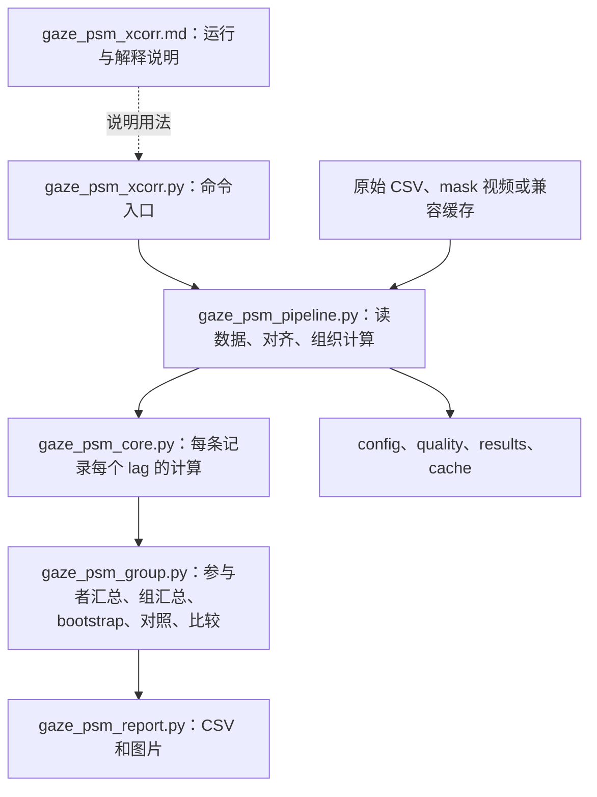

# Gaze delay：代码、公式和所有输出字段的通俗说明

适用版本：2026-10-30 的 gaze/PSM 数值分析及 `outputs/gaze_psm_xcorr` 完整结果。数值复核时五个原脚本与 `code_snapshot` 一致，统一换行符后也与 provenance 哈希一致。随后按照可读性要求更新了绘图：`gaze_psm_report.py` 的数值导出函数保留，绘图委托给新增的 `gaze_psm_figures.py`；原始分析快照没有覆盖。

当前图片的尺度、布局及结论图建议见：[图片可读性与结论图指南](gaze_psm_figures_guide_zh.md)。

配套阅读：[结果复核报告](gaze_psm_results_audit_zh.md)。本文讲“怎样算、每个数是什么意思”，配套报告讲“现有数值能否复现、可以得出什么结论”。

## 1. 先用一句话理解它在算什么

**把视线轨迹与器械轨迹在时间上前后错开，寻找“变化形状最相似”的错开量。**

`xcorr` 是 cross-correlation 的缩写，中文叫“互相关”。可以想成把两条透明胶片上的轨迹沿时间轴来回滑动，每滑到一个位置就打一个相似度分数。

例如：眼睛先向右移动，0.34 秒后器械也出现相似的向右变化。如果这样错开后整段轨迹最相似，程序可能给出 `peak_lag_s ≈ +0.34`。

这里的 gaze 是原始有效视线采样点，PSM 是器械分割掩膜的整体质心。“相似的轨迹变化”不自动意味着视线与器械尖端到达同一个点，也不等于识别出一次 fixation。程序没有做 fixation 分类、事件首次到达识别或因果分析。

### 1.1 延迟正负号：这份代码最容易读反的地方

程序比较的是：

$$
G(t)\quad\text{与}\quad P(t+\tau)
$$

也可以把器械时间记成 $u$，写成：

$$
G(u-\tau)\quad\text{与}\quad P(u).
$$

| `peak_lag_s` | 直观含义 |
|---|---|
| `+0.34` | 较早的 gaze 与晚 340 ms 的 PSM 最相似，即 gaze 轨迹领先 |
| `-0.17` | 较晚的 gaze 与早 170 ms 的 PSM 最相似，即 gaze 轨迹滞后 |
| `0` | 最相似的位置在零错开量附近，时间分辨率内近似同步 |

因此，如果使用“gaze delay”这个名称，要同时写出正负号定义；日常语言中的“正延迟”有时被理解为 gaze 更晚，与本程序的约定相反。

**`r` 的正负与 `lag` 的正负是两件事。** `r>0` 说的是两条轨迹同向变化；`lag>0` 才说 gaze 在时间上更早。

### 1.2 一行真实结果怎么读

Task A、右器械、整任务、position：

```text
peak_lag_s       = 0.3414634146
peak_r           = 0.4892701649
peak_lag_ci_low  = 0.2682926829
peak_lag_ci_high = 0.4390243902
n_stable_users   = 11
```

意思是：11 位新手按参与者等权汇总后，位置变化最相似的错开量约为 **gaze 领先 341 ms**；按参与者重新抽样得到的 95% 峰值区间约为 **268～439 ms**；最高相关系数约 **0.489**。它没有说“48.9% 的时间眼睛看着器械”，也没有说“每个人都提前 341 ms”。

## 2. 六个文件分别负责什么

用户列出的文件中，五个是 Python 脚本，一个是已有的英文 Markdown 使用说明。



### 2.1 `tools/gaze_psm_xcorr.py`：薄薄的一层入口

| 函数 | 作用 |
|---|---|
| `main(argv)` | 把命令行参数交给 `pipeline.main`；真正的计算在其他文件 |
| `xcorr(gaze, psm, hz, max_lag, min_pairs)` | 兼容旧调用方式；返回 `lag_s, r, pairs` |
| `interpolate(...)` | 调用 pipeline 的有效点插值函数 |
| `centroids(...)` | 调用 mask 视频解码，返回质心坐标和宽、高 |

`xcorr()` 将最少点数换算为 `min_pairs/hz` 秒；把两个 RMS 阈值设为零，并关闭空间距离计算。**它不等同于完整 CLI 的默认配置**：完整流程默认还要求位置变化至少达到 1 px，并包含阶段、空间检查和统计汇总。

文件开头把仓库根目录加入模块搜索路径，使 `python tools/gaze_psm_xcorr.py` 能找到 `tools` 下的模块。

### 2.2 `tools/gaze_psm_pipeline.py`：数据加工与总调度

可以把它理解为“把不同来源的数据整理到同一张时间表，然后叫其他模块工作”。

| 函数或常量 | 具体作用 |
|---|---|
| `CACHE_VERSION = 4` | 当前缓存版本，避免直接复用受旧输入解析问题影响的 gaze |
| `EMPTY_STAGES` | 空、`none`、`nan`、`null` 不作为有效动作阶段 |
| `read_rows` / `number` | 读取 CSV；把坐标文本变成数值，空值变成缺失 |
| `timestamp_ns` | 直接用整数或 Decimal 读取纳秒；支持科学计数法；拒绝非整数纳秒和非有限值 |
| `status_code` | 将 `2`、`2.0`、`2e0` 识别为同一个状态码 |
| `normalized_stage` | 阶段名转小写、去首尾空格、合并多余空格 |
| `timeline` | 删除标为 `IsDelete` 的时间戳行，检查时间严格递增、帧号唯一 |
| `stage_frames` | 按 `Frame_Number` 连接阶段标签；给每次连续出现分配 occurrence ID |
| `interpolate_valid` | 只在有效点之间做短间隔线性插值，不填长空档 |
| `smooth_valid` | 在每段连续有效数据内做居中的奇数窗口均值平滑 |
| `decode_mask` | 逐帧读取左右器械 mask，二值化，提取质心与面积 |
| `source_files` / `fingerprint` | 列出输入依赖；依据路径、大小、修改时间及提取参数生成缓存标识 |
| `extract` | 缓存检查、时钟对齐、像素换算、插值、平滑、质量统计和缓存保存 |
| `curve_inputs` | 选择 position；或差分得到 velocity，并按差分时间中点匹配阶段 |
| `calculate` | 为左右器械、两种信号、整任务和各阶段调用 `analyze_curve`；也支持异人 gaze |
| `json_ready` / `save_json` | 把 NumPy 数据转为 JSON；把 NaN/Infinity 写成标准 JSON 的 `null` |
| `_extract_job` | 单条记录提取；将可预期的读取/格式错误记录到 quality |
| `_init_analysis_worker` / `_observed_job` / `_null_job` | 工作进程初始化、真实配对计算、异人配对计算 |
| `parse_args` | 命令行参数与合法性检查 |
| `main` | 选择记录、确定采样率、组织并行工作、抽异人配对、统计汇总和输出 |

`main` 返回 0 表示流程没有记录级提取错误；返回 1 表示至少有提取错误。**没有提取错误也可能有无法计算的阶段或不可靠的峰值**，需要继续查看各曲线的支持情况和状态。

### 2.3 `tools/gaze_psm_core.py`：单条记录的数学核心

| 函数 | 作用 |
|---|---|
| `_fft_statistics` | 利用 FFT 快速算每个错开量的有效配对数、中心化交叉乘积和两边的平方变化量 |
| `analyze_curve` | 组织整任务/阶段、缺失值、变化阈值和空间检查，返回一整条曲线 |

core 不负责挑峰、不计算组统计，也不作显著性判断。它回答：“这条记录在这个条件下，每个 lag 的 `r`、有效点数、距离分别是多少？”

### 2.4 `tools/gaze_psm_group.py`：以人为单位的统计

| 函数 | 作用 |
|---|---|
| `GROUP_FIELDS` / `_key` | 用任务、左右器械、信号、阶段、分析模式标识一个条件 |
| `_mean` | 忽略缺失值的普通均值；用于距离等指标 |
| `fisher_mean` | 忽略缺失值的等权 Fisher-z 相关系数均值 |
| `_quantiles` | 取 2.5% 和 97.5% 分位数 |
| `_peak` | 找最大有符号 `r` 对应的 lag；判断是否达到搜索端点 |
| `_validate_lags` / `_field` | 检查不同曲线的 lag 网格和数组长度一致 |
| `_participant_curves` | 一个参与者的多条记录先等权汇总，并计算固定记录敏感性曲线 |
| `_bootstrap_curves` | 按参与者有放回重抽，生成曲线区间、峰值分布和边界频率 |
| `_group_curve` | 选完整 lag 窗口都有效的参与者，形成组曲线和相关诊断 |
| `_contrasts` | 同一批参与者的 A/C 对比，以及同任务不同阶段的配对对比 |
| `aggregate` | 总入口；返回参与者曲线、组曲线、配对比较，并处理异人参考 |

“新手是独立统计单位”落实在这里。33 条 A 记录和 51 条 C 记录不是 84 个互相独立的人。

### 2.5 `tools/gaze_psm_report.py`：保存与画图

可读性更新后，下表的绘图辅助函数由 `gaze_psm_figures.py` 实现，在 report 中保留原名称的导入；数值 CSV 导出仍由 report 负责。新增 `generate_figures` 统一生成主图、个人诊断图、空间变化量和峰值区间汇总图。

| 函数或常量 | 作用 |
|---|---|
| `META` / `LAG_FIELDS` | 定义 CSV 中的身份/条件字段与随 lag 变化的字段 |
| `_value` / `_write` | 将列表等转成 CSV 单元格内容并写文件 |
| `_long_rows` | 将一条包含 165 个 lag 的曲线展开为 165 行 |
| `_summary` | 保留已有组/个人峰值；为记录级曲线补算峰值和峰值处支持数 |
| `_matches` / `_finite` / `_task_order` | 筛选条件、检查有无有效值、确定图中任务顺序 |
| `_decorate` / `_curve_panel` / `_save` | 坐标轴、单面板、保存；部分记录运行的图片会加水印 |
| `_whole_figures` / `_stage_figures` | 整任务与阶段曲线 |
| `_spatial_figures` | 空间距离和接近比例曲线 |
| `_record_figures` | 每条记录的峰值散点；空心表示端点峰值 |
| `_paired_figures` | 同一位新手在 A、C 两任务的个人峰值连线 |
| `_bootstrap_figures` | 整任务组峰值 lag 的 bootstrap 直方图 |
| `generate_outputs` | 导出全部 CSV；按参数选择是否画图 |

这个文件主要改变呈现方式。注意 `_paired_figures` 画的是**个人峰值**，`contrasts.csv` 比较的是**共享参与者的两条组曲线峰值**，二者不是同一个统计量。

### 2.6 `tools/gaze_psm_xcorr.md`：已有英文说明

它不是 Python，不会被执行，也不生成数据。它说明启动命令、延迟正负号、输入同步、阶段定义、参与者权重、bootstrap、异人参考、输出及缓存迁移。本文对这些内容补充中文解释、实际公式、字段字典与数值例子。

## 3. 数据是怎样变成两条轨迹的

### 3.1 选谁、读什么

从 `Index/content_index.csv` 按 `src_skill`、`Task Name` 和可选的记录 ID 筛选。当前结果是 A/C 两任务的 novice：A 33 条、C 51 条，共 11 人。

每条记录的主要输入：

```text
Active_Data/<user>/csv/<id>_video_ts.csv          视频帧时间
Active_Data/<user>/csv/<id>_gaze.csv              原始 gaze（默认）
Active_Data/<user>/npy/<id>_gaze.csv              阶段；也可选作 gaze 来源
Active_Data/<user>/sam/<id>/mask/obj_psm_l.mp4    左器械 mask
Active_Data/<user>/sam/<id>/mask/obj_psm_r.mp4    右器械 mask
```

`side=l/r` 是左右器械，不是双目摄像头的左右眼。

### 3.2 时间换算

先在整数纳秒上做减法，再转为秒：

$$t_i=(T_i-T_0)/10^9.$$

绝对时间戳约有 19 位，先变成浮点数可能丢失末尾精度。当前实现对科学计数法用 Decimal 解析，不经过浮点中间值。`Status=2.0` 与 `Status=2` 等价。两项都是本次主结果此前已经修复的问题。

视频保留帧必须时间递增、帧号唯一；阶段按帧号连接，不能用已经四舍五入的 allocation 时间戳替代原始视频时钟。mask 解码帧数与保留时间戳数量不一致时，整条记录报错，不直接截短。

### 3.3 gaze 从归一化坐标变成像素

默认读取 `norm_x`、`norm_y`，接受指定状态码，排除非有限值和超出 `[0,1]` 的点。对于宽 $W$、高 $H$ 的图：

$$G_x=W\cdot\mathrm{norm\_x},\qquad G_y=H\cdot\mathrm{norm\_y}.$$

当前 84 条记录的 mask 分辨率均为 `1280×1024`。例如 `(0.5,0.25)` 被换算为 `(640,256)` px。

默认图像坐标 y 向下；若显式启用 `--flip-gaze-y`，则使用 $G_y\leftarrow H-G_y$。代码采用 $W,H$ 缩放，并允许边界坐标等于 $W,H$；不是按 $W-1,H-1$ 缩放。实际 gaze 坐标约定和空间注册仍需对照原始采集系统确认。

选择 allocation 像素 gaze 时要同时明确 `--gaze-source allocation --gaze-units pixels`。列名叫 `gaze_x` 并不能证明单位是像素。

### 3.4 mask 如何得到 PSM 位置

灰度值大于 127 的像素变成 1，其余为 0，得到二值掩膜 $M(x,y)$。默认前景面积少于 10 px 时，该帧位置缺失。

$$
A=\sum_{x,y}M(x,y),\qquad
P_x=\frac{\sum_{x,y}xM(x,y)}{A},\qquad
P_y=\frac{\sum_{x,y}yM(x,y)}{A}.
$$

通俗说：把所有白色像素的横坐标平均、纵坐标平均，得到白色区域的“重心”。这与 OpenCV 的图像矩定义一致。[OpenCV Moments 文档](https://docs.opencv.org/4.x/d8/d23/classcv_1_1Moments.html)

所有前景连通块都参与平均；代码没有只取最大块，也没有找尖端。因此遮挡、误分割、器械伸缩或轮廓变化，都可能改变质心。

### 3.5 对齐到统一时间格子

当前结果使用 $f_s=41$ Hz：

$$t_n=n/41.$$

相邻格子相差约 **24.39 ms**。每条记录的真实视频帧率不同，统一网格不表示原始视频恰好都是 41 fps。

若两个有效观测时间为 $t_a<t<t_b$，线性插值为：

$$X(t)=X_a+\frac{t-t_a}{t_b-t_a}(X_b-X_a).$$

可以想成在两个已知点之间画直线，估计中间位置。仅当两端有效点相隔不超过 `max_gap=0.1 s` 时填充；不外推。恰好落在有效观测时间的点即使旁边有长空档，也保留原值。重复时间取排序后第一个点。

无效点先被排除，所以**短暂无效区间可能由其两端有效点插值填补**；“不跨长缺口”不等于“一切无效行都完整保留为空”。

阶段标签使用当前位置之前最近的视频帧标签，超过 `max_gap` 仍无更新时标为无阶段；标签不做数值插值。

### 3.6 平滑和速度

平滑窗口点数：

$$w=\max(1,\operatorname{round}(\mathrm{smooth\_ms}\cdot f_s/1000)).$$

若 $w$ 是偶数再加 1，保证居中。当前 `80 ms × 41 Hz = 3.28`，得到 **3 点均值窗口**，按 $w/f_s$ 的窗口长度约 73.17 ms，最早与最晚采样点相距约 48.78 ms；不是恰好执行 80 ms 的连续时间滤波。

$$\widetilde X_n=\frac{1}{w}\sum_{h=-(w-1)/2}^{(w-1)/2}X_{n+h}.$$

它在连续有效段内计算，段端点使用最近值补齐；不跨缺失段。**平滑按有效段切分，没有在每个阶段边界重新开始**，因此阶段边界附近可能用到相邻阶段的点。居中平滑使用前后信息，适合离线分析，不应当作在线预测。

position 用平滑后的位置；velocity 用它们的差分：

$$V_n=(\widetilde X_{n+1}-\widetilde X_n)f_s.$$

速度是带方向的二维向量 `(vx,vy)`，单位 px/s，不是只保留大小的 speed。速度对应区间中点 $(t_n+t_{n+1})/2$，阶段也按这个中点匹配。

## 4. xcorr 的完整公式

### 4.1 “错开几格”与“错开几秒”

设整数错开量为 $k$，则：

$$\tau_k=k/f_s,\qquad k=-K,\ldots,K,\qquad K=\operatorname{round}(\mathrm{max\_lag}f_s).$$

当前 `max_lag=2 s`、`hz=41`，所以 $K=82$，共有 **165 个 lag**，从 -2 到 +2 秒；零点为第 83 个点（Python 索引 82）。没有在峰值附近做连续时间拟合或亚采样精度优化。

在 lag $k$ 上，比较 $G_{u-k}$ 和 $P_u$。当 $k=14$ 时，就是 gaze 与晚 14 格的 PSM 比，$14/41\approx0.34146$ 秒。

### 4.2 三种分析模式决定“允许哪些配对”

| `mode` | 配对规则 | 研究问题 |
|---|---|---|
| `whole` | 整条记录当作一个 occurrence，只要两边有效且没越界 | 整个任务的典型时间对应 |
| `psm_stage` | PSM 时间 $u$ 必须在指定阶段；gaze 时间 $u-k$ 可在阶段外 | 当器械处于该阶段时，对应 gaze 可早/晚多少 |
| `within_stage` | PSM 与 gaze 时间都必须在**同一次连续出现**的该阶段内 | 只看同片段内部时，结果是否仍成立 |

例如 transfer 从 10 s 开始：在 `psm_stage` 下，10.1 s 的 PSM 可以配 9.6 s 的 gaze；`within_stage` 不允许这对跨阶段样本。

一个阶段可能反复出现。每次连续出现单独分配 ID，不把几个片段首尾拼接。中间没有同一阶段的时间，也不会被误当成紧邻时间。

### 4.3 每个 occurrence、每个 lag 都重新求平均

设第 $j$ 次阶段出现，在 lag $k$ 下符合条件的 PSM 索引集合为 $I_{j,k}$，有效配对数为 $n_{j,k}$。两边的 x、y 任一个缺失，这对都不参与。若某次出现少于 2 对，整个 occurrence 在这个 lag 上不贡献统计量。

$$
\bar G_{j,k}=\frac{1}{n_{j,k}}\sum_{u\in I_{j,k}}G_{u-k},\qquad
\bar P_{j,k}=\frac{1}{n_{j,k}}\sum_{u\in I_{j,k}}P_u.
$$

再计算相对于各自平均位置的变化：

$$g_{j,u,k}=G_{u-k}-\bar G_{j,k},\qquad p_{j,u,k}=P_u-\bar P_{j,k}.$$

这样做是在问“它们相对于各自中心怎样移动”，而不是“它们的绝对位置是否相等”。均值是每个坐标单独求的，也会随 lag 的有效重叠范围改变。

### 4.4 把 x/y 和各 occurrence 的变化量汇总，再归一化

$$
C_k=\sum_j\sum_{u\in I_{j,k}}g_{j,u,k}\cdot p_{j,u,k},
$$

$$
V_{G,k}=\sum_j\sum_{u\in I_{j,k}}\|g_{j,u,k}\|^2,\qquad
V_{P,k}=\sum_j\sum_{u\in I_{j,k}}\|p_{j,u,k}\|^2,
$$

$$\boxed{r_k=\frac{C_k}{\sqrt{V_{G,k}V_{P,k}}}}.$$

其中点积 $g\cdot p=g_xp_x+g_yp_y$；平方长度 $\|g\|^2=g_x^2+g_y^2$。公式可以理解为：**同向变化的总量，除以两边各自变化大小的尺度**。

这些 $V$ 是中心化平方和；代码不是先除以 $n-1$ 求样本方差。对于相关系数，分子分母的共同样本尺度会抵消。各片段先分别中心化，再汇总，避免片段间不同的平均位置制造虚假的共同变化。

| `r` | 意思 |
|---|---|
| 接近 +1 | 变化方向和形状高度一致 |
| 接近 0 | 这种线性轨迹对应较弱；不代表所有可能关系都不存在 |
| 接近 -1 | 主要呈反向变化 |

它不是“x 的相关系数与 y 的相关系数各占一半”。某方向或片段变化更大，会在平方和中贡献更多；因此**occurrence 并非等权平均**。等权记录、等权参与者发生在后面的 group 层。

### 4.5 一个能手算的小例子

零 lag 下，假设三对位置是：

```text
gaze: (0,0),   (1,0),   (2,0)
PSM:  (200,0), (201,0), (202,0)
```

两边平均分别为 `(1,0)`、`(201,0)`；去掉各自平均后，都变成 `(-1,0),(0,0),(1,0)`。于是 $C=2,V_G=2,V_P=2$，$r=1$。

但每对点仍相隔 **200 px**。如果接近阈值为 50 px，接近比例就是 0。这个例子解释了为什么不能只凭较高 `r` 就说“眼睛看到了器械之后会到的位置”。

### 4.6 最少支持与 RMS 阈值

$$N_k=\sum_j n_{j,k},\qquad
\mathrm{gaze\_rms}_k=\sqrt{V_{G,k}/N_k},\qquad
\mathrm{psm\_rms}_k=\sqrt{V_{P,k}/N_k}.$$

RMS 表示去掉每段均值后的典型变化幅度；position 单位是 px，velocity 单位是 px/s。它不表示平均 gaze 坐标、平均速度或 fixation 稳定性。

只有同时满足以下条件才填写 `r`：

1. $N_k\ge\max(2,\lceil\mathrm{min\_overlap}\cdot f_s\rceil)$。
2. 两边 RMS 都达到配置的最低值。
3. 分母大于浮点数的极小阈值，能正常归一化。

当前整任务要求至少 **205 对**（5 s × 41 Hz），阶段要求至少 **82 对**（2 s × 41 Hz）；位置两边 RMS 至少 1 px，速度两边至少 1 px/s。阶段门槛作用于所有 occurrence 的合计，不要求每个片段都满 2 秒。

`pairs/hz` 是有效网格样本量对应的时间，不表示它们一定连续，也不表示有这么多独立观测。插值和平滑后的邻近点存在依赖。

无效结果填 `NaN`，在标准 JSON 中保存为 `null`；不填成相关系数 0。0 是一个有效的“无明显线性相关”数值。

### 4.7 FFT 为什么不会改变公式

FFT 是快速求和的方法，不表示这里最终报告的是频率或相位角。定义：

$$\mathcal C(a,b;k)=\sum_u a_u b_{u-k}.$$

对无效样本置零，并使用有效性掩码 $m_P,m_G$，可以得到每个坐标的：

$$n=\mathcal C(m_P,m_G;k),\quad S_G=\mathcal C(m_P,G;k),\quad S_P=\mathcal C(P,m_G;k),$$

$$C=\mathcal C(P,G;k)-S_GS_P/n,$$

$$V_G=\mathcal C(m_P,G^2;k)-S_G^2/n,\qquad
V_P=\mathcal C(P^2,m_G;k)-S_P^2/n.$$

x、y 的 $C,V$ 分别相加，再按前述公式计算。实现还先减去一个方便的固定偏移，减小大数相减的误差；之后仍按各 lag 的真实重叠范围中心化。计数的 FFT 浮点误差会通过四舍五入恢复为整数。

`scipy.signal.correlate` 本身提供的是求和运算；本项目另外实现了有效样本、中心化与归一化。[SciPy correlate 定义](https://docs.scipy.org/doc/scipy/reference/generated/scipy.signal.correlate.html)

### 4.8 峰值怎么选

$$\widehat\tau=\operatorname*{argmax}_{\tau_k}r_k,\qquad
\mathrm{peak\_r}=r(\widehat\tau).$$

选择最大**有符号**相关系数，不选最大的绝对值。例如 `r=-0.9` 不会胜过 `r=+0.2`。如果全部值为负，仍可返回其中最大的负值；程序状态正常不代表存在正向关联。

完全并列时，NumPy 返回第一个最大值，即 lag 较小的那个。宽而平的峰、多个峰或小数值波动都可能影响选出的格点，所以应看整条曲线与峰值分布。

若最大值在 -2 或 +2 秒端点，标为 `boundary_peak`：说明在当前搜索范围内最优点碰到了边，不能认定真实延迟恰好是 2 秒。

## 5. 空间指标怎样算

与 xcorr 使用相同的有效配对、相同的 lag 和 occurrence 筛选，但**不减去各自平均位置**：

$$d_{u,k}=\sqrt{(G_{x,u-k}-P_{x,u})^2+(G_{y,u-k}-P_{y,u})^2}.$$

记录级输出：

$$D_k=\operatorname{median}(d_{u,k}),\qquad
Q_k=\frac{\#\{d_{u,k}\le R\}}{N_k},\quad R=50\ \mathrm{px}.$$

`distance_median_px` 越小表示在图像上越接近，`proximity` 越大表示更多配对落在给定半径内。`proximity=0.04` 就是 4%，不是 0.04%。

这里所谓“原图坐标”是**未中心化的像素坐标**。实际传给 core 的是**平滑后的** gaze 和 PSM；并不是缓存中名为 `gaze_raw_*`、`psm_raw_*` 的未平滑数组。

位置相关与距离都使用该 occurrence 至少两对的配对，但空间值在 `r` 因总支持不足或 RMS 太小而无效时也可能存在。组汇总只使用 `r` 有效的记录；不能绕开支持条件，仅凭某个距离值解释该曲线。

组距离的计算顺序是：**每条记录求中位数 → 同一参与者的记录求普通均值 → 参与者间求普通均值**。`proximity` 使用同样的两级普通平均。它们不是把所有样本混在一起后的中位数/比例，也不使用 Fisher-z。

`spatial_at_peak_px` 和 `proximity_at_peak` 在**同一个组 xcorr 峰值 lag** 上取值；`*_at_zero*` 在零 lag 上取值。程序没有为距离另外搜索最小值，也没有在每条记录各自最优 lag 处取距离再汇总。速度曲线不输出这些空间解释，相关字段为空是设计行为。

## 6. 从记录到个人，再到组：平均方式与权重

### 6.1 为什么用 Fisher-z

相关系数被限制在 -1～+1，代码先变换，再平均，再变回去：

$$z(r)=\operatorname{atanh}(r)=\frac12\ln\frac{1+r}{1-r},$$

$$\mathrm{FisherMean}(r_1,\ldots,r_m)=\tanh\left(\frac1m\sum_{i=1}^{m}z(r_i)\right).$$

为避免 $r=\pm1$ 产生无穷大，先裁剪到 $[-0.9999999,0.9999999]$；缺失值不给权重。这里只用变换做均值，没有套用普通独立样本 Pearson 检验得到 p 值。

### 6.2 两级平均

先把参与者 $i$ 的记录 $a$ 在 lag $k$ 的相关汇总：

$$r_{i,k}=\tanh\left[\frac{1}{m_{i,k}}\sum_{a\text{ 有效}}\operatorname{atanh}(r_{i,a,k})\right].$$

再对主分析选定的 $n$ 位参与者：

$$r_{\mathrm{group},k}=\tanh\left[\frac1n\sum_{i=1}^{n}\operatorname{atanh}(r_{i,k})\right].$$

同一个人做 5 条记录，另一个人做 3 条，在组层面仍各占一份。记录长短、有效点数、`pairs` 都不用于提高其个人或组层面的权重。

**先平均曲线再找组峰值**，不是先取每条记录峰值再平均，也不是平均每个人的峰值时间。

### 6.3 固定参与者与固定记录敏感性

主组曲线只采用在**全部 165 个 lag** 上都有有效个人曲线的人，人数是 `n_stable_users`。每个 lag 使用所有当前可用个人曲线的结果另存为 `r_available`，人数是随 lag 变化的 `n_users`。

但某个人可能在负 lag 用记录 1、在正 lag 用记录 2，个人曲线仍处处有效。为显示这种影响，另算：

- `r_fixed_records`：每个人只保留所有 lag 都有效的记录，再汇总。
- `r_primary_fixed_record_users`：只选固定记录敏感性分析中同一批人，保留他们原来的个人主曲线，再汇总。

比较这两条曲线，可以在参与者集合相同的前提下查看“可用记录换来换去”的影响。`record_support_changes=True` 表示至少一条记录的有效状态随 lag 改变；即使每个 lag 的记录数量相等，也可能发生记录替换。

**主分析固定了人，不一定固定了每个人的记录。** `stable` 说的是数据支持完整，不表示这个人的行为或峰值稳定。

## 7. bootstrap、异人参考、条件对比

### 7.1 参与者 bootstrap

若某条件有 11 位稳定参与者，每轮有放回抽取 11 个身份，例如抽到某人两次、漏掉另一个人。用抽中的整条个人曲线重建组曲线，重新找峰；当前重复 1000 次。

$$r_k^{*(b)}=\tanh\left[\frac1n\sum_{h=1}^n\operatorname{atanh}(r_{I_h^{(b)},k})\right],\qquad
\tau^{*(b)}=\operatorname*{argmax}_{\tau_k}r_k^{*(b)}.$$

$$\mathrm{CI}_{\tau}=[Q_{2.5\%}(\tau^*),Q_{97.5\%}(\tau^*)].$$

每个 lag 的 `r_ci_low/high` 也是 1000 条曲线在该 lag 的 2.5%/97.5% 分位数。区间采用百分位法，与[bootstrap 的有放回重抽和百分位区间定义](https://docs.scipy.org/doc/scipy/reference/generated/scipy.stats.bootstrap.html)一致；本项目自行实现，没有调用 SciPy 的 BCa 默认算法。

区别要记清：

| 输出 | 回答的问题 |
|---|---|
| `r_ci_low/high` | 在某个固定 lag 上，组相关系数对参与者重抽有多敏感 |
| `peak_lag_ci_low/high` | 每次重新找最大值后，峰值时间落在哪些位置 |
| `bootstrap_peak_lag_s` | 1000 次峰值时间的完整分布，有没有多峰或端点堆积 |
| `boundary_frequency` | 重抽峰值落在搜索两端的比例 |

曲线阴影是逐点区间，不是整条曲线同时有 95% 覆盖保证的区间；不能把阴影直接当作峰值时间区间。峰值 CI 跨零时，领先/滞后的方向仍不确定。11 人的百分位 bootstrap 和峰值估计都可能不稳定，应结合分布读。

这个区间也不是“95% 的参与者个人提前时间落在这里”。抽样对象是参与者，目标统计量是组曲线峰值；当前实现没有另外在每个人内部重抽记录或时间点。

分位数默认在线性插值后取值，所以 CI 端点可能不是 24.39 ms 的整数倍；这不表示原始峰值估计有更高时间分辨率。

### 7.2 同任务、不同参与者的参考配对

对每条真实 PSM 记录：先从其他同任务参与者中等概率挑一个人，再从其同任务记录里挑一条 gaze。每条记录单独抽取，允许重复使用 donor；这不是要求一对一的全局洗牌。

donor 的 gaze 按目标图像宽高缩放，按“各自记录开始后的经过时间”对齐，不拉伸时长、不循环、不外推；donor 短于目标时，后半段留空。阶段仍由目标 PSM 时间定义。异人参考关闭空间指标。

当前重复 100 次，每次同样做记录→个人→组汇总、同样搜索全部 lag。只接受完整保留真实组的稳定参与者集合且全 lag 有效的参考轮次；因此 `n_null_replicates` 可能少于 100。

每轮记最大相关：

$$M_b=\max_k r_{\mathrm{unpaired},k}^{(b)}.$$

输出：

$$\mathrm{null\_peak\_r\_95}=Q_{95\%}(M_b),$$

$$\boxed{\mathrm{null\_peak\_p}=\frac{1+\#\{M_b\ge\mathrm{peak\_r}_{\mathrm{observed}}\}}{B_{\mathrm{有效}}+1}}.$$

例如 100 次都没有超过观察峰值，得到 $1/101\approx0.0099$。若只有 74 次有效，最小为 $1/75\approx0.0133$。它没有精确到任意小 p 值的能力。

`null_r_low/high` 是异人组曲线每个 lag 的 95% 参考范围；`null_peak_r_95` 是各轮**最大值**的 95% 分位，二者不同。后者考虑了同一 lag 窗口里寻找最高点的操作。

这个 `p` 是针对既定异人配对方案的经验尾部比例。它说明真实配对的轨迹关联是否比异人参考强；**它不检验 lag 是否大于零，也不能当作“gaze 领先概率”或严格通用的独立性/因果检验**。任务结构、记录时长差异与参考轮次筛选都会影响它。

### 7.3 配对条件差异

两种条件先取共同且全 lag 有效的参与者；两边各用这批人重建组曲线、找峰。定义：

$$\Delta\tau=\widehat\tau_b-\widehat\tau_a.$$

当前 A/C 对比为 **C−A**；阶段对比为文件写明的 `condition_b − condition_a`，不是按动作先后自动命名。内部条件按排序组织，读表必须看字段。

每轮 bootstrap 使用**同一组抽中的身份**同时重建 a、b 两条件，再相减：

$$\Delta\tau^{*(b)}=\widehat\tau_b^{*(b)}-\widehat\tau_a^{*(b)}.$$

最后取差值分布的 2.5%/97.5%。它不是“CI 上下限互相相减”，也不是“各人的两个峰值之差再平均”。

只比较同侧器械、同种信号、同种模式；A/C 仅做整任务比较，阶段比较只在同一任务内进行。阶段对比很多，当前没有多重比较校正，不能把每个名义 95% 区间都当作已控制整体错误率的确认性结论。

## 8. 输出文件怎么找、每一行是什么

| 文件 | 一行或内容代表什么 |
|---|---|
| `record_curves.csv` | 一条记录 × 一个条件 × 一个 lag |
| `record_summary.csv` | 一条记录 × 一个条件的峰值与状态 |
| `novice_curves.csv` | 一位参与者 × 一个条件 × 一个 lag |
| `novice_summary.csv` | 一位参与者 × 一个条件的峰值与记录支持 |
| `group_curves.csv` | 一个组条件 × 一个 lag |
| `group_summary.csv` | 一个组条件的峰值、区间、空间值、参考统计 |
| `contrasts.csv` | 一对条件的配对峰值差与区间 |
| `bootstrap_peaks.csv` | 一个组条件 × 一轮 bootstrap 的峰值 lag |
| `bootstrap_contrasts.csv` | 一对条件 × 一轮 bootstrap 的峰值差 |
| `unpaired_peaks.csv` | 一个组条件 × 一轮有效异人参考的最大 r |
| `quality.csv` / `quality.json` | 每条记录的提取状态与覆盖率等质量诊断 |
| `config.json` | 这次运行实际采用的配置，不应只参考 CLI 默认值 |
| `results.json` | 记录、个人、组、比较的完整数据与数组 |
| `cache/<id>.npz` | 对齐前后轨迹、阶段、mask 面积、质量信息和缓存标识 |
| `figures/` | 当前绘图版共 19 张 PNG 与对应 PDF；范围和比较分组见 `axes.json` |
| `code_snapshot/` / `rerun_provenance.json` | 保存的执行代码与重跑来源说明；不由普通 CLI 每次自动生成 |
| `validation.json` | 此前重跑时单独生成的验证记录，不是本次审计的替代 |
| `audit_20261030.json` | 本次独立复核脚本生成的检查范围、数量和结果 |
| `interpretation/interpretation_zh.md` | 此前对修复后结果的中文解读；不是原始观测 |

当前共有 **2664 条记录条件曲线、776 条参与者条件曲线、80 条组条件曲线、132 项条件比较**。每条曲线有 165 个 lag；2664 不代表 2664 段独立实验。

### 8.1 身份、条件与支持字段

| 字段 | 含义 |
|---|---|
| `content_id` | 一条记录的 ID，例如 `User1_1_1` |
| `user` | 参与者 ID，当前从记录名第一个下划线之前提取 |
| `task` | A 或 C；任务对比中可为 `paired` |
| `side` | `l` 左器械，`r` 右器械 |
| `signal` | `position` 位置或 `velocity` 二维速度 |
| `stage` | 阶段名；`__whole__` 表示整任务；阶段比较中可为 `paired` |
| `mode` | `whole`、`psm_stage`、`within_stage`，规则见第 4.2 节 |
| `record_ids` | 此参与者此条件下组织进来的全部记录 ID；并不保证每个 lag 都有贡献 |
| `n_records` | 此 lag 有效记录数；个人级为该人的记录数，组级为主分析选定人的有效记录数合计 |
| `pairs` | 有效配对网格点数；个人/组层面为其支持记录的求和，不是统计权重 |
| `occurrences` | 至少有两对有效点、实际贡献的 occurrence 数；个人/组级求和 |
| `n_users` | 该 lag 所有可用个人曲线的人数，对应 `r_available` 的支持，而非必然对应主 `r` |
| `stable_users` / `n_stable_users` | 整个 lag 窗口都有效、用于主组曲线的人及人数 |
| `excluded_partial_users` | 此条件中无法支持全部 lag、未纳入主组曲线的人 |
| `stable_record_ids` / `n_stable_records` | 个人层面全 lag 有效的记录及数量 |
| `fixed_record_users` / `n_fixed_record_users` | 主组稳定人群里具有全 lag 有效记录、可进入固定记录敏感性分析的人及人数 |
| `record_support_changes` | 记录有效性是否随 lag 改变；组级表示入选人群中是否有人发生这种改变 |

整任务通常只有一个 occurrence，因此 `occurrences` 多数对应有支持记录的数量；阶段可能有很多次 occurrence。少于两对的片段不计入 `pairs/occurrences`。

### 8.2 曲线、峰值、空间与不确定性字段

| 字段 | 含义/单位 |
|---|---|
| `lag_s` | 本行尝试的错开量，单位秒 |
| `r` | 当前层级的主相关系数，无单位 |
| `gaze_rms` / `psm_rms` | 记录级为中心化 RMS；个人/组级为按层级普通平均后的 RMS，非汇总平方和重新开方 |
| `distance_median_px` | 记录级中位配对距离；个人/组级为其两级均值，px |
| `proximity` | 在配置半径内的配对比例；个人/组级按两级均值，0～1 |
| `r_available` | 每个 lag 使用所有可用人的 Fisher-z 组均值，诊断用途 |
| `r_fixed_records` | 固定全 lag 支持记录后的敏感性曲线 |
| `r_primary_fixed_record_users` | 在固定记录敏感性分析的同一人群上重算的主曲线 |
| `r_ci_low` / `r_ci_high` | 每个 lag 上组 r 的 bootstrap 逐点 95% 区间 |
| `peak_lag_s` | 最大有符号 r 所在的 lag，秒 |
| `peak_r` | 曲线最大有符号 r，不是 lag 的显著性 |
| `peak_at_boundary` | 峰值是否在整个设定 lag 网格的第一个或最后一个点 |
| `pairs_at_peak` / `occurrences_at_peak` | 记录峰值 lag 处的配对数/片段数；由 report 为记录 summary 补算 |
| `peak_lag_ci_low` / `peak_lag_ci_high` | 重新抽参与者并找峰后的 lag 95% 百分位区间，秒 |
| `n_bootstrap` | 为该组配置的 bootstrap 次数；数据不足时不一定真的生成这么多峰值 |
| `bootstrap_peak_lag_s` | JSON 中保存的完整 bootstrap 峰值数组 |
| `boundary_frequency` | 有效 bootstrap 峰值落在搜索端点的比例，0～1 |
| `spatial_at_zero_px` / `spatial_at_peak_px` | 组距离曲线在零 lag/主组峰值 lag 的值，px |
| `proximity_at_zero` / `proximity_at_peak` | 组接近比例曲线在零 lag/主组峰值 lag 的值 |

### 8.3 异人参考字段

| 字段 | 含义 |
|---|---|
| `baseline_label` | 固定标为 `unpaired_reference`，说明参考来自异人配对 |
| `n_null_replicates` | 此组真正通过完整支持检查的异人参考轮数 |
| `null_r_low` / `null_r_high` | 各 lag 上异人组 r 的 2.5%/97.5% 分位数 |
| `null_peak_r` | JSON 保存的每轮异人组最大 r 数组 |
| `null_peak_r_95` | 上述最大 r 分布的 95% 分位数 |
| `null_peak_p` | 第 7.2 节定义的、带有限模拟修正的经验尾部比例 |
| `replicate` | CSV 中导出轮次索引，从 0 开始 |

`unpaired_peaks.csv` 只保存成功通过该组支持筛选的轮次，索引是压缩后的有效顺序，不是保证能直接反推原始第几次随机抽样的全局编号。

### 8.4 条件比较字段

| 字段 | 含义 |
|---|---|
| `dimension` | `task` 任务比较；`stage` 阶段比较 |
| `condition_a` / `condition_b` | 被比较的两个条件名称 |
| `difference_definition` | 当前为 `condition_b_minus_condition_a` |
| `stable_users` / `n_users` | 两条件共同的全 lag 有效参与者及人数；这里的人数是比较用人数 |
| `peak_lag_a_s` / `peak_lag_b_s` | 限定到共同人群后，两条件各自组曲线的峰值；不一定等于各自全人群 summary |
| `difference_s` | b 峰值 lag 减 a 峰值 lag，秒 |
| `ci_low` / `ci_high` | 配对 bootstrap 差值的 95% 区间，秒 |
| `bootstrap_difference_s` | JSON 保存的完整配对重抽差值数组 |

`bootstrap_contrasts.csv` 里的 `difference_s` 是**该轮**差值；同一行保留的 `ci_low/high` 等是该比较的汇总信息。不要把某一行的轮次差值当成总体点估计。

### 8.5 `status` 不是“显著/不显著”标签

| 状态 | 出现场合与意思 |
|---|---|
| `ok` | 峰值可计算且未落在全搜索端点，或提取正常；不表示科学结论已经成立 |
| `boundary_peak` | 峰值在搜索端点；条件比较中任一条件端点峰值也会触发 |
| `no_valid_curve` | 没有可用主曲线；包括没有全窗口有效个人曲线等情况 |
| `insufficient_users` | 有些数据，但共同/稳定参与者少于门槛 |
| `insufficient_support_or_variation` | 记录级曲线所有 lag 都因有效配对数或变化量等原因无效 |
| `error` | quality 中的输入、时间轴、解码等提取错误；详情见 `error` 文本 |

个别记录只在部分 lag 上有值时，`peak_at_boundary` 只检查设定窗口两端，不检查该记录“实际有效子窗口”的边缘。因此记录峰值还应结合 `record_curves.csv` 的支持范围看。

### 8.6 quality 全字段

表中 `s_` 表示分别展开为 `l_`、`r_`。

| 字段 | 含义 |
|---|---|
| `content_id,user,task,status,error` | 身份、任务、提取状态及错误说明 |
| `frames` | 实际采用的保留视频帧数；不是统一网格长度 |
| `deleted_rows` | 视频时间戳文件中删除标记行总数；部分记录运行也可能对应全文件删除数 |
| `hz` | 统一网格采样率 |
| `measured_video_hz` | `1 / median(原始视频相邻时间差)`，不一定等于容器 fps |
| `video_interval_p95_s` | 相邻原始视频时间差的 95% 分位数，反映较长帧间隔 |
| `partial_record` | 是否用了 `max_frames` 截断；不能混入完整主结果 |
| `duration_s` | 最后采用的原始视频时间相对首帧的秒数；网格最后一点可能略早 |
| `stages` | 此记录出现的非空阶段名集合 |
| `gaze_source` | `raw` 或 `allocation` |
| `cache_version` | 当前为 4 |
| `accepted_gaze_samples` | 状态、有限坐标及归一化范围初筛后通过的原始 gaze 数；不等于最终网格有效点数，也不保证全在视频时段内 |
| `s_resolution` | mask 宽×高 |
| `s_mask_fps` | 视频容器报告的 fps；对齐仍使用原始时间戳 |
| `s_native_mask_cache_reused` | 本次提取是否从兼容旧缓存复用原始 mask 质心，而不是重新解码 |
| `s_gaze_valid_fraction` | 平滑前、插值后的 gaze 网格有效比例 |
| `s_psm_valid_fraction` | 平滑前、插值后的 PSM 网格有效比例 |
| `s_centroid_jumps` | 相邻原始质心移动超过 `jump_px` 的次数，非两信号的配对跳变 |
| `s_large_area_changes` | 相邻 mask 面积比超过 `area_ratio` 的次数 |

面积比的实现是 $\max(A_{i+1},A_i)/\max(\min(A_{i+1},A_i),1)$。质心跳变和面积变化只是 QC 计数，**不会因为超过阈值就自动删点**。覆盖率低也不会自动删整条记录，只要仍满足曲线的支持与 RMS 条件。

### 8.7 cache 数组

| NPZ 键 | 含义 |
|---|---|
| `time_s` | 统一网格时间 |
| `stage,occurrence` | 统一网格上的阶段与连续出现 ID；-1 表示不选入阶段 |
| `native_time_s,native_stage,native_occurrence` | 保留原始帧的时间、阶段和 occurrence |
| `frame_number` | 原始帧号，连接外部阶段表的依据 |
| `resolution_l/r` | 宽、高二元素数组 |
| `gaze_raw_l/r` | 已对齐、插值、换算像素但未平滑的 gaze；这里 `raw` 不是原 CSV 的全部原始行 |
| `psm_raw_l/r` | 已对齐、插值但未平滑的质心 |
| `gaze_l/r,psm_l/r` | 真正进入计算的平滑后位置 |
| `native_psm_l/r` | 原始保留 mask 帧的质心，尚未插值和平滑 |
| `area_l/r` | 各原始 mask 帧的前景面积 |
| `fingerprint` | 输入元信息和提取参数的 SHA-256 标识 |
| `qc_json` | 与此缓存对应的 quality JSON 文本 |

缓存标识使用输入路径、文件大小和修改时间，不是原始视频/CSV 每个字节的内容哈希。没有原文件时，读取缓存里的标识本身不能证明缓存与原文件完全一致。

## 9. 参数字典：以实际 config 为准

| CLI 参数 | 当前结果/默认及作用 |
|---|---|
| `--index` | 默认 `Index/content_index.csv`，记录清单 |
| `--data-root` | 原始 Active_Data 路径；默认是 Linux NAS 挂载路径 |
| `--output` | 输出及缓存目录；当前 `outputs/gaze_psm_xcorr` |
| `--phase` | `all` 全流程；`extract` 只缓存；`analyze` 必须找到匹配缓存 |
| `--reuse-cache` / `--no-reuse-cache` | 是否尝试复用提取缓存；当前开启 |
| `--tasks` / `--skill` / `--records` | 任务、技能类别、可选记录子集；当前 A/C、novice、全选 |
| `--hz` | 默认 `auto`，各记录观测帧率中位数再取整；当前重跑明确使用 41 |
| `--max-lag` | 当前 ±2 秒 |
| `--max-gap` | 当前 0.1 秒，插值两端有效点最大间隔，也用于阶段标签过期判断 |
| `--min-overlap` / `--stage-min-overlap` | 当前整任务 5 秒、阶段合计 2 秒的有效点量 |
| `--stages` / `--no-stages` | 是否计算阶段，默认开启 |
| `--within-stage` | 额外计算同一连续阶段内部的敏感性，默认关闭，当前重跑开启 |
| `--signals` | `position velocity`；当前都计算，位置是主要指标 |
| `--smooth-ms` | 当前 80 ms，换算成奇数点窗口 |
| `--threshold` / `--min-area` | 当前 127、10 px，mask 二值化和最小面积 |
| `--spatial-tolerance` | 当前 50 px，探索性接近半径，需结合校准解释 |
| `--min-gaze-rms` / `--min-psm-rms` | 当前均 1 px，位置变化门槛 |
| `--min-velocity-rms` | 当前 1 px/s，速度两边共同变化门槛 |
| `--gaze-source` / `--gaze-units` | 当前 `raw`、`normalized` |
| `--gaze-x-column` / `--gaze-y-column` | 可覆盖默认坐标列，当前未覆盖 |
| `--gaze-valid-values` / `--gaze-status` | 接受的状态码，当前 2；两个参数名是同一选项 |
| `--flip-gaze-y` | 当前关闭，保持 y 向下 |
| `--jump-px` / `--area-ratio` | 当前 100 px、3，只统计 QC，不自动剔除 |
| `--bootstrap` / `--shuffles` | 当前 1000 次参与者重抽、100 次异人参考 |
| `--seed` | 当前 42；控制可重复的随机序列 |
| `--min-users` | 当前 3；算法最低门槛，不代表 3 人足够支持稳健科学结论 |
| `--max-frames` | 当前未限制；设置后为部分记录运行并给图加水印 |
| `--opencv-threads` | 当前 1，OpenCV 图像操作线程数 |
| `--workers` | 默认 1，当前重跑 8；改变工作进程数，不改变权重或随机配对顺序 |
| `--no-plots` | 当前关闭；启用后只导出表格，不画图 |

config 还有程序添加的 `primary_signal=position`、`stage_anchor=psm_time`、`partial_record=false` 和 `cache_version=4`。

`--phase analyze` 虽然读取缓存，仍先基于原始路径和源文件元信息计算标识；把旧输出复制到没有 NAS 的电脑后，不能直接保证此命令可用。本次额外的审计脚本从 NPZ 进行只读复算，不冒充原始输入完整验证。

## 10. 图片应该怎样看

以下是可读性更新后的画法；主相关图聚焦组曲线，个人曲线另图保存，完整的选图建议见[图片指南](gaze_psm_figures_guide_zh.md)。

| 图片 | 读图方法 |
|---|---|
| `whole_task_position/velocity.png` | 蓝线是组曲线，蓝点是组峰，蓝带是逐点 bootstrap 区间，灰带是异人参考范围；同信号四面板共享数据驱动的 y 范围 |
| `stages_A/C_position/velocity.png` | 每行一个阶段，同一行左右共用 y 范围；橙色为同片段分析，紫色为固定记录敏感性，具体线型读图例 |
| `spatial_distance.png` | 距离越低越接近；竖线标出相关系数峰值 lag，不保证距离最低 |
| `spatial_proximity.png` | 已换算成百分比刻度；CSV/JSON 中仍是 0～1 的原始比例 |
| `record_peaks_position/velocity.png` | 每个点是一条记录的峰值；颜色区分人，空心点为搜索端点峰值 |
| `paired_novices_position/velocity.png` | 上排保留全部个人峰值，下排共用 ±0.8 s 细节范围；注明超出细节窗的点数，仅作诊断 |
| `bootstrap_peak_lags_position/velocity.png` | 统一分箱、x/y 范围的峰值直方图，纵轴为重抽比例；多团提示多峰 |
| `novice_curves_position/velocity.png` | 原主图的个人曲线移至此处，保留完整个人数值范围 |
| `spatial_changes.png` | 相对零 lag 的距离差和接近比例百分点差，用于看微小变化，不含变化量 CI |
| `conclusion_position.png` | 整任务位置峰值区间、配对任务差和空间比例的结论汇总 |
| `stage_peak_lags_position.png` | 主阶段与同片段的峰值区间、人数及端点标记；属于探索性阶段证据 |

个人诊断图的灰线包含可用的部分曲线，不保证每条都进入主组平均；真正入组人数看 `n_stable_users`。没有足够数据的面板保留缺失/不足提示。

## 11. 推荐阅读顺序与可用表述

1. 看 `config.json` 确认完整记录、采样率、主要信号和模式。
2. 看 `quality.csv` 的提取错误、覆盖率和异常计数。
3. 看 `group_summary.csv` 的人数、峰值、峰值 CI、端点标记和 bootstrap 边界频率。
4. 看整条曲线和峰值分布，检查是否平、宽或多峰，以及记录支持是否随 lag 改变。
5. 用空间距离/接近比例判断“变化相似”是否同时具有空间接近。
6. 比较 `within_stage` 与固定记录敏感性，再读异人参考和配对比较。

适合当前分析的说法是：“在指定分析条件下，gaze 与器械整体质心的二维位置轨迹，在约某个时间错开量处最相关。”

如果还要说“眼睛先到达同一目标位置”“fixation 提前多少”或“眼睛引导了动作”，则需要原始空间注册、工具尖端/目标定义、有效 fixation/到达事件和相应研究设计的额外证据。
