# GT84 人工 gaze 与 PSM 结果分析报告

配套报告：[Models10 与同批 GT10 对照分析](models10_vs_gt_report.md)。

数据目录：`gaze_psm_revision_20261105/gt84`；结果日期：2026-11-05。本报告根据已生成的 CSV、JSON、完整曲线和计算代码整理，不重新选择参数或改动原始结果。所有图片采用相对于本报告所在交付根目录的链接，保留 `gt84/figures/` 即可在 Markdown 阅读器中直接看到图片。13 张不同图全部嵌入，并分别提供同名 PDF 链接。

## 1. 主要结论

1. **位置轨迹存在明显的阶段和器械差异，但不能汇总成一个统一的“眼动领先时间”。** 在主分析 `position + psm_stage` 中，A 任务 transfer ring 左、右侧的组峰位分别为 **0.439 s、0.683 s**，C 任务 reach string 右侧为 **0.512 s**、wrap around psm 左侧为 **0.854 s**；这四组的参与者重抽样范围全为正，且未触及主搜索窗端点。它们是特定分析条件下的正峰位证据，尚非经校准的生理领先检验。
2. **阶段边界处理会实质改变峰位。** 限制 gaze 和 PSM 属于同一个 occurrence 后，上述四组的峰位分别变为 0、0.049、0、0 s。此差异在相同录制支持下仍存在，说明“能否跨 occurrence 配对”影响估计对象；不能把两种 mode 的峰位差直接解释为预视时间。
3. **速度相关弱，峰位定位普遍不稳定。** 主 `velocity + psm_stage` 的 16 个有支持组，峰高仅约 **0.005–0.069**，全部方向不确定。`within_stage` 只有 A transfer ring 右侧出现正向重抽样范围，但峰高仍只有 0.019。位置相关较高不等同于眼和器械的瞬时运动速度同步。
4. **边界峰应写成“窗口内无法定位”。** C pull through and cinch 右侧位置主峰为 +2.000 s，重抽样范围为 [2.000, 2.000]，97.82% 重抽样峰落在边界；这是一种搜索窗截断，绝不能解释为“领先恰好两秒、估计很精确”。扩大到 ±4 s 后该峰移至约 +3.707 s。
5. **相关与空间接近是不同证据。** C wrap around psm 右侧零 lag 的距离汇总约 95.34 px、50 px 内比例 22.99%，比多数阶段接近；但不少相关峰对应距离仍达数百像素。按相关峰移位并不保证距离或接近比例改善，不能仅凭相关把 gaze 解释为正在注视器械。
6. **84 是录制数，独立参与者为 11 人。** 主固定侧总计 72 个预设条件：64 个有组曲线，8 个为 A drop ring 的支持不足条件；64 个可用条件中，51 个方向不确定、8 个受窗口限制、5 个范围全为正（位置 4 个、速度 1 个）。主分支 2,328 条逐录制条件曲线仅 34 条满足代码的探索性可定位规则，不能把组峰位当作多数单次录制都具备的稳定延迟。

## 2. 数据范围与计算流程

84 个录制来自 11 个参与者；A 为 33 个录制、C 为 51 个录制，每个任务都覆盖 11 人。A 的预设阶段为 reach ring、grab ring、transfer ring、place ring、drop ring；C 为 reach string、wrap around psm、threading string through tower、pull through and cinch。一个 occurrence 指同一录制中某阶段的一次连续出现，不能把同名阶段的不同 occurrence 混为一段。

左右 PSM 均指固定物理器械，分别作为 `fixed_left`、`fixed_right` 分析。它们不等于已验证的操作侧。`gt_selected_side` 是按每个录制 × 阶段 × signal × mode 的 GT 有符号最大相关峰选择一侧；并列选左侧。该选择会提高关联强度的描述值，仅用于补充。

### 2.1 预处理与比较分支

| 项目 | 本次实际规则 | 对解读的影响 |
| --- | --- | --- |
| 时间网格 | 41 Hz；一格约 0.02439 s | 峰位是离散网格估计，不具有无限时间分辨率 |
| gaze 来源 | 已有 `gaze_raw` 41 Hz 插值缓存 | 不是原始高频眼动；本轮没有重做上游 Status 筛选和插值 |
| PSM 输入 | 原生 DLC 有限二维坐标全部保留；likelihood、图外点、跳变只作 QC | 主结果包括这些质量候选，不能称为置信度过滤后的数据 |
| 插值 | 最大间隙 0.1 s；不外推，不跨长缺口补齐 | 缺失仍会影响不同 lag 的有效配对支持 |
| position | 从未平滑网格坐标做 3 点居中移动平均 | 描述位置轨迹形状；对照为不平滑及 5 点平均 |
| velocity | 从未平滑网格坐标独立做二阶 SG5，再相邻差分除以 dt；时间及 stage 取区间中点 | 不是在 position 的 3 点平均上再串联滤波；单位 px/s |
| 速度敏感性 | 旧 box3、SG7、SG11 | 用于判断微分和平滑引起的峰跳转 |
| 有限段边缘 | 默认保留并记录；`trim_edges` 另行裁除 | 边缘不是默认删点理由 |
| 搜索窗 | 主 ±2 s，共 165 个 lag；敏感性 ±4 s，共 329 个 lag | 扩窗可能发现另一更高峰，不能事后挑最有利窗口 |
| lag 有效条件 | 汇总有效配对至少 2 s，即 82 对；双方中心化二维 RMS 均至少 1；分母非退化 | position 的 RMS 单位 px，velocity 为 px/s；支持不足不等于零相关 |
| 分组门槛 | 每组至少 3 个有完整 lag 曲线的 user | 不把帧、occurrence 或多次录制当作独立参与者 |

`psm_stage` 仅把 PSM 时刻限制在目标 occurrence，gaze 可在其之前或之后；`within_stage` 要求被配对的 gaze 也属于同一个 occurrence。两者零 lag 条件原则上相同；但用于组曲线的完整录制集合可能不同，因此组级零 lag 也可能不同。

### 2.2 核心相关公式与正负号

令 τ 为 lag，配对为 `gaze(t − τ)` 与 `PSM(t)`；因此 **τ > 0 表示匹配的 gaze 轨迹较早出现**，τ < 0 表示相对较晚。对每个 occurrence o 和 lag τ，在有效配对内分别去除 gaze、PSM 的二维均值，然后计算：

```text
C_o(τ)  = Σ_i (g_i − mean(g_o)) · (p_i − mean(p_o))
SSg_o   = Σ_i ||g_i − mean(g_o)||²
SSp_o   = Σ_i ||p_i − mean(p_o)||²
r(τ)    = Σ_o C_o(τ) / sqrt[(Σ_o SSg_o) (Σ_o SSp_o)]
RMS_g   = sqrt[(Σ_o SSg_o) / N_pairs]，PSM 同理
```

这是二维、逐 occurrence 去均值后的充分统计量池化，不是 x/y 两个 Pearson 系数的简单平均，也不是逐 occurrence 相关的等权平均；较多配对/较大变异的 occurrence 可贡献更多协方差与方差。`r ∈ [−1,1]`，衡量去除平移后的轨迹协变，不能直接衡量绝对空间误差。

组曲线只保留**整个 lag 搜索窗均有效**的录制。先将 r 裁到 (−1+1e−7, 1−1e−7)，做 Fisher 变换 `z=atanh(r)`；录制在 user 内等权平均 z，再在 user 间等权平均，最后 `r_group=tanh(mean(z))`。组峰为组曲线的最大值位置，**不是单录制峰位的平均数**。录制支持在整个 lag 轴上固定，避免不同 lag 混入不同录制集合。

## 3. 完整指标说明

本节覆盖本目录实际输出的计算指标；ID、路径、随机种子、代码指纹属于来源与复现元数据。保留字段名便于与 CSV 对照。

### 3.1 相关、支持与峰形

| 字段/指标 | 计算定义 | 数值说明什么 |
| --- | --- | --- |
| `r`、`r_zero` | 每个 lag 的上述相关，以及 τ=0 的相关 | 峰高与零 lag 相关分别回答最佳移位与同步位置下的轨迹一致性 |
| `pairs`、`occurrences` | 每个 lag 有效二维配对数、至少贡献2对的 occurrence 数 | 是可计算性和支持，不是独立统计样本量 |
| `gaze_rms`、`psm_rms` | 中心化二维平方和除以配对数后开方 | 排除近乎恒定、分母退化的轨迹；不表示原始坐标距原点的大小 |
| `full_support` / `full_lag_support`、`n_supported_lags` | 全 lag 是否有限、有限 lag 数 | 两个布尔字段在此为同义；主组完整支持为165格 |
| `n_total_users`、`n_stable_users`、`n_complete_records` | 条件中出现过的用户、至少一条完整曲线的用户、完整录制数 | `stable`在组表指固定支持，不等于该用户的峰可精确定位 |
| `peak_r`、`peak_lag_s` | 有符号 r 的最大值及其 lag，非绝对相关最大值；并列时取 lag 轴上首次最大值 | 峰位需和峰形、范围、支持一起解释，不能单看正负号 |
| `peak_gain_over_zero` | `peak_r − r_zero` | 移位相比同步的相关改善；很小表示峰位虽非零，改善却有限 |
| `positive_peak` | `peak_r > 0` | **是正相关峰，不是正 lag** |
| `peak_at_boundary`、`peak_at_support_edge` | 峰在搜索窗首/末格、峰在有支持区域首/末格 | 前者代表窗口截断风险；后者还可暴露局部支持截断 |
| `tied_maxima_count`、`tied_maxima_span_s` | 与最高 r 相差不超过1e−12的格数、最远并列峰时间跨度 | 多个分离并列最大值时，单一 argmax 不能唯一定位 |
| `n_local_maxima` | 曲线局部峰个数，含符合端点规则的边界峰 | 峰越多越需要看竞争峰，而不能只报告最高点 |
| `second_peak_*` | 与主峰相隔至少0.2 s的局部峰中最高者；报告 lag、r、主次峰高差、距离 | 次峰高差小而距离大，表示另一延迟同样合理 |
| `near_peak_intervals_0p01/0p05/0p10` | 满足 `r ≥ peak_r − ε` 的连续 lag 区间集合；ε为0.01/0.05/0.10 | 是相关高度容差集合，不是概率区间 |
| `near_peak_components_*` | 近峰集合的分离区间个数 | 多于1表示分离候选区间 |
| `near_peak_span_*_s` | 近峰集合最右端−最左端，含中间空隙 | 整体可能延迟范围；不能当连续置信区间 |
| `near_peak_contiguous_width_*_s` | 包含 argmax 的单个近峰区间宽度 | 描述主峰平坦程度；0.01容差宽于0.4 s会被可靠性规则标记 |
| `near_peak_fraction_*` | 近峰格数 / 有限 lag 格数 | 比例大意味着许多 lag 都近似等好，定位能力低 |

### 3.2 重抽样与可定位性

组级 `n_bootstrap=5000`：以 user 为抽样单位，有放回抽取同样数量 user，每次重建组曲线并找峰。`r_resample_low/high` 是各 lag 的2.5/97.5百分位；`peak_lag_resample_low/high` 是5000个组峰位的相应百分位；`bootstrap_boundary_frequency` 为落在搜索窗两端的比例。这些范围未进行覆盖率校准，**不能直接写成经验证的95%置信区间**。图中的逐 lag 阴影也不是整条曲线的同时置信带。

`lag_interpretation` 先识别支持不足；若点峰或范围触及窗端，标记窗口限制；否则范围全正/全负才标对应方向，其余为方向不确定。`formal_leading_test=False` 表示没有正式的领先检验。范围全正也不自动等于稳定的单录制领先。

逐录制诊断另用 **500 次**相邻 occurrence 非循环块重抽样，块长2，仅对已存充分统计量重加权，不拼接原始轨迹。至少4个已登记且4个有贡献 occurrence 才运行此分支；局部保序不保证 occurrence 平稳或可交换。

| 字段/指标 | 定义与解读 |
| --- | --- |
| `n_registered_occurrences`、`n_contributing_occurrences` | 所登记 occurrence 数、任一 lag 至少贡献2对的 occurrence 数；无贡献的登记ID也保留 |
| `bootstrap_requested`、`bootstrap_valid_replicates`、`bootstrap_valid_fraction` | 请求500次、全 lag 有效的重抽样次数及其比例；无效重复不应悄悄补抽 |
| `bootstrap_range_low_s/high_s/width_s` | 有效重复峰位2.5/97.5百分位及宽度；仅探索性范围 |
| `bootstrap_boundary_fraction`、`bootstrap_peak_distribution` | 有效重复落在窗端的比例、完整离散峰位计数分布；边界堆积/多峰不能被一个区间掩盖 |
| `loo_valid_replicates`、`loo_peak_lags_s`、`loo_max_abs_peak_change_s` | 每次删一个 occurrence 的有效次数、峰位列表、相对原峰的最大绝对变化；反映单次 occurrence 的影响 |
| `first_half_peak_lag_s`、`second_half_peak_lag_s`、`half_peak_difference_s` | 按 occurrence 时间序列分前后半，分别求峰；最后一项为两峰绝对差 | 
| `operational_precision_s`、`block_length` | 本次定位容差0.4 s、块长2；是操作规则，不是仪器精度或概率保证 |
| `lag_identifiable`、`reliability_reasons`、`lag_status` | 同时检查全 lag 支持、内部峰、无相隔大于1.5格的并列最大值、无高差≤0.01的分离竞争峰、0.01近峰宽≤0.4 s、足够occurrence、重抽样宽≤0.4 s、边界重复≤5%、有效重复≥95%、删一/前后半变化≤0.4 s。所有理由保留，`lag_status`只列第一项 |
| `point_direction_0p05/0p10/0p20` | 点峰相对 ±δ 秒分 lead、lag、synchronous；δ=0.05/0.10/0.20。点分类不考虑可靠性 |
| `direction_0p05/0p10/0p20` | 只有可定位且相关峰为正时，范围全在+δ以上才lead、全在−δ以下才lag、全在[−δ,+δ]内才synchronous；否则undetermined |
| `uncertainty_calibrated`、`uncertainty_method`、`uncertainty_limit` | 本次校准标志为False，记录方法及限制，避免把重抽样区间误写成精确推断 |

### 3.3 空间、阶段差异和随机参考

| 指标 | 定义 | 解读 |
| --- | --- | --- |
| `distance_median_px` | 对一条录制在0 lag或该条件共同组峰 lag处，计算所有有效配对 `||gaze(t−τ)−PSM(t)||` 的中位数；随后录制在user内等权平均、user间等权平均 | 单位像素；组字段名称仍含median，但组值是“录制中位距离的分层平均”，不是所有帧的整体中位数 |
| `proximity_25px/50px/100px` | 录制中距离≤25/50/100 px的配对比例，再按同样层级平均 | 描述空间接近；50 px未被校准为“注视器械”判据，25/100用于阈值敏感性 |
| `cross_boundary_pairs`、`cross_boundary_fraction` | gaze与目标PSM不属同一occurrence的有效配对数及其比例 | `within_stage`按定义为0；比例高说明使用了跨界样本，不说明跨界样本贡献了同等比例的相关 |
| `matched_mode_*`、`shared_complete_record` | 两种mode都在全lag有效的录制交集后，重新聚合 | 区分mode本身与支持集合变化；不是把主结果强行补齐 |
| `difference_s`、`peak_lag_a_s/b_s` | 在阶段A/B共同user上重建两条曲线，差值=阶段B峰−阶段A峰 | 不是所有人单独峰差的平均；同时抽user得到差值范围 |
| `resample_low/high`、`boundary_frequency` | 阶段差值重抽样范围、任一阶段峰触边的重复比例 | 跨零/不跨零都只是探索；`precise_delay_difference_allowed=False`禁止精确生理时延差解释 |
| `available_record_*`、`complete_record_*` | 固定同一信号，只改变旧“每lag可用录制”与新“全lag完整录制”支持规则 | 差异不能全部归因于平滑；`record_support_changes`标记支持变化 |
| `observed_peak_r`、`reference_peak_r_95` | 观测组最大相关、unpaired参考最大相关的95百分位 | 比较关联强度；不测试峰lag为正，也不是因果证据 |
| `reference_tail_fraction` | `(1 + 有效参考峰≥观测峰的次数) / (1 + n_valid)` | 尾部比例小表示观测峰高超出该错配参考；最小值非0，5000次有效时为1/5001≈0.000200 |
| `reference_bh_descriptive` | 在同scope×side×signal×mode中，对A/C全部9个预设阶段作BH形式调整；缺失阶段按1纳入，但输出仍缺失 | 仅描述性多重比较调整，`bh_formal_fdr_control_claimed=False`，不宣称正式FDR保证 |
| `n_requested/valid/failed`、`valid_fraction`、失败原因 | 每组预定5000次，记录有效/失败数、有效比例，分无donor与曲线不完整 | 失败不补抽；无有效参考不是不显著，更不是尾部比例=1 |
| donor覆盖字段 | 每个目标可选不同user数、录制数、可覆盖全时长的donor数、尝试与无donor次数 | 显示参考方案的时长可行性，与主结果支持不同 |

随机参考在同任务、不同user之间把gaze与目标PSM按经过时间错配，先等概率选合格donor user，再在该user内等概率选录制；不外推，保持观测完整录制/user集合。`elapsed_time_model_consistent` 为主参考；`duration_eligible_subset` 仅选有全时长donor的目标，并为该子集**重新计算自己的观测峰**。二者不得混用。选侧补充没有新做参考尾部比例，不能借用固定侧数值。

### 3.4 预处理与验证指标

`native_samples/nonfinite` 是原生坐标点数/二维非有限点数；`n_samples`、`valid_samples/fraction` 为网格/信号样本数与有效率。`low_likelihood_count/fraction` 默认阈值0.5，另有0.2/0.8标记；`outside_frame_count` 为图像范围外坐标；`jump_over_100px_count` 为相邻原生点位移>100 px；`native_speed_p99_px_s` 使用实际dt计算速度的99百分位。孤立跳变候选使用往返几何：相邻两步速度超过 max(1000 px/s, 6×中位速度)，两端距离≤前后两步位移之和的20%，且两个相邻时间间隔均≤0.1 s、三个坐标均有限。这些都是未校准QC候选，均不删除/加权。

`ordinary_resample_fraction` 表示正常有限坐标重采样网格比例，不是坏点填补率；`filled_nonfinite_hole_fraction` 为跨原生非有限点的小孔洞插值；`filled_quality_hole_fraction` 为质量删除造成孔洞的插值；`long_gap_grid_fraction` 为长间隙保留缺失的比例；`longest_grid_missing_s` 为最长连续网格缺失时长。`filter_edge_points` / `signal_filter_edge_points` 是滤波边缘标记，`filter_edge_removed_points` 才是实际裁除数。`quality_rejected_count` 与 `dlc_quality_deleted` 本次为0。标记可重叠，不能相加成为“总异常率”。`common_gaze_masked_raw_points` 记录共同gaze有效mask带来的额外原始点遮罩，而非DLC质量过滤。

`support_audit.passed` 核验时间轴、原生重建与支持规则；`same_mask` 验证新旧曲线有限值位置一致；`max_abs_error` 为新旧相关曲线的最大绝对差；输入SHA-256验证来源未变。这些证明实现与来源一致，不证明生理解释或测量标定成立。

## 4. 主结果数值与解释

下表完整保留两个signal的全部72个主条件，包括无支持的drop ring。`用户/录制`仅计全lag有效支持；范围为5000次user重抽样百分位范围；“边界%”为重抽样峰触边比例。所有lag单位为秒；“—”表示缺失。

### 4.1 Position：位置轨迹

| 任务/阶段 | 侧 | mode | 用户/录制 | 峰lag | 峰r | r(0) | 峰−零增益 | 峰lag范围 | 边界% | 判读 |
| --- | --- | --- | --- | --- | --- | --- | --- | --- | --- | --- |
| A reach ring | 左 | PSM锚定 | 11/33 | 0.024 | 0.187 | 0.187 | 0.000 | [-0.146, 0.463] | 0.00% | 方向不确定 |
| A reach ring | 左 | 同次阶段内 | 11/33 | 0.000 | 0.187 | 0.187 | 0.000 | [-0.122, 0.341] | 0.02% | 方向不确定 |
| A reach ring | 右 | PSM锚定 | 11/33 | -0.098 | 0.425 | 0.423 | 0.002 | [-0.220, 0.390] | 0.00% | 方向不确定 |
| A reach ring | 右 | 同次阶段内 | 11/33 | 0.000 | 0.423 | 0.423 | 0.000 | [-0.098, 0.073] | 0.00% | 方向不确定 |
| A grab ring | 左 | PSM锚定 | 11/33 | 0.317 | 0.035 | 0.031 | 0.004 | [-1.878, 1.147] | 0.00% | 方向不确定 |
| A grab ring | 左 | 同次阶段内 | 11/33 | 0.366 | 0.038 | 0.031 | 0.006 | [-1.976, 1.439] | 0.70% | 方向不确定 |
| A grab ring | 右 | PSM锚定 | 11/33 | 0.317 | 0.097 | 0.084 | 0.012 | [-0.122, 0.439] | 0.00% | 方向不确定 |
| A grab ring | 右 | 同次阶段内 | 11/33 | 0.463 | 0.101 | 0.084 | 0.016 | [-0.317, 0.634] | 0.00% | 方向不确定 |
| A transfer ring | 左 | PSM锚定 | 11/33 | 0.439 | 0.243 | 0.223 | 0.020 | [0.146, 0.854] | 0.00% | 范围全为正 |
| A transfer ring | 左 | 同次阶段内 | 11/33 | 0.000 | 0.223 | 0.223 | 0.000 | [0.000, 0.195] | 0.00% | 方向不确定 |
| A transfer ring | 右 | PSM锚定 | 11/33 | 0.683 | 0.443 | 0.368 | 0.075 | [0.537, 0.976] | 0.00% | 范围全为正 |
| A transfer ring | 右 | 同次阶段内 | 11/33 | 0.049 | 0.369 | 0.368 | 0.000 | [0.000, 0.220] | 0.00% | 方向不确定 |
| A place ring | 左 | PSM锚定 | 11/33 | -1.293 | 0.067 | 0.048 | 0.020 | [-2.000, -0.268] | 3.08% | 窗口限制 |
| A place ring | 左 | 同次阶段内 | 11/32 | -0.341 | 0.061 | 0.049 | 0.012 | [-2.000, 1.902] | 4.00% | 窗口限制 |
| A place ring | 右 | PSM锚定 | 11/33 | 0.000 | 0.130 | 0.130 | 0.000 | [-0.268, 0.195] | 0.00% | 方向不确定 |
| A place ring | 右 | 同次阶段内 | 11/33 | -0.220 | 0.135 | 0.130 | 0.006 | [-0.415, 0.171] | 0.00% | 方向不确定 |
| A drop ring | 左 | PSM锚定 | 0/0 | — | — | — | — | [—, —] | — | 支持不足 |
| A drop ring | 左 | 同次阶段内 | 0/0 | — | — | — | — | [—, —] | — | 支持不足 |
| A drop ring | 右 | PSM锚定 | 0/0 | — | — | — | — | [—, —] | — | 支持不足 |
| A drop ring | 右 | 同次阶段内 | 0/0 | — | — | — | — | [—, —] | — | 支持不足 |
| C reach string | 左 | PSM锚定 | 11/51 | 0.195 | 0.366 | 0.363 | 0.002 | [-0.073, 0.659] | 0.00% | 方向不确定 |
| C reach string | 左 | 同次阶段内 | 11/51 | 0.098 | 0.364 | 0.363 | 0.001 | [-0.122, 0.610] | 0.00% | 方向不确定 |
| C reach string | 右 | PSM锚定 | 11/51 | 0.512 | 0.266 | 0.255 | 0.011 | [0.146, 0.659] | 0.00% | 范围全为正 |
| C reach string | 右 | 同次阶段内 | 11/51 | 0.000 | 0.255 | 0.255 | 0.000 | [-0.439, 0.463] | 0.00% | 方向不确定 |
| C wrap around psm | 左 | PSM锚定 | 11/51 | 0.854 | 0.265 | 0.254 | 0.011 | [0.146, 1.707] | 0.48% | 范围全为正 |
| C wrap around psm | 左 | 同次阶段内 | 11/51 | 0.000 | 0.254 | 0.254 | 0.000 | [-0.366, 0.000] | 0.14% | 方向不确定 |
| C wrap around psm | 右 | PSM锚定 | 11/51 | 0.220 | 0.439 | 0.436 | 0.003 | [-0.049, 1.268] | 0.70% | 方向不确定 |
| C wrap around psm | 右 | 同次阶段内 | 11/51 | 0.000 | 0.436 | 0.436 | 0.000 | [0.000, 0.171] | 0.00% | 方向不确定 |
| C threading string through tower | 左 | PSM锚定 | 8/18 | 0.195 | 0.190 | 0.152 | 0.038 | [-1.902, 1.244] | 1.18% | 方向不确定 |
| C threading string through tower | 左 | 同次阶段内 | 6/13 | -2.000 | 0.279 | 0.207 | 0.072 | [-2.000, 1.000] | 74.72% | 窗口限制 |
| C threading string through tower | 右 | PSM锚定 | 8/18 | -0.439 | 0.188 | 0.168 | 0.019 | [-0.512, 2.000] | 10.68% | 窗口限制 |
| C threading string through tower | 右 | 同次阶段内 | 6/13 | -0.268 | 0.204 | 0.192 | 0.012 | [-2.000, 1.976] | 30.68% | 窗口限制 |
| C pull through and cinch | 左 | PSM锚定 | 11/37 | -1.829 | 0.005 | -0.030 | 0.035 | [-2.000, -0.195] | 6.24% | 窗口限制 |
| C pull through and cinch | 左 | 同次阶段内 | 11/37 | -2.000 | 0.011 | -0.030 | 0.041 | [-2.000, -0.390] | 62.32% | 窗口限制 |
| C pull through and cinch | 右 | PSM锚定 | 11/37 | 2.000 | 0.254 | 0.161 | 0.093 | [2.000, 2.000] | 97.82% | 窗口限制 |
| C pull through and cinch | 右 | 同次阶段内 | 11/37 | 0.000 | 0.161 | 0.161 | 0.000 | [0.000, 1.976] | 2.22% | 方向不确定 |

### 4.2 Velocity：速度轨迹

| 任务/阶段 | 侧 | mode | 用户/录制 | 峰lag | 峰r | r(0) | 峰−零增益 | 峰lag范围 | 边界% | 判读 |
| --- | --- | --- | --- | --- | --- | --- | --- | --- | --- | --- |
| A reach ring | 左 | PSM锚定 | 11/33 | -0.171 | 0.010 | 0.004 | 0.006 | [-1.512, 1.463] | 0.00% | 方向不确定 |
| A reach ring | 左 | 同次阶段内 | 11/33 | -0.171 | 0.010 | 0.004 | 0.006 | [-1.951, 1.976] | 2.30% | 方向不确定 |
| A reach ring | 右 | PSM锚定 | 11/33 | -0.195 | 0.014 | 0.003 | 0.011 | [-0.537, 0.805] | 0.00% | 方向不确定 |
| A reach ring | 右 | 同次阶段内 | 11/33 | -0.195 | 0.014 | 0.003 | 0.010 | [-0.537, 0.805] | 0.00% | 方向不确定 |
| A grab ring | 左 | PSM锚定 | 11/33 | -0.317 | 0.016 | 0.004 | 0.012 | [-1.951, 0.561] | 0.58% | 方向不确定 |
| A grab ring | 左 | 同次阶段内 | 11/33 | 0.390 | 0.016 | 0.004 | 0.011 | [-1.951, 1.902] | 0.60% | 方向不确定 |
| A grab ring | 右 | PSM锚定 | 11/33 | -0.317 | 0.023 | 0.003 | 0.020 | [-0.341, 0.463] | 0.00% | 方向不确定 |
| A grab ring | 右 | 同次阶段内 | 11/33 | -0.317 | 0.026 | 0.003 | 0.023 | [-1.439, 1.659] | 1.22% | 方向不确定 |
| A transfer ring | 左 | PSM锚定 | 11/33 | 0.220 | 0.018 | 0.012 | 0.006 | [-0.366, 0.463] | 0.00% | 方向不确定 |
| A transfer ring | 左 | 同次阶段内 | 11/33 | 0.220 | 0.017 | 0.012 | 0.005 | [-0.366, 1.341] | 0.00% | 方向不确定 |
| A transfer ring | 右 | PSM锚定 | 11/33 | 0.220 | 0.020 | 0.011 | 0.009 | [-0.317, 0.415] | 0.00% | 方向不确定 |
| A transfer ring | 右 | 同次阶段内 | 11/33 | 0.390 | 0.019 | 0.011 | 0.008 | [0.220, 1.171] | 0.00% | 范围全为正 |
| A place ring | 左 | PSM锚定 | 11/33 | 0.317 | 0.013 | -0.002 | 0.015 | [-1.000, 1.854] | 0.00% | 方向不确定 |
| A place ring | 左 | 同次阶段内 | 11/33 | 0.317 | 0.014 | -0.002 | 0.016 | [-1.659, 1.976] | 0.60% | 方向不确定 |
| A place ring | 右 | PSM锚定 | 11/33 | 0.244 | 0.014 | -0.001 | 0.015 | [-0.220, 1.390] | 0.00% | 方向不确定 |
| A place ring | 右 | 同次阶段内 | 11/33 | 1.390 | 0.014 | -0.001 | 0.016 | [-1.878, 1.927] | 0.08% | 方向不确定 |
| A drop ring | 左 | PSM锚定 | 0/0 | — | — | — | — | [—, —] | — | 支持不足 |
| A drop ring | 左 | 同次阶段内 | 0/0 | — | — | — | — | [—, —] | — | 支持不足 |
| A drop ring | 右 | PSM锚定 | 0/0 | — | — | — | — | [—, —] | — | 支持不足 |
| A drop ring | 右 | 同次阶段内 | 0/0 | — | — | — | — | [—, —] | — | 支持不足 |
| C reach string | 左 | PSM锚定 | 11/51 | -0.293 | 0.015 | 0.002 | 0.014 | [-1.878, 0.659] | 0.00% | 方向不确定 |
| C reach string | 左 | 同次阶段内 | 11/51 | -0.293 | 0.016 | 0.002 | 0.014 | [-1.902, 0.659] | 0.00% | 方向不确定 |
| C reach string | 右 | PSM锚定 | 11/51 | 0.829 | 0.013 | 0.006 | 0.007 | [-1.951, 0.829] | 0.00% | 方向不确定 |
| C reach string | 右 | 同次阶段内 | 11/51 | 0.829 | 0.014 | 0.006 | 0.008 | [-0.585, 0.854] | 0.00% | 方向不确定 |
| C wrap around psm | 左 | PSM锚定 | 11/51 | -1.463 | 0.005 | 0.003 | 0.003 | [-1.488, 1.171] | 0.02% | 方向不确定 |
| C wrap around psm | 左 | 同次阶段内 | 11/51 | -1.146 | 0.007 | 0.003 | 0.004 | [-1.463, 1.171] | 0.06% | 方向不确定 |
| C wrap around psm | 右 | PSM锚定 | 11/51 | 0.146 | 0.010 | 0.006 | 0.004 | [-1.049, 0.854] | 0.00% | 方向不确定 |
| C wrap around psm | 右 | 同次阶段内 | 11/51 | 0.146 | 0.011 | 0.006 | 0.004 | [-1.317, 0.951] | 0.00% | 方向不确定 |
| C threading string through tower | 左 | PSM锚定 | 8/18 | 1.024 | 0.069 | -0.011 | 0.080 | [-1.537, 1.512] | 0.00% | 方向不确定 |
| C threading string through tower | 左 | 同次阶段内 | 6/13 | -1.951 | 0.063 | -0.004 | 0.066 | [-1.976, 1.951] | 0.00% | 方向不确定 |
| C threading string through tower | 右 | PSM锚定 | 8/18 | 1.927 | 0.064 | -0.013 | 0.077 | [-0.732, 1.927] | 0.00% | 方向不确定 |
| C threading string through tower | 右 | 同次阶段内 | 6/13 | 1.756 | 0.075 | -0.001 | 0.077 | [-1.293, 1.951] | 0.00% | 方向不确定 |
| C pull through and cinch | 左 | PSM锚定 | 11/37 | 0.902 | 0.013 | 0.002 | 0.011 | [-1.854, 1.756] | 0.12% | 方向不确定 |
| C pull through and cinch | 左 | 同次阶段内 | 11/37 | 0.902 | 0.013 | 0.002 | 0.011 | [-1.854, 1.756] | 0.36% | 方向不确定 |
| C pull through and cinch | 右 | PSM锚定 | 11/37 | -1.439 | 0.018 | 0.008 | 0.010 | [-1.463, 1.927] | 0.00% | 方向不确定 |
| C pull through and cinch | 右 | 同次阶段内 | 11/37 | -1.439 | 0.024 | 0.008 | 0.016 | [-1.707, 1.927] | 0.00% | 方向不确定 |

### 4.3 主组峰形的实测摘要

以下只汇总primary中有支持的32个位置条件与32个速度条件（含两种mode），中位数是跨条件的描述汇总，不是参与者层面的统计推断。

| 指标 | 位置：中位数 [最小,最大] | 速度：中位数 [最小,最大] |
| --- | --- | --- |
| 局部峰数 | 3.000 [1.000, 14.000]; n=32 | 31.000 [27.000, 33.000]; n=32 |
| 主次峰高差r | 0.016 [0.001, 0.202]; n=20 | 0.003 [0.000, 0.041]; n=32 |
| 0.01近峰分离区间数 | 1.000 [1.000, 2.000]; n=32 | 7.500 [1.000, 18.000]; n=32 |
| 0.01主峰连续宽度s | 0.573 [0.000, 1.707]; n=32 | 0.171 [0.000, 1.488]; n=32 |
| 0.01近峰整体跨度s | 0.610 [0.000, 2.439]; n=32 | 3.439 [0.000, 4.000]; n=32 |
| 0.01近峰格数占比 | 0.155 [0.006, 0.430]; n=32 | 0.224 [0.006, 0.994]; n=32 |
| 0.05主峰连续宽度s | 1.683 [0.049, 4.000]; n=32 | 4.000 [0.049, 4.000]; n=32 |
| 0.10主峰连续宽度s | 2.866 [0.171, 4.000]; n=32 | 4.000 [0.098, 4.000]; n=32 |

两类各32组均无并列最大值，但这不代表峰唯一可靠：位置20/32组、速度32/32组存在相隔至少0.2 s的竞争次峰。0.01近峰集合有多个分离区间的条件分别为位置3/32、速度28/32。速度的单个最高峰可以很尖（主峰连续宽中位0.171 s），但近峰集合总跨度中位3.439 s、主次峰高差中位仅0.003，说明许多相隔很远的峰几乎等高；这正是不能用尖峰外观推断可靠时延的原因。位置主峰连续宽中位0.573 s也超过逐录制操作容差0.4 s；这里比较的是组形状描述，不能直接套为组级正式检验。

### 4.4 怎样理解这些数值

A reach ring 的右侧位置峰r=0.425，高于左侧0.187，但右侧峰lag=−0.098 s的范围跨零，因此“相关较强”不能改写为“gaze稳定领先”。A transfer ring 右侧r从零lag的0.368增至峰位0.683 s处的0.443，增益约0.075，是较明确的阶段性关联改善；左侧对应增益仅约0.020。

C reach string 右侧和wrap around psm左侧的正峰lag范围虽均在零以上，但峰高相比零lag仅提高约0.011；尤其wrap左侧峰位范围[0.146,1.707] s较宽，不能把0.854 s当精确生理时延。C threading string through tower支持较少：PSM锚定8人/18录制，同次阶段内6人/13录制，其峰位和mode差更需谨慎。C pull through and cinch左侧位置峰相关近零，负向窗口范围也不能证明有实质反向时序。

主速度PSM锚定16组中没有一个方向明确；最高峰来自C threading左侧r=0.069、lag=1.024 s，但范围[−1.537,1.512] s跨零且很宽。A transfer右侧within-stage虽有[0.220,1.171] s的正向范围，r=0.019且对mode依赖，因此只能作为局部补充现象。不能把“速度大多数不确定”误写成“速度绝无关联”，它表示现有指标与支持不足以稳定定位时序偏移。

## 5. 全部13张图及逐图解释

图中蓝色为PSM锚定，橙色为同次阶段内；固定左/右列对应同一物理器械。所有图未显示drop ring曲线是由于没有有效组支持，并非删掉不理想结果；表中保留其缺失状态。

### 图 1：位置组峰位与参与者重抽样范围

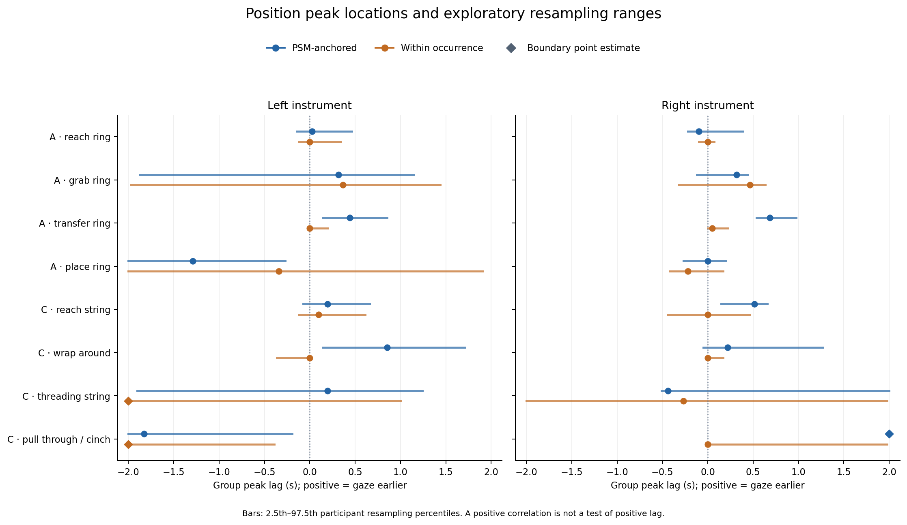

**怎么看：** 横轴为峰lag（秒），纵轴列出任务阶段，左右两面板为左右器械；点是组曲线峰位，水平线是2.5–97.5百分位范围，菱形表示点峰触及±2 s端点。

**图说明什么：** A transfer两侧、C reach右侧、C wrap左侧的蓝色范围均为正；改为橙色同次阶段内后峰多回到零附近。C pull右侧蓝色峰固定在+2 s端点，C threading左侧橙色峰在−2 s端点。它们是窗口限制而非精确的±2 s延迟；整体上峰位的阶段依赖和mode依赖明显。

[查看原始 PNG](gt84/figures/primary_position_peak_lags.png) · [下载同图 PDF](gt84/figures/primary_position_peak_lags.pdf)

### 图 2：A任务位置完整相关曲线

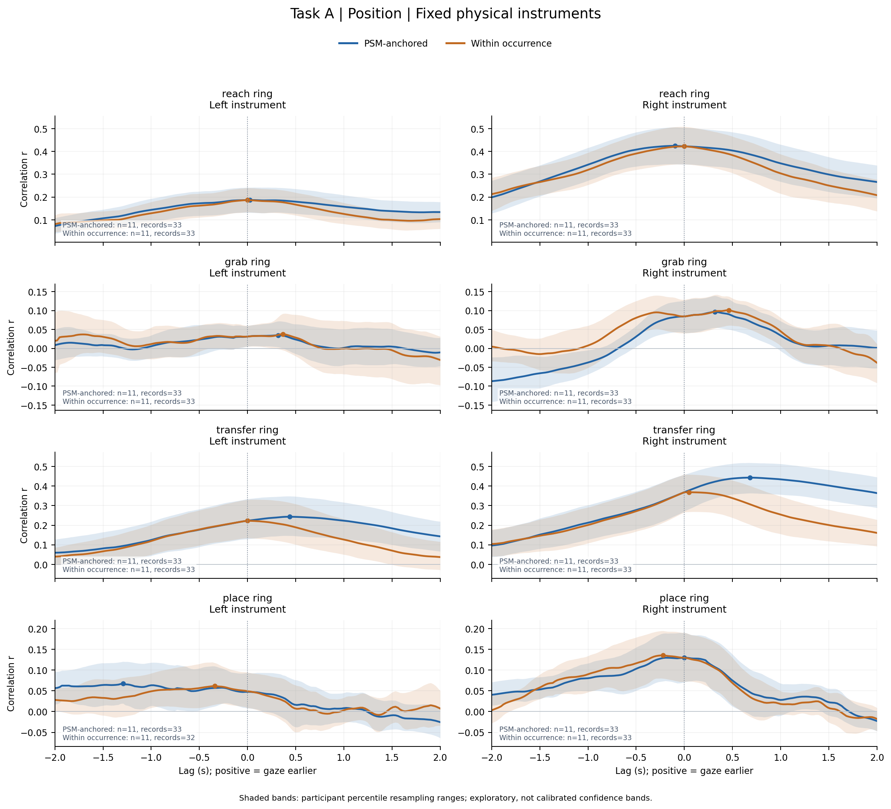

**怎么看：** 每行一个阶段，每列一侧；横轴lag、纵轴r。阴影为逐lag的user重抽样范围，圆点/菱形为最高点；每格注明支持user/录制数。

**图说明什么：** reach ring右侧峰约0.425而左侧约0.187；transfer ring右侧PSM锚定在0.683 s、r=0.443达到最高，同次阶段内峰回到0.049 s、r=0.369。左侧transfer也由0.439 s回到0。grab左侧曲线接近零且多处竞争，place左侧曲线较平、峰lag为负且范围触窗端；不能从这两行获得稳定时延。place左侧within-stage只保留32而非33录制，进一步需要共同支持核对。

[查看原始 PNG](gt84/figures/primary_position_curves_A.png) · [下载同图 PDF](gt84/figures/primary_position_curves_A.pdf)

### 图 3：C任务位置完整相关曲线

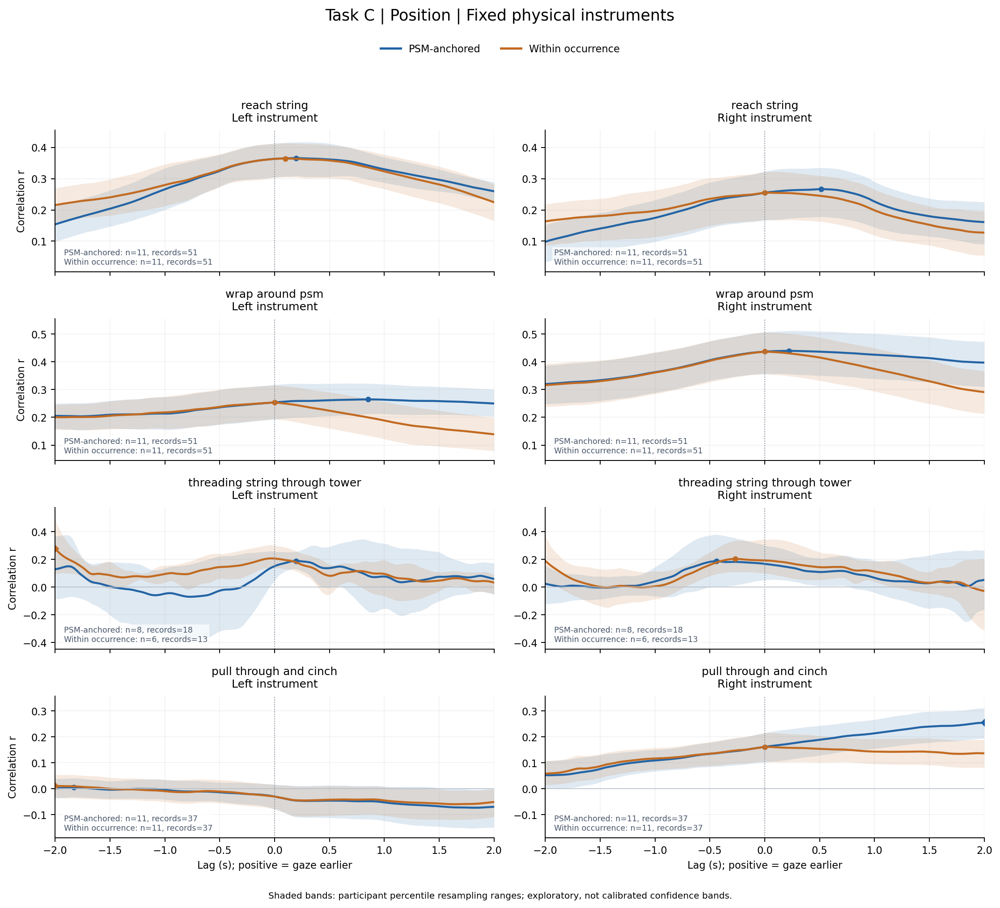

**怎么看：** 排布与A任务相同，但C threading的图内支持数为8人/18录制和6人/13录制，低于其余阶段。

**图说明什么：** reach左侧整体r约0.36且峰近零；reach右侧蓝峰0.512 s、橙峰0；wrap右侧r约0.44但蓝峰很宽，wrap左侧蓝峰约0.854 s、橙峰0。threading曲线有竞争形状与宽阴影，左侧橙线的−2 s最大值靠边。pull右侧蓝线到+2 s仍上升，直接显示搜索窗未包住峰；左侧该阶段r近零或负，不能与右侧合并为统一领先结论。

[查看原始 PNG](gt84/figures/primary_position_curves_C.png) · [下载同图 PDF](gt84/figures/primary_position_curves_C.pdf)

### 图 4：A任务位置组峰位重抽样分布

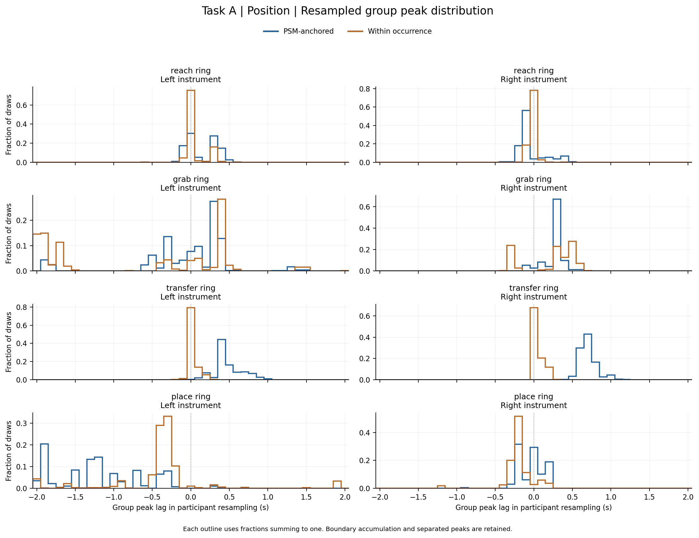

**怎么看：** 每条直方图轮廓显示5000次user重抽样的峰lag频率，各色频率和为1，纵轴不是相关。分离峰与长尾保留。

**图说明什么：** transfer两侧蓝色分布集中于正lag，而橙色明显集中在零附近，支持mode差并非只由一个点估计造成。reach的分布主体近零，grab左侧可在负端与正0.3–0.4 s等位置间跳转；place左侧PSM锚定出现宽负向分布及端点质量。单个百分位范围不足以表达这些竞争峰，不能用“平均延迟”概括。

[查看原始 PNG](gt84/figures/group_bootstrap_position_A.png) · [下载同图 PDF](gt84/figures/group_bootstrap_position_A.pdf)

### 图 5：C任务位置组峰位重抽样分布

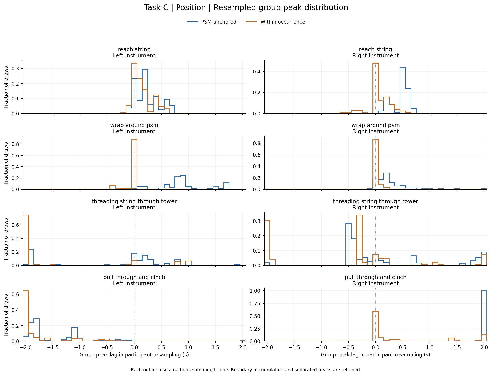

**怎么看：** 与上一图相同，重点看端点堆积和是否有多个分离峰簇。

**图说明什么：** reach右侧蓝色主体在约0.5 s而橙色近零；wrap左侧蓝色分布扩展到约1.7 s，说明即使范围全正也定位较宽。threading左侧within-stage的−2 s边界频率74.72%，pull左侧within-stage为62.32%。pull右侧PSM锚定+2 s堆积达97.82%，产生[2,2]范围的原因是截断，不是高精度；这是阅读峰表时最重要的边界诊断。

[查看原始 PNG](gt84/figures/group_bootstrap_position_C.png) · [下载同图 PDF](gt84/figures/group_bootstrap_position_C.pdf)

### 图 6：速度组峰位与参与者重抽样范围

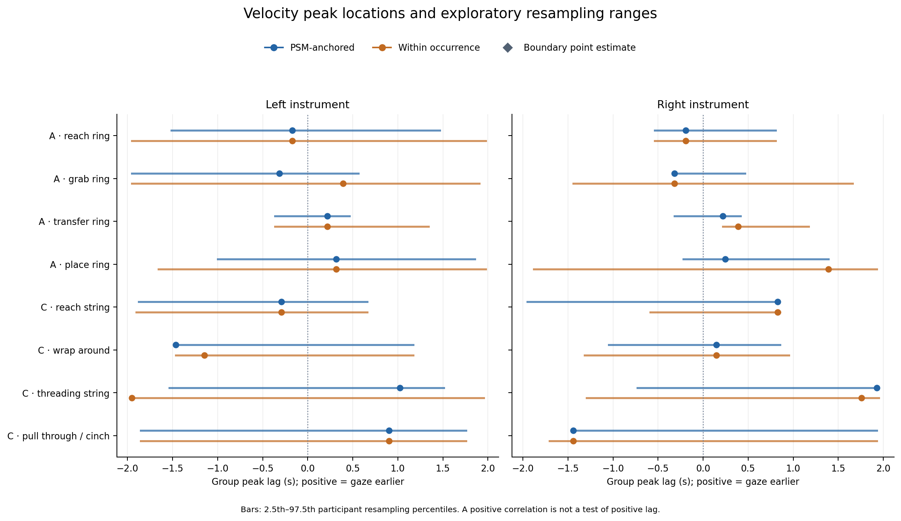

**怎么看：** 标记含义与位置峰位图相同，但信号为SG5后差分得到的二维速度。

**图说明什么：** 蓝色PSM锚定的所有可用范围均跨零；不少范围几乎覆盖整个±2 s窗口，说明点估计正负并不稳定。仅A transfer右侧橙色within-stage范围[0.220,1.171] s全正，但峰r仅0.019。图中的大正lag或大负lag不能脱离弱相关和宽范围单独解释。

[查看原始 PNG](gt84/figures/primary_velocity_peak_lags.png) · [下载同图 PDF](gt84/figures/primary_velocity_peak_lags.pdf)

### 图 7：A任务速度完整相关曲线

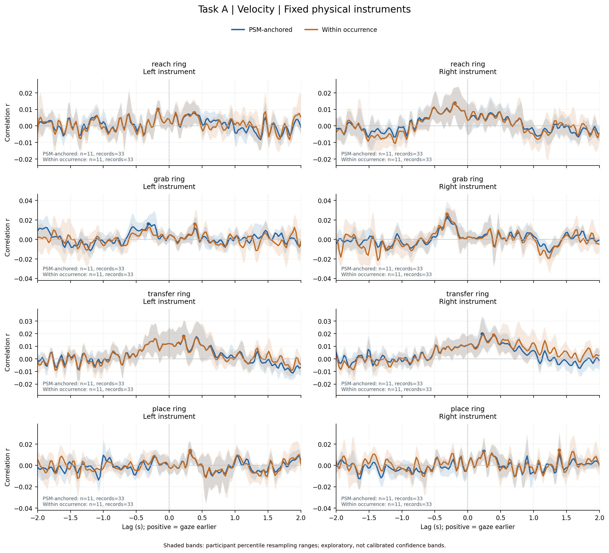

**怎么看：** 横轴仍是lag，纵轴r的量级比位置图小，应看实际刻度，不应仅凭波峰的视觉高度判断强弱。

**图说明什么：** PSM锚定峰r约0.010–0.023；grab两侧最高点约−0.317 s，transfer两侧约+0.220 s，但存在许多小幅竞争峰和较宽阴影。左右速度的强相关证据远弱于位置；place右侧的橙色点峰可移到1.390 s，亦显示同一弱曲线最高点对条件变化敏感。

[查看原始 PNG](gt84/figures/primary_velocity_curves_A.png) · [下载同图 PDF](gt84/figures/primary_velocity_curves_A.pdf)

### 图 8：C任务速度完整相关曲线

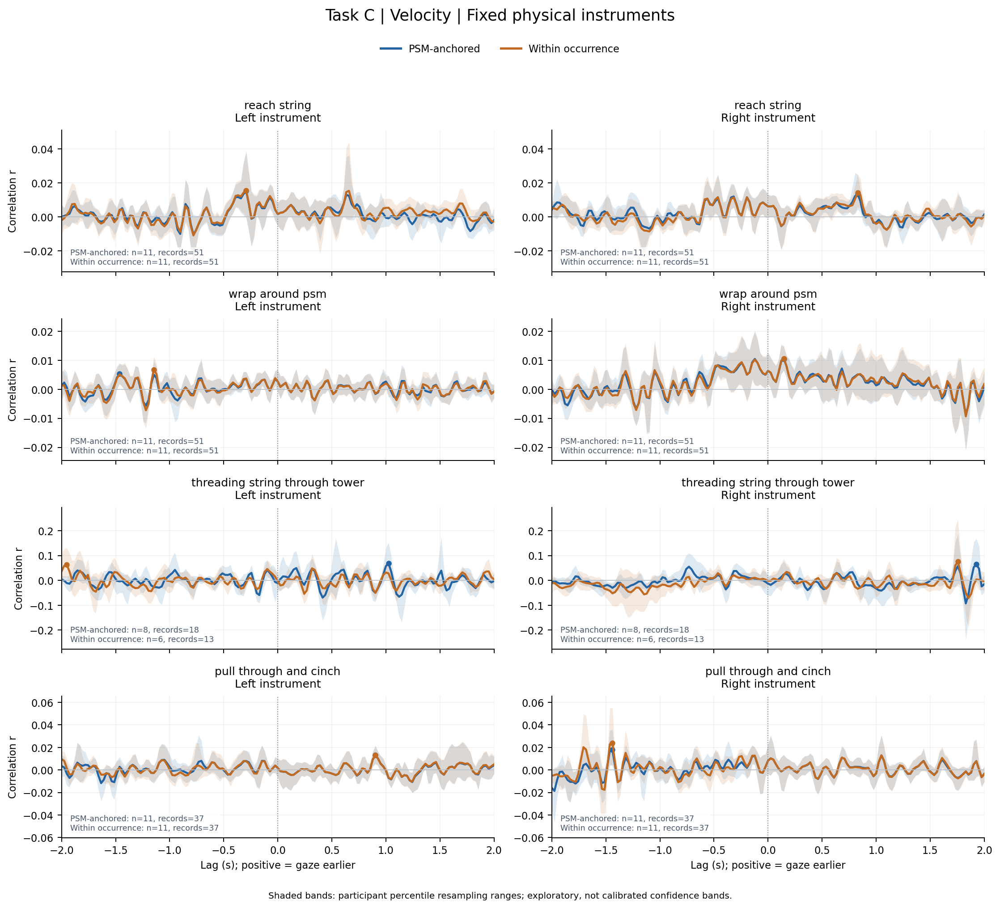

**怎么看：** 每个阶段左右图采用该行对应刻度；尤其threading的相关峰较其余行大，同时支持人数更少。

**图说明什么：** threading左/右PSM锚定点峰为1.024/1.927 s、r=0.069/0.064；其余C阶段主速度峰多为0.005–0.018，峰附近有竞争波动。threading左侧within-stage最高点转到−1.951 s，而右侧仍在+1.756 s，说明同一阶段不能用一个公共速度延迟描述，且支持变化与弱可定位性均重要。

[查看原始 PNG](gt84/figures/primary_velocity_curves_C.png) · [下载同图 PDF](gt84/figures/primary_velocity_curves_C.pdf)

### 图 9：A任务速度组峰位重抽样分布

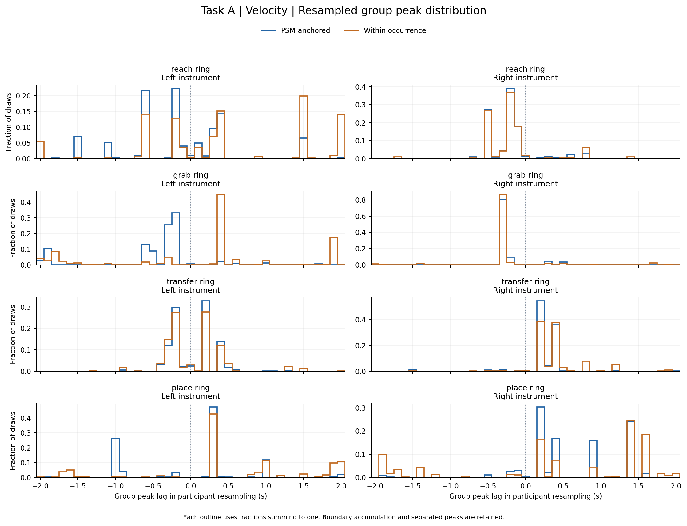

**怎么看：** 这是峰lag的重抽样频率，不是速度幅度或相关强度；不同峰簇揭示最高点会在候选lag之间切换。

**图说明什么：** reach、grab及place等多处分布跨正负lag，与峰表宽范围一致。transfer右侧within-stage的分布偏正，但PSM锚定范围仍跨零；全图不能支持统一、可重复的速度领先。即使某条原曲线有单一最高点，多峰的重抽样分布仍表明其位置不稳定。

[查看原始 PNG](gt84/figures/group_bootstrap_velocity_A.png) · [下载同图 PDF](gt84/figures/group_bootstrap_velocity_A.pdf)

### 图 10：C任务速度组峰位重抽样分布

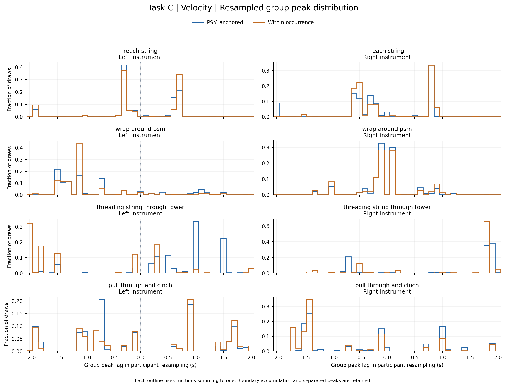

**怎么看：** 各面板保留所有重抽样峰位的离散结构；不能把多峰轮廓只压缩为一个均值。

**图说明什么：** C任务速度峰分布在多处候选lag聚集，threading、pull等尤其宽；例如threading右侧PSM锚定范围[−0.732,1.927] s，pull右侧为[−1.463,1.927] s。所有C任务速度主条件均方向不确定。分布形状与速度敏感性图相互印证：最高点的方向可以被很小的曲线差异改变。

[查看原始 PNG](gt84/figures/group_bootstrap_velocity_C.png) · [下载同图 PDF](gt84/figures/group_bootstrap_velocity_C.pdf)

### 图 11：位置峰位对平滑、边缘和窗口的敏感性

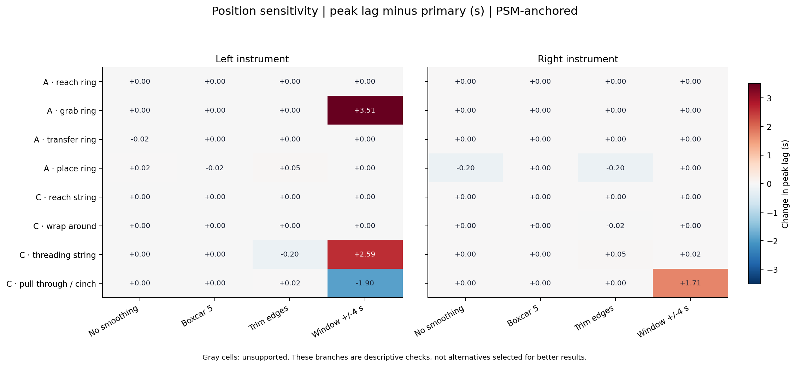

**怎么看：** 每格为“该分支峰lag − 主分支峰lag”，只画PSM锚定；红色是向正lag移动、蓝色向负lag移动，数字单位秒。接近白色和0表示峰位不变，不表示没有相关。

**图说明什么：** 不平滑/5点平均相对3点主分支总体变化小：16组绝对变化中位数均为0，最大分别0.195/0.024 s。扩大窗口则会带来很大变化：A grab左侧由0.317跳到3.829 s（+3.512），C threading左侧由0.195到2.780 s（+2.585），C pull右侧由2.000到3.707 s（+1.707）。这表明平滑稳定性不等于搜索窗稳定性；弱峰或边界峰仍难以定位。分支支持可能变化，应结合完整表的n。

[查看原始 PNG](gt84/figures/position_sensitivity_lag_change.png) · [下载同图 PDF](gt84/figures/position_sensitivity_lag_change.pdf)

### 图 12：速度峰位对滤波和窗口的敏感性

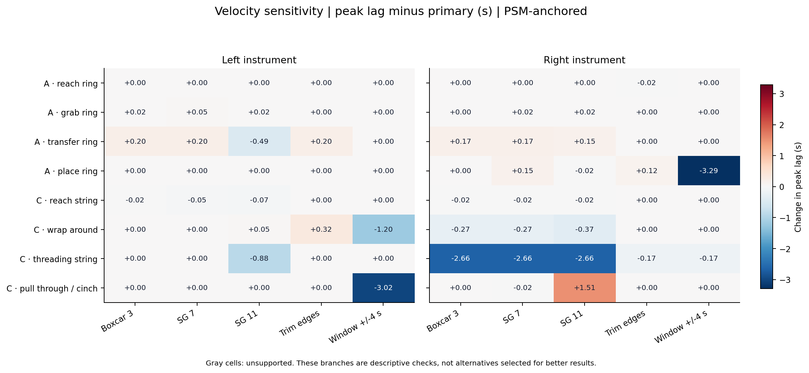

**怎么看：** 各列依次为旧box3、SG7、SG11、边缘裁除和±4 s窗口，均减去SG5主分支峰位；这里只画PSM锚定。原图左面板的行标签未完整显示，两面板从上至下均为：A reach ring、A grab ring、A transfer ring、A place ring、C reach string、C wrap around psm、C threading string through tower、C pull through and cinch。

**图说明什么：** 不少格接近0，但C threading右侧从主峰+1.927 s，在box3、SG7、SG11均变为−0.732 s，变化−2.659 s，发生方向翻转。SG7/SG11跨16组的绝对变化中位数仅0.024/0.037 s，仍掩盖了这个严重个例。因此不能因总体中位变化小就认定所有速度峰稳健，尤其不应把C threading速度峰当可靠生理延迟。

[查看原始 PNG](gt84/figures/velocity_sensitivity_lag_change.png) · [下载同图 PDF](gt84/figures/velocity_sensitivity_lag_change.pdf)

### 图 13：零lag与共同组峰lag处的空间对应

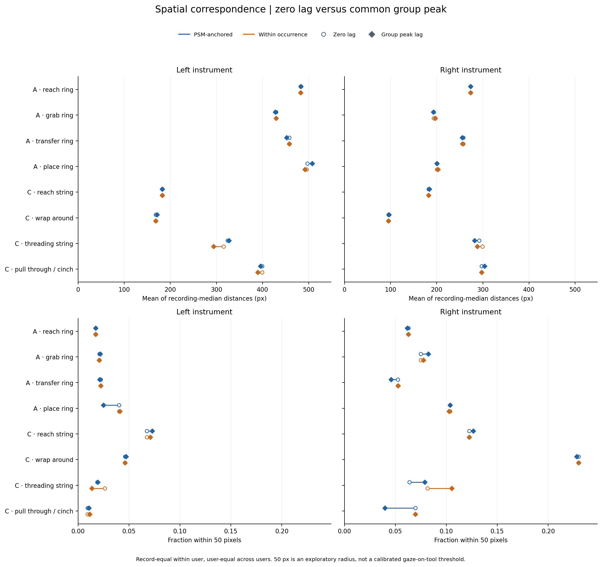

**怎么看：** 上排为录制中位距离的分层平均（px），越小越近；下排为50 px内比例，越大越近；空心圆是零lag、菱形是同条件共同组峰lag，短线连接二者。蓝/橙仍表示mode。

**图说明什么：** A任务右侧总体比左侧更接近gaze；例如grab零lag左右分别429.05/193.29 px。C wrap右侧最接近之一，零lag95.34 px、50 px比例22.99%。但移到相关峰并非普遍改善：A transfer右侧距离257.78→255.06 px略降，50 px比例却5.26%→4.60%；C pull右侧距离297.35→303.70 px变大，50 px比例6.95%→3.99%。因此轨迹形状相关与绝对空间注视必须分开解释。

[查看原始 PNG](gt84/figures/spatial_zero_vs_peak.png) · [下载同图 PDF](gt84/figures/spatial_zero_vs_peak.pdf)

## 6. 支持、选侧、敏感性与可靠性补充

### 6.1 共同支持和旧支持规则

| 任务/阶段 | 侧 | signal | mode | 用户/录制：原→共同 | 峰lag：原→共同 |
| --- | --- | --- | --- | --- | --- |
| A place ring | 左 | position | PSM锚定 | 11/33 → 11/32 | -1.293 → -1.220 |
| C threading string through tower | 左 | position | PSM锚定 | 8/18 → 6/13 | 0.195 → -0.049 |
| C threading string through tower | 左 | velocity | PSM锚定 | 8/18 → 6/13 | 1.024 → 0.317 |
| C threading string through tower | 右 | position | PSM锚定 | 8/18 → 6/13 | -0.439 → -0.220 |
| C threading string through tower | 右 | velocity | PSM锚定 | 8/18 → 6/13 | 1.927 → 1.756 |

表只列共同支持后变化的条件，未列条件的支持和点峰相同。A transfer左右、C reach右侧、C wrap左侧的正峰mode差在共同支持下仍存在。threading则明显受支持集合约束，不能把原始两条mode曲线的差全归因于边界规则。完整数据见[matched_mode_summary.csv](gt84/matched_mode_summary.csv)。

旧“每lag可用录制”与新“全lag完整录制”共72组支持对照中9组支持发生变化，2组点峰改变：C threading右侧position/within-stage由−2.000变为−0.268 s；同阶段右侧velocity/PSM锚定由1.756变为1.927 s。由此可见，新旧组分析差异不应全部归因于平滑。

### 6.2 GT选择侧补充

选择规则为每条条件比较左右有符号最高相关，取峰较高侧，而非逐lag拼出左右上包络。不同录制可能选到不同物理侧，因此组曲线不是固定器械。表中覆盖所有可用选择侧组，无支持的drop ring四组均缺失。

| 任务/阶段 | signal | mode | 用户/录制 | 峰lag | 峰r | 范围 | 判读 |
| --- | --- | --- | --- | --- | --- | --- | --- |
| A reach ring | position | PSM锚定 | 11/33 | -0.098 | 0.439 | [-0.171, 0.366] | 方向不确定 |
| A reach ring | position | 同次阶段内 | 11/33 | 0.000 | 0.439 | [-0.098, 0.073] | 方向不确定 |
| A grab ring | position | PSM锚定 | 11/33 | 0.341 | 0.115 | [-0.220, 0.415] | 方向不确定 |
| A grab ring | position | 同次阶段内 | 11/33 | 0.463 | 0.127 | [-0.439, 0.610] | 方向不确定 |
| A transfer ring | position | PSM锚定 | 11/33 | 0.610 | 0.467 | [0.439, 0.951] | 范围全为正 |
| A transfer ring | position | 同次阶段内 | 11/33 | 0.049 | 0.431 | [0.000, 0.220] | 方向不确定 |
| A place ring | position | PSM锚定 | 11/33 | 0.122 | 0.165 | [-1.171, 0.171] | 方向不确定 |
| A place ring | position | 同次阶段内 | 11/33 | -0.220 | 0.183 | [-0.268, 0.171] | 方向不确定 |
| C reach string | position | PSM锚定 | 11/51 | 0.463 | 0.405 | [-0.146, 0.659] | 方向不确定 |
| C reach string | position | 同次阶段内 | 11/51 | 0.024 | 0.402 | [-0.293, 0.415] | 方向不确定 |
| C wrap around psm | position | PSM锚定 | 11/51 | 0.244 | 0.463 | [0.000, 1.220] | 方向不确定 |
| C wrap around psm | position | 同次阶段内 | 11/51 | 0.000 | 0.456 | [0.000, 0.171] | 方向不确定 |
| C threading string through tower | position | PSM锚定 | 8/18 | 0.780 | 0.264 | [-1.902, 1.878] | 方向不确定 |
| C threading string through tower | position | 同次阶段内 | 6/13 | -2.000 | 0.257 | [-2.000, 1.951] | 窗口限制 |
| C pull through and cinch | position | PSM锚定 | 11/37 | 2.000 | 0.261 | [1.415, 2.000] | 窗口限制 |
| C pull through and cinch | position | 同次阶段内 | 11/37 | 0.000 | 0.175 | [-1.073, 1.976] | 方向不确定 |
| A reach ring | velocity | PSM锚定 | 11/33 | -0.195 | 0.014 | [-0.732, 1.463] | 方向不确定 |
| A reach ring | velocity | 同次阶段内 | 11/33 | -0.195 | 0.014 | [-1.951, 1.463] | 方向不确定 |
| A grab ring | velocity | PSM锚定 | 11/33 | -0.317 | 0.025 | [-0.537, 0.341] | 方向不确定 |
| A grab ring | velocity | 同次阶段内 | 11/33 | -0.317 | 0.026 | [-1.756, 1.512] | 方向不确定 |
| A transfer ring | velocity | PSM锚定 | 11/33 | 0.415 | 0.023 | [-0.341, 0.415] | 方向不确定 |
| A transfer ring | velocity | 同次阶段内 | 11/33 | 0.415 | 0.024 | [-0.366, 0.537] | 方向不确定 |
| A place ring | velocity | PSM锚定 | 11/33 | 0.902 | 0.015 | [-0.220, 1.390] | 方向不确定 |
| A place ring | velocity | 同次阶段内 | 11/33 | 0.366 | 0.015 | [-1.878, 1.951] | 方向不确定 |
| C reach string | velocity | PSM锚定 | 11/51 | 0.634 | 0.021 | [-1.854, 0.829] | 方向不确定 |
| C reach string | velocity | 同次阶段内 | 11/51 | 0.659 | 0.023 | [-0.607, 0.829] | 方向不确定 |
| C wrap around psm | velocity | PSM锚定 | 11/51 | -0.122 | 0.010 | [-1.317, 0.854] | 方向不确定 |
| C wrap around psm | velocity | 同次阶段内 | 11/51 | -0.122 | 0.010 | [-1.317, 0.951] | 方向不确定 |
| C threading string through tower | velocity | PSM锚定 | 8/18 | 0.171 | 0.069 | [0.146, 1.756] | 范围全为正 |
| C threading string through tower | velocity | 同次阶段内 | 6/13 | 1.756 | 0.086 | [-1.951, 1.951] | 方向不确定 |
| C pull through and cinch | velocity | PSM锚定 | 11/37 | -1.439 | 0.014 | [-1.707, 1.927] | 方向不确定 |
| C pull through and cinch | velocity | 同次阶段内 | 11/37 | -1.707 | 0.026 | [-1.707, 1.927] | 方向不确定 |

位置选侧后，A transfer的PSM锚定峰r=0.467、lag=0.610 s，较固定右侧r=0.443略高，仍显示正向范围；C wrap选侧峰r=0.463但方向不确定；C pull仍停在+2 s窗端。相关提高部分来自“按较高相关选择”的定义，不能解释为识别到了真实操作侧或得到额外独立证据。

### 6.3 逐录制可定位性与阶段配对差值

| signal | 逐录制条件数 | 全lag有效 | 可定位条数 | 占全部条件 |
| --- | --- | --- | --- | --- |
| position | 1164 | 1145 | 23 | 1.98% |
| velocity | 1164 | 1146 | 11 | 0.95% |

| 首要诊断状态 | 条件条数 |
| --- | --- |
| broad_uncertainty | 843 |
| competing_peaks | 700 |
| insufficient_repeats | 269 |
| broad_near_peak | 261 |
| boundary_limited | 175 |
| insufficient_support | 37 |
| interior_stable_exploratory | 34 |
| incomplete_bootstrap_support | 4 |
| leave_one_occurrence_instability | 2 |
| bootstrap_boundary_instability | 2 |
| temporal_half_instability | 1 |

状态计数中的首要原因不等于全部原因；`reliability_reasons`可同时包含多项。位置859条、速度860条逐录制条件产生了有效bootstrap范围，其范围宽中位数分别为2.000 s和2.585 s（各自只在有范围者内计算，包含两种mode）；没有范围者保留缺失。34/2328=1.46%的条件通过可定位筛查，说明逐录制峰定位总体脆弱。该比例不能作为11名参与者的“成功率”，也不能因可定位少就抹去组级轨迹关联。

阶段间同步抽user的96条配对差值均为探索性，其中11条范围不跨零，所有96条的 `precise_delay_difference_allowed` 均为False。其中A右侧position/PSM锚定：transfer−reach=0.780 s，范围[0.195,1.073]；transfer−grab=0.366 s，范围[0.171,0.829]；transfer−place=0.683 s，范围[0.415,1.098]。这些对比与transfer阶段正峰突出一致，但并非经过多重比较校正的正式lag差检验。涉及C pull右侧的差值约98%重抽样触边，不能报告精确的阶段时延差。全部差值与共同user名单见[stage_contrasts.csv](gt84/stage_contrasts.csv)。

## 7. 空间指标完整主参考表

下表为PSM锚定position，完整记录25/50/100 px接近比例在零lag和组峰lag处的变化；“跨界%”仅列组峰处，零lag均为0。within-stage跨界率按定义为0，其数值见[完整空间表](gt84/spatial_summary.csv)。接近比例的变化以百分点解释更合适，不能当作概率显著性。

| 任务/阶段 | 侧 | 人数 | 距离px：零→峰 | 25px：零→峰 | 50px：零→峰 | 100px：零→峰 | 峰处跨界% |
| --- | --- | --- | --- | --- | --- | --- | --- |
| A reach ring | 左 | 11 | 482.52 → 482.67 | 0.40% → 0.40% | 1.72% → 1.72% | 5.87% → 5.87% | 0.38% |
| A reach ring | 右 | 11 | 273.49 → 273.39 | 1.67% → 1.71% | 6.27% → 6.16% | 20.25% → 19.85% | 1.70% |
| A grab ring | 左 | 11 | 429.05 → 427.65 | 0.50% → 0.55% | 2.09% → 2.17% | 8.49% → 9.00% | 11.06% |
| A grab ring | 右 | 11 | 193.29 → 193.15 | 1.64% → 1.88% | 7.49% → 8.24% | 28.37% → 29.15% | 11.06% |
| A transfer ring | 左 | 11 | 457.57 → 452.01 | 0.65% → 0.62% | 2.22% → 2.11% | 7.51% → 7.50% | 7.11% |
| A transfer ring | 右 | 11 | 257.78 → 255.06 | 1.12% → 1.01% | 5.26% → 4.60% | 18.38% → 17.19% | 11.05% |
| A place ring | 左 | 11 | 496.99 → 507.69 | 0.71% → 0.69% | 4.04% → 2.48% | 12.13% → 8.85% | 32.82% |
| A place ring | 右 | 11 | 200.59 → 200.59 | 2.76% → 2.76% | 10.38% → 10.38% | 34.54% → 34.54% | 0.00% |
| C reach string | 左 | 11 | 183.01 → 182.38 | 1.43% → 1.65% | 6.74% → 7.27% | 27.05% → 27.65% | 1.67% |
| C reach string | 右 | 11 | 182.62 → 184.34 | 3.56% → 3.59% | 12.25% → 12.64% | 30.72% → 30.84% | 4.38% |
| C wrap around psm | 左 | 11 | 168.21 → 171.10 | 1.10% → 1.16% | 4.60% → 4.73% | 22.40% → 21.48% | 3.89% |
| C wrap around psm | 右 | 11 | 95.34 → 96.31 | 7.29% → 7.00% | 22.99% → 22.79% | 53.89% → 53.48% | 1.00% |
| C threading string through tower | 左 | 8 | 324.07 → 327.13 | 0.45% → 0.59% | 1.90% → 1.95% | 5.63% → 6.24% | 5.39% |
| C threading string through tower | 右 | 8 | 291.91 → 282.18 | 1.21% → 3.53% | 6.37% → 7.90% | 15.53% → 15.46% | 11.58% |
| C pull through and cinch | 左 | 11 | 399.15 → 395.59 | 0.33% → 0.28% | 0.95% → 1.06% | 4.33% → 4.02% | 9.48% |
| C pull through and cinch | 右 | 11 | 297.35 → 303.70 | 1.87% → 1.06% | 6.95% → 3.99% | 19.67% → 12.67% | 12.78% |

A place左侧峰处跨界率32.82%，是本表较高值；其峰处距离反而变大至507.69 px。A transfer两侧跨界率分别7.11%、11.05%，但不能据此说“只有这部分产生了领先”，因为相关是中心化后整体协方差与方差的比值，不能按样本比例分解成因果贡献。

## 8. Unpaired随机参考：关联强度证据及失败覆盖

下表完整列出两种scope下的支持状态和有效次数；同一行中的“主/时长子集”分别使用各自的观测曲线。尾部比例与BH值保留4位小数，以免将最小约0.0002误写成0。PSM锚定和within-stage均为固定侧；没有为GT选择侧复用这些参考值。

| scope | 条件总数 | 有参考 | 无完整参考重复 | 观测用户不足 |
| --- | --- | --- | --- | --- |
| elapsed_time_model_consistent | 72 | 56 | 8 | 8 |
| duration_eligible_subset | 72 | 64 | 0 | 8 |

### 8.1 位置参考

| 任务/阶段 | 侧 | mode | 观测r 主/子集 | 有效次数 主/子集（各请求5000） | 尾部比例 主/子集 | 描述BH 主/子集 |
| --- | --- | --- | --- | --- | --- | --- |
| A reach ring | 左 | PSM锚定 | 0.187 / 0.187 | 5000 / 5000 | 0.0002 / 0.0002 | 0.0006 / 0.0004 |
| A reach ring | 左 | 同次阶段内 | 0.187 / 0.187 | 4640 / 4683 | 0.0002 / 0.0002 | 0.0006 / 0.0005 |
| A reach ring | 右 | PSM锚定 | 0.425 / 0.427 | 5000 / 5000 | 0.0002 / 0.0002 | 0.0005 / 0.0003 |
| A reach ring | 右 | 同次阶段内 | 0.423 / 0.425 | 4640 / 4683 | 0.0002 / 0.0002 | 0.0006 / 0.0004 |
| A grab ring | 左 | PSM锚定 | 0.035 / 0.040 | 2782 / 4703 | 0.3306 / 0.2128 | 0.4250 / 0.2736 |
| A grab ring | 左 | 同次阶段内 | 0.038 / 0.043 | 509 / 3777 | 0.4549 / 0.4044 | 0.5849 / 0.5200 |
| A grab ring | 右 | PSM锚定 | 0.097 / 0.099 | 5000 / 5000 | 0.0040 / 0.0002 | 0.0060 / 0.0003 |
| A grab ring | 右 | 同次阶段内 | 0.101 / 0.104 | 2664 / 4332 | 0.0184 / 0.0039 | 0.0276 / 0.0050 |
| A transfer ring | 左 | PSM锚定 | 0.243 / 0.242 | 5000 / 5000 | 0.0002 / 0.0002 | 0.0006 / 0.0004 |
| A transfer ring | 左 | 同次阶段内 | 0.223 / 0.224 | 5000 / 5000 | 0.0002 / 0.0002 | 0.0006 / 0.0005 |
| A transfer ring | 右 | PSM锚定 | 0.443 / 0.440 | 5000 / 5000 | 0.0002 / 0.0002 | 0.0005 / 0.0003 |
| A transfer ring | 右 | 同次阶段内 | 0.369 / 0.366 | 5000 / 5000 | 0.0002 / 0.0002 | 0.0006 / 0.0004 |
| A place ring | 左 | PSM锚定 | 0.067 / 0.064 | 4488 / 5000 | 0.0058 / 0.0008 | 0.0104 / 0.0014 |
| A place ring | 左 | 同次阶段内 | 0.061 / 0.058 | 1850 / 5000 | 0.0551 / 0.0324 | 0.0827 / 0.0486 |
| A place ring | 右 | PSM锚定 | 0.130 / 0.136 | 5000 / 5000 | 0.0002 / 0.0002 | 0.0005 / 0.0003 |
| A place ring | 右 | 同次阶段内 | 0.135 / 0.141 | 3043 / 5000 | 0.0003 / 0.0002 | 0.0006 / 0.0004 |
| A drop ring | 左 | PSM锚定 | — / — | 0 / 0 | — / — | — / — |
| A drop ring | 左 | 同次阶段内 | — / — | 0 / 0 | — / — | — / — |
| A drop ring | 右 | PSM锚定 | — / — | 0 / 0 | — / — | — / — |
| A drop ring | 右 | 同次阶段内 | — / — | 0 / 0 | — / — | — / — |
| C reach string | 左 | PSM锚定 | 0.366 / 0.366 | 4881 / 5000 | 0.0002 / 0.0002 | 0.0006 / 0.0004 |
| C reach string | 左 | 同次阶段内 | 0.364 / 0.365 | 4881 / 5000 | 0.0002 / 0.0002 | 0.0006 / 0.0005 |
| C reach string | 右 | PSM锚定 | 0.266 / 0.274 | 4881 / 5000 | 0.0002 / 0.0002 | 0.0005 / 0.0003 |
| C reach string | 右 | 同次阶段内 | 0.255 / 0.263 | 4881 / 5000 | 0.0002 / 0.0002 | 0.0006 / 0.0004 |
| C wrap around psm | 左 | PSM锚定 | 0.265 / 0.264 | 3956 / 5000 | 0.0003 / 0.0002 | 0.0006 / 0.0004 |
| C wrap around psm | 左 | 同次阶段内 | 0.254 / 0.251 | 3956 / 5000 | 0.0003 / 0.0002 | 0.0006 / 0.0005 |
| C wrap around psm | 右 | PSM锚定 | 0.439 / 0.440 | 3956 / 5000 | 0.0003 / 0.0002 | 0.0005 / 0.0003 |
| C wrap around psm | 右 | 同次阶段内 | 0.436 / 0.437 | 3956 / 5000 | 0.0003 / 0.0002 | 0.0006 / 0.0004 |
| C threading string through tower | 左 | PSM锚定 | 0.190 / 0.190 | 876 / 2338 | 0.2178 / 0.1501 | 0.3267 / 0.2251 |
| C threading string through tower | 左 | 同次阶段内 | 0.279 / 0.279 | 332 / 970 | 0.0180 / 0.0278 | 0.0324 / 0.0486 |
| C threading string through tower | 右 | PSM锚定 | 0.188 / 0.188 | 830 / 2338 | 0.1841 / 0.0876 | 0.2367 / 0.0986 |
| C threading string through tower | 右 | 同次阶段内 | 0.204 / 0.204 | 314 / 970 | 0.2032 / 0.2297 | 0.2612 / 0.2584 |
| C pull through and cinch | 左 | PSM锚定 | 0.005 / 0.005 | 0 / 4517 | — / 0.7430 | — / 0.8359 |
| C pull through and cinch | 左 | 同次阶段内 | 0.011 / 0.012 | 0 / 4517 | — / 0.6700 | — / 0.7537 |
| C pull through and cinch | 右 | PSM锚定 | 0.254 / 0.253 | 0 / 4517 | — / 0.0002 | — / 0.0003 |
| C pull through and cinch | 右 | 同次阶段内 | 0.161 / 0.158 | 0 / 4517 | — / 0.0018 | — / 0.0027 |

### 8.2 速度参考

| 任务/阶段 | 侧 | mode | 观测r 主/子集 | 有效次数 主/子集（各请求5000） | 尾部比例 主/子集 | 描述BH 主/子集 |
| --- | --- | --- | --- | --- | --- | --- |
| A reach ring | 左 | PSM锚定 | 0.010 / 0.010 | 5000 / 5000 | 0.1894 / 0.1278 | 0.3857 / 0.2300 |
| A reach ring | 左 | 同次阶段内 | 0.010 / 0.010 | 4640 / 4683 | 0.5273 / 0.4317 | 0.8715 / 0.6047 |
| A reach ring | 右 | PSM锚定 | 0.014 / 0.014 | 5000 / 5000 | 0.0132 / 0.0118 | 0.0534 / 0.0265 |
| A reach ring | 右 | 同次阶段内 | 0.014 / 0.014 | 4640 / 4683 | 0.0911 / 0.0848 | 0.1641 / 0.1131 |
| A grab ring | 左 | PSM锚定 | 0.016 / 0.016 | 5000 / 5000 | 0.1510 / 0.0764 | 0.3857 / 0.2292 |
| A grab ring | 左 | 同次阶段内 | 0.016 / 0.015 | 2664 / 4332 | 0.7550 / 0.6386 | 0.9707 / 0.7184 |
| A grab ring | 右 | PSM锚定 | 0.023 / 0.023 | 5000 / 5000 | 0.0178 / 0.0032 | 0.0534 / 0.0144 |
| A grab ring | 右 | 同次阶段内 | 0.026 / 0.026 | 2664 / 4332 | 0.0814 / 0.0194 | 0.1641 / 0.0544 |
| A transfer ring | 左 | PSM锚定 | 0.018 / 0.018 | 5000 / 5000 | 0.0002 / 0.0002 | 0.0018 / 0.0018 |
| A transfer ring | 左 | 同次阶段内 | 0.017 / 0.018 | 5000 / 5000 | 0.0006 / 0.0004 | 0.0054 / 0.0036 |
| A transfer ring | 右 | PSM锚定 | 0.020 / 0.020 | 5000 / 5000 | 0.0002 / 0.0002 | 0.0018 / 0.0018 |
| A transfer ring | 右 | 同次阶段内 | 0.019 / 0.019 | 5000 / 5000 | 0.0016 / 0.0010 | 0.0144 / 0.0090 |
| A place ring | 左 | PSM锚定 | 0.013 / 0.013 | 5000 / 5000 | 0.2571 / 0.1276 | 0.3857 / 0.2300 |
| A place ring | 左 | 同次阶段内 | 0.014 / 0.014 | 3162 / 5000 | 0.4967 / 0.3463 | 0.8715 / 0.6047 |
| A place ring | 右 | PSM锚定 | 0.014 / 0.015 | 5000 / 5000 | 0.2388 / 0.0508 | 0.3581 / 0.0762 |
| A place ring | 右 | 同次阶段内 | 0.014 / 0.018 | 3162 / 5000 | 0.5188 / 0.0880 | 0.6670 / 0.1131 |
| A drop ring | 左 | PSM锚定 | — / — | 0 / 0 | — / — | — / — |
| A drop ring | 左 | 同次阶段内 | — / — | 0 / 0 | — / — | — / — |
| A drop ring | 右 | PSM锚定 | — / — | 0 / 0 | — / — | — / — |
| A drop ring | 右 | 同次阶段内 | — / — | 0 / 0 | — / — | — / — |
| C reach string | 左 | PSM锚定 | 0.015 / 0.015 | 4881 / 5000 | 0.0113 / 0.0054 | 0.0507 / 0.0243 |
| C reach string | 左 | 同次阶段内 | 0.016 / 0.016 | 4881 / 5000 | 0.0176 / 0.0090 | 0.0793 / 0.0405 |
| C reach string | 右 | PSM锚定 | 0.013 / 0.014 | 4881 / 5000 | 0.0539 / 0.0050 | 0.0970 / 0.0150 |
| C reach string | 右 | 同次阶段内 | 0.014 / 0.015 | 4881 / 5000 | 0.0510 / 0.0100 | 0.1530 / 0.0450 |
| C wrap around psm | 左 | PSM锚定 | 0.005 / 0.005 | 3956 / 5000 | 0.9300 / 0.8432 | 1.0000 / 0.9486 |
| C wrap around psm | 左 | 同次阶段内 | 0.007 / 0.007 | 3956 / 5000 | 0.5810 / 0.4461 | 0.8715 / 0.6047 |
| C wrap around psm | 右 | PSM锚定 | 0.010 / 0.011 | 3956 / 5000 | 0.0359 / 0.0224 | 0.0807 / 0.0403 |
| C wrap around psm | 右 | 同次阶段内 | 0.011 / 0.011 | 3956 / 5000 | 0.0402 / 0.0242 | 0.1530 / 0.0544 |
| C threading string through tower | 左 | PSM锚定 | 0.069 / 0.069 | 876 / 2338 | 0.2281 / 0.1710 | 0.3857 / 0.2565 |
| C threading string through tower | 左 | 同次阶段内 | 0.063 / 0.063 | 291 / 691 | 0.2808 / 0.1286 | 0.8425 / 0.3858 |
| C threading string through tower | 右 | PSM锚定 | 0.064 / 0.064 | 876 / 2338 | 0.4424 / 0.2954 | 0.5688 / 0.3324 |
| C threading string through tower | 右 | 同次阶段内 | 0.075 / 0.075 | 291 / 691 | 0.2158 / 0.2442 | 0.3236 / 0.2747 |
| C pull through and cinch | 左 | PSM锚定 | 0.013 / 0.013 | 0 / 4517 | — / 0.4243 | — / 0.5455 |
| C pull through and cinch | 左 | 同次阶段内 | 0.013 / 0.013 | 0 / 4517 | — / 0.4703 | — / 0.6047 |
| C pull through and cinch | 右 | PSM锚定 | 0.018 / 0.018 | 0 / 4517 | — / 0.1315 | — / 0.1690 |
| C pull through and cinch | 右 | 同次阶段内 | 0.024 / 0.024 | 0 / 4517 | — / 0.0305 | — / 0.0550 |

### 8.3 参考结果的含义

许多位置条件相对错配参考的尾部比例很低，支持同一录制内的轨迹对应优于同任务不同user的错配。但该比较统计量是**最大相关峰高**，不会因为尾部比例小就证明峰lag为正。例如C threading左侧within-stage的主参考尾部比例约0.018，仍伴随−2 s边界峰和很低的参考有效数332/5000，不能当作已定位时延。

C pull through and cinch全部8个主参考条件均无完整有效参考重复，5000次失败全记为不完整曲线；不能把缺失参考解释为“不显著”。时长覆盖子集恢复这些条件的参考（每组4517个有效重复），但已更换目标集合及其观测统计量，仅能作为子集描述。A drop ring在两种scope均因观测用户不足而缺失。

速度参考中，A transfer左右PSM锚定的尾部比例也可很小，但r仅约0.018/0.020，且峰lag范围跨零。这说明“相对参考可区分”与“效应强/延迟稳定”是三个不同问题。BH形式调整也不改变这一解释边界。

## 9. QC实测汇总与结果验证

本表只取 `primary + position + source=psm`，每个录制左右侧各计一次，避免把多个signal/variant重复相加。原生点分母1,749,260，网格点分母1,699,838。

| QC项 | 计数 | 比例 | 分母 |
| --- | --- | --- | --- |
| 原生非有限坐标 | 0 | 0.00% | 原生点 |
| likelihood<0.5（保留） | 230,303 | 13.17% | 原生点 |
| 相邻位移>100px（保留） | 21,338 | 1.22% | 原生点 |
| 图像外坐标（保留） | 0 | 0.00% | 原生点 |
| 孤立往返跳变候选（保留） | 8,233 | 0.47% | 原生点 |
| 质量规则实际删除 | 0 | 0.00% | 原生点 |
| 普通有限坐标重采样 | 1,699,650 | 99.98894% | 网格点 |
| 非有限孔洞插补 | 0 | 0.00000% | 网格点 |
| 质量删除孔洞插补 | 0 | 0.00000% | 网格点 |
| 长间隙保留缺失 | 18 | 0.00106% | 网格点 |

普通重采样接近100%表示原生DLC时间点通常不与41 Hz网格精确重合，并不表示几乎所有数据都是异常插补。13.17%的原生点likelihood<0.5均保留，符合本轮明确规则；本报告据此解释结果，不假定这些点已经被过滤。

验证文件记录：84录制、11人、12,804条跨variant条件曲线、396个固定侧组；2,328条旧单录制曲线回归全部通过，最大相关绝对误差1.7364×10⁻¹³；36个旧max组曲线全部通过；输入未改变、原生支持审计全部通过、DLC质量规则删除点数0。验证保证实现回归与输入一致，不增加参与者数，也不解决峰位推断限制。

## 10. 可直接使用的研究结论

GT84结果表明，人工gaze与器械位置轨迹的关系具有任务阶段、物理器械侧别和阶段配对规则依赖性。A任务transfer阶段在固定左右侧的PSM锚定分析中呈现较一致的正峰位，C任务reach右侧和wrap左侧也呈现正向参与者重抽样范围；但限制双方属于同一次阶段后，这些峰位多回到零附近，提示跨阶段配对条件对时序估计至关重要。速度相关普遍较弱、峰位重抽样分布较宽且存在竞争峰，因此不支持给出统一的眼动—器械速度领先时长。部分阶段受到支持不足或搜索窗口截断，尤其C任务pull右侧的+2 s边界峰不能视为精确延迟。空间距离与接近比例进一步表明，轨迹相关不等同于gaze直接注视器械。现有证据适合报告阶段性的探索性关联与其不确定性，不足以确立普适的生理领先或因果关系。

## 11. 数据与图覆盖索引

本报告使用独立13张PNG图；同名13份PDF是相同内容的矢量版本，均在各图下方链接，不重复解释。原HTML使用这些外部图，没有需要另行抽取的内嵌独立图。Markdown移动时请同时保留整个 `gt84` 子目录；只复制md而不复制图片会破坏可视化链接。

| 图号 | PNG / PDF文件名 |
| --- | --- |
| 1 | primary_position_peak_lags.png / primary_position_peak_lags.pdf |
| 2 | primary_position_curves_A.png / primary_position_curves_A.pdf |
| 3 | primary_position_curves_C.png / primary_position_curves_C.pdf |
| 4 | group_bootstrap_position_A.png / group_bootstrap_position_A.pdf |
| 5 | group_bootstrap_position_C.png / group_bootstrap_position_C.pdf |
| 6 | primary_velocity_peak_lags.png / primary_velocity_peak_lags.pdf |
| 7 | primary_velocity_curves_A.png / primary_velocity_curves_A.pdf |
| 8 | primary_velocity_curves_C.png / primary_velocity_curves_C.pdf |
| 9 | group_bootstrap_velocity_A.png / group_bootstrap_velocity_A.pdf |
| 10 | group_bootstrap_velocity_C.png / group_bootstrap_velocity_C.pdf |
| 11 | position_sensitivity_lag_change.png / position_sensitivity_lag_change.pdf |
| 12 | velocity_sensitivity_lag_change.png / velocity_sensitivity_lag_change.pdf |
| 13 | spatial_zero_vs_peak.png / spatial_zero_vs_peak.pdf |

数据入口：

- [原始HTML报告](gt84/report.html)、[运行参数与代码指纹](gt84/run_manifest.json)、[输入来源与指纹](gt84/input_manifest.json)、[验证结果](gt84/validation.json)。
- [全部组汇总](gt84/group_summary.csv)、[逐lag组曲线](gt84/group_curves.csv)、[逐录制指标](gt84/record_summary.csv)、[逐录制完整曲线](gt84/record_curves.jsonl)。
- [选侧记录](gt84/side_selection.csv)、[选择侧组结果](gt84/gt_selected_group_summary.csv)、[共同支持覆盖](gt84/matched_mode_coverage.csv)、[共同支持结果](gt84/matched_mode_summary.csv)。
- [空间汇总](gt84/spatial_summary.csv)、[逐录制空间结果](gt84/spatial_records.csv)、[阶段配对差值](gt84/stage_contrasts.csv)、[新旧支持规则对照](gt84/aggregation_support_comparison.csv)。
- [随机参考汇总](gt84/unpaired_reference.csv)、[参考方法](gt84/unpaired_reference_method.json)、[donor覆盖](gt84/unpaired_donor_coverage.csv)。
- [预处理QC](gt84/preprocessing_qc.csv)、[支持审计](gt84/support_audit.csv)、[旧单录制回归](gt84/legacy_curve_regression.csv)、[旧max组回归](gt84/legacy_max_group_regression.csv)。
- [组峰位重抽样索引](gt84/group_bootstrap_index.json)、[组峰位重抽样数组](gt84/group_bootstrap_peak_lags.npz)。逐点来源、occurrence充分统计量、逐录制重抽样分布分别位于 `point_provenance/`、`occurrence_statistics/`、`bootstrap_peaks/`；这些是机器可读中间产物，不是额外未嵌入图片。
- 指标定义核对代码：[相关内核](gt84/code_snapshot/gaze_psm_core.py)、[峰形与可靠性](gt84/code_snapshot/gaze_psm_reliability_v2.py)、[组统计](gt84/code_snapshot/gaze_psm_statistics_v2.py)、[主流程与空间指标](gt84/code_snapshot/run_gt84_revision.py)、[原生预处理](gt84/code_snapshot/gaze_psm_preprocess_revision.py)、[随机参考](gt84/code_snapshot/gt_reference.py)。
