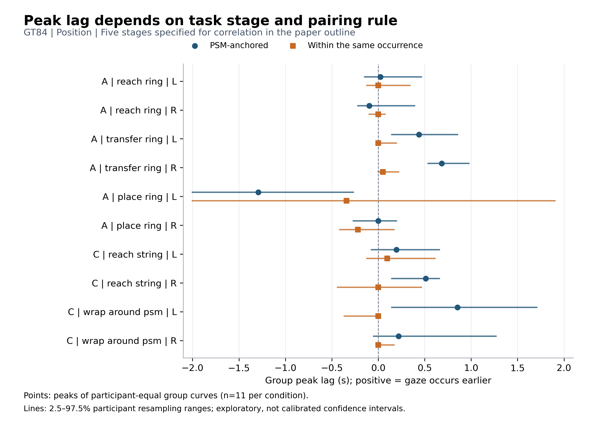
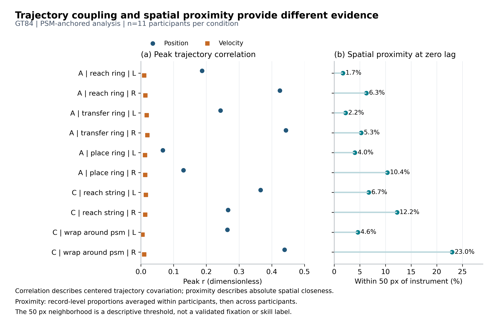

# GT84：眼动与器械运动关系的论文结论摘要

**总论：GT84支持阶段和器械侧相关的位置协同，不支持普遍、固定的眼动领先时长；高相关或正峰位尚不能作为专家式注视的判据。**

## 分析范围与解释口径

本摘要对应论文大纲中的行为指标“眼动是否领先器械”，仅分析[Paper Outline第9页CORRELATION](<C:/Users/GT502/Desktop/JMRR2027/Paper Outline.pptx>)指定的五个阶段：任务A的接近环、转移环、放置环，以及任务C的接近线、绕器械缠线。数据包含11名参与者的84次录制，其中任务A为33次、任务C为51次；这不是84名独立参与者，也不是按表现划分后的专家与新手比较。

主结果分别分析固定左右物理器械。位置相关使用41 Hz网格、3点居中平滑与±2秒搜索窗；速度由独立的5点二阶平滑后差分获得。相关在每次阶段出现内去均值后汇总二维协方差与方差，再将完整曲线按录制、参与者分层等权作Fisher变换聚合。正峰位表示相匹配的眼动轨迹较早出现。以下范围均为5000次参与者重抽样的探索性百分位范围，不是经过覆盖率校准的置信区间。

## 结论一：位置关联随阶段和器械侧变化，转移阶段提供较明确的正向时序证据

任务A转移环阶段的左右位置峰位分别为**0.439秒和0.683秒**，对应范围为**[0.146,0.854]秒和[0.537,0.976]秒**。右侧峰相关为**0.443**，高于同步位置的0.368，说明允许时间移位后，轨迹对应有可见改善。相比之下，接近环右侧虽有0.425的较高相关，峰位范围仍跨零；放置环右侧峰位为0，相关仅0.130。因而相关强度、时间方向与动作阶段应分别报告。

任务C接近线右侧、绕器械缠线左侧的正峰位分别为**0.512秒和0.854秒**，范围为[0.146,0.659]秒和[0.146,1.707]秒。但两者相比同步相关的改善都只有约0.011，后者定位范围也较宽。五阶段十个固定侧条件中，四个具有未触及窗端的正向范围，构成阶段特异的时序证据，不能概括为所有动作均有同一个提前量。

## 结论二：正向峰位依赖阶段配对规则，适合描述跨阶段的轨迹对应，不能直接当作预视时长

主分析只限定器械时刻属于目标阶段，允许配对的眼动来自该次阶段之前或之后。当进一步要求眼动与器械属于**同一次阶段出现**时，上述四个正峰位依次变为**0、0.049、0、0秒**。这些条件的参与者与录制支持均不变，因此变化不能归因于换了一批受试者或录制。

这一对照说明，同次阶段内的同步对应与允许跨界的时间对应是两个不同的行为量。转移环右侧在同次阶段内仍保持0.369的位置峰相关，说明关联本身并未消失；改变的是其最佳时间对齐。论文可据此强调阶段转换背景的重要性，并同时报告两种条件。两种峰位之差尚不能直接命名为“预视时长”，因为限制配对也改变了样本构成和相关曲线形状。

**图1说明：** 比较五阶段、左右器械在两种配对规则下的位置峰位与重抽样范围。转移环两侧及任务C两个条件的正峰，在限制同次阶段后回到零附近；图的重点是阶段与规则的共同作用，而非筛选一个统一延迟。

## 结论三：位置关联、速度协同与空间接近提供不同信息，应组成多个行为维度

在五阶段固定侧主分析中，位置峰相关为**0.067–0.443**，速度峰相关只有**0.005–0.020**，且十个速度峰位范围全部跨零。因此现有证据更支持位置轨迹层面的阶段性对应，尚不支持一个稳定的瞬时速度领先指标。同次阶段内，转移环右侧速度范围虽为正，峰相关仍仅0.019，不改变这一总体判断。

空间结果进一步限制了“相关即注视器械”的解释。绕器械缠线右侧的零时移位置相关为0.436，但同期距离汇总为**95.34像素**，50像素内比例为**22.99%**；转移环右侧零时移距离为257.78像素，50像素内仅5.26%。这里距离是录制中位距离的参与者分层平均，50像素只是探索性阈值。眼动与器械可以随任务结构共同变化，却不持续落在同一位置。论文应分别保留位置关联、峰位稳定性和空间接近度，避免合成未经验证的单一“优质眼动”分数。

**图2说明：** 将位置和速度峰相关与零时移空间接近度并列。较高的位置相关并不保证速度同步或持续贴近器械；这些维度共同刻画行为，不能相互替代。

## 对论文研究问题的回答

**研究问题一：适合动态、多模态任务的眼动模型是什么？** 本结果支持按阶段、器械侧评价模型的时间关系，并明确报告峰位不确定性。但峰位的统计不确定性不等于注视位置的多模态分布；GT84没有模型消融或概率评分，不能据此证明时序输入必需、概率输出更优或某架构最优。

**研究问题二：专家眼动是否优于大量新手或被动观察者眼动？** 本分析得到的是行为维度及其条件依赖性，尚未给出专家质量排序。GT84没有按任务表现或熟练度分层，也没有相应训练标签对照，因而不能判断专家标注是否必要。上述指标可作为后续分层比较的候选测量，不能预先把正峰位或高相关定义为专家标记。

**研究问题三：低数据条件下，跨任务训练是否提升泛化和数据效率？** 两任务的阶段与侧别差异提示，泛化评估应检查不同条件下能否保留行为关系，而不只汇总坐标误差；但GT84没有训练数据量或跨任务模型实验，不能回答少样本方案的收益大小。

## English Results / Discussion

Across 84 recordings from 11 participants, gaze–instrument position coupling varied by stage and physical side. In five stages selected from the paper outline, ring transfer showed positive peak lags of 0.439 s and 0.683 s for the left and right instruments. Restricting gaze and instrument samples to the same occurrence shifted these peaks to 0 s and 0.049 s. Position correlations were stronger than velocity correlations, whereas spatial proximity remained limited. These findings support stage-aware descriptions of gaze–action coordination rather than a universal anticipation delay. They motivate stage-aware temporal evaluation with explicit uncertainty reporting and separate measures of coupling, timing, and proximity. However, these exploratory results do not establish an expertise marker, the necessity of expert annotations, or benefits from low-data cross-task training.

图的矢量版：[图1 PDF](paper_summary_figures/G1_stage_lags.pdf)、[图2 PDF](paper_summary_figures/G2_coupling_vs_proximity.pdf)。数值来源：[峰位与配对规则](paper_summary_data/gt84_selected_group_results.csv)、[相关与空间接近](paper_summary_data/gt84_selected_coupling_proximity.csv)。完整指标和原图见[详细版](gt84_analysis_report.md)，模型对照见[模型论文简版](models10_vs_gt_paper_summary.md)。
