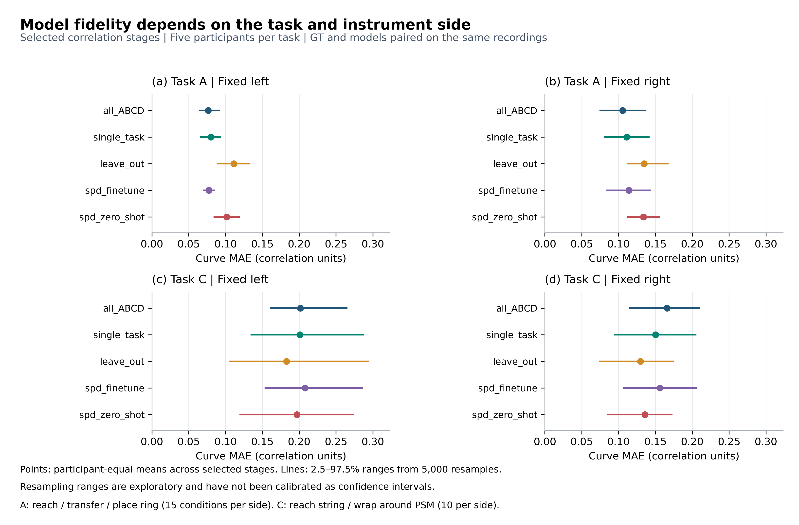
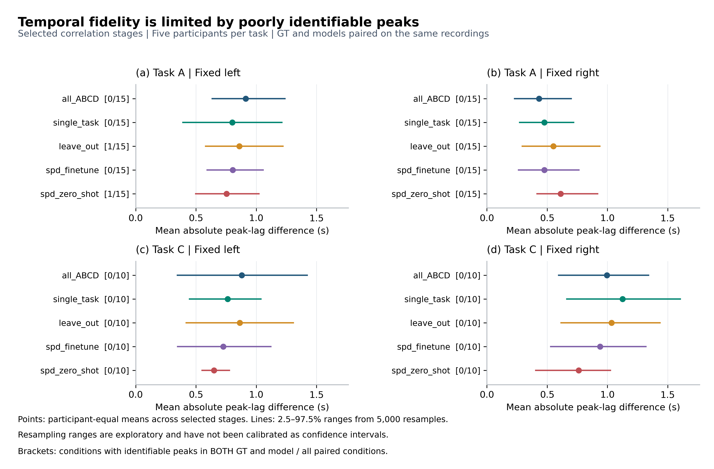

# Models10与GT10：论文结果简版

**可用于论文的主结论：模型能够部分复现人类注视与器械运动的相关结构，但表现依赖任务；本分析尚不能验证精确时序保真，也不能确认统一最优模型。**

本版按[Paper Outline第9页CORRELATION](<C:/Users/GT502/Desktop/JMRR2027/Paper Outline.pptx>)重算，仅包含A的reach ring、transfer ring、place ring，以及C的reach string、wrap around psm；以下数字均为这一阶段子集的结果。样本为10条录制、7名独立参与者；A/C各5人，其中3人跨两任务。

## 方法与指标

主分析采用位置、PSM阶段锚定及左右固定器械，41 Hz、3点居中平滑，搜索±2秒。以同录制同阶段的GT为参照，先算相关曲线MAE及峰lag差，再在参与者内阶段等权、参与者间等权汇总。共同输入条件全部保留，不按峰质量筛除；范围由5000次参与者重采样得到，属探索性分位范围。

**曲线MAE**是165个lag点上模型与GT相关系数的平均绝对差，越小表示曲线复现越好，不是gaze像素误差。**绝对峰差**先逐条件计算`|模型峰lag−GT峰lag|`再平均，单位为秒；不能用有符号差的抵消代替它。gaze–PSM的正lag表示gaze先于PSM。

## 三项明确结论

### 1. 曲线复现具有任务依赖，没有一个模型在两任务都最好

A左右侧MAE均以all_ABCD数值最小（0.0765、0.1058），C左右侧均以leave_out最小（0.1827、0.1297）。对同模型同侧作描述比较，10个组合中有9个在C的MAE更高；例外是leave_out右侧，C为0.1297、A为0.1349。因此可写“复现误差随任务变化”，不能笼统写“所有模型在C都更差”。

这种差异不是纯粹的跨任务泛化效应：两任务包含的操作阶段和动作结构不同，且本分析没有改变训练任务或训练样本量。它首先说明模型的行为复现不能脱离任务情境评价；是否由迁移难度造成，仍需相同训练设置下的专门对照。

**表1　相关曲线MAE。** 每列5名参与者；每模型A每侧15/15、C每侧10/10条件可用。粗略结构相似不等于峰位置正确，且模型相关强度高于GT也不代表更准确。

| 模型 | A左 | A右 | C左 | C右 |
| --- | ---: | ---: | ---: | ---: |
| all_ABCD | 0.0765 | 0.1058 | 0.2017 | 0.1660 |
| single_task | 0.0802 | 0.1110 | 0.2009 | 0.1502 |
| leave_out | 0.1112 | 0.1349 | 0.1827 | 0.1297 |
| spd_finetune | 0.0776 | 0.1141 | 0.2080 | 0.1562 |
| spd_zero_shot | 0.1016 | 0.1338 | 0.1971 | 0.1358 |

**图M1解读：**四面板对应任务×器械侧；点为参与者等权MAE，线为参与者重采样分位范围。A中all_ABCD和spd_finetune较接近；C中leave_out的点估计更低，尤其右侧。图支持任务相关的数值差异，不支持仅凭误差条或最小点宣称显著优胜。

### 2. 峰差仍大且GT峰本身难以定位，时序保真尚未得到验证

各模型组的平均绝对峰差为0.4325–1.1244秒。A右all_ABCD最小，A左和C左右则以spd_zero_shot最小；这与曲线MAE排序不同，说明“曲线形状接近”和“最大值位置接近”是两个评价维度。A的平均有符号峰差均为负（−0.5772至−0.2748秒），显示模型相对PSM的峰倾向于向负lag移动；这一偏移不能直接称为模型运行延迟。

**表2　平均绝对统计峰差（秒）。** 这些是描述性最大值位置差，尚非经过验证的生理时延误差。

| 模型 | A左 | A右 | C左 | C右 |
| --- | ---: | ---: | ---: | ---: |
| all_ABCD | 0.9122 | 0.4325 | 0.8805 | 0.9951 |
| single_task | 0.8016 | 0.4764 | 0.7634 | 1.1244 |
| leave_out | 0.8602 | 0.5512 | 0.8634 | 1.0341 |
| spd_finetune | 0.8049 | 0.4764 | 0.7268 | 0.9390 |
| spd_zero_shot | 0.7528 | 0.6114 | 0.6488 | 0.7610 |

**图M2解读：**点/线为绝对峰差均值及参与者重采样范围；模型名后方括号给出双方均可定位的条件数/配对条件总数。GT的50个唯一条件仅1个可定位；仅A左leave_out与spd_zero_shot各有1/15（6.7%）双方可定位，其余18个组合均为0%。因此小峰差也可能来自两个不稳定最大值接近；不能据此确认模型学到了人类提前注视的精确时间。可定位要求综合完整支持、非边界峰、近峰宽、重复数及重采样稳定性，是操作性规则，未作外部真实性校准。

例如C右all_ABCD的有符号平均峰差仅−0.0488秒，绝对峰差却为0.9951秒，直接展示了正负抵消的风险。本范围输入支持虽为100%，但“能够计算完整曲线”并不等于“能够确定唯一时延”。峰不可定位也不证明模型没有时序能力；它说明当前GT及评估条件不足以验证该能力。

### 3. 全任务配置未显示一致优势，数据效率仍未直接检验

与single_task相比，all_ABCD在A左右侧MAE略低（0.0765/0.1058，对比0.0802/0.1110），在C左右侧却略高（0.2017/0.1660，对比0.2009/0.1502）。因此本批数据没有显示全任务命名配置相对单任务配置的一致曲线复现收益。缺少等数据量对照，不能据此判断多任务训练本身无效或数据效率高低。

对这五阶段进行整参与者模型标签交换检验。每任务×侧把所选各阶段及其平均的全部模型对列为同一Holm家族，共140项比较；原始最小双侧p=0.0625，校正后全部为1.0。每组仅5人，精确双侧检验最小分辨率本来就是2/32=0.0625。因此当前只能报告描述性排序；结果不证明模型等效，也不足以确认任何模型优于其他模型。

all_ABCD、single_task和leave_out按输入来源路径中的全任务、单任务、留出目标任务方案名称解释。五模型的预测文件均保存概率与采样输出，但本次相关分析只评价点轨迹，未比较分布校准、多峰覆盖或概率/确定性消融。本文也未控制训练样本量与随机种子，未进行专家/新手/被动观察数据的受控对照；SPD名称不等同于专家或被动观察数据。

## 对Paper Outline研究问题的回答

| 研究问题 | 本结果能给出的回答 | 还需哪些证据 |
| --- | --- | --- |
| RQ1：何种模型适合动态、多模态注视预测；时序/概率建模假设是否成立？ | **尚不能确认架构或机制优越性。** 支持模型具有部分行为相关结构保真，但跨任务排序变化，精确时序未验证。 | 同数据、同训练预算的时序/非时序、多模态/单模态、概率/确定性受控消融及对应指标。 |
| RQ2：专家数据是否比更多新手/被动观察数据产生更高质量gaze？ | **未回答。** 本批结果没有可核实且受控的技能/观察方式和数据量对照。 | 明确来源标签、匹配训练条件，分别控制数据质量和数量。 |
| RQ3：低数据下跨任务泛化和数据效率如何？ | **本批未显示全任务配置相对单任务配置的一致收益；等数据量的数据效率尚未检验。** C中leave_out数值较好，但不足以确认泛化优势。 | 核实训练/测试任务隔离，开展等量对照、数据量阶梯及新参与者测试，形成学习曲线。 |

## 可直接用于论文的英文结果段落

Across ten recordings from seven participants, five gaze models were compared with ground truth on five selected task stages, using participant-weighted summaries and fixed instruments. Correlation-curve MAE was lowest for all_ABCD in Task A (left/right: 0.0765/0.1058) and leave_out in Task C (0.1827/0.1297). Absolute peak-lag differences ranged from 0.4325 to 1.1244 s. However, only one of 50 ground-truth conditions met operational peak-identifiability criteria, limiting interpretation as temporal fidelity. Participant-level comparisons yielded no confirmed advantage after Holm correction. The all-task configuration showed no consistent advantage over the single-task configuration. These results support partial, task-dependent reproduction of gaze–instrument correlation structure, but not precise anticipatory timing. Controlled ablations and documented training-data composition are needed to assess modeling mechanisms, expert-data benefits, and low-data generalization.

复核数据：[限定阶段汇总](paper_summary_data/models_selected_summary.csv)、[参与者值](paper_summary_data/models_selected_user_metrics.csv)、[可定位覆盖](paper_summary_data/models_selected_reliability.csv)、[本范围精确比较](paper_summary_data/models_selected_exact_comparisons.csv)。本版数字全部来自原目录逐条件结果的重新汇总，不覆盖原始结果。

图的矢量版：[图M1 PDF](paper_summary_figures/M1_curve_fidelity.pdf)、[图M2 PDF](paper_summary_figures/M2_timing_fidelity.pdf)。完整指标与原图见[详细版](models10_vs_gt_report.md)，人工行为参照见[GT84论文简版](gt84_paper_summary.md)。
