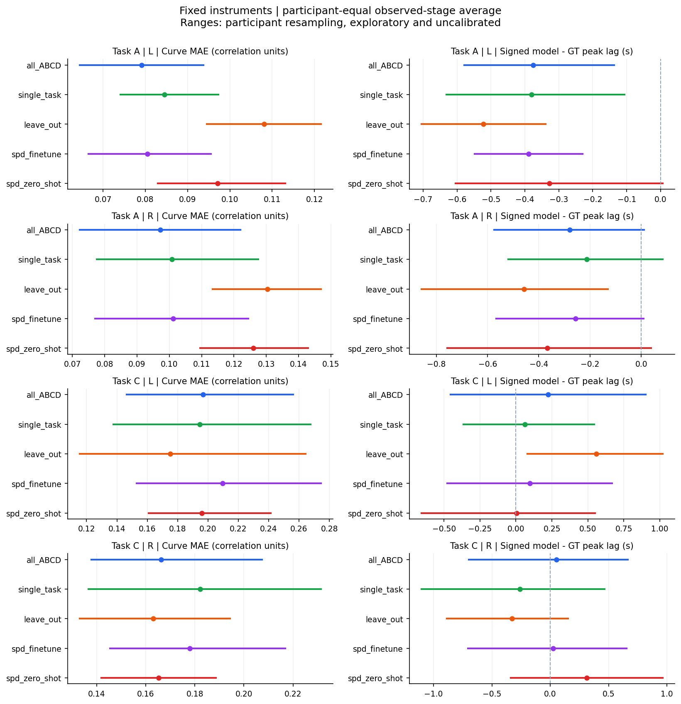
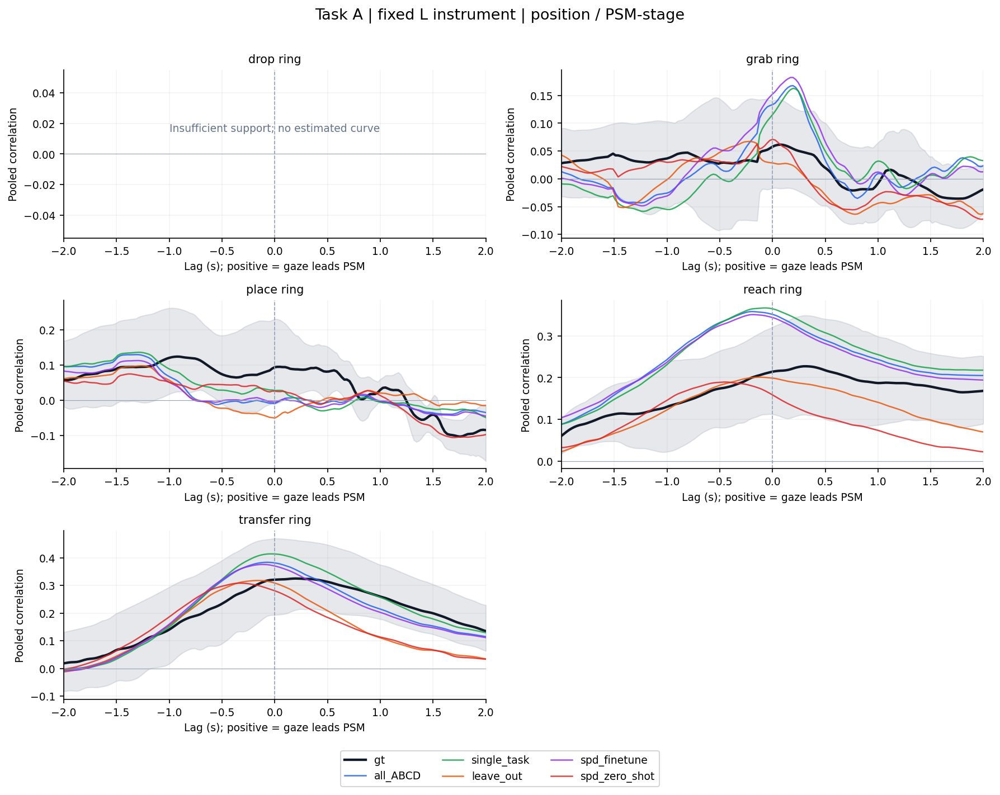
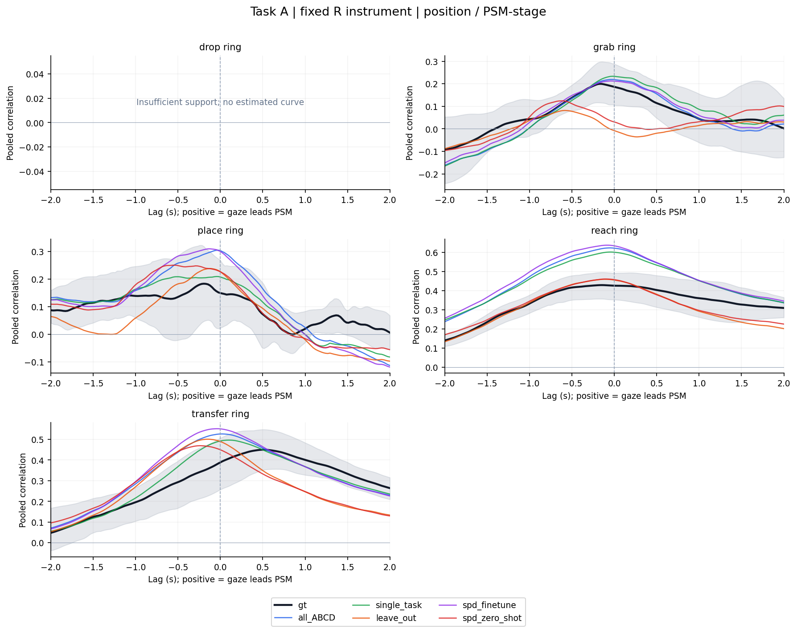
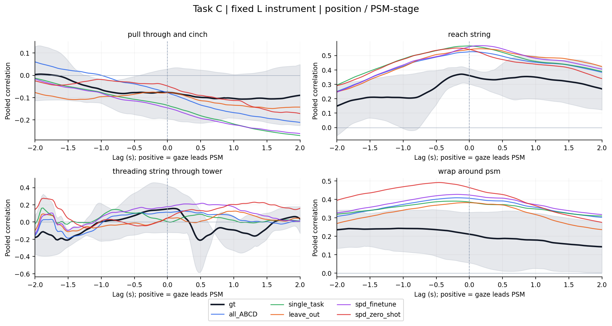
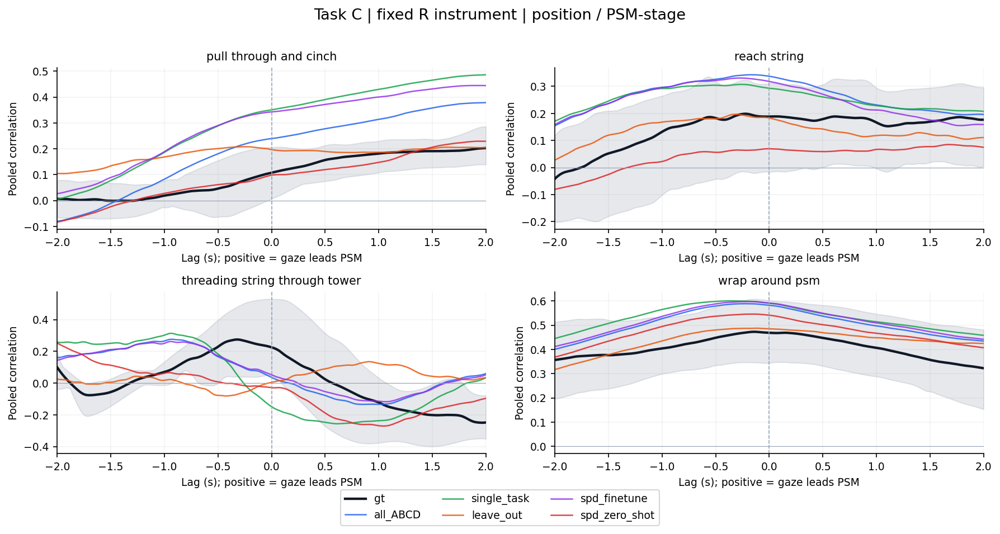
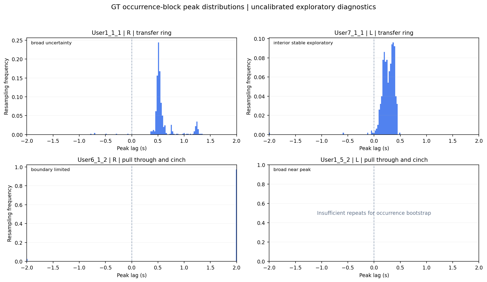

# Models10 与 GT10 对照分析报告

配套报告：[GT84 人工 gaze 与 PSM 分析](gt84_analysis_report.md)。

数据目录：`gaze_psm_revision_20261105/models10`；结果版本：2026-11-05。本文读取已保存的数值、运行参数、计算代码与图片，不重新训练、不重新推断，也不对模型预测做最佳平移校正。

**核心结论：五模型能复现部分 gaze–PSM 相关曲线结构，Task A 的复现误差总体小于 Task C；现有数据不足以确认精确的注视领先时间或统计上稳健的模型优胜者。** 主分析中，Task A 左右侧的最小曲线 MAE 均来自 all_ABCD；Task C 左右侧均来自 leave_out。但曲线 MAE 与峰位置误差排序不同，所有可计算的模型两两比较经 Holm 校正后均为 1.0。尤其 Task C，全部模型的逐条件 lag 可定位率为 0%，不应将统计峰差解释为已验证的生理时延。

本报告内嵌 **6 张唯一图片**。已逐字节核对：`models10/report.html` 的 6 张内嵌图片均与 `models10/figures` 中 PNG 相同，顶层 `models10_vs_gt10.html` 的 4 张图也正是其中四张阶段曲线图。因此六图覆盖两份 HTML 的全部图像，没有遗漏，也不重复展示。本文必须与 `models10` 子目录保持相对位置；在支持本地 Markdown 图片的阅读器中，所有图均可直接显示。

## 1. 数据范围与正确的比较对象

GT10 是同一批 10 个录制的人工 gaze；五个模型分别为 `all_ABCD`、`single_task`、`leave_out`、`spd_finetune`、`spd_zero_shot`。模型与 GT 均对同一条 PSM 轨迹计算相关，**GT84 的总体组均值不是模型配对的基准**。10 个录制来自 7 名独立参与者；A/C 每任务各 5 人，User1、User7、User12 同时出现在两个任务中。

独立核验表明，这 10 个录制的 GT/PSM 输入与 GT84 对应记录一致；primary 下涵盖 position/velocity、两种 mode 的 304 条 GT 曲线逐项一致。主模型对照为 `variant=primary / signal=position / mode=psm_stage`，左右器械单独比较。

| 录制 | 参与者 | 任务 | 主条件数（左右合计） | 每模型完整支持条件 |
| --- | --- | --- | --- | --- |
| User11_6_1 | User11 | A | 8 | 8 |
| User12_3_1 | User12 | A | 8 | 8 |
| User12_5_2 | User12 | C | 6 | 6 |
| User1_1_1 | User1 | A | 10 | 8 |
| User1_5_2 | User1 | C | 8 | 8 |
| User5_3_2 | User5 | C | 6 | 6 |
| User6_1_2 | User6 | C | 6 | 6 |
| User7_1_1 | User7 | A | 8 | 8 |
| User7_4_1 | User7 | C | 8 | 8 |
| User9_7_1 | User9 | A | 8 | 8 |

每模型共 76 个 `record × stage × side` 主条件，74 个具有 GT 与五模型共同完整 lag 支持；5 个模型合计 370/380 个可比较配对行。缺失的是 User1_1_1 的 drop ring 左右两侧，状态保留而不填零。Task A 每侧 20/21 条件可用，Task C 每侧 17/17 条件可用。Task C 各阶段支持人数并不相同，不能将所有阶段都当作 5 人。

完整交付含 10,032 条固定侧曲线、8,360 条固定侧配对；另有 1,824 条选侧补充曲线和 1,520 条选侧补充配对。这里的曲线/配对条目数量包含信号、模式和敏感性分支，绝不是独立参与者样本量。

## 2. 预处理、相关定义与汇总单位

### 2.1 输入与信号

- 统一为 41 Hz，采样间隔为 `1/41 ≈ 0.02439 s`；主 lag 网格为 −2 至 +2 s，共 165 点。±4 s 对照为 329 点。网格间隔不是时延估计的精度保证。
- 最大插值间隙为 0.1 s。DLC 所有有限坐标保留；低 likelihood、图像外坐标、高速或孤立跳变只标记，不删除也不加权。原始 `gaze_raw` 已是 41 Hz 插值缓存，本轮没有重新处理高频原始眼动 Status。
- position 使用未平滑网格坐标的 3 点居中移动平均；对照为不平滑与 5 点平均。velocity 独立从未平滑网格坐标做二阶 Savitzky–Golay 5 点滤波，再计算相邻差分乘 41，单位为 px/s，时间戳放在相邻帧中点；不是对 position 主结果再平滑一次。速度保留带符号 x/y 分量，不是速度模长。
- 滤波不跨 NaN 缺口；连续有限段的边缘采用最近值延拓，主分析保留并记录边缘点，`trim_edges` 分支删除受填充影响的点。
- GT 与五模型采用共同 gaze 有效掩码；每一侧 PSM 掩码单独保留。`common_input` 要求同一条件中六个来源都具有完整 lag 支持，不依据峰正负、边界或可定位性挑选条件。
- `psm_stage` 以 PSM 时间所属的阶段 occurrence 为锚，gaze 可落在该 occurrence 之外；`within_stage` 要求 gaze 与 PSM 均处在同一 occurrence 内。两者检验的时间范围不同。

### 2.2 二维相关曲线及 lag 符号

对每个 lag τ，配对 `gaze(u−τ)` 与 `PSM(u)`；**τ>0 表示更早的 gaze 与当前 PSM 对应，即 gaze 在相关定义中领先 PSM；τ<0 表示相反。** 每个 occurrence 在该 lag 的有效重叠内分别去除 gaze 和 PSM 均值，再把 x、y 两轴的中心化协方差和平方和汇总：

`C_k(τ)=Σ_i [(g_x−ḡ_x)(p_x−p̄_x)+(g_y−ḡ_y)(p_y−p̄_y)]`

`Vg_k(τ)=Σ_i ||g_i−ḡ||²`，`Vp_k(τ)=Σ_i ||p_i−p̄||²`

`r(τ)=Σ_k C_k(τ) / sqrt[(Σ_k Vg_k(τ))(Σ_k Vp_k(τ))]`

这不是分别计算 x/y Pearson 相关后取平均，也不是对各 occurrence 的相关系数取平均。每个 occurrence 至少有 2 对有效点才贡献充分统计量；池化总重叠至少为 2 s，即 82 对点，且 gaze/PSM 的中心化 RMS 变异均至少为 1（position 为 px；velocity 为 px/s），分母非零才得到支持的 r。r 接近 1 表示中心化二维变化一致，接近 0 表示该线性关系弱，负值表示反向变化；r 不测量两者的绝对空间距离。

### 2.3 两种不同的“平均”

**组曲线：**仅使用所有 lag 均有限的录制，在同一个参与者内对录制做 Fisher z 平均，再对参与者等权做 Fisher z 平均，即 `tanh(mean(atanh(r)))`；计算前将 r 裁剪到 ±(1−10⁻⁷)。组曲线至少需要 3 名完整支持参与者。图中的灰带仅为 GT 每个 lag 的参与者重采样分位范围。

**配对误差汇总：**先逐录制/阶段/侧计算 GT–模型误差，同阶段内录制等权，参与者内对实际观测且输入可用的阶段等权，最后参与者等权算术平均，称为 observed-stage average。它不补出缺失阶段，也不是按帧数或 occurrence 数加权。组曲线的峰差与逐录制峰差的平均是不同统计量，不可互换。

## 3. 所有计算指标的定义和阅读方式

以下按功能覆盖数值输出中的指标；`content_id/task/user/stage/source/variant/mode/side` 等为分组标识，路径、哈希、说明字段是可追溯元数据，不是效果量。

### 3.1 相关强度、峰与支持指标

| 字段/指标 | 计算定义与单位 | 结果说明什么 |
| --- | --- | --- |
| `r / lag_s` | 固定 lag 网格上的二维池化相关 / 秒 | 表示关系随时间偏移如何变化；不能只看最高点。 |
| `pairs / occurrences` | 当前 lag 下贡献的有效点对数 / 至少有2对点的 occurrence 数 | 衡量该 lag 的数据基础；不同 lag 可能不同。 |
| `gaze_rms / psm_rms` | `sqrt(中心化平方和/有效点对数)`；px 或 px/s | 是 occurrence 内变化量，非平均速度或注视稳定阈值。低于1则不支持相关。 |
| `full_support / full_lag_support` | 所有165点（或329点）r均有限；两字段同义 | 控制完整窗口可比较性；并不表示峰可靠。 |
| `n_supported_lags` | 有限 r 的 lag 点数 | 少于全网格时应检查缺口或变异不足。 |
| `peak_r / peak_lag_s` | 有限 r 的最大值及其 lag；并列时取网格上第一个 | 衡量最大正向相关位置；即使所有 r≤0 仍保留统计最大值。 |
| `r_zero` | τ=0 的相关 | 不做时间平移时的关系。 |
| `peak_gain_over_zero` | `peak_r−r_zero` | 搜索时间偏移带来的相关增量；很小提示峰位置变化未带来明显强度改善。 |
| `positive_peak` | `peak_r>0` | 正向耦合诊断；不是输入纳入条件，也不等价于显著相关。 |
| `peak_at_boundary` | 最大值位于整个搜索窗首/末点 | 极值可能落在窗口外，不能将±2 s精确解释为真实时延。 |
| `peak_at_support_edge` | 最大值位于有限支持区的首/末点 | 峰受可用数据边界限制；不同于完整搜索窗边界。 |
| `tied_maxima_count / tied_maxima_span_s` | 与最大 r 差≤10⁻¹²的点数及首尾跨度 | 暴露平顶/并列最大值；默认取第一个不应被当成唯一峰。 |
| `n_local_maxima` | 局部极大数；端点满足规则时也计入 | 多峰意味着可能存在不同时间尺度或周期结构。 |
| `second_peak_lag_s / second_peak_r` | 距主峰至少0.2 s的局部峰中最高者 | 衡量竞争峰；没有符合条件的峰时为缺失。 |
| `second_peak_gap_r / second_peak_distance_s` | 主峰减次峰的r差 / 两峰时间距离 | r差小且相隔较远时，峰位置容易切换。 |
| `near_peak_intervals_0p01/0p05/0p10` | 集合 `{τ:r(τ)≥peak_r−ε}` 的全部连续区间，ε=0.01/0.05/0.10 | 展示几乎同样好的 lag 集合，属于描述集合而非置信区间。 |
| `near_peak_components_*` | 近峰集合的连通区间数 | 多于1提示分离的竞争区域。 |
| `near_peak_span_*_s` | 近峰集合最左到最右的跨度 | 包含区间间空隙，不能误当单一峰宽。 |
| `near_peak_contiguous_width_*_s` | 包含主峰的连续近峰区间宽度 | 越宽越难精确定位。 |
| `near_peak_fraction_*` | 近峰集合点数/全部有限lag点数 | 接近1表示几乎整个窗口都同样好。 |

### 3.2 单录制峰可靠性与方向

主分支的 occurrence bootstrap 为500次，敏感性分支为200次。以长度2的非循环相邻 occurrence 块抽样，对充分统计量重加权，不拼接原始轨迹；至少4个登记 occurrence 且至少4个实际贡献 occurrence 才运行。该方案仅保留局部顺序，未证实 occurrence 的平稳性或可交换性。

| 字段/指标 | 定义与解释 |
| --- | --- |
| `n_registered_occurrences / n_contributing_occurrences` | 登记的重复数 / 至少在一个lag有2对点的重复数；不能以总帧数替代重复数。 |
| `bootstrap_requested / bootstrap_valid_replicates / bootstrap_valid_fraction` | 计划次数 / 完整lag支持的有效次数 / 有效率。 |
| `bootstrap_range_low_s/high_s/width_s` | 有效峰lag分布的2.5%、97.5%分位数及宽度；未校准为具有95%覆盖率的置信区间。 |
| `bootstrap_boundary_fraction / bootstrap_peak_distribution` | 有效重采样峰在搜索窗边界的比例 / 每个峰lag及其频数；用于检验边界集中与多峰。 |
| `loo_valid_replicates / loo_peak_lags_s / loo_max_abs_peak_change_s` | 每次删除一个 occurrence 后的有效次数、全部峰lag及相对原峰最大绝对变动；揭示单个重复对结果的影响。 |
| `first_half_peak_lag_s / second_half_peak_lag_s / half_peak_difference_s` | 按 occurrence 时间顺序分前后两半，分别重算峰；最后一项为绝对差。 |
| `lag_identifiable / lag_status / reliability_reasons` | 操作性可定位标志、首要失败原因、全部失败原因；这不是经过外部验证的真实性判定。 |
| `point_direction_0p05/0p10/0p20` | 只按峰点值与±0.05/0.10/0.20 s比较，分 lead、lag、synchronous；峰缺失为undefined。 |
| `direction_0p05/0p10/0p20` | 要求可定位、正峰、有bootstrap范围；整个范围在正阈值上方才lead，在负阈值下方才lag，完全在同步带内才synchronous，其余undetermined。 |

`lag_identifiable=True` 要求没有任何失败原因：完整lag支持、非边界峰；远距离并列峰跨度不超过1.5/41 s；无差≤0.01的分离竞争峰；主峰连续0.01近峰宽≤0.4 s；重复数足够；bootstrap有效率≥95%、范围宽≤0.4 s、边界比例≤5%；删除一个重复或前后半段的峰变动≤0.4 s。峰是否为正单独报告，负峰也可能通过可定位规则，但不会据此给出稳健的正向领先判断。

### 3.3 模型对照误差与覆盖

| 字段/指标 | 计算与解释 |
| --- | --- |
| `curve_mae` | `mean_τ abs(r_model(τ)−r_GT(τ))`，要求整个lag网格共同有限；单位是相关系数，不是像素，也不是秒。越小表示相关曲线复现越好。 |
| `curve_mae_partial` | 仅在GT与该模型共同有限lag上计算MAE，保留作诊断；因网格支持可能不同，不替代主完整支持MAE。 |
| `delta_lag_s` | 模型相对PSM的峰lag减去GT相对PSM的峰lag。负值表示模型曲线峰向负lag移动，不能直接等同模型执行耗时。 |
| `abs_lag_difference_s` | 先逐条件取 `abs(delta_lag_s)` 再汇总；不会像有符号平均那样因正负抵消。 |
| `delta_peak_r` | 模型最大r减GT最大r；高于GT不意味着预测更准确。 |
| `input_eligible / common_input` | 前者为该GT–模型对完整支持；后者为六来源均完整支持，主跨模型比较使用后者。 |
| `n_common_lags / n_required_lags` | 该配对共同有效网格数 / 目标网格数。 |
| `n_total_conditions/n_conditions/input_coverage` | 总条件数、共同输入可用条件数及其比例；保留不可用状态。 |
| `n_total_users/n_users/*_n_users` | 登记人数、共同输入可用人数、相应误差指标有有限值的人数。 |
| `gt_localizable_rate/model_localizable_rate/both_localizable_rate` | 共同输入条件中GT、模型、双方可定位的条目比例；是条件覆盖，不是参与者加权的误差平均。 |
| `gt_boundary_rate/model_boundary_rate` | 共同输入条件中的边界峰比例。 |
| `participant_equal_*` | 依前述“同阶段录制→观测阶段→参与者”等权得到的MAE、有符号峰差、绝对峰差。 |
| `*_resample_low/high` | 对参与者均值做5000次有放回重采样的2.5/97.5分位；`*_user_values_json`保留各人值。 |
| `*_leave_one_user_min/max` | 每次删除一人后组均值的最小/最大；衡量小样本个体依赖。 |
| `conditional_localizable_abs_lag_difference_s / conditional_localizable_n_users` | 仅双方可定位子集的绝对峰差及覆盖人数；子集由结果决定，应与全样本覆盖同时报告，不能取代主结果。 |
| `point_direction_agreement_*` | 同一阈值下GT与模型点方向是否相同；汇总为参与者等权一致率。 |
| `marginal_independence_chance` | `Σ类别 p_GT(类别)×p_model(类别)`；利用三个类别的边际比例构造描述基准，非置换p值。 |
| `same_side/gt_side/model_side/selected_side` | 比较是否使用同一物理器械以及实际所选侧；独立max可能不相同。 |

### 3.4 组级差异、参考分布与模型比较

| 字段/指标 | 定义与解释 |
| --- | --- |
| `n_stable_users/n_complete_records` | 完整lag支持参与者及录制数，stable在这里指支持固定，不保证生理峰稳定。 |
| `r_resample_low/high / peak_lag_resample_low/high` | 参与者重采样组曲线的逐lag相关范围 / 每次整条组曲线峰lag的分位范围；逐点带不是全曲线同时置信带。 |
| `bootstrap_boundary_frequency` | 组曲线重采样峰落在窗口边界的比例。 |
| `n_shared_users` | GT与某模型共同完整支持参与者数；配对组差必须在同一人群上算。 |
| `delta_group_peak_lag_s` | 共同人群模型组曲线峰lag减GT组曲线峰lag。 |
| `delta_group_peak_r/delta_group_r_zero` | 共同人群的模型减GT峰相关 / 零lag相关；其重采样范围在同一批抽中的参与者上配对计算。 |
| `observed_peak_r/reference_peak_r_95` | 他人gaze参考中，观测组最大r / 参考组最大r的95分位。 |
| `n_requested/n_valid/exceedance_fraction_corrected` | 他人参考计划5000次；仅保留全部既定接收者完整支持的抽样；尾部比例为 `(1+#参考峰≥观测峰)/(1+有效次数)`。是描述参考，非正式生理领先p值。 |
| 身份参考 `observed_curve_mae/null_mean_curve_mae/null_q025/null_q975/empirical_lower_tail_rank` | 在所有人、所有来源共同完整阶段上，将整个人的模型曲线轮廓重配给GT；枚举5!=120种映射（含原映射和固定点），计算观测MAE、重配均值、2.5/97.5分位及 `#重配MAE≤观测MAE/120`。越低表示真实身份匹配比多数重配更好。 |
| 身份参考 `observed_abs_lag_difference_s/null_mean_abs_lag_difference_s/null_abs_lag_q025/q975/lag_empirical_lower_tail_rank` | 同一身份重配下的统计峰绝对差及其参考量；不要求峰可定位，因此不是“真实时延”的检验。 |
| `mean_curve_mae_b_minus_a/p_exact/n_permutations` | 在共同条件上算每人模型B减A的MAE，再枚举2ⁿ个整参与者模型标签交换（等价差值符号翻转）；双侧p为 `#abs(交换均差)≥abs(观测均差)/2ⁿ`。 |
| `minimum_two_sided_p/p_holm` | 最小双侧p为2/2ⁿ；n=5时是0.0625。Holm在每task×side内，对所有阶段及观测阶段平均、所有模型对联合校正。 |
| `delta_curve_mae/primary_* /variant_*` | 敏感性分支与其matched primary共同条件上的指标及差值；窗口改变时需另核对lag计算域。 |

他人gaze参考按同任务、不同参与者、相同从录制开始算的elapsed-time替换gaze，保留接收者PSM及阶段；没有阶段进度重定时。因此它反映一种明确构造下的参照，不是普适独立性检验。身份参考与整人模型标签交换也都有参与者可交换性假设，小样本下不能据此确认因果机制。

### 3.5 质量控制及工程验证指标

| 字段/指标 | 定义与解释 |
| --- | --- |
| `n_samples/valid_samples/valid_fraction` | 信号网格点数、二维有限点数及比例；gaze共同掩码后的比例可小于各模型原始比例。 |
| `native_samples/native_nonfinite/raw_grid_nonfinite` | 原生点数、原生二维非有限点数、平滑前网格非有限点数。 |
| `low_likelihood_count/fraction` | 原生likelihood<0.5点数/原生点数；0.2、0.8字段同理。仅QC，不是本轮三种过滤分支。 |
| `jump_over_100px_count/native_speed_p99_px_s` | 相邻原生坐标欧氏位移>100px次数 / 用真实Δt计算的速度99分位；高值可能含快速动作或追踪异常，不能直接删除。 |
| `isolated_jump_candidate_count` | 中点前后两段速度均大于 `max(1000px/s,6×中位速度)`，邻点回返距离≤两段行程总和的20%，且两段Δt≤0.1s的候选数；未校准的诊断标记。 |
| `outside_frame_count` | 有限坐标任一维小于0或大于图像对应尺寸的点数。 |
| `filter_edge_points/signal_filter_edge_points/filter_edge_removed_points` | 坐标滤波边缘数、最终position或差分velocity受影响点数、trim实际移除数；velocity取两个差分端点边缘标记并集。 |
| `ordinary_resample_fraction` | 网格在有限原生邻点之间正常插值的比例；高值通常来自非整齐时间戳，不等于大量缺失修补。 |
| `filled_nonfinite_hole_fraction/filled_quality_hole_fraction` | 短非有限缺口被填充的比例 / 因质量删除而形成缺口的填充比例；后者本轮为0。 |
| `long_gap_grid_fraction/longest_grid_missing_s` | 插值间隙>0.1s对应网格比例 / 最长连续缺失网格点数除以41。 |
| `quality_rejected_count/common_gaze_masked_raw_points` | 因质量规则删除点数（本轮0） / 原本有限但因其他gaze来源缺失而被共同掩码移除的点数，两者不要混淆。 |
| `frame_match/time_match/hash_matches_legacy/support_equal/max_abs_difference/passed` | 帧/时间/输入哈希/有限支持一致性、数值最大绝对误差、规则验收标志；证明处理可追溯及重现，不证明统计效应真实。 |

本 models10 结果未输出 gaze像素预测误差、AUC、分类准确率或空间距离/近邻率，不应把曲线MAE换称这些指标；GT84的空间指标在GT84报告中单独解释。

## 4. 主分析数值结果与模型结论

### 4.1 参与者等权、观测阶段平均

每行均为同任务同侧5名参与者。MAE范围为5000次参与者重采样的探索性2.5/97.5分位。所有lag差都保留不可定位条件，不代表真实时延误差。表中“双方可定位”和“模型边界”分母为该行共同输入条件数。

#### Task A · 固定左侧（共同条件 20/21）

| 模型 | 曲线MAE | MAE重采样范围 | 平均Δlag(s) | 平均绝对峰差(s) | 双方可定位 | 模型边界 |
| --- | --- | --- | --- | --- | --- | --- |
| all_ABCD | 0.0791 | 0.0645–0.0937 | -0.3756 | 0.9049 | 0.0% | 10.0% |
| single_task | 0.0846 | 0.0741–0.0973 | -0.3805 | 0.8585 | 0.0% | 0.0% |
| leave_out | 0.1081 | 0.0946–0.1216 | -0.5220 | 1.1463 | 5.0% | 10.0% |
| spd_finetune | 0.0805 | 0.0665–0.0956 | -0.3890 | 0.8256 | 0.0% | 5.0% |
| spd_zero_shot | 0.0971 | 0.0829–0.1131 | -0.3280 | 0.9354 | 5.0% | 0.0% |

#### Task A · 固定右侧（共同条件 20/21）

| 模型 | 曲线MAE | MAE重采样范围 | 平均Δlag(s) | 平均绝对峰差(s) | 双方可定位 | 模型边界 |
| --- | --- | --- | --- | --- | --- | --- |
| all_ABCD | 0.0972 | 0.0722–0.1221 | -0.2793 | 0.4841 | 0.0% | 5.0% |
| single_task | 0.1008 | 0.0775–0.1275 | -0.2134 | 0.4817 | 0.0% | 5.0% |
| leave_out | 0.1303 | 0.1134–0.1470 | -0.4573 | 0.6354 | 0.0% | 0.0% |
| spd_finetune | 0.1011 | 0.0770–0.1244 | -0.2561 | 0.4683 | 0.0% | 5.0% |
| spd_zero_shot | 0.1260 | 0.1096–0.1430 | -0.3671 | 0.8012 | 0.0% | 0.0% |

#### Task C · 固定左侧（共同条件 17/17）

| 模型 | 曲线MAE | MAE重采样范围 | 平均Δlag(s) | 平均绝对峰差(s) | 双方可定位 | 模型边界 |
| --- | --- | --- | --- | --- | --- | --- |
| all_ABCD | 0.1969 | 0.1465–0.2562 | 0.2236 | 0.9220 | 0.0% | 17.6% |
| single_task | 0.1945 | 0.1377–0.2677 | 0.0626 | 0.7634 | 0.0% | 11.8% |
| leave_out | 0.1751 | 0.1155–0.2644 | 0.5585 | 1.0301 | 0.0% | 5.9% |
| spd_finetune | 0.2095 | 0.1531–0.2745 | 0.0955 | 0.8443 | 0.0% | 17.6% |
| spd_zero_shot | 0.1960 | 0.1608–0.2415 | 0.0041 | 0.8593 | 0.0% | 17.6% |

#### Task C · 固定右侧（共同条件 17/17）

| 模型 | 曲线MAE | MAE重采样范围 | 平均Δlag(s) | 平均绝对峰差(s) | 双方可定位 | 模型边界 |
| --- | --- | --- | --- | --- | --- | --- |
| all_ABCD | 0.1662 | 0.1379–0.2074 | 0.0516 | 0.9435 | 0.0% | 17.6% |
| single_task | 0.1822 | 0.1367–0.2314 | -0.2593 | 0.9789 | 0.0% | 29.4% |
| leave_out | 0.1631 | 0.1331–0.1944 | -0.3260 | 1.0886 | 0.0% | 17.6% |
| spd_finetune | 0.1779 | 0.1454–0.2168 | 0.0260 | 0.9106 | 0.0% | 17.6% |
| spd_zero_shot | 0.1653 | 0.1419–0.1887 | 0.3142 | 0.7776 | 0.0% | 23.5% |

**Task A：**all_ABCD 的曲线 MAE 在左、右侧分别为0.0791、0.0972，数值最小；spd_finetune 的绝对峰差最小，分别0.8256 s、0.4683 s。所有模型平均Δlag均为负（左侧−0.5220至−0.3280 s，右侧−0.4573至−0.2134 s），说明模型相对PSM的统计峰整体更偏负lag。曲线形状更接近与峰位置更接近是不同目标，不应合并为单一“最佳模型”。

**Task C：**leave_out 的曲线MAE在左右侧数值最小（0.1751、0.1631），但绝对峰差却达到1.0301、1.0886 s；C左绝对峰差最小为single_task的0.7634 s，C右为spd_zero_shot的0.7776 s。spd_zero_shot在C左的有符号平均仅0.0041 s，但绝对差0.8593 s，说明接近零主要可能来自正负抵消，不能称“几乎没有时间误差”。

Task A 的10个模型×侧结果中的MAE整体处于0.0791–0.1303，Task C为0.1631–0.2095；两任务范围不重叠，但任务阶段、动作结构和重复数不同，不能单凭此表认定某种训练机制导致泛化失败。所有20个任务×侧×模型组合中，仅A左leave_out与spd_zero_shot的双方可定位率为5%（各1/20）；其他18个组合为0%。

### 图1：主模型误差与有符号峰差汇总

左列横轴为曲线MAE，越靠左越接近GT；右列为模型峰lag减GT峰lag，虚线为0。行分别为A左、A右、C左、C右；点为参与者等权平均，线为参与者重采样范围，模型颜色固定。A的all_ABCD在左列数值最靠左，C的leave_out更靠左，但许多范围重叠，且精确标签交换的Holm结果全为1.0，因此图不支持确认性排名。A右侧峰差绝对值通常小于A左；C右signed Δlag跨正负，不能只凭点靠近0判断复现好。应配合上表绝对峰差及低可定位覆盖阅读。

### 4.2 每条录制的误差与异质性

下表为每录制内所有共同主条件（已观测阶段×两侧）的曲线MAE算术平均，仅用于定位个体差异；它不是重新把10个录制当作10个独立参与者做推断。

| 录制 | 任务 | all_ABCD | single_task | leave_out | spd_finetune | spd_zero_shot |
| --- | --- | --- | --- | --- | --- | --- |
| User11_6_1 | A | 0.0816 | 0.0876 | 0.1418 | 0.0765 | 0.1096 |
| User12_3_1 | A | 0.1025 | 0.1022 | 0.1074 | 0.1096 | 0.1349 |
| User12_5_2 | C | 0.1339 | 0.1051 | 0.1625 | 0.1236 | 0.1722 |
| User1_1_1 | A | 0.1005 | 0.0953 | 0.1072 | 0.1078 | 0.1120 |
| User1_5_2 | C | 0.1924 | 0.1741 | 0.1357 | 0.1932 | 0.1830 |
| User5_3_2 | C | 0.2761 | 0.2971 | 0.2834 | 0.2917 | 0.2328 |
| User6_1_2 | C | 0.1613 | 0.1654 | 0.1077 | 0.1586 | 0.1735 |
| User7_1_1 | A | 0.0578 | 0.0695 | 0.1333 | 0.0616 | 0.1072 |
| User7_4_1 | C | 0.1440 | 0.2000 | 0.1564 | 0.2014 | 0.1417 |
| User9_7_1 | A | 0.0983 | 0.1088 | 0.1064 | 0.0986 | 0.0941 |

各模型在不同录制上的优劣并不一致，C任务User5_3_2的MAE整体较高（约0.233–0.297），不能只看组均值就认为所有参与者表现相似。该差异可能同时受到模型、GT曲线形态、参与者动作以及阶段覆盖影响，当前资料不能分解这些因素的因果贡献。

### 4.3 GT10组曲线的峰值与支持

下表专列图中黑线的数值，便于判断模型是在复现较强结构，还是在比较非常弱且不稳定的峰。人数指完整lag支持人数；“范围”是整条组曲线重采样峰位置的分位范围。

| 任务 | 侧 | 阶段 | 人数 | 峰lag(s) | 峰r | 零lag r | 峰lag范围(s) |
| --- | --- | --- | --- | --- | --- | --- | --- |
| A | l | drop ring | 0 | — | — | — | — |
| A | l | grab ring | 5 | 0.0732 | 0.0615 | 0.0578 | -1.5122–1.2439 |
| A | l | place ring | 5 | -0.9268 | 0.1242 | 0.0942 | -0.9756–0.6829 |
| A | l | reach ring | 5 | 0.3171 | 0.2273 | 0.2142 | -0.1951–2.0000 |
| A | l | transfer ring | 5 | 0.1951 | 0.3252 | 0.3209 | -0.0488–0.4146 |
| A | r | drop ring | 0 | — | — | — | — |
| A | r | grab ring | 5 | -0.1707 | 0.2000 | 0.1862 | -0.1951–1.6829 |
| A | r | place ring | 5 | -0.1951 | 0.1839 | 0.1498 | -1.3902–1.3659 |
| A | r | reach ring | 5 | -0.1463 | 0.4294 | 0.4262 | -0.4634–0.2439 |
| A | r | transfer ring | 5 | 0.5122 | 0.4500 | 0.3889 | 0.2683–0.6585 |
| C | l | pull through and cinch | 4 | -1.9268 | 0.0051 | -0.0770 | -1.9512–1.9268 |
| C | l | reach string | 5 | -0.1220 | 0.3705 | 0.3607 | -0.2683–0.9024 |
| C | l | threading string through tower | 3 | 0.0976 | 0.1574 | 0.1516 | -1.8780–2.0000 |
| C | l | wrap around psm | 5 | -1.0732 | 0.2424 | 0.2108 | -2.0000–0.5610 |
| C | r | pull through and cinch | 4 | 2.0000 | 0.2029 | 0.1075 | 1.1951–2.0000 |
| C | r | reach string | 5 | -0.2195 | 0.1985 | 0.1881 | -0.5610–1.7805 |
| C | r | threading string through tower | 3 | -0.3171 | 0.2750 | 0.2258 | -1.0000–-0.0244 |
| C | r | wrap around psm | 5 | -0.1463 | 0.4728 | 0.4688 | -0.1951–0.2439 |

A右transfer ring的GT组峰为+0.5122 s，r=0.4500，重采样峰范围0.2683–0.6585 s，是图中较清楚的正lag组结构；但这仍是特定样本和方法下的探索性组统计，不是所有单人均有相同生理领先。C右pull through and cinch峰为+2.0000 s，处于搜索边界；C左同阶段最大r仅0.0051，相关结构几乎没有正峰。C左threading string through tower的组峰范围跨−1.8780至+2.0000 s，仅3人支持，单个峰点尤其不应被强解释。

## 5. 四张阶段曲线图：逐图、逐阶段解释

四图统一：横轴为lag（s），正值表示gaze在相关定义中领先PSM；纵轴为Fisher汇总后的二维相关r。黑线为GT；蓝all_ABCD、绿single_task、橙leave_out、紫spd_finetune、红spd_zero_shot。灰带仅为GT逐lag的参与者重采样范围，未绘制模型范围，故不能用“模型是否落入灰带”作为正式差异检验。

### 图2：Task A 固定左器械的阶段曲线

- **drop ring：**没有完整支持的组曲线；面板中的水平参考线不是零相关估计。该阶段只有User1_1_1的一次记录且支持不足。
- **grab ring：**GT峰r=0.0615，lag=+0.0732 s，整体接近0；all_ABCD、single_task、spd_finetune在正lag附近形成更突出的窄峰。它们高于GT并不表示更准确，而是模型产生了GT中较弱的相关结构。
- **place ring：**GT峰在−0.9268 s、r=0.1242；多条模型曲线在接近0及正lag区域更低，且可出现负相关。形状与振幅的差别比某一个lag点的正负更值得关注。
- **reach ring：**GT为较宽的正相关丘形，峰r=0.2273、lag=+0.3171 s；蓝/绿/紫峰更高且偏向零或负lag，显示强度高估和峰位置偏移并存。
- **transfer ring：**六条曲线都呈较宽正相关峰，GT峰+0.1951 s、r=0.3252；多模型峰更靠近0或负lag，说明粗略阶段结构可复现，精确时间位置仍有差异。

这张图解释了A左较低MAE与仍可达0.8–1.1 s的逐条件绝对峰差为何能同时存在：平缓、多峰或弱相关曲线只需较小振幅变化就可能切换最大值位置。

### 图3：Task A 固定右器械的阶段曲线

- **drop ring：**同样没有可估计组曲线，不能填作r=0。
- **grab ring：**GT在−0.1707 s、r=0.2000附近形成宽峰，蓝/绿/紫整体较接近；红/橙在负lag附近较高、随后回落，形状不同。
- **place ring：**GT峰−0.1951 s、r=0.1839；蓝/紫等峰更高且位置不同。GT在正lag尾部仍保持部分正相关，若模型尾部下降至负值，会增加整个lag网格的MAE。
- **reach ring：**GT峰r=0.4294、lag=−0.1463 s，蓝/绿/紫峰接近0.6以上；它们保留丘形但明显抬高相关强度。红/橙的幅度更接近GT不意味着其他阶段也更好。
- **transfer ring：**GT组峰为+0.5122 s，模型多在接近0或略负lag达到最高值，视觉上形成系统性的峰左移。这与A右平均Δlag为负一致。

A右主绝对峰差小于A左，但GT逐条件可定位率为0%，因此“更接近”只是统计峰复现层面的比较。

### 图4：Task C 固定左器械的阶段曲线

- **pull through and cinch：**GT除极少负lag附近外大多为负，最大r也仅0.0051、lag=−1.9268 s；蓝/绿/紫在正lag端更负。这里没有清楚的正向耦合峰，不能将靠近窗口左端的最大值解释成精确“gaze滞后”。
- **reach string：**GT峰r=0.3705、lag=−0.1220 s；模型在较大lag范围都处于约0.4–0.55的更高正相关水平，显示阶段形状与强度偏差。
- **threading string through tower：**GT仅3人支持，曲线波动明显，灰带宽；模型与GT局部峰谷并不一致，GT正lag约0.5 s的下降不被多数模型再现。最大值位置对这些局部差异敏感。
- **wrap around psm：**GT峰−1.0732 s、r=0.2424，整体明显低于模型；红色spd_zero_shot曲线尤高，但这属于与GT的振幅偏离而不是更好复现。

C左的模型MAE为0.1751–0.2095，明显高于A左；图中主要问题既有振幅偏差，也有弱峰、多峰和时间位置偏差。

### 图5：Task C 固定右器械的阶段曲线

- **pull through and cinch：**GT随lag增大总体上升，+2 s边界处达到r=0.2029；蓝/绿/紫同样上升但幅度更大。边界最大值说明现有±2 s窗口未包围内部峰，不支持精确时延读数。
- **reach string：**GT峰−0.2195 s、r=0.1985，蓝/绿/紫整体更高、红色整体更低；橙色较接近GT的振幅，但不能据单阶段判定总体最佳。
- **threading string through tower：**GT峰−0.3171 s、r=0.2750；蓝/绿/紫较强部分偏向更负lag，GT与模型的正lag谷底位置亦不同；红/橙曲线形状又不同。该面板说明固定器械和阶段后仍存在模型相关结构差异。
- **wrap around psm：**GT在零附近形成宽而强的正相关，峰−0.1463 s、r=0.4728，零lag已为0.4688，峰增益仅约0.0040。即使峰位置有变化，相关强度改善也很小，不能过度解读小量的峰偏移。

C右signed Δlag在模型间正负混杂，且模型边界率为17.6%–29.4%，需要同时保留边界与可定位信息。

### 图6：四个GT条件的occurrence重采样峰分布

横轴为每次重采样后重新寻找的峰lag，纵轴为有效重采样频率，条宽为1/41 s；不是轨迹点的分布，也不是参与者分布。

1. **左上 User1_1_1 / 右侧 / transfer ring：**原峰+0.5366 s、r=0.3150；500次有效重采样范围约0.3902–1.2439 s，宽0.8537 s，超过0.4 s阈值。虽然多数峰集中在约0.5 s，仍有较远峰质量，故标为broad uncertainty。
2. **右上 User7_1_1 / 左侧 / transfer ring：**原峰+0.3415 s、r=0.3338；16次登记occurrence，500次有效重采样，范围0.0732–0.4390 s，宽0.3659 s，通过本轮操作性规则，标为interior stable exploratory。范围仍可跨不同的方向带界限，不能据标签声称精确生理领先量。
3. **左下 User6_1_2 / 右侧 / pull through and cinch：**原峰+2 s、r=0.1225，许多重采样峰堆积在+2 s边界，范围−0.1000至+2.0000 s。这是边界限制的示例，不是“非常稳定地领先2秒”。
4. **右下 User1_5_2 / 左侧 / pull through and cinch：**只有1个occurrence，未运行bootstrap，空图不是零不确定性。其原峰−1.5854 s、r=−0.1525，0.01近峰宽约1.0244 s，属于宽而非正的统计最大值。

四面板说明：点峰值、峰高和可定位性是不同信息；可靠性不足的条件应保留状态，不能删除后只展示少量窄峰。

## 6. 可定位覆盖、方向与补充信号

### 6.1 逐条件可靠性

下表分母为每来源全部76个主条件；“完整”均为74，“可定位”按操作规则计算。bootstrap宽度中位数仅对有有效重采样范围的条件计算，不能代表未运行的条件。

| 来源 | 总条件 | 完整 | 可定位 | 边界峰 | 正峰 | bootstrap宽度中位数(s) |
| --- | --- | --- | --- | --- | --- | --- |
| all_ABCD | 76 | 74 | 9 | 9 | 72 | 0.9268 |
| gt | 76 | 74 | 2 | 6 | 70 | 1.9942 |
| leave_out | 76 | 74 | 8 | 6 | 70 | 1.5326 |
| single_task | 76 | 74 | 10 | 8 | 70 | 1.5732 |
| spd_finetune | 76 | 74 | 6 | 8 | 71 | 0.9030 |
| spd_zero_shot | 76 | 74 | 7 | 7 | 68 | 1.7598 |

GT只有2/74个完整条件可定位，模型为6–10/74；模型更容易形成操作性稳定峰不代表它更接近GT，因为GT与模型的稳定条件通常并不重合。Task C中所有模型的可定位条件数均为0，不能把C的模型峰误差作为已确定时延的准确性。

以下限定为 `primary / position / psm_stage` 的 `observed-stage average`。三种同步带下，参与者等权点方向一致率在20个任务×侧×模型组合的范围如下。它只描述统计峰点值；同步带改变会改变分类结果，没有经过可靠性确认的方向不能据此升级为机制判断。

| 同步带半宽(s) | 一致率最小 | 一致率最大 | 边际描述基准最小 | 边际描述基准最大 |
| --- | --- | --- | --- | --- |
| 0.0500 | 0.3000 | 0.7167 | 0.2700 | 0.6083 |
| 0.1000 | 0.3000 | 0.6833 | 0.2350 | 0.5247 |
| 0.2000 | 0.2500 | 0.6667 | 0.2750 | 0.4714 |

### 6.2 velocity 与 within_stage 的完整补充

下表每格为五模型的范围，全部取primary、参与者等权observed-stage average。不同信号的相关幅度和估计难度不同，不能因为velocity的MAE数值小就认定速度预测更准确。

| 信号 | 模式 | 任务 | 侧 | 曲线MAE范围 | 绝对峰差范围(s) | 双方可定位率最大 |
| --- | --- | --- | --- | --- | --- | --- |
| position | psm_stage | A | l | 0.0791–0.1081 | 0.8256–1.1463 | 5.0% |
| position | psm_stage | A | r | 0.0972–0.1303 | 0.4683–0.8012 | 0.0% |
| position | psm_stage | C | l | 0.1751–0.2095 | 0.7634–1.0301 | 0.0% |
| position | psm_stage | C | r | 0.1631–0.1822 | 0.7776–1.0886 | 0.0% |
| position | within_stage | A | l | 0.1006–0.1204 | 0.7390–0.9268 | 0.0% |
| position | within_stage | A | r | 0.1175–0.1535 | 0.5037–0.7244 | 0.0% |
| position | within_stage | C | l | 0.1765–0.2112 | 0.9305–1.3431 | 0.0% |
| position | within_stage | C | r | 0.1852–0.1989 | 0.8967–1.0659 | 0.0% |
| velocity | psm_stage | A | l | 0.0234–0.0255 | 1.0183–1.3439 | 0.0% |
| velocity | psm_stage | A | r | 0.0214–0.0244 | 0.8915–1.0854 | 0.0% |
| velocity | psm_stage | C | l | 0.0303–0.0323 | 0.9358–1.3435 | 0.0% |
| velocity | psm_stage | C | r | 0.0323–0.0338 | 0.9935–1.5431 | 0.0% |
| velocity | within_stage | A | l | 0.0283–0.0325 | 1.1341–1.4171 | 0.0% |
| velocity | within_stage | A | r | 0.0267–0.0304 | 1.0073–1.5195 | 0.0% |
| velocity | within_stage | C | l | 0.0316–0.0342 | 1.2484–1.4752 | 0.0% |
| velocity | within_stage | C | r | 0.0341–0.0358 | 0.8122–1.5041 | 0.0% |

velocity虽然曲线MAE约0.021–0.036，但绝对峰差常在0.8–1.5 s量级，所有组合双方可定位率为0%。这支持“弱/低幅相关曲线的整体差可以很小，而最大值位置不稳”的解释。within_stage限制gaze也在同一阶段内，会改变跨边界配对及支持，整体未消除峰不可定位问题。

## 7. 选侧补充：保证同侧与独立max的差别

`gt_selected_side` 在每录制×阶段×信号×模式上，以GT较大峰r决定一侧，所有模型使用同一侧；它保证物理可比，但选择仍由数据决定。`independent_max_side_legacy` 为GT、每模型各自选择最大峰r侧，可能比较不同器械。两者都只作补充描述，没有新计算选侧统计量的参考p值，不能借用固定侧参考结果。

以下两张选侧表均限定为 `primary / position / psm_stage` 的 `observed-stage average`，不代表其他信号或模式的选侧效果。

| 任务 | 选侧规则 | 模型 | 曲线MAE | 平均Δlag(s) | 绝对峰差(s) |
| --- | --- | --- | --- | --- | --- |
| A | gt_selected_side | all_ABCD | 0.0878 | -0.2427 | 0.4183 |
| A | gt_selected_side | leave_out | 0.1252 | -0.3476 | 0.6037 |
| A | gt_selected_side | single_task | 0.0891 | -0.1976 | 0.4073 |
| A | gt_selected_side | spd_finetune | 0.0929 | -0.2707 | 0.4488 |
| A | gt_selected_side | spd_zero_shot | 0.1227 | -0.2146 | 0.8732 |
| A | independent_max_side_legacy | all_ABCD | 0.0993 | -0.3598 | 0.5866 |
| A | independent_max_side_legacy | leave_out | 0.1252 | -0.3646 | 0.7232 |
| A | independent_max_side_legacy | single_task | 0.0983 | -0.1634 | 0.4463 |
| A | independent_max_side_legacy | spd_finetune | 0.1059 | -0.2976 | 0.5244 |
| A | independent_max_side_legacy | spd_zero_shot | 0.1190 | -0.2963 | 0.8598 |
| C | gt_selected_side | all_ABCD | 0.1937 | 0.0951 | 0.7675 |
| C | gt_selected_side | leave_out | 0.1721 | 0.0394 | 0.8890 |
| C | gt_selected_side | single_task | 0.1968 | -0.0264 | 0.6801 |
| C | gt_selected_side | spd_finetune | 0.2006 | 0.0846 | 0.8041 |
| C | gt_selected_side | spd_zero_shot | 0.1979 | -0.1598 | 0.6370 |
| C | independent_max_side_legacy | all_ABCD | 0.1995 | 0.0720 | 0.7882 |
| C | independent_max_side_legacy | leave_out | 0.1740 | 0.1797 | 0.7488 |
| C | independent_max_side_legacy | single_task | 0.2052 | 0.1183 | 0.5524 |
| C | independent_max_side_legacy | spd_finetune | 0.2028 | 0.3500 | 0.5459 |
| C | independent_max_side_legacy | spd_zero_shot | 0.2040 | -0.1285 | 0.6512 |

| 任务 | 模型 | 独立max的同侧比例 |
| --- | --- | --- |
| A | all_ABCD | 0.7500 |
| A | leave_out | 0.7500 |
| A | single_task | 0.8500 |
| A | spd_finetune | 0.8000 |
| A | spd_zero_shot | 0.8000 |
| C | all_ABCD | 0.8824 |
| C | leave_out | 0.7059 |
| C | single_task | 0.8235 |
| C | spd_finetune | 0.8824 |
| C | spd_zero_shot | 0.8235 |

独立max在A只有75%–85%的条件与GT同侧，C为70.6%–88.2%。例如C的spd_finetune绝对峰差由GT选侧的0.8041 s变为独立max的0.5459 s，但后者部分条件换了物理器械；不能把这种下降归为模型时序准确性提升。固定左/右应继续作为主结论，最大相关侧也不能自动称为实际操作侧。

## 8. 直接GT–模型相对时序审计

此处直接相关GT gaze与模型gaze；**正lag的含义是“模型gaze跟随/落后GT gaze”**，不同于前述gaze–PSM的正lag。分别保存整段、前半、后半共150条曲线。下表整段中位数以每任务5条录制等权计算，不是7人跨任务合并的总体延迟。

| 任务 | 模型 | 录制数 | 整段峰lag中位数(s) | 最小(s) | 最大(s) | 峰r中位数 |
| --- | --- | --- | --- | --- | --- | --- |
| A | all_ABCD | 5 | 0.2683 | 0.2195 | 0.5854 | 0.7686 |
| A | leave_out | 5 | 0.4146 | 0.3659 | 0.8293 | 0.4957 |
| A | single_task | 5 | 0.2683 | 0.1951 | 0.5854 | 0.7609 |
| A | spd_finetune | 5 | 0.3171 | 0.2439 | 0.6098 | 0.7431 |
| A | spd_zero_shot | 5 | 0.5610 | 0.4878 | 0.8537 | 0.5300 |
| C | all_ABCD | 5 | 0.2927 | -0.1220 | 0.3902 | 0.7089 |
| C | leave_out | 5 | 0.2927 | -0.8049 | 0.3659 | 0.6459 |
| C | single_task | 5 | 0.3171 | -0.8049 | 0.3415 | 0.7165 |
| C | spd_finetune | 5 | 0.2927 | -0.2195 | 0.4390 | 0.6947 |
| C | spd_zero_shot | 5 | 0.2683 | -0.2195 | 0.5610 | 0.5796 |

| 任务 | 模型 | 前后半峰差中位数(s) | 前后半峰差最大(s) |
| --- | --- | --- | --- |
| A | all_ABCD | 0.0976 | 0.3171 |
| A | leave_out | 0.2195 | 0.6585 |
| A | single_task | 0.1463 | 0.2683 |
| A | spd_finetune | 0.1220 | 0.3659 |
| A | spd_zero_shot | 0.1951 | 0.5366 |
| C | all_ABCD | 0.2195 | 0.4878 |
| C | leave_out | 0.5610 | 1.4634 |
| C | single_task | 0.3415 | 1.2439 |
| C | spd_finetune | 0.4878 | 1.3902 |
| C | spd_zero_shot | 0.3171 | 0.8049 |

A任务的直接峰lag全部为正，各模型中位数约0.268–0.561 s；C任务中位数约0.268–0.317 s，但存在负值，且前后半段差异可达1.4634 s。因此无法用一个固定常数解释或补偿所有录制。当前可检查代码以clip末帧为目标，没有证实“中心帧/末帧错配”；但当前代码不能证明历史推断时的实际版本。直接相关峰既不是时间戳错误的证明，也不是模型运行耗时；本轮未校准预测时间轴。

## 9. 敏感性分析：完整分支与共同条件

所有分支与各自 `primary_matched_to_*` 在同一组条件键上比较；裁边可能仍改变条件内部时间掩码。下表是每个分支在各task×side×model组合的变化范围，限定psm_stage与observed-stage average；position专属分支用position，velocity专属分支用velocity，trim/window分支包含两信号。正ΔMAE表示分支曲线复现误差更大。不同组合的最小/最大并非一个总体效应。

| 分支 | ΔMAE范围 | Δ绝对峰差范围(s) | 有符号峰差改变量最大绝对值(s) |
| --- | --- | --- | --- |
| position_smooth5 | 0.001470–0.003875 | -0.0585–0.0138 | 0.0512 |
| position_unsmoothed | -0.006638–-0.002572 | -0.0061–0.0951 | 0.1537 |
| trim_edges | -0.000381–0.001030 | -0.1366–0.2484 | 0.2171 |
| velocity_box3 | 0.001339–0.004502 | -0.3902–0.4179 | 0.3134 |
| velocity_sg11 | 0.012310–0.016755 | -0.5126–0.1809 | 0.6858 |
| velocity_sg7 | 0.003731–0.006102 | -0.4228–0.3134 | 0.5447 |
| window4 | -0.028555–0.000251 | 0.2695–1.6610 | 1.0508 |
| window4_restricted2 | -0.000000–0.000000 | 0.0000–0.0000 | 0.0000 |

不平滑相对3点主位置滤波，MAE下降约0.0026–0.0066；5点平均使MAE增加约0.0015–0.0039，说明平滑选择对曲线距离影响较小但非零。velocity从SG5改SG7/SG11时MAE均增大，峰差变化可达数百毫秒；弱速度峰的lag解释依赖滤波。

扩窗至±4 s后MAE常下降、绝对峰差却增大0.270–1.661 s，原因包含lag域与最大值搜索域都变化，不能将MAE下降称为稳健提升。关键核验是 `window4_restricted2`：把±4 s曲线限制回±2 s后，MAE差在约10⁻¹⁶浮点误差内、两类峰差完全相同，说明变化主要来自扩展后的搜索/评价窗口，而不是同域数值改变。该restricted分支没有重新计算±2 s可靠性bootstrap，不可冒用其可靠性标签。

## 10. 三类参考与推断边界

### 10.1 他人gaze与PSM的非配对参考

主固定侧position/psm_stage共有108组参考：A drop ring的12个来源×侧组合无可估计观测组；有完整支持的96组有效抽样906–5000次。C pull through and cinch的左右侧×六来源共12组仅906/5000有效，低于预设有效2000目标；失败抽样没有通过更换donor或补抽掩盖。

以下列出GT的18个组，比较观测峰与参考峰95分位。低尾部比例仅说明观测峰在这种他人elapsed-time配对参考下较高，不等于gaze因果领先，也不证明该峰可精确定位。

| 任务 | 侧 | 阶段 | 有效抽样 | 观测峰r | 参考峰95分位 | 修正尾部比例 |
| --- | --- | --- | --- | --- | --- | --- |
| A | l | drop ring | 0 | — | — | — |
| A | l | grab ring | 5000 | 0.0615 | 0.1580 | 0.6701 |
| A | l | place ring | 5000 | 0.1242 | 0.0837 | 0.0010 |
| A | l | reach ring | 5000 | 0.2273 | 0.1093 | 0.0002 |
| A | l | transfer ring | 5000 | 0.3252 | 0.0943 | 0.0002 |
| A | r | drop ring | 0 | — | — | — |
| A | r | grab ring | 5000 | 0.2000 | 0.1214 | 0.0002 |
| A | r | place ring | 5000 | 0.1839 | 0.1468 | 0.0042 |
| A | r | reach ring | 5000 | 0.4294 | 0.1264 | 0.0002 |
| A | r | transfer ring | 5000 | 0.4500 | 0.1284 | 0.0002 |
| C | l | pull through and cinch | 906 | 0.0051 | 0.1287 | 0.8082 |
| C | l | reach string | 5000 | 0.3705 | 0.2617 | 0.0002 |
| C | l | threading string through tower | 5000 | 0.1574 | 0.4259 | 0.9242 |
| C | l | wrap around psm | 5000 | 0.2424 | 0.1572 | 0.0002 |
| C | r | pull through and cinch | 906 | 0.2029 | 0.3289 | 0.3815 |
| C | r | reach string | 5000 | 0.1985 | 0.2020 | 0.0538 |
| C | r | threading string through tower | 5000 | 0.2750 | 0.6021 | 0.6203 |
| C | r | wrap around psm | 5000 | 0.4728 | 0.2550 | 0.0002 |

GT的A多数阶段观测峰高于参考，但A左grab ring尾部比例0.6701，证据弱；C左pull/cinch和threading、C右pull/cinch和threading均未超过参考95分位，C右reach string约0.0538。相反C的reach/wrap部分侧有强于参考的相关强度。结果强调“存在相对参考更强的相关”与“峰时间可定位”必须分开。

### 10.2 参与者身份匹配参考

A的共同完整阶段为4个，C为2个；因此C本节观测误差不等同于前文所有观测阶段平均。每行枚举120个整参与者身份映射，保留阶段和器械侧。下表同时列曲线与峰差下尾秩。

| 任务 | 侧 | 模型 | 共同阶段数 | 真实匹配MAE | 重配平均MAE | 曲线下尾秩 | 绝对峰差下尾秩 |
| --- | --- | --- | --- | --- | --- | --- | --- |
| A | l | all_ABCD | 4 | 0.0791 | 0.1304 | 0.0083 | 0.2500 |
| A | l | leave_out | 4 | 0.1081 | 0.1470 | 0.1000 | 0.7500 |
| A | l | single_task | 4 | 0.0846 | 0.1343 | 0.0083 | 0.6333 |
| A | l | spd_finetune | 4 | 0.0805 | 0.1295 | 0.0083 | 0.2417 |
| A | l | spd_zero_shot | 4 | 0.0971 | 0.1321 | 0.0167 | 0.4167 |
| A | r | all_ABCD | 4 | 0.0972 | 0.1396 | 0.0083 | 0.0500 |
| A | r | leave_out | 4 | 0.1303 | 0.1508 | 0.0167 | 0.1333 |
| A | r | single_task | 4 | 0.1008 | 0.1339 | 0.0083 | 0.0333 |
| A | r | spd_finetune | 4 | 0.1011 | 0.1437 | 0.0083 | 0.0583 |
| A | r | spd_zero_shot | 4 | 0.1260 | 0.1497 | 0.0167 | 0.4083 |
| C | l | all_ABCD | 2 | 0.2017 | 0.2646 | 0.0167 | 0.1750 |
| C | l | leave_out | 2 | 0.1827 | 0.2320 | 0.0667 | 0.2667 |
| C | l | single_task | 2 | 0.2009 | 0.2680 | 0.0167 | 0.0667 |
| C | l | spd_finetune | 2 | 0.2080 | 0.2751 | 0.0167 | 0.1083 |
| C | l | spd_zero_shot | 2 | 0.1971 | 0.2437 | 0.0333 | 0.0417 |
| C | r | all_ABCD | 2 | 0.1660 | 0.2306 | 0.0917 | 0.4000 |
| C | r | leave_out | 2 | 0.1297 | 0.2015 | 0.0250 | 0.3417 |
| C | r | single_task | 2 | 0.1502 | 0.2395 | 0.0083 | 0.1500 |
| C | r | spd_finetune | 2 | 0.1562 | 0.2306 | 0.0083 | 0.2583 |
| C | r | spd_zero_shot | 2 | 0.1358 | 0.2056 | 0.0333 | 0.1333 |

20个组合真实身份MAE均低于重配平均MAE，说明模型曲线保留了一定参与者对应的信息，而非完全可由他人曲线替代。曲线下尾秩约0.0083–0.1000，峰差下尾秩约0.0333–0.7500，峰位置匹配证据明显更不一致。这些秩依赖共同完整阶段和交换性假设，未做统一确认性检验或多重校正，不应以单个低秩宣称模型优胜。

### 10.3 模型之间的精确整人标签交换

`model_comparisons.csv`共有220行，其中200行可计算、20行drop ring无有效用户。可计算比较的原始最小双侧p为0.0625，所有Holm校正值为1.0。n=5时精确双侧p本来最小就只能到0.0625；这同时反映样本量与检验分辨率的限制。因此“没有确认显著差异”不等于“所有模型等效”，但足以否定仅凭当前误差最小值作强优胜宣称。

## 11. 输入质量、数值核验与未解决问题

主position分支的20个录制×侧PSM序列均为100%有限；原生非有限、图像外点、长间隙网格及非有限缺口填补均为0。likelihood<0.5比例在各序列间为2.84%–25.53%；<0.2为0%–7.72%，<0.8为27.35%–92.99%。20条原生序列合计2108次>100px相邻跳变、852个孤立跳变候选；它们并未导致删除。原生速度99分位约405–32,323 px/s，提示应保留追踪质量背景解释，不能把所有峰都视为精确器械运动对应。

gaze共同有效比例为84.31%–100%，反映共同输入掩码。PSM正常重采样比例约99.97%–99.99%，是原生时间戳与41Hz网格错位导致，大比例正常插值不等同于大量缺失数据修复。质量规则删除点数始终为0；低likelihood候选和高速候选可能有重叠，不应把其计数相加解释为独立异常数。

验证结果：888条旧已选侧曲线回归最大差0；1,824条上一版primary曲线逐项完全一致；独立从保存记录曲线重算432条primary组曲线最大差约2.23×10⁻¹⁶；输入缓存、预测哈希、执行代码快照保持一致，38项既有测试和1项补充选侧测试通过。验证证明数值实现与来源可追溯，不会自动解决小样本、GT自身时序不稳定或参考交换性问题。

## 12. 综合结论

1. **模型确实复现了部分任务/阶段相关形状。** A的reach/transfer、C的reach/wrap可看到共同的宽峰结构，身份重配参考也显示真实参与者匹配MAE普遍更低。
2. **Task A的曲线复现比Task C更接近GT。** A的MAE为0.0791–0.1303，C为0.1631–0.2095；但相关强度被高估、峰位置偏移和阶段异质性均存在。高于GT的r不是“胜过GT”。
3. **现有数据不支持精确生理时延评价。** GT主条件仅2/74可定位，双方可定位覆盖几乎为零；多峰、宽峰、重复不足和边界峰均有实际例子。绝对峰差应称统计峰复现差，不是真实延迟误差。
4. **没有统计确认的统一最佳模型。** all_ABCD在A曲线MAE最低、leave_out在C最低，但绝对峰差最优模型不同，所有有效Holm结果均1.0。报告数值排序，避免确认性排名。
5. **固定同一物理器械和保留原时序是必要条件。** 独立max有约11.8%–29.4%的条件（C）或15%–25%（A）比较了不同侧；其较低峰差不可当作准确性提升。直接GT–模型偏移随任务、录制和前后半段变化，当前不宜做测试集最佳平移。
6. **下一步验证应在新增参与者及独立校准数据上进行。** 保持固定侧、预先规定lag窗与滤波、明确主要曲线指标；对有足够重复且峰可定位的条件另报告时序，并持续报告其覆盖。当前报告的范围与参考均保持探索性表述。

## 13. 原始结果与复核入口

- [完整模型HTML报告](models10/report.html)、[同批GT10对照HTML](models10_vs_gt10.html)。
- [运行参数](models10/run_manifest.json)、[模型验证](models10/validation.json)、[独立模型核验](models10/independent_validation.json)、[GT与模型输入对齐](verification/gt_model_input_alignment.json)、[最终核验](verification/final_validation.json)。
- [逐条件峰与可靠性](models10/record_summary.csv)、[全部逐条件配对](models10/paired_metrics.csv)、[配对汇总](models10/paired_summary.csv)、[组曲线](models10/group_curves.csv)、[组峰汇总](models10/group_summary.csv)、[共同人群组峰差](models10/paired_group_summary.csv)。
- [选侧逐条件结果](models10/selected_rule_paired_metrics.csv)、[选侧汇总](models10/selected_rule_paired_summary.csv)、[选侧组曲线](models10/selected_rule_group_curves.csv)。
- [共同条件敏感性](models10/sensitivity_summary.csv)、[逐条件敏感性](models10/sensitivity_conditions.csv)、[±4秒截回±2秒](models10/window4_restricted2_pairs.csv)、[方向敏感性](models10/direction_sensitivity.csv)。
- [直接GT–模型时序](models10/direct_model_delay.csv)、[推断时间语义审计](models10/temporal_semantics_audit.json)、[身份参考](models10/identity_reference.csv)、[模型精确比较](models10/model_comparisons.csv)、[他人gaze参考](models10/unpaired_reference.csv)、[参考有效次数说明](models10/reference_coverage_note.json)。
- [质量控制汇总](models10/preprocessing_qc.csv)、[预处理原因定义](models10/preprocessing_reason_schema.json)、[帧与时间对齐](models10/alignment_audit.csv)、[支持审计](models10/support_audit.csv)。
- 定义依据：[相关与峰可靠性代码](models10/code_snapshot/gaze_psm_reliability_v2.py)、[组统计代码](models10/code_snapshot/gaze_psm_statistics_v2.py)、[预处理代码](models10/code_snapshot/gaze_psm_preprocess_v2.py)、[分析流程代码](models10/code_snapshot/analyze_model_xcorr_dlc_v2.py)。

### 图片覆盖清单

| 唯一图片 | 本文位置 | 原始HTML中的出现 |
| --- | --- | --- |
| `primary_summary.png` | 图1 | models10/report.html |
| `curves_A_l.png` | 图2 | models10/report.html、models10_vs_gt10.html |
| `curves_A_r.png` | 图3 | models10/report.html、models10_vs_gt10.html |
| `curves_C_l.png` | 图4 | models10/report.html、models10_vs_gt10.html |
| `curves_C_r.png` | 图5 | models10/report.html、models10_vs_gt10.html |
| `peak_distributions.png` | 图6 | models10/report.html |

所有图以Markdown图片语法直接嵌入，解释紧邻图片；原始PNG无需联网。表中缺失值“—”表示该项未估计/不适用，不是0。
