# GT84 人工 gaze 与 PSM 结果分析报告

结果日期：2026-11-06。本次 GT 坐标来自 `D:/Dataset/dvss/Active_Data/User*/npy/<record>_gaze.npy`；仅保留两个坐标均有限且均在归一化闭区间 `[0,1]` 内的样本，完全不依据 `valid` 或原始眼动 CSV 的 `Status` 筛选。按视频帧号使用同一 User 的 `csv/<record>_video_ts.csv` 对齐时间，该 CSV 仅提供时间，不提供 GT gaze 坐标。归一化坐标按原视频尺寸换算为像素后，以原规则重建 41 Hz 网格。2026-11-05 目录属于历史 CSV-GT 口径结果，不能继续作为本次 GT 基准。

GT84 的 874,630 个原生样本中，818,734 个通过坐标规则，55,896 个排除；接受样本的 stored `valid` 分别为 1：4,086、2：508,994、3：305,654。`valid` 在这里仅作来源审计，三个取值均未作为筛选条件。

共 84 条录制、11 名参与者；Task A=33 条/11 人，Task C=51 条/11 人。84 是录制数，不能当作独立人数。

## 1. 主要结果与边界

主分支预设 72 个固定侧条件，其中 64 个具有组曲线。原规则方向状态计数：`direction_uncertain`=47；`window_limited`=13；`positive_peak_resampling_range`=3；`negative_peak_resampling_range`=1。

原规则标为正向峰位重采样范围的条件为：A / transfer ring / l / position / PSM in stage：0.683 s，范围 [0.268, 0.976] s；A / transfer ring / r / position / PSM in stage：0.659 s，范围 [0.537, 0.927] s；C / wrap around psm / l / position / PSM in stage：0.512 s，范围 [0.073, 1.683] s。

原规则标为负向峰位重采样范围的条件为：A / grab ring / l / velocity / PSM in stage：-0.293 s，范围 [-0.561, -0.195] s。这仍是描述性方向证据，不是正式生理领先检验。

这里的 GT 主分支 2328 条逐录制曲线指 `variant=primary` 下的固定左右侧，**同时包含 position/velocity 两种 signal 和 PSM in stage/Both in stage 两种 mode**；其中 39 条通过原可定位规则。它与模型主表仅使用 position + PSM in stage 的范围不同。位置峰、速度峰及空间接近度回答不同问题，不合成为统一的“领先时间”。组级方向状态是原代码的描述性规则，未增加宽峰排除或更改其定义。

## 2. 预处理、相关和汇总方法

主分析固定左右物理器械，使用 41 Hz 网格、最大 0.1 s 插值间隙、±2 s 搜索窗（165 格）。不外推或跨长缺口插值。位置由未平滑坐标做 3 点居中平均；速度独立做二阶 SG5 平滑后相邻差分，时间取中点。原有不平滑/5 点位置、SG7/SG11/旧 box3 速度、裁边及 ±4 s 敏感性分支均保留。

配对为 `gaze(t−τ)` 和 `PSM(t)`，因此正 τ 表示较早的 gaze 对应当前 PSM。每个 occurrence、每个 lag 分别去均值，再汇总二维协方差与平方和求相关；不是 x/y Pearson 系数的平均。总有效配对至少 82 点，双方中心化二维 RMS 至少 1，且分母非退化。PSM 全部有限坐标保留；likelihood、跳变及图外点仅作质量标记。

`PSM in stage` 仅要求 PSM 属于该阶段 occurrence；`Both in stage` 要求两端均属于同一次 occurrence。组曲线仅纳入整个 lag 窗完整的录制，先在参与者内等权平均 Fisher z，再在参与者间等权，最后反变换。组峰位是组曲线最大值的位置，不是录制峰位的平均。分组至少 3 名参与者。

原版峰形、近峰宽度、方向及可定位规则保持不变。`positive_peak` 指正相关峰，不代表正 lag；非零峰也不自动满足可定位规则。重采样范围是探索性百分位范围，尚未校准为生理时延的置信区间。边界峰、宽峰和不稳定峰应结合完整曲线解读；正峰位不构成因果或固定预视时长的证明。

算法和数值参数沿用原版，运行库环境不同：旧 Python 3.11.5/NumPy 1.24.3，本次 Python 3.12.12/NumPy 1.26.4；依赖版本按本次实际环境记录于各分支 requirements 文件，不能将其称为运行环境完全一致。

## 3. 主分析全部固定侧条件

以下直接读取新 `group_summary.csv`；NA 保留为“—”，不填零。

| task | stage | side | signal | mode | n_stable_users | n_complete_records | peak_r | peak_lag_s | peak_lag_resample_low | peak_lag_resample_high | lag_interpretation |
| --- | --- | --- | --- | --- | --- | --- | --- | --- | --- | --- | --- |
| A | drop ring | l | position | PSM in stage | 0 | 0 | — | — | — | — | insufficient_support |
| A | drop ring | l | position | Both in stage | 0 | 0 | — | — | — | — | insufficient_support |
| A | grab ring | l | position | PSM in stage | 11 | 33 | 0.0435 | -0.2927 | -1.7073 | 1.3415 | direction_uncertain |
| A | grab ring | l | position | Both in stage | 11 | 33 | 0.0588 | -1.6585 | -1.9268 | 0.4146 | direction_uncertain |
| A | place ring | l | position | PSM in stage | 11 | 32 | 0.0699 | -1.2439 | -2.0000 | -0.8780 | window_limited |
| A | place ring | l | position | Both in stage | 11 | 32 | 0.0447 | -0.8780 | -2.0000 | 0.0000 | window_limited |
| A | reach ring | l | position | PSM in stage | 11 | 33 | 0.1829 | 0.0000 | -0.1463 | 0.3902 | direction_uncertain |
| A | reach ring | l | position | Both in stage | 11 | 33 | 0.1829 | 0.0000 | -0.1220 | 0.3171 | direction_uncertain |
| A | transfer ring | l | position | PSM in stage | 11 | 33 | 0.2311 | 0.6829 | 0.2683 | 0.9756 | positive_peak_resampling_range |
| A | transfer ring | l | position | Both in stage | 11 | 33 | 0.1984 | 0.0000 | 0.0000 | 0.1951 | direction_uncertain |
| A | drop ring | l | velocity | PSM in stage | 0 | 0 | — | — | — | — | insufficient_support |
| A | drop ring | l | velocity | Both in stage | 0 | 0 | — | — | — | — | insufficient_support |
| A | grab ring | l | velocity | PSM in stage | 11 | 33 | 0.0222 | -0.2927 | -0.5610 | -0.1951 | negative_peak_resampling_range |
| A | grab ring | l | velocity | Both in stage | 11 | 33 | 0.0160 | -0.2927 | -1.9756 | 1.8049 | direction_uncertain |
| A | place ring | l | velocity | PSM in stage | 11 | 33 | 0.0141 | 0.3171 | -0.9268 | 1.0488 | direction_uncertain |
| A | place ring | l | velocity | Both in stage | 11 | 33 | 0.0141 | 0.3171 | -1.8049 | 1.0976 | direction_uncertain |
| A | reach ring | l | velocity | PSM in stage | 11 | 33 | 0.0088 | 0.0976 | -1.8049 | 0.3902 | direction_uncertain |
| A | reach ring | l | velocity | Both in stage | 11 | 33 | 0.0091 | 0.0976 | -1.9512 | 1.9756 | direction_uncertain |
| A | transfer ring | l | velocity | PSM in stage | 11 | 33 | 0.0160 | 0.2195 | -0.3659 | 0.4390 | direction_uncertain |
| A | transfer ring | l | velocity | Both in stage | 11 | 33 | 0.0154 | 0.2195 | -0.3659 | 1.0244 | direction_uncertain |
| A | drop ring | r | position | PSM in stage | 0 | 0 | — | — | — | — | insufficient_support |
| A | drop ring | r | position | Both in stage | 0 | 0 | — | — | — | — | insufficient_support |
| A | grab ring | r | position | PSM in stage | 11 | 33 | 0.1052 | 0.3171 | -0.1220 | 0.4146 | direction_uncertain |
| A | grab ring | r | position | Both in stage | 11 | 33 | 0.1040 | 0.3171 | -0.4878 | 0.3902 | direction_uncertain |
| A | place ring | r | position | PSM in stage | 11 | 33 | 0.1044 | -0.2439 | -0.4634 | 0.2927 | direction_uncertain |
| A | place ring | r | position | Both in stage | 11 | 33 | 0.0992 | -0.2439 | -0.3171 | 0.2439 | direction_uncertain |
| A | reach ring | r | position | PSM in stage | 11 | 33 | 0.4170 | -0.1951 | -0.3902 | 0.2683 | direction_uncertain |
| A | reach ring | r | position | Both in stage | 11 | 33 | 0.4125 | 0.0000 | -0.1951 | 0.0000 | direction_uncertain |
| A | transfer ring | r | position | PSM in stage | 11 | 33 | 0.4187 | 0.6585 | 0.5366 | 0.9268 | positive_peak_resampling_range |
| A | transfer ring | r | position | Both in stage | 11 | 33 | 0.3513 | 0.0000 | 0.0000 | 0.0488 | direction_uncertain |
| A | drop ring | r | velocity | PSM in stage | 0 | 0 | — | — | — | — | insufficient_support |
| A | drop ring | r | velocity | Both in stage | 0 | 0 | — | — | — | — | insufficient_support |
| A | grab ring | r | velocity | PSM in stage | 11 | 33 | 0.0272 | -0.3171 | -0.6098 | 0.3171 | direction_uncertain |
| A | grab ring | r | velocity | Both in stage | 11 | 33 | 0.0310 | -0.3171 | -0.3415 | 0.9024 | direction_uncertain |
| A | place ring | r | velocity | PSM in stage | 11 | 33 | 0.0172 | 0.3659 | -0.9756 | 1.6585 | direction_uncertain |
| A | place ring | r | velocity | Both in stage | 11 | 33 | 0.0189 | 0.3659 | -2.0000 | 1.6585 | window_limited |
| A | reach ring | r | velocity | PSM in stage | 11 | 33 | 0.0158 | -0.2195 | -0.5122 | 0.8049 | direction_uncertain |
| A | reach ring | r | velocity | Both in stage | 11 | 33 | 0.0157 | -0.2195 | -0.5122 | 0.8049 | direction_uncertain |
| A | transfer ring | r | velocity | PSM in stage | 11 | 33 | 0.0185 | 0.2195 | -0.4878 | 0.4146 | direction_uncertain |
| A | transfer ring | r | velocity | Both in stage | 11 | 33 | 0.0175 | 0.2195 | -0.4878 | 0.7561 | direction_uncertain |
| C | pull through and cinch | l | position | PSM in stage | 11 | 37 | -0.0034 | -1.7805 | -2.0000 | -0.5366 | window_limited |
| C | pull through and cinch | l | position | Both in stage | 11 | 37 | -0.0192 | -2.0000 | -2.0000 | 2.0000 | window_limited |
| C | reach string | l | position | PSM in stage | 11 | 51 | 0.3338 | 0.4634 | -0.0488 | 0.7073 | direction_uncertain |
| C | reach string | l | position | Both in stage | 11 | 51 | 0.3290 | 0.1463 | -0.0976 | 0.6341 | direction_uncertain |
| C | threading string through tower | l | position | PSM in stage | 8 | 18 | 0.1618 | -0.0244 | -1.4878 | 2.0000 | window_limited |
| C | threading string through tower | l | position | Both in stage | 7 | 13 | 0.2638 | -2.0000 | -2.0000 | -0.0488 | window_limited |
| C | wrap around psm | l | position | PSM in stage | 11 | 51 | 0.2641 | 0.5122 | 0.0732 | 1.6829 | positive_peak_resampling_range |
| C | wrap around psm | l | position | Both in stage | 11 | 51 | 0.2577 | 0.0000 | -0.3659 | 0.0000 | direction_uncertain |
| C | pull through and cinch | l | velocity | PSM in stage | 11 | 37 | 0.0130 | 0.9024 | -1.8293 | 1.7805 | direction_uncertain |
| C | pull through and cinch | l | velocity | Both in stage | 11 | 37 | 0.0133 | 0.9024 | -2.0000 | 1.8049 | window_limited |
| C | reach string | l | velocity | PSM in stage | 11 | 51 | 0.0184 | 0.6585 | -1.9024 | 0.7317 | direction_uncertain |
| C | reach string | l | velocity | Both in stage | 11 | 51 | 0.0157 | 0.6341 | -1.9024 | 0.6585 | direction_uncertain |
| C | threading string through tower | l | velocity | PSM in stage | 8 | 18 | 0.0563 | -1.5366 | -1.5366 | 1.7561 | direction_uncertain |
| C | threading string through tower | l | velocity | Both in stage | 7 | 13 | 0.0462 | -1.9512 | -2.0000 | 2.0000 | window_limited |
| C | wrap around psm | l | velocity | PSM in stage | 11 | 51 | 0.0064 | 0.4634 | -1.4634 | 1.4634 | direction_uncertain |
| C | wrap around psm | l | velocity | Both in stage | 11 | 51 | 0.0067 | 0.4634 | -1.4634 | 1.4634 | direction_uncertain |
| C | pull through and cinch | r | position | PSM in stage | 11 | 37 | 0.2546 | 2.0000 | 1.9512 | 2.0000 | window_limited |
| C | pull through and cinch | r | position | Both in stage | 11 | 37 | 0.1341 | 1.9756 | -1.6829 | 2.0000 | window_limited |
| C | reach string | r | position | PSM in stage | 11 | 51 | 0.2560 | 0.2927 | -0.2195 | 0.6585 | direction_uncertain |
| C | reach string | r | position | Both in stage | 11 | 51 | 0.2535 | 0.0000 | -0.5366 | 0.3902 | direction_uncertain |
| C | threading string through tower | r | position | PSM in stage | 8 | 18 | 0.2251 | -0.4146 | -0.4878 | 1.9024 | direction_uncertain |
| C | threading string through tower | r | position | Both in stage | 7 | 13 | 0.3216 | -2.0000 | -2.0000 | -0.2683 | window_limited |
| C | wrap around psm | r | position | PSM in stage | 11 | 51 | 0.4620 | 0.1707 | -0.0244 | 0.6341 | direction_uncertain |
| C | wrap around psm | r | position | Both in stage | 11 | 51 | 0.4603 | 0.0000 | -0.0244 | 0.1220 | direction_uncertain |
| C | pull through and cinch | r | velocity | PSM in stage | 11 | 37 | 0.0232 | 0.0488 | -1.6585 | 1.9268 | direction_uncertain |
| C | pull through and cinch | r | velocity | Both in stage | 11 | 37 | 0.0386 | -1.6585 | -1.6829 | 1.9024 | direction_uncertain |
| C | reach string | r | velocity | PSM in stage | 11 | 51 | 0.0156 | -0.4878 | -0.5854 | 0.8537 | direction_uncertain |
| C | reach string | r | velocity | Both in stage | 11 | 51 | 0.0164 | -0.4878 | -0.5854 | 0.8537 | direction_uncertain |
| C | threading string through tower | r | velocity | PSM in stage | 8 | 18 | 0.0566 | 1.7561 | -0.7317 | 1.7561 | direction_uncertain |
| C | threading string through tower | r | velocity | Both in stage | 7 | 13 | 0.0582 | 1.7561 | -2.0000 | 1.9756 | window_limited |
| C | wrap around psm | r | velocity | PSM in stage | 11 | 51 | 0.0111 | -0.4146 | -1.3415 | 0.8049 | direction_uncertain |
| C | wrap around psm | r | velocity | Both in stage | 11 | 51 | 0.0096 | -0.0244 | -1.3415 | 1.2439 | direction_uncertain |

## 4. 指标说明

| 字段 | 含义 |
| --- | --- |
| peak_r / r_zero | 最大有符号相关/零 lag 相关；衡量中心化轨迹协变，不是空间误差 |
| peak_lag_s | 窗口内最大相关的位置；正值为 gaze 较早，需结合可靠性解释 |
| near_peak_* | 距峰顶 0.01/0.05/0.10 的候选区间、宽度和占比；宽峰限制精确定位 |
| peak_at_boundary / bootstrap_boundary_frequency | 原曲线边界峰/重抽样边界峰占比；反映搜索窗截断 |
| lag_identifiable / lag_interpretation | 逐条件可定位规则/组方向描述；不能互相替代 |
| distance_median_px / proximity_50px | 录制中位距离及 50 px 内比例，再按参与者分层平均；50 px 为描述阈值 |
| gt_selected_side | 以 GT 在相应条件的有符号峰选侧，所有模型使用该侧；补充描述 |
| reference rank / p_exact | 参考尾部比例/标签交换 p；仅在对应可交换性条件下解释 |

## 5. 全部主图和敏感性图

### A 位置相关曲线

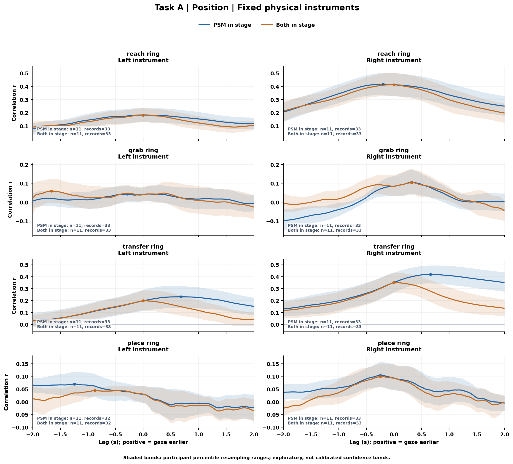

[PDF](gt84/figures/primary_position_curves_A.pdf)

### C 位置相关曲线

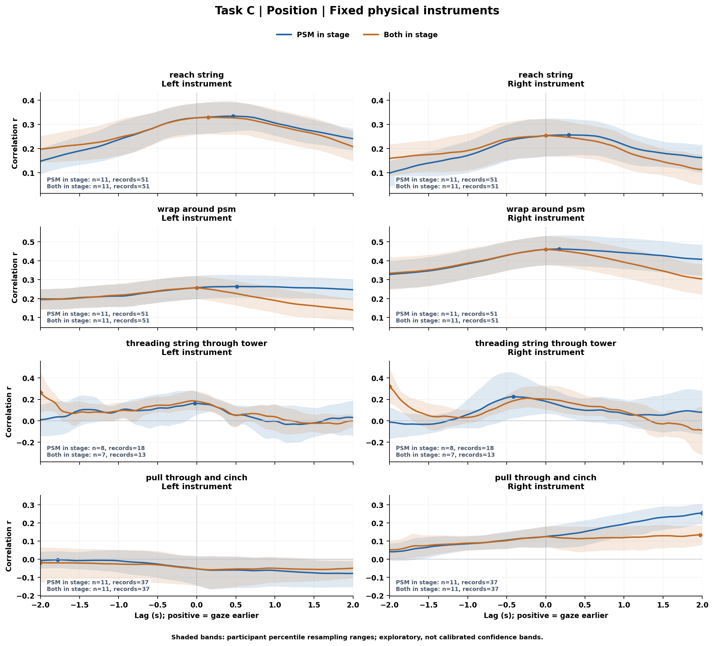

[PDF](gt84/figures/primary_position_curves_C.pdf)

### 位置组峰位及支持

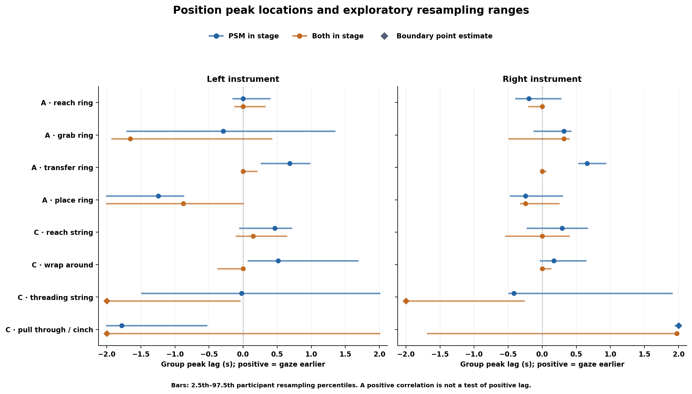

[PDF](gt84/figures/primary_position_peak_lags.pdf)

### A 速度相关曲线

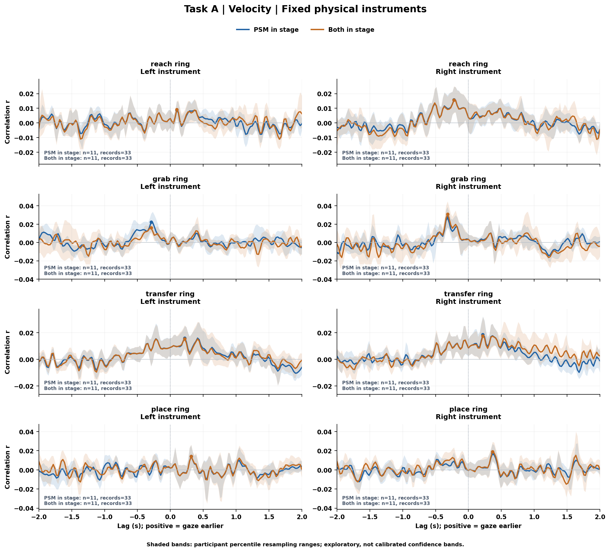

[PDF](gt84/figures/primary_velocity_curves_A.pdf)

### C 速度相关曲线

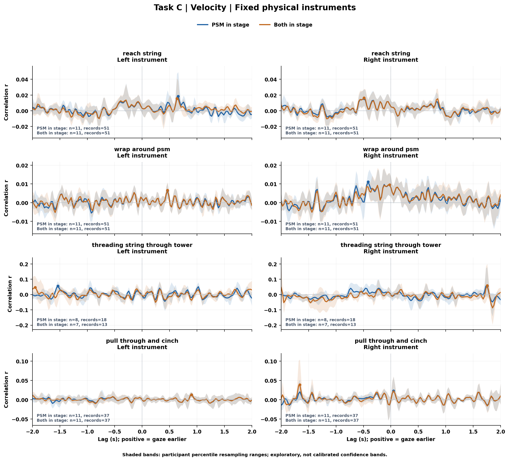

[PDF](gt84/figures/primary_velocity_curves_C.pdf)

### 速度组峰位及支持

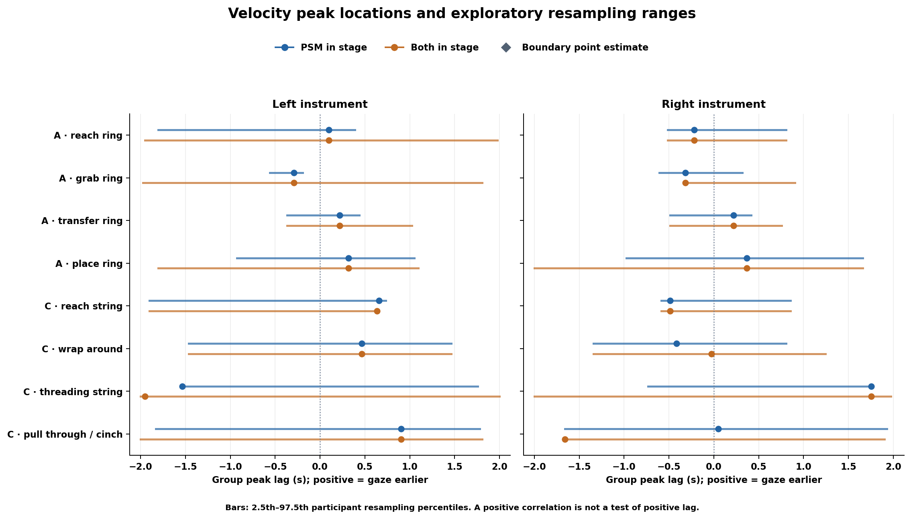

[PDF](gt84/figures/primary_velocity_peak_lags.pdf)

### A 位置参与者重采样

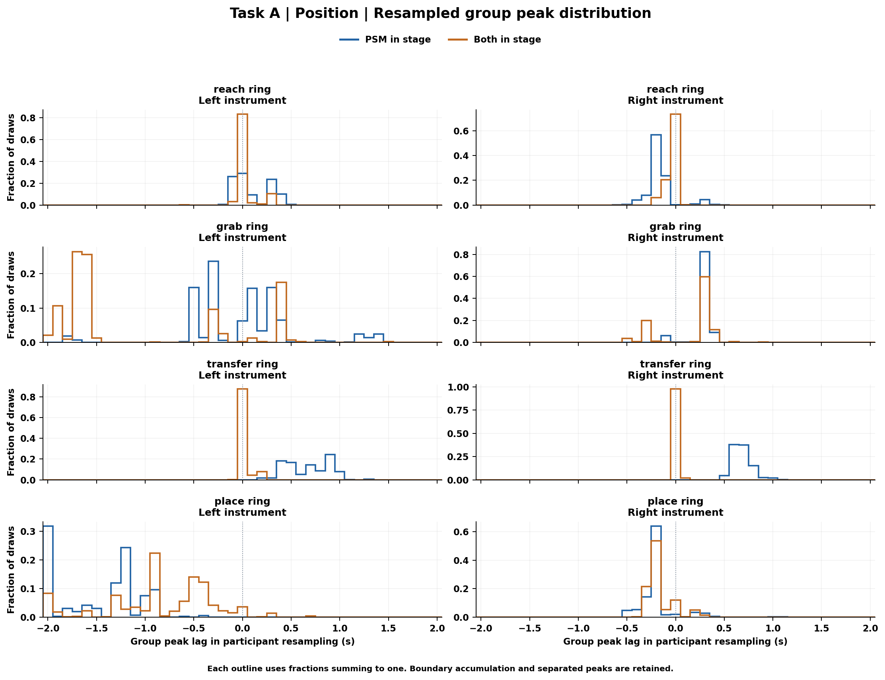

[PDF](gt84/figures/group_bootstrap_position_A.pdf)

### C 位置参与者重采样

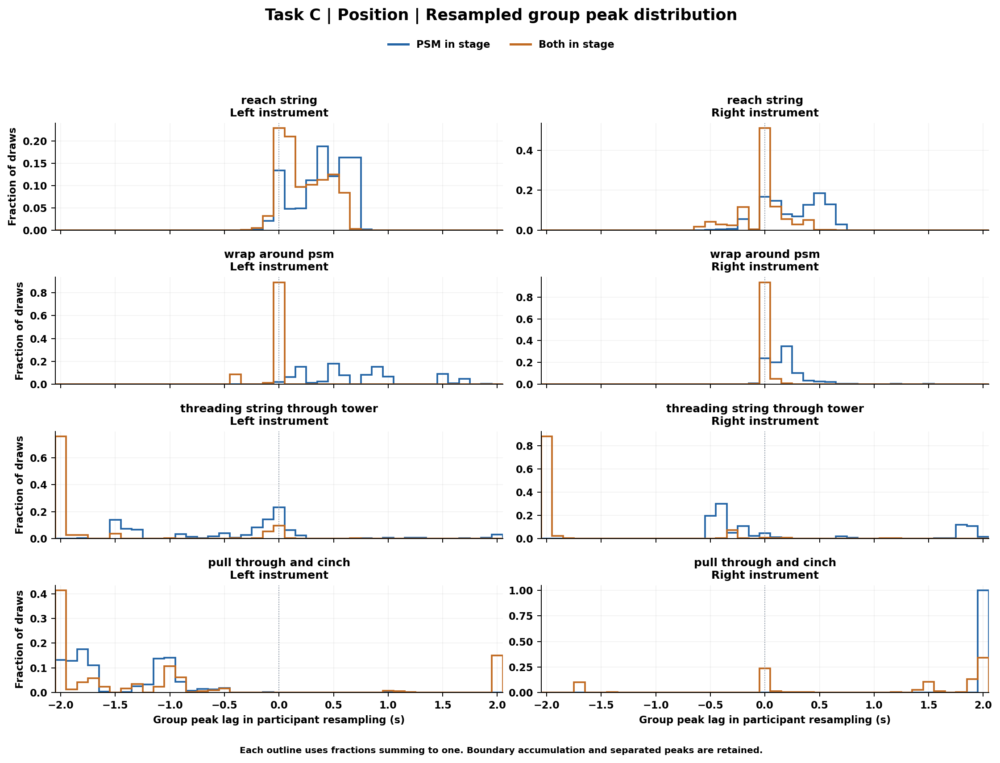

[PDF](gt84/figures/group_bootstrap_position_C.pdf)

### A 速度参与者重采样

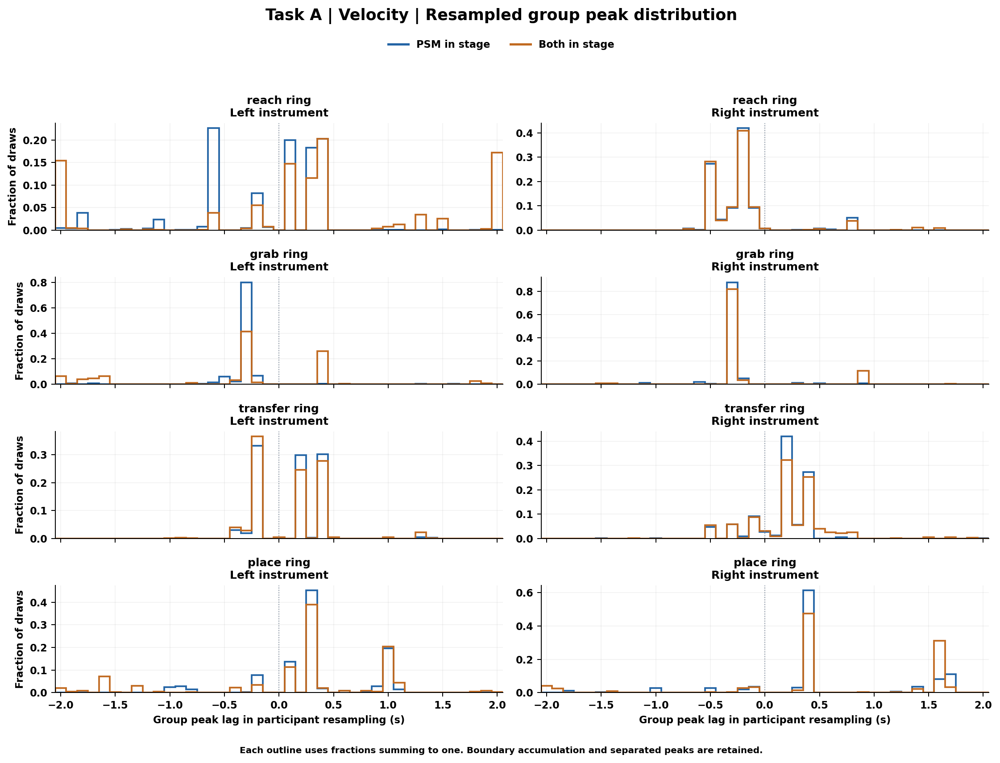

[PDF](gt84/figures/group_bootstrap_velocity_A.pdf)

### C 速度参与者重采样

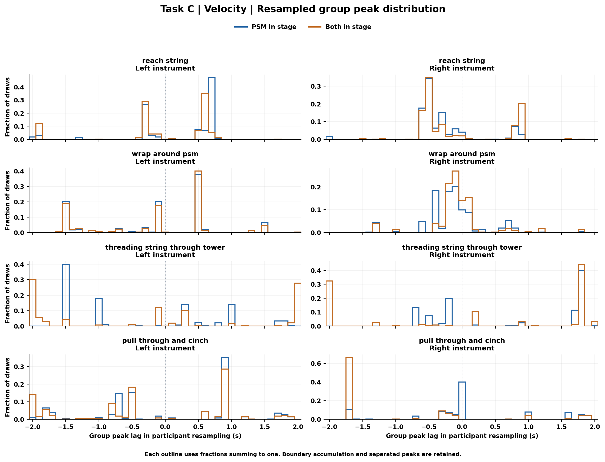

[PDF](gt84/figures/group_bootstrap_velocity_C.pdf)

### 位置处理与窗口敏感性

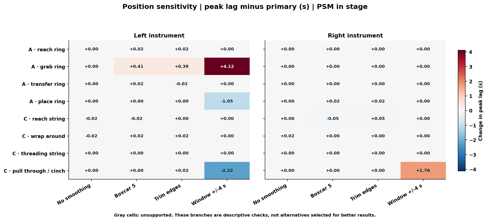

[PDF](gt84/figures/position_sensitivity_lag_change.pdf)

### 速度滤波敏感性

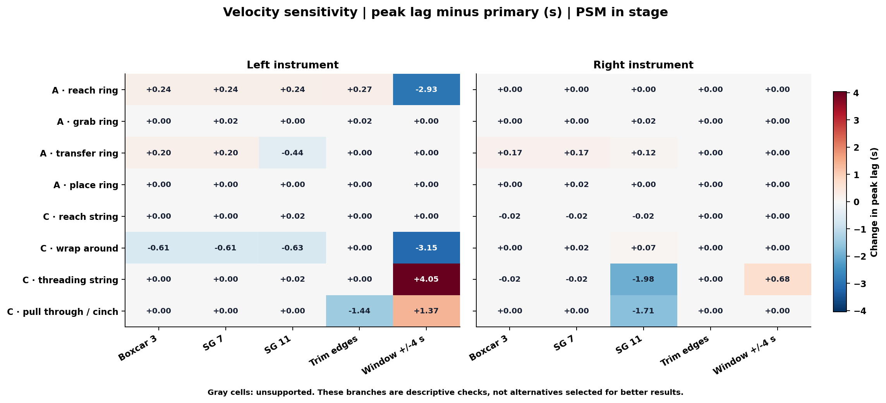

[PDF](gt84/figures/velocity_sensitivity_lag_change.pdf)

### 零 lag 与峰位移位后的空间接近度

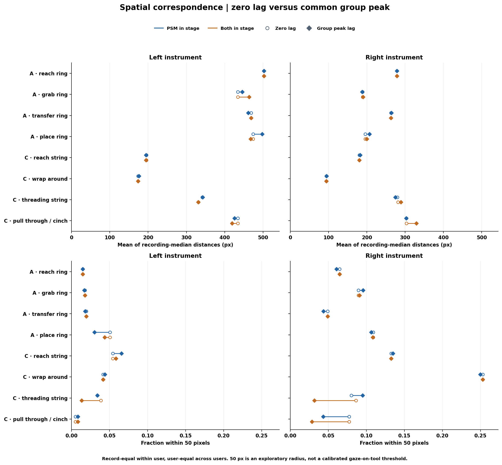

[PDF](gt84/figures/spatial_zero_vs_peak.pdf)

## 6. 数据来源和可比较性

本次相对于 11 月 5 日结果改变的是 GT 源和有效性掩码；其余分析参数及阶段、选侧、聚合、bootstrap/reference 规则沿用原版。因此旧表不能与新表混用为同一 GT 基准，模型排名与时序解释应以本次完整重算为准。视频录制交集是按 record ID 匹配，不以 gaze 所在文件夹名判定。

[输入来源清单](gt84/input_manifest.json) · [逐录制结果](gt84/record_summary.csv) · [完整交互报告](gt84/report.html) · [模型同批比较](models10_vs_gt_report.md)

非配对参考保留原先的时间语义、固定观察支持和失败计数，尾部比例及描述性多重比较不宣称正式领先 p 值或 FDR 控制。参见 [参考结果](gt84/unpaired_reference.csv)；具体条件与失败原因保留在分支结果中。
