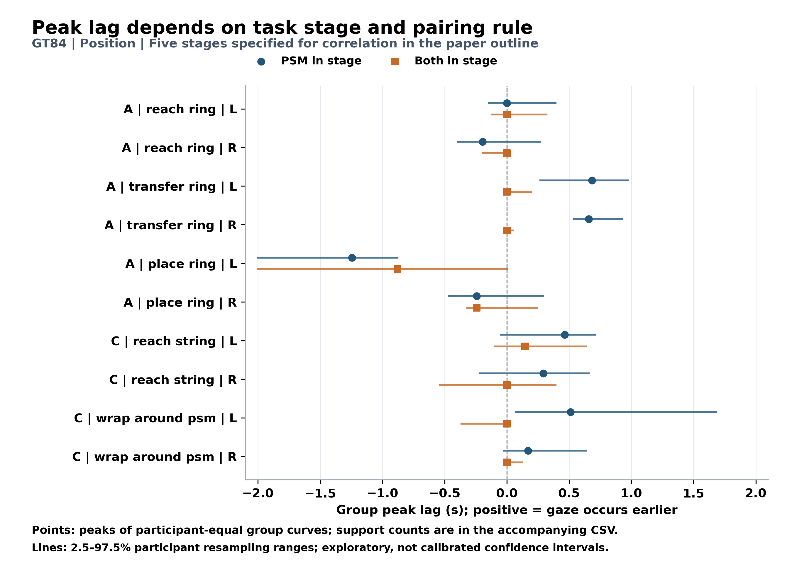
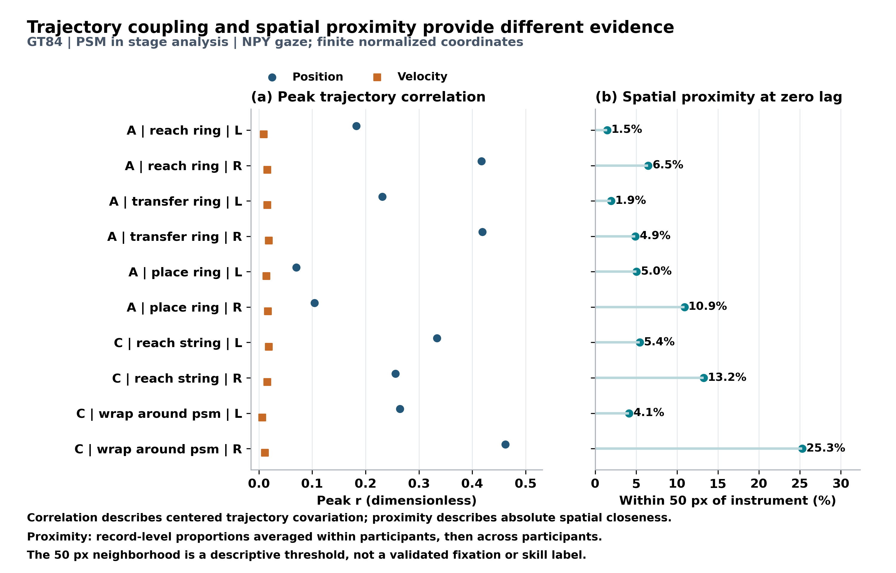

# GT84 眼动与器械关系的论文结果摘要

更新日期：2026-11-06。论文限定阶段沿用原版：A 的 reach ring、transfer ring、place ring，以及 C 的 reach string、wrap around psm。它与完整报告的全部已观测阶段范围不同。

本次 GT 坐标来自 `D:/Dataset/dvss/Active_Data/User*/npy/<record>_gaze.npy`；仅保留两个坐标均有限且均在归一化闭区间 `[0,1]` 内的样本，完全不依据 `valid` 或原始眼动 CSV 的 `Status` 筛选。按视频帧号使用同一 User 的 `csv/<record>_video_ts.csv` 对齐时间，该 CSV 仅提供时间，不提供 GT gaze 坐标。归一化坐标按原视频尺寸换算为像素后，以原规则重建 41 Hz 网格。2026-11-05 目录属于历史 CSV-GT 口径结果，不能继续作为本次 GT 基准。

## 1. 固定侧位置峰与阶段配对规则

正 lag 表示 gaze 在对应轨迹关系中较早出现。以下为原 5000 次参与者重采样范围；其正负只描述窗口内的估计方向，不等同于正式生理领先检验。

| task | stage | side | n_stable_users | peak_r | peak_lag_s | peak_lag_resample_low | peak_lag_resample_high | lag_interpretation |
| --- | --- | --- | --- | --- | --- | --- | --- | --- |
| A | place ring | l | 11 | 0.0699 | -1.2439 | -2.0000 | -0.8780 | window_limited |
| A | reach ring | l | 11 | 0.1829 | 0.0000 | -0.1463 | 0.3902 | direction_uncertain |
| A | transfer ring | l | 11 | 0.2311 | 0.6829 | 0.2683 | 0.9756 | positive_peak_resampling_range |
| A | place ring | r | 11 | 0.1044 | -0.2439 | -0.4634 | 0.2927 | direction_uncertain |
| A | reach ring | r | 11 | 0.4170 | -0.1951 | -0.3902 | 0.2683 | direction_uncertain |
| A | transfer ring | r | 11 | 0.4187 | 0.6585 | 0.5366 | 0.9268 | positive_peak_resampling_range |
| C | reach string | l | 11 | 0.3338 | 0.4634 | -0.0488 | 0.7073 | direction_uncertain |
| C | wrap around psm | l | 11 | 0.2641 | 0.5122 | 0.0732 | 1.6829 | positive_peak_resampling_range |
| C | reach string | r | 11 | 0.2560 | 0.2927 | -0.2195 | 0.6585 | direction_uncertain |
| C | wrap around psm | r | 11 | 0.4620 | 0.1707 | -0.0244 | 0.6341 | direction_uncertain |

原规则标为正向峰位重采样范围的条件为：A / transfer ring / l / position / PSM in stage：0.683 s，范围 [0.268, 0.976] s；A / transfer ring / r / position / PSM in stage：0.659 s，范围 [0.537, 0.927] s；C / wrap around psm / l / position / PSM in stage：0.512 s，范围 [0.073, 1.683] s。

在此范围内，没有条件被原规则标为负向峰位重采样范围。这仍是描述性方向证据，不是正式生理领先检验。

图 G1 同时显示 PSM 阶段锚定与同 occurrence 配对。两种规则改变有效重叠及统计对象；不能把峰位差直接称为预视时长。

## 2. 位置协变 速度和空间接近

这十个固定侧条件的位置峰 r 为 0.0699–0.4620，速度峰 r 为 0.0064–0.0185；零 lag 的 50 px 内比例为 1.48%–25.30%。相关衡量去除平移后的轨迹协变，接近度衡量绝对位置距离，二者不能相互替代。

50 px 是描述阈值，未验证为注视器械或技能标签。该结果适合按任务、阶段和器械侧报告，不能据此形成统一的“优质 gaze”分数或一个普遍领先时间。

## 3. 方法与论文解读

主分析固定左右物理器械，使用 41 Hz 网格、最大 0.1 s 插值间隙、±2 s 搜索窗（165 格）。不外推或跨长缺口插值。位置由未平滑坐标做 3 点居中平均；速度独立做二阶 SG5 平滑后相邻差分，时间取中点。原有不平滑/5 点位置、SG7/SG11/旧 box3 速度、裁边及 ±4 s 敏感性分支均保留。

配对为 `gaze(t−τ)` 和 `PSM(t)`，因此正 τ 表示较早的 gaze 对应当前 PSM。每个 occurrence、每个 lag 分别去均值，再汇总二维协方差与平方和求相关；不是 x/y Pearson 系数的平均。总有效配对至少 82 点，双方中心化二维 RMS 至少 1，且分母非退化。PSM 全部有限坐标保留；likelihood、跳变及图外点仅作质量标记。

`PSM in stage` 仅要求 PSM 属于该阶段 occurrence；`Both in stage` 要求两端均属于同一次 occurrence。组曲线仅纳入整个 lag 窗完整的录制，先在参与者内等权平均 Fisher z，再在参与者间等权，最后反变换。组峰位是组曲线最大值的位置，不是录制峰位的平均。分组至少 3 名参与者。

原版峰形、近峰宽度、方向及可定位规则保持不变。`positive_peak` 指正相关峰，不代表正 lag；非零峰也不自动满足可定位规则。重采样范围是探索性百分位范围，尚未校准为生理时延的置信区间。边界峰、宽峰和不稳定峰应结合完整曲线解读；正峰位不构成因果或固定预视时长的证明。

算法和数值参数沿用原版，运行库环境不同：旧 Python 3.11.5/NumPy 1.24.3，本次 Python 3.12.12/NumPy 1.26.4；依赖版本按本次实际环境记录于各分支 requirements 文件，不能将其称为运行环境完全一致。

本结果提供模型行为评价的 GT 基准；不包含专家/新手训练数据的受控比较，也不检验概率模型或架构机制。应结合新 GT 下的模型配对误差与峰可定位覆盖报告，避免仅凭正峰位推断预视能力。

[详细分析](gt84_analysis_report.md) · [限定组峰数据](paper_summary_data/gt84_selected_group_results.csv) · [相关和空间接近数据](paper_summary_data/gt84_selected_coupling_proximity.csv)
