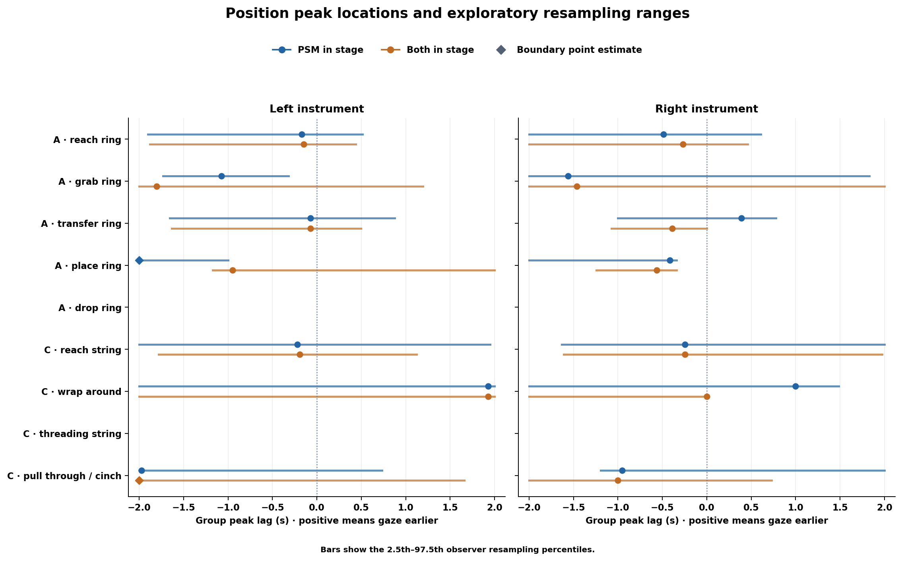
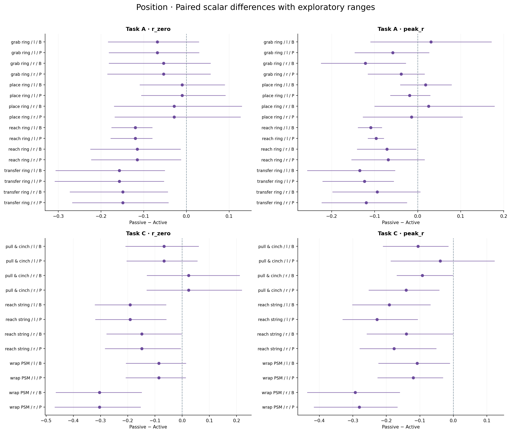
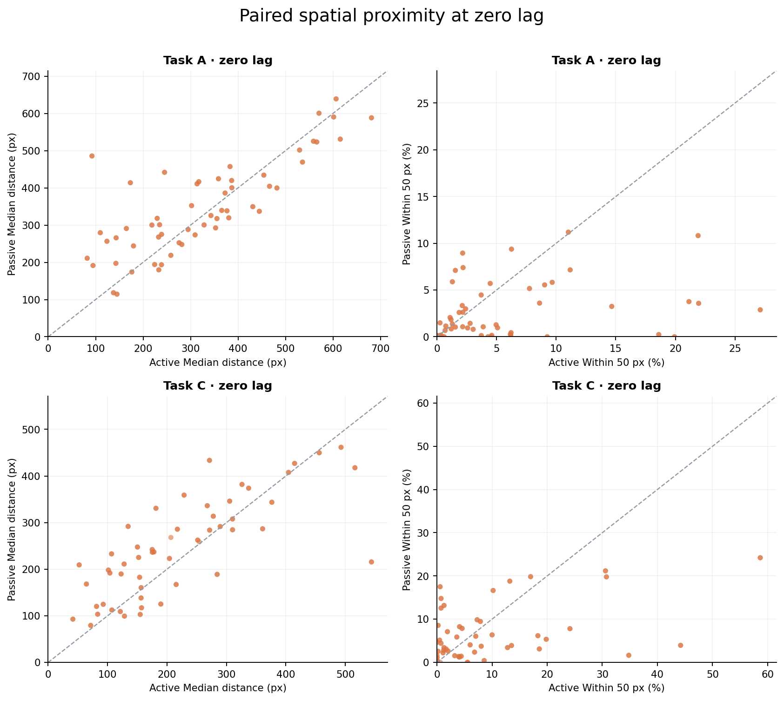

# Passive 与 Active GT 眼动–器械关系的论文结果摘要

更新日期：2026-11-09。论文限定阶段与 GT84 摘要一致：A 的 reach ring、transfer ring、place ring，以及 C 的 reach string、wrap around psm。完整分析另包含其他预定阶段。

纳入 16 次 novice–novice 观看（A=7、C=9）、8 名观看者及 16 个来源视频；对照为 GT84 中这些来源视频对应的 active GT，涉及 10 名来源操作者。配对单位是来源视频，不是同一人的两种状态，也不是将 16 次观看与完整 GT84 的 84 条录制直接作组差。两域均使用人工 NPY gaze，仅按坐标有限且位于 `[0,1]` 筛选，不使用 `valid`/`Status` 作排除条件。

## 1. 固定侧位置峰与阶段配对规则

固定 `variant=primary`、`signal=position`、`mode=PSM in stage`。正 lag 表示 gaze 轨迹在该配对关系中较早出现。以下为 **passive 组曲线峰**；`peak_lag_resample_low/high` 是 5000 次整观看者重采样的探索性 2.5–97.5 百分位范围，单位 s，非正式生理领先检验。

| task | stage | side | n_stable_users | peak_r | peak_lag_s | peak_lag_resample_low | peak_lag_resample_high | lag_interpretation |
| --- | --- | --- | --- | --- | --- | --- | --- | --- |
| A | place ring | l | 7 | 0.1249 | -2.0000 | -2.0000 | -1.0000 | window_limited |
| A | reach ring | l | 7 | 0.1047 | -0.1707 | -1.9024 | 0.5122 | direction_uncertain |
| A | transfer ring | l | 7 | 0.1279 | -0.0732 | -1.6585 | 0.8780 | direction_uncertain |
| A | place ring | r | 7 | 0.1215 | -0.4146 | -2.0000 | -0.3415 | window_limited |
| A | reach ring | r | 7 | 0.2358 | -0.4878 | -2.0000 | 0.6098 | window_limited |
| A | transfer ring | r | 7 | 0.2503 | 0.3902 | -1.0000 | 0.7805 | direction_uncertain |
| C | reach string | l | 8 | 0.0845 | -0.2195 | -2.0000 | 1.9512 | window_limited |
| C | wrap around psm | l | 8 | 0.0506 | 1.9268 | -2.0000 | 2.0000 | window_limited |
| C | reach string | r | 8 | 0.1320 | -0.2439 | -1.6341 | 2.0000 | window_limited |
| C | wrap around psm | r | 8 | 0.1670 | 1.0000 | -2.0000 | 1.4878 | window_limited |

这十个条件中 7 个为 `window_limited`、3 个为 `direction_uncertain`，没有条件被原规则标为正侧或负侧峰位重采样范围。单个正峰位不构成稳定领先证据。改用 `Both in stage` 后，A / place ring / r 为负侧范围：−0.561 s，范围 [−1.244, −0.341] s；仍应作为探索性方向描述。完整阶段中另外一个负侧条件为 A / grab ring / l / position / PSM in stage，位于本文限定阶段之外。

两种 mode 的完整位置峰如下图：`PSM in stage` 只限制 PSM 端的阶段，`Both in stage` 要求两端同一 occurrence。改变 mode 会改变有效配对及统计对象，峰位差不能直接当作预视时长。

图含完整预定阶段；本文数值与解释仅限上述五阶段。未用 GT84 图替代 passive 结果。

## 2. 位置协变、速度和空间接近

上述十个固定侧条件的 passive 位置组峰 `peak_r` 为 0.0506–0.2503，相应速度组峰为 0.0091–0.0331；零 lag 的 `proximity_50px` 为 1.17%–12.29%。相关衡量 occurrence 内中心化轨迹协变，空间接近度衡量绝对像素距离，二者不能互相替代。

与 matched active 比较时，两域使用相同完整支持配对和观看者权重。下表固定 `metric=peak_r`，报告 **逐录制峰值的观看者分层算术均值**，不是上节的组曲线峰：`passive_value`/`active_value` 为两域均值，`delta=passive_value−active_value`，`low/high` 为差值的探索性百分位范围。

| task | stage | side | n_pairs | n_observers | passive_value | active_value | delta | low | high |
| --- | --- | --- | --- | --- | --- | --- | --- | --- | --- |
| A | place ring | l | 7 | 7 | 0.1617 | 0.1803 | -0.0186 | -0.0640 | 0.0296 |
| A | reach ring | l | 7 | 7 | 0.1489 | 0.2456 | -0.0967 | -0.1159 | -0.0784 |
| A | transfer ring | l | 7 | 7 | 0.2027 | 0.3266 | -0.1239 | -0.2214 | -0.0553 |
| A | place ring | r | 7 | 7 | 0.1918 | 0.2061 | -0.0143 | -0.1276 | 0.1047 |
| A | reach ring | r | 7 | 7 | 0.2965 | 0.3650 | -0.0686 | -0.1544 | 0.0163 |
| A | transfer ring | r | 7 | 7 | 0.3127 | 0.4324 | -0.1197 | -0.2233 | -0.0246 |
| C | reach string | l | 9 | 8 | 0.1514 | 0.3792 | -0.2278 | -0.3312 | -0.1064 |
| C | wrap around psm | l | 9 | 8 | 0.0983 | 0.2183 | -0.1200 | -0.2266 | -0.0311 |
| C | reach string | r | 9 | 8 | 0.1857 | 0.3629 | -0.1772 | -0.2798 | -0.0506 |
| C | wrap around psm | r | 9 | 8 | 0.2027 | 0.4836 | -0.2809 | -0.4164 | -0.1666 |

十个 `peak_r` 均值差的点估计全部为负，其中 7 个探索性范围不跨零；零 lag 相关 `r_zero` 的十个点估计也全部为负，其中 7 个范围不跨零。结果支持在该匹配样本中按任务、阶段和侧描述 passive 的位置协变较弱；不能将不跨零直接称为统计显著，也不能归因于观看状态本身。

图含所有支持充分阶段和两种 mode，仅展示 `r_zero` 与 `peak_r`；点为逐录制指标分层均值之差，横线为探索性范围。若另引用 `paired_group_summary.csv` 中 `metric=peak_lag_s` 的差值，其含义是逐录制峰位差的分层均值，不是组曲线峰位差。

空间差异不呈统一方向。例如 A / reach ring 的零 lag `distance_median_px` 差，l 侧为 −55.7 px、r 侧为 +78.4 px；对应探索性范围分别为 [−81.1, −27.6] 与 [28.4, 128.0] px。C / wrap around psm / r 的 `proximity_50px` 为 passive 12.29%、active 26.61%，差 −14.32 个百分点，范围 [−24.99, −4.28] 个百分点。50 px 仅为描述阈值，未经验证为注视器械或技能标签；不能将这些指标合成统一“优质 gaze”分数。

## 3. 方法与论文解读

主分析使用 41 Hz 网格、最大 0.1 s 插值间隙及 ±2 s 搜索窗（165 lag），不外推或跨长缺口插值。位置采用 3 点居中平均；有符号二维速度从原始网格坐标独立做二阶 SG5 平滑后差分，时间取中点。每个 occurrence、每个 lag 单独去均值后汇总二维协方差与平方和，总有效配对至少 82 点，双方中心化二维 RMS 至少 1；并非 x/y Pearson 系数的平均。

配对始终是 `gaze(t−τ)` 与 `PSM(t)`，同义量沿用 GT84 的 `peak_r`、`r_zero`、`peak_lag_s`、`peak_lag_resample_low/high`、`distance_median_px`、`proximity_50px`。单域组曲线只纳入全 lag 完整的录制，先观看者内等权 Fisher z，再观看者间等权反变换，至少 3 人；`n_stable_users` 代表完整支持人数，不代表峰位稳定人数。配对组曲线也按 passive 观看者分层，active/passive 使用相同记录对和权重。

两类峰值汇总必须区分：先聚合曲线再取峰为 **组曲线峰**；先求各录制峰再两级算术平均为 **逐录制指标分层均值**。后者保留 `metric / passive_value / active_value / delta / low / high` 命名；匹配组峰位差沿用 `delta_group_peak_lag_s`。所有差值均为 passive − active，比例差以百分数呈现时使用“百分点”。`positive_peak` 只指正相关峰，不指正 lag。

全部 primary 有 440 个逐录制条件，passive 仅 3 个通过 `lag_identifiable`；436 个双方完整支持条件对中，双方同时通过的只有 1 个。现有结果不足以估计稳定、普遍的观看者相对操作者领先或滞后时间。保留原峰形与方向规则，不能将非零峰位或不跨零的探索性范围当作可定位或因果证据。

输入按已确认的 NPY 第 i 行与视频/DLC 第 i 行对应；来源映射及 NPY 行数相等确定 active/passive 配对，不增加时间戳匹配条件。秒数沿用精确源采集时钟，实际播放时序尚未经验校准。passive 历史 NPY 已有 clamp/最近邻填充，当前全部坐标有效不代表原始眼动无缺失。

5000 次同步观看者重采样没有完整处理观看者/来源操作者交叉依赖，故范围为探索性描述，不报告正式 p/FDR 或生理时延置信区间。保留全部 8 个处理/窗口 variant，并提供权重、逐身份剔除和共同可用坐标敏感性；`common_time_primary` 不意味着新增时间同步。passive 与配对补充分别在 Python 3.12.12/NumPy 1.26.4 和 Python 3.11.5/NumPy 1.24.3 环境生成，不能称运行环境完全相同。

本结果描述 novice–novice 来源匹配样本中的 gaze–PSM 关系，未控制观看/操作状态的全部混杂，不构成专家/新手比较、技能标签或模型机制检验。应联合报告曲线、支持数量、峰位可定位覆盖与空间指标。

[详细分析与统一变量表](gt_passive_analysis_report.md) · [Passive 组峰数据](gt_passive16/group_summary.csv) · [空间数据](gt_passive16/spatial_summary.csv) · [逐录制指标分层均值](gt_passive16/active_passive_comparison/paired_group_summary.csv) · [匹配组曲线峰](gt_passive16/active_passive_comparison/group_peak_comparison.csv) · [来源配对清单](gt_passive16/active_passive_comparison/paired_record_mapping.csv)
