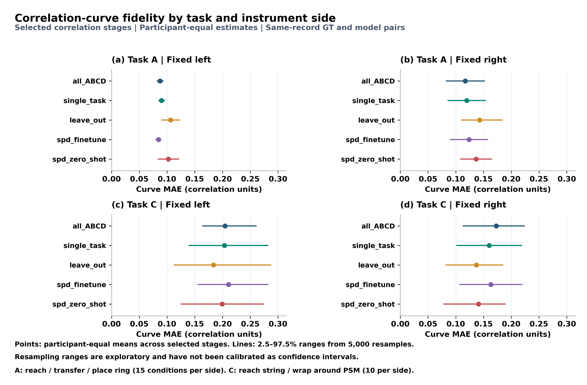
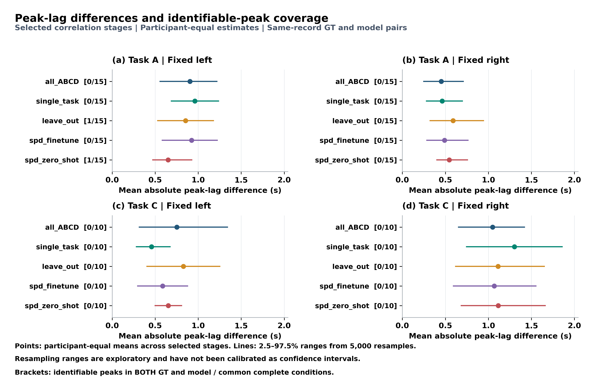

# Models10 与 GT10 论文结果摘要

更新日期：2026-11-06。论文限定阶段沿用原版：A 的 reach ring、transfer ring、place ring，以及 C 的 reach string、wrap around psm。它与完整报告的全部已观测阶段范围不同。

本次 GT 坐标来自 `D:/Dataset/dvss/Active_Data/User*/npy/<record>_gaze.npy`；仅保留两个坐标均有限且均在归一化闭区间 `[0,1]` 内的样本，完全不依据 `valid` 或原始眼动 CSV 的 `Status` 筛选。按视频帧号使用同一 User 的 `csv/<record>_video_ts.csv` 对齐时间，该 CSV 仅提供时间，不提供 GT gaze 坐标。归一化坐标按原视频尺寸换算为像素后，以原规则重建 41 Hz 网格。2026-11-05 目录属于历史 CSV-GT 口径结果，不能继续作为本次 GT 基准。

本子集为 10 条录制、7 名独立参与者，共 250 条配对、250 条共同完整支持。**下列主表、排序及覆盖统计全部限定为 `variant=primary`、`signal=position`、`mode=PSM in stage`、固定左右物理器械（side=l/r），再选择上述五阶段；不包含 velocity 或 Both in stage。** 完整模型报告中的 380 条配对/370 条共同完整支持采用相同 signal/mode/side 筛选，但保留全部已观测阶段。GT84 详细报告中的 2328 条 primary 曲线则包含两种 signal 和两种 mode，不是同一个统计范围。

## 1. 相关曲线复现

曲线 MAE 的描述性最小值：A左侧：spd_finetune（0.0848）；A右侧：all_ABCD（0.1173）；C左侧：leave_out（0.1836）；C右侧：leave_out（0.1372）。这些是数值排序，是否支持模型差异需结合参与者交换检验。

| 模型 | A左 | A右 | C左 | C右 |
| --- | ---: | ---: | ---: | ---: |
| all_ABCD | 0.0872 | 0.1173 | 0.2045 | 0.1730 |
| single_task | 0.0899 | 0.1197 | 0.2037 | 0.1603 |
| leave_out | 0.1064 | 0.1428 | 0.1836 | 0.1372 |
| spd_finetune | 0.0848 | 0.1240 | 0.2106 | 0.1633 |
| spd_zero_shot | 0.1023 | 0.1367 | 0.1995 | 0.1409 |

## 2. 统计峰差和可定位覆盖

GT 的 50 个唯一条件中 1 个通过原可定位规则；模型–GT 双方可定位率为 0.0%–6.7%。这限制了将统计峰差解释为精确时序保真的能力。平均绝对峰差范围为 0.4520–1.3024 s。

| 模型 | A左 | A右 | C左 | C右 |
| --- | ---: | ---: | ---: | ---: |
| all_ABCD | 0.9041 | 0.4520 | 0.7512 | 1.0488 |
| single_task | 0.9626 | 0.4634 | 0.4585 | 1.3024 |
| leave_out | 0.8537 | 0.5902 | 0.8293 | 1.1122 |
| spd_finetune | 0.9236 | 0.4894 | 0.5878 | 1.0683 |
| spd_zero_shot | 0.6504 | 0.5463 | 0.6537 | 1.1146 |

图中点为参与者等权均值，线为 5000 次参与者重采样范围；方括号为双方可定位条件数/所有共同完整条件数。小绝对峰差不能单独证明人类注视时序得到精确复现。

## 3. 模型比较及可比较范围

整参与者模型标签交换共 140 项比较，原始最小双侧 p=0.0625，Holm 最小 p=1.0000；校正后 p<0.05 的比较为 0 项。每个任务×侧的各阶段及已观测阶段平均、全部模型对属于同一家族。小样本下的无显著差异不证明模型等效。

同一任务、侧、阶段范围、来源规则下的曲线 MAE、signed/absolute 峰差、可定位率可以并列。旧 raw CSV/Status 口径的结果需要同步重算后，才能作为同口径基准；两种数据源的结果可以作为“数据源修正前后”对照，不能混用。

汇总依次为同阶段录制等权、参与者内已观测阶段等权、参与者等权；峰差按逐条件计算再汇总。保留共同完整输入中的所有峰状态。主分析固定左右物理器械，使用 41 Hz 网格、最大 0.1 s 插值间隙、±2 s 搜索窗（165 格）。不外推或跨长缺口插值。位置由未平滑坐标做 3 点居中平均；速度独立做二阶 SG5 平滑后相邻差分，时间取中点。原有不平滑/5 点位置、SG7/SG11/旧 box3 速度、裁边及 ±4 s 敏感性分支均保留。

配对为 `gaze(t−τ)` 和 `PSM(t)`，因此正 τ 表示较早的 gaze 对应当前 PSM。每个 occurrence、每个 lag 分别去均值，再汇总二维协方差与平方和求相关；不是 x/y Pearson 系数的平均。总有效配对至少 82 点，双方中心化二维 RMS 至少 1，且分母非退化。PSM 全部有限坐标保留；likelihood、跳变及图外点仅作质量标记。

`PSM in stage` 仅要求 PSM 属于该阶段 occurrence；`Both in stage` 要求两端均属于同一次 occurrence。组曲线仅纳入整个 lag 窗完整的录制，先在参与者内等权平均 Fisher z，再在参与者间等权，最后反变换。组峰位是组曲线最大值的位置，不是录制峰位的平均。分组至少 3 名参与者。

原版峰形、近峰宽度、方向及可定位规则保持不变。`positive_peak` 指正相关峰，不代表正 lag；非零峰也不自动满足可定位规则。重采样范围是探索性百分位范围，尚未校准为生理时延的置信区间。边界峰、宽峰和不稳定峰应结合完整曲线解读；正峰位不构成因果或固定预视时长的证明。

算法和数值参数沿用原版，运行库环境不同：旧 Python 3.11.5/NumPy 1.24.3，本次 Python 3.12.12/NumPy 1.26.4；依赖版本按本次实际环境记录于各分支 requirements 文件，不能将其称为运行环境完全一致。

当前比较没有控制训练样本量、技能构成或架构机制；模型文件夹名称仅作为配置名称，不能替代训练来源证据。

[逐条件数据](paper_summary_data/models_selected_conditions.csv) · [汇总](paper_summary_data/models_selected_summary.csv) · [参与者值](paper_summary_data/models_selected_user_metrics.csv) · [可靠性](paper_summary_data/models_selected_reliability.csv) · [精确比较](paper_summary_data/models_selected_exact_comparisons.csv) · [独立核验](paper_summary_data/independent_summary_audit.json)
