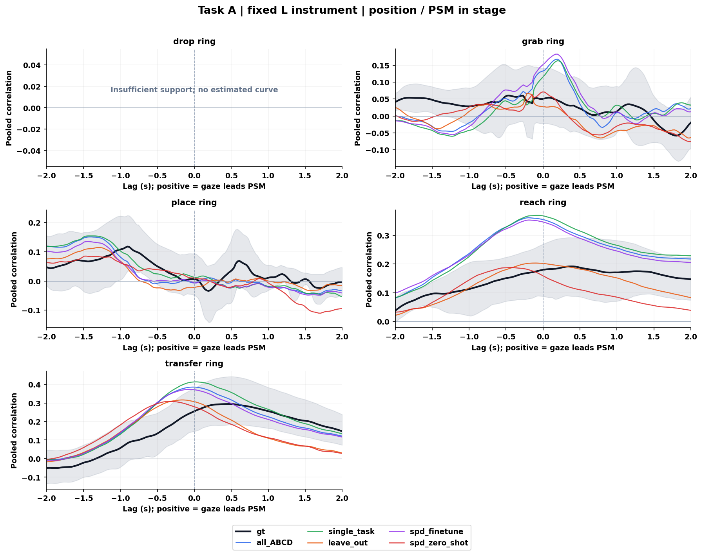
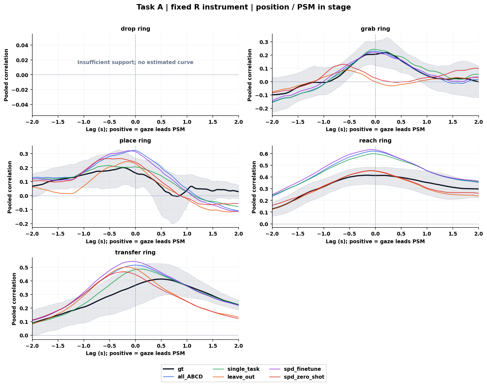
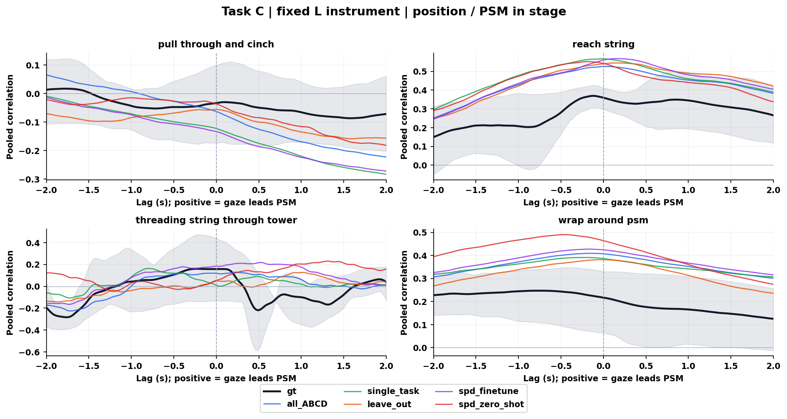
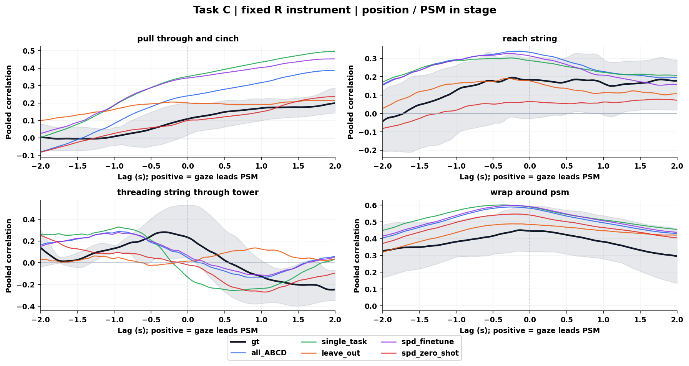
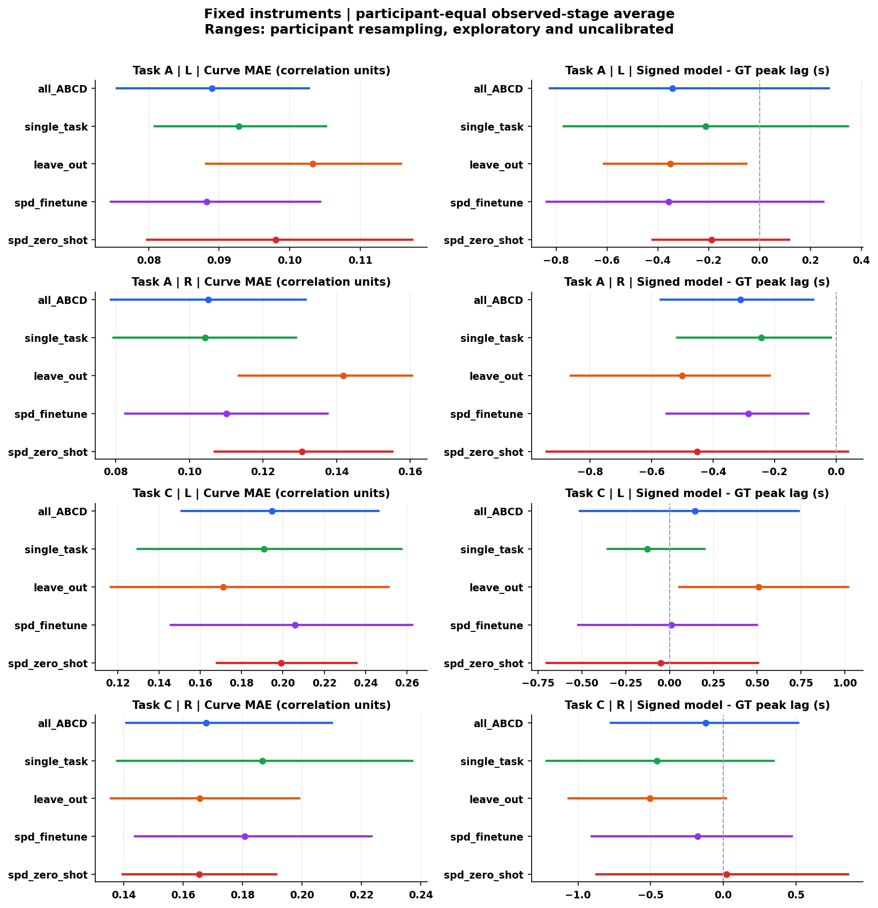
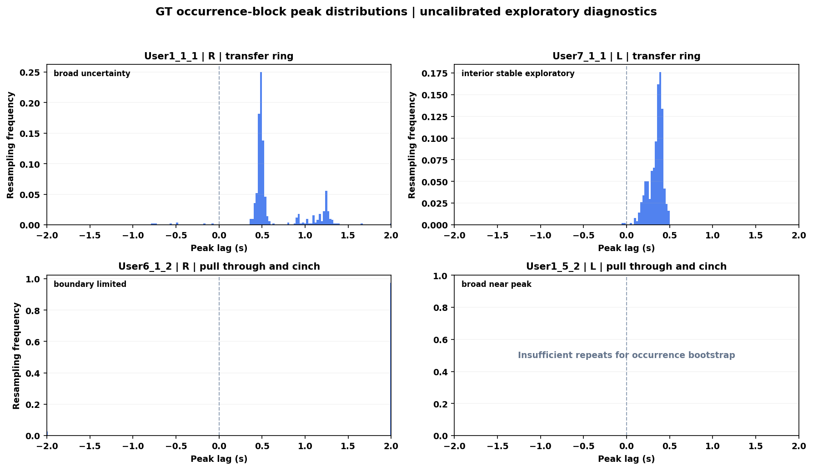

# Models10 与同批 GT10 对照分析报告

结果日期：2026-11-06。本次 GT 坐标来自 `D:/Dataset/dvss/Active_Data/User*/npy/<record>_gaze.npy`；仅保留两个坐标均有限且均在归一化闭区间 `[0,1]` 内的样本，完全不依据 `valid` 或原始眼动 CSV 的 `Status` 筛选。按视频帧号使用同一 User 的 `csv/<record>_video_ts.csv` 对齐时间，该 CSV 仅提供时间，不提供 GT gaze 坐标。归一化坐标按原视频尺寸换算为像素后，以原规则重建 41 Hz 网格。2026-11-05 目录属于历史 CSV-GT 口径结果，不能继续作为本次 GT 基准。

本报告比较 10 个录制、7 名参与者的 GT 与五模型。GT10 是这些录制自身的 NPY gaze，GT84 的整体组均值不是这里的配对基准。模型预测沿用原文件，未重新训练或推断。

## 1. 全部已观测阶段的位置主结果

**本报告的主表、模型排序和配对覆盖统计均限定为 `variant=primary`、`signal=position`、`mode=PSM in stage`、固定左右物理器械（side=l/r）。“完整阶段”只表示保留该范围内全部已观测阶段，不包含 velocity 或 Both in stage 的结果。**

曲线 MAE 最小的描述性结果为：A左侧：spd_finetune（0.0882）；A右侧：single_task（0.1042）；C左侧：leave_out（0.1712）；C右侧：spd_zero_shot（0.1655）。

逐条件绝对峰差的参与者等权均值为 0.4638–1.0370 s。GT 的 76 个唯一条件中 1 个通过原可定位规则；模型–GT 双方可定位率为 0.0%–5.0%。这限制了将统计峰差解释为精确时序保真的能力。

整参与者模型标签交换共 220 项比较，原始最小双侧 p=0.0625，Holm 最小 p=1.0000；校正后 p<0.05 的比较为 0 项。每个任务×侧的各阶段及已观测阶段平均、全部模型对属于同一家族。小样本下的无显著差异不证明模型等效。

完整阶段主分支共有 380 条模型配对，其中 370 条满足 GT 与五模型共同完整支持。按峰正负、边界或可定位性均不删除输入合格条件。

| record | user | task | GT主条件 | 每模型共同完整条件 |
| --- | --- | --- | --- | --- |
| User11_6_1 | User11 | A | 8 | 8 |
| User12_3_1 | User12 | A | 8 | 8 |
| User12_5_2 | User12 | C | 6 | 6 |
| User1_1_1 | User1 | A | 10 | 8 |
| User1_5_2 | User1 | C | 8 | 8 |
| User5_3_2 | User5 | C | 6 | 6 |
| User6_1_2 | User6 | C | 6 | 6 |
| User7_1_1 | User7 | A | 8 | 8 |
| User7_4_1 | User7 | C | 8 | 8 |
| User9_7_1 | User9 | A | 8 | 8 |

## 2. 方法和三个误差指标

主分析固定左右物理器械，使用 41 Hz 网格、最大 0.1 s 插值间隙、±2 s 搜索窗（165 格）。不外推或跨长缺口插值。位置由未平滑坐标做 3 点居中平均；速度独立做二阶 SG5 平滑后相邻差分，时间取中点。原有不平滑/5 点位置、SG7/SG11/旧 box3 速度、裁边及 ±4 s 敏感性分支均保留。

配对为 `gaze(t−τ)` 和 `PSM(t)`，因此正 τ 表示较早的 gaze 对应当前 PSM。每个 occurrence、每个 lag 分别去均值，再汇总二维协方差与平方和求相关；不是 x/y Pearson 系数的平均。总有效配对至少 82 点，双方中心化二维 RMS 至少 1，且分母非退化。PSM 全部有限坐标保留；likelihood、跳变及图外点仅作质量标记。

`PSM in stage` 仅要求 PSM 属于该阶段 occurrence；`Both in stage` 要求两端均属于同一次 occurrence。组曲线仅纳入整个 lag 窗完整的录制，先在参与者内等权平均 Fisher z，再在参与者间等权，最后反变换。组峰位是组曲线最大值的位置，不是录制峰位的平均。分组至少 3 名参与者。

原版峰形、近峰宽度、方向及可定位规则保持不变。`positive_peak` 指正相关峰，不代表正 lag；非零峰也不自动满足可定位规则。重采样范围是探索性百分位范围，尚未校准为生理时延的置信区间。边界峰、宽峰和不稳定峰应结合完整曲线解读；正峰位不构成因果或固定预视时长的证明。

算法和数值参数沿用原版，运行库环境不同：旧 Python 3.11.5/NumPy 1.24.3，本次 Python 3.12.12/NumPy 1.26.4；依赖版本按本次实际环境记录于各分支 requirements 文件，不能将其称为运行环境完全一致。

模型缓存 `qc_json.gaze_source_npy` 指向同录像的 **GT 参照文件**，不表示模型 gaze 来自 NPY；模型 gaze 实际来自 `prediction_manifest.csv` 及 `input_policy_audit.models` 记录的原预测 NPZ。输入缓存目录的 `config.json` 保留历史缓存生成参数（包括旧独立最大侧、bootstrap 等），仅供来源和历史回归审计；本轮实际计算参数以两个分支的 `run_manifest.json` 为准，缓存中的旧 `results.json` 也仅用于历史差异审计。

GT 和五模型在同一录制、阶段、同一物理侧配对；共同 gaze 掩码与该侧 PSM 支持按原规则处理。先在参与者内对同阶段录制等权，再对已观测阶段等权，最后参与者等权。参与者重采样 5000 次，seed=42。

曲线 MAE 是各 lag 点相关系数差的平均绝对值，不是 gaze 像素误差；`Δlag=模型峰−GT峰`；绝对峰差先逐条件取绝对值再汇总，不能用有符号差代替。两种峰差均是统计峰位置差，不能直接称作模型运行延迟。

## 3. 全部已观测阶段的位置汇总表

本节三张主表均为 primary + position + PSM in stage，固定左右侧分别汇总；velocity、Both in stage 和其他敏感性分支保留在完整结果文件中。

### 曲线 MAE

| 模型 | A左 | A右 | C左 | C右 |
| --- | ---: | ---: | ---: | ---: |
| all_ABCD | 0.0890 | 0.1051 | 0.1948 | 0.1678 |
| single_task | 0.0928 | 0.1042 | 0.1909 | 0.1868 |
| leave_out | 0.1033 | 0.1417 | 0.1712 | 0.1656 |
| spd_finetune | 0.0882 | 0.1101 | 0.2058 | 0.1808 |
| spd_zero_shot | 0.0980 | 0.1306 | 0.1992 | 0.1655 |

### 有符号峰差 秒

| 模型 | A左 | A右 | C左 | C右 |
| --- | ---: | ---: | ---: | ---: |
| all_ABCD | -0.3427 | -0.3110 | 0.1447 | -0.1211 |
| single_task | -0.2110 | -0.2427 | -0.1272 | -0.4561 |
| leave_out | -0.3512 | -0.5012 | 0.5081 | -0.5045 |
| spd_finetune | -0.3561 | -0.2854 | 0.0102 | -0.1776 |
| spd_zero_shot | -0.1890 | -0.4512 | -0.0512 | 0.0211 |

### 绝对峰差 秒

| 模型 | A左 | A右 | C左 | C右 |
| --- | ---: | ---: | ---: | ---: |
| all_ABCD | 0.9207 | 0.4988 | 0.7659 | 0.8805 |
| single_task | 1.0012 | 0.4720 | 0.4638 | 0.9878 |
| leave_out | 1.0268 | 0.6622 | 0.9626 | 1.0370 |
| spd_finetune | 0.9317 | 0.4756 | 0.6654 | 0.9012 |
| spd_zero_shot | 0.7841 | 0.7659 | 0.8154 | 0.9057 |

### GT gaze 和 model gaze 是否领先 PSM

以下按各来源对同一 PSM 的组相关峰位作描述计数，不能将“正 lag 峰数”当作“可靠领先条件数”。组曲线支持人数可能随来源或阶段变化；精确配对误差使用上文共同完整输入集合。正/零/负分别表示窗口内最大相关对应的 gaze 较早、同步或较晚，仍需结合峰形、参与者重采样范围及边界状态。

| source | 有组曲线条件 | 组峰lag最小s | 组峰lag最大s | 正lag峰数 | 零lag峰数 | 负lag峰数 | 窗口边界峰数 |
| --- | --- | --- | --- | --- | --- | --- | --- |
| all_ABCD | 16 | -2.0000 | 2.0000 | 4 | 1 | 11 | 2 |
| gt | 16 | -1.7805 | 2.0000 | 5 | 0 | 11 | 1 |
| leave_out | 16 | -1.2927 | 1.8537 | 4 | 1 | 11 | 0 |
| single_task | 16 | -2.0000 | 2.0000 | 4 | 1 | 11 | 2 |
| spd_finetune | 16 | -2.0000 | 1.9756 | 4 | 0 | 12 | 1 |
| spd_zero_shot | 16 | -2.0000 | 1.9512 | 3 | 1 | 12 | 1 |

每个阶段、侧、来源的精确峰位、峰相关及重采样范围见 [组曲线汇总](models10/group_summary.csv)；下方四张阶段曲线直接展示 GT 与模型相对于 PSM 的 lag 关系。

## 4. 完整图表

### A 左侧 GT 与模型曲线

### A 右侧 GT 与模型曲线

### C 左侧 GT 与模型曲线

### C 右侧 GT 与模型曲线

### 主分析误差和覆盖汇总

### 逐条件峰位分布

### 补充结果的含义

[直接 GT–模型相关](models10/direct_model_delay.csv) 的正 lag 明确定义为 model gaze 跟随 GT gaze，与上文 gaze–PSM 的正 lag 表示 gaze 较早不同；这也不是“模型与 GT 各自对 PSM 的峰位相减”，两种统计量不能互换。本次未使用最佳平移校正预测。

[GT 统一选侧](models10/selected_rule_paired_summary.csv) 让全部模型使用同条件 GT 选中的侧，仅作补充；[独立选侧敏感性](models10/side_selection_sensitivity.csv) 保留 same_side 标记，不能把不同物理器械混成主配对。

[参与者身份匹配参考](models10/identity_reference.csv) 保持任务、阶段和侧，整参与者轮换所有来源共有的完整阶段 profile；尾部名次依赖可交换性假设，不能证明因果领先或一般独立性。[滤波及窗口敏感性](models10/sensitivity_summary.csv) 用于检查处理选择对结果的影响，不能事后选择最有利分支作为主结论。

## 5. 论文子集和来源

论文限定阶段沿用原版：A 的 reach ring、transfer ring、place ring，以及 C 的 reach string、wrap around psm。它与完整报告的全部已观测阶段范围不同。完整阶段与论文子集不能混合比较其 MAE、峰差或 p 值。

该分析评价行为相关结构与统计时序的复现；未对训练数据量、技能群体、概率建模或架构做受控消融，不能据此认定专家数据优势、模型等效或架构优越性。

[输入来源](models10/input_manifest.json) · [逐条件配对](models10/paired_metrics.csv) · [参与者等权汇总](models10/paired_summary.csv) · [论文限定阶段摘要](models10_vs_gt_paper_summary.md) · [逐录制 HTML 对照](models10_vs_gt10.html)
