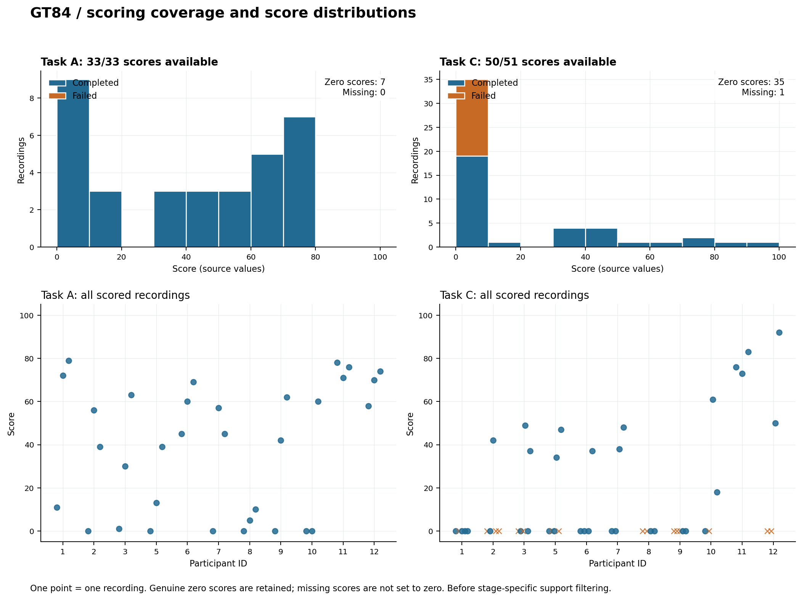
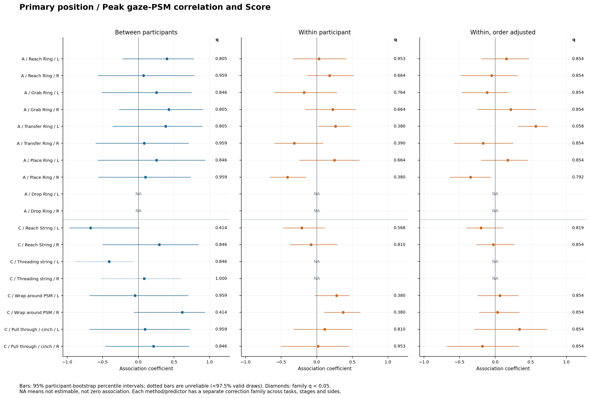

# GT84 gaze–PSM corr–score 分析总结

**数据版本：** 20261106 NPY gaze，固定左右 PSM。  
**总结日期：** 2026-11-09。  
**结果目录：** `D:\GitHub_Project\co-tracker\outputs\gt84_corr_score_20261106_20261109`。

本报告依据已保存并通过独立核验的结果表整理，没有重新计算 xcorr、修改评分或新增统计检验。下文所称“关联”，是 **gaze–PSM 轨迹相关指标与整次录制 Score 的统计关系**，不是 gaze 与 PSM 两条轨迹本身的相关。

## 1. 核心结论

1. **主分析没有获得多重比较校正后的关联证据。** 位置峰值相关 `peak_r` 与 Score 的参与者间 Spearman 分析，18 个预设阶段/侧别条件中有 16 个可估计，均未达到 BH 校正后 `q<0.05`；最小 q 为 **0.4144**。当前结果不支持笼统表述“gaze–PSM 越相关，评分越高”，但也不能证明不存在关联。
2. **补充结果具有条件依赖性。** A / transfer ring / 右侧的位置零时滞相关 `r_zero` 与 Score，在未调整顺序的参与者内模型中呈负关联；调整任务顺序后明显减弱。另一个条件——左侧 `peak_r`——调整后增强，但仍未通过校正，因此不能概括为“顺序调整使所有关联都减弱”。
3. **有一个值得后续验证的参与者间速度信号结果。** C / reach string / 右侧的速度 `r_zero` 与 Score 呈正关联，ρ=0.8257、家族 q=0.0432；但相应参与者内模型没有同样证据。它不能推导出“同一个人提高该相关指标就会提高评分”。
4. **时滞与评分的关系尚无法检验。** 满足可定位要求的每个条件只有 0–2 位参与者，未达到至少 6 人的分析阈值。

这些结论来自同一批 **84 条录制、11 名参与者**；83 条录制有可用总分。独立人数是 11，而不是 83 或 84。全部补充分析有 6 行家族内 `q<0.05`，其中包含同一结果在多个敏感性场景中的重复，不能计为 6 个独立发现。

## 2. 数据来源与评分匹配

### 2.1 分析版本与输入

新版 gaze 来自各 User 的 `npy/<record>_gaze.npy`，接受两个坐标均有限且位于归一化闭区间 `[0,1]` 内的样本，不按 stored valid 或原始 CSV 的 Status 筛选；左右 PSM 分别分析。旧版 `score_corr_max_dlc` 使用 CSV gaze、Status=2 和逐录制/阶段最大峰选侧，其数值不能替代本次结论。本次没有覆盖旧版结果。

| 输入或审计文件 | 用途 |
| --- | --- |
| [inputs/record_summary.csv](inputs/record_summary.csv) | 新版逐录制 peak_r、r_zero、时滞、支持与可定位性信息 |
| [inputs/Task_A_Score.csv](inputs/Task_A_Score.csv)、[inputs/Task_C_Score.csv](inputs/Task_C_Score.csv) | 原始 Score、完成状态、任务顺序及尝试次数 |
| [inputs/content_index.csv](inputs/content_index.csv) | 交叉核对录制身份、任务和参与者 |
| [inputs/run_manifest.json](inputs/run_manifest.json)、[inputs/preprocessing_qc.csv](inputs/preprocessing_qc.csv) | 数据版本、录制名单与预处理质量记录 |
| [tables/matched_scores.csv](tables/matched_scores.csv) | 84 条录制的评分匹配与来源诊断 |
| [tables/matched_record_metrics.csv](tables/matched_record_metrics.csv) | 各场景/指标的逐条纳入和排除原因 |

匹配键为 `User{UserID}_{TaskNum}_{Attempt}`，并核对 task、user、TaskNum、Attempt 和 UserType。Score 是**整次 attempt 的评分**；同一个 Score 关联到多个阶段不会增加独立样本量。录制名单、Score 及完成状态均与旧版匹配审计一致。

### 2.2 样本及评分分布

| 任务 | 录制数 | 人数 | 可用 Score | Completed | Failed | 零分数 | 零分/可评分 | Score 中位数 | Score 范围 |
| --- | --- | --- | --- | --- | --- | --- | --- | --- | --- |
| A | 33 | 11 | 33 | 33 | 0 | 7 | 21.2% | 45.0 | 0.0–79.0 |
| C | 51 | 11 | 50 | 34 | 16 | 35 | 70.0% | 0.0 | 0.0–92.0 |

依据：[matched_scores.csv](tables/matched_scores.csv)。A/C 使用同一组 11 人，人数不能相加。

- `User8_7_2` 为 NotAttempted、Score 缺失，保留匹配记录，但不纳入评分关联；未将缺失填为 0。
- A 的 7 个零分均为 Completed。C 的 35 个零分包含 16 个 Failed 和 19 个 Completed。因此，仅分析 Completed 也不能消除 Task C 的零分集中现象。
- 真正的零分保留；原评分中已标记的时间/视频时长差异、重复分数组合等诊断仅供追溯，未据此擅自改分、重新匹配或删除录制。

## 3. 分析方法及结果解释规则

| 项目 | 本次采用的方法 |
| --- | --- |
| 主分析 | `variant=primary`，position，PSM in stage，固定左/右侧；`peak_r` 与 Score 的参与者间 Spearman |
| 补充指标 | 零时滞相关 `r_zero`；时滞仅在可定位样本中探索 |
| 参与者间分析 | 在每人同一批有效录制上，以 Fisher-z 平均相关强度、算术平均 Score，再对参与者汇总值计算 Spearman；每人一个点 |
| 参与者内分析 | 指标与 Score 作秩转换，吸收参与者固定效应，每人总权重相同；关联系数是参与者内秩关联，不是普通跨录制 Spearman |
| 顺序调整 | 参与者内模型额外调整 TaskNum 与 Attempt；A 的 Attempt 恒为 1，该列不提供额外信息，按实际设计秩计算自由度 |
| 最低支持 | 参与者间至少 6 人；参与者内至少 6 人同时具有指标和 Score 的个体内变异 |
| 纳入规则 | 有限指标与 Score、Completed 或 Failed、完整 lag 支持；强度分析保留有效零/负相关，不要求正峰或峰位可定位 |
| 区间与 p 值 | 10,000 次参与者级 bootstrap；参与者间采用 19,999 次双侧评分置换及 +1 修正，参与者内采用 CR1 聚类标准误与 t(G−1) 近似 |
| 多重比较 | 每个 scenario × predictor × method 为一个 BH 家族，跨 A/C、阶段和左右侧校正；不是跨所有家族的整体 FDR 控制 |
| 稳健性 | Completed-only、Both in stage、velocity、排除边界峰；另逐人剔除，重新计算参与者内秩及模型 |

下表区间均为 **2.5%–97.5% 的探索性重抽样百分位区间**。参与者内 bootstrap 保留原全样本秩，仅重抽参与者。`ci_reliable=True` 只表示至少 97.5% 的抽样可计算，不代表小样本覆盖率已校准。区间是否跨零不能替代置换 p 值及 BH 校正结果。

依据：[analysis_protocol.json](analysis_protocol.json)、[provenance.json](provenance.json)。

## 4. 主分析：位置 peak_r 与 Score

### 4.1 全部预设条件

每行是在指定阶段/侧别下对参与者汇总的分析；录制数为该条件实际纳入数，人数为独立参与者数。18 个预设条件中，A/drop ring 两侧支持不足，其余 16 个进入该主家族的 BH 校正。

| 任务 | 阶段 | 侧 | 录制数 | 人数 | Spearman ρ | 重抽样区间 | p | 家族 q | 结果 |
| --- | --- | --- | --- | --- | --- | --- | --- | --- | --- |
| A | reach ring | 左 | 33 | 11 | 0.400 | [-0.219, 0.775] | 0.22660 | 0.8051 | 未通过校正 |
| A | reach ring | 右 | 33 | 11 | 0.073 | [-0.564, 0.783] | 0.84290 | 0.9591 | 未通过校正 |
| A | grab ring | 左 | 33 | 11 | 0.255 | [-0.509, 0.740] | 0.45395 | 0.8465 | 未通过校正 |
| A | grab ring | 右 | 33 | 11 | 0.427 | [-0.268, 0.902] | 0.18825 | 0.8051 | 未通过校正 |
| A | transfer ring | 左 | 33 | 11 | 0.382 | [-0.358, 0.894] | 0.25160 | 0.8051 | 未通过校正 |
| A | transfer ring | 右 | 33 | 11 | 0.082 | [-0.596, 0.701] | 0.81715 | 0.9591 | 未通过校正 |
| A | place ring | 左 | 32 | 11 | 0.255 | [-0.570, 0.935] | 0.45040 | 0.8465 | 未通过校正 |
| A | place ring | 右 | 33 | 11 | 0.100 | [-0.557, 0.732] | 0.77505 | 0.9591 | 未通过校正 |
| A | drop ring | 左 | 0 | 0 | — | — | — | — | 不可估计 |
| A | drop ring | 右 | 0 | 0 | — | — | — | — | 不可估计 |
| C | reach string | 左 | 50 | 11 | -0.670 | [-0.966, 0.010] | 0.02905 | 0.4144 | 未通过校正 |
| C | reach string | 右 | 50 | 11 | 0.294 | [-0.498, 0.838] | 0.38570 | 0.8465 | 未通过校正 |
| C | threading string through tower | 左 | 18 | 8 | -0.412 | [-0.877, -0.085] † | 0.49600 | 0.8465 | 未通过校正 |
| C | threading string through tower | 右 | 18 | 8 | 0.082 | [-0.513, 0.595] † | 1.00000 | 1.0000 | 未通过校正 |
| C | wrap around psm | 左 | 50 | 11 | -0.046 | [-0.684, 0.697] | 0.89920 | 0.9591 | 未通过校正 |
| C | wrap around psm | 右 | 50 | 11 | 0.615 | [-0.058, 0.929] | 0.05180 | 0.4144 | 未通过校正 |
| C | pull through and cinch | 左 | 36 | 11 | 0.092 | [-0.687, 0.720] | 0.79325 | 0.9591 | 未通过校正 |
| C | pull through and cinch | 右 | 36 | 11 | 0.211 | [-0.462, 0.709] | 0.52905 | 0.8465 | 未通过校正 |

† 区间不可靠，详见第 7 节。数据依据：[primary_peak_r_associations.csv](tables/primary_peak_r_associations.csv)、[coverage.csv](tables/coverage.csv)。

主家族最小 p 来自 **C / reach string / 左侧**：ρ=−0.6698、p=0.02905，但 q=0.4144；**C / wrap around psm / 右侧**为ρ=0.6147、p=0.0518、q=0.4144。两者均不能作为校正后关联证据，且方向不同。A 条件下的参与者间系数均为正值，但同样没有通过校正。

“未通过校正”表示现有数据不足以支持该条件的关联声明，并不等价于证明真实效应为零。11 人样本下区间普遍较宽，部分条件可用录制集合也不同。

### 4.2 参与者间与参与者内结果的整体对照

| 指标 | 分析层次 | 可估计条件数 | q<0.05 条件数 | 最小 p | 最小家族 q |
| --- | --- | --- | --- | --- | --- |
| peak_r | 参与者间 Spearman | 16 | 0 | 0.02905 | 0.41440 |
| peak_r | 参与者内秩关联 | 14 | 0 | 0.05236 | 0.37957 |
| peak_r | 参与者内秩关联：调整顺序 | 14 | 0 | 0.00412 | 0.05766 |
| r_zero | 参与者间 Spearman | 16 | 0 | 0.05720 | 0.91520 |
| r_zero | 参与者内秩关联 | 14 | 1 | 0.00227 | 0.03184 |
| r_zero | 参与者内秩关联：调整顺序 | 14 | 0 | 0.03366 | 0.47123 |

依据：[associations.csv](tables/associations.csv)、[family_summary.csv](tables/family_summary.csv)。参与者内可估计条件少于参与者间，是因为还要求足够的个体内变异；这不是把不显著结果删除。

## 5. 补充发现与任务顺序的影响

### 5.1 A / transfer ring：左右侧及指标的结论不同

| 侧 | 指标 | 方法 | 秩关联系数 | 重抽样区间 | p | 家族 q | 逐人剔除系数范围 |
| --- | --- | --- | --- | --- | --- | --- | --- |
| 右 | r_zero | 参与者内秩关联 | -0.4973 | [-0.651, -0.347] | 0.00227 | 0.03184 | [-0.5298, -0.4160] |
| 右 | r_zero | 参与者内秩关联：调整顺序 | -0.1182 | [-0.546, 0.390] | 0.70363 | 0.87781 | [-0.2816, -0.0157] |
| 左 | peak_r | 参与者内秩关联 | 0.2615 | [0.021, 0.454] | 0.10845 | 0.37957 | [0.1633, 0.2962] |
| 左 | peak_r | 参与者内秩关联：调整顺序 | 0.5704 | [0.320, 0.734] | 0.00412 | 0.05766 | [0.4765, 0.6104] |

四行均基于 33 条录制、11 人。依据：[associations.csv](tables/associations.csv)、[leave_one_user_out.csv](tables/leave_one_user_out.csv)。

右侧 `r_zero` 的未调整负关联在逐人剔除后仍为负，说明其符号并非由单个参与者决定；但是顺序调整后系数从 −0.4973 缩小为 −0.1182，q 从 0.03184 升为 0.87781，因而不足以支持独立于任务顺序的关联。该变化也不能证明关联“全部由练习造成”。

左侧 `peak_r` 调整后系数由 0.2615 上升至 0.5704，p=0.00412，但 q=0.05766，仍未达到预设阈值。不能因为接近 0.05 而将其改称显著。

在 Both in stage 场景下，同一 A/transfer ring/右侧的 `peak_r` 未调整参与者内系数为 −0.4765、q=0.02069；顺序调整后为 −0.1068、q=0.78262。这再次表明，未调整的局部结果不能直接推广为稳定的评分关系。

### 5.2 C / reach string / 右侧：速度 r_zero 的参与者间探索结果

| 方法 | 录制数 | 人数 | 关联系数 | 重抽样区间 | p | 家族 q | 逐人剔除范围 |
| --- | --- | --- | --- | --- | --- | --- | --- |
| 参与者间 Spearman | 50 | 11 | 0.8257 | [0.416, 0.962] | 0.00270 | 0.04320 | [0.7669, 0.8632] |
| 参与者内秩关联 | 50 | 11 | 0.0210 | [-0.254, 0.332] | 0.91008 | 0.91386 | [-0.0765, 0.1404] |
| 参与者内秩关联：调整顺序 | 50 | 11 | 0.0893 | [-0.216, 0.423] | 0.66753 | 0.99650 | [0.0013, 0.2203] |

依据：[associations.csv](tables/associations.csv)、[leave_one_user_out.csv](tables/leave_one_user_out.csv)。

参与者间ρ=0.8257，q=0.0432，逐人剔除范围为[0.7669, 0.8632]，该正向关系对单个参与者剔除较稳定。不过，这是**速度零时滞指标的次要家族结果**，不是主位置 `peak_r` 分析的阳性发现；其 q 值也不是所有探索分析共同校正后的 q。对应参与者内和顺序调整模型的系数接近零，说明“人与人之间的差异”和“同一人的录制变化”不能互相替代。

## 6. 稳健性分析及显著行的去重解释

### 6.1 peak_r 在各场景下的参与者间结果

| 场景 | 可估计条件数 | q<0.05 条件数 | 最小 p | 最小家族 q |
| --- | --- | --- | --- | --- |
| 主范围：position / PSM in stage | 16 | 0 | 0.02905 | 0.41440 |
| 仅 Completed | 16 | 0 | 0.03060 | 0.29520 |
| Both in stage | 14 | 0 | 0.04490 | 0.37345 |
| velocity / PSM in stage | 16 | 0 | 0.01395 | 0.14080 |
| 排除边界峰 | 16 | 0 | 0.09650 | 0.78000 |

这些预设场景均未获得参与者间 `peak_r–Score` 的家族校正后证据。但各场景可能改变样本或指标，表中比较不是场景间差异的正式检验，也不能将结果重复视为独立验证。

### 6.2 全部 6 行家族内 q<0.05 结果

| 场景 | 条件 | 指标 | 方法 | 关联系数 | p | 家族 q |
| --- | --- | --- | --- | --- | --- | --- |
| 主范围：position / PSM in stage | A / transfer ring / 右 | r_zero | 参与者内秩关联 | -0.4973 | 0.00227 | 0.03184 |
| 仅 Completed | A / transfer ring / 右 | r_zero | 参与者内秩关联 | -0.4973 | 0.00227 | 0.03184 |
| Both in stage | A / transfer ring / 右 | peak_r | 参与者内秩关联 | -0.4765 | 0.00148 | 0.02069 |
| Both in stage | A / transfer ring / 右 | r_zero | 参与者内秩关联 | -0.4973 | 0.00227 | 0.03184 |
| velocity / PSM in stage | C / reach string / 右 | r_zero | 参与者间 Spearman | 0.8257 | 0.00270 | 0.04320 |
| 排除边界峰 | A / transfer ring / 右 | r_zero | 参与者内秩关联 | -0.4952 | 0.00253 | 0.03289 |

依据：[family_significant_results.csv](tables/family_significant_results.csv)。其中 5 行围绕 A/transfer ring/右侧，另 1 行是 C/reach string/右侧的速度零时滞结果。A 的所有录制本就 Completed，所以 Completed-only 的重复并非新证据；零 lag 时两种 stage mode 也可能使用相同配对。该表是结果索引，不是独立发现计数。

## 7. 数据支持与推断边界

### 7.1 阶段覆盖不均衡

- A 多数主条件有 33 条录制、11 人；place ring 左侧有 32 条。drop ring 两侧各只有 1 条候选记录且均无完整 lag 支持，最终纳入为 0，不能把缺失结果写成零相关。
- C 的 reach string、wrap around psm 每侧有 50 条有效录制、11 人；pull through and cinch 每侧为 36 条、11 人；threading string through tower 每侧只有 18 条、8 人。
- 每个条件使用自身同批录制计算指标与评分汇总；不同阶段的参与者均值可能来自不同录制集合，因此阶段间系数不能直接当作同样样本上的效应差异。

依据：[coverage.csv](tables/coverage.csv)、[participant_summaries.csv](tables/participant_summaries.csv)。

### 7.2 C 的 threading 条件重抽样区间不可靠

| 指标 | 侧 | 人数 | Spearman ρ | 有限抽样的百分位区间 | 有效抽样比例 | p | 家族 q |
| --- | --- | --- | --- | --- | --- | --- | --- |
| peak_r | 左 | 8 | -0.4124 | [-0.877, -0.085] † | 65.03% | 0.49600 | 0.84648 |
| r_zero | 左 | 8 | -0.2474 | [-0.811, 0.258] † | 66.20% | 0.75705 | 0.93457 |
| peak_r | 右 | 8 | 0.0825 | [-0.513, 0.595] † | 65.61% | 1.00000 | 1.00000 |
| r_zero | 右 | 8 | -0.5774 | [-0.889, -0.581] † | 64.70% | 0.25240 | 0.93457 |

有效比例仅 **64.70%–66.20%**，远低于 97.5% 的区间可用性标准。零分集中、小样本及重抽后缺少变异会造成许多系数无法计算；仅在剩余有效抽样上取百分位会产生不稳定甚至反直觉的区间。因此，即使某些区间不跨零，也**不能将其解读为可靠显著证据**。本报告保留这些区间用于透明呈现，并统一标记 †。

### 7.3 时滞关联目前不可估计

在完整支持、有评分且 `lag_identifiable=True` 的限制下，每个预设条件仅有 0–2 人，均低于 6 人阈值。带符号和绝对时滞 × 三种方法 × 18 个条件，共 **108 行**均不可估计。因此当前只能说“可定位时滞样本不足以检验评分关联”，不能说“领先时间与评分无关”。

依据：[lag_exploratory_associations.csv](tables/lag_exploratory_associations.csv)、[coverage.csv](tables/coverage.csv)。

### 7.4 统计与解释限制

- 83 条可评分录制来自 11 人。参与者内 CR1/t 推断依赖小聚类近似，不能当作大样本精确检验。
- Task C 的可评分录制中 70% 为零分，限制区分度。零分不自动等价于某种具体错误；仅筛 Completed 也不消除地板效应。
- `peak_r` 是搜索窗内的最大有符号相关，受最大值选择影响。固定左右侧并未消除 lag 搜索选择，因此需要同时看 `r_zero`、边界峰敏感性及全部曲线的原始解释。
- 本研究没有训练或验证评分预测器；不能从组内统计关联推出个体预测能力，也不能从观察性关联推断因果。
- 独立核验确认计算一致，不意味着研究设计、评分来源或小样本推断的所有局限都已消除。

## 8. 计算核验与证据索引

本次共保存 648 行预设关联结果，其中 432 行可估计；这些行跨多个场景、指标及方法，**不能当作 648 个独立样本或独立假设发现**。独立核验包括：

| 核验内容 | 结果 |
| --- | --- |
| 评分匹配、6,984 条候选指标及纳入规则 | 通过 |
| 156 个参与者间 Spearman 系数独立复算 | 最大绝对误差约 5.0×10⁻¹⁶ |
| 276 个有效参与者内模型的全 dummy WLS、CR1 标准误和 p 值 | 最大绝对误差约 7.77×10⁻¹² |
| BH 校正 | 最大绝对误差约 1.89×10⁻¹⁵ |
| 4,694 条逐人剔除结果 | 最大绝对误差约 8.05×10⁻¹⁶ |
| 覆盖计数、图中残差与权重 | 通过 |
| 独立核验所保护的 11 个来源/旧版关键文件 | SHA-256 前后一致 |

核验没有独立重新生成全部 Monte Carlo 置换和 bootstrap 抽样序列，其范围见 [independent_validation.json](validation/independent_validation.json)。原分析协议、结果、图表、代码和旧版文件均未因本总结而改动。

| 查阅目的 | 文件 |
| --- | --- |
| 原始详细分析报告 | [report.html](report.html) |
| 主分析完整数据 | [primary_peak_r_associations.csv](tables/primary_peak_r_associations.csv) |
| 全部场景/方法结果与可估计状态 | [associations.csv](tables/associations.csv) |
| 家族大小与最小 p/q | [family_summary.csv](tables/family_summary.csv) |
| 每位参与者的绘图点及录制集合 | [participant_summaries.csv](tables/participant_summaries.csv) |
| 每条录制及指标的排除理由 | [matched_record_metrics.csv](tables/matched_record_metrics.csv) |
| 逐人剔除结果 | [leave_one_user_out.csv](tables/leave_one_user_out.csv) |
| 24 页完整图集 | [all_figures.pdf](figures/all_figures.pdf) |
| 复现说明与字段解释 | [REPRODUCE.txt](REPRODUCE.txt) |

## 9. 可用于后续研究表述的总结

在 20261106 版 GT84 数据中，固定左右器械后，位置峰值 gaze–PSM 相关强度与整次录制评分的参与者间关联，在全部可估计阶段/侧别条件中均未通过多重比较校正。补充分析显示，部分关联依赖所用信号、零时滞或峰值指标、阶段限制和任务顺序；其中 A 右侧 transfer ring 的未调整个体内负关联经顺序调整后减弱，而 C 右侧 reach string 的速度零时滞相关表现出参与者间的探索性正关联。两类结果均不足以证明普遍的“相关越强、表现越好”关系。考虑到仅 11 名参与者、Task C 零分集中及可定位时滞样本不足，当前结果更适合用于提出有条件的后续假设，而非确立通用能力指标或生理领先机制。

