# GT84 真实注视分析：指标、结果与全图解读

编制日期：2026-11-05。数据来自本目录已生成的CSV、配置、代码快照和图片；本次汇总没有重跑模型或修改任何原始结果。

**阅读范围：** 本报告嵌入105张原图并逐张解释；另一份报告见[models10_vs_gt_analysis_zh.md](models10_vs_gt_analysis_zh.md)。两份报告合计覆盖目录原有全部221张图片（184张统计图、37张叠加/区域审计图），其中37张共享图在两份中重复收入，便于独立阅读。

**版本约定：** 当前结论依据`20261105T063658759189Z_v2_full`；`20261105T033217114891Z_full`已被原报告标记为superseded，仅作为历史结果展示。两版的有效帧、基线及模型表示不同，不能拼成同一对照表。当前v2的概率主分析与三个点解码分支也必须分别解释。

**图片阅读：** 图片使用标准Markdown内嵌语法和相对于本文件的路径。请将本文件保留在`target_locking_analysis`根目录，使用支持本地图片的Markdown预览打开；如移动报告，应保留两个运行子目录的相对位置。图上个别标题拥挤时，以图旁正文及原始CSV数值为准。

## 阅读导航

- [GT84 的范围与核心结论](#section-001)
- [有效覆盖与缺失](#section-002)
- [主指标结果：整体与阶段](#section-003)
- [驻留与切换：当前可观测时序行为](#section-006)
- [与 SimNow 表现的关系](#section-009)
- [重复轮次：成绩提高与目标偏好变化并非同义](#section-010)
- [敏感性与可解释边界](#section-011)
- [GT84 结论与后续使用建议](#section-012)
- [数据与逐图阅读索引](#section-013)
- [指标与计算方法：完整阅读字典](#section-014)
- [GT84 逐图解释（68张）](#section-024)
- [附录：共享区域叠加图与定位质量审计（37张）](#section-098)

---

## GT84 的范围与核心结论

GT84 指这次分析读取的 **84 份真实眼动录像**：Task A（Sea Spikes）33 份、Task C（Knot-tying）51 份，来自同一组 11 名参与者；不是 84 名独立被试。本文主结论使用 `20261105T063658759189Z_v2_full` 的 `real_all`、`main`、`gaze`；旧版 14 张真实眼动图仅在末尾作为历史结果展示。

主规则为 target 与双侧 DLC 腕部邻域半径均 50 px，真实眼动有效码 2/3。`target` 是有效目标槽位坐标的算术均值邻域，`gripper` 实际是腕部/铰接邻域，均不等于完整物体轮廓或已验证的夹爪尖端。每录像按实际时间加权，同一人录像等权，再对人等权；因此不能用所有帧合并后的比例替代本报告均值。

**最主要的结果是任务和阶段依赖，而非统一的“越熟练越看目标”。** Task A 的 target 占用约 25.0%，腕部约 9.5%，可分辨区域内目标偏好 C 为 76.8%；Task C 的 target 约 24.7%、腕部约 23.4%，C 为 51.4%。两任务目标占用相近，但腕部与重叠区域的分配明显不同。Task C 从第 1 到第 3 轮，成绩上升的同时 C 与 target 占用下降；它与把 C 直接解释成技能水平的做法不相容。

GT84 是行为描述集合。模型测试只覆盖另一个 10 录像配对集合，不能用这里的整体均值直接减去模型均值作为误差。

## 有效覆盖与缺失

|任务|纳入录像|参与者|共同有效帧|有效秒|有效分钟|
|---|---:|---:|---:|---:|---:|
|A|33|11|367,203|8,614.7|143.58|
|C|51|11|336,886|8,022.8|133.71|

合计 704,089 个共同有效帧，约 277.29 分钟。共同有效要求目标、眼动及两侧 DLC 几何信息满足条件。分母不是视频总时长，也不包含目标缺失帧。

| 任务 | 阶段 | 原阶段帧 | 目标可用% | 眼动可用% | 共同有效% | 有效人数 |
|---|---|---|---|---|---|---|
| A | 接近环 | 122,724 | 98.6 | 94.3 | 93.1 | 11 |
| A | 抓取环 | 64,648 | 99.9 | 95.0 | 94.9 | 11 |
| A | 转移环 | 130,674 | 99.8 | 94.1 | 94.0 | 11 |
| A | 放置环 | 72,190 | 99.9 | 95.5 | 95.4 | 11 |
| C | 接近线 | 156,116 | 88.5 | 94.6 | 83.6 | 11 |
| C | 绕器械缠线 | 211,102 | 99.1 | 88.5 | 87.7 | 11 |
| C | 拉穿并收紧 | 93,752 | 12.5 | 94.6 | 12.1 | 6 |
| C | 穿塔引线 | 10,250 | 100.0 | 97.3 | 97.3 | 8 |

**Cinch 阶段共同有效覆盖只有 12.1%，仅 6 人进入占用统计；穿塔阶段有 8 人。** 因而 cinch 的高目标偏好不能概括未进入统计的 87.9% 阶段帧。穿塔的 97.3% 覆盖是已标记阶段内的帧覆盖，不代表所有参与者均有该阶段。零重叠与零切换也只能解释为现有有效片段中未观察到相应事件。

## 主指标结果：整体与阶段

以下为参与者均值及 bootstrap 95% CI；比例以 % 表示，差值/面积修正量以百分点表示。n 按单元格指标取值，NA 保持不可估。所有 CI 使用原输出的 10,000 次参与者 bootstrap，不是逐帧独立抽样区间。

| 指标 | Task A（n=11） | Task C（n=11） |
|---|---|---|
| L_T | 22.24 [18.73, 25.62] | 12.84 [10.37, 15.30] |
| L_P | 6.72 [4.61, 9.27] | 11.51 [9.60, 13.32] |
| L_O | 2.74 [1.49, 4.17] | 11.84 [9.53, 14.46] |
| L_N | 68.30 [63.30, 72.91] | 63.81 [60.41, 67.84] |
| L_target | 24.98 [21.23, 28.60] | 24.68 [21.16, 27.84] |
| L_gripper | 9.46 [6.34, 13.15] | 23.35 [19.90, 26.74] |
| D | 28.97 [24.80, 33.17] | 24.35 [21.58, 26.90] |
| C | 76.79 [70.29, 82.87] | 51.41 [44.16, 59.28] |
| C_U | 33.35 [32.90, 33.83] | 28.01 [27.20, 28.91] |
| C_excess | 43.43 [37.24, 49.27] | 23.41 [16.67, 30.89] |
| E_target | 24.38 [20.63, 28.00] | 24.08 [20.56, 27.24] |
| E_gripper | 8.30 [5.19, 11.98] | 22.18 [18.73, 25.56] |
| B | 15.52 [11.21, 19.68] | 1.32 [-1.89, 5.00] |
| B_excess | 16.09 [11.78, 20.23] | 1.90 [-1.32, 5.58] |
| area_T | 0.57 [0.55, 0.58] | 0.37 [0.35, 0.40] |
| area_P | 1.13 [1.12, 1.15] | 0.95 [0.93, 0.97] |
| area_O | 0.03 [0.02, 0.04] | 0.23 [0.20, 0.25] |
| area_N | 98.27 [98.25, 98.28] | 98.45 [98.43, 98.47] |

`L_N` 分别为 68.30% 和 63.81%，说明多数有效观察时间没有落入这两个小邻域；这不等于“未关注任务”。Task A 的目标单独区域 22.24% 明显高于腕部单独区域 6.72%，而 Task C 两者仅为 12.84% 与 11.51%。Task C 的重叠 11.84% 远高于 Task A 的 2.74%，两种 inclusive 占用都包含该重叠，不能相加作为不重叠总量。

面积基线解释了另一个关键点：Task C 的 C=51.41% 看似接近一半，但其几何面积偏好基线 `C_U` 只有 28.01%；`C_excess` 为 +23.41 pp [16.67,30.89]，仍高于均匀落点的目标偏好。与此同时，绝对净偏差 B 仅 +1.32 pp [-1.89,5.00]，面积修正的 B_excess 为 +1.90 pp [-1.32,5.58]，均不能确认目标占用高于腕部占用。C_excess 和 B_excess 分母、含义不同，并不矛盾。

Task A 的 B=+15.52 pp [11.21,19.68]、B_excess=+16.09 pp [11.78,20.23]，支持在当前区域定义下整体更偏向目标邻域。两任务 E_target 都约 +24 pp，而各自目标圆盘面积约 0.60%，说明真实眼动集中于任务相关的小区域，不能由其画面面积本身解释。

### Task A 阶段分解

| 阶段 | Target % | 腕部 % | 重叠 % | D % | C % |
|---|---|---|---|---|---|
| 接近环 | 12.4 [9.7, 15.2]；n=11 | 8.0 [4.8, 12.0]；n=11 | 0.8 [0.3, 1.8]；n=11 | 18.8 [15.1, 22.9]；n=11 | 63.2 [53.5, 72.3]；n=11 |
| 抓取环 | 29.4 [25.9, 33.8]；n=11 | 10.8 [6.4, 16.7]；n=11 | 3.5 [1.8, 6.0]；n=11 | 33.1 [28.4, 38.7]；n=11 | 80.3 [74.3, 85.7]；n=11 |
| 转移环 | 25.2 [20.4, 29.9]；n=11 | 6.6 [4.5, 9.0]；n=11 | 1.3 [0.6, 2.0]；n=11 | 29.3 [24.6, 34.0]；n=11 | 79.5 [73.0, 85.6]；n=11 |
| 放置环 | 43.0 [35.5, 50.3]；n=11 | 15.6 [10.5, 20.8]；n=11 | 7.6 [4.0, 11.6]；n=11 | 43.4 [36.0, 51.1]；n=11 | 79.1 [71.5, 86.1]；n=11 |

### Task C 阶段分解

| 阶段 | Target % | 腕部 % | 重叠 % | D % | C % |
|---|---|---|---|---|---|
| 接近线 | 23.4 [19.5, 27.3]；n=11 | 19.3 [15.6, 22.9]；n=11 | 5.4 [3.6, 7.3]；n=11 | 32.0 [27.8, 35.9]；n=11 | 54.9 [47.0, 63.3]；n=11 |
| 绕器械缠线 | 28.4 [23.2, 33.3]；n=11 | 29.2 [24.2, 34.8]；n=11 | 19.1 [14.0, 25.1]；n=11 | 19.4 [15.6, 23.2]；n=11 | 46.8 [38.1, 56.4]；n=11 |
| 拉穿并收紧 | 24.2 [10.2, 39.2]；n=6 | 3.6 [1.7, 5.4]；n=6 | 0.0 [0.0, 0.0]；n=6 | 27.8 [13.1, 43.5]；n=6 | 84.1 [70.3, 94.9]；n=6 |
| 穿塔引线 | 11.1 [6.9, 15.5]；n=8 | 10.5 [4.6, 17.4]；n=8 | 2.7 [0.3, 6.2]；n=8 | 16.2 [11.6, 19.8]；n=8 | 53.6 [33.8, 73.5]；n=8 |

Task A 中，放置环 target 占用 42.98%，高于抓取环 29.37%、转移环 25.17% 和接近环 12.42%。接近环虽 C=63.24%，但 D 只有18.77%，说明目标偏好只是在较少的可分辨注视内出现；抓取、转移、放置的 C 约79%–80%，同时各阶段实际目标占用仍有明显不同。这里是阶段描述，未进行阶段间配对差的确认性检验。

Task C 中，绕器械缠线的重叠达到19.10%，占该阶段 target28.35% 与腕部29.24% 的很大部分；其 C=46.81% 不能被解读为清楚地区分“看线”与“看器械”。接近线 target23.38%、腕部19.31%，C54.86%；拉穿并收紧 C84.14%，但只有6人的低覆盖片段，且 C 的录像支持为15份、占用支持16份；穿塔 target11.13%、腕部10.51%，C53.61%，区间33.82%–73.50%很宽。穿塔 C_excess=+19.71 pp [-1.07,40.09]，B_excess=+1.17 pp [-5.56,8.17]，均仍不确定。

## 驻留与切换：当前可观测时序行为

真实 gaze 的时序表保存在解码分支中。它仍然是真实 gaze 单点序列，不是把 GT 重新 argmax、求期望或随机采样。三个解码分支的 real_all 时间数值一致。表内驻留是录像内合格事件时长的中位数经参与者层级平均，并非全体事件合并中位数，也不是眼动学固定注视检测器的 fixation duration。切换率单位为次/有效分钟。

### Task A 时间指标

| 阶段 | T驻留 ms | P驻留 ms | O驻留 ms | 直接切换 /min | 经O切换 /min |
|---|---|---|---|---|---|
| 整体 | 353.3 [307.7, 416.5]；n=11 | 270.3 [244.9, 298.6]；n=11 | 261.0 [227.8, 295.1]；n=11 | 0.35 [0.22, 0.48]；n=11 | 0.32 [0.19, 0.50]；n=11 |
| 接近环 | 341.9 [295.0, 392.9]；n=11 | 268.7 [243.9, 295.8]；n=11 | 243.5 [193.3, 297.7]；n=9 | 0.12 [0.02, 0.24]；n=11 | 0.16 [0.03, 0.33]；n=11 |
| 抓取环 | 378.6 [333.8, 431.6]；n=11 | 382.2 [302.8, 498.0]；n=11 | 309.7 [229.3, 420.7]；n=10 | 0.30 [0.00, 0.62]；n=11 | 0.45 [0.16, 0.79]；n=11 |
| 转移环 | 350.6 [304.2, 409.5]；n=11 | 281.2 [240.3, 328.3]；n=11 | 247.3 [211.6, 284.9]；n=9 | 0.38 [0.15, 0.63]；n=11 | 0.19 [0.05, 0.40]；n=11 |
| 放置环 | 509.4 [352.3, 755.6]；n=11 | 311.6 [247.5, 396.6]；n=11 | 291.8 [229.1, 360.3]；n=11 | 0.75 [0.39, 1.15]；n=11 | 0.79 [0.32, 1.32]；n=11 |

### Task C 时间指标

| 阶段 | T驻留 ms | P驻留 ms | O驻留 ms | 直接切换 /min | 经O切换 /min |
|---|---|---|---|---|---|
| 整体 | 301.5 [271.6, 334.3]；n=11 | 291.9 [264.5, 319.8]；n=11 | 337.5 [295.9, 388.3]；n=11 | 0.16 [0.10, 0.23]；n=11 | 0.68 [0.51, 0.87]；n=11 |
| 接近线 | 400.2 [319.8, 498.6]；n=11 | 375.7 [305.9, 460.9]；n=11 | 416.1 [263.3, 651.6]；n=11 | 0.26 [0.08, 0.45]；n=11 | 0.49 [0.25, 0.76]；n=11 |
| 绕器械缠线 | 263.0 [230.4, 295.3]；n=11 | 259.4 [231.7, 286.8]；n=11 | 346.2 [301.5, 397.5]；n=11 | 0.14 [0.05, 0.25]；n=11 | 0.85 [0.53, 1.21]；n=11 |
| 拉穿并收紧 | 427.4 [315.6, 533.5]；n=6 | 458.7 [287.6, 629.8]；n=4 | NA [NA, NA]；n=0 | 0.00 [0.00, 0.00]；n=6 | 0.00 [0.00, 0.00]；n=6 |
| 穿塔引线 | 501.1 [257.0, 887.2]；n=6 | 256.1 [189.2, 331.9]；n=7 | 294.6 [188.7, 377.1]；n=4 | 0.00 [0.00, 0.00]；n=8 | 0.00 [0.00, 0.00]；n=8 |

Task A 整体 T 驻留353.3ms、P驻留270.3ms，放置环 T 驻留509.4ms且直接/经重叠切换约0.75/0.79次每分钟，符合该阶段较多局部目标停留和区域转换的描述。图上放置环还存在很长的个体驻留值，均值不能代替个体分布。

Task C 整体 T/P 驻留约301.5/291.9ms，O驻留337.5ms；经重叠切换0.678/min，高于直接切换0.163/min。绕器械缠线经重叠切换0.848/min，提示当前几何区域下的转换常经过重叠位置。Cinch 的 O驻留是 NA，不是0ms；穿塔 T驻留仅6人可估，区间257–887ms很宽。Cinch 与穿塔切换率为0不能证明完整阶段没有转换，因为缺失、短片段、事件阈值与区域重叠均会影响可检测事件。

## 与 SimNow 表现的关系

每个散点代表一名参与者在“指标与成绩都可用的同一录像集合”上的均值；Task A 通常33录像，Task C整体50录像。Task C有51份可计算占用的录像但仅50份有可用成绩，不能将全部占用均值直接拿去配对成绩。ρ 是 Spearman 排序相关，正负仅描述单调关系；置信区间跨0说明当前数据不足以确定方向。

| 任务 | 阶段 | C—成绩 ρ | Target—成绩 ρ | 腕部—成绩 ρ |
|---|---|---|---|---|
| A | 整体 | 0.036 [-0.702, 0.785]；n=11 | 0.082 [-0.528, 0.735]；n=11 | -0.109 [-0.748, 0.533]；n=11 |
| A | 接近环 | 0.027 [-0.640, 0.769]；n=11 | 0.218 [-0.408, 0.725]；n=11 | 0.000 [-0.632, 0.621]；n=11 |
| A | 抓取环 | -0.173 [-0.787, 0.557]；n=11 | 0.600 [0.000, 0.887]；n=11 | 0.045 [-0.636, 0.684]；n=11 |
| A | 转移环 | 0.209 [-0.651, 0.822]；n=11 | 0.091 [-0.564, 0.659]；n=11 | -0.009 [-0.593, 0.690]；n=11 |
| A | 放置环 | 0.100 [-0.674, 0.769]；n=11 | -0.064 [-0.747, 0.659]；n=11 | 0.073 [-0.583, 0.703]；n=11 |
| C | 整体 | -0.174 [-0.706, 0.575]；n=11 | 0.156 [-0.561, 0.833]；n=11 | 0.220 [-0.518, 0.773]；n=11 |
| C | 接近线 | 0.009 [-0.687, 0.715]；n=11 | 0.358 [-0.334, 0.848]；n=11 | 0.624 [0.100, 0.906]；n=11 |
| C | 绕器械缠线 | -0.266 [-0.769, 0.423]；n=11 | 0.193 [-0.574, 0.751]；n=11 | 0.294 [-0.437, 0.850]；n=11 |
| C | 拉穿并收紧 | -0.203 [-1.000, 1.000]；n=6 | -0.464 [-1.000, 0.636]；n=6 | -0.145 [-1.000, 0.894]；n=6 |
| C | 穿塔引线 | -0.405 [-0.941, 0.182]；n=8 | -0.343 [-0.813, 0.282]；n=8 | 0.078 [-0.779, 0.784]；n=8 |

整体三类指标在两任务中均没有稳定的成绩相关证据。Task A 整体 C、target、腕部的ρ分别0.036、0.082、-0.109；Task C分别-0.174、0.156、0.220，所有整体CI都跨0。

阶段层面较值得后续验证的是 Task C 接近线腕部占用ρ=0.624 [0.100,0.906]（11人，50录像，9种不同参与者均分），逐个留出参与者的ρ范围0.553–0.736；面积修正 E_gripper 的相关相同。Task A 抓取环 targetρ=0.600 [0.000,0.887]，逐人留出0.467–0.685，是方向相对稳定但CI触及0的线索。鉴于大量任务×阶段×指标比较、只有11人，以及区域语义与有效帧选择，这些都应视为探索性结果，不能认定已找到可靠技能标记。

穿塔成绩只有3个不同值（8人），C相关bootstrap有1013/10000次不可定义，剩8987次构建区间；不能把其ρ=-0.405当作精确效应。Cinch C相关仅6人，CI达到[-1,1]。整体面积修正相关也未改变主结论：A的C_excess/E_target/E_gripper/B/B_excess分别0.036/0.082/-0.109/-0.055/-0.055；C分别-0.128/0.156/0.220/-0.064/-0.064，区间均跨0。

## 重复轮次：成绩提高与目标偏好变化并非同义

Round 按同一参与者/任务内 TaskNum 的先后顺序定义，同一轮的不同 attempt 先平均；它不是简单的 Attempt 编号。下表是同一参与者第3轮减第1轮，比例量单位pp，成绩单位为分。

| 任务 | 指标 | 第3−第1轮 [95%CI] | 配对人数 | 录像支持 |
|---|---|---|---|---|
| A | C | 1.8 [-7.7, 10.0] | 11 | 11→11 |
| A | L_target | -1.3 [-6.7, 3.8] | 11 | 11→11 |
| A | L_gripper | -1.5 [-5.0, 2.6] | 11 | 11→11 |
| A | L_O | -0.5 [-2.2, 1.0] | 11 | 11→11 |
| A | C_excess | 1.3 [-8.0, 9.5] | 11 | 11→11 |
| A | E_target | -1.3 [-6.7, 3.8] | 11 | 11→11 |
| A | E_gripper | -1.5 [-5.0, 2.7] | 11 | 11→11 |
| A | B | 0.2 [-6.1, 6.0] | 11 | 11→11 |
| A | B_excess | 0.2 [-6.1, 6.0] | 11 | 11→11 |
| A | score | 38.5 [24.8, 51.3] | 11 | 11→11 |
| C | C | -22.7 [-34.0, -11.4] | 11 | 18→15 |
| C | L_target | -8.0 [-14.2, -2.5] | 11 | 18→15 |
| C | L_gripper | 5.4 [-3.8, 14.8] | 11 | 18→15 |
| C | L_O | -2.0 [-8.0, 3.4] | 11 | 18→15 |
| C | C_excess | -23.0 [-34.1, -12.0] | 11 | 18→15 |
| C | E_target | -8.0 [-14.2, -2.5] | 11 | 18→15 |
| C | E_gripper | 5.4 [-3.8, 14.8] | 11 | 18→15 |
| C | B | -13.5 [-19.9, -7.2] | 11 | 18→15 |
| C | B_excess | -13.5 [-19.9, -7.2] | 11 | 18→15 |
| C | score | 22.2 [8.1, 40.0] | 11 | 18→14 |

Task A成绩上升38.5分，但C变化约+1.8pp、target约-1.3pp，CI均跨0；表现提升未伴随可确认的整体目标偏好提升。

Task C成绩上升22.2分，C下降22.7pp [-34.0,-11.4]、target下降8.0pp [-14.2,-2.5]；腕部增加5.4pp但CI跨0。绕器械缠线 C 同样下降22.7pp [-31.8,-13.4]。该结果更符合“实践过程中注视分配改变”的描述，不能直接解释为目标注意变差或因果性的专家策略。Task C占用1→3使用18→15份录像，成绩使用18→14份；虽然均为11名配对参与者，录像支持不同。Cinch/穿塔轮次图线条稀疏，不应用肉眼连线外推全员学习曲线。

## 敏感性与可解释边界

以下均为整体 gaze。`main`为50/50px、码2/3；r25与r100同时改目标/腕部半径；gripper100仅将腕部扩大至100px；gaze3只用状态3；legacy123使用旧状态1/2/3；smooth为既定插值和平滑诊断。这里不是重新挑选最优阈值。

| 任务 | 条件 | C % [CI] | Target % [CI] | 腕部 % [CI] |
|---|---|---|---|---|
| A | main | 76.8 [70.3, 82.9] | 25.0 [21.2, 28.6] | 9.5 [6.3, 13.2] |
| A | r25 | 79.3 [72.4, 86.1] | 9.4 [7.5, 11.2] | 2.4 [1.5, 3.4] |
| A | r100 | 70.4 [64.1, 76.1] | 50.5 [45.2, 55.1] | 33.2 [26.4, 40.9] |
| A | gripper100 | 40.4 [31.7, 49.1] | 25.0 [21.2, 28.6] | 33.2 [26.4, 40.9] |
| A | gaze3 | 76.8 [69.1, 84.1] | 22.5 [18.9, 26.2] | 8.7 [5.1, 12.8] |
| A | legacy123 | 76.7 [70.2, 82.8] | 24.9 [21.1, 28.5] | 9.4 [6.3, 13.1] |
| A | smooth | 76.7 [70.2, 82.7] | 24.7 [21.0, 28.4] | 9.4 [6.3, 13.1] |
| C | main | 51.4 [44.2, 59.3] | 24.7 [21.2, 27.8] | 23.4 [19.9, 26.7] |
| C | r25 | 53.2 [46.7, 60.1] | 8.0 [6.5, 9.3] | 6.8 [5.3, 8.5] |
| C | r100 | 43.8 [35.9, 51.6] | 53.0 [47.1, 58.2] | 56.7 [51.2, 61.7] |
| C | gripper100 | 11.4 [7.8, 15.1] | 24.7 [21.2, 27.8] | 56.7 [51.2, 61.7] |
| C | gaze3 | 52.2 [41.9, 62.8] | 20.4 [14.6, 26.0] | 18.6 [13.2, 23.5] |
| C | legacy123 | 51.4 [44.2, 59.3] | 24.6 [21.1, 27.7] | 23.3 [19.9, 26.6] |
| C | smooth | 51.3 [43.9, 59.3] | 24.5 [21.0, 27.7] | 23.3 [19.8, 26.7] |

最明显的变化来自区域半径。仅把腕部半径扩大至100px，就把A的C从76.8%降至40.4%、C任务从51.4%降至11.4%；这说明C依赖目标与腕部区域的相对大小，不能跨不同ROI定义直接比较。双半径100px时A的C70.4%、C任务43.8%，而绝对占用显著增大；小半径25px则显著压低绝对占用。

严格gaze3下整体C均值接近主值，但有效帧A降至118,838、C降至134,502（分别为主帧数约32%和40%），而C任务整体相关方向在严格条件下可改变。相近均值不代表筛选没有影响。旧状态规则与插值/平滑对整体均值影响较小，却不能修复目标语义、眼动校准误差或采集同步不确定性。

## GT84 结论与后续使用建议

1. **可以支持的结论**：A在当前小邻域定义下具有明显目标偏好；C的目标与腕部占用接近，重叠尤其集中于绕器械缠线；各阶段行为不同，应保留阶段分解。
2. **不能直接支持的结论**：不能从高C推断技能高、从Other占用高推断不专注、从零切换推断完整阶段无转换，也不能把腕部邻域称为夹爪尖端注视。
3. **对练习的描述**：成绩提升可以与稳定或下降的目标偏好共存。Task C 的轮次变化值得进一步检查阶段时间构成、目标覆盖和个体轨迹；当前结果不提供因果机制。
4. **优先补强的数据**：补齐cinch目标标注、确认目标槽位的物体语义、独立验证眼动空间误差与时序同步，再对预先指定的阶段/指标扩样验证。这里的11名参与者远比总帧数更决定统计可信度。

## 数据与逐图阅读索引

主值来自 [整体及阶段表](20261105T063658759189Z_v2_full/main_probability/group_stage_summary.csv)、[覆盖表](20261105T063658759189Z_v2_full/coverage.csv)、[表现相关](20261105T063658759189Z_v2_full/main_probability/performance_correlations.csv)、[重复差](20261105T063658759189Z_v2_full/main_probability/repetition_contrasts.csv) 和 [时序表](20261105T063658759189Z_v2_full/decoded_expectation/group_stage_summary.csv)。下面逐张嵌入68张 real_all 图片；不同分支中的同一GT统计重复展示用于完整索引，不增加独立样本或重复验证次数。

---

## 指标与计算方法：完整阅读字典

本节按实际保存的计算源码与 CSV 字段解释指标，而非根据图标题推测。主定义来自新版的 [计算入口](20261105T063658759189Z_v2_full/code_snapshot/analyze_target_locking.py)、[几何与时间计算](20261105T063658759189Z_v2_full/code_snapshot/tl_geometry.py)、[点指标](20261105T063658759189Z_v2_full/code_snapshot/tl_common.py) 和 [统计汇总](20261105T063658759189Z_v2_full/code_snapshot/tl_stats.py)。本文比例均可乘 100 表示百分比；两个比例之差乘 100 后是**百分点**，不是相对增长百分比。NA 表示不可估，不等于 0。

### 分析对象、区域与分支

- `real_all`：84 份录像中的可用真实 gaze，Task A 为 33 份、Task C 为 51 份，各 11 位参与者；它是 GT84 的分析集合。
- `paired_test`：五种模型预测均存在的共同测试录像；A/C 各 5 份、各 5 人，共 10 份。模型比较中的 GT 必须取这 10 份录像的共同有效帧，不能以 GT84 均值替代。
- `source=gaze`：真实眼动单点。`all_ABCD`、`single_task`、`leave_out`、`spd_finetune`、`spd_zero_shot` 是五种模型来源。
- `whole`：四个预定阶段所含有效时间合并后计算的录像整体指标，不是四个阶段指标的简单平均。`drop ring` 不在预定八阶段内，未纳入。
- target 中心 $z_i$：当前帧中坐标有限且位于画面内的有效标注槽位的算术平均。主 ROI 是这个均值中心周围半径 50 px 的**一个圆盘**，不是每个标注点圆盘的并集。`target_count` 是有效槽位数；`target_slotmask/slotmask` 是有效槽位的位掩码。
- gripper/PSM 区域：左右 DLC 腕部或铰接点周围半径 50 px 圆盘的并集，重叠部分只算一次。名称中的 `gripper` 是历史字段名，不能据此把它解释为已验证的 jaw tip 或整个器械。主分析要求左右两点均有限且在画面内；没有另加 DLC likelihood 阈值。

四个互斥区域为 $T$=target-only、$P$=wrist-only、$O$=target 与 wrist 重叠、$N$=两者之外。帧级代码为 −1=不可用、0=N、1=T、2=P、3=O。圆盘边界以距离平方“≤半径平方”计入。归一化 gaze/model 坐标乘画面宽高得到像素坐标；模型 40×32 网格含两端节点。1280×1024 画面上的节点间距约为 32.82×33.03 px，因此 25 px 敏感性需要结合量化尺度理解。

| 分支 | 每帧预测量 | 指标解释与限制 |
| --- | --- | --- |
| `main_probability` / `probability_mc` | 保存的 $K=64$ 个样本中落入区域 $r$ 的比例 $q_{ir}=K^{-1}\sum_k 1(x_{ik}\in r_i)$ | 主分析度量分布的区域概率质量，不先压成一个点；单帧概率步长 1/64。若单帧区域命中概率为q，二项抽样标准差为 `sqrt(q(1−q)/64)`，理论上限为 $\sqrt{0.25/64}=0.0625$，参与者 bootstrap 不完整覆盖重新采样的不确定性。没有可解释的连续模型轨迹，因此不输出硬混淆/驻留/切换指标。 |
| `decoded_expectation` | 归一化保存概率图的像素期望位置 $\sum p_{uv}(x_u,y_v)$ | 多峰分布的期望可能落在峰之间；这是点预测的几何命中，不等于 ROI 内概率质量。 |
| `decoded_argmax` | 保存概率图最大值的网格节点 | 并列峰取按行优先（y 后 x）扫描的第一个最大值。峰值换位可产生轨迹跳变。 |
| `decoded_sample` | seed=42，用 NumPy PCG64 每帧独立均匀选择一个已保存样本索引 | 可复现的一条随机解码路径。样本列没有跨帧联合轨迹身份，驻留/切换不能代表模型分布的真实时间连贯性。 |

真实 gaze 在各分支仍为同一真实点观测；新版 `real_all` 图在不同解码分支中重复展示同一份真实数据，并不是四次独立实验。保存概率图与有限 K 原始样本经验分布不必完全一致，分支间差异不能全部归因于“选点规则”。

### 时间权重、有效分母与聚合层级

时间来自按原始 Frame_Number 对齐的精确 `video_ts.csv` 纳秒时间戳。相邻原始帧号必须连续、时间递增且间隔不超过 100 ms；每个符合条件的间隔向两侧帧各分配一半作为 $w_i$ 秒。首尾不外推，断帧与大间隔不补时，孤立帧权重为 0。该时间是保存的记录时钟；它本身不能验证曝光延迟或设备时钟同步误差。

主有效帧同时满足：属于预定阶段、有有效 target、左右 DLC 坐标有效、gaze 坐标有限且位于归一化 [0,1] 内，以及 gaze valid code 为 2 或 3。配对集合再与五模型的有效概率图、全部 K 样本、三种解码位置共同求交集。故同一情景下各模型/分支的 `valid_n` 和 `valid_s` 相同。

对某录像某阶段的有效集合 $V$，$W=\sum_{i\in V}w_i$。先在录像内计算每项指标，再在参与者内对有效录像**等权平均**，最后对参与者**等权平均**。不能把全体帧直接池化后得到的比例当作报告的组均值。各指标分别排除其不可估值，因此 C、驻留等的 n 可能小于占用指标的 n。`valid_n>0` 不保证 `valid_s>0`；仅有孤立有效帧时占用仍不可估。

### 占用、偏好、面积修正：所有主行为指标

令 $L_r=\sum_{i\in V}w_i q_{ir}/W$。对 gaze 或解码点，$q_{ir}$ 是命中区域的 0/1 指示；对模型主分析，它是该区域的样本概率。令 $a_{ir}$ 为区域 r 的画面面积比例，$A_r=\sum w_i a_{ir}/W$。面积在画面内全部像素中心 `(列+0.5, 行+0.5)` 上精确计数，圆盘超出画面的部分剔除，左右圆盘取并集。不是直接用无限平面上的 $\pi r^2$。

| 保存字段 | 定义 | 结果说明什么 |
| --- | --- | --- |
| `L_T`, `L_P`, `L_O`, `L_N` | 各互斥区域的时间加权占用/概率；四项合计 1 | T/P 分别刻画可独立归属的目标/腕部空间；O 表示区域重合，不能强行归因给其中一方；N 高表示大部分时间/概率位于预设 ROI 外，不等同于行为错误。 |
| `L_target` | $L_T+L_O$ | 总目标邻域命中率，越高意味着越多观察时间或模型概率进入 target 圆盘。 |
| `L_gripper` | $L_P+L_O$ | 总腕部邻域命中率。它与 `L_target` 同时包含 O，二者不能直接相加当作总命中率。 |
| `D` | $L_T+L_P$ | 可分辨的独占区域总占用。D 低时，高 C 可能只来自很小的空间/时间子集。 |
| `C` | $L_T/(L_T+L_P)$；D=0 则 NA | 在独占区域中偏向 target 的条件比例；0.5 表示 T/P 占用相等。它不是总体 target 命中率，也不是预测准确率。 |
| `B` | $L_T-L_P=L_{target}-L_{gripper}$ | 有符号目标优势，范围 [−1,1]。单录像指标满足 $B=D(2C-1)$（C 可估时）；它同时受偏好方向和独占占用多少影响。 |
| `area_T`, `area_P`, `area_O`, `area_N` | 上述 $A_T,A_P,A_O,A_N$，合计 1 | 均匀随机落点的几何机会水平。以有效帧、相同时间权重平均。 |
| `C_U` | $A_T/(A_T+A_P)$，零分母为 NA | 均匀面积参照下的独占目标偏好；通常不应预设为 0.5，因为两侧腕部并集可比一个 target 圆盘大。它是“加权面积的比”，不是逐帧面积比的均值。 |
| `C_excess` | $C-C_U$ | 超过几何面积机会水平的目标偏好。正值表明相对面积参照更偏向 target，不能直接解释为优于模型或熟练度更高。 |
| `E_target` | $L_{target}-(A_T+A_O)$ | target 命中超过均匀随机画面落点的幅度；0 为面积机会水平。 |
| `E_gripper` | $L_{gripper}-(A_P+A_O)$ | 腕部命中超过面积机会水平的幅度。 |
| `B_excess` | $L_T-L_P-A_T+A_P$，也等于 $E_{target}-E_{gripper}$ | 去除两类 ROI 面积不平衡后的净目标优势。 |
| `C_reason` | 空值=可估；`zero_exclusive_occupancy`=独占分母为0；`no_valid_frames`=有效时长为0 | 区分“未出现可区分注视”和“没有有效观察”，不能统一填零。 |

面积修正只校正 ROI 的几何机会大小，不会自动消除追踪误差、遮挡、目标语义不明确或有效帧选择偏差。组水平 C 是参与者 C 的均值，不能拿组水平 T/P 再相除来“校验”它；B 的线性恒等式仅在支持集合相同时可直接沿聚合保留。

### 模型对 GT 的差值、概率损失及四类参照

| 指标 | 计算定义 | 阅读方向 |
| --- | --- | --- |
| `delta_C`, `delta_L_target`, `delta_L_gripper` | 同一录像、阶段、共同帧上模型指标减 gaze 指标，再按参与者层级汇总 | 负值为低估，正值为高估；0 为该汇总量匹配。占用相符仍不保证逐帧命中相符。 |
| `abs_delta_*` | 先对每个录像的模型−GT 差取绝对值，再录像/参与者平均 | 越小越接近；不是“组均值差的绝对值”，后者可因正负抵消掩盖误差。 |
| `BS_target`, `BS_gripper` | $BS_e=\sum w_i(q_{ie}-y_{ie})^2/W$，其中目标事件 $q_{it}+q_{io}$，腕部事件 $q_{ip}+q_{io}$，GT 为对应 0/1 命中 | Brier 范围 [0,1]、越小越好；0 表示事件预测全对。它评价 ROI 事件概率，不是像素距离、整图相似度或四分类总损失。硬点预测时 BS 恰等于该二元事件的时间加权错误率。 |
| `BS_<event>_<reference>` | 将同帧模型事件概率替换成指定参照后按同式计算 | 用于判断低 Brier 是否仅反映低事件频率或静态偏置。相同参照在五模型间去重后单独汇总。 |
| `BSS_target`, `BSS_gripper` + `reference` | $1-\overline{BS}_{model}/\overline{BS}_{reference}$；横线是同一可用试次支持上先参与者内、再参与者间等权均值 | 大于0=优于指定参照；0=相当；小于0=更差；最大为1、下界不固定。参照平均BS为0则不可估。**不是先求每人的BSS再平均。** |
| `estimate_A_minus_B` | 先按参与者和录像匹配模型A/B，逐录像相减，再参与者内、参与者间平均 | 对 BS、绝对误差、FPR/FNR 等越小越好指标，负值偏向A；对有符号偏差/切换差则不能仅凭负值判优。 |
| agreement 表的 `gaze`, `model` | 对 C、L_target、L_gripper、B，先仅保留该指标在双方都可估的共同录像，再计算参与者均值 | agreement 图虚线 y=x 为一致；下方为模型低估。它展示配对数值，当前表没有另算 Pearson、ICC、R² 或一致性界限。 |

四个评价基线与一个诊断参考的精确定义如下。

| 参照 | 定义与训练方式 | 能回答的问题 |
| --- | --- | --- |
| `center_point` | 每帧固定在画面中心 `(W/2,H/2)`，随当前 ROI 是否包含中心给出0/1事件 | 是否超过固定中央落点；它不是均匀分布的软概率。 |
| `uniform_area` | 当前帧 target/wrist 在画面中的面积比例，作为软事件概率 | 是否超过对空间完全无偏好的均匀随机落点。 |
| `train_heatmap` | 每个任务×情景×阶段，仅训练录像真实 gaze 生成32×40网格 Gaussian 核（σ=1网格单位），用有效原生时间权重池化平均、归一化保留完整图，再对测试帧ROI积分 | 是否超过训练数据的静态空间先验。每个含端点网格节点表示一个像素中心 Voronoi 单元的概率质量，ROI积分按单元被覆盖像素比例计算，不把热图压成期望点。 |
| `train_rate` | 同任务×情景×阶段训练集有效时长中的 target/wrist 事件率，每个测试帧使用同一软概率 | 是否超过不随当前画面变化的训练事件频率。两事件各自拟合，内部 `rateq` 只是边际概率容器，不应当作四互斥类别分布。 |
| `GT_smoothed` | 以当前测试帧真实 gaze 为中心的 σ=1 网格 Gaussian 图，再积分 ROI | 描述标签空间平滑本身对占用和 Brier 的影响；因为使用测试真值，属于诊断，不是独立预测器、严格上界或BSS分母。 |

训练基线在训练录像间按有效时长池化；这与最终评价的“试次等权、参与者等权”不同，是源码的实际设计。基线清单与配对测试录像无交集，但同一人的其他录像可在训练集。包括 zero-shot 在内所有模型使用同一任务训练参照作为评价标尺；不能据此说 zero-shot 模型自身使用了该训练集。

### 点解码专属：硬事件错误、混淆矩阵、驻留和切换

`FP_<event>_s` 为模型命中、GT未命中的有效秒数；`FN_*_s` 为模型未命中、GT命中；`TP_*_s` 为都命中；`TN_*_s` 为都未命中。对应 `_n` 保存帧数。`FPR=FP_s/(FP_s+TN_s)`，分母是GT阴性时间；`FNR=FN_s/(FN_s+TP_s)`，分母是GT阳性时间。零分母为 NA。汇总先算每录像的率再平均，不以所有参与者秒数池化替代。低 FPR 可与高 FNR 同时存在，表示很少误报但大量漏检。

四分类混淆记录 `frames` 和 `seconds`。`joint_share` 为每录像中某个“GT类→预测类”秒数除以该录像全部有效秒数，再依次参与者内/间平均；16格总计1。`conditional_given_actual` 为每录像某GT类内分配到各预测类的比例，再分层平均；某GT类从未出现时该行不可估。图中是后者，按行读：行是GT、列是预测，对角线大说明该GT类更常被正确分类。`n_joint` 与 `n_conditional` 是该格实际支持人数，支持不同的格不能简单当作一个大样本池化概率表。

时间分析先把同一 occurrence 内连续相同标签组成 run。原始断帧、>100 ms 间隔、阶段/occurrence 边界、已知 target identity 变化和不可用标签会截断可连接路径；不能跳过 other 或缺失时间拼接。有效槽位 bitmask 改变只作为审计，不自动等于已知物体身份变化。持续时间为该 run 所含帧的原生权重之和。

| 时间字段（v2 带分支前缀） | 定义、单位与边界 |
| --- | --- |
| `valid_seconds` | 点分类有效时间之和，秒；在点分支与 `valid_s` 对应。概率分支未计算时间行为，因此混合表遗留的此列为空。 |
| `dwell_<state>_median_s` | 对 other、target_only、psm_only、overlap 分别取**观察到的时长≥120 ms**的连续run的中位数，单位秒；没有合格run则NA。 |
| `dwell_T_ms`, `dwell_P_ms`, `dwell_O_ms` | 上述 T/P/O 中位数×1000，毫秒。组水平是录像run中位数经过两层均值汇总，不是所有run合并的总体中位数。 |
| `dwell_<state>_n` | ≥120 ms 合格run数量。数量多可来自观察更长或切分更多，不能单独解释为更集中。 |
| `dwell_<state>_n_censored` | 合格run中接触观察边界或相邻缺失分类的截断run数量。达到120 ms的截断run仍纳入中位数，报告没有做生存分析删失校正。 |
| `all_<state>_runs`, `all_<state>_runs_censored` | 所有run（不设120 ms门槛）数量及其中截断数量；用于了解阈值筛掉多少片段及边界影响。 |
| `direct_count` | 相邻且均≥120 ms的 T→P 或 P→T run 次数，两方向相加。 |
| `via_count` | T→O→P 或 P→O→T 次数；两端T/P均≥120 ms，中间必须恰为一个连续O run，**O自身不要求≥120 ms**。 |
| `direct_rate`, `via_rate` | 相应次数×60/有效秒数，单位次/有效分钟。0表示有观察但没有满足条件的切换；无有效时长为NA。 |
| `delta_direct_rate`, `delta_via_rate`, `delta_dwell_*_ms` | 同录像模型值−GT值，只有两者均可估才进入差值；不能以双方各自不同支持的均值相减替代。 |

120 ms 是本分析的 AOI run 筛选规则，不是独立眼动事件检测器；不能把所有这些片段直接称为生理意义的 fixation。随机 sample 分支即使出现驻留数值，也只能解读为这条独立逐帧抽样路径的结果。

### 成绩关系、轮次变化与统计不确定性

| 统计字段 | 精确定义与解释 |
| --- | --- |
| `score` | 本地任务成绩表的 SimNow 总成绩；仅状态 Completed 或 Failed 且实际成绩有限的录像可用于成绩分析，不将失败等同于缺失。 |
| `mean_score`, `mean_metric` | 对每个特定指标，先筛选该指标与成绩均有效的**同一批录像**，再按参与者平均；不同指标可能使用不同录像支持。 |
| `rho` | 参与者层面 Spearman 秩相关：平均秩处理并列，计算两变量秩的 Pearson 相关；至少3人且双方均非恒定才输出。正/负表示排序同向/反向，不是因果、预测准确率或跨参与者泛化证据。分析的行为指标为 C、L_target、L_gripper、C_excess、E_target、E_gripper、B、B_excess。 |
| `distinct_scores`, `status` | 成绩不同取值数，以及 `defined`、`fewer_than_3_participants`、`constant_score`、`constant_metric` 等可估性原因；并列过多会削弱可解释性。 |
| `held_out`, `n_retained`, `loo_defined`, `loo_min`, `loo_max` | 每次去掉一位参与者重新算ρ；剩余至少3人且变量不恒定才可估。保存被去掉的人、剩余人数，以及有效留一估计数和最小/最大值；用于判断是否被单个人驱动。 |
| `round` | 每位参与者×任务内，将不同 TaskNum 排序得到第1/2/3轮，先于内容筛选建立；Attempt是同一轮重试，不是round。 |
| `mean_paired_change` | 同人后轮−前轮（1→3、1→2、2→3），先对同轮各次录像等权平均，只有两轮对应指标均有效才配对；随后对参与者平均。 |
| `n_matched_participants`, `n_recordings_from/to` | 该轮次差值实际配对人数与前后轮支持录像数；成绩与占用可有不同录像支持，不能因人数相同就称完全相同试次。 |
| `mean` / `estimate`、`ci_low/high` | 组点估计及参与者bootstrap 2.5/97.5百分位区间。模型对比先在录像层配对，bootstrap再重采样参与者，保留配对关系。 |
| `bootstrap_defined/undefined` | 10,000次、seed=42重复中可估/不可估的次数；ρ重采样中会重新排名并处理新增并列。恒定样本等不可估重复不进入分位数。整体不满足估计条件时二者均可记0，因此不能总把相加不足10000判为错误。 |
| `n_participants`, `n_trials`, `n_paired_trials` | 对该特定指标可估的参与者数、支持录像数、配对录像数；不是独立帧数。`trials_total/trials_valid` 为全部/有有效帧录像数，`n_trials_<metric>` 为该指标实际可估的录像数。 |

均值及BSS区间至少需要2位有效参与者；相关区间至少3人。参与者重采样近似表示当前样本下的个体差异，条件于已训练模型、已保存预测及标注，不覆盖重新训练模型、重新采样预测、重新标注或未测眼动校准误差。n=5时可行的bootstrap权重组合有限，区间不能视为大样本精度证据。当前未作多重比较校正，不输出确认性 p 值；模型排名、阶段差异和成绩相关应按描述/探索结果阅读。

### 覆盖率与敏感性条件

| 覆盖字段 | 定义 |
| --- | --- |
| `total_n`, `total_s` | 所选阶段全部保留帧数、对应原生时间权重之和；whole合计预定四阶段。 |
| `target_n`, `target_coverage_fraction` | 有有效target中心的帧数及其/total_n。 |
| `gaze_n`, `dlc_geometry_n` | 通过当前情景gaze规则的帧数、双侧DLC坐标通过画内几何条件的帧数。二者为边际覆盖，不能与target比例相乘得到联合有效率。 |
| `valid_n`, `valid_s`, `fraction` | 所有GT有效条件交集的帧数、有效秒数、valid_n/total_n；fraction是帧比例，不是有效时间比例。 |
| `paired_n`, `paired_s`, `paired_available` | 进一步要求所有模型和解码共同有效后的帧数/秒数，以及录像是否具备五模型预测。 |
| `interpolated_fraction` | smooth情景中，最终GT有效帧里由插值补齐原缺失gaze位置的比例；不统计原有点被平滑移动的比例。 |
| `psm_definition`, `target_definition`, `semantic_quality_flags` | 区域定义与语义提示；不是额外的帧剔除开关。 |

| v2情景 | target / wrist半径 | gaze及预处理 | 能检验的影响 |
| --- | --- | --- | --- |
| `main` | 50 / 50 px | code2/3，原始点 | 主定义。 |
| `r25` | 25 / 25 px | 同main | 更严空间命中与模型网格量化影响。 |
| `r100` | 100 / 100 px | 同main | 同步扩大两ROI后的占用、重叠和偏好变化。 |
| `gripper100` | 50 / 100 px | 同main | 不对称区域大小改变；C下降可能来自定义变化，不能直接解释为行为逆转。 |
| `gaze3` | 50 / 50 px | 仅code3 | 更严格眼动状态筛选，样本/时间支持会减少。 |
| `legacy123` | 50 / 50 px | code1/2/3 | 与旧眼动质量规则比较；不是直接复用旧运行。 |
| `smooth` | 50 / 50 px | 以code2/3原始有效点为起点，同occurrence内≤100 ms有效两端间线性补齐，41 Hz网格、居中3点平均，再映回原生时间 | 同时包含短缺失补齐与平滑的影响；端点采用保持边界，不能跨occurrence或长缺失桥接。 |

上述情景一次改变预设条件，是稳健性检查，不是依据结果挑最优半径。即使主/敏感性ρ改变正负，若均接近0或CI宽，也不能称实质性策略反转。

### 来源审计和候选区域指标

以下是用于判断结果可信范围的辅助计算指标，不是模型准确率。

| 字段族/文件 | 定义与意义 |
| --- | --- |
| `recording_audit` 的 `original_npy_rows`, `retained_frames`, `deleted_video_ts_rows` | 原始NPY条目、按记录时间轴保留的视频帧、被删除时间记录数。`video_nominal_fps` 是视频元数据帧率；`native_median_hz=1e9/median(diff(timestamp_ns))` 是记录时间间隔的倒数。 |
| `npy_video_timestamp_differences`, `*_max_abs_ns`, `*_median_abs_ns`, `npy_nonincreasing_timestamp_steps` | NPY与精确视频时间逐帧不一致数、绝对差最大/中位数、NPY非递增步数。单位ns；报告显示s时除1e9。这些衡量保存时间轴差异，不等于硬件同步误差。 |
| `valid_code_counts`, `gaze_coordinate_valid_n`, `gaze_valid_n`, `gaze_legacy123_coordinate_valid_n`, `gaze_strict3_coordinate_valid_n` | 原始状态计数、坐标通过[0,1]域检查的数量以及三种状态规则下数量。 |
| `raw_match_*`、原始时间解析计数 | 对原始gaze按最近Capture Unix时间匹配，等距取较早样本；容差为视频记录时间间隔中位数的1.5倍。保存容差内匹配数、时间绝对差中位数/95百分位/最大值（ms），以及原始时间可解析/不可解析、重复时间戳数量。 |
| `raw_<left/right/combined>_status_compared_n/match_n/match_fraction/confusion` | 在容差内且原始状态有限的帧上，NPY valid与原始状态码的比较数、相等数、相等比例及枚举交叉计数。不同枚举相等不自动代表含义相等；代码来源一致也不证明空间定位精度。 |
| backup/export差异计数 | `backup_video_timestamp_match_n` / `backup_valid_code_match_n` 核对备份时间/状态；`current_backup_gaze_changed_over_0_01px_n` 与 `export_current_gaze_changed_over_0_01px_n` 统计像素位置改变>0.01 px帧数；`export_current_valid_code_difference_n` 统计导出/当前有效码差异。 |
| `raw_norm_to_npy_median_error_px`、`projection_*` | 原始归一化坐标或候选校准矩阵重投影位置与当前/备份NPY的欧氏像素差。投影候选保存可比帧数、中位数和95百分位；每只眼按中位差选最小候选。它是历史坐标来源诊断，搜索过多份矩阵，不能当作独立校准精度。 |
| `knot_center_*` | 检查额外 knot_center 字段存在、有效、与slot1重复、冲突、缺slot1及格式异常数量，按 `knot_center_match_tolerance_px` 比较；不自动创建独立新目标。 |
| `native_drop_ring_n/s`, `included_drop_ring_s` | 原始额外drop ring标签帧数/秒数，以及本分析实际纳入秒数；后者为0。 |
| `prediction_audit` 的 `valid_maps/invalid_maps`, `max_mass_error`, `invalid_sample_points/frames` | 概率图非负、有限且总质量>0的有效性统计；总概率质量与1差的最大值；样本不有限或不在[0,1]的点/帧数。 |
| `num_samples`, `argmax_tied_frames`, `samples_grid_roundoff_max` | K值、最大概率并列帧数、样本乘[39,31]后与最近整数的最大差；分别描述采样数、argmax歧义、网格吻合度。 |
| `frame_match`, `time_match`, `model_*_match`, SHA256等 | 检验预测与原始帧号/时间轴一致、固定输入文件身份；checkpoint SHA缺失不能靠预测文件hash补回。`sample_index_sha256`固定随机选取索引；不是预测精度。 |
| mask inventory | 左/右/tip mask是否存在、可打开、帧数/分辨率/fps、文件字节等；`*_metadata_match`只要求帧数/宽高相同且可打开，不证明每帧内容同步或标注正确。 |
| `count_changes` | occurrence内相邻有效槽位bitmask变化次数，不只是“点数量变化”，也不是经过验证的物体身份切换。 |
| `max_point_radius_px`, `frames_point_radius_gt50` | 有效槽位到其均值中心的最大距离（先逐帧、再occurrence取最大）；至少一个槽位距离>50 px的帧数。可提示单圆盘没有覆盖全部槽位，不足以自动诊断漂移。 |
| `frac_center_within50_of_wrist` | occurrence中有target的帧里，target中心距最近左右腕点**<50 px**的比例；反映几何接近，不是gaze占用率。 |
| `target_points`, `label_mode`, `mode_counts`, `frames/target_frames` | 标注槽位数量、标注来源/模式、各模式帧数，以及occurrence总帧/有target帧数；用于定位覆盖与语义支持。 |

候选tip仅用于附图审查，未替换主分析腕部点。`component_area` 为掩码连通域像素数（候选域至少100像素）；`wrist_component_distance_px` 为腕点到该域最近像素距离，需≤15 px。`elongation` 为PCA最大/最小特征值之比，需≥1.5；`axial_wrist_offset_px` 为腕点相对域中心沿所选主轴方向的偏移绝对值，需≥10 px。取主轴投影99.8百分位末端向内3 px的像素组成cap，其均值为候选点；`direction_x/y` 是主轴单位向量。`tip_distance_px` 为腕点到候选欧氏距离，需20–260 px；`cap_width_px` 为cap在垂直主轴方向的跨度，需≤45 px；`cap_branches` 为cap中面积≥max(3,15% cap像素数)的连通分支数，需≤1。满足上述规则才 `accepted=True`。`quality_score=min(1,offset/30)×min(1,elongation/4)` 只对通过候选赋值，否则0，是工程评分，**不是正确率或概率**。`visual_status/note` 为抽样人工复核；`reference_error_px` 只有独立参考tip坐标存在时才有意义，当前没有该真值可用于定量准确度验证。

完整性检查 `occupancy_conservation`、`area_conservation` 检查四类占用/面积之和；`NA_denominator_check` 检查C零分母处理；`paired_frame_support_identical_across_branches` 检查模型/分支共同支持；`whole_equals_stage_exposures` 检查whole与阶段帧数、时长合计一致。它们通过说明内部计算一致，不证明ROI语义、原始标注或模型泛化正确。

### 旧版与新版的指标差异

`20261105T033217114891Z_full` 已在配置中标记 `superseded`。旧图保留用于完整追溯，但其均值/排名不进入新版结论：旧主模型是保存热图的**期望点**，gaze使用code1/2/3；新版主模型为64样本ROI概率、gaze使用code2/3且所有分支重新共同取帧。旧 `center` 对应固定中心点，`uniform` 对应均匀面积；旧 `train_center` 把训练平均平滑热图解码为一个期望点，并非新版积分完整图的 `train_heatmap`。旧 `mean_u/mean_v` 是这一训练热图期望点的归一化坐标。旧 `dlc90` 情景额外要求双侧 DLC likelihood≥0.9，旧 `dlc_n` 为通过该情景阈值的帧数；新版未保留它，新增 gaze3/legacy123 质量敏感性。旧图中时间、Brier与confusion属于旧帧支持的硬点结果；不能与新版概率指标直接拼成一条趋势。

本目录没有计算或输出 AUC、NSS、KL、逐帧模型—真实gaze的像素距离误差、ICC、R²、正式p值或独立jaw-tip定位精度。不能因为图名写 agreement、Brier skill 或候选quality就补推这些未测指标。

---

## GT84 逐图解释（68张）

图内通常包含整体和四个阶段，面板排列按文件绘图顺序，未必是动作发生顺序。图中的率/比例纵轴常为0–1，正文换算成%。图片中的 `Gripper` 旧标签仍按腕部/铰接邻域解释。

### main_probability

#### 图 G01｜Task A｜main_probability｜四区域占用

本图为v2主分析的全部真实眼动（real_all），不是10录像模型测试子集。

各面板横轴为gaze，纵轴为有效时间占用；绿色T、橙色P、紫色O、灰色N互斥且合计100%，其中target总占用为绿色+紫色，腕部总占用为橙色+紫色。

整体 L_T=22.2%、L_P=6.7%、L_O=2.7%、L_N=68.3%。

放置环target占用43.0%，接近环仅12.4%；可见动作阶段改变了目标邻域的实际注视时间。灰色大并不代表不关注任务，因为两个ROI只占画面很小部分。

数据依据：[该分支统计表](20261105T063658759189Z_v2_full/main_probability/group_stage_summary.csv)；[相关表](20261105T063658759189Z_v2_full/main_probability/performance_correlations.csv)；[轮次表](20261105T063658759189Z_v2_full/main_probability/repetition_contrasts.csv)。

#### 图 G02｜Task A｜main_probability｜目标偏好与成绩

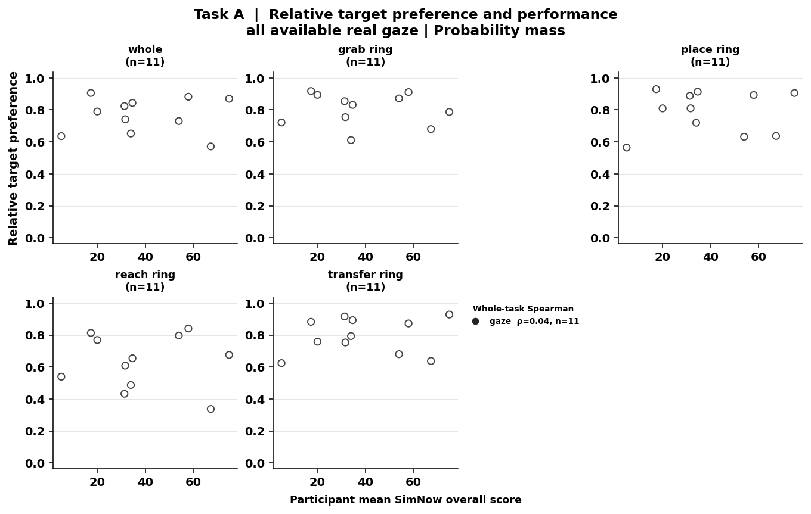

本图为v2主分析的全部真实眼动（real_all），不是10录像模型测试子集。

横轴为参与者平均SimNow总分，纵轴为C，空心圆为参与者；各阶段使用指标与成绩同时可用的录像，图例ρ只对应whole面板。

整体ρ=0.036 [-0.702, 0.785]；n=11，逐人留出范围[-0.176, 0.285]；CI跨0，不能确立单调关系。

阶段分解：接近环ρ=0.027（n=11）；抓取环ρ=-0.173（n=11）；转移环ρ=0.209（n=11）；放置环ρ=0.100（n=11）。

整体散点没有稳定的随成绩上升或下降形态；高占用或高偏好不能直接换算成高技能。

数据依据：[该分支统计表](20261105T063658759189Z_v2_full/main_probability/group_stage_summary.csv)；[相关表](20261105T063658759189Z_v2_full/main_probability/performance_correlations.csv)；[轮次表](20261105T063658759189Z_v2_full/main_probability/repetition_contrasts.csv)。

#### 图 G03｜Task A｜main_probability｜目标占用与成绩

本图为v2主分析的全部真实眼动（real_all），不是10录像模型测试子集。

横轴为参与者平均SimNow总分，纵轴为L_target，空心圆为参与者；各阶段使用指标与成绩同时可用的录像，图例ρ只对应whole面板。

整体ρ=0.082 [-0.528, 0.735]；n=11，逐人留出范围[-0.224, 0.248]；CI跨0，不能确立单调关系。

阶段分解：接近环ρ=0.218（n=11）；抓取环ρ=0.600（n=11）；转移环ρ=0.091（n=11）；放置环ρ=-0.064（n=11）。

抓取环的正向排序比整体更明显，提示整体平均可能掩盖阶段特异线索；尚不能据此认定技能指标。

数据依据：[该分支统计表](20261105T063658759189Z_v2_full/main_probability/group_stage_summary.csv)；[相关表](20261105T063658759189Z_v2_full/main_probability/performance_correlations.csv)；[轮次表](20261105T063658759189Z_v2_full/main_probability/repetition_contrasts.csv)。

#### 图 G04｜Task A｜main_probability｜腕部占用与成绩

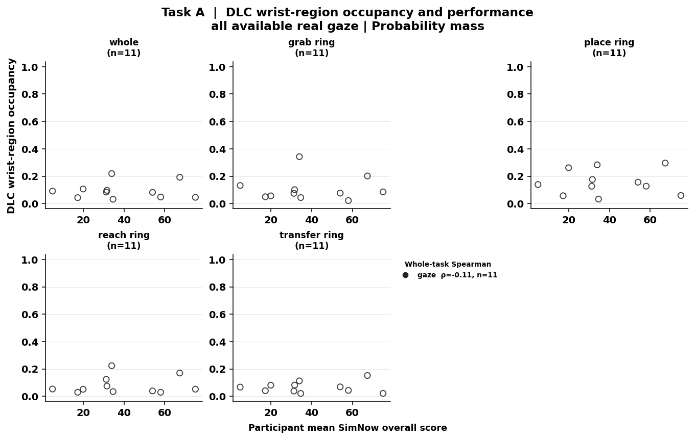

本图为v2主分析的全部真实眼动（real_all），不是10录像模型测试子集。

横轴为参与者平均SimNow总分，纵轴为L_gripper，空心圆为参与者；各阶段使用指标与成绩同时可用的录像，图例ρ只对应whole面板。

整体ρ=-0.109 [-0.748, 0.533]；n=11，逐人留出范围[-0.345, 0.030]；CI跨0，不能确立单调关系。

阶段分解：接近环ρ=0.000（n=11）；抓取环ρ=0.045（n=11）；转移环ρ=-0.009（n=11）；放置环ρ=0.073（n=11）。

整体散点没有稳定的随成绩上升或下降形态；高占用或高偏好不能直接换算成高技能。

数据依据：[该分支统计表](20261105T063658759189Z_v2_full/main_probability/group_stage_summary.csv)；[相关表](20261105T063658759189Z_v2_full/main_probability/performance_correlations.csv)；[轮次表](20261105T063658759189Z_v2_full/main_probability/repetition_contrasts.csv)。

#### 图 G05｜Task A｜main_probability｜参与者轮次轨迹

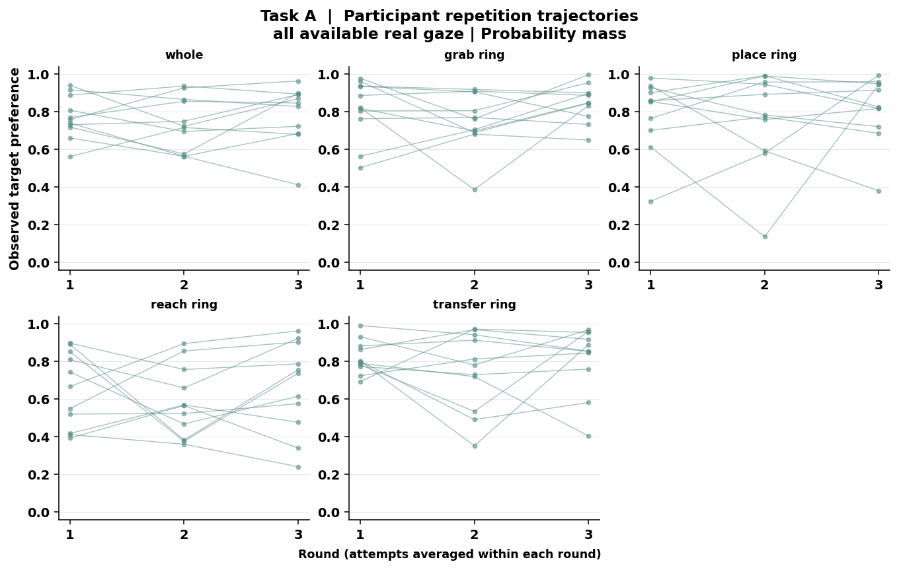

本图为v2主分析的全部真实眼动（real_all），不是10录像模型测试子集。

横轴为第1/2/3轮，纵轴为真实C；每条浅绿线连接同一参与者，同轮attempt已平均。整体现有配对第3−第1轮ΔC=1.8 [-7.7, 10.0] pp，n=11。

线条上下波动、变化方向不同；群体C变化CI跨0，不能用成绩提升来推定C必然上升。个别阶段尖锐变化还需结合该人的有效帧与阶段组成。

数据依据：[该分支统计表](20261105T063658759189Z_v2_full/main_probability/group_stage_summary.csv)；[相关表](20261105T063658759189Z_v2_full/main_probability/performance_correlations.csv)；[轮次表](20261105T063658759189Z_v2_full/main_probability/repetition_contrasts.csv)。

#### 图 G06｜Task A｜main_probability｜整体敏感性

本图为v2主分析的全部真实眼动（real_all），不是10录像模型测试子集。

三个面板依次为C、target占用和腕部占用；横轴是分析设置而非连续时间，连线只帮助比较设定。

C在main、r25、r100、gripper100分别为76.8%、79.3%、70.4%、40.4%。

gaze3、legacy123与smooth的C分别为76.8%、76.7%、76.7%；几何设定的影响远大于旧码或平滑对整体C的变化。严格状态的有效帧明显减少，相近均值不代表同一观测支持。

因此应在固定ROI定义下解释C，并结合面积修正与覆盖；不能挑选让结论更显著的半径。

数据依据：[该分支统计表](20261105T063658759189Z_v2_full/main_probability/group_stage_summary.csv)；[相关表](20261105T063658759189Z_v2_full/main_probability/performance_correlations.csv)；[轮次表](20261105T063658759189Z_v2_full/main_probability/repetition_contrasts.csv)。

#### 图 G07｜Task C｜main_probability｜四区域占用

本图为v2主分析的全部真实眼动（real_all），不是10录像模型测试子集。

各面板横轴为gaze，纵轴为有效时间占用；绿色T、橙色P、紫色O、灰色N互斥且合计100%，其中target总占用为绿色+紫色，腕部总占用为橙色+紫色。

整体 L_T=12.8%、L_P=11.5%、L_O=11.8%、L_N=63.8%。

绕器械缠线重叠19.1%，拉穿收紧重叠为0、穿塔Other为81.1%。这说明C任务主要难点是重叠与阶段支持不同；cinch只覆盖可观察小部分，不能比较柱高后推断完整行为。

数据依据：[该分支统计表](20261105T063658759189Z_v2_full/main_probability/group_stage_summary.csv)；[相关表](20261105T063658759189Z_v2_full/main_probability/performance_correlations.csv)；[轮次表](20261105T063658759189Z_v2_full/main_probability/repetition_contrasts.csv)。

#### 图 G08｜Task C｜main_probability｜目标偏好与成绩

本图为v2主分析的全部真实眼动（real_all），不是10录像模型测试子集。

横轴为参与者平均SimNow总分，纵轴为C，空心圆为参与者；各阶段使用指标与成绩同时可用的录像，图例ρ只对应whole面板。

整体ρ=-0.174 [-0.706, 0.575]；n=11，逐人留出范围[-0.387, 0.031]；CI跨0，不能确立单调关系。

阶段分解：接近线ρ=0.009（n=11）；绕器械缠线ρ=-0.266（n=11）；拉穿并收紧ρ=-0.203（n=6）；穿塔引线ρ=-0.405（n=8）。

Cinch只有6人、穿塔只有8人且成绩档位稀疏，散点少和并列分数使阶段相关不稳定；图形不是技能预测验证。

数据依据：[该分支统计表](20261105T063658759189Z_v2_full/main_probability/group_stage_summary.csv)；[相关表](20261105T063658759189Z_v2_full/main_probability/performance_correlations.csv)；[轮次表](20261105T063658759189Z_v2_full/main_probability/repetition_contrasts.csv)。

#### 图 G09｜Task C｜main_probability｜目标占用与成绩

本图为v2主分析的全部真实眼动（real_all），不是10录像模型测试子集。

横轴为参与者平均SimNow总分，纵轴为L_target，空心圆为参与者；各阶段使用指标与成绩同时可用的录像，图例ρ只对应whole面板。

整体ρ=0.156 [-0.561, 0.833]；n=11，逐人留出范围[0.036, 0.450]；CI跨0，不能确立单调关系。

阶段分解：接近线ρ=0.358（n=11）；绕器械缠线ρ=0.193（n=11）；拉穿并收紧ρ=-0.464（n=6）；穿塔引线ρ=-0.343（n=8）。

Cinch只有6人、穿塔只有8人且成绩档位稀疏，散点少和并列分数使阶段相关不稳定；图形不是技能预测验证。

数据依据：[该分支统计表](20261105T063658759189Z_v2_full/main_probability/group_stage_summary.csv)；[相关表](20261105T063658759189Z_v2_full/main_probability/performance_correlations.csv)；[轮次表](20261105T063658759189Z_v2_full/main_probability/repetition_contrasts.csv)。

#### 图 G10｜Task C｜main_probability｜腕部占用与成绩

本图为v2主分析的全部真实眼动（real_all），不是10录像模型测试子集。

横轴为参与者平均SimNow总分，纵轴为L_gripper，空心圆为参与者；各阶段使用指标与成绩同时可用的录像，图例ρ只对应whole面板。

整体ρ=0.220 [-0.518, 0.773]；n=11，逐人留出范围[-0.043, 0.444]；CI跨0，不能确立单调关系。

阶段分解：接近线ρ=0.624（n=11）；绕器械缠线ρ=0.294（n=11）；拉穿并收紧ρ=-0.145（n=6）；穿塔引线ρ=0.078（n=8）。

接近线面板正向趋势最值得进一步验证；v2该阶段ρ=.624，CI[.100,.906]，但不能忽视多指标探索和样本量。

数据依据：[该分支统计表](20261105T063658759189Z_v2_full/main_probability/group_stage_summary.csv)；[相关表](20261105T063658759189Z_v2_full/main_probability/performance_correlations.csv)；[轮次表](20261105T063658759189Z_v2_full/main_probability/repetition_contrasts.csv)。

#### 图 G11｜Task C｜main_probability｜参与者轮次轨迹

本图为v2主分析的全部真实眼动（real_all），不是10录像模型测试子集。

横轴为第1/2/3轮，纵轴为真实C；每条浅绿线连接同一参与者，同轮attempt已平均。整体现有配对第3−第1轮ΔC=-22.7 [-34.0, -11.4] pp，n=11。

整体及绕器械缠线中多条线下降，群体C下降是主要趋势；cinch和穿塔连线稀疏，缺点不等于0或没有学习。即使成绩提升，也不能把C下降解释为注意退化。

数据依据：[该分支统计表](20261105T063658759189Z_v2_full/main_probability/group_stage_summary.csv)；[相关表](20261105T063658759189Z_v2_full/main_probability/performance_correlations.csv)；[轮次表](20261105T063658759189Z_v2_full/main_probability/repetition_contrasts.csv)。

#### 图 G12｜Task C｜main_probability｜整体敏感性

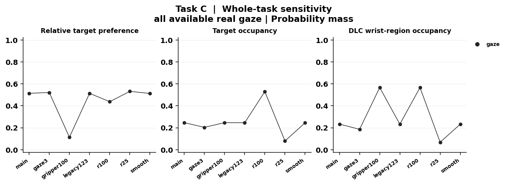

本图为v2主分析的全部真实眼动（real_all），不是10录像模型测试子集。

三个面板依次为C、target占用和腕部占用；横轴是分析设置而非连续时间，连线只帮助比较设定。

C在main、r25、r100、gripper100分别为51.4%、53.2%、43.8%、11.4%。

gaze3、legacy123与smooth的C分别为52.2%、51.4%、51.3%；几何设定的影响远大于旧码或平滑对整体C的变化。严格状态的有效帧明显减少，相近均值不代表同一观测支持。

因此应在固定ROI定义下解释C，并结合面积修正与覆盖；不能挑选让结论更显著的半径。

数据依据：[该分支统计表](20261105T063658759189Z_v2_full/main_probability/group_stage_summary.csv)；[相关表](20261105T063658759189Z_v2_full/main_probability/performance_correlations.csv)；[轮次表](20261105T063658759189Z_v2_full/main_probability/repetition_contrasts.csv)。

### decoded_expectation

#### 图 G13｜Task A｜decoded_expectation｜四区域占用

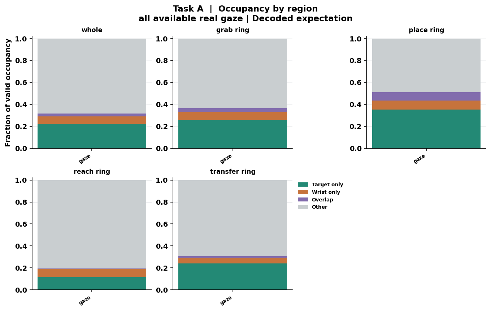

本图位于 `decoded_expectation`，但绘制的来源只有 `gaze`：它是与v2主分析相同的真实眼动支持，不是该解码器产生的模型轨迹。

各面板横轴为gaze，纵轴为有效时间占用；绿色T、橙色P、紫色O、灰色N互斥且合计100%，其中target总占用为绿色+紫色，腕部总占用为橙色+紫色。

整体 L_T=22.2%、L_P=6.7%、L_O=2.7%、L_N=68.3%。

放置环target占用43.0%，接近环仅12.4%；可见动作阶段改变了目标邻域的实际注视时间。灰色大并不代表不关注任务，因为两个ROI只占画面很小部分。

数据依据：[该分支统计表](20261105T063658759189Z_v2_full/decoded_expectation/group_stage_summary.csv)；[相关表](20261105T063658759189Z_v2_full/decoded_expectation/performance_correlations.csv)；[轮次表](20261105T063658759189Z_v2_full/decoded_expectation/repetition_contrasts.csv)。

#### 图 G14｜Task A｜decoded_expectation｜目标偏好与成绩

本图位于 `decoded_expectation`，但绘制的来源只有 `gaze`：它是与v2主分析相同的真实眼动支持，不是该解码器产生的模型轨迹。

横轴为参与者平均SimNow总分，纵轴为C，空心圆为参与者；各阶段使用指标与成绩同时可用的录像，图例ρ只对应whole面板。

整体ρ=0.036 [-0.702, 0.785]；n=11，逐人留出范围[-0.176, 0.285]；CI跨0，不能确立单调关系。

阶段分解：接近环ρ=0.027（n=11）；抓取环ρ=-0.173（n=11）；转移环ρ=0.209（n=11）；放置环ρ=0.100（n=11）。

整体散点没有稳定的随成绩上升或下降形态；高占用或高偏好不能直接换算成高技能。

数据依据：[该分支统计表](20261105T063658759189Z_v2_full/decoded_expectation/group_stage_summary.csv)；[相关表](20261105T063658759189Z_v2_full/decoded_expectation/performance_correlations.csv)；[轮次表](20261105T063658759189Z_v2_full/decoded_expectation/repetition_contrasts.csv)。

#### 图 G15｜Task A｜decoded_expectation｜目标占用与成绩

本图位于 `decoded_expectation`，但绘制的来源只有 `gaze`：它是与v2主分析相同的真实眼动支持，不是该解码器产生的模型轨迹。

横轴为参与者平均SimNow总分，纵轴为L_target，空心圆为参与者；各阶段使用指标与成绩同时可用的录像，图例ρ只对应whole面板。

整体ρ=0.082 [-0.528, 0.735]；n=11，逐人留出范围[-0.224, 0.248]；CI跨0，不能确立单调关系。

阶段分解：接近环ρ=0.218（n=11）；抓取环ρ=0.600（n=11）；转移环ρ=0.091（n=11）；放置环ρ=-0.064（n=11）。

抓取环的正向排序比整体更明显，提示整体平均可能掩盖阶段特异线索；尚不能据此认定技能指标。

数据依据：[该分支统计表](20261105T063658759189Z_v2_full/decoded_expectation/group_stage_summary.csv)；[相关表](20261105T063658759189Z_v2_full/decoded_expectation/performance_correlations.csv)；[轮次表](20261105T063658759189Z_v2_full/decoded_expectation/repetition_contrasts.csv)。

#### 图 G16｜Task A｜decoded_expectation｜腕部占用与成绩

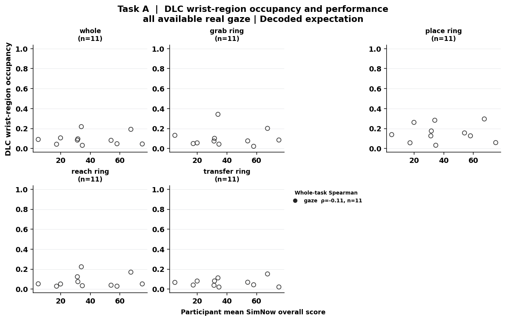

本图位于 `decoded_expectation`，但绘制的来源只有 `gaze`：它是与v2主分析相同的真实眼动支持，不是该解码器产生的模型轨迹。

横轴为参与者平均SimNow总分，纵轴为L_gripper，空心圆为参与者；各阶段使用指标与成绩同时可用的录像，图例ρ只对应whole面板。

整体ρ=-0.109 [-0.748, 0.533]；n=11，逐人留出范围[-0.345, 0.030]；CI跨0，不能确立单调关系。

阶段分解：接近环ρ=0.000（n=11）；抓取环ρ=0.045（n=11）；转移环ρ=-0.009（n=11）；放置环ρ=0.073（n=11）。

整体散点没有稳定的随成绩上升或下降形态；高占用或高偏好不能直接换算成高技能。

数据依据：[该分支统计表](20261105T063658759189Z_v2_full/decoded_expectation/group_stage_summary.csv)；[相关表](20261105T063658759189Z_v2_full/decoded_expectation/performance_correlations.csv)；[轮次表](20261105T063658759189Z_v2_full/decoded_expectation/repetition_contrasts.csv)。

#### 图 G17｜Task A｜decoded_expectation｜驻留与切换

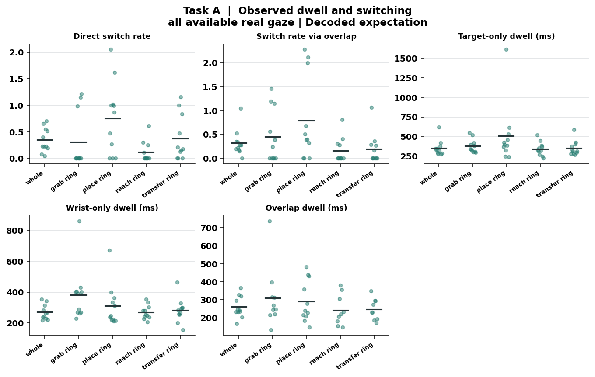

本图位于 `decoded_expectation`，但绘制的来源只有 `gaze`：它是与v2主分析相同的真实眼动支持，不是该解码器产生的模型轨迹。

五个面板分别显示直接切换率、经重叠切换率、T/P/O驻留；横轴为整体/阶段，绿点为参与者，黑短横为均值，切换单位次/分钟、驻留单位ms。

整体T/P/O驻留分别353.3/270.3/261.0ms；直接/经O切换为0.345/0.324/min。

放置环T驻留点分散并含长时离群值，其均值509.4ms，高于接近环；个体分布提醒我们不能仅看一条平均线。

数据依据：[该分支统计表](20261105T063658759189Z_v2_full/decoded_expectation/group_stage_summary.csv)；[相关表](20261105T063658759189Z_v2_full/decoded_expectation/performance_correlations.csv)；[轮次表](20261105T063658759189Z_v2_full/decoded_expectation/repetition_contrasts.csv)。

#### 图 G18｜Task A｜decoded_expectation｜参与者轮次轨迹

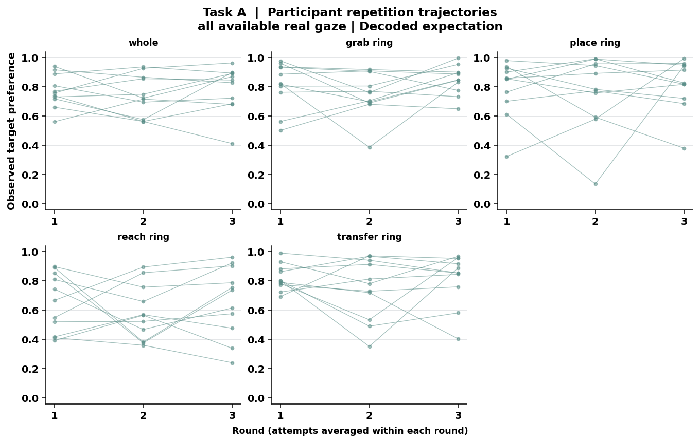

本图位于 `decoded_expectation`，但绘制的来源只有 `gaze`：它是与v2主分析相同的真实眼动支持，不是该解码器产生的模型轨迹。

横轴为第1/2/3轮，纵轴为真实C；每条浅绿线连接同一参与者，同轮attempt已平均。整体现有配对第3−第1轮ΔC=1.8 [-7.7, 10.0] pp，n=11。

线条上下波动、变化方向不同；群体C变化CI跨0，不能用成绩提升来推定C必然上升。个别阶段尖锐变化还需结合该人的有效帧与阶段组成。

数据依据：[该分支统计表](20261105T063658759189Z_v2_full/decoded_expectation/group_stage_summary.csv)；[相关表](20261105T063658759189Z_v2_full/decoded_expectation/performance_correlations.csv)；[轮次表](20261105T063658759189Z_v2_full/decoded_expectation/repetition_contrasts.csv)。

#### 图 G19｜Task A｜decoded_expectation｜整体敏感性

本图位于 `decoded_expectation`，但绘制的来源只有 `gaze`：它是与v2主分析相同的真实眼动支持，不是该解码器产生的模型轨迹。

三个面板依次为C、target占用和腕部占用；横轴是分析设置而非连续时间，连线只帮助比较设定。

C在main、r25、r100、gripper100分别为76.8%、79.3%、70.4%、40.4%。

gaze3、legacy123与smooth的C分别为76.8%、76.7%、76.7%；几何设定的影响远大于旧码或平滑对整体C的变化。严格状态的有效帧明显减少，相近均值不代表同一观测支持。

因此应在固定ROI定义下解释C，并结合面积修正与覆盖；不能挑选让结论更显著的半径。

数据依据：[该分支统计表](20261105T063658759189Z_v2_full/decoded_expectation/group_stage_summary.csv)；[相关表](20261105T063658759189Z_v2_full/decoded_expectation/performance_correlations.csv)；[轮次表](20261105T063658759189Z_v2_full/decoded_expectation/repetition_contrasts.csv)。

#### 图 G20｜Task C｜decoded_expectation｜四区域占用

本图位于 `decoded_expectation`，但绘制的来源只有 `gaze`：它是与v2主分析相同的真实眼动支持，不是该解码器产生的模型轨迹。

各面板横轴为gaze，纵轴为有效时间占用；绿色T、橙色P、紫色O、灰色N互斥且合计100%，其中target总占用为绿色+紫色，腕部总占用为橙色+紫色。

整体 L_T=12.8%、L_P=11.5%、L_O=11.8%、L_N=63.8%。

绕器械缠线重叠19.1%，拉穿收紧重叠为0、穿塔Other为81.1%。这说明C任务主要难点是重叠与阶段支持不同；cinch只覆盖可观察小部分，不能比较柱高后推断完整行为。

数据依据：[该分支统计表](20261105T063658759189Z_v2_full/decoded_expectation/group_stage_summary.csv)；[相关表](20261105T063658759189Z_v2_full/decoded_expectation/performance_correlations.csv)；[轮次表](20261105T063658759189Z_v2_full/decoded_expectation/repetition_contrasts.csv)。

#### 图 G21｜Task C｜decoded_expectation｜目标偏好与成绩

本图位于 `decoded_expectation`，但绘制的来源只有 `gaze`：它是与v2主分析相同的真实眼动支持，不是该解码器产生的模型轨迹。

横轴为参与者平均SimNow总分，纵轴为C，空心圆为参与者；各阶段使用指标与成绩同时可用的录像，图例ρ只对应whole面板。

整体ρ=-0.174 [-0.706, 0.575]；n=11，逐人留出范围[-0.387, 0.031]；CI跨0，不能确立单调关系。

阶段分解：接近线ρ=0.009（n=11）；绕器械缠线ρ=-0.266（n=11）；拉穿并收紧ρ=-0.203（n=6）；穿塔引线ρ=-0.405（n=8）。

Cinch只有6人、穿塔只有8人且成绩档位稀疏，散点少和并列分数使阶段相关不稳定；图形不是技能预测验证。

数据依据：[该分支统计表](20261105T063658759189Z_v2_full/decoded_expectation/group_stage_summary.csv)；[相关表](20261105T063658759189Z_v2_full/decoded_expectation/performance_correlations.csv)；[轮次表](20261105T063658759189Z_v2_full/decoded_expectation/repetition_contrasts.csv)。

#### 图 G22｜Task C｜decoded_expectation｜目标占用与成绩

本图位于 `decoded_expectation`，但绘制的来源只有 `gaze`：它是与v2主分析相同的真实眼动支持，不是该解码器产生的模型轨迹。

横轴为参与者平均SimNow总分，纵轴为L_target，空心圆为参与者；各阶段使用指标与成绩同时可用的录像，图例ρ只对应whole面板。

整体ρ=0.156 [-0.561, 0.833]；n=11，逐人留出范围[0.036, 0.450]；CI跨0，不能确立单调关系。

阶段分解：接近线ρ=0.358（n=11）；绕器械缠线ρ=0.193（n=11）；拉穿并收紧ρ=-0.464（n=6）；穿塔引线ρ=-0.343（n=8）。

Cinch只有6人、穿塔只有8人且成绩档位稀疏，散点少和并列分数使阶段相关不稳定；图形不是技能预测验证。

数据依据：[该分支统计表](20261105T063658759189Z_v2_full/decoded_expectation/group_stage_summary.csv)；[相关表](20261105T063658759189Z_v2_full/decoded_expectation/performance_correlations.csv)；[轮次表](20261105T063658759189Z_v2_full/decoded_expectation/repetition_contrasts.csv)。

#### 图 G23｜Task C｜decoded_expectation｜腕部占用与成绩

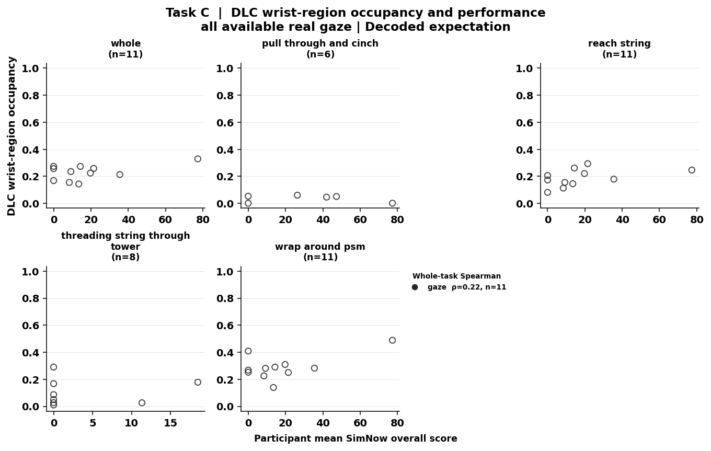

本图位于 `decoded_expectation`，但绘制的来源只有 `gaze`：它是与v2主分析相同的真实眼动支持，不是该解码器产生的模型轨迹。

横轴为参与者平均SimNow总分，纵轴为L_gripper，空心圆为参与者；各阶段使用指标与成绩同时可用的录像，图例ρ只对应whole面板。

整体ρ=0.220 [-0.518, 0.773]；n=11，逐人留出范围[-0.043, 0.444]；CI跨0，不能确立单调关系。

阶段分解：接近线ρ=0.624（n=11）；绕器械缠线ρ=0.294（n=11）；拉穿并收紧ρ=-0.145（n=6）；穿塔引线ρ=0.078（n=8）。

接近线面板正向趋势最值得进一步验证；v2该阶段ρ=.624，CI[.100,.906]，但不能忽视多指标探索和样本量。

数据依据：[该分支统计表](20261105T063658759189Z_v2_full/decoded_expectation/group_stage_summary.csv)；[相关表](20261105T063658759189Z_v2_full/decoded_expectation/performance_correlations.csv)；[轮次表](20261105T063658759189Z_v2_full/decoded_expectation/repetition_contrasts.csv)。

#### 图 G24｜Task C｜decoded_expectation｜驻留与切换

本图位于 `decoded_expectation`，但绘制的来源只有 `gaze`：它是与v2主分析相同的真实眼动支持，不是该解码器产生的模型轨迹。

五个面板分别显示直接切换率、经重叠切换率、T/P/O驻留；横轴为整体/阶段，绿点为参与者，黑短横为均值，切换单位次/分钟、驻留单位ms。

整体T/P/O驻留分别301.5/291.9/337.5ms；直接/经O切换为0.163/0.678/min。

绕器械缠线经O切换较多，说明空间转换常经过重叠。Cinch的O驻留没有可估事件；cinch与穿塔零切换只指保留的有效片段，并不证明原始全过程不存在切换。

数据依据：[该分支统计表](20261105T063658759189Z_v2_full/decoded_expectation/group_stage_summary.csv)；[相关表](20261105T063658759189Z_v2_full/decoded_expectation/performance_correlations.csv)；[轮次表](20261105T063658759189Z_v2_full/decoded_expectation/repetition_contrasts.csv)。

#### 图 G25｜Task C｜decoded_expectation｜参与者轮次轨迹

本图位于 `decoded_expectation`，但绘制的来源只有 `gaze`：它是与v2主分析相同的真实眼动支持，不是该解码器产生的模型轨迹。

横轴为第1/2/3轮，纵轴为真实C；每条浅绿线连接同一参与者，同轮attempt已平均。整体现有配对第3−第1轮ΔC=-22.7 [-34.0, -11.4] pp，n=11。

整体及绕器械缠线中多条线下降，群体C下降是主要趋势；cinch和穿塔连线稀疏，缺点不等于0或没有学习。即使成绩提升，也不能把C下降解释为注意退化。

数据依据：[该分支统计表](20261105T063658759189Z_v2_full/decoded_expectation/group_stage_summary.csv)；[相关表](20261105T063658759189Z_v2_full/decoded_expectation/performance_correlations.csv)；[轮次表](20261105T063658759189Z_v2_full/decoded_expectation/repetition_contrasts.csv)。

#### 图 G26｜Task C｜decoded_expectation｜整体敏感性

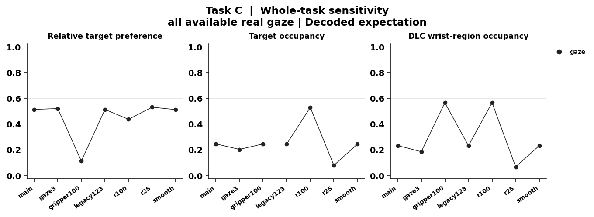

本图位于 `decoded_expectation`，但绘制的来源只有 `gaze`：它是与v2主分析相同的真实眼动支持，不是该解码器产生的模型轨迹。

三个面板依次为C、target占用和腕部占用；横轴是分析设置而非连续时间，连线只帮助比较设定。

C在main、r25、r100、gripper100分别为51.4%、53.2%、43.8%、11.4%。

gaze3、legacy123与smooth的C分别为52.2%、51.4%、51.3%；几何设定的影响远大于旧码或平滑对整体C的变化。严格状态的有效帧明显减少，相近均值不代表同一观测支持。

因此应在固定ROI定义下解释C，并结合面积修正与覆盖；不能挑选让结论更显著的半径。

数据依据：[该分支统计表](20261105T063658759189Z_v2_full/decoded_expectation/group_stage_summary.csv)；[相关表](20261105T063658759189Z_v2_full/decoded_expectation/performance_correlations.csv)；[轮次表](20261105T063658759189Z_v2_full/decoded_expectation/repetition_contrasts.csv)。

### decoded_argmax

#### 图 G27｜Task A｜decoded_argmax｜四区域占用

本图位于 `decoded_argmax`，但绘制的来源只有 `gaze`：它是与v2主分析相同的真实眼动支持，不是该解码器产生的模型轨迹。

各面板横轴为gaze，纵轴为有效时间占用；绿色T、橙色P、紫色O、灰色N互斥且合计100%，其中target总占用为绿色+紫色，腕部总占用为橙色+紫色。

整体 L_T=22.2%、L_P=6.7%、L_O=2.7%、L_N=68.3%。

放置环target占用43.0%，接近环仅12.4%；可见动作阶段改变了目标邻域的实际注视时间。灰色大并不代表不关注任务，因为两个ROI只占画面很小部分。

数据依据：[该分支统计表](20261105T063658759189Z_v2_full/decoded_argmax/group_stage_summary.csv)；[相关表](20261105T063658759189Z_v2_full/decoded_argmax/performance_correlations.csv)；[轮次表](20261105T063658759189Z_v2_full/decoded_argmax/repetition_contrasts.csv)。

#### 图 G28｜Task A｜decoded_argmax｜目标偏好与成绩

本图位于 `decoded_argmax`，但绘制的来源只有 `gaze`：它是与v2主分析相同的真实眼动支持，不是该解码器产生的模型轨迹。

横轴为参与者平均SimNow总分，纵轴为C，空心圆为参与者；各阶段使用指标与成绩同时可用的录像，图例ρ只对应whole面板。

整体ρ=0.036 [-0.702, 0.785]；n=11，逐人留出范围[-0.176, 0.285]；CI跨0，不能确立单调关系。

阶段分解：接近环ρ=0.027（n=11）；抓取环ρ=-0.173（n=11）；转移环ρ=0.209（n=11）；放置环ρ=0.100（n=11）。

整体散点没有稳定的随成绩上升或下降形态；高占用或高偏好不能直接换算成高技能。

数据依据：[该分支统计表](20261105T063658759189Z_v2_full/decoded_argmax/group_stage_summary.csv)；[相关表](20261105T063658759189Z_v2_full/decoded_argmax/performance_correlations.csv)；[轮次表](20261105T063658759189Z_v2_full/decoded_argmax/repetition_contrasts.csv)。

#### 图 G29｜Task A｜decoded_argmax｜目标占用与成绩

本图位于 `decoded_argmax`，但绘制的来源只有 `gaze`：它是与v2主分析相同的真实眼动支持，不是该解码器产生的模型轨迹。

横轴为参与者平均SimNow总分，纵轴为L_target，空心圆为参与者；各阶段使用指标与成绩同时可用的录像，图例ρ只对应whole面板。

整体ρ=0.082 [-0.528, 0.735]；n=11，逐人留出范围[-0.224, 0.248]；CI跨0，不能确立单调关系。

阶段分解：接近环ρ=0.218（n=11）；抓取环ρ=0.600（n=11）；转移环ρ=0.091（n=11）；放置环ρ=-0.064（n=11）。

抓取环的正向排序比整体更明显，提示整体平均可能掩盖阶段特异线索；尚不能据此认定技能指标。

数据依据：[该分支统计表](20261105T063658759189Z_v2_full/decoded_argmax/group_stage_summary.csv)；[相关表](20261105T063658759189Z_v2_full/decoded_argmax/performance_correlations.csv)；[轮次表](20261105T063658759189Z_v2_full/decoded_argmax/repetition_contrasts.csv)。

#### 图 G30｜Task A｜decoded_argmax｜腕部占用与成绩

本图位于 `decoded_argmax`，但绘制的来源只有 `gaze`：它是与v2主分析相同的真实眼动支持，不是该解码器产生的模型轨迹。

横轴为参与者平均SimNow总分，纵轴为L_gripper，空心圆为参与者；各阶段使用指标与成绩同时可用的录像，图例ρ只对应whole面板。

整体ρ=-0.109 [-0.748, 0.533]；n=11，逐人留出范围[-0.345, 0.030]；CI跨0，不能确立单调关系。

阶段分解：接近环ρ=0.000（n=11）；抓取环ρ=0.045（n=11）；转移环ρ=-0.009（n=11）；放置环ρ=0.073（n=11）。

整体散点没有稳定的随成绩上升或下降形态；高占用或高偏好不能直接换算成高技能。

数据依据：[该分支统计表](20261105T063658759189Z_v2_full/decoded_argmax/group_stage_summary.csv)；[相关表](20261105T063658759189Z_v2_full/decoded_argmax/performance_correlations.csv)；[轮次表](20261105T063658759189Z_v2_full/decoded_argmax/repetition_contrasts.csv)。

#### 图 G31｜Task A｜decoded_argmax｜驻留与切换

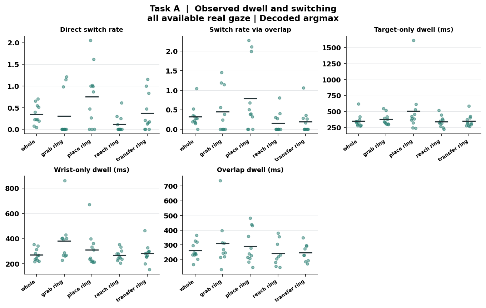

本图位于 `decoded_argmax`，但绘制的来源只有 `gaze`：它是与v2主分析相同的真实眼动支持，不是该解码器产生的模型轨迹。

五个面板分别显示直接切换率、经重叠切换率、T/P/O驻留；横轴为整体/阶段，绿点为参与者，黑短横为均值，切换单位次/分钟、驻留单位ms。

整体T/P/O驻留分别353.3/270.3/261.0ms；直接/经O切换为0.345/0.324/min。

放置环T驻留点分散并含长时离群值，其均值509.4ms，高于接近环；个体分布提醒我们不能仅看一条平均线。

数据依据：[该分支统计表](20261105T063658759189Z_v2_full/decoded_argmax/group_stage_summary.csv)；[相关表](20261105T063658759189Z_v2_full/decoded_argmax/performance_correlations.csv)；[轮次表](20261105T063658759189Z_v2_full/decoded_argmax/repetition_contrasts.csv)。

#### 图 G32｜Task A｜decoded_argmax｜参与者轮次轨迹

本图位于 `decoded_argmax`，但绘制的来源只有 `gaze`：它是与v2主分析相同的真实眼动支持，不是该解码器产生的模型轨迹。

横轴为第1/2/3轮，纵轴为真实C；每条浅绿线连接同一参与者，同轮attempt已平均。整体现有配对第3−第1轮ΔC=1.8 [-7.7, 10.0] pp，n=11。

线条上下波动、变化方向不同；群体C变化CI跨0，不能用成绩提升来推定C必然上升。个别阶段尖锐变化还需结合该人的有效帧与阶段组成。

数据依据：[该分支统计表](20261105T063658759189Z_v2_full/decoded_argmax/group_stage_summary.csv)；[相关表](20261105T063658759189Z_v2_full/decoded_argmax/performance_correlations.csv)；[轮次表](20261105T063658759189Z_v2_full/decoded_argmax/repetition_contrasts.csv)。

#### 图 G33｜Task A｜decoded_argmax｜整体敏感性

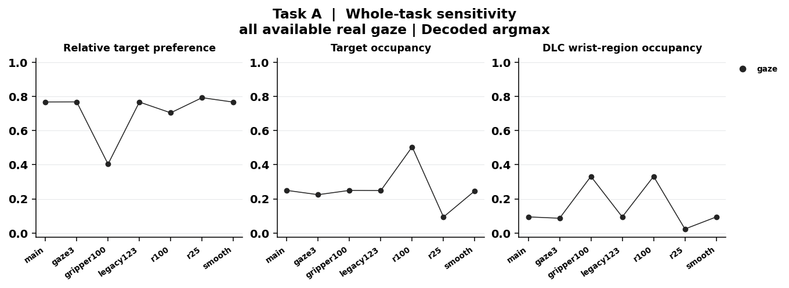

本图位于 `decoded_argmax`，但绘制的来源只有 `gaze`：它是与v2主分析相同的真实眼动支持，不是该解码器产生的模型轨迹。

三个面板依次为C、target占用和腕部占用；横轴是分析设置而非连续时间，连线只帮助比较设定。

C在main、r25、r100、gripper100分别为76.8%、79.3%、70.4%、40.4%。

gaze3、legacy123与smooth的C分别为76.8%、76.7%、76.7%；几何设定的影响远大于旧码或平滑对整体C的变化。严格状态的有效帧明显减少，相近均值不代表同一观测支持。

因此应在固定ROI定义下解释C，并结合面积修正与覆盖；不能挑选让结论更显著的半径。

数据依据：[该分支统计表](20261105T063658759189Z_v2_full/decoded_argmax/group_stage_summary.csv)；[相关表](20261105T063658759189Z_v2_full/decoded_argmax/performance_correlations.csv)；[轮次表](20261105T063658759189Z_v2_full/decoded_argmax/repetition_contrasts.csv)。

#### 图 G34｜Task C｜decoded_argmax｜四区域占用

本图位于 `decoded_argmax`，但绘制的来源只有 `gaze`：它是与v2主分析相同的真实眼动支持，不是该解码器产生的模型轨迹。

各面板横轴为gaze，纵轴为有效时间占用；绿色T、橙色P、紫色O、灰色N互斥且合计100%，其中target总占用为绿色+紫色，腕部总占用为橙色+紫色。

整体 L_T=12.8%、L_P=11.5%、L_O=11.8%、L_N=63.8%。

绕器械缠线重叠19.1%，拉穿收紧重叠为0、穿塔Other为81.1%。这说明C任务主要难点是重叠与阶段支持不同；cinch只覆盖可观察小部分，不能比较柱高后推断完整行为。

数据依据：[该分支统计表](20261105T063658759189Z_v2_full/decoded_argmax/group_stage_summary.csv)；[相关表](20261105T063658759189Z_v2_full/decoded_argmax/performance_correlations.csv)；[轮次表](20261105T063658759189Z_v2_full/decoded_argmax/repetition_contrasts.csv)。

#### 图 G35｜Task C｜decoded_argmax｜目标偏好与成绩

本图位于 `decoded_argmax`，但绘制的来源只有 `gaze`：它是与v2主分析相同的真实眼动支持，不是该解码器产生的模型轨迹。

横轴为参与者平均SimNow总分，纵轴为C，空心圆为参与者；各阶段使用指标与成绩同时可用的录像，图例ρ只对应whole面板。

整体ρ=-0.174 [-0.706, 0.575]；n=11，逐人留出范围[-0.387, 0.031]；CI跨0，不能确立单调关系。

阶段分解：接近线ρ=0.009（n=11）；绕器械缠线ρ=-0.266（n=11）；拉穿并收紧ρ=-0.203（n=6）；穿塔引线ρ=-0.405（n=8）。

Cinch只有6人、穿塔只有8人且成绩档位稀疏，散点少和并列分数使阶段相关不稳定；图形不是技能预测验证。

数据依据：[该分支统计表](20261105T063658759189Z_v2_full/decoded_argmax/group_stage_summary.csv)；[相关表](20261105T063658759189Z_v2_full/decoded_argmax/performance_correlations.csv)；[轮次表](20261105T063658759189Z_v2_full/decoded_argmax/repetition_contrasts.csv)。

#### 图 G36｜Task C｜decoded_argmax｜目标占用与成绩

本图位于 `decoded_argmax`，但绘制的来源只有 `gaze`：它是与v2主分析相同的真实眼动支持，不是该解码器产生的模型轨迹。

横轴为参与者平均SimNow总分，纵轴为L_target，空心圆为参与者；各阶段使用指标与成绩同时可用的录像，图例ρ只对应whole面板。

整体ρ=0.156 [-0.561, 0.833]；n=11，逐人留出范围[0.036, 0.450]；CI跨0，不能确立单调关系。

阶段分解：接近线ρ=0.358（n=11）；绕器械缠线ρ=0.193（n=11）；拉穿并收紧ρ=-0.464（n=6）；穿塔引线ρ=-0.343（n=8）。

Cinch只有6人、穿塔只有8人且成绩档位稀疏，散点少和并列分数使阶段相关不稳定；图形不是技能预测验证。

数据依据：[该分支统计表](20261105T063658759189Z_v2_full/decoded_argmax/group_stage_summary.csv)；[相关表](20261105T063658759189Z_v2_full/decoded_argmax/performance_correlations.csv)；[轮次表](20261105T063658759189Z_v2_full/decoded_argmax/repetition_contrasts.csv)。

#### 图 G37｜Task C｜decoded_argmax｜腕部占用与成绩

本图位于 `decoded_argmax`，但绘制的来源只有 `gaze`：它是与v2主分析相同的真实眼动支持，不是该解码器产生的模型轨迹。

横轴为参与者平均SimNow总分，纵轴为L_gripper，空心圆为参与者；各阶段使用指标与成绩同时可用的录像，图例ρ只对应whole面板。

整体ρ=0.220 [-0.518, 0.773]；n=11，逐人留出范围[-0.043, 0.444]；CI跨0，不能确立单调关系。

阶段分解：接近线ρ=0.624（n=11）；绕器械缠线ρ=0.294（n=11）；拉穿并收紧ρ=-0.145（n=6）；穿塔引线ρ=0.078（n=8）。

接近线面板正向趋势最值得进一步验证；v2该阶段ρ=.624，CI[.100,.906]，但不能忽视多指标探索和样本量。

数据依据：[该分支统计表](20261105T063658759189Z_v2_full/decoded_argmax/group_stage_summary.csv)；[相关表](20261105T063658759189Z_v2_full/decoded_argmax/performance_correlations.csv)；[轮次表](20261105T063658759189Z_v2_full/decoded_argmax/repetition_contrasts.csv)。

#### 图 G38｜Task C｜decoded_argmax｜驻留与切换

本图位于 `decoded_argmax`，但绘制的来源只有 `gaze`：它是与v2主分析相同的真实眼动支持，不是该解码器产生的模型轨迹。

五个面板分别显示直接切换率、经重叠切换率、T/P/O驻留；横轴为整体/阶段，绿点为参与者，黑短横为均值，切换单位次/分钟、驻留单位ms。

整体T/P/O驻留分别301.5/291.9/337.5ms；直接/经O切换为0.163/0.678/min。

绕器械缠线经O切换较多，说明空间转换常经过重叠。Cinch的O驻留没有可估事件；cinch与穿塔零切换只指保留的有效片段，并不证明原始全过程不存在切换。

数据依据：[该分支统计表](20261105T063658759189Z_v2_full/decoded_argmax/group_stage_summary.csv)；[相关表](20261105T063658759189Z_v2_full/decoded_argmax/performance_correlations.csv)；[轮次表](20261105T063658759189Z_v2_full/decoded_argmax/repetition_contrasts.csv)。

#### 图 G39｜Task C｜decoded_argmax｜参与者轮次轨迹

本图位于 `decoded_argmax`，但绘制的来源只有 `gaze`：它是与v2主分析相同的真实眼动支持，不是该解码器产生的模型轨迹。

横轴为第1/2/3轮，纵轴为真实C；每条浅绿线连接同一参与者，同轮attempt已平均。整体现有配对第3−第1轮ΔC=-22.7 [-34.0, -11.4] pp，n=11。

整体及绕器械缠线中多条线下降，群体C下降是主要趋势；cinch和穿塔连线稀疏，缺点不等于0或没有学习。即使成绩提升，也不能把C下降解释为注意退化。

数据依据：[该分支统计表](20261105T063658759189Z_v2_full/decoded_argmax/group_stage_summary.csv)；[相关表](20261105T063658759189Z_v2_full/decoded_argmax/performance_correlations.csv)；[轮次表](20261105T063658759189Z_v2_full/decoded_argmax/repetition_contrasts.csv)。

#### 图 G40｜Task C｜decoded_argmax｜整体敏感性

本图位于 `decoded_argmax`，但绘制的来源只有 `gaze`：它是与v2主分析相同的真实眼动支持，不是该解码器产生的模型轨迹。

三个面板依次为C、target占用和腕部占用；横轴是分析设置而非连续时间，连线只帮助比较设定。

C在main、r25、r100、gripper100分别为51.4%、53.2%、43.8%、11.4%。

gaze3、legacy123与smooth的C分别为52.2%、51.4%、51.3%；几何设定的影响远大于旧码或平滑对整体C的变化。严格状态的有效帧明显减少，相近均值不代表同一观测支持。

因此应在固定ROI定义下解释C，并结合面积修正与覆盖；不能挑选让结论更显著的半径。

数据依据：[该分支统计表](20261105T063658759189Z_v2_full/decoded_argmax/group_stage_summary.csv)；[相关表](20261105T063658759189Z_v2_full/decoded_argmax/performance_correlations.csv)；[轮次表](20261105T063658759189Z_v2_full/decoded_argmax/repetition_contrasts.csv)。

### decoded_sample

#### 图 G41｜Task A｜decoded_sample｜四区域占用

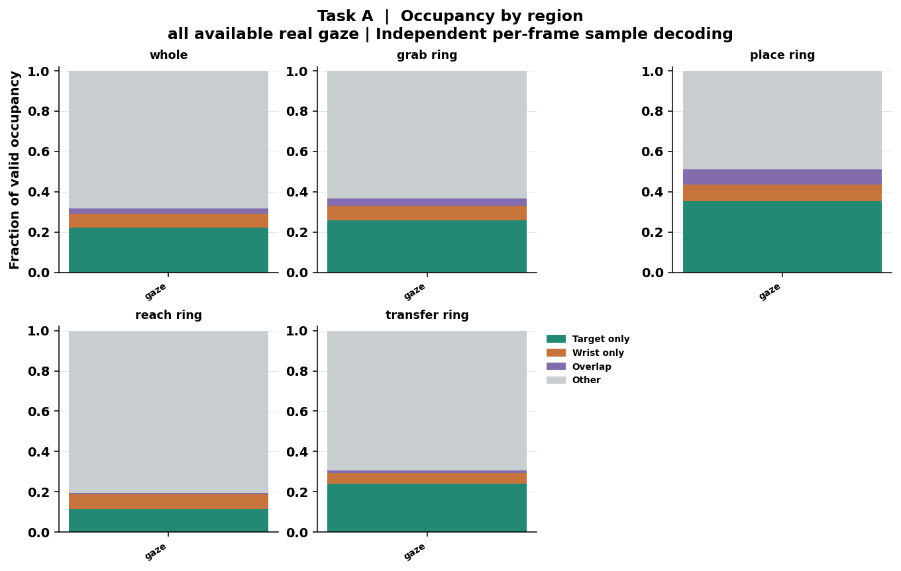

本图位于 `decoded_sample`，但绘制的来源只有 `gaze`：它是与v2主分析相同的真实眼动支持，不是该解码器产生的模型轨迹。

各面板横轴为gaze，纵轴为有效时间占用；绿色T、橙色P、紫色O、灰色N互斥且合计100%，其中target总占用为绿色+紫色，腕部总占用为橙色+紫色。

整体 L_T=22.2%、L_P=6.7%、L_O=2.7%、L_N=68.3%。

放置环target占用43.0%，接近环仅12.4%；可见动作阶段改变了目标邻域的实际注视时间。灰色大并不代表不关注任务，因为两个ROI只占画面很小部分。

数据依据：[该分支统计表](20261105T063658759189Z_v2_full/decoded_sample/group_stage_summary.csv)；[相关表](20261105T063658759189Z_v2_full/decoded_sample/performance_correlations.csv)；[轮次表](20261105T063658759189Z_v2_full/decoded_sample/repetition_contrasts.csv)。

#### 图 G42｜Task A｜decoded_sample｜目标偏好与成绩

本图位于 `decoded_sample`，但绘制的来源只有 `gaze`：它是与v2主分析相同的真实眼动支持，不是该解码器产生的模型轨迹。

横轴为参与者平均SimNow总分，纵轴为C，空心圆为参与者；各阶段使用指标与成绩同时可用的录像，图例ρ只对应whole面板。

整体ρ=0.036 [-0.702, 0.785]；n=11，逐人留出范围[-0.176, 0.285]；CI跨0，不能确立单调关系。

阶段分解：接近环ρ=0.027（n=11）；抓取环ρ=-0.173（n=11）；转移环ρ=0.209（n=11）；放置环ρ=0.100（n=11）。

整体散点没有稳定的随成绩上升或下降形态；高占用或高偏好不能直接换算成高技能。

数据依据：[该分支统计表](20261105T063658759189Z_v2_full/decoded_sample/group_stage_summary.csv)；[相关表](20261105T063658759189Z_v2_full/decoded_sample/performance_correlations.csv)；[轮次表](20261105T063658759189Z_v2_full/decoded_sample/repetition_contrasts.csv)。

#### 图 G43｜Task A｜decoded_sample｜目标占用与成绩

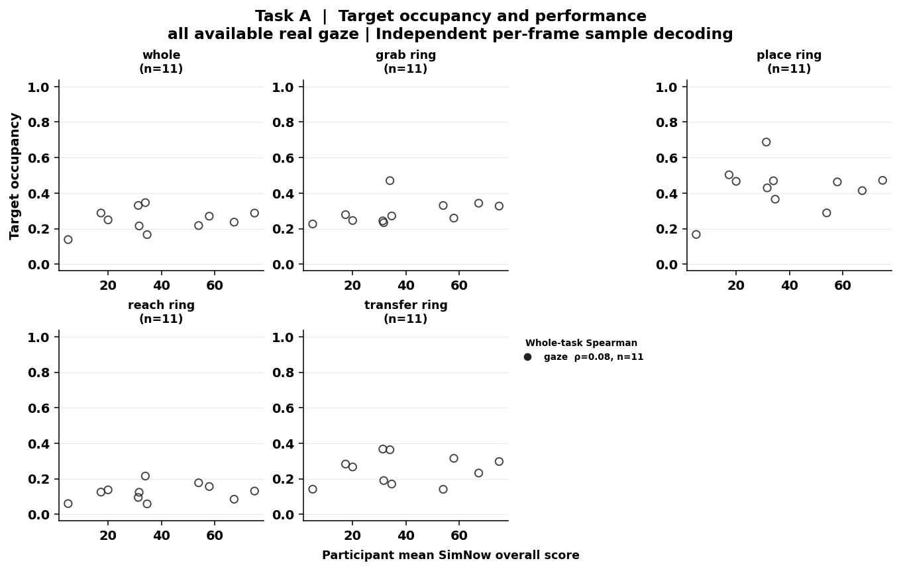

本图位于 `decoded_sample`，但绘制的来源只有 `gaze`：它是与v2主分析相同的真实眼动支持，不是该解码器产生的模型轨迹。

横轴为参与者平均SimNow总分，纵轴为L_target，空心圆为参与者；各阶段使用指标与成绩同时可用的录像，图例ρ只对应whole面板。

整体ρ=0.082 [-0.528, 0.735]；n=11，逐人留出范围[-0.224, 0.248]；CI跨0，不能确立单调关系。

阶段分解：接近环ρ=0.218（n=11）；抓取环ρ=0.600（n=11）；转移环ρ=0.091（n=11）；放置环ρ=-0.064（n=11）。

抓取环的正向排序比整体更明显，提示整体平均可能掩盖阶段特异线索；尚不能据此认定技能指标。

数据依据：[该分支统计表](20261105T063658759189Z_v2_full/decoded_sample/group_stage_summary.csv)；[相关表](20261105T063658759189Z_v2_full/decoded_sample/performance_correlations.csv)；[轮次表](20261105T063658759189Z_v2_full/decoded_sample/repetition_contrasts.csv)。

#### 图 G44｜Task A｜decoded_sample｜腕部占用与成绩

本图位于 `decoded_sample`，但绘制的来源只有 `gaze`：它是与v2主分析相同的真实眼动支持，不是该解码器产生的模型轨迹。

横轴为参与者平均SimNow总分，纵轴为L_gripper，空心圆为参与者；各阶段使用指标与成绩同时可用的录像，图例ρ只对应whole面板。

整体ρ=-0.109 [-0.748, 0.533]；n=11，逐人留出范围[-0.345, 0.030]；CI跨0，不能确立单调关系。

阶段分解：接近环ρ=0.000（n=11）；抓取环ρ=0.045（n=11）；转移环ρ=-0.009（n=11）；放置环ρ=0.073（n=11）。

整体散点没有稳定的随成绩上升或下降形态；高占用或高偏好不能直接换算成高技能。

数据依据：[该分支统计表](20261105T063658759189Z_v2_full/decoded_sample/group_stage_summary.csv)；[相关表](20261105T063658759189Z_v2_full/decoded_sample/performance_correlations.csv)；[轮次表](20261105T063658759189Z_v2_full/decoded_sample/repetition_contrasts.csv)。

#### 图 G45｜Task A｜decoded_sample｜驻留与切换

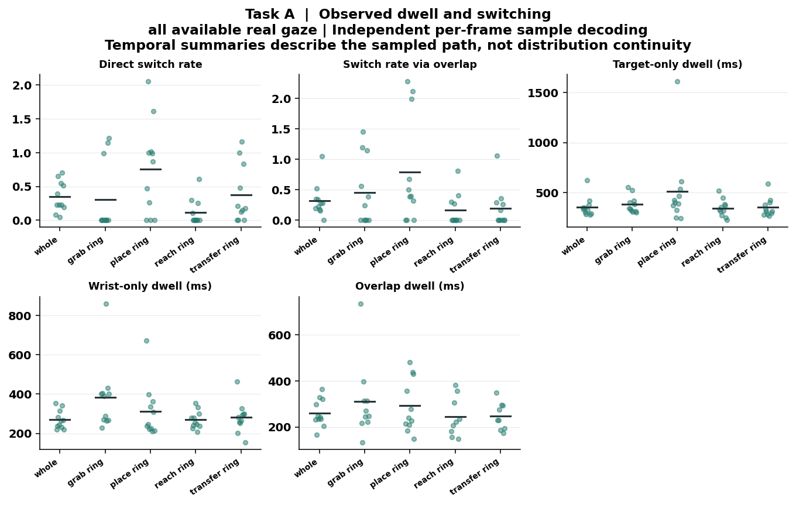

本图位于 `decoded_sample`，但绘制的来源只有 `gaze`：它是与v2主分析相同的真实眼动支持，不是该解码器产生的模型轨迹。

五个面板分别显示直接切换率、经重叠切换率、T/P/O驻留；横轴为整体/阶段，绿点为参与者，黑短横为均值，切换单位次/分钟、驻留单位ms。

整体T/P/O驻留分别353.3/270.3/261.0ms；直接/经O切换为0.345/0.324/min。

放置环T驻留点分散并含长时离群值，其均值509.4ms，高于接近环；个体分布提醒我们不能仅看一条平均线。

标题中的“逐帧采样不代表分布连续性”是分支通用警示；本图是gaze，不能把它误读成模型采样时间性能。

数据依据：[该分支统计表](20261105T063658759189Z_v2_full/decoded_sample/group_stage_summary.csv)；[相关表](20261105T063658759189Z_v2_full/decoded_sample/performance_correlations.csv)；[轮次表](20261105T063658759189Z_v2_full/decoded_sample/repetition_contrasts.csv)。

#### 图 G46｜Task A｜decoded_sample｜参与者轮次轨迹

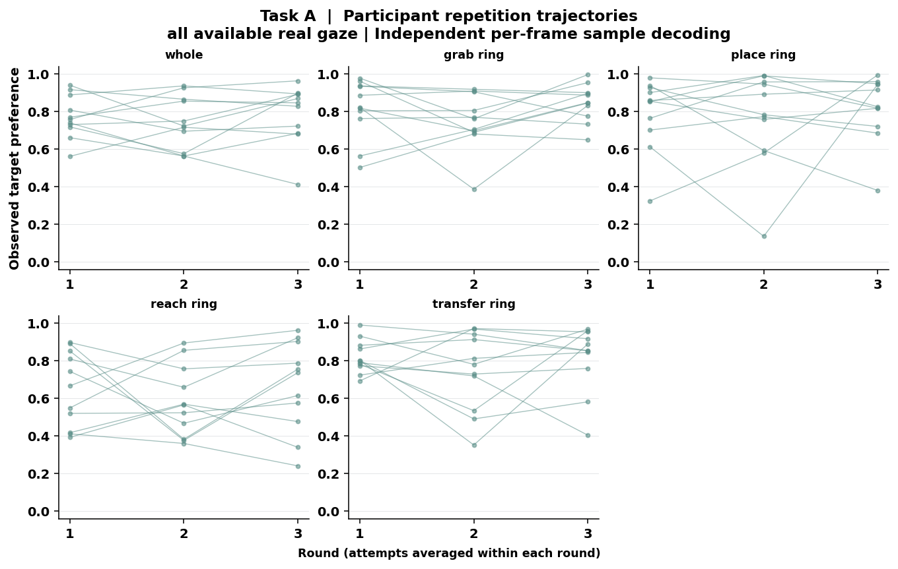

本图位于 `decoded_sample`，但绘制的来源只有 `gaze`：它是与v2主分析相同的真实眼动支持，不是该解码器产生的模型轨迹。

横轴为第1/2/3轮，纵轴为真实C；每条浅绿线连接同一参与者，同轮attempt已平均。整体现有配对第3−第1轮ΔC=1.8 [-7.7, 10.0] pp，n=11。

线条上下波动、变化方向不同；群体C变化CI跨0，不能用成绩提升来推定C必然上升。个别阶段尖锐变化还需结合该人的有效帧与阶段组成。

数据依据：[该分支统计表](20261105T063658759189Z_v2_full/decoded_sample/group_stage_summary.csv)；[相关表](20261105T063658759189Z_v2_full/decoded_sample/performance_correlations.csv)；[轮次表](20261105T063658759189Z_v2_full/decoded_sample/repetition_contrasts.csv)。

#### 图 G47｜Task A｜decoded_sample｜整体敏感性

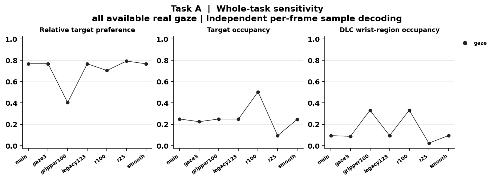

本图位于 `decoded_sample`，但绘制的来源只有 `gaze`：它是与v2主分析相同的真实眼动支持，不是该解码器产生的模型轨迹。

三个面板依次为C、target占用和腕部占用；横轴是分析设置而非连续时间，连线只帮助比较设定。

C在main、r25、r100、gripper100分别为76.8%、79.3%、70.4%、40.4%。

gaze3、legacy123与smooth的C分别为76.8%、76.7%、76.7%；几何设定的影响远大于旧码或平滑对整体C的变化。严格状态的有效帧明显减少，相近均值不代表同一观测支持。

因此应在固定ROI定义下解释C，并结合面积修正与覆盖；不能挑选让结论更显著的半径。

数据依据：[该分支统计表](20261105T063658759189Z_v2_full/decoded_sample/group_stage_summary.csv)；[相关表](20261105T063658759189Z_v2_full/decoded_sample/performance_correlations.csv)；[轮次表](20261105T063658759189Z_v2_full/decoded_sample/repetition_contrasts.csv)。

#### 图 G48｜Task C｜decoded_sample｜四区域占用

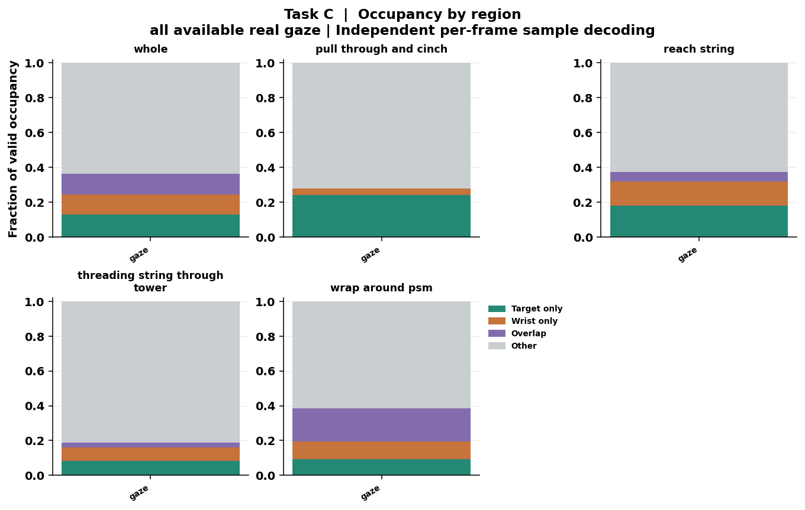

本图位于 `decoded_sample`，但绘制的来源只有 `gaze`：它是与v2主分析相同的真实眼动支持，不是该解码器产生的模型轨迹。

各面板横轴为gaze，纵轴为有效时间占用；绿色T、橙色P、紫色O、灰色N互斥且合计100%，其中target总占用为绿色+紫色，腕部总占用为橙色+紫色。

整体 L_T=12.8%、L_P=11.5%、L_O=11.8%、L_N=63.8%。

绕器械缠线重叠19.1%，拉穿收紧重叠为0、穿塔Other为81.1%。这说明C任务主要难点是重叠与阶段支持不同；cinch只覆盖可观察小部分，不能比较柱高后推断完整行为。

数据依据：[该分支统计表](20261105T063658759189Z_v2_full/decoded_sample/group_stage_summary.csv)；[相关表](20261105T063658759189Z_v2_full/decoded_sample/performance_correlations.csv)；[轮次表](20261105T063658759189Z_v2_full/decoded_sample/repetition_contrasts.csv)。

#### 图 G49｜Task C｜decoded_sample｜目标偏好与成绩

本图位于 `decoded_sample`，但绘制的来源只有 `gaze`：它是与v2主分析相同的真实眼动支持，不是该解码器产生的模型轨迹。

横轴为参与者平均SimNow总分，纵轴为C，空心圆为参与者；各阶段使用指标与成绩同时可用的录像，图例ρ只对应whole面板。

整体ρ=-0.174 [-0.706, 0.575]；n=11，逐人留出范围[-0.387, 0.031]；CI跨0，不能确立单调关系。

阶段分解：接近线ρ=0.009（n=11）；绕器械缠线ρ=-0.266（n=11）；拉穿并收紧ρ=-0.203（n=6）；穿塔引线ρ=-0.405（n=8）。

Cinch只有6人、穿塔只有8人且成绩档位稀疏，散点少和并列分数使阶段相关不稳定；图形不是技能预测验证。

数据依据：[该分支统计表](20261105T063658759189Z_v2_full/decoded_sample/group_stage_summary.csv)；[相关表](20261105T063658759189Z_v2_full/decoded_sample/performance_correlations.csv)；[轮次表](20261105T063658759189Z_v2_full/decoded_sample/repetition_contrasts.csv)。

#### 图 G50｜Task C｜decoded_sample｜目标占用与成绩

本图位于 `decoded_sample`，但绘制的来源只有 `gaze`：它是与v2主分析相同的真实眼动支持，不是该解码器产生的模型轨迹。

横轴为参与者平均SimNow总分，纵轴为L_target，空心圆为参与者；各阶段使用指标与成绩同时可用的录像，图例ρ只对应whole面板。

整体ρ=0.156 [-0.561, 0.833]；n=11，逐人留出范围[0.036, 0.450]；CI跨0，不能确立单调关系。

阶段分解：接近线ρ=0.358（n=11）；绕器械缠线ρ=0.193（n=11）；拉穿并收紧ρ=-0.464（n=6）；穿塔引线ρ=-0.343（n=8）。

Cinch只有6人、穿塔只有8人且成绩档位稀疏，散点少和并列分数使阶段相关不稳定；图形不是技能预测验证。

数据依据：[该分支统计表](20261105T063658759189Z_v2_full/decoded_sample/group_stage_summary.csv)；[相关表](20261105T063658759189Z_v2_full/decoded_sample/performance_correlations.csv)；[轮次表](20261105T063658759189Z_v2_full/decoded_sample/repetition_contrasts.csv)。

#### 图 G51｜Task C｜decoded_sample｜腕部占用与成绩

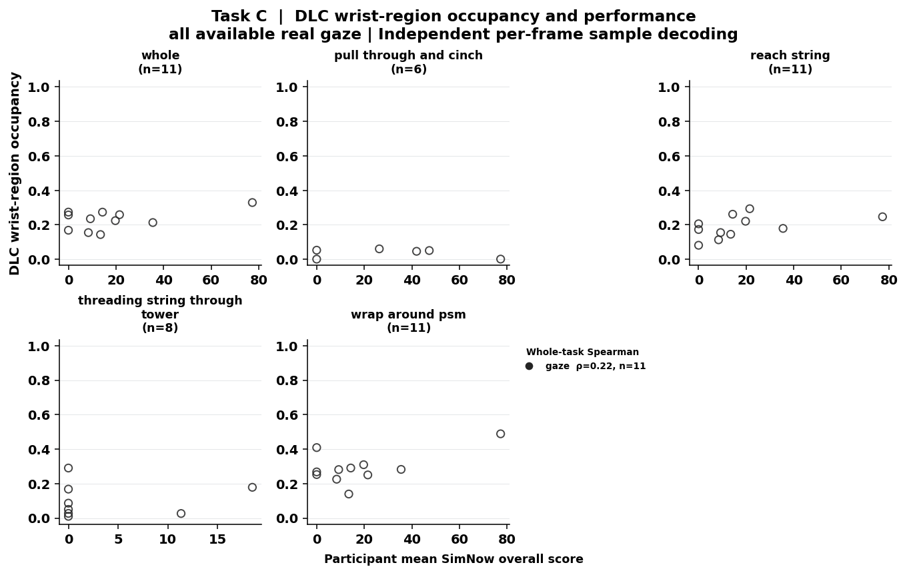

本图位于 `decoded_sample`，但绘制的来源只有 `gaze`：它是与v2主分析相同的真实眼动支持，不是该解码器产生的模型轨迹。

横轴为参与者平均SimNow总分，纵轴为L_gripper，空心圆为参与者；各阶段使用指标与成绩同时可用的录像，图例ρ只对应whole面板。

整体ρ=0.220 [-0.518, 0.773]；n=11，逐人留出范围[-0.043, 0.444]；CI跨0，不能确立单调关系。

阶段分解：接近线ρ=0.624（n=11）；绕器械缠线ρ=0.294（n=11）；拉穿并收紧ρ=-0.145（n=6）；穿塔引线ρ=0.078（n=8）。

接近线面板正向趋势最值得进一步验证；v2该阶段ρ=.624，CI[.100,.906]，但不能忽视多指标探索和样本量。

数据依据：[该分支统计表](20261105T063658759189Z_v2_full/decoded_sample/group_stage_summary.csv)；[相关表](20261105T063658759189Z_v2_full/decoded_sample/performance_correlations.csv)；[轮次表](20261105T063658759189Z_v2_full/decoded_sample/repetition_contrasts.csv)。

#### 图 G52｜Task C｜decoded_sample｜驻留与切换

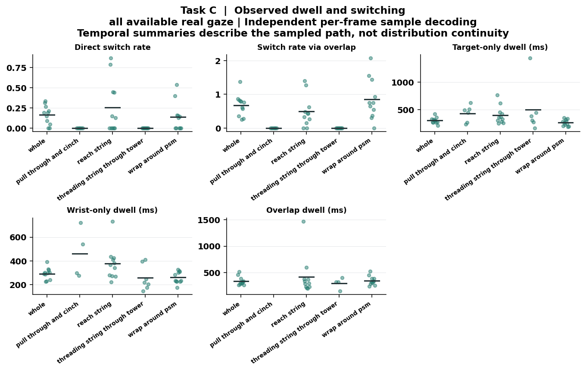

本图位于 `decoded_sample`，但绘制的来源只有 `gaze`：它是与v2主分析相同的真实眼动支持，不是该解码器产生的模型轨迹。

五个面板分别显示直接切换率、经重叠切换率、T/P/O驻留；横轴为整体/阶段，绿点为参与者，黑短横为均值，切换单位次/分钟、驻留单位ms。

整体T/P/O驻留分别301.5/291.9/337.5ms；直接/经O切换为0.163/0.678/min。

绕器械缠线经O切换较多，说明空间转换常经过重叠。Cinch的O驻留没有可估事件；cinch与穿塔零切换只指保留的有效片段，并不证明原始全过程不存在切换。

标题中的“逐帧采样不代表分布连续性”是分支通用警示；本图是gaze，不能把它误读成模型采样时间性能。

数据依据：[该分支统计表](20261105T063658759189Z_v2_full/decoded_sample/group_stage_summary.csv)；[相关表](20261105T063658759189Z_v2_full/decoded_sample/performance_correlations.csv)；[轮次表](20261105T063658759189Z_v2_full/decoded_sample/repetition_contrasts.csv)。

#### 图 G53｜Task C｜decoded_sample｜参与者轮次轨迹

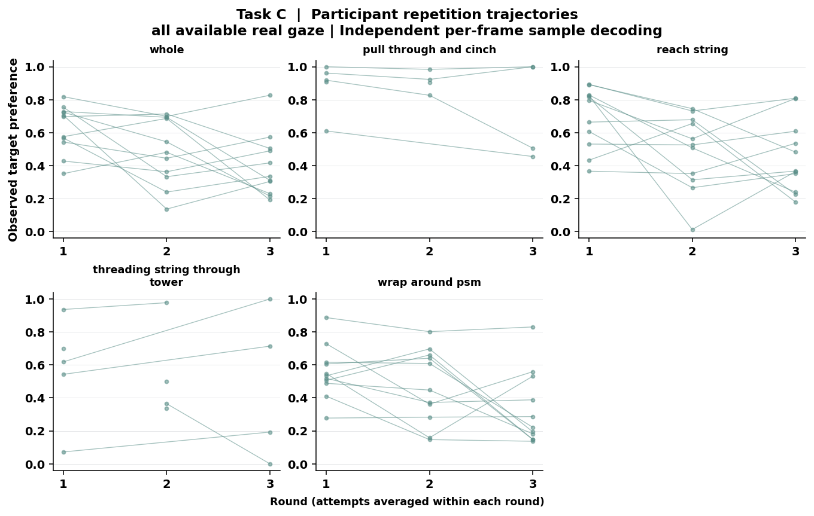

本图位于 `decoded_sample`，但绘制的来源只有 `gaze`：它是与v2主分析相同的真实眼动支持，不是该解码器产生的模型轨迹。

横轴为第1/2/3轮，纵轴为真实C；每条浅绿线连接同一参与者，同轮attempt已平均。整体现有配对第3−第1轮ΔC=-22.7 [-34.0, -11.4] pp，n=11。

整体及绕器械缠线中多条线下降，群体C下降是主要趋势；cinch和穿塔连线稀疏，缺点不等于0或没有学习。即使成绩提升，也不能把C下降解释为注意退化。

数据依据：[该分支统计表](20261105T063658759189Z_v2_full/decoded_sample/group_stage_summary.csv)；[相关表](20261105T063658759189Z_v2_full/decoded_sample/performance_correlations.csv)；[轮次表](20261105T063658759189Z_v2_full/decoded_sample/repetition_contrasts.csv)。

#### 图 G54｜Task C｜decoded_sample｜整体敏感性

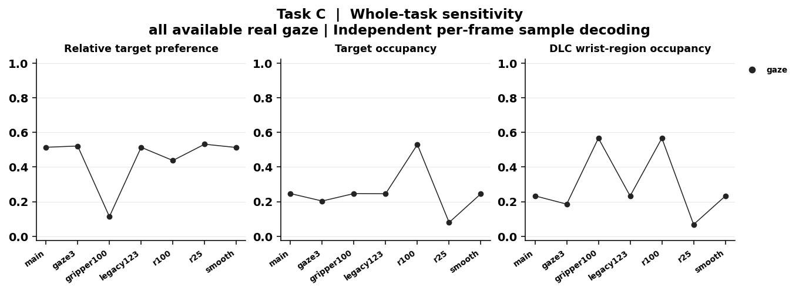

本图位于 `decoded_sample`，但绘制的来源只有 `gaze`：它是与v2主分析相同的真实眼动支持，不是该解码器产生的模型轨迹。

三个面板依次为C、target占用和腕部占用；横轴是分析设置而非连续时间，连线只帮助比较设定。

C在main、r25、r100、gripper100分别为51.4%、53.2%、43.8%、11.4%。

gaze3、legacy123与smooth的C分别为52.2%、51.4%、51.3%；几何设定的影响远大于旧码或平滑对整体C的变化。严格状态的有效帧明显减少，相近均值不代表同一观测支持。

因此应在固定ROI定义下解释C，并结合面积修正与覆盖；不能挑选让结论更显著的半径。

数据依据：[该分支统计表](20261105T063658759189Z_v2_full/decoded_sample/group_stage_summary.csv)；[相关表](20261105T063658759189Z_v2_full/decoded_sample/performance_correlations.csv)；[轮次表](20261105T063658759189Z_v2_full/decoded_sample/repetition_contrasts.csv)。

### 旧版（已被v2替代）

#### 图 G55｜Task A｜旧版（已被v2替代）｜四区域占用

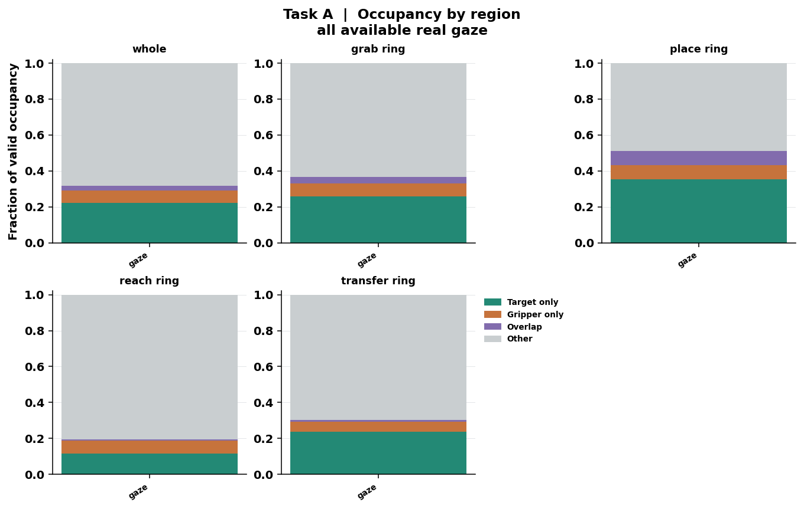

**历史结果：使用旧定义/旧有效帧集，仅用于回溯，不与v2主表混算。**

各面板横轴为gaze，纵轴为有效时间占用；绿色T、橙色P、紫色O、灰色N互斥且合计100%，其中target总占用为绿色+紫色，腕部总占用为橙色+紫色。

整体 L_T=22.2%、L_P=6.7%、L_O=2.7%、L_N=68.4%。

放置环target占用42.9%，接近环仅12.4%；可见动作阶段改变了目标邻域的实际注视时间。灰色大并不代表不关注任务，因为两个ROI只占画面很小部分。

数据依据：[该分支统计表](20261105T033217114891Z_full/group_stage_summary.csv)；[相关表](20261105T033217114891Z_full/performance_correlations.csv)；[轮次表](20261105T033217114891Z_full/repetition_contrasts.csv)。

#### 图 G56｜Task A｜旧版（已被v2替代）｜目标偏好与成绩

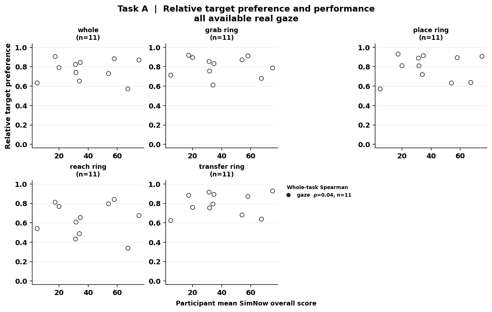

**历史结果：使用旧定义/旧有效帧集，仅用于回溯，不与v2主表混算。**

横轴为参与者平均SimNow总分，纵轴为C，空心圆为参与者；各阶段使用指标与成绩同时可用的录像，图例ρ只对应whole面板。

整体ρ=0.036 [-0.702, 0.785]；n=11，逐人留出范围[-0.176, 0.285]；CI跨0，不能确立单调关系。

阶段分解：接近环ρ=0.027（n=11）；抓取环ρ=-0.173（n=11）；转移环ρ=0.209（n=11）；放置环ρ=0.082（n=11）。

整体散点没有稳定的随成绩上升或下降形态；高占用或高偏好不能直接换算成高技能。

数据依据：[该分支统计表](20261105T033217114891Z_full/group_stage_summary.csv)；[相关表](20261105T033217114891Z_full/performance_correlations.csv)；[轮次表](20261105T033217114891Z_full/repetition_contrasts.csv)。

#### 图 G57｜Task A｜旧版（已被v2替代）｜目标占用与成绩

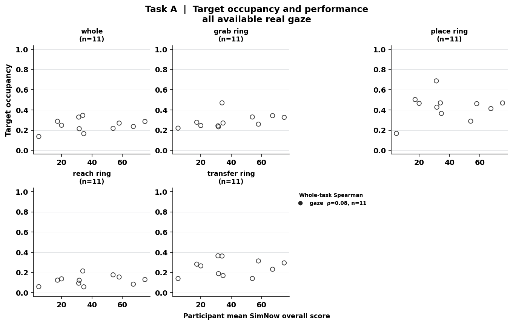

**历史结果：使用旧定义/旧有效帧集，仅用于回溯，不与v2主表混算。**

横轴为参与者平均SimNow总分，纵轴为L_target，空心圆为参与者；各阶段使用指标与成绩同时可用的录像，图例ρ只对应whole面板。

整体ρ=0.082 [-0.528, 0.735]；n=11，逐人留出范围[-0.224, 0.248]；CI跨0，不能确立单调关系。

阶段分解：接近环ρ=0.218（n=11）；抓取环ρ=0.600（n=11）；转移环ρ=0.155（n=11）；放置环ρ=-0.109（n=11）。

抓取环的正向排序比整体更明显，提示整体平均可能掩盖阶段特异线索；尚不能据此认定技能指标。

数据依据：[该分支统计表](20261105T033217114891Z_full/group_stage_summary.csv)；[相关表](20261105T033217114891Z_full/performance_correlations.csv)；[轮次表](20261105T033217114891Z_full/repetition_contrasts.csv)。

#### 图 G58｜Task A｜旧版（已被v2替代）｜腕部占用与成绩

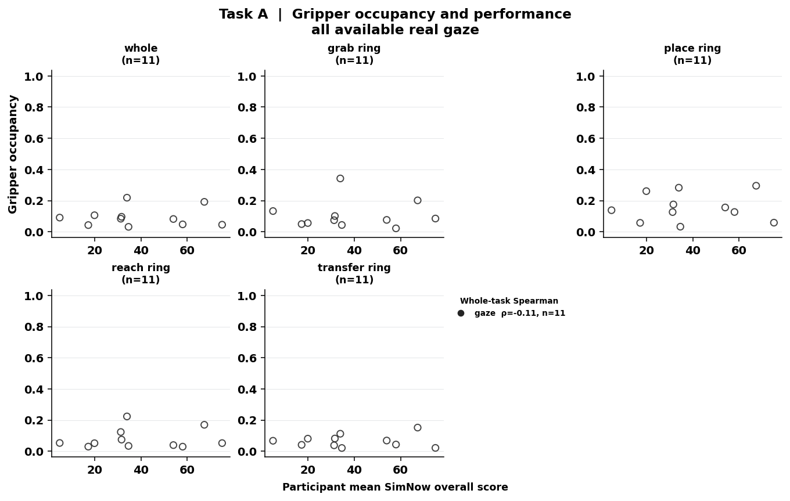

**历史结果：使用旧定义/旧有效帧集，仅用于回溯，不与v2主表混算。**

横轴为参与者平均SimNow总分，纵轴为L_gripper，空心圆为参与者；各阶段使用指标与成绩同时可用的录像，图例ρ只对应whole面板。

整体ρ=-0.109 [-0.748, 0.533]；n=11，逐人留出范围[-0.345, 0.030]；CI跨0，不能确立单调关系。

阶段分解：接近环ρ=0.000（n=11）；抓取环ρ=0.045（n=11）；转移环ρ=-0.009（n=11）；放置环ρ=0.073（n=11）。

整体散点没有稳定的随成绩上升或下降形态；高占用或高偏好不能直接换算成高技能。

数据依据：[该分支统计表](20261105T033217114891Z_full/group_stage_summary.csv)；[相关表](20261105T033217114891Z_full/performance_correlations.csv)；[轮次表](20261105T033217114891Z_full/repetition_contrasts.csv)。

#### 图 G59｜Task A｜旧版（已被v2替代）｜驻留与切换

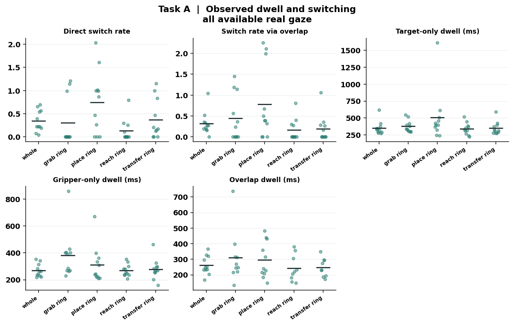

**历史结果：使用旧定义/旧有效帧集，仅用于回溯，不与v2主表混算。**

五个面板分别显示直接切换率、经重叠切换率、T/P/O驻留；横轴为整体/阶段，绿点为参与者，黑短横为均值，切换单位次/分钟、驻留单位ms。

整体T/P/O驻留分别353.5/270.0/262.0ms；直接/经O切换为0.349/0.322/min。

放置环T驻留点分散并含长时离群值，其均值508.3ms，高于接近环；个体分布提醒我们不能仅看一条平均线。

数据依据：[该分支统计表](20261105T033217114891Z_full/group_stage_summary.csv)；[相关表](20261105T033217114891Z_full/performance_correlations.csv)；[轮次表](20261105T033217114891Z_full/repetition_contrasts.csv)。

#### 图 G60｜Task A｜旧版（已被v2替代）｜参与者轮次轨迹

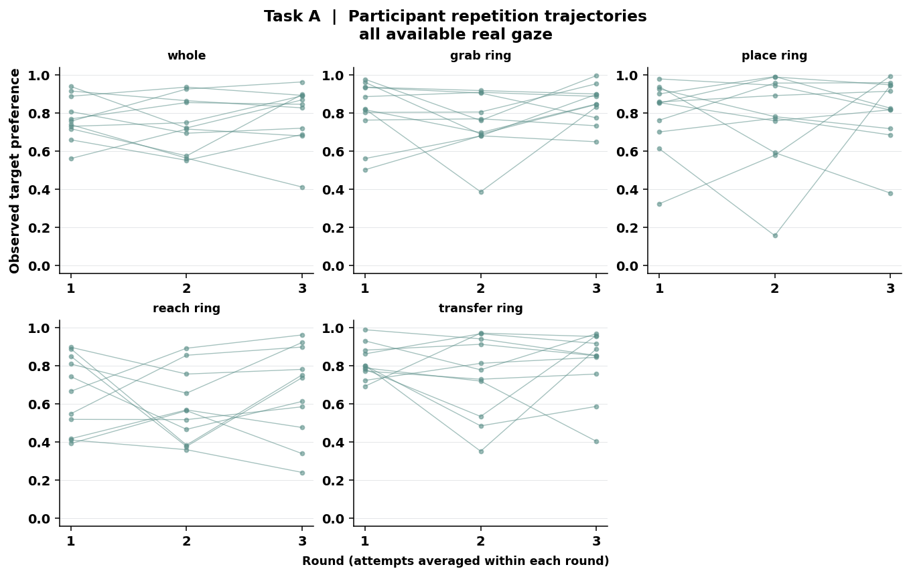

**历史结果：使用旧定义/旧有效帧集，仅用于回溯，不与v2主表混算。**

横轴为第1/2/3轮，纵轴为真实C；每条浅绿线连接同一参与者，同轮attempt已平均。整体现有配对第3−第1轮ΔC=1.8 [-7.6, 10.1] pp，n=11。

线条上下波动、变化方向不同；群体C变化CI跨0，不能用成绩提升来推定C必然上升。个别阶段尖锐变化还需结合该人的有效帧与阶段组成。

数据依据：[该分支统计表](20261105T033217114891Z_full/group_stage_summary.csv)；[相关表](20261105T033217114891Z_full/performance_correlations.csv)；[轮次表](20261105T033217114891Z_full/repetition_contrasts.csv)。

#### 图 G61｜Task A｜旧版（已被v2替代）｜整体敏感性

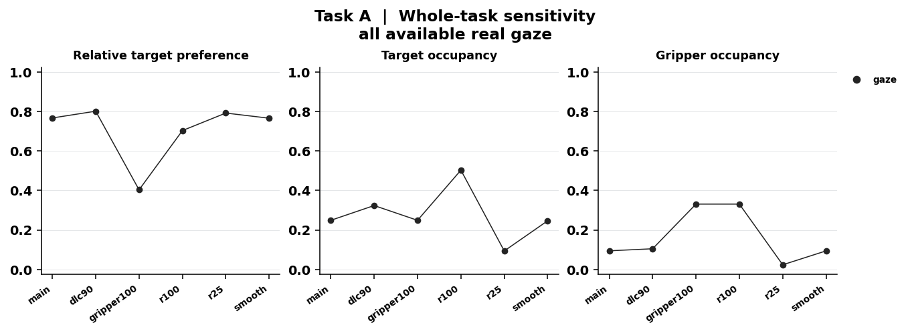

**历史结果：使用旧定义/旧有效帧集，仅用于回溯，不与v2主表混算。**

三个面板依次为C、target占用和腕部占用；横轴是分析设置而非连续时间，连线只帮助比较设定。

C在main、r25、r100、gripper100分别为76.7%、79.2%、70.4%、40.3%。

旧版横轴还包含dlc90。旧图整体展示“扩大腕部半径显著降低C、扩大双半径提高绝对占用”的现象；dlc90基于DLC质量阈值的旧筛选，不能替代v2眼动状态敏感性。

因此应在固定ROI定义下解释C，并结合面积修正与覆盖；不能挑选让结论更显著的半径。

数据依据：[该分支统计表](20261105T033217114891Z_full/group_stage_summary.csv)；[相关表](20261105T033217114891Z_full/performance_correlations.csv)；[轮次表](20261105T033217114891Z_full/repetition_contrasts.csv)。

#### 图 G62｜Task C｜旧版（已被v2替代）｜四区域占用

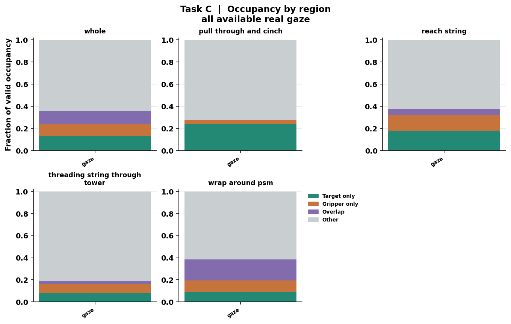

**历史结果：使用旧定义/旧有效帧集，仅用于回溯，不与v2主表混算。**

各面板横轴为gaze，纵轴为有效时间占用；绿色T、橙色P、紫色O、灰色N互斥且合计100%，其中target总占用为绿色+紫色，腕部总占用为橙色+紫色。

整体 L_T=12.8%、L_P=11.5%、L_O=11.8%、L_N=63.9%。

绕器械缠线重叠19.0%，拉穿收紧重叠为0、穿塔Other为81.1%。这说明C任务主要难点是重叠与阶段支持不同；cinch只覆盖可观察小部分，不能比较柱高后推断完整行为。

数据依据：[该分支统计表](20261105T033217114891Z_full/group_stage_summary.csv)；[相关表](20261105T033217114891Z_full/performance_correlations.csv)；[轮次表](20261105T033217114891Z_full/repetition_contrasts.csv)。

#### 图 G63｜Task C｜旧版（已被v2替代）｜目标偏好与成绩

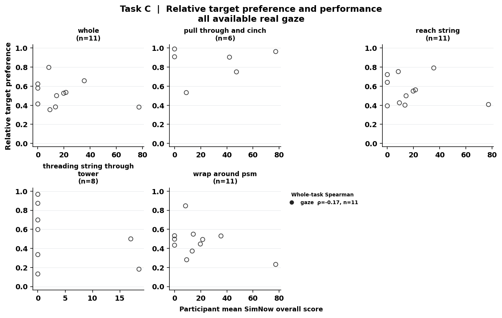

**历史结果：使用旧定义/旧有效帧集，仅用于回溯，不与v2主表混算。**

横轴为参与者平均SimNow总分，纵轴为C，空心圆为参与者；各阶段使用指标与成绩同时可用的录像，图例ρ只对应whole面板。

整体ρ=-0.174 [-0.706, 0.575]；n=11，逐人留出范围[-0.387, 0.031]；CI跨0，不能确立单调关系。

阶段分解：接近线ρ=0.009（n=11）；绕器械缠线ρ=-0.266（n=11）；拉穿并收紧ρ=-0.203（n=6）；穿塔引线ρ=-0.405（n=8）。

Cinch只有6人、穿塔只有8人且成绩档位稀疏，散点少和并列分数使阶段相关不稳定；图形不是技能预测验证。

数据依据：[该分支统计表](20261105T033217114891Z_full/group_stage_summary.csv)；[相关表](20261105T033217114891Z_full/performance_correlations.csv)；[轮次表](20261105T033217114891Z_full/repetition_contrasts.csv)。

#### 图 G64｜Task C｜旧版（已被v2替代）｜目标占用与成绩

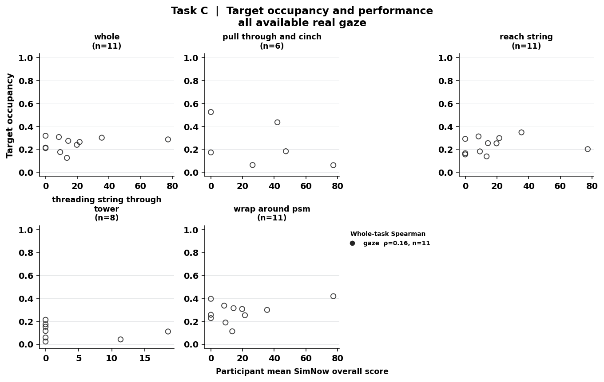

**历史结果：使用旧定义/旧有效帧集，仅用于回溯，不与v2主表混算。**

横轴为参与者平均SimNow总分，纵轴为L_target，空心圆为参与者；各阶段使用指标与成绩同时可用的录像，图例ρ只对应whole面板。

整体ρ=0.156 [-0.561, 0.833]；n=11，逐人留出范围[0.036, 0.450]；CI跨0，不能确立单调关系。

阶段分解：接近线ρ=0.358（n=11）；绕器械缠线ρ=0.193（n=11）；拉穿并收紧ρ=-0.464（n=6）；穿塔引线ρ=-0.343（n=8）。

Cinch只有6人、穿塔只有8人且成绩档位稀疏，散点少和并列分数使阶段相关不稳定；图形不是技能预测验证。

数据依据：[该分支统计表](20261105T033217114891Z_full/group_stage_summary.csv)；[相关表](20261105T033217114891Z_full/performance_correlations.csv)；[轮次表](20261105T033217114891Z_full/repetition_contrasts.csv)。

#### 图 G65｜Task C｜旧版（已被v2替代）｜腕部占用与成绩

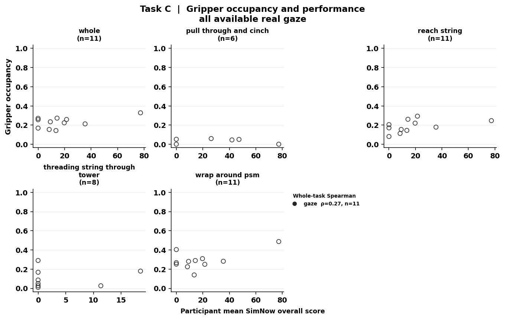

**历史结果：使用旧定义/旧有效帧集，仅用于回溯，不与v2主表混算。**

横轴为参与者平均SimNow总分，纵轴为L_gripper，空心圆为参与者；各阶段使用指标与成绩同时可用的录像，图例ρ只对应whole面板。

整体ρ=0.266 [-0.453, 0.778]；n=11，逐人留出范围[0.018, 0.444]；CI跨0，不能确立单调关系。

阶段分解：接近线ρ=0.624（n=11）；绕器械缠线ρ=0.294（n=11）；拉穿并收紧ρ=-0.145（n=6）；穿塔引线ρ=0.078（n=8）。

接近线的上升趋势值得后续检验；旧版统计不作为新版显著性依据。

数据依据：[该分支统计表](20261105T033217114891Z_full/group_stage_summary.csv)；[相关表](20261105T033217114891Z_full/performance_correlations.csv)；[轮次表](20261105T033217114891Z_full/repetition_contrasts.csv)。

#### 图 G66｜Task C｜旧版（已被v2替代）｜驻留与切换

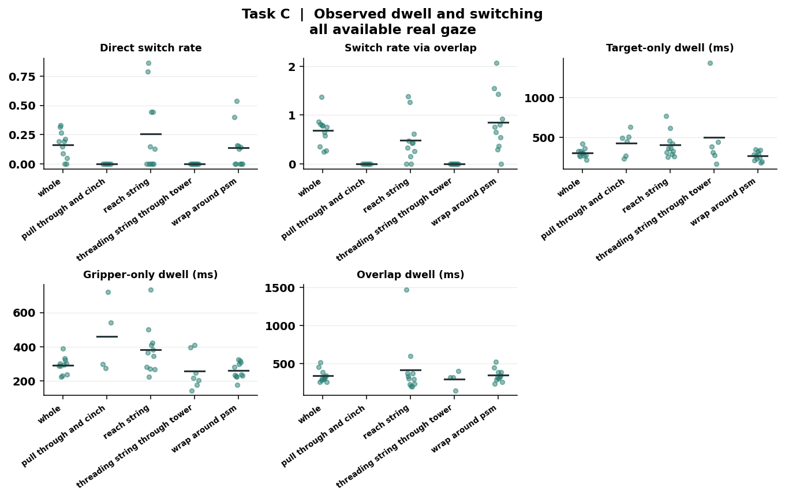

**历史结果：使用旧定义/旧有效帧集，仅用于回溯，不与v2主表混算。**

五个面板分别显示直接切换率、经重叠切换率、T/P/O驻留；横轴为整体/阶段，绿点为参与者，黑短横为均值，切换单位次/分钟、驻留单位ms。

整体T/P/O驻留分别301.4/292.2/337.9ms；直接/经O切换为0.163/0.679/min。

绕器械缠线经O切换较多，说明空间转换常经过重叠。Cinch的O驻留没有可估事件；cinch与穿塔零切换只指保留的有效片段，并不证明原始全过程不存在切换。

数据依据：[该分支统计表](20261105T033217114891Z_full/group_stage_summary.csv)；[相关表](20261105T033217114891Z_full/performance_correlations.csv)；[轮次表](20261105T033217114891Z_full/repetition_contrasts.csv)。

#### 图 G67｜Task C｜旧版（已被v2替代）｜参与者轮次轨迹

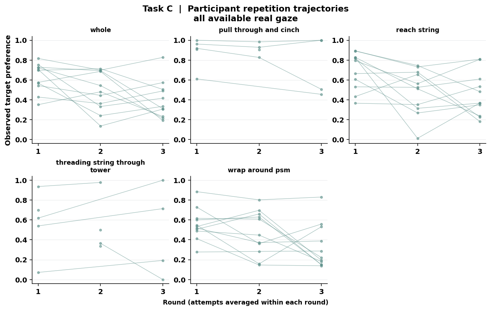

**历史结果：使用旧定义/旧有效帧集，仅用于回溯，不与v2主表混算。**

横轴为第1/2/3轮，纵轴为真实C；每条浅绿线连接同一参与者，同轮attempt已平均。整体现有配对第3−第1轮ΔC=-22.6 [-33.9, -11.3] pp，n=11。

整体及绕器械缠线中多条线下降，群体C下降是主要趋势；cinch和穿塔连线稀疏，缺点不等于0或没有学习。即使成绩提升，也不能把C下降解释为注意退化。

数据依据：[该分支统计表](20261105T033217114891Z_full/group_stage_summary.csv)；[相关表](20261105T033217114891Z_full/performance_correlations.csv)；[轮次表](20261105T033217114891Z_full/repetition_contrasts.csv)。

#### 图 G68｜Task C｜旧版（已被v2替代）｜整体敏感性

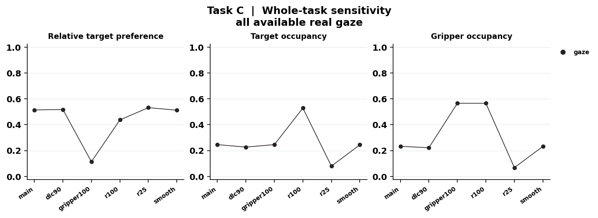

**历史结果：使用旧定义/旧有效帧集，仅用于回溯，不与v2主表混算。**

三个面板依次为C、target占用和腕部占用；横轴是分析设置而非连续时间，连线只帮助比较设定。

C在main、r25、r100、gripper100分别为51.4%、53.2%、43.7%、11.3%。

旧版横轴还包含dlc90。旧图整体展示“扩大腕部半径显著降低C、扩大双半径提高绝对占用”的现象；dlc90基于DLC质量阈值的旧筛选，不能替代v2眼动状态敏感性。

因此应在固定ROI定义下解释C，并结合面积修正与覆盖；不能挑选让结论更显著的半径。

数据依据：[该分支统计表](20261105T033217114891Z_full/group_stage_summary.csv)；[相关表](20261105T033217114891Z_full/performance_correlations.csv)；[轮次表](20261105T033217114891Z_full/repetition_contrasts.csv)。

---

## 附录：共享区域叠加图与定位质量审计（37张）

本附录同时收入两份报告，因为ROI定义与定位质量直接影响模型对照和GT行为解释。逐张嵌入原图，不把缩略拼图当作替代。叠加图只展示代表帧与all_ABCD点解码，不是全时段统计或五模型排名；审计图也不构成带人工真值的准确率验证。

### v2 当前代表帧：8张

黄色圆/小点表示目标均值50 px邻域/标注槽位，绿色圆表示左右DLC腕部50 px邻域，蓝色十字表示真实注视。紫色菱形为all_ABCD期望点、红色三角为argmax、白色叉为逐帧独立随机样本。

#### v2 当前代表帧 · 抓环 · User1_1_1_grab_ring

**图中内容与含义：** 黄色槽位点和目标均值圆集中在左下方环上，蓝色注视点也在这一邻域；左腕部圆则在其左侧。此图说明“注视被抓取物”与“注视腕部”可能分属不同空间事件。 紫色期望点明显偏向画面中央下方，红色argmax靠近目标边缘，白色采样点在目标下方；期望点会掩盖局部峰值命中。

#### v2 当前代表帧 · 放环 · User1_1_1_place_ring

**图中内容与含义：** 目标圆围绕上部绿色环/锥体邻域，蓝色注视位于其左上方、接近左器械远端；腕部圆在更上方。位置邻近不代表target与腕部两个事件完全重合。 argmax落在目标邻域，期望点在目标圆右侧边缘，随机采样点在左侧；硬归类会随解码方式和边界变化。

#### v2 当前代表帧 · 接近环 · User1_1_1_reach_ring

**图中内容与含义：** 目标圆位于左下方环区，左右绿色圆包围腕部，而非两侧器械的完整长度。蓝色注视点靠近目标区边缘，说明50 px硬边界会影响单帧归类。 期望点位于目标右上方，argmax更靠近目标，白色采样点则在右侧器械上方；同一概率分布的不同解码可给出不同区域标签。

#### v2 当前代表帧 · 转移环 · User1_1_1_transfer_ring

**图中内容与含义：** 左侧夹爪附近可见紫环，蓝色注视点接近紫环，而黄色目标均值圆在其下方。槽位均值与当前可见被操纵环的位置不必一致，因此低target占用还可能受目标定义影响。 三种模型点在紫环附近分散，但黄色圆在下方；图示说明“落在操作相关物附近”和“命中当前target圆”不是同一判据。

#### v2 当前代表帧 · 拉线并收紧 · User1_5_2_pull_through_and_cinch

**图中内容与含义：** 画面底部明确显示“Instrument out of view”，绿色DLC腕点却落在底部界面上；黄色target与蓝色gaze仍在中央线结附近。说明“坐标在画面内”无法保证器械真实可见，是cinch指标解释的重要限制。 三种模型解码点在中央目标附近分布，而腕部圆落在界面上；模型与GT相近也不能消除区域语义错误。

#### v2 当前代表帧 · 接近线 · User1_5_2_reach_string

**图中内容与含义：** 黄色目标圆在右上方线段末端附近，蓝色注视点靠近其上缘；左腕部圆位于目标左下方。绿色圆没有覆盖整段可见夹爪，支持将指标命名为腕部邻域占用。 期望点与argmax在目标左缘、夹爪附近，采样点在其下方；点预测位置接近操作区域不等于整个预测分布的质量都集中在那里。

#### v2 当前代表帧 · 穿线过塔 · User1_5_2_threading_string_through_tower

**图中内容与含义：** 黄色target圆在右侧黄色线段末端附近，蓝色gaze在其左上方，两侧腕部绿色圆靠近画面边缘。中央塔孔、线段与target均值并非同一空间位置，应依据标注定义解释占用。 期望点和argmax偏向中央塔孔/线段，独立样本在中央偏右；模型点可处于可见操作结构附近却未命中右侧target圆。

#### v2 当前代表帧 · 绕器械缠线 · User1_5_2_wrap_around_psm

**图中内容与含义：** 黄色目标圆和右腕部绿色圆大幅重叠，蓝色注视在这一邻域，线圈与工具交叉。该帧直观解释Task C较高的Overlap：重叠区不能用于区分“只看目标”还是“只看腕部”。 期望点、argmax也聚集在两圆交叠邻域，白色采样点稍靠下；即使命中target与腕部，exclusive分母D仍可能较小。

### 旧版代表帧（已被替代）：8张

黄色圆/小点表示目标均值50 px邻域/标注槽位，绿色圆表示左右DLC腕部50 px邻域，蓝色十字表示真实注视。紫色菱形为all_ABCD期望点；图上grippers的旧称应按腕部邻域理解。

#### 旧版代表帧（已被替代） · 抓环 · User1_1_1_grab_ring

**图中内容与含义：** 黄色槽位点和目标均值圆集中在左下方环上，蓝色注视点也在这一邻域；左腕部圆则在其左侧。此图说明“注视被抓取物”与“注视腕部”可能分属不同空间事件。 旧版紫色期望点在目标上方的背景中，与真实注视的目标邻域不同；这是单帧偏离示例，不能单独确定总体误差。旧帧13025与v2帧13023也不完全相同。

#### 旧版代表帧（已被替代） · 放环 · User1_1_1_place_ring

**图中内容与含义：** 目标圆围绕上部绿色环/锥体邻域，蓝色注视位于其左上方、接近左器械远端；腕部圆在更上方。位置邻近不代表target与腕部两个事件完全重合。 旧版只显示紫色期望点，其位于黄色圆右缘附近；图中并未展示概率质量或其他解码，不能从这一点读出Brier表现。

#### 旧版代表帧（已被替代） · 接近环 · User1_1_1_reach_ring

**图中内容与含义：** 目标圆位于左下方环区，左右绿色圆包围腕部，而非两侧器械的完整长度。蓝色注视点靠近目标区边缘，说明50 px硬边界会影响单帧归类。 旧版紫色期望点靠近左下方目标区右缘；与v2代表帧的期望点位置不同，且帧号13531与v2的13536不同，不能直接作为同帧算法改进对照。

#### 旧版代表帧（已被替代） · 转移环 · User1_1_1_transfer_ring

**图中内容与含义：** 左侧夹爪附近可见紫环，蓝色注视点接近紫环，而黄色目标均值圆在其下方。槽位均值与当前可见被操纵环的位置不必一致，因此低target占用还可能受目标定义影响。 旧版期望点也在上方紫环附近，偏离下方目标均值圆；旧帧16190与v2帧16192不同，应分别看作区域语义示例。

#### 旧版代表帧（已被替代） · 拉线并收紧 · User1_5_2_pull_through_and_cinch

**图中内容与含义：** 画面底部明确显示“Instrument out of view”，绿色DLC腕点却落在底部界面上；黄色target与蓝色gaze仍在中央线结附近。说明“坐标在画面内”无法保证器械真实可见，是cinch指标解释的重要限制。 旧版同样显示不可见器械的界面落点；这是已有输入质量限制，不应将其解释为真实地看向远离目标的器械。

#### 旧版代表帧（已被替代） · 接近线 · User1_5_2_reach_string

**图中内容与含义：** 黄色目标圆在右上方线段末端附近，蓝色注视点靠近其上缘；左腕部圆位于目标左下方。绿色圆没有覆盖整段可见夹爪，支持将指标命名为腕部邻域占用。 旧版期望点接近目标左缘，可用于理解几何归类，但不能替代v2保存样本的区域概率。

#### 旧版代表帧（已被替代） · 穿线过塔 · User1_5_2_threading_string_through_tower

**图中内容与含义：** 黄色target圆在右侧黄色线段末端附近，蓝色gaze在其左上方，两侧腕部绿色圆靠近画面边缘。中央塔孔、线段与target均值并非同一空间位置，应依据标注定义解释占用。 旧版期望点也位于中央偏右、远离黄色目标圆；它只能说明此帧的空间差异，不能证明对完整穿线阶段的跟踪质量。

#### 旧版代表帧（已被替代） · 绕器械缠线 · User1_5_2_wrap_around_psm

**图中内容与含义：** 黄色目标圆和右腕部绿色圆大幅重叠，蓝色注视在这一邻域，线圈与工具交叉。该帧直观解释Task C较高的Overlap：重叠区不能用于区分“只看目标”还是“只看腕部”。 旧版期望点位于重叠邻域；C排除该重叠，不应把图中接近目标的点都计入target-only。

### 候选夹爪端点审计：21张

32个侧别候选中19个通过几何规则、13个被拒绝，只有5/16帧左右均通过。既有视觉复核将19个通过者分为11个大致符合可见远端、4个明显取到近端、4个有歧义；没有独立人工坐标，不能换算为正式端点精度或泛化错误率。全部候选均未替换主分析腕点。绿色是原腕点/圆，紫色是几何放行的候选，红色是被拒绝但可绘制的候选，黄色是保持原定义的target。

#### 候选样例 00 · User1_1_1 · reach ring

**图中内容与含义：** 原始帧号13531；左侧几何拒绝、右侧几何通过。左侧候选位置看似接近远端，但因主轴方向证据弱而拒绝；右侧候选通过，接近闭合夹爪远端。说明几何拒绝与肉眼看似合理可以同时出现。

#### 候选样例 01 · User10_1_1 · reach ring

**图中内容与含义：** 原始帧号10284；左侧几何通过、右侧几何拒绝。左侧候选接近可见夹爪远端；右侧只有黑色轴杆附近DLC点，未找到腕点15 px内合适分量，因此拒绝。左右可用性不能由一个文件存在来保证。

#### 候选样例 02 · User1_1_1 · grab ring

**图中内容与含义：** 原始帧号13025；左侧几何通过、右侧几何通过。左右候选均通过，左候选在抓环的远端、右候选在闭合夹爪远端附近；这是看似合理的示例，但无人工坐标，不能据此声称像素误差达标。

#### 候选样例 03 · User10_1_1 · grab ring

**图中内容与含义：** 原始帧号9191；左侧几何通过、右侧几何拒绝。左候选虽被几何规则放行，却落在图像左边界近端，而张开的夹爪朝右；右侧未找到近腕部有效分量。该图直接展示“几何通过”仍可定位错误。

#### 候选样例 04 · User1_1_1 · transfer ring

**图中内容与含义：** 原始帧号16190；左侧几何通过、右侧几何通过。左右候选大致位于可见夹爪远端，左侧候选在紫环附近；黄色目标圆却在下方，提示端点估计质量与target物体语义是两个独立问题。

#### 候选样例 05 · User10_1_1 · transfer ring

**图中内容与含义：** 原始帧号8172；左侧几何通过、右侧几何拒绝。左候选接近环旁可见夹爪；右侧工具可见，但腕点附近缺少对应分割而拒绝。分割漏检会降低候选覆盖率，不能以坐标可见推断mask有效。

#### 候选样例 06 · User1_1_1 · place ring

**图中内容与含义：** 原始帧号15075；左侧几何通过、右侧几何拒绝。左候选选中了张开夹爪的一支，究竟定义单支尖端还是双支中点未确定；右侧位置看似接近远端，但方向证据弱而拒绝。需要先统一端点标注协议。

#### 候选样例 07 · User10_1_1 · place ring

**图中内容与含义：** 原始帧号8561；左侧几何拒绝、右侧几何拒绝。左侧工具有透视缩短与环遮挡，方向判断被拒绝；右侧可见工具附近缺少分割。两侧均未放行，不能把拒绝帧填为零距离或自动当作正确腕点。

#### 候选样例 08 · User1_5_2 · reach string

**图中内容与含义：** 原始帧号2299；左侧几何通过、右侧几何通过。左候选通过却位于腕部下缘，真正可见夹爪朝右上；右候选接近闭合夹爪远端。说明细长形状与高几何分数仍不足以确定近端/远端方向。

#### 候选样例 09 · User10_2_1 · reach string

**图中内容与含义：** 原始帧号8085；左侧几何通过、右侧几何通过。左候选接近抓线远端；右候选虽通过，但工具透视缩短、周围线圈使端点位置有歧义。应区分规则通过和语义可验证。

#### 候选样例 10 · User1_5_2 · wrap around psm

**图中内容与含义：** 原始帧号3020；左侧几何通过、右侧几何拒绝。左候选被放行在近端下缘，实际夹爪朝右上；右候选因方向不清拒绝，附近又有线圈。交叉与关节姿态使简单几何规则失效。

#### 候选样例 11 · User10_2_1 · wrap around psm

**图中内容与含义：** 原始帧号9572；左侧几何通过、右侧几何拒绝。左候选虽通过，但处于器械和缝线交叉处，无法可靠确定端点；右候选看似可能在远端却因方向证据弱被拒。该图主要反映遮挡和方向歧义。

#### 候选样例 12 · User1_5_2 · pull through and cinch

**图中内容与含义：** 原始帧号4944；左侧几何拒绝、右侧几何拒绝。画面提示工具离开视野，两侧腕点在底部界面，左右均无15 px内有效分量并被拒绝。主分析“坐标有效”与实际工具可见性之间存在落差。

#### 候选样例 13 · User10_2_1 · pull through and cinch

**图中内容与含义：** 原始帧号9161；左侧几何拒绝、右侧几何通过。左腕点在底部界面且拒绝；右候选虽通过，却落在右图像边界近端下缘，而可见夹爪朝左上。边界截断能把近端误认为尖端。

#### 候选样例 14 · User1_5_2 · threading string through tower

**图中内容与含义：** 原始帧号1926；左侧几何通过、右侧几何通过。左候选位于张开夹爪的一支，受缝线干扰，规范端点仍不明确；右候选大致接近可见闭合夹爪远端。不能把左侧通过等同于解剖端点验证。

#### 候选样例 15 · User10_2_2 · threading string through tower

**图中内容与含义：** 原始帧号3565；左侧几何通过、右侧几何拒绝。左候选大致位于可见远端；右侧因透视缩短、线圈与方向不明确而拒绝。本例再次说明同帧两侧的可用性和可靠性可不同。

#### 候选总览 0（样例00–03）

**图中内容与含义：** 汇总接近环和抓环样例00–03，可直接比较同阶段的User1与User10。样例02的两侧看似合理，与03左侧错误近端形成对照：相同阶段并不保证定位可靠性相同。 此图重复展示上述样例，不增加独立验证帧数。

#### 候选总览 1（样例04–07）

**图中内容与含义：** 汇总转移环和放环样例04–07。04展示较清晰远端，05/07展示右侧分割缺失，06展示张开夹爪定义歧义；这些失败机制不能用一个“通过率”概括。 此图重复展示上述样例，不增加独立验证帧数。

#### 候选总览 2（样例08–11）

**图中内容与含义：** 汇总接近线和缠线样例08–11。08/10左侧候选错误取到近端，09/11存在透视缩短、交叉或缝线遮挡；Task C下方向判定尤其需要视觉核验。 此图重复展示上述样例，不增加独立验证帧数。

#### 候选总览 3（样例12–15）

**图中内容与含义：** 汇总收紧和穿线样例12–15。12/13展示器械出画和边界误判，14展示开放夹爪规范点歧义，15展示同帧左右质量不一致；这些是保留腕部定义并披露限制的直接依据。 此图重复展示上述样例，不增加独立验证帧数。

#### Mask格式示例

**图中内容与含义：** 左上为原视频，右上为左器械分割，左下为右器械分割，右下为`obj_psm_tip`组合分割。白色区域包含较大的腕部/远端金属结构，不是一个夹爪尖端坐标；不能因为文件名含tip就直接作为jawtip真值。84/84录像的mask元数据一致也只说明尺寸与帧数匹配，并非逐帧语义或同步验收。

审计依据：[逐侧视觉记录](20261105T063658759189Z_v2_full/region_review/candidate_validation/visual_review.csv)、[候选几何值](20261105T063658759189Z_v2_full/region_review/candidate_validation/candidate_samples.csv)、[验收汇总](20261105T063658759189Z_v2_full/region_review/candidate_validation/validation_summary.json)。

---

## 复核依据与结果边界

数值来源以当前分支CSV为准：[主概率结果清单](20261105T063658759189Z_v2_full/main_probability/statistics_manifest.json)、[代码快照](20261105T063658759189Z_v2_full/code_snapshot/)、[运行参数](20261105T063658759189Z_v2_full/run_config.json)、[输入覆盖](20261105T063658759189Z_v2_full/coverage.csv)、[输入问题](20261105T063658759189Z_v2_full/input_issues.json)。原运行[验证记录](20261105T063658759189Z_v2_full/validation.json)显示占用守恒、面积守恒、NA分母、分支共同有效帧及整体/阶段时长关系均通过；[独立验证记录](20261105T063658759189Z_v2_full/independent_validation.json)包含1570项概率试次检查和44800个原始采样帧区域检查。它们证明所检查的计算一致性，不能证明ROI语义、注视精度或行为解释全部正确。

本次文档复核另外检查了全部图片可解码、全部图片引用可解析、两份文档覆盖221张原图且无遗漏。报告中的新增表格和百分比由原CSV提取/换算；图中曲线及误差条沿用原结果。描述性的置信区间、相关关系与排名均不应升级为未经检验的因果结论。
