# GT84 真实注视分析：v3 指标、结果与全图解读

更新日期：2026-11-06。本报告从 v3 已保存的 CSV/JSON 重新提取数值并更新逐图说明，没有重新训练模型或修改本次分析结果。

当前数据目录：`20261105T063658759189Z_v3_full`（原生成目录名为 `v3 full`，现使用本目录实际名称）。本报告的现行结论、表格与统计图均来自 v3；旧运行仅供历史回溯，不与当前分母混合。另见[模型详细报告](models10_vs_gt_analysis_zh.md)、[论文范围精简版](gt84_paper_summary_zh.md)。

## 阅读导航

- [范围、筛选规则与核心结论](#gt-section-01)
- [v3 修复影响、有效覆盖与缺失](#gt-section-02)
- [主指标：整体与全部阶段](#gt-section-03)
- [驻留与切换：真实 gaze 的观察时序](#gt-section-04)
- [与 SimNow 成绩的关系](#gt-section-05)
- [重复练习：成绩与注视变化](#gt-section-06)
- [论文限定范围：A 四阶段整体与 C reach string](#gt-section-07)
- [五种现行敏感性与区域定义边界](#gt-section-08)
- [可支持的结论与使用限制](#gt-section-09)
- [指标与计算方法：完整阅读字典](#gt-section-10)
- [GT84 逐图解释（54张现行统计图）](#gt-section-11)
- [附录：现行叠加与区域审计（29张）](#gt-section-12)
- [复核依据与当前版本边界](#gt-section-13)

## 范围、筛选规则与核心结论

GT84 是 **84 份录像、11 名参与者**：Task A（Sea Spikes）33 份，Task C（Knot-tying）51 份。本文使用 `real_all / main / gaze`。模型测试的 10 录像子集不能用本报告 GT84 均值替代其配对真实对照。

真实 gaze 直接读取结构化 `UserN/npy/<ID>_gaze.npy` 中的 `gaze_x`、`gaze_y`，按原视频 `Frame_Number` 对齐。**仅要求两坐标有限且都在归一化闭区间 [0,1]；完全不限制 `valid` 的取值。** 坐标合格后还须与预定阶段、有效目标和双侧 DLC 几何条件求交集。`valid` 状态码及原始设备状态只作来源审计。

主半径 target 与左右 DLC 腕部邻域均为 50 px。target 是有效槽位均值周围的一个圆盘，PSM 是两腕部圆盘的并集；不是完整目标轮廓或经验证的夹爪尖端。每录像按时间加权，录像在参与者内等权，参与者之间等权。

Task A 整体目标占用为 **24.89 [21.13, 28.52]%**，腕部占用 **9.45 [6.33, 13.14]%**，独占区域内目标偏好 C 为 **76.74 [70.23, 82.84]%**；Task C 四阶段整体相应为 **24.60 [21.11, 27.72]%**、**23.28 [19.87, 26.61]%**、**51.42 [44.18, 59.28]%**。方括号均为参与者 bootstrap 95% CI。

目标锁定主要描述任务和阶段相关的注视分配，不能直接作为越高越好的技能指标。Task C 的练习成绩提升与目标偏好下降并存；这里描述共变，不能推断减少目标注视导致成绩提高。本文同时给出四阶段完整描述与论文限定范围，避免将 Task C whole 与 reach string 混用。

## v3 修复影响、有效覆盖与缺失

| 任务 | 录像 | 人数 | 有效帧 | 有效秒 | 有效分钟 |
| --- | --- | --- | --- | --- | --- |
| A | 33 | 11 | 369,366 | 8668.072 | 144.47 |
| C | 51 | 11 | 338,323 | 8057.631 | 134.29 |

合计 **707,689 帧、16725.704 秒（278.76 分钟）**。原 NPY、视频时间轴、DLC 和模型预测哈希与 v2 一致；主分析新增 3,600 帧、88.165 秒，无原主分析帧被移除。进入后续条件筛选前，gaze 可用帧由旧状态规则下的 814,648 增至仅检查坐标的 818,734；原始坐标没有变化，新增来自取消状态筛选。这两个数量尚未与阶段和几何条件取交集。

修复对照见 [逐录像支持变化](20261105T063658759189Z_v3_full/frame_support_v2_v3_changes.csv) 和 [修复摘要](20261105T063658759189Z_v3_full/correction_summary_zh.md)。

| 任务 | 阶段 | 原阶段帧 | 目标可用% | gaze可用% | 联合有效% | 有效人数 |
| --- | --- | --- | --- | --- | --- | --- |
| A | 接近环 | 122,724 | 98.62 | 94.94 | 93.67 | 11 |
| A | 抓取环 | 64,648 | 99.90 | 95.53 | 95.43 | 11 |
| A | 转移环 | 130,674 | 99.85 | 94.76 | 94.61 | 11 |
| A | 放置环 | 72,190 | 99.85 | 95.86 | 95.71 | 11 |
| C | 接近线 | 156,116 | 88.49 | 95.08 | 84.01 | 11 |
| C | 绕器械缠线 | 211,102 | 99.14 | 88.85 | 88.01 | 11 |
| C | 拉穿并收紧 | 93,752 | 12.46 | 95.03 | 12.14 | 6 |
| C | 穿塔引线 | 10,250 | 100.00 | 97.55 | 97.55 | 8 |

Cinch 联合有效帧覆盖为 **12.14%**，占用可估 6 人；穿塔占用可估 8 人，已标阶段内覆盖为 97.55%。低覆盖阶段的高偏好不能代表未进入统计的时段。边际覆盖不能相乘得到联合覆盖，帧覆盖也不同于时间覆盖。

## 主指标：整体与全部阶段

比例使用百分比，比例之差使用百分点。各单元格为参与者均值 [95% CI]；人数和录像数按指标实际可估支持计数，NA 不填 0。

| 指标 | A 四阶段整体 | C 四阶段整体 |
| --- | --- | --- |
| L_T | 22.17 [18.66, 25.53] | 12.80 [10.35, 15.26] |
| L_P | 6.72 [4.61, 9.26] | 11.48 [9.58, 13.28] |
| L_O | 2.73 [1.48, 4.16] | 11.80 [9.51, 14.38] |
| L_N | 68.39 [63.38, 73.00] | 63.92 [60.56, 67.90] |
| L_target | 24.89 [21.13, 28.52] | 24.60 [21.11, 27.72] |
| L_gripper | 9.45 [6.33, 13.14] | 23.28 [19.87, 26.61] |
| D | 28.89 [24.74, 33.08] | 24.28 [21.51, 26.82] |
| C | 76.74 [70.23, 82.84] | 51.42 [44.18, 59.28] |
| C_U | 33.35 [32.90, 33.83] | 28.01 [27.20, 28.91] |
| C_excess | 43.39 [37.17, 49.24] | 23.41 [16.68, 30.88] |
| E_target | 24.30 [20.53, 27.92] | 24.00 [20.51, 27.13] |
| E_gripper | 8.28 [5.18, 11.96] | 22.10 [18.69, 25.43] |
| B | 15.45 [11.14, 19.59] | 1.32 [-1.88, 4.99] |
| B_excess | 16.02 [11.71, 20.15] | 1.90 [-1.30, 5.57] |
| area_T | 0.57 [0.55, 0.58] | 0.37 [0.35, 0.40] |
| area_P | 1.13 [1.12, 1.15] | 0.95 [0.93, 0.97] |
| area_O | 0.03 [0.02, 0.04] | 0.23 [0.20, 0.25] |
| area_N | 98.27 [98.25, 98.28] | 98.45 [98.43, 98.47] |

四互斥区域 T/P/O/N 合计 100%。A 的 Other 为 68.39%，C 为 63.92%；这仅表示注视在两个小邻域之外，不等于不关注任务。C 的重叠为 11.80%，A 为 2.73%；inclusive 目标和腕部占用都包含 O，不能直接相加。

C whole 的几何偏好基线 C_U 为 28.01%，C_excess 为 23.41 [16.68, 30.88] pp，而原始净优势 B 为 1.32 [-1.88, 4.99] pp、B_excess 为 1.90 [-1.30, 5.57] pp。C_excess 与 B 的分母和问题不同，前者高于 0 不意味着后者的区间一定排除 0。

A whole 的 B 为 15.45 [11.14, 19.59] pp、B_excess 为 16.02 [11.71, 20.15] pp。面积修正控制区域机会大小，无法自动修正校准、遮挡或目标语义误差。

### Task A 全阶段结果

| 阶段 | Target % | 腕部 % | 重叠 % | D % | C % |
| --- | --- | --- | --- | --- | --- |
| 接近环 | 12.38 [9.68, 15.17]；n=11，录像=33 | 8.02 [4.79, 11.98]；n=11，录像=33 | 0.84 [0.25, 1.76]；n=11，录像=33 | 18.72 [15.00, 22.84]；n=11，录像=33 | 63.19 [53.43, 72.26]；n=11，录像=33 |
| 抓取环 | 29.27 [25.70, 33.74]；n=11，录像=33 | 10.78 [6.35, 16.71]；n=11，录像=33 | 3.53 [1.76, 5.99]；n=11，录像=33 | 32.99 [28.26, 38.69]；n=11，录像=33 | 80.24 [74.12, 85.72]；n=11，录像=33 |
| 转移环 | 25.07 [20.29, 29.78]；n=11，录像=33 | 6.62 [4.50, 9.01]；n=11，录像=33 | 1.25 [0.59, 1.94]；n=11，录像=33 | 29.20 [24.53, 33.91]；n=11，录像=33 | 79.44 [73.03, 85.56]；n=11，录像=33 |
| 放置环 | 42.89 [35.43, 50.19]；n=11，录像=33 | 15.56 [10.48, 20.78]；n=11，录像=33 | 7.59 [3.98, 11.54]；n=11，录像=33 | 43.28 [35.92, 51.02]；n=11，录像=33 | 79.17 [71.57, 86.14]；n=11，录像=33 |

### Task C 全阶段结果

| 阶段 | Target % | 腕部 % | 重叠 % | D % | C % |
| --- | --- | --- | --- | --- | --- |
| 接近线 | 23.33 [19.41, 27.28]；n=11，录像=51 | 19.25 [15.57, 22.86]；n=11，录像=51 | 5.35 [3.61, 7.30]；n=11，录像=51 | 31.87 [27.72, 35.75]；n=11，录像=51 | 54.87 [47.03, 63.30]；n=11，录像=51 |
| 绕器械缠线 | 28.24 [23.17, 33.08]；n=11，录像=51 | 29.13 [24.12, 34.63]；n=11，录像=51 | 19.02 [13.93, 24.90]；n=11，录像=51 | 19.34 [15.57, 23.17]；n=11，录像=51 | 46.78 [38.15, 56.32]；n=11，录像=51 |
| 拉穿并收紧 | 24.09 [10.17, 38.92]；n=6，录像=16 | 3.55 [1.70, 5.39]；n=6，录像=16 | 0.00 [0.00, 0.00]；n=6，录像=16 | 27.64 [13.08, 43.21]；n=6，录像=16 | 84.17 [70.35, 94.97]；n=6，录像=15 |
| 穿塔引线 | 11.13 [6.93, 15.49]；n=8，录像=19 | 10.50 [4.60, 17.39]；n=8，录像=19 | 2.72 [0.33, 6.27]；n=8，录像=19 | 16.19 [11.57, 19.74]；n=8，录像=19 | 53.58 [33.82, 73.50]；n=8，录像=18 |

A 的接近环与放置环 target 占用分别为 12.38% 与 42.89%；整体平均会掩盖阶段差异。此处未用阶段间配对检验证明任意两阶段显著不同。

C 的缠线重叠占用为 19.02%；其 target、腕部 inclusive 占用分别为 28.24% 和 29.13%。这限制了将该阶段解读为独立的‘看目标’或‘看器械’。Cinch 与穿塔需同时看实际人数、有效片段及区域语义，零事件不代表整个阶段没有该行为。

## 驻留与切换：真实 gaze 的观察时序

真实 gaze 时序保存在点解码分支中，仍是真实单点观测，不是对 GT 再解码。三个解码分支的 real_all 统计经前缀归一后完全一致。驻留是各录像 ≥120 ms AOI run 的中位数再作参与者层级平均，不是所有事件合并中位数，也不是独立生理 fixation 检测。切换单位次/有效分钟。

### Task A 时间指标

| 阶段 | T驻留 ms | P驻留 ms | O驻留 ms | 直接切换 /min | 经O切换 /min |
| --- | --- | --- | --- | --- | --- |
| 四阶段整体 | 353.5 [308.1, 416.7]；n=11，录像=33 | 270.0 [244.5, 298.3]；n=11，录像=33 | 262.0 [228.9, 295.6]；n=11，录像=31 | 0.349 [0.220, 0.485]；n=11，录像=33 | 0.322 [0.191, 0.498]；n=11，录像=33 |
| 接近环 | 341.6 [294.4, 392.6]；n=11，录像=33 | 269.5 [245.0, 296.0]；n=11，录像=33 | 243.5 [193.3, 297.7]；n=9，录像=14 | 0.132 [0.020, 0.290]；n=11，录像=33 | 0.162 [0.027, 0.323]；n=11，录像=33 |
| 抓取环 | 378.0 [332.9, 431.4]；n=11，录像=33 | 382.2 [302.7, 498.0]；n=11，录像=31 | 309.7 [229.3, 420.7]；n=10，录像=19 | 0.303 [0.000, 0.621]；n=11，录像=33 | 0.449 [0.159, 0.789]；n=11，录像=33 |
| 转移环 | 351.1 [304.6, 410.6]；n=11，录像=33 | 278.8 [238.7, 326.0]；n=11，录像=32 | 247.3 [211.6, 284.9]；n=9，录像=21 | 0.374 [0.152, 0.631]；n=11，录像=33 | 0.194 [0.048, 0.395]；n=11，录像=33 |
| 放置环 | 508.3 [351.9, 753.4]；n=11，录像=33 | 311.6 [247.5, 396.6]；n=11，录像=32 | 295.3 [232.3, 363.0]；n=11，录像=27 | 0.748 [0.388, 1.140]；n=11，录像=33 | 0.785 [0.322, 1.316]；n=11，录像=33 |

### Task C 时间指标

| 阶段 | T驻留 ms | P驻留 ms | O驻留 ms | 直接切换 /min | 经O切换 /min |
| --- | --- | --- | --- | --- | --- |
| 四阶段整体 | 301.4 [271.4, 334.3]；n=11，录像=51 | 292.2 [264.7, 319.9]；n=11，录像=51 | 337.9 [296.4, 388.5]；n=11，录像=50 | 0.163 [0.097, 0.228]；n=11，录像=51 | 0.679 [0.508, 0.868]；n=11，录像=51 |
| 接近线 | 400.5 [320.5, 498.9]；n=11，录像=50 | 381.9 [308.3, 468.1]；n=11，录像=50 | 418.1 [265.4, 652.7]；n=11，录像=38 | 0.256 [0.081, 0.452]；n=11，录像=51 | 0.485 [0.247, 0.760]；n=11，录像=51 |
| 绕器械缠线 | 262.4 [229.4, 295.2]；n=11，录像=50 | 260.5 [233.1, 287.6]；n=11，录像=50 | 346.1 [301.5, 397.4]；n=11，录像=50 | 0.137 [0.049, 0.247]；n=11，录像=51 | 0.852 [0.530, 1.210]；n=11，录像=51 |
| 拉穿并收紧 | 427.4 [315.6, 533.5]；n=6，录像=15 | 458.7 [287.6, 629.8]；n=4，录像=7 | NA [NA, NA]；n=0，录像=0 | 0.000 [0.000, 0.000]；n=6，录像=16 | 0.000 [0.000, 0.000]；n=6，录像=16 |
| 穿塔引线 | 501.8 [257.0, 887.9]；n=6，录像=11 | 256.1 [189.2, 331.9]；n=7，录像=10 | 294.6 [188.7, 377.1]；n=4，录像=4 | 0.000 [0.000, 0.000]；n=8，录像=19 | 0.000 [0.000, 0.000]；n=8，录像=19 |

缺帧、不可用 gaze、阶段边界与已知 target 身份变化会截断路径，不跨缺失拼接。触及观察边界但达到时长阈值的 run 仍可纳入中位数；当前没有删失校正。无合格 run 为 NA，有有效时间但未观察到合格切换可为 0，二者不能混淆。

## 与 SimNow 成绩的关系

每个点是参与者在该指标与成绩都可用的同一批录像上的均值。Spearman ρ 描述单调排序关系；CI 跨 0 表示方向未被当前样本确定，不证明关系不存在。没有多重比较校正，阶段与指标筛选后的关联应作探索性结果。

| 任务 | 阶段 | C—成绩ρ | Target—成绩ρ | 腕部—成绩ρ |
| --- | --- | --- | --- | --- |
| A | 四阶段整体 | 0.036 [-0.702, 0.785]；n=11，录像=33 | 0.082 [-0.528, 0.735]；n=11，录像=33 | -0.109 [-0.748, 0.533]；n=11，录像=33 |
| A | 接近环 | 0.027 [-0.640, 0.769]；n=11，录像=33 | 0.218 [-0.408, 0.725]；n=11，录像=33 | 0.000 [-0.632, 0.621]；n=11，录像=33 |
| A | 抓取环 | -0.173 [-0.787, 0.557]；n=11，录像=33 | 0.600 [0.000, 0.887]；n=11，录像=33 | 0.045 [-0.636, 0.684]；n=11，录像=33 |
| A | 转移环 | 0.209 [-0.651, 0.822]；n=11，录像=33 | 0.155 [-0.544, 0.716]；n=11，录像=33 | -0.009 [-0.593, 0.690]；n=11，录像=33 |
| A | 放置环 | 0.082 [-0.701, 0.744]；n=11，录像=33 | -0.109 [-0.760, 0.602]；n=11，录像=33 | 0.073 [-0.583, 0.703]；n=11，录像=33 |
| C | 四阶段整体 | -0.174 [-0.706, 0.575]；n=11，录像=50 | 0.156 [-0.561, 0.833]；n=11，录像=50 | 0.266 [-0.453, 0.778]；n=11，录像=50 |
| C | 接近线 | 0.009 [-0.687, 0.715]；n=11，录像=50 | 0.358 [-0.334, 0.848]；n=11，录像=50 | 0.624 [0.100, 0.906]；n=11，录像=50 |
| C | 绕器械缠线 | -0.266 [-0.769, 0.423]；n=11，录像=50 | 0.193 [-0.574, 0.751]；n=11，录像=50 | 0.294 [-0.437, 0.850]；n=11，录像=50 |
| C | 拉穿并收紧 | -0.203 [-1.000, 1.000]；n=6，录像=15 | -0.464 [-1.000, 0.636]；n=6，录像=16 | -0.145 [-1.000, 0.894]；n=6，录像=16 |
| C | 穿塔引线 | -0.405 [-0.941, 0.182]；n=8，录像=18 | -0.343 [-0.813, 0.282]；n=8，录像=19 | 0.078 [-0.779, 0.784]；n=8，录像=19 |

Task A whole 的 C、target、腕部 ρ 依次为 0.036、0.082、-0.109；这些整体区间均跨 0，不能据此确认越看目标越高分。

Task C whole 的 C、target、腕部 ρ 依次为 -0.174、0.156、0.266；这些整体区间均跨 0，不能据此确认越看目标越高分。

| 任务 | 阶段 | 指标 | 有效/不可估 bootstrap | LOO有效数 | LOO范围 | 不同成绩数 |
| --- | --- | --- | --- | --- | --- | --- |
| A | 四阶段整体 | C | 10000/0 | 11 | -0.176–0.285 | 11 |
| A | 四阶段整体 | L_target | 10000/0 | 11 | -0.224–0.248 | 11 |
| A | 四阶段整体 | L_gripper | 10000/0 | 11 | -0.345–0.030 | 11 |
| A | 接近环 | C | 10000/0 | 11 | -0.127–0.297 | 11 |
| A | 接近环 | L_target | 10000/0 | 11 | 0.030–0.406 | 11 |
| A | 接近环 | L_gripper | 10000/0 | 11 | -0.224–0.164 | 11 |
| A | 抓取环 | C | 10000/0 | 11 | -0.394–0.006 | 11 |
| A | 抓取环 | L_target | 10000/0 | 11 | 0.467–0.685 | 11 |
| A | 抓取环 | L_gripper | 10000/0 | 11 | -0.176–0.224 | 11 |
| A | 转移环 | C | 10000/0 | 11 | -0.055–0.382 | 11 |
| A | 转移环 | L_target | 10000/0 | 11 | -0.127–0.309 | 11 |
| A | 转移环 | L_gripper | 10000/0 | 11 | -0.236–0.273 | 11 |
| A | 放置环 | C | 10000/0 | 11 | -0.224–0.321 | 11 |
| A | 放置环 | L_target | 10000/0 | 11 | -0.479–0.042 | 11 |
| A | 放置环 | L_gripper | 10000/0 | 11 | -0.139–0.273 | 11 |
| C | 四阶段整体 | C | 10000/0 | 11 | -0.387–0.031 | 9 |
| C | 四阶段整体 | L_target | 10000/0 | 11 | 0.036–0.450 | 9 |
| C | 四阶段整体 | L_gripper | 10000/0 | 11 | 0.018–0.444 | 9 |
| C | 接近线 | C | 10000/0 | 11 | -0.231–0.178 | 9 |
| C | 接近线 | L_target | 10000/0 | 11 | 0.215–0.498 | 9 |
| C | 接近线 | L_gripper | 10000/0 | 11 | 0.553–0.736 | 9 |
| C | 绕器械缠线 | C | 10000/0 | 11 | -0.407–-0.018 | 9 |
| C | 绕器械缠线 | L_target | 10000/0 | 11 | -0.080–0.395 | 9 |
| C | 绕器械缠线 | L_gripper | 10000/0 | 11 | 0.055–0.535 | 9 |
| C | 拉穿并收紧 | C | 9983/17 | 6 | -0.667–0.300 | 5 |
| C | 拉穿并收紧 | L_target | 9983/17 | 6 | -0.700–-0.051 | 5 |
| C | 拉穿并收紧 | L_gripper | 9983/17 | 6 | -0.800–0.100 | 5 |
| C | 穿塔引线 | C | 8987/1013 | 8 | -0.668–-0.204 | 3 |
| C | 穿塔引线 | L_target | 8987/1013 | 8 | -0.579–-0.204 | 3 |
| C | 穿塔引线 | L_gripper | 8987/1013 | 8 | -0.408–0.408 | 3 |

LOO 是逐次去掉一名参与者后的可估相关范围，不是独立验证集性能。少人数、并列成绩和不可估 bootstrap 会扩大不确定性；不能仅凭某个点估计较大认定技能标记。

Task C 有成绩录像 50 份，其中 Failed 为 16 份，16 份为 0 分。失败不是缺失，参与者均分包含这些 0；成绩提升部分反映完成状态变化。占用有 51 录像不意味着成绩相关也使用 51 录像。

| 任务 | 轮次 | 有成绩录像 | 失败录像 | 失败且0分 |
| --- | --- | --- | --- | --- |
| A | 1 | 11 | 0 | 0 |
| A | 2 | 11 | 0 | 0 |
| A | 3 | 11 | 0 | 0 |
| C | 1 | 18 | 9 | 9 |
| C | 2 | 18 | 4 | 4 |
| C | 3 | 14 | 3 | 3 |

## 重复练习：成绩与注视变化

Round 为同人同任务 TaskNum 排序，同轮 attempt 先平均；不是 Attempt 编号。下表第3轮−第1轮保持同人配对；比例量乘100为百分点，成绩保持分数单位。

| 任务 | 阶段 | 指标 | 第3−第1轮 [95%CI] | 配对人数 | 前→后录像 |
| --- | --- | --- | --- | --- | --- |
| A | 四阶段整体 | C | 1.83 [-7.60, 10.07] | 11 | 11→11 |
| A | 四阶段整体 | L_target | -1.24 [-6.64, 3.80] | 11 | 11→11 |
| A | 四阶段整体 | L_gripper | -1.50 [-5.00, 2.65] | 11 | 11→11 |
| A | 四阶段整体 | L_O | -0.49 [-2.15, 1.03] | 11 | 11→11 |
| A | 四阶段整体 | C_excess | 1.38 [-7.97, 9.56] | 11 | 11→11 |
| A | 四阶段整体 | E_target | -1.24 [-6.64, 3.80] | 11 | 11→11 |
| A | 四阶段整体 | E_gripper | -1.49 [-5.00, 2.68] | 11 | 11→11 |
| A | 四阶段整体 | B | 0.26 [-6.08, 6.03] | 11 | 11→11 |
| A | 四阶段整体 | B_excess | 0.25 [-6.10, 6.02] | 11 | 11→11 |
| A | 四阶段整体 | score | 38.45 [24.82, 51.27] | 11 | 11→11 |
| A | 接近环 | C | 1.51 [-7.83, 11.94] | 11 | 11→11 |
| A | 接近环 | L_target | -1.45 [-6.12, 3.12] | 11 | 11→11 |
| A | 接近环 | L_gripper | -1.75 [-4.61, 1.42] | 11 | 11→11 |
| A | 接近环 | L_O | -0.27 [-1.40, 0.79] | 11 | 11→11 |
| A | 接近环 | C_excess | 0.95 [-8.46, 11.39] | 11 | 11→11 |
| A | 接近环 | E_target | -1.45 [-6.12, 3.12] | 11 | 11→11 |
| A | 接近环 | E_gripper | -1.74 [-4.59, 1.44] | 11 | 11→11 |
| A | 接近环 | B | 0.31 [-4.53, 5.15] | 11 | 11→11 |
| A | 接近环 | B_excess | 0.29 [-4.53, 5.14] | 11 | 11→11 |
| A | 接近环 | score | 38.45 [24.82, 51.27] | 11 | 11→11 |
| A | 抓取环 | C | 3.20 [-4.09, 11.28] | 11 | 11→11 |
| A | 抓取环 | L_target | -11.80 [-22.77, 0.02] | 11 | 11→11 |
| A | 抓取环 | L_gripper | -3.96 [-9.86, 2.06] | 11 | 11→11 |
| A | 抓取环 | L_O | -1.16 [-5.12, 3.54] | 11 | 11→11 |
| A | 抓取环 | C_excess | 2.88 [-4.44, 11.16] | 11 | 11→11 |
| A | 抓取环 | E_target | -11.80 [-22.77, 0.02] | 11 | 11→11 |
| A | 抓取环 | E_gripper | -3.96 [-9.86, 2.08] | 11 | 11→11 |
| A | 抓取环 | B | -7.83 [-17.14, 0.87] | 11 | 11→11 |
| A | 抓取环 | B_excess | -7.84 [-17.14, 0.87] | 11 | 11→11 |
| A | 抓取环 | score | 38.45 [24.82, 51.27] | 11 | 11→11 |
| A | 转移环 | C | -0.38 [-11.39, 9.55] | 11 | 11→11 |
| A | 转移环 | L_target | -2.39 [-8.58, 3.60] | 11 | 11→11 |
| A | 转移环 | L_gripper | -1.33 [-5.02, 3.56] | 11 | 11→11 |
| A | 转移环 | L_O | -0.93 [-2.10, 0.13] | 11 | 11→11 |
| A | 转移环 | C_excess | -0.78 [-11.48, 8.89] | 11 | 11→11 |
| A | 转移环 | E_target | -2.39 [-8.58, 3.60] | 11 | 11→11 |
| A | 转移环 | E_gripper | -1.32 [-5.01, 3.57] | 11 | 11→11 |
| A | 转移环 | B | -1.06 [-8.76, 6.64] | 11 | 11→11 |
| A | 转移环 | B_excess | -1.07 [-8.76, 6.62] | 11 | 11→11 |
| A | 转移环 | score | 38.45 [24.82, 51.27] | 11 | 11→11 |
| A | 放置环 | C | 2.64 [-15.35, 20.80] | 11 | 11→11 |
| A | 放置环 | L_target | -2.86 [-13.30, 8.33] | 11 | 11→11 |
| A | 放置环 | L_gripper | -3.12 [-12.85, 7.45] | 11 | 11→11 |
| A | 放置环 | L_O | -2.32 [-6.25, 1.08] | 11 | 11→11 |
| A | 放置环 | C_excess | 1.90 [-15.93, 19.95] | 11 | 11→11 |
| A | 放置环 | E_target | -2.86 [-13.30, 8.33] | 11 | 11→11 |
| A | 放置环 | E_gripper | -3.11 [-12.84, 7.46] | 11 | 11→11 |
| A | 放置环 | B | 0.26 [-15.68, 16.94] | 11 | 11→11 |
| A | 放置环 | B_excess | 0.25 [-15.67, 16.93] | 11 | 11→11 |
| A | 放置环 | score | 38.45 [24.82, 51.27] | 11 | 11→11 |
| C | 四阶段整体 | C | -22.61 [-33.91, -11.31] | 11 | 18→15 |
| C | 四阶段整体 | L_target | -8.04 [-14.14, -2.57] | 11 | 18→15 |
| C | 四阶段整体 | L_gripper | 5.37 [-3.77, 14.68] | 11 | 18→15 |
| C | 四阶段整体 | L_O | -2.07 [-7.98, 3.28] | 11 | 18→15 |
| C | 四阶段整体 | C_excess | -22.95 [-34.03, -11.89] | 11 | 18→15 |
| C | 四阶段整体 | E_target | -8.04 [-14.14, -2.56] | 11 | 18→15 |
| C | 四阶段整体 | E_gripper | 5.37 [-3.78, 14.68] | 11 | 18→15 |
| C | 四阶段整体 | B | -13.40 [-19.73, -7.21] | 11 | 18→15 |
| C | 四阶段整体 | B_excess | -13.40 [-19.74, -7.21] | 11 | 18→15 |
| C | 四阶段整体 | score | 22.18 [8.14, 39.96] | 11 | 18→14 |
| C | 接近线 | C | -24.32 [-38.29, -9.64] | 11 | 18→15 |
| C | 接近线 | L_target | -11.34 [-17.32, -4.29] | 11 | 18→15 |
| C | 接近线 | L_gripper | 8.26 [0.29, 15.73] | 11 | 18→15 |
| C | 接近线 | L_O | -2.21 [-5.43, 0.76] | 11 | 18→15 |
| C | 接近线 | C_excess | -24.35 [-38.75, -9.16] | 11 | 18→15 |
| C | 接近线 | E_target | -11.34 [-17.32, -4.29] | 11 | 18→15 |
| C | 接近线 | E_gripper | 8.27 [0.30, 15.74] | 11 | 18→15 |
| C | 接近线 | B | -19.60 [-29.84, -9.23] | 11 | 18→15 |
| C | 接近线 | B_excess | -19.61 [-29.84, -9.24] | 11 | 18→15 |
| C | 接近线 | score | 22.18 [8.14, 39.96] | 11 | 18→14 |
| C | 绕器械缠线 | C | -22.56 [-31.64, -13.34] | 11 | 18→15 |
| C | 绕器械缠线 | L_target | -6.69 [-19.46, 4.93] | 11 | 18→15 |
| C | 绕器械缠线 | L_gripper | 3.58 [-10.60, 16.30] | 11 | 18→15 |
| C | 绕器械缠线 | L_O | -1.45 [-13.83, 9.05] | 11 | 18→15 |
| C | 绕器械缠线 | C_excess | -21.62 [-30.22, -12.97] | 11 | 18→15 |
| C | 绕器械缠线 | E_target | -6.69 [-19.46, 4.93] | 11 | 18→15 |
| C | 绕器械缠线 | E_gripper | 3.58 [-10.60, 16.30] | 11 | 18→15 |
| C | 绕器械缠线 | B | -10.27 [-16.04, -4.95] | 11 | 18→15 |
| C | 绕器械缠线 | B_excess | -10.27 [-16.03, -4.95] | 11 | 18→15 |
| C | 绕器械缠线 | score | 22.18 [8.14, 39.96] | 11 | 18→14 |
| C | 拉穿并收紧 | C | -13.22 [-30.92, 1.92] | 4 | 4→4 |
| C | 拉穿并收紧 | L_target | 0.55 [-18.14, 16.29] | 4 | 4→4 |
| C | 拉穿并收紧 | L_gripper | 3.55 [-0.11, 7.22] | 4 | 4→4 |
| C | 拉穿并收紧 | L_O | 0.00 [0.00, 0.00] | 4 | 4→4 |
| C | 拉穿并收紧 | C_excess | -12.85 [-30.01, 0.35] | 4 | 4→4 |
| C | 拉穿并收紧 | E_target | 0.55 [-18.14, 16.29] | 4 | 4→4 |
| C | 拉穿并收紧 | E_gripper | 3.52 [-0.01, 7.05] | 4 | 4→4 |
| C | 拉穿并收紧 | B | -3.00 [-23.43, 14.47] | 4 | 4→4 |
| C | 拉穿并收紧 | B_excess | -2.97 [-23.31, 14.33] | 4 | 4→4 |
| C | 拉穿并收紧 | score | 29.25 [3.50, 70.75] | 4 | 4→4 |
| C | 穿塔引线 | C | 22.52 [12.06, 38.12] | 3 | 4→4 |
| C | 穿塔引线 | L_target | -0.85 [-6.66, 2.71] | 3 | 4→4 |
| C | 穿塔引线 | L_gripper | -9.56 [-12.17, -8.21] | 3 | 4→4 |
| C | 穿塔引线 | L_O | -0.41 [-1.24, 0.00] | 3 | 4→4 |
| C | 穿塔引线 | C_excess | 21.92 [10.29, 38.78] | 3 | 4→4 |
| C | 穿塔引线 | E_target | -0.85 [-6.66, 2.71] | 3 | 4→4 |
| C | 穿塔引线 | E_gripper | -9.54 [-12.20, -8.12] | 3 | 4→4 |
| C | 穿塔引线 | B | 8.71 [5.51, 11.00] | 3 | 4→4 |
| C | 穿塔引线 | B_excess | 8.69 [5.54, 11.00] | 3 | 4→4 |
| C | 穿塔引线 | score | 0.00 [0.00, 0.00] | 3 | 4→4 |

A whole 成绩变化 38.45 [24.82, 51.27] 分，C 变化 1.83 [-7.60, 10.07] pp；C whole 成绩变化 22.18 [8.14, 39.96] 分、C 变化 -22.61 [-33.91, -11.31] pp。两种变化可以并存，不能把目标偏好最大化当作已经验证的训练目标。

成绩与注视可能同样有11名配对参与者，却来自不同前后录像数；应按表中支持解释。短片段、阶段时长构成和阶段缺失可能影响轮次比较，连线不是所有人完整学习轨迹的证明。

## 论文限定范围：A 四阶段整体与 C reach string

此节与两份 paper summary 使用相同范围：Task A 四阶段整体，Task C 仅 reach string。C whole、缠线、cinch、穿塔继续在上文作完整描述和补充证据，不替代本节数值。该范围沿用已有论文摘要，不是本次按结果重新挑选。

| 指标 | A whole | C reach string |
| --- | --- | --- |
| L_T | 22.17 [18.66, 25.53]；n=11，录像=33 | 17.97 [14.91, 20.93]；n=11，录像=51 |
| L_P | 6.72 [4.61, 9.26]；n=11，录像=33 | 13.90 [10.73, 16.93]；n=11，录像=51 |
| L_O | 2.73 [1.48, 4.16]；n=11，录像=33 | 5.35 [3.61, 7.30]；n=11，录像=51 |
| L_N | 68.39 [63.38, 73.00]；n=11，录像=33 | 62.77 [58.15, 67.76]；n=11，录像=51 |
| L_target | 24.89 [21.13, 28.52]；n=11，录像=33 | 23.33 [19.41, 27.28]；n=11，录像=51 |
| L_gripper | 9.45 [6.33, 13.14]；n=11，录像=33 | 19.25 [15.57, 22.86]；n=11，录像=51 |
| D | 28.89 [24.74, 33.08]；n=11，录像=33 | 31.87 [27.72, 35.75]；n=11，录像=51 |
| C | 76.74 [70.23, 82.84]；n=11，录像=33 | 54.87 [47.03, 63.30]；n=11，录像=51 |
| C_U | 33.35 [32.90, 33.83]；n=11，录像=33 | 32.33 [32.07, 32.67]；n=11，录像=51 |
| C_excess | 43.39 [37.17, 49.24]；n=11，录像=33 | 22.54 [14.84, 30.84]；n=11，录像=51 |
| E_target | 24.30 [20.53, 27.92]；n=11，录像=33 | 22.73 [18.82, 26.68]；n=11，录像=51 |
| E_gripper | 8.28 [5.18, 11.96]；n=11，录像=33 | 18.08 [14.40, 21.69]；n=11，录像=51 |
| B | 15.45 [11.14, 19.59]；n=11，录像=33 | 4.07 [-0.10, 8.91]；n=11，录像=51 |
| B_excess | 16.02 [11.71, 20.15]；n=11，录像=33 | 4.64 [0.48, 9.47]；n=11，录像=51 |
| area_T | 0.57 [0.55, 0.58]；n=11，录像=33 | 0.52 [0.52, 0.54]；n=11，录像=51 |
| area_P | 1.13 [1.12, 1.15]；n=11，录像=33 | 1.10 [1.09, 1.11]；n=11，录像=51 |
| area_O | 0.03 [0.02, 0.04]；n=11，录像=33 | 0.07 [0.06, 0.08]；n=11，录像=51 |
| area_N | 98.27 [98.25, 98.28]；n=11，录像=33 | 98.30 [98.29, 98.32]；n=11，录像=51 |

| 任务范围 | 指标 | ρ [95%CI] | LOO范围 | 可估/不可估bootstrap |
| --- | --- | --- | --- | --- |
| A whole | C | 0.036 [-0.702, 0.785]；n=11，录像=33 | -0.176–0.285 | 10000/0 |
| A whole | L_target | 0.082 [-0.528, 0.735]；n=11，录像=33 | -0.224–0.248 | 10000/0 |
| A whole | L_gripper | -0.109 [-0.748, 0.533]；n=11，录像=33 | -0.345–0.030 | 10000/0 |
| A whole | C_excess | 0.036 [-0.702, 0.785]；n=11，录像=33 | -0.176–0.285 | 10000/0 |
| A whole | E_target | 0.082 [-0.528, 0.735]；n=11，录像=33 | -0.224–0.248 | 10000/0 |
| A whole | E_gripper | -0.109 [-0.748, 0.533]；n=11，录像=33 | -0.345–0.030 | 10000/0 |
| A whole | B | -0.055 [-0.690, 0.738]；n=11，录像=33 | -0.297–0.164 | 10000/0 |
| A whole | B_excess | -0.055 [-0.690, 0.738]；n=11，录像=33 | -0.297–0.164 | 10000/0 |
| C reach string | C | 0.009 [-0.687, 0.715]；n=11，录像=50 | -0.231–0.178 | 10000/0 |
| C reach string | L_target | 0.358 [-0.334, 0.848]；n=11，录像=50 | 0.215–0.498 | 10000/0 |
| C reach string | L_gripper | 0.624 [0.100, 0.906]；n=11，录像=50 | 0.553–0.736 | 10000/0 |
| C reach string | C_excess | 0.009 [-0.687, 0.715]；n=11，录像=50 | -0.231–0.178 | 10000/0 |
| C reach string | E_target | 0.358 [-0.334, 0.848]；n=11，录像=50 | 0.215–0.498 | 10000/0 |
| C reach string | E_gripper | 0.624 [0.100, 0.906]；n=11，录像=50 | 0.553–0.736 | 10000/0 |
| C reach string | B | -0.165 [-0.848, 0.548]；n=11，录像=50 | -0.462–0.006 | 10000/0 |
| C reach string | B_excess | -0.156 [-0.831, 0.564]；n=11，录像=50 | -0.450–0.018 | 10000/0 |

| 任务范围 | 指标 | 第3−第1轮 [95%CI] | 配对人数 | 前→后录像 |
| --- | --- | --- | --- | --- |
| A whole | C | 1.83 [-7.60, 10.07] | 11 | 11→11 |
| A whole | L_target | -1.24 [-6.64, 3.80] | 11 | 11→11 |
| A whole | L_gripper | -1.50 [-5.00, 2.65] | 11 | 11→11 |
| A whole | L_O | -0.49 [-2.15, 1.03] | 11 | 11→11 |
| A whole | C_excess | 1.38 [-7.97, 9.56] | 11 | 11→11 |
| A whole | B | 0.26 [-6.08, 6.03] | 11 | 11→11 |
| A whole | B_excess | 0.25 [-6.10, 6.02] | 11 | 11→11 |
| A whole | score | 38.45 [24.82, 51.27] | 11 | 11→11 |
| C reach string | C | -24.32 [-38.29, -9.64] | 11 | 18→15 |
| C reach string | L_target | -11.34 [-17.32, -4.29] | 11 | 18→15 |
| C reach string | L_gripper | 8.26 [0.29, 15.73] | 11 | 18→15 |
| C reach string | L_O | -2.21 [-5.43, 0.76] | 11 | 18→15 |
| C reach string | C_excess | -24.35 [-38.75, -9.16] | 11 | 18→15 |
| C reach string | B | -19.60 [-29.84, -9.23] | 11 | 18→15 |
| C reach string | B_excess | -19.61 [-29.84, -9.24] | 11 | 18→15 |
| C reach string | score | 22.18 [8.14, 39.96] | 11 | 18→14 |

C reach string 的 C 为 54.87 [47.03, 63.30]%，其 CI 包含50%；原始目标−腕部差 B 为 4.07 [-0.10, 8.91] pp，CI 包含0；C_excess 为 22.54 [14.84, 30.84] pp。原始独占偏好是否超过一半与是否高于几何面积机会是不同问题，不能把面积富集改写成原始目标占用显著超过腕部。

### 论文范围的敏感性：不只比较均值

| 任务范围 | 情景 | C % [CI] | Target % [CI] | 腕部 % [CI] | 腕部—成绩ρ [CI] |
| --- | --- | --- | --- | --- | --- |
| A whole | main | 76.74 [70.23, 82.84] | 24.89 [21.13, 28.52] | 9.45 [6.33, 13.14] | -0.109 [-0.748, 0.533] |
| A whole | r25 | 79.24 [72.35, 86.09] | 9.37 [7.44, 11.21] | 2.37 [1.52, 3.36] | -0.118 [-0.665, 0.521] |
| A whole | r100 | 70.36 [64.01, 76.02] | 50.31 [45.05, 54.98] | 33.11 [26.37, 40.78] | -0.064 [-0.702, 0.590] |
| A whole | gripper100 | 40.34 [31.68, 49.01] | 24.89 [21.13, 28.52] | 33.11 [26.37, 40.78] | -0.064 [-0.702, 0.590] |
| A whole | smooth | 76.62 [70.16, 82.70] | 24.65 [20.89, 28.27] | 9.41 [6.31, 13.09] | -0.109 [-0.748, 0.533] |
| C reach string | main | 54.87 [47.03, 63.30] | 23.33 [19.41, 27.28] | 19.25 [15.57, 22.86] | 0.624 [0.100, 0.906] |
| C reach string | r25 | 59.09 [49.15, 68.94] | 7.99 [5.88, 10.01] | 4.89 [3.73, 6.22] | 0.587 [-0.084, 0.944] |
| C reach string | r100 | 46.96 [41.22, 53.02] | 48.63 [42.74, 53.92] | 49.89 [42.86, 56.19] | 0.569 [-0.049, 0.841] |
| C reach string | gripper100 | 19.62 [15.03, 25.13] | 23.33 [19.41, 27.28] | 49.89 [42.86, 56.19] | 0.569 [-0.049, 0.841] |
| C reach string | smooth | 54.87 [46.92, 63.43] | 23.17 [19.32, 27.09] | 19.09 [15.46, 22.65] | 0.624 [0.100, 0.906] |

C reach string 腕部—成绩关联在当前5种情景中有 3 种 CI 跨0。主分析中的正向线索应结合这些情景读，不可称为已验证且对阈值稳定的技能机制。边缘 CI 不跨0也应报告精确边界，避免把细微分位数变化解释为确定的效应有无。

## 五种现行敏感性与区域定义边界

所有情景均不筛 `valid`。main=50/50 px，r25=25/25 px，r100=100/100 px，gripper100=50/100 px；smooth 从坐标合格的原始点出发，在既定短缺口和同 occurrence 内插值/平滑。旧状态码情景仅在历史 v2 保留，不属于当前分析。

| 任务 | 情景 | C % [CI] | Target % [CI] | 腕部 % [CI] | 有效帧 |
| --- | --- | --- | --- | --- | --- |
| A | main | 76.74 [70.23, 82.84] | 24.89 [21.13, 28.52] | 9.45 [6.33, 13.14] | 369,366 |
| A | r25 | 79.24 [72.35, 86.09] | 9.37 [7.44, 11.21] | 2.37 [1.52, 3.36] | 369,366 |
| A | r100 | 70.36 [64.01, 76.02] | 50.31 [45.05, 54.98] | 33.11 [26.37, 40.78] | 369,366 |
| A | gripper100 | 40.34 [31.68, 49.01] | 24.89 [21.13, 28.52] | 33.11 [26.37, 40.78] | 369,366 |
| A | smooth | 76.62 [70.16, 82.70] | 24.65 [20.89, 28.27] | 9.41 [6.31, 13.09] | 371,895 |
| C | main | 51.42 [44.18, 59.28] | 24.60 [21.11, 27.72] | 23.28 [19.87, 26.61] | 338,323 |
| C | r25 | 53.19 [46.64, 60.09] | 7.95 [6.52, 9.27] | 6.80 [5.31, 8.45] | 338,323 |
| C | r100 | 43.72 [35.90, 51.52] | 52.87 [47.04, 57.97] | 56.58 [51.15, 61.60] | 338,323 |
| C | gripper100 | 11.34 [7.75, 15.09] | 24.60 [21.11, 27.72] | 56.58 [51.15, 61.60] | 338,323 |
| C | smooth | 51.25 [43.83, 59.21] | 24.46 [20.98, 27.56] | 23.17 [19.81, 26.53] | 340,299 |

扩大腕部半径会改变 T/P/O 的几何定义，因此 C 降低不自动表示行为策略反转。平滑可能补齐原不可用点，也移动原可用点；它是独立敏感性分析，不能冒充原始观测。相近均值不证明完全相同帧或个体行为。

## 可支持的结论与使用限制

1. 在固定腕部与目标邻域定义下，A 的总体目标优势较明确；C 更依赖阶段、重叠和面积机会，应同时报告 C、D、inclusive占用及覆盖。
2. 成绩提升可与目标偏好稳定或下降并存。当前数据不足以将 target locking 单调解释为技能、专家式注视或因果机制。
3. Cinch 低覆盖、缠线目标与器械接近以及穿塔人数较少仍是区域解释限制。取消状态筛选并未修复这些语义问题。
4. 11名参与者决定主要统计支持；总帧数不能当作独立样本数。需要预设指标、独立空间/时间校准、完整阶段标注和更大参与者样本验证。

数值来源：[group_stage_summary.csv](20261105T063658759189Z_v3_full/main_probability/group_stage_summary.csv)、[performance_correlations.csv](20261105T063658759189Z_v3_full/main_probability/performance_correlations.csv)、[repetition_contrasts.csv](20261105T063658759189Z_v3_full/main_probability/repetition_contrasts.csv)、[group_stage_summary.csv](20261105T063658759189Z_v3_full/decoded_expectation/group_stage_summary.csv)；[覆盖表](20261105T063658759189Z_v3_full/coverage.csv)。

## 指标与计算方法：完整阅读字典

本节按实际保存的计算源码与 CSV 字段解释指标，而非根据图标题推测。主定义来自新版的 [计算入口](20261105T063658759189Z_v3_full/code_snapshot/analyze_target_locking.py)、[几何与时间计算](20261105T063658759189Z_v3_full/code_snapshot/tl_geometry.py)、[点指标](20261105T063658759189Z_v3_full/code_snapshot/tl_common.py) 和 [统计汇总](20261105T063658759189Z_v3_full/code_snapshot/tl_stats.py)。本文比例均可乘 100 表示百分比；两个比例之差乘 100 后是**百分点**，不是相对增长百分比。NA 表示不可估，不等于 0。

### 分析对象、区域与分支

- `real_all`：84 份录像中的可用真实 gaze，Task A 为 33 份、Task C 为 51 份，各 11 位参与者；它是 GT84 的分析集合。
- `paired_test`：五种模型预测均存在的共同测试录像；A/C 各 5 份、各 5 人，共 10 份。模型比较中的 GT 必须取这 10 份录像的共同有效帧，不能以 GT84 均值替代。
- `source=gaze`：真实眼动单点。`all_ABCD`、`single_task`、`leave_out`、`spd_finetune`、`spd_zero_shot` 是五种模型来源。
- `whole`：四个预定阶段所含有效时间合并后计算的录像整体指标，不是四个阶段指标的简单平均。`drop ring` 不在预定八阶段内，未纳入。
- target 中心 $z_i$：当前帧中坐标有限且位于画面内的有效标注槽位的算术平均。主 ROI 是这个均值中心周围半径 50 px 的**一个圆盘**，不是每个标注点圆盘的并集。`target_count` 是有效槽位数；`target_slotmask/slotmask` 是有效槽位的位掩码。
- gripper/PSM 区域：左右 DLC 腕部或铰接点周围半径 50 px 圆盘的并集，重叠部分只算一次。名称中的 `gripper` 是历史字段名，不能据此把它解释为已验证的 jaw tip 或整个器械。主分析要求左右两点均有限且在画面内；没有另加 DLC likelihood 阈值。

四个互斥区域为 $T$=target-only、$P$=wrist-only、$O$=target 与 wrist 重叠、$N$=两者之外。帧级代码为 −1=不可用、0=N、1=T、2=P、3=O。圆盘边界以距离平方“≤半径平方”计入。归一化 gaze/model 坐标乘画面宽高得到像素坐标；模型 40×32 网格含两端节点。1280×1024 画面上的节点间距约为 32.82×33.03 px，因此 25 px 敏感性需要结合量化尺度理解。

| 分支 | 每帧预测量 | 指标解释与限制 |
| --- | --- | --- |
| `main_probability` / `probability_mc` | 保存的 $K=64$ 个样本中落入区域 $r$ 的比例 $q_{ir}=K^{-1}\sum_k 1(x_{ik}\in r_i)$ | 主分析度量分布的区域概率质量，不先压成一个点；单帧概率步长 1/64。若单帧区域命中概率为q，二项抽样标准差为 `sqrt(q(1−q)/64)`，理论上限为 $\sqrt{0.25/64}=0.0625$，参与者 bootstrap 不完整覆盖重新采样的不确定性。没有可解释的连续模型轨迹，因此不输出硬混淆/驻留/切换指标。 |
| `decoded_expectation` | 归一化保存概率图的像素期望位置 $\sum p_{uv}(x_u,y_v)$ | 多峰分布的期望可能落在峰之间；这是点预测的几何命中，不等于 ROI 内概率质量。 |
| `decoded_argmax` | 保存概率图最大值的网格节点 | 并列峰取按行优先（y 后 x）扫描的第一个最大值。峰值换位可产生轨迹跳变。 |
| `decoded_sample` | seed=42，用 NumPy PCG64 每帧独立均匀选择一个已保存样本索引 | 可复现的一条随机解码路径。样本列没有跨帧联合轨迹身份，驻留/切换不能代表模型分布的真实时间连贯性。 |

真实 gaze 在各分支仍为同一真实点观测；新版 `real_all` 图在不同解码分支中重复展示同一份真实数据，并不是四次独立实验。保存概率图与有限 K 原始样本经验分布不必完全一致，分支间差异不能全部归因于“选点规则”。

### 时间权重、有效分母与聚合层级

时间来自按原始 Frame_Number 对齐的精确 `video_ts.csv` 纳秒时间戳。相邻原始帧号必须连续、时间递增且间隔不超过 100 ms；每个符合条件的间隔向两侧帧各分配一半作为 $w_i$ 秒。首尾不外推，断帧与大间隔不补时，孤立帧权重为 0。该时间是保存的记录时钟；它本身不能验证曝光延迟或设备时钟同步误差。

主有效帧同时满足：属于预定阶段、有有效 target、左右 DLC 坐标有效、gaze 坐标有限且位于归一化 [0,1] 内，`valid` 取值不参与筛选。配对集合再与五模型的有效概率图、全部 K 样本、三种解码位置共同求交集。故同一情景下各模型/分支的 `valid_n` 和 `valid_s` 相同。

对某录像某阶段的有效集合 $V$，$W=\sum_{i\in V}w_i$。先在录像内计算每项指标，再在参与者内对有效录像**等权平均**，最后对参与者**等权平均**。不能把全体帧直接池化后得到的比例当作报告的组均值。各指标分别排除其不可估值，因此 C、驻留等的 n 可能小于占用指标的 n。`valid_n>0` 不保证 `valid_s>0`；仅有孤立有效帧时占用仍不可估。

### 占用、偏好、面积修正：所有主行为指标

令 $L_r=\sum_{i\in V}w_i q_{ir}/W$。对 gaze 或解码点，$q_{ir}$ 是命中区域的 0/1 指示；对模型主分析，它是该区域的样本概率。令 $a_{ir}$ 为区域 r 的画面面积比例，$A_r=\sum w_i a_{ir}/W$。面积在画面内全部像素中心 `(列+0.5, 行+0.5)` 上精确计数，圆盘超出画面的部分剔除，左右圆盘取并集。不是直接用无限平面上的 $\pi r^2$。

| 保存字段 | 定义 | 结果说明什么 |
| --- | --- | --- |
| `L_T`, `L_P`, `L_O`, `L_N` | 各互斥区域的时间加权占用/概率；四项合计 1 | T/P 分别刻画可独立归属的目标/腕部空间；O 表示区域重合，不能强行归因给其中一方；N 高表示大部分时间/概率位于预设 ROI 外，不等同于行为错误。 |
| `L_target` | $L_T+L_O$ | 总目标邻域命中率，越高意味着越多观察时间或模型概率进入 target 圆盘。 |
| `L_gripper` | $L_P+L_O$ | 总腕部邻域命中率。它与 `L_target` 同时包含 O，二者不能直接相加当作总命中率。 |
| `D` | $L_T+L_P$ | 可分辨的独占区域总占用。D 低时，高 C 可能只来自很小的空间/时间子集。 |
| `C` | $L_T/(L_T+L_P)$；D=0 则 NA | 在独占区域中偏向 target 的条件比例；0.5 表示 T/P 占用相等。它不是总体 target 命中率，也不是预测准确率。 |
| `B` | $L_T-L_P=L_{target}-L_{gripper}$ | 有符号目标优势，范围 [−1,1]。单录像指标满足 $B=D(2C-1)$（C 可估时）；它同时受偏好方向和独占占用多少影响。 |
| `area_T`, `area_P`, `area_O`, `area_N` | 上述 $A_T,A_P,A_O,A_N$，合计 1 | 均匀随机落点的几何机会水平。以有效帧、相同时间权重平均。 |
| `C_U` | $A_T/(A_T+A_P)$，零分母为 NA | 均匀面积参照下的独占目标偏好；通常不应预设为 0.5，因为两侧腕部并集可比一个 target 圆盘大。它是“加权面积的比”，不是逐帧面积比的均值。 |
| `C_excess` | $C-C_U$ | 超过几何面积机会水平的目标偏好。正值表明相对面积参照更偏向 target，不能直接解释为优于模型或熟练度更高。 |
| `E_target` | $L_{target}-(A_T+A_O)$ | target 命中超过均匀随机画面落点的幅度；0 为面积机会水平。 |
| `E_gripper` | $L_{gripper}-(A_P+A_O)$ | 腕部命中超过面积机会水平的幅度。 |
| `B_excess` | $L_T-L_P-A_T+A_P$，也等于 $E_{target}-E_{gripper}$ | 去除两类 ROI 面积不平衡后的净目标优势。 |
| `C_reason` | 空值=可估；`zero_exclusive_occupancy`=独占分母为0；`no_valid_frames`=有效时长为0 | 区分“未出现可区分注视”和“没有有效观察”，不能统一填零。 |

面积修正只校正 ROI 的几何机会大小，不会自动消除追踪误差、遮挡、目标语义不明确或有效帧选择偏差。组水平 C 是参与者 C 的均值，不能拿组水平 T/P 再相除来“校验”它；B 的线性恒等式仅在支持集合相同时可直接沿聚合保留。

### 模型对 GT 的差值、概率损失及四类参照

| 指标 | 计算定义 | 阅读方向 |
| --- | --- | --- |
| `delta_C`, `delta_L_target`, `delta_L_gripper` | 同一录像、阶段、共同帧上模型指标减 gaze 指标，再按参与者层级汇总 | 负值为低估，正值为高估；0 为该汇总量匹配。占用相符仍不保证逐帧命中相符。 |
| `abs_delta_*` | 先对每个录像的模型−GT 差取绝对值，再录像/参与者平均 | 越小越接近；不是“组均值差的绝对值”，后者可因正负抵消掩盖误差。 |
| `BS_target`, `BS_gripper` | $BS_e=\sum w_i(q_{ie}-y_{ie})^2/W$，其中目标事件 $q_{it}+q_{io}$，腕部事件 $q_{ip}+q_{io}$，GT 为对应 0/1 命中 | Brier 范围 [0,1]、越小越好；0 表示事件预测全对。它评价 ROI 事件概率，不是像素距离、整图相似度或四分类总损失。硬点预测时 BS 恰等于该二元事件的时间加权错误率。 |
| `BS_<event>_<reference>` | 将同帧模型事件概率替换成指定参照后按同式计算 | 用于判断低 Brier 是否仅反映低事件频率或静态偏置。相同参照在五模型间去重后单独汇总。 |
| `BSS_target`, `BSS_gripper` + `reference` | $1-\overline{BS}_{model}/\overline{BS}_{reference}$；横线是同一可用试次支持上先参与者内、再参与者间等权均值 | 大于0=优于指定参照；0=相当；小于0=更差；最大为1、下界不固定。参照平均BS为0则不可估。**不是先求每人的BSS再平均。** |
| `estimate_A_minus_B` | 先按参与者和录像匹配模型A/B，逐录像相减，再参与者内、参与者间平均 | 对 BS、绝对误差、FPR/FNR 等越小越好指标，负值偏向A；对有符号偏差/切换差则不能仅凭负值判优。 |
| agreement 表的 `gaze`, `model` | 对 C、L_target、L_gripper、B，先仅保留该指标在双方都可估的共同录像，再计算参与者均值 | agreement 图虚线 y=x 为一致；下方为模型低估。它展示配对数值，当前表没有另算 Pearson、ICC、R² 或一致性界限。 |

四个评价基线与一个诊断参考的精确定义如下。

| 参照 | 定义与训练方式 | 能回答的问题 |
| --- | --- | --- |
| `center_point` | 每帧固定在画面中心 `(W/2,H/2)`，随当前 ROI 是否包含中心给出0/1事件 | 是否超过固定中央落点；它不是均匀分布的软概率。 |
| `uniform_area` | 当前帧 target/wrist 在画面中的面积比例，作为软事件概率 | 是否超过对空间完全无偏好的均匀随机落点。 |
| `train_heatmap` | 每个任务×情景×阶段，仅训练录像真实 gaze 生成32×40网格 Gaussian 核（σ=1网格单位），用有效原生时间权重池化平均、归一化保留完整图，再对测试帧ROI积分 | 是否超过训练数据的静态空间先验。每个含端点网格节点表示一个像素中心 Voronoi 单元的概率质量，ROI积分按单元被覆盖像素比例计算，不把热图压成期望点。 |
| `train_rate` | 同任务×情景×阶段训练集有效时长中的 target/wrist 事件率，每个测试帧使用同一软概率 | 是否超过不随当前画面变化的训练事件频率。两事件各自拟合，内部 `rateq` 只是边际概率容器，不应当作四互斥类别分布。 |
| `GT_smoothed` | 以当前测试帧真实 gaze 为中心的 σ=1 网格 Gaussian 图，再积分 ROI | 描述标签空间平滑本身对占用和 Brier 的影响；因为使用测试真值，属于诊断，不是独立预测器、严格上界或BSS分母。 |

训练基线在训练录像间按有效时长池化；这与最终评价的“试次等权、参与者等权”不同，是源码的实际设计。基线清单与配对测试录像无交集，但同一人的其他录像可在训练集。包括 zero-shot 在内所有模型使用同一任务训练参照作为评价标尺；不能据此说 zero-shot 模型自身使用了该训练集。

### 点解码专属：硬事件错误、混淆矩阵、驻留和切换

`FP_<event>_s` 为模型命中、GT未命中的有效秒数；`FN_*_s` 为模型未命中、GT命中；`TP_*_s` 为都命中；`TN_*_s` 为都未命中。对应 `_n` 保存帧数。`FPR=FP_s/(FP_s+TN_s)`，分母是GT阴性时间；`FNR=FN_s/(FN_s+TP_s)`，分母是GT阳性时间。零分母为 NA。汇总先算每录像的率再平均，不以所有参与者秒数池化替代。低 FPR 可与高 FNR 同时存在，表示很少误报但大量漏检。

四分类混淆记录 `frames` 和 `seconds`。`joint_share` 为每录像中某个“GT类→预测类”秒数除以该录像全部有效秒数，再依次参与者内/间平均；16格总计1。`conditional_given_actual` 为每录像某GT类内分配到各预测类的比例，再分层平均；某GT类从未出现时该行不可估。图中是后者，按行读：行是GT、列是预测，对角线大说明该GT类更常被正确分类。`n_joint` 与 `n_conditional` 是该格实际支持人数，支持不同的格不能简单当作一个大样本池化概率表。

时间分析先把同一 occurrence 内连续相同标签组成 run。原始断帧、>100 ms 间隔、阶段/occurrence 边界、已知 target identity 变化和不可用标签会截断可连接路径；不能跳过 other 或缺失时间拼接。有效槽位 bitmask 改变只作为审计，不自动等于已知物体身份变化。持续时间为该 run 所含帧的原生权重之和。

| 时间字段（v3 带分支前缀） | 定义、单位与边界 |
| --- | --- |
| `valid_seconds` | 点分类有效时间之和，秒；在点分支与 `valid_s` 对应。概率分支未计算时间行为，因此混合表遗留的此列为空。 |
| `dwell_<state>_median_s` | 对 other、target_only、psm_only、overlap 分别取**观察到的时长≥120 ms**的连续run的中位数，单位秒；没有合格run则NA。 |
| `dwell_T_ms`, `dwell_P_ms`, `dwell_O_ms` | 上述 T/P/O 中位数×1000，毫秒。组水平是录像run中位数经过两层均值汇总，不是所有run合并的总体中位数。 |
| `dwell_<state>_n` | ≥120 ms 合格run数量。数量多可来自观察更长或切分更多，不能单独解释为更集中。 |
| `dwell_<state>_n_censored` | 合格run中接触观察边界或相邻缺失分类的截断run数量。达到120 ms的截断run仍纳入中位数，报告没有做生存分析删失校正。 |
| `all_<state>_runs`, `all_<state>_runs_censored` | 所有run（不设120 ms门槛）数量及其中截断数量；用于了解阈值筛掉多少片段及边界影响。 |
| `direct_count` | 相邻且均≥120 ms的 T→P 或 P→T run 次数，两方向相加。 |
| `via_count` | T→O→P 或 P→O→T 次数；两端T/P均≥120 ms，中间必须恰为一个连续O run，**O自身不要求≥120 ms**。 |
| `direct_rate`, `via_rate` | 相应次数×60/有效秒数，单位次/有效分钟。0表示有观察但没有满足条件的切换；无有效时长为NA。 |
| `delta_direct_rate`, `delta_via_rate`, `delta_dwell_*_ms` | 同录像模型值−GT值，只有两者均可估才进入差值；不能以双方各自不同支持的均值相减替代。 |

120 ms 是本分析的 AOI run 筛选规则，不是独立眼动事件检测器；不能把所有这些片段直接称为生理意义的 fixation。随机 sample 分支即使出现驻留数值，也只能解读为这条独立逐帧抽样路径的结果。

### 成绩关系、轮次变化与统计不确定性

| 统计字段 | 精确定义与解释 |
| --- | --- |
| `score` | 本地任务成绩表的 SimNow 总成绩；仅状态 Completed 或 Failed 且实际成绩有限的录像可用于成绩分析，不将失败等同于缺失。 |
| `mean_score`, `mean_metric` | 对每个特定指标，先筛选该指标与成绩均有效的**同一批录像**，再按参与者平均；不同指标可能使用不同录像支持。 |
| `rho` | 参与者层面 Spearman 秩相关：平均秩处理并列，计算两变量秩的 Pearson 相关；至少3人且双方均非恒定才输出。正/负表示排序同向/反向，不是因果、预测准确率或跨参与者泛化证据。分析的行为指标为 C、L_target、L_gripper、C_excess、E_target、E_gripper、B、B_excess。 |
| `distinct_scores`, `status` | 成绩不同取值数，以及 `defined`、`fewer_than_3_participants`、`constant_score`、`constant_metric` 等可估性原因；并列过多会削弱可解释性。 |
| `held_out`, `n_retained`, `loo_defined`, `loo_min`, `loo_max` | 每次去掉一位参与者重新算ρ；剩余至少3人且变量不恒定才可估。保存被去掉的人、剩余人数，以及有效留一估计数和最小/最大值；用于判断是否被单个人驱动。 |
| `round` | 每位参与者×任务内，将不同 TaskNum 排序得到第1/2/3轮，先于内容筛选建立；Attempt是同一轮重试，不是round。 |
| `mean_paired_change` | 同人后轮−前轮（1→3、1→2、2→3），先对同轮各次录像等权平均，只有两轮对应指标均有效才配对；随后对参与者平均。 |
| `n_matched_participants`, `n_recordings_from/to` | 该轮次差值实际配对人数与前后轮支持录像数；成绩与占用可有不同录像支持，不能因人数相同就称完全相同试次。 |
| `mean` / `estimate`、`ci_low/high` | 组点估计及参与者bootstrap 2.5/97.5百分位区间。模型对比先在录像层配对，bootstrap再重采样参与者，保留配对关系。 |
| `bootstrap_defined/undefined` | 10,000次、seed=42重复中可估/不可估的次数；ρ重采样中会重新排名并处理新增并列。恒定样本等不可估重复不进入分位数。整体不满足估计条件时二者均可记0，因此不能总把相加不足10000判为错误。 |
| `n_participants`, `n_trials`, `n_paired_trials` | 对该特定指标可估的参与者数、支持录像数、配对录像数；不是独立帧数。`trials_total/trials_valid` 为全部/有有效帧录像数，`n_trials_<metric>` 为该指标实际可估的录像数。 |

均值及BSS区间至少需要2位有效参与者；相关区间至少3人。参与者重采样近似表示当前样本下的个体差异，条件于已训练模型、已保存预测及标注，不覆盖重新训练模型、重新采样预测、重新标注或未测眼动校准误差。n=5时可行的bootstrap权重组合有限，区间不能视为大样本精度证据。当前未作多重比较校正，不输出确认性 p 值；模型排名、阶段差异和成绩相关应按描述/探索结果阅读。

### 覆盖率与敏感性条件

| 覆盖字段 | 定义 |
| --- | --- |
| `total_n`, `total_s` | 所选阶段全部保留帧数、对应原生时间权重之和；whole合计预定四阶段。 |
| `target_n`, `target_coverage_fraction` | 有有效target中心的帧数及其/total_n。 |
| `gaze_n`, `dlc_geometry_n` | 通过当前情景gaze规则的帧数、双侧DLC坐标通过画内几何条件的帧数。二者为边际覆盖，不能与target比例相乘得到联合有效率。 |
| `valid_n`, `valid_s`, `fraction` | 所有GT有效条件交集的帧数、有效秒数、valid_n/total_n；fraction是帧比例，不是有效时间比例。 |
| `paired_n`, `paired_s`, `paired_available` | 进一步要求所有模型和解码共同有效后的帧数/秒数，以及录像是否具备五模型预测。 |
| `interpolated_fraction` | smooth情景中，最终GT有效帧里由插值补齐原缺失gaze位置的比例；不统计原有点被平滑移动的比例。 |
| `psm_definition`, `target_definition`, `semantic_quality_flags` | 区域定义与语义提示；不是额外的帧剔除开关。 |

| v3情景 | target / wrist半径 | gaze及预处理 | 能检验的影响 |
| --- | --- | --- | --- |
| `main` | 50 / 50 px | 坐标有限且位于[0,1]，原始点 | 主定义。 |
| `r25` | 25 / 25 px | 同main | 更严空间命中与模型网格量化影响。 |
| `r100` | 100 / 100 px | 同main | 同步扩大两ROI后的占用、重叠和偏好变化。 |
| `gripper100` | 50 / 100 px | 同main | 不对称区域大小改变；C下降可能来自定义变化，不能直接解释为行为逆转。 |
| `smooth` | 50 / 50 px | 以坐标合格原始点为起点，同occurrence内≤100 ms有效两端间线性补齐，41 Hz网格、居中3点平均，再映回原生时间 | 同时包含短缺失补齐与平滑的影响；端点采用保持边界，不能跨occurrence或长缺失桥接。 |

上述情景一次改变预设条件，是稳健性检查，不是依据结果挑最优半径。即使主/敏感性ρ改变正负，若均接近0或CI宽，也不能称实质性策略反转。

### 来源审计和候选区域指标

以下是用于判断结果可信范围的辅助计算指标，不是模型准确率。

| 字段族/文件 | 定义与意义 |
| --- | --- |
| `recording_audit` 的 `original_npy_rows`, `retained_frames`, `deleted_video_ts_rows` | 原始NPY条目、按记录时间轴保留的视频帧、被删除时间记录数。`video_nominal_fps` 是视频元数据帧率；`native_median_hz=1e9/median(diff(timestamp_ns))` 是记录时间间隔的倒数。 |
| `npy_video_timestamp_differences`, `*_max_abs_ns`, `*_median_abs_ns`, `npy_nonincreasing_timestamp_steps` | NPY与精确视频时间逐帧不一致数、绝对差最大/中位数、NPY非递增步数。单位ns；报告显示s时除1e9。这些衡量保存时间轴差异，不等于硬件同步误差。 |
| `valid_code_counts`, `gaze_coordinate_valid_n`, `gaze_valid_n`, `gaze_legacy123_coordinate_valid_n`, `gaze_strict3_coordinate_valid_n` | 原始状态计数、坐标通过[0,1]域检查的数量；v3 gaze_valid_n 等于 gaze_coordinate_valid_n。后两种状态规则计数仅为历史来源诊断，不参与分析筛帧。 |
| `raw_match_*`、原始时间解析计数 | 对原始gaze按最近Capture Unix时间匹配，等距取较早样本；容差为视频记录时间间隔中位数的1.5倍。保存容差内匹配数、时间绝对差中位数/95百分位/最大值（ms），以及原始时间可解析/不可解析、重复时间戳数量。 |
| `raw_<left/right/combined>_status_compared_n/match_n/match_fraction/confusion` | 在容差内且原始状态有限的帧上，NPY valid与原始状态码的比较数、相等数、相等比例及枚举交叉计数。不同枚举相等不自动代表含义相等；代码来源一致也不证明空间定位精度。 |
| backup/export差异计数 | `backup_video_timestamp_match_n` / `backup_valid_code_match_n` 核对备份时间/状态；`current_backup_gaze_changed_over_0_01px_n` 与 `export_current_gaze_changed_over_0_01px_n` 统计像素位置改变>0.01 px帧数；`export_current_valid_code_difference_n` 统计导出/当前有效码差异。 |
| `raw_norm_to_npy_median_error_px`、`projection_*` | 原始归一化坐标或候选校准矩阵重投影位置与当前/备份NPY的欧氏像素差。投影候选保存可比帧数、中位数和95百分位；每只眼按中位差选最小候选。它是历史坐标来源诊断，搜索过多份矩阵，不能当作独立校准精度。 |
| `knot_center_*` | 检查额外 knot_center 字段存在、有效、与slot1重复、冲突、缺slot1及格式异常数量，按 `knot_center_match_tolerance_px` 比较；不自动创建独立新目标。 |
| `native_drop_ring_n/s`, `included_drop_ring_s` | 原始额外drop ring标签帧数/秒数，以及本分析实际纳入秒数；后者为0。 |
| `prediction_audit` 的 `valid_maps/invalid_maps`, `max_mass_error`, `invalid_sample_points/frames` | 概率图非负、有限且总质量>0的有效性统计；总概率质量与1差的最大值；样本不有限或不在[0,1]的点/帧数。 |
| `num_samples`, `argmax_tied_frames`, `samples_grid_roundoff_max` | K值、最大概率并列帧数、样本乘[39,31]后与最近整数的最大差；分别描述采样数、argmax歧义、网格吻合度。 |
| `frame_match`, `time_match`, `model_*_match`, SHA256等 | 检验预测与原始帧号/时间轴一致、固定输入文件身份；checkpoint SHA缺失不能靠预测文件hash补回。`sample_index_sha256`固定随机选取索引；不是预测精度。 |
| mask inventory | 左/右/tip mask是否存在、可打开、帧数/分辨率/fps、文件字节等；`*_metadata_match`只要求帧数/宽高相同且可打开，不证明每帧内容同步或标注正确。 |
| `count_changes` | occurrence内相邻有效槽位bitmask变化次数，不只是“点数量变化”，也不是经过验证的物体身份切换。 |
| `max_point_radius_px`, `frames_point_radius_gt50` | 有效槽位到其均值中心的最大距离（先逐帧、再occurrence取最大）；至少一个槽位距离>50 px的帧数。可提示单圆盘没有覆盖全部槽位，不足以自动诊断漂移。 |
| `frac_center_within50_of_wrist` | occurrence中有target的帧里，target中心距最近左右腕点**<50 px**的比例；反映几何接近，不是gaze占用率。 |
| `target_points`, `label_mode`, `mode_counts`, `frames/target_frames` | 标注槽位数量、标注来源/模式、各模式帧数，以及occurrence总帧/有target帧数；用于定位覆盖与语义支持。 |

候选tip仅用于附图审查，未替换主分析腕部点。`component_area` 为掩码连通域像素数（候选域至少100像素）；`wrist_component_distance_px` 为腕点到该域最近像素距离，需≤15 px。`elongation` 为PCA最大/最小特征值之比，需≥1.5；`axial_wrist_offset_px` 为腕点相对域中心沿所选主轴方向的偏移绝对值，需≥10 px。取主轴投影99.8百分位末端向内3 px的像素组成cap，其均值为候选点；`direction_x/y` 是主轴单位向量。`tip_distance_px` 为腕点到候选欧氏距离，需20–260 px；`cap_width_px` 为cap在垂直主轴方向的跨度，需≤45 px；`cap_branches` 为cap中面积≥max(3,15% cap像素数)的连通分支数，需≤1。满足上述规则才 `accepted=True`。`quality_score=min(1,offset/30)×min(1,elongation/4)` 只对通过候选赋值，否则0，是工程评分，**不是正确率或概率**。`visual_status/note` 为抽样人工复核；`reference_error_px` 只有独立参考tip坐标存在时才有意义，当前没有该真值可用于定量准确度验证。

完整性检查 `occupancy_conservation`、`area_conservation` 检查四类占用/面积之和；`NA_denominator_check` 检查C零分母处理；`paired_frame_support_identical_across_branches` 检查模型/分支共同支持；`whole_equals_stage_exposures` 检查whole与阶段帧数、时长合计一致。它们通过说明内部计算一致，不证明ROI语义、原始标注或模型泛化正确。

### 历史版本与当前 v3

最早的期望点运行与 v2 概率运行保留作历史回溯。v2 主 gaze 曾限制状态码；v3 的 gaze 可用性完全由有限的 [0,1] 坐标决定，按原帧匹配，其后再应用阶段/目标/DLC/共同模型条件。v3 重新计算训练参照、真实和模型配对支持、时间指标、统计及图表；旧状态专属敏感性不再属于当前场景。历史均值不能替代当前对照，也不能将旧期望点指标与当前概率损失混算。

本目录未输出 AUC、NSS、KL、像素距离准确度、ICC、R²、正式确认性 p 值或独立 jaw-tip 定位精度；agreement、Brier skill 和候选 quality 的命名不能补推这些未测指标。

## GT84 逐图解释（54张现行统计图）

图中比例轴通常为0–1，正文换算为%；所有图均为 real_all/gaze。点解码文件夹中的 GT 图重复展示同一真实数据，不能算作额外实验。图中 whole 指四阶段整体，论文 C reach string 需读对应阶段。

### 图 G01｜Task A｜main_probability｜目标偏好与成绩

**数据范围：** v3，`real_all / main / gaze`，图位于 `main_probability`。此分支不输出驻留/切换。

横轴为参与者平均 SimNow 成绩，纵轴为 C。空心点为参与者，使用指标和成绩同时有效的录像；不将帧作为独立点。

| 阶段 | ρ [95%CI] | LOO范围 | 不同成绩数 | 不可估bootstrap |
| --- | --- | --- | --- | --- |
| 四阶段整体 | 0.036 [-0.702, 0.785]；n=11，录像=33 | -0.176–0.285 | 11 | 0 |
| 接近环 | 0.027 [-0.640, 0.769]；n=11，录像=33 | -0.127–0.297 | 11 | 0 |
| 抓取环 | -0.173 [-0.787, 0.557]；n=11，录像=33 | -0.394–0.006 | 11 | 0 |
| 转移环 | 0.209 [-0.651, 0.822]；n=11，录像=33 | -0.055–0.382 | 11 | 0 |
| 放置环 | 0.082 [-0.701, 0.744]；n=11，录像=33 | -0.224–0.321 | 11 | 0 |

CI跨0时方向未确定。阶段线索仍需考虑多指标探索、并列成绩、失败0分和敏感性表；LOO方向一致不等于独立样本泛化。

对应数值：[group_stage_summary.csv](20261105T063658759189Z_v3_full/main_probability/group_stage_summary.csv)、[performance_correlations.csv](20261105T063658759189Z_v3_full/main_probability/performance_correlations.csv)、[repetition_contrasts.csv](20261105T063658759189Z_v3_full/main_probability/repetition_contrasts.csv)。

### 图 G02｜Task A｜main_probability｜腕部占用与成绩

**数据范围：** v3，`real_all / main / gaze`，图位于 `main_probability`。此分支不输出驻留/切换。

横轴为参与者平均 SimNow 成绩，纵轴为 L_gripper。空心点为参与者，使用指标和成绩同时有效的录像；不将帧作为独立点。

| 阶段 | ρ [95%CI] | LOO范围 | 不同成绩数 | 不可估bootstrap |
| --- | --- | --- | --- | --- |
| 四阶段整体 | -0.109 [-0.748, 0.533]；n=11，录像=33 | -0.345–0.030 | 11 | 0 |
| 接近环 | 0.000 [-0.632, 0.621]；n=11，录像=33 | -0.224–0.164 | 11 | 0 |
| 抓取环 | 0.045 [-0.636, 0.684]；n=11，录像=33 | -0.176–0.224 | 11 | 0 |
| 转移环 | -0.009 [-0.593, 0.690]；n=11，录像=33 | -0.236–0.273 | 11 | 0 |
| 放置环 | 0.073 [-0.583, 0.703]；n=11，录像=33 | -0.139–0.273 | 11 | 0 |

CI跨0时方向未确定。阶段线索仍需考虑多指标探索、并列成绩、失败0分和敏感性表；LOO方向一致不等于独立样本泛化。

对应数值：[group_stage_summary.csv](20261105T063658759189Z_v3_full/main_probability/group_stage_summary.csv)、[performance_correlations.csv](20261105T063658759189Z_v3_full/main_probability/performance_correlations.csv)、[repetition_contrasts.csv](20261105T063658759189Z_v3_full/main_probability/repetition_contrasts.csv)。

### 图 G03｜Task A｜main_probability｜目标占用与成绩

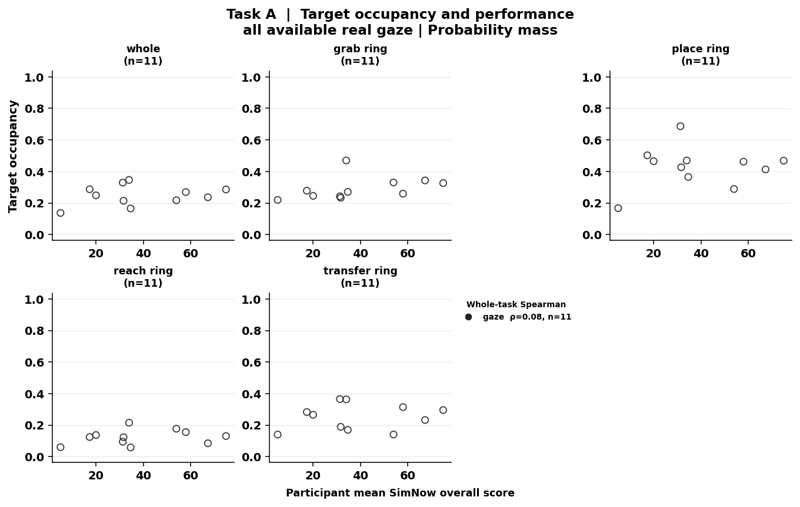

**数据范围：** v3，`real_all / main / gaze`，图位于 `main_probability`。此分支不输出驻留/切换。

横轴为参与者平均 SimNow 成绩，纵轴为 L_target。空心点为参与者，使用指标和成绩同时有效的录像；不将帧作为独立点。

| 阶段 | ρ [95%CI] | LOO范围 | 不同成绩数 | 不可估bootstrap |
| --- | --- | --- | --- | --- |
| 四阶段整体 | 0.082 [-0.528, 0.735]；n=11，录像=33 | -0.224–0.248 | 11 | 0 |
| 接近环 | 0.218 [-0.408, 0.725]；n=11，录像=33 | 0.030–0.406 | 11 | 0 |
| 抓取环 | 0.600 [0.000, 0.887]；n=11，录像=33 | 0.467–0.685 | 11 | 0 |
| 转移环 | 0.155 [-0.544, 0.716]；n=11，录像=33 | -0.127–0.309 | 11 | 0 |
| 放置环 | -0.109 [-0.760, 0.602]；n=11，录像=33 | -0.479–0.042 | 11 | 0 |

CI跨0时方向未确定。阶段线索仍需考虑多指标探索、并列成绩、失败0分和敏感性表；LOO方向一致不等于独立样本泛化。

对应数值：[group_stage_summary.csv](20261105T063658759189Z_v3_full/main_probability/group_stage_summary.csv)、[performance_correlations.csv](20261105T063658759189Z_v3_full/main_probability/performance_correlations.csv)、[repetition_contrasts.csv](20261105T063658759189Z_v3_full/main_probability/repetition_contrasts.csv)。

### 图 G04｜Task A｜main_probability｜四区域占用

**数据范围：** v3，`real_all / main / gaze`，图位于 `main_probability`。此分支不输出驻留/切换。

四个互斥区域 T/P/O/N 的有效时间占用合计100%；target=T+O、腕部=P+O。灰色 Other 不是不专注的证据。

| 阶段 | T % | P % | O % | N % | Target % | 腕部 % |
| --- | --- | --- | --- | --- | --- | --- |
| 四阶段整体 | 22.17 | 6.72 | 2.73 | 68.39 | 24.89 | 9.45 |
| 接近环 | 11.54 | 7.18 | 0.84 | 80.44 | 12.38 | 8.02 |
| 抓取环 | 25.74 | 7.26 | 3.53 | 63.48 | 29.27 | 10.78 |
| 转移环 | 23.83 | 5.38 | 1.25 | 69.55 | 25.07 | 6.62 |
| 放置环 | 35.30 | 7.98 | 7.59 | 49.14 | 42.89 | 15.56 |

阶段柱高反映分配差异，不能忽略目标/双腕部覆盖和该阶段可估人数。重叠多时，inclusive占用接近不意味着能清楚分辨目标与器械的独立关注。

对应数值：[group_stage_summary.csv](20261105T063658759189Z_v3_full/main_probability/group_stage_summary.csv)、[performance_correlations.csv](20261105T063658759189Z_v3_full/main_probability/performance_correlations.csv)、[repetition_contrasts.csv](20261105T063658759189Z_v3_full/main_probability/repetition_contrasts.csv)。

### 图 G05｜Task A｜main_probability｜参与者轮次轨迹

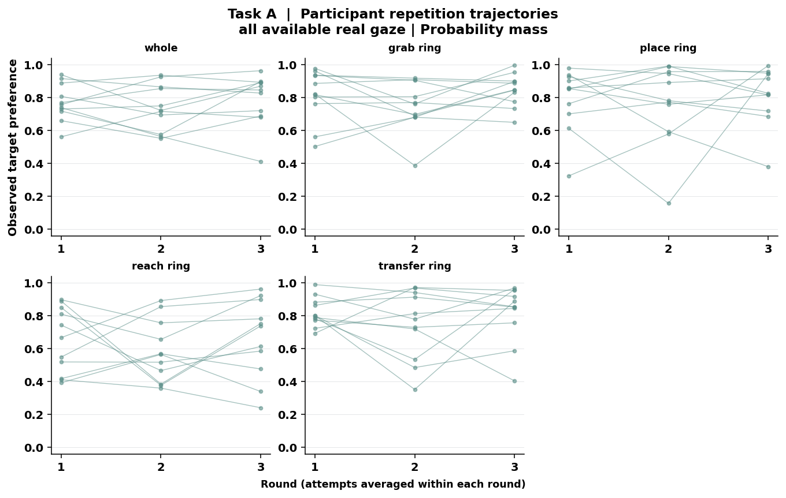

**数据范围：** v3，`real_all / main / gaze`，图位于 `main_probability`。此分支不输出驻留/切换。

横轴为第1/2/3轮，纵轴为 C；每条线连接同一参与者，同轮 attempt 已平均。缺点不补零，线条不代表所有人每阶段都完整。

| 阶段 | 第3−第1轮 C，pp [CI] | 配对人数 | 前→后录像 |
| --- | --- | --- | --- |
| 四阶段整体 | 1.83 [-7.60, 10.07] | 11 | 11→11 |
| 接近环 | 1.51 [-7.83, 11.94] | 11 | 11→11 |
| 抓取环 | 3.20 [-4.09, 11.28] | 11 | 11→11 |
| 转移环 | -0.38 [-11.39, 9.55] | 11 | 11→11 |
| 放置环 | 2.64 [-15.35, 20.80] | 11 | 11→11 |

轮次改变与阶段时长、ROI和有效片段组成共同作用；图不能直接给出学习机制或注意质量的因果解释。

对应数值：[group_stage_summary.csv](20261105T063658759189Z_v3_full/main_probability/group_stage_summary.csv)、[performance_correlations.csv](20261105T063658759189Z_v3_full/main_probability/performance_correlations.csv)、[repetition_contrasts.csv](20261105T063658759189Z_v3_full/main_probability/repetition_contrasts.csv)。

### 图 G06｜Task A｜main_probability｜整体敏感性

**数据范围：** v3，`real_all / 五种情景 / gaze`，图位于 `main_probability`。此分支不输出驻留/切换。

横轴为五种预设分析设置，不是连续时间；三个面板比较 C、target 和腕部占用。

| 情景 | C % [CI] | Target % [CI] | 腕部 % [CI] |
| --- | --- | --- | --- |
| main | 76.74 [70.23, 82.84] | 24.89 [21.13, 28.52] | 9.45 [6.33, 13.14] |
| r25 | 79.24 [72.35, 86.09] | 9.37 [7.44, 11.21] | 2.37 [1.52, 3.36] |
| r100 | 70.36 [64.01, 76.02] | 50.31 [45.05, 54.98] | 33.11 [26.37, 40.78] |
| gripper100 | 40.34 [31.68, 49.01] | 24.89 [21.13, 28.52] | 33.11 [26.37, 40.78] |
| smooth | 76.62 [70.16, 82.70] | 24.65 [20.89, 28.27] | 9.41 [6.31, 13.09] |

各情景均不按 valid 筛帧。非对称扩大腕部会改变可分辨区域及几何机会，不能把 C 改变当作同一指标下行为反转；smooth 同时含短缺口插值和平滑，不是观测精度验证。

对应数值：[group_stage_summary.csv](20261105T063658759189Z_v3_full/main_probability/group_stage_summary.csv)、[performance_correlations.csv](20261105T063658759189Z_v3_full/main_probability/performance_correlations.csv)、[repetition_contrasts.csv](20261105T063658759189Z_v3_full/main_probability/repetition_contrasts.csv)。

### 图 G07｜Task C｜main_probability｜目标偏好与成绩

**数据范围：** v3，`real_all / main / gaze`，图位于 `main_probability`。此分支不输出驻留/切换。

横轴为参与者平均 SimNow 成绩，纵轴为 C。空心点为参与者，使用指标和成绩同时有效的录像；不将帧作为独立点。

| 阶段 | ρ [95%CI] | LOO范围 | 不同成绩数 | 不可估bootstrap |
| --- | --- | --- | --- | --- |
| 四阶段整体 | -0.174 [-0.706, 0.575]；n=11，录像=50 | -0.387–0.031 | 9 | 0 |
| 接近线 | 0.009 [-0.687, 0.715]；n=11，录像=50 | -0.231–0.178 | 9 | 0 |
| 绕器械缠线 | -0.266 [-0.769, 0.423]；n=11，录像=50 | -0.407–-0.018 | 9 | 0 |
| 拉穿并收紧 | -0.203 [-1.000, 1.000]；n=6，录像=15 | -0.667–0.300 | 5 | 17 |
| 穿塔引线 | -0.405 [-0.941, 0.182]；n=8，录像=18 | -0.668–-0.204 | 3 | 1013 |

CI跨0时方向未确定。阶段线索仍需考虑多指标探索、并列成绩、失败0分和敏感性表；LOO方向一致不等于独立样本泛化。

对应数值：[group_stage_summary.csv](20261105T063658759189Z_v3_full/main_probability/group_stage_summary.csv)、[performance_correlations.csv](20261105T063658759189Z_v3_full/main_probability/performance_correlations.csv)、[repetition_contrasts.csv](20261105T063658759189Z_v3_full/main_probability/repetition_contrasts.csv)。

### 图 G08｜Task C｜main_probability｜腕部占用与成绩

**数据范围：** v3，`real_all / main / gaze`，图位于 `main_probability`。此分支不输出驻留/切换。

横轴为参与者平均 SimNow 成绩，纵轴为 L_gripper。空心点为参与者，使用指标和成绩同时有效的录像；不将帧作为独立点。

| 阶段 | ρ [95%CI] | LOO范围 | 不同成绩数 | 不可估bootstrap |
| --- | --- | --- | --- | --- |
| 四阶段整体 | 0.266 [-0.453, 0.778]；n=11，录像=50 | 0.018–0.444 | 9 | 0 |
| 接近线 | 0.624 [0.100, 0.906]；n=11，录像=50 | 0.553–0.736 | 9 | 0 |
| 绕器械缠线 | 0.294 [-0.437, 0.850]；n=11，录像=50 | 0.055–0.535 | 9 | 0 |
| 拉穿并收紧 | -0.145 [-1.000, 0.894]；n=6，录像=16 | -0.800–0.100 | 5 | 17 |
| 穿塔引线 | 0.078 [-0.779, 0.784]；n=8，录像=19 | -0.408–0.408 | 3 | 1013 |

CI跨0时方向未确定。阶段线索仍需考虑多指标探索、并列成绩、失败0分和敏感性表；LOO方向一致不等于独立样本泛化。

对应数值：[group_stage_summary.csv](20261105T063658759189Z_v3_full/main_probability/group_stage_summary.csv)、[performance_correlations.csv](20261105T063658759189Z_v3_full/main_probability/performance_correlations.csv)、[repetition_contrasts.csv](20261105T063658759189Z_v3_full/main_probability/repetition_contrasts.csv)。

### 图 G09｜Task C｜main_probability｜目标占用与成绩

**数据范围：** v3，`real_all / main / gaze`，图位于 `main_probability`。此分支不输出驻留/切换。

横轴为参与者平均 SimNow 成绩，纵轴为 L_target。空心点为参与者，使用指标和成绩同时有效的录像；不将帧作为独立点。

| 阶段 | ρ [95%CI] | LOO范围 | 不同成绩数 | 不可估bootstrap |
| --- | --- | --- | --- | --- |
| 四阶段整体 | 0.156 [-0.561, 0.833]；n=11，录像=50 | 0.036–0.450 | 9 | 0 |
| 接近线 | 0.358 [-0.334, 0.848]；n=11，录像=50 | 0.215–0.498 | 9 | 0 |
| 绕器械缠线 | 0.193 [-0.574, 0.751]；n=11，录像=50 | -0.080–0.395 | 9 | 0 |
| 拉穿并收紧 | -0.464 [-1.000, 0.636]；n=6，录像=16 | -0.700–-0.051 | 5 | 17 |
| 穿塔引线 | -0.343 [-0.813, 0.282]；n=8，录像=19 | -0.579–-0.204 | 3 | 1013 |

CI跨0时方向未确定。阶段线索仍需考虑多指标探索、并列成绩、失败0分和敏感性表；LOO方向一致不等于独立样本泛化。

对应数值：[group_stage_summary.csv](20261105T063658759189Z_v3_full/main_probability/group_stage_summary.csv)、[performance_correlations.csv](20261105T063658759189Z_v3_full/main_probability/performance_correlations.csv)、[repetition_contrasts.csv](20261105T063658759189Z_v3_full/main_probability/repetition_contrasts.csv)。

### 图 G10｜Task C｜main_probability｜四区域占用

**数据范围：** v3，`real_all / main / gaze`，图位于 `main_probability`。此分支不输出驻留/切换。

四个互斥区域 T/P/O/N 的有效时间占用合计100%；target=T+O、腕部=P+O。灰色 Other 不是不专注的证据。

| 阶段 | T % | P % | O % | N % | Target % | 腕部 % |
| --- | --- | --- | --- | --- | --- | --- |
| 四阶段整体 | 12.80 | 11.48 | 11.80 | 63.92 | 24.60 | 23.28 |
| 接近线 | 17.97 | 13.90 | 5.35 | 62.77 | 23.33 | 19.25 |
| 绕器械缠线 | 9.23 | 10.11 | 19.02 | 61.65 | 28.24 | 29.13 |
| 拉穿并收紧 | 24.09 | 3.55 | 0.00 | 72.36 | 24.09 | 3.55 |
| 穿塔引线 | 8.41 | 7.78 | 2.72 | 81.08 | 11.13 | 10.50 |

阶段柱高反映分配差异，不能忽略目标/双腕部覆盖和该阶段可估人数。重叠多时，inclusive占用接近不意味着能清楚分辨目标与器械的独立关注。

对应数值：[group_stage_summary.csv](20261105T063658759189Z_v3_full/main_probability/group_stage_summary.csv)、[performance_correlations.csv](20261105T063658759189Z_v3_full/main_probability/performance_correlations.csv)、[repetition_contrasts.csv](20261105T063658759189Z_v3_full/main_probability/repetition_contrasts.csv)。

### 图 G11｜Task C｜main_probability｜参与者轮次轨迹

**数据范围：** v3，`real_all / main / gaze`，图位于 `main_probability`。此分支不输出驻留/切换。

横轴为第1/2/3轮，纵轴为 C；每条线连接同一参与者，同轮 attempt 已平均。缺点不补零，线条不代表所有人每阶段都完整。

| 阶段 | 第3−第1轮 C，pp [CI] | 配对人数 | 前→后录像 |
| --- | --- | --- | --- |
| 四阶段整体 | -22.61 [-33.91, -11.31] | 11 | 18→15 |
| 接近线 | -24.32 [-38.29, -9.64] | 11 | 18→15 |
| 绕器械缠线 | -22.56 [-31.64, -13.34] | 11 | 18→15 |
| 拉穿并收紧 | -13.22 [-30.92, 1.92] | 4 | 4→4 |
| 穿塔引线 | 22.52 [12.06, 38.12] | 3 | 4→4 |

轮次改变与阶段时长、ROI和有效片段组成共同作用；图不能直接给出学习机制或注意质量的因果解释。

对应数值：[group_stage_summary.csv](20261105T063658759189Z_v3_full/main_probability/group_stage_summary.csv)、[performance_correlations.csv](20261105T063658759189Z_v3_full/main_probability/performance_correlations.csv)、[repetition_contrasts.csv](20261105T063658759189Z_v3_full/main_probability/repetition_contrasts.csv)。

### 图 G12｜Task C｜main_probability｜整体敏感性

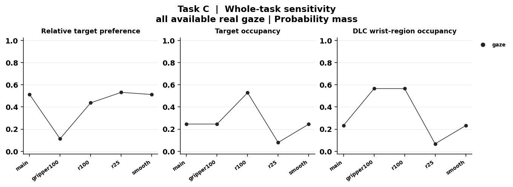

**数据范围：** v3，`real_all / 五种情景 / gaze`，图位于 `main_probability`。此分支不输出驻留/切换。

横轴为五种预设分析设置，不是连续时间；三个面板比较 C、target 和腕部占用。

| 情景 | C % [CI] | Target % [CI] | 腕部 % [CI] |
| --- | --- | --- | --- |
| main | 51.42 [44.18, 59.28] | 24.60 [21.11, 27.72] | 23.28 [19.87, 26.61] |
| r25 | 53.19 [46.64, 60.09] | 7.95 [6.52, 9.27] | 6.80 [5.31, 8.45] |
| r100 | 43.72 [35.90, 51.52] | 52.87 [47.04, 57.97] | 56.58 [51.15, 61.60] |
| gripper100 | 11.34 [7.75, 15.09] | 24.60 [21.11, 27.72] | 56.58 [51.15, 61.60] |
| smooth | 51.25 [43.83, 59.21] | 24.46 [20.98, 27.56] | 23.17 [19.81, 26.53] |

各情景均不按 valid 筛帧。非对称扩大腕部会改变可分辨区域及几何机会，不能把 C 改变当作同一指标下行为反转；smooth 同时含短缺口插值和平滑，不是观测精度验证。

对应数值：[group_stage_summary.csv](20261105T063658759189Z_v3_full/main_probability/group_stage_summary.csv)、[performance_correlations.csv](20261105T063658759189Z_v3_full/main_probability/performance_correlations.csv)、[repetition_contrasts.csv](20261105T063658759189Z_v3_full/main_probability/repetition_contrasts.csv)。

### 图 G13｜Task A｜decoded_expectation｜驻留与切换

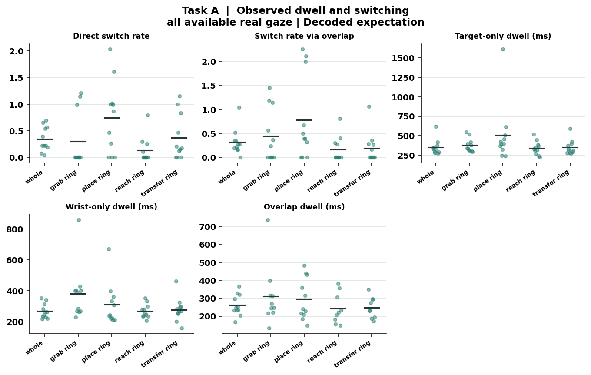

**数据范围：** v3，`real_all / main / gaze`，图位于 `decoded_expectation`。本图来源仍是真实 gaze，不是该解码器的模型轨迹。

面板为直接/经重叠切换率以及 T/P/O 驻留；切换率按有效分钟，驻留按毫秒。参与者点与群体均值不能当作全部 run 的池化中位数。

| 阶段 | T/P/O驻留 ms | 直接/经O切换 /min |
| --- | --- | --- |
| 四阶段整体 | 353.5/270.0/262.0 | 0.349/0.322 |
| 接近环 | 341.6/269.5/243.5 | 0.132/0.162 |
| 抓取环 | 378.0/382.2/309.7 | 0.303/0.449 |
| 转移环 | 351.1/278.8/247.3 | 0.374/0.194 |
| 放置环 | 508.3/311.6/295.3 | 0.748/0.785 |

≥120 ms 是 AOI run 规则，不等同于生理 fixation；缺失、边界和重复阶段会截断时序。NA与0不同，不能从少量有效片段的零切换推断原始全过程没有转换。

对应数值：[group_stage_summary.csv](20261105T063658759189Z_v3_full/decoded_expectation/group_stage_summary.csv)、[performance_correlations.csv](20261105T063658759189Z_v3_full/decoded_expectation/performance_correlations.csv)、[repetition_contrasts.csv](20261105T063658759189Z_v3_full/decoded_expectation/repetition_contrasts.csv)。

### 图 G14｜Task A｜decoded_expectation｜目标偏好与成绩

**数据范围：** v3，`real_all / main / gaze`，图位于 `decoded_expectation`。本图来源仍是真实 gaze，不是该解码器的模型轨迹。

横轴为参与者平均 SimNow 成绩，纵轴为 C。空心点为参与者，使用指标和成绩同时有效的录像；不将帧作为独立点。

| 阶段 | ρ [95%CI] | LOO范围 | 不同成绩数 | 不可估bootstrap |
| --- | --- | --- | --- | --- |
| 四阶段整体 | 0.036 [-0.702, 0.785]；n=11，录像=33 | -0.176–0.285 | 11 | 0 |
| 接近环 | 0.027 [-0.640, 0.769]；n=11，录像=33 | -0.127–0.297 | 11 | 0 |
| 抓取环 | -0.173 [-0.787, 0.557]；n=11，录像=33 | -0.394–0.006 | 11 | 0 |
| 转移环 | 0.209 [-0.651, 0.822]；n=11，录像=33 | -0.055–0.382 | 11 | 0 |
| 放置环 | 0.082 [-0.701, 0.744]；n=11，录像=33 | -0.224–0.321 | 11 | 0 |

CI跨0时方向未确定。阶段线索仍需考虑多指标探索、并列成绩、失败0分和敏感性表；LOO方向一致不等于独立样本泛化。

对应数值：[group_stage_summary.csv](20261105T063658759189Z_v3_full/decoded_expectation/group_stage_summary.csv)、[performance_correlations.csv](20261105T063658759189Z_v3_full/decoded_expectation/performance_correlations.csv)、[repetition_contrasts.csv](20261105T063658759189Z_v3_full/decoded_expectation/repetition_contrasts.csv)。

### 图 G15｜Task A｜decoded_expectation｜腕部占用与成绩

**数据范围：** v3，`real_all / main / gaze`，图位于 `decoded_expectation`。本图来源仍是真实 gaze，不是该解码器的模型轨迹。

横轴为参与者平均 SimNow 成绩，纵轴为 L_gripper。空心点为参与者，使用指标和成绩同时有效的录像；不将帧作为独立点。

| 阶段 | ρ [95%CI] | LOO范围 | 不同成绩数 | 不可估bootstrap |
| --- | --- | --- | --- | --- |
| 四阶段整体 | -0.109 [-0.748, 0.533]；n=11，录像=33 | -0.345–0.030 | 11 | 0 |
| 接近环 | 0.000 [-0.632, 0.621]；n=11，录像=33 | -0.224–0.164 | 11 | 0 |
| 抓取环 | 0.045 [-0.636, 0.684]；n=11，录像=33 | -0.176–0.224 | 11 | 0 |
| 转移环 | -0.009 [-0.593, 0.690]；n=11，录像=33 | -0.236–0.273 | 11 | 0 |
| 放置环 | 0.073 [-0.583, 0.703]；n=11，录像=33 | -0.139–0.273 | 11 | 0 |

CI跨0时方向未确定。阶段线索仍需考虑多指标探索、并列成绩、失败0分和敏感性表；LOO方向一致不等于独立样本泛化。

对应数值：[group_stage_summary.csv](20261105T063658759189Z_v3_full/decoded_expectation/group_stage_summary.csv)、[performance_correlations.csv](20261105T063658759189Z_v3_full/decoded_expectation/performance_correlations.csv)、[repetition_contrasts.csv](20261105T063658759189Z_v3_full/decoded_expectation/repetition_contrasts.csv)。

### 图 G16｜Task A｜decoded_expectation｜目标占用与成绩

**数据范围：** v3，`real_all / main / gaze`，图位于 `decoded_expectation`。本图来源仍是真实 gaze，不是该解码器的模型轨迹。

横轴为参与者平均 SimNow 成绩，纵轴为 L_target。空心点为参与者，使用指标和成绩同时有效的录像；不将帧作为独立点。

| 阶段 | ρ [95%CI] | LOO范围 | 不同成绩数 | 不可估bootstrap |
| --- | --- | --- | --- | --- |
| 四阶段整体 | 0.082 [-0.528, 0.735]；n=11，录像=33 | -0.224–0.248 | 11 | 0 |
| 接近环 | 0.218 [-0.408, 0.725]；n=11，录像=33 | 0.030–0.406 | 11 | 0 |
| 抓取环 | 0.600 [0.000, 0.887]；n=11，录像=33 | 0.467–0.685 | 11 | 0 |
| 转移环 | 0.155 [-0.544, 0.716]；n=11，录像=33 | -0.127–0.309 | 11 | 0 |
| 放置环 | -0.109 [-0.760, 0.602]；n=11，录像=33 | -0.479–0.042 | 11 | 0 |

CI跨0时方向未确定。阶段线索仍需考虑多指标探索、并列成绩、失败0分和敏感性表；LOO方向一致不等于独立样本泛化。

对应数值：[group_stage_summary.csv](20261105T063658759189Z_v3_full/decoded_expectation/group_stage_summary.csv)、[performance_correlations.csv](20261105T063658759189Z_v3_full/decoded_expectation/performance_correlations.csv)、[repetition_contrasts.csv](20261105T063658759189Z_v3_full/decoded_expectation/repetition_contrasts.csv)。

### 图 G17｜Task A｜decoded_expectation｜四区域占用

**数据范围：** v3，`real_all / main / gaze`，图位于 `decoded_expectation`。本图来源仍是真实 gaze，不是该解码器的模型轨迹。

四个互斥区域 T/P/O/N 的有效时间占用合计100%；target=T+O、腕部=P+O。灰色 Other 不是不专注的证据。

| 阶段 | T % | P % | O % | N % | Target % | 腕部 % |
| --- | --- | --- | --- | --- | --- | --- |
| 四阶段整体 | 22.17 | 6.72 | 2.73 | 68.39 | 24.89 | 9.45 |
| 接近环 | 11.54 | 7.18 | 0.84 | 80.44 | 12.38 | 8.02 |
| 抓取环 | 25.74 | 7.26 | 3.53 | 63.48 | 29.27 | 10.78 |
| 转移环 | 23.83 | 5.38 | 1.25 | 69.55 | 25.07 | 6.62 |
| 放置环 | 35.30 | 7.98 | 7.59 | 49.14 | 42.89 | 15.56 |

阶段柱高反映分配差异，不能忽略目标/双腕部覆盖和该阶段可估人数。重叠多时，inclusive占用接近不意味着能清楚分辨目标与器械的独立关注。

对应数值：[group_stage_summary.csv](20261105T063658759189Z_v3_full/decoded_expectation/group_stage_summary.csv)、[performance_correlations.csv](20261105T063658759189Z_v3_full/decoded_expectation/performance_correlations.csv)、[repetition_contrasts.csv](20261105T063658759189Z_v3_full/decoded_expectation/repetition_contrasts.csv)。

### 图 G18｜Task A｜decoded_expectation｜参与者轮次轨迹

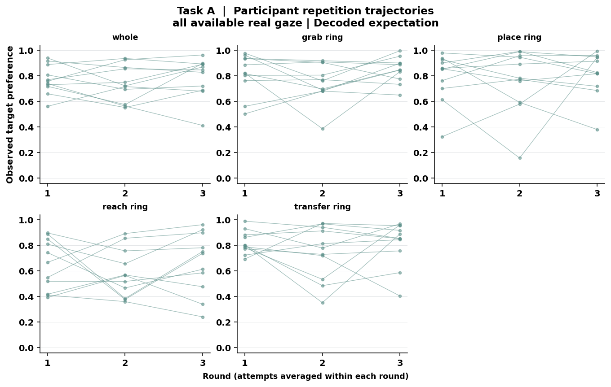

**数据范围：** v3，`real_all / main / gaze`，图位于 `decoded_expectation`。本图来源仍是真实 gaze，不是该解码器的模型轨迹。

横轴为第1/2/3轮，纵轴为 C；每条线连接同一参与者，同轮 attempt 已平均。缺点不补零，线条不代表所有人每阶段都完整。

| 阶段 | 第3−第1轮 C，pp [CI] | 配对人数 | 前→后录像 |
| --- | --- | --- | --- |
| 四阶段整体 | 1.83 [-7.60, 10.07] | 11 | 11→11 |
| 接近环 | 1.51 [-7.83, 11.94] | 11 | 11→11 |
| 抓取环 | 3.20 [-4.09, 11.28] | 11 | 11→11 |
| 转移环 | -0.38 [-11.39, 9.55] | 11 | 11→11 |
| 放置环 | 2.64 [-15.35, 20.80] | 11 | 11→11 |

轮次改变与阶段时长、ROI和有效片段组成共同作用；图不能直接给出学习机制或注意质量的因果解释。

对应数值：[group_stage_summary.csv](20261105T063658759189Z_v3_full/decoded_expectation/group_stage_summary.csv)、[performance_correlations.csv](20261105T063658759189Z_v3_full/decoded_expectation/performance_correlations.csv)、[repetition_contrasts.csv](20261105T063658759189Z_v3_full/decoded_expectation/repetition_contrasts.csv)。

### 图 G19｜Task A｜decoded_expectation｜整体敏感性

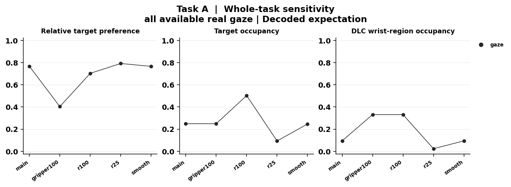

**数据范围：** v3，`real_all / 五种情景 / gaze`，图位于 `decoded_expectation`。本图来源仍是真实 gaze，不是该解码器的模型轨迹。

横轴为五种预设分析设置，不是连续时间；三个面板比较 C、target 和腕部占用。

| 情景 | C % [CI] | Target % [CI] | 腕部 % [CI] |
| --- | --- | --- | --- |
| main | 76.74 [70.23, 82.84] | 24.89 [21.13, 28.52] | 9.45 [6.33, 13.14] |
| r25 | 79.24 [72.35, 86.09] | 9.37 [7.44, 11.21] | 2.37 [1.52, 3.36] |
| r100 | 70.36 [64.01, 76.02] | 50.31 [45.05, 54.98] | 33.11 [26.37, 40.78] |
| gripper100 | 40.34 [31.68, 49.01] | 24.89 [21.13, 28.52] | 33.11 [26.37, 40.78] |
| smooth | 76.62 [70.16, 82.70] | 24.65 [20.89, 28.27] | 9.41 [6.31, 13.09] |

各情景均不按 valid 筛帧。非对称扩大腕部会改变可分辨区域及几何机会，不能把 C 改变当作同一指标下行为反转；smooth 同时含短缺口插值和平滑，不是观测精度验证。

对应数值：[group_stage_summary.csv](20261105T063658759189Z_v3_full/decoded_expectation/group_stage_summary.csv)、[performance_correlations.csv](20261105T063658759189Z_v3_full/decoded_expectation/performance_correlations.csv)、[repetition_contrasts.csv](20261105T063658759189Z_v3_full/decoded_expectation/repetition_contrasts.csv)。

### 图 G20｜Task C｜decoded_expectation｜驻留与切换

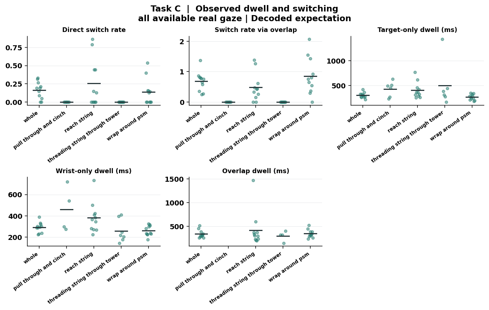

**数据范围：** v3，`real_all / main / gaze`，图位于 `decoded_expectation`。本图来源仍是真实 gaze，不是该解码器的模型轨迹。

面板为直接/经重叠切换率以及 T/P/O 驻留；切换率按有效分钟，驻留按毫秒。参与者点与群体均值不能当作全部 run 的池化中位数。

| 阶段 | T/P/O驻留 ms | 直接/经O切换 /min |
| --- | --- | --- |
| 四阶段整体 | 301.4/292.2/337.9 | 0.163/0.679 |
| 接近线 | 400.5/381.9/418.1 | 0.256/0.485 |
| 绕器械缠线 | 262.4/260.5/346.1 | 0.137/0.852 |
| 拉穿并收紧 | 427.4/458.7/NA | 0.000/0.000 |
| 穿塔引线 | 501.8/256.1/294.6 | 0.000/0.000 |

≥120 ms 是 AOI run 规则，不等同于生理 fixation；缺失、边界和重复阶段会截断时序。NA与0不同，不能从少量有效片段的零切换推断原始全过程没有转换。

对应数值：[group_stage_summary.csv](20261105T063658759189Z_v3_full/decoded_expectation/group_stage_summary.csv)、[performance_correlations.csv](20261105T063658759189Z_v3_full/decoded_expectation/performance_correlations.csv)、[repetition_contrasts.csv](20261105T063658759189Z_v3_full/decoded_expectation/repetition_contrasts.csv)。

### 图 G21｜Task C｜decoded_expectation｜目标偏好与成绩

**数据范围：** v3，`real_all / main / gaze`，图位于 `decoded_expectation`。本图来源仍是真实 gaze，不是该解码器的模型轨迹。

横轴为参与者平均 SimNow 成绩，纵轴为 C。空心点为参与者，使用指标和成绩同时有效的录像；不将帧作为独立点。

| 阶段 | ρ [95%CI] | LOO范围 | 不同成绩数 | 不可估bootstrap |
| --- | --- | --- | --- | --- |
| 四阶段整体 | -0.174 [-0.706, 0.575]；n=11，录像=50 | -0.387–0.031 | 9 | 0 |
| 接近线 | 0.009 [-0.687, 0.715]；n=11，录像=50 | -0.231–0.178 | 9 | 0 |
| 绕器械缠线 | -0.266 [-0.769, 0.423]；n=11，录像=50 | -0.407–-0.018 | 9 | 0 |
| 拉穿并收紧 | -0.203 [-1.000, 1.000]；n=6，录像=15 | -0.667–0.300 | 5 | 17 |
| 穿塔引线 | -0.405 [-0.941, 0.182]；n=8，录像=18 | -0.668–-0.204 | 3 | 1013 |

CI跨0时方向未确定。阶段线索仍需考虑多指标探索、并列成绩、失败0分和敏感性表；LOO方向一致不等于独立样本泛化。

对应数值：[group_stage_summary.csv](20261105T063658759189Z_v3_full/decoded_expectation/group_stage_summary.csv)、[performance_correlations.csv](20261105T063658759189Z_v3_full/decoded_expectation/performance_correlations.csv)、[repetition_contrasts.csv](20261105T063658759189Z_v3_full/decoded_expectation/repetition_contrasts.csv)。

### 图 G22｜Task C｜decoded_expectation｜腕部占用与成绩

**数据范围：** v3，`real_all / main / gaze`，图位于 `decoded_expectation`。本图来源仍是真实 gaze，不是该解码器的模型轨迹。

横轴为参与者平均 SimNow 成绩，纵轴为 L_gripper。空心点为参与者，使用指标和成绩同时有效的录像；不将帧作为独立点。

| 阶段 | ρ [95%CI] | LOO范围 | 不同成绩数 | 不可估bootstrap |
| --- | --- | --- | --- | --- |
| 四阶段整体 | 0.266 [-0.453, 0.778]；n=11，录像=50 | 0.018–0.444 | 9 | 0 |
| 接近线 | 0.624 [0.100, 0.906]；n=11，录像=50 | 0.553–0.736 | 9 | 0 |
| 绕器械缠线 | 0.294 [-0.437, 0.850]；n=11，录像=50 | 0.055–0.535 | 9 | 0 |
| 拉穿并收紧 | -0.145 [-1.000, 0.894]；n=6，录像=16 | -0.800–0.100 | 5 | 17 |
| 穿塔引线 | 0.078 [-0.779, 0.784]；n=8，录像=19 | -0.408–0.408 | 3 | 1013 |

CI跨0时方向未确定。阶段线索仍需考虑多指标探索、并列成绩、失败0分和敏感性表；LOO方向一致不等于独立样本泛化。

对应数值：[group_stage_summary.csv](20261105T063658759189Z_v3_full/decoded_expectation/group_stage_summary.csv)、[performance_correlations.csv](20261105T063658759189Z_v3_full/decoded_expectation/performance_correlations.csv)、[repetition_contrasts.csv](20261105T063658759189Z_v3_full/decoded_expectation/repetition_contrasts.csv)。

### 图 G23｜Task C｜decoded_expectation｜目标占用与成绩

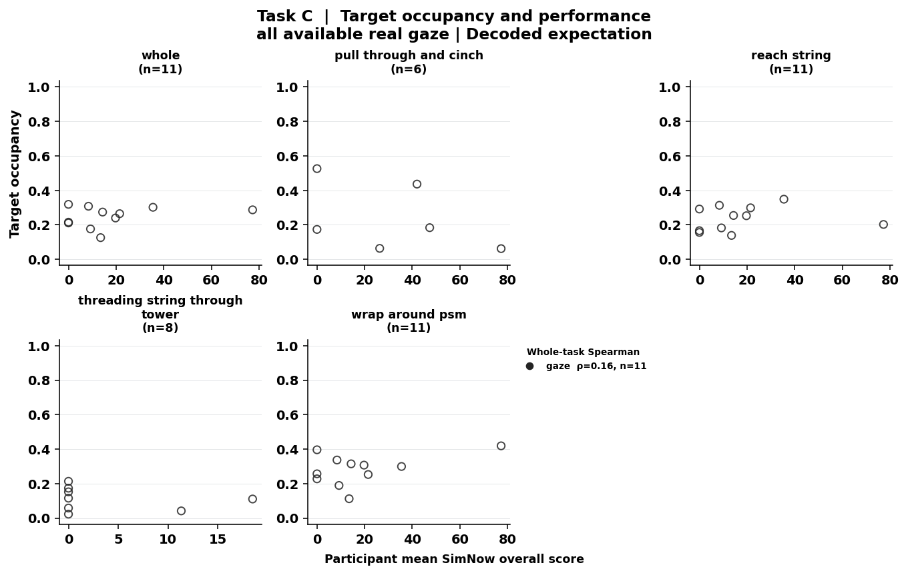

**数据范围：** v3，`real_all / main / gaze`，图位于 `decoded_expectation`。本图来源仍是真实 gaze，不是该解码器的模型轨迹。

横轴为参与者平均 SimNow 成绩，纵轴为 L_target。空心点为参与者，使用指标和成绩同时有效的录像；不将帧作为独立点。

| 阶段 | ρ [95%CI] | LOO范围 | 不同成绩数 | 不可估bootstrap |
| --- | --- | --- | --- | --- |
| 四阶段整体 | 0.156 [-0.561, 0.833]；n=11，录像=50 | 0.036–0.450 | 9 | 0 |
| 接近线 | 0.358 [-0.334, 0.848]；n=11，录像=50 | 0.215–0.498 | 9 | 0 |
| 绕器械缠线 | 0.193 [-0.574, 0.751]；n=11，录像=50 | -0.080–0.395 | 9 | 0 |
| 拉穿并收紧 | -0.464 [-1.000, 0.636]；n=6，录像=16 | -0.700–-0.051 | 5 | 17 |
| 穿塔引线 | -0.343 [-0.813, 0.282]；n=8，录像=19 | -0.579–-0.204 | 3 | 1013 |

CI跨0时方向未确定。阶段线索仍需考虑多指标探索、并列成绩、失败0分和敏感性表；LOO方向一致不等于独立样本泛化。

对应数值：[group_stage_summary.csv](20261105T063658759189Z_v3_full/decoded_expectation/group_stage_summary.csv)、[performance_correlations.csv](20261105T063658759189Z_v3_full/decoded_expectation/performance_correlations.csv)、[repetition_contrasts.csv](20261105T063658759189Z_v3_full/decoded_expectation/repetition_contrasts.csv)。

### 图 G24｜Task C｜decoded_expectation｜四区域占用

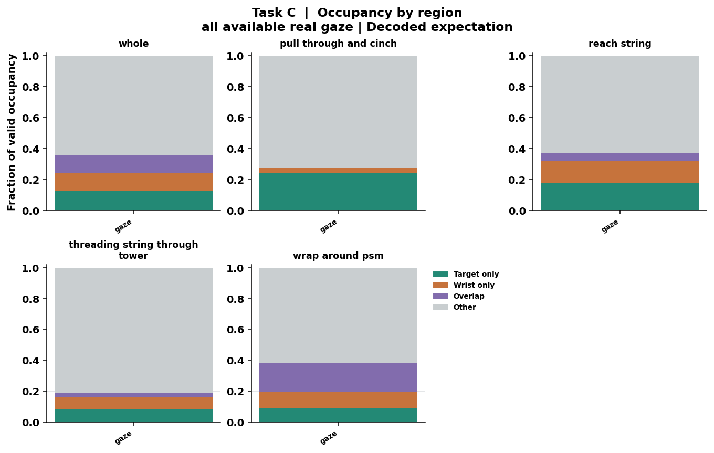

**数据范围：** v3，`real_all / main / gaze`，图位于 `decoded_expectation`。本图来源仍是真实 gaze，不是该解码器的模型轨迹。

四个互斥区域 T/P/O/N 的有效时间占用合计100%；target=T+O、腕部=P+O。灰色 Other 不是不专注的证据。

| 阶段 | T % | P % | O % | N % | Target % | 腕部 % |
| --- | --- | --- | --- | --- | --- | --- |
| 四阶段整体 | 12.80 | 11.48 | 11.80 | 63.92 | 24.60 | 23.28 |
| 接近线 | 17.97 | 13.90 | 5.35 | 62.77 | 23.33 | 19.25 |
| 绕器械缠线 | 9.23 | 10.11 | 19.02 | 61.65 | 28.24 | 29.13 |
| 拉穿并收紧 | 24.09 | 3.55 | 0.00 | 72.36 | 24.09 | 3.55 |
| 穿塔引线 | 8.41 | 7.78 | 2.72 | 81.08 | 11.13 | 10.50 |

阶段柱高反映分配差异，不能忽略目标/双腕部覆盖和该阶段可估人数。重叠多时，inclusive占用接近不意味着能清楚分辨目标与器械的独立关注。

对应数值：[group_stage_summary.csv](20261105T063658759189Z_v3_full/decoded_expectation/group_stage_summary.csv)、[performance_correlations.csv](20261105T063658759189Z_v3_full/decoded_expectation/performance_correlations.csv)、[repetition_contrasts.csv](20261105T063658759189Z_v3_full/decoded_expectation/repetition_contrasts.csv)。

### 图 G25｜Task C｜decoded_expectation｜参与者轮次轨迹

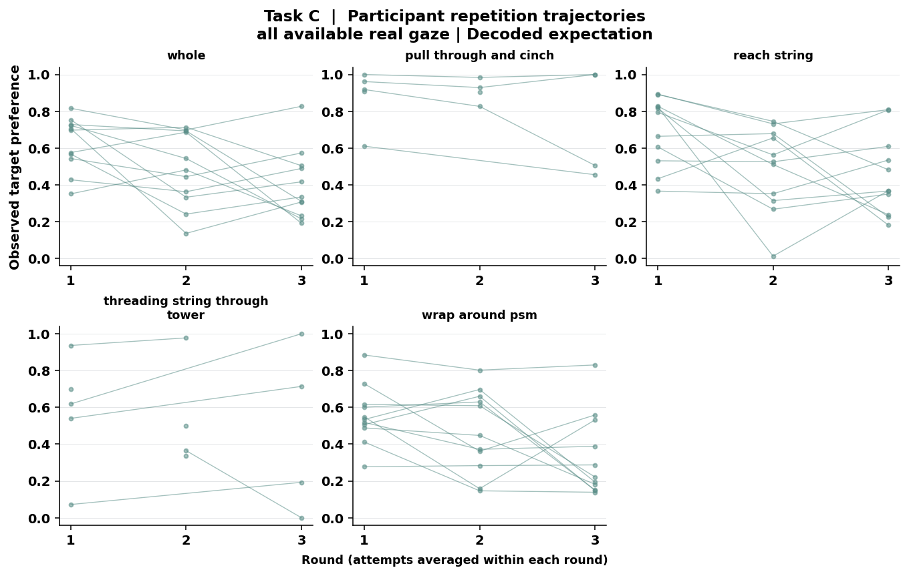

**数据范围：** v3，`real_all / main / gaze`，图位于 `decoded_expectation`。本图来源仍是真实 gaze，不是该解码器的模型轨迹。

横轴为第1/2/3轮，纵轴为 C；每条线连接同一参与者，同轮 attempt 已平均。缺点不补零，线条不代表所有人每阶段都完整。

| 阶段 | 第3−第1轮 C，pp [CI] | 配对人数 | 前→后录像 |
| --- | --- | --- | --- |
| 四阶段整体 | -22.61 [-33.91, -11.31] | 11 | 18→15 |
| 接近线 | -24.32 [-38.29, -9.64] | 11 | 18→15 |
| 绕器械缠线 | -22.56 [-31.64, -13.34] | 11 | 18→15 |
| 拉穿并收紧 | -13.22 [-30.92, 1.92] | 4 | 4→4 |
| 穿塔引线 | 22.52 [12.06, 38.12] | 3 | 4→4 |

轮次改变与阶段时长、ROI和有效片段组成共同作用；图不能直接给出学习机制或注意质量的因果解释。

对应数值：[group_stage_summary.csv](20261105T063658759189Z_v3_full/decoded_expectation/group_stage_summary.csv)、[performance_correlations.csv](20261105T063658759189Z_v3_full/decoded_expectation/performance_correlations.csv)、[repetition_contrasts.csv](20261105T063658759189Z_v3_full/decoded_expectation/repetition_contrasts.csv)。

### 图 G26｜Task C｜decoded_expectation｜整体敏感性

**数据范围：** v3，`real_all / 五种情景 / gaze`，图位于 `decoded_expectation`。本图来源仍是真实 gaze，不是该解码器的模型轨迹。

横轴为五种预设分析设置，不是连续时间；三个面板比较 C、target 和腕部占用。

| 情景 | C % [CI] | Target % [CI] | 腕部 % [CI] |
| --- | --- | --- | --- |
| main | 51.42 [44.18, 59.28] | 24.60 [21.11, 27.72] | 23.28 [19.87, 26.61] |
| r25 | 53.19 [46.64, 60.09] | 7.95 [6.52, 9.27] | 6.80 [5.31, 8.45] |
| r100 | 43.72 [35.90, 51.52] | 52.87 [47.04, 57.97] | 56.58 [51.15, 61.60] |
| gripper100 | 11.34 [7.75, 15.09] | 24.60 [21.11, 27.72] | 56.58 [51.15, 61.60] |
| smooth | 51.25 [43.83, 59.21] | 24.46 [20.98, 27.56] | 23.17 [19.81, 26.53] |

各情景均不按 valid 筛帧。非对称扩大腕部会改变可分辨区域及几何机会，不能把 C 改变当作同一指标下行为反转；smooth 同时含短缺口插值和平滑，不是观测精度验证。

对应数值：[group_stage_summary.csv](20261105T063658759189Z_v3_full/decoded_expectation/group_stage_summary.csv)、[performance_correlations.csv](20261105T063658759189Z_v3_full/decoded_expectation/performance_correlations.csv)、[repetition_contrasts.csv](20261105T063658759189Z_v3_full/decoded_expectation/repetition_contrasts.csv)。

### 图 G27｜Task A｜decoded_argmax｜驻留与切换

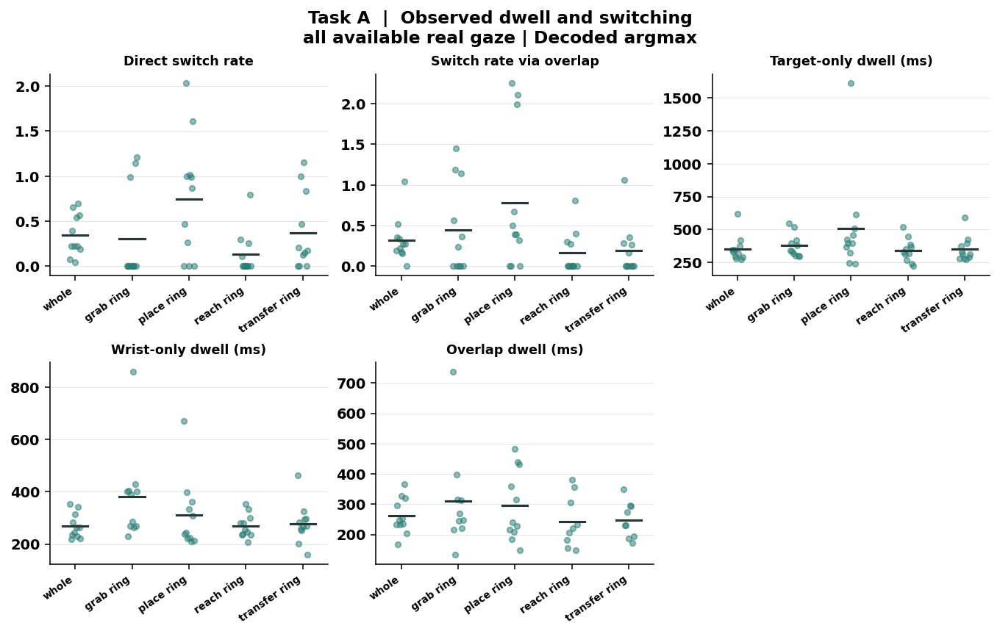

**数据范围：** v3，`real_all / main / gaze`，图位于 `decoded_argmax`。本图来源仍是真实 gaze，不是该解码器的模型轨迹。

面板为直接/经重叠切换率以及 T/P/O 驻留；切换率按有效分钟，驻留按毫秒。参与者点与群体均值不能当作全部 run 的池化中位数。

| 阶段 | T/P/O驻留 ms | 直接/经O切换 /min |
| --- | --- | --- |
| 四阶段整体 | 353.5/270.0/262.0 | 0.349/0.322 |
| 接近环 | 341.6/269.5/243.5 | 0.132/0.162 |
| 抓取环 | 378.0/382.2/309.7 | 0.303/0.449 |
| 转移环 | 351.1/278.8/247.3 | 0.374/0.194 |
| 放置环 | 508.3/311.6/295.3 | 0.748/0.785 |

≥120 ms 是 AOI run 规则，不等同于生理 fixation；缺失、边界和重复阶段会截断时序。NA与0不同，不能从少量有效片段的零切换推断原始全过程没有转换。

对应数值：[group_stage_summary.csv](20261105T063658759189Z_v3_full/decoded_argmax/group_stage_summary.csv)、[performance_correlations.csv](20261105T063658759189Z_v3_full/decoded_argmax/performance_correlations.csv)、[repetition_contrasts.csv](20261105T063658759189Z_v3_full/decoded_argmax/repetition_contrasts.csv)。

### 图 G28｜Task A｜decoded_argmax｜目标偏好与成绩

**数据范围：** v3，`real_all / main / gaze`，图位于 `decoded_argmax`。本图来源仍是真实 gaze，不是该解码器的模型轨迹。

横轴为参与者平均 SimNow 成绩，纵轴为 C。空心点为参与者，使用指标和成绩同时有效的录像；不将帧作为独立点。

| 阶段 | ρ [95%CI] | LOO范围 | 不同成绩数 | 不可估bootstrap |
| --- | --- | --- | --- | --- |
| 四阶段整体 | 0.036 [-0.702, 0.785]；n=11，录像=33 | -0.176–0.285 | 11 | 0 |
| 接近环 | 0.027 [-0.640, 0.769]；n=11，录像=33 | -0.127–0.297 | 11 | 0 |
| 抓取环 | -0.173 [-0.787, 0.557]；n=11，录像=33 | -0.394–0.006 | 11 | 0 |
| 转移环 | 0.209 [-0.651, 0.822]；n=11，录像=33 | -0.055–0.382 | 11 | 0 |
| 放置环 | 0.082 [-0.701, 0.744]；n=11，录像=33 | -0.224–0.321 | 11 | 0 |

CI跨0时方向未确定。阶段线索仍需考虑多指标探索、并列成绩、失败0分和敏感性表；LOO方向一致不等于独立样本泛化。

对应数值：[group_stage_summary.csv](20261105T063658759189Z_v3_full/decoded_argmax/group_stage_summary.csv)、[performance_correlations.csv](20261105T063658759189Z_v3_full/decoded_argmax/performance_correlations.csv)、[repetition_contrasts.csv](20261105T063658759189Z_v3_full/decoded_argmax/repetition_contrasts.csv)。

### 图 G29｜Task A｜decoded_argmax｜腕部占用与成绩

**数据范围：** v3，`real_all / main / gaze`，图位于 `decoded_argmax`。本图来源仍是真实 gaze，不是该解码器的模型轨迹。

横轴为参与者平均 SimNow 成绩，纵轴为 L_gripper。空心点为参与者，使用指标和成绩同时有效的录像；不将帧作为独立点。

| 阶段 | ρ [95%CI] | LOO范围 | 不同成绩数 | 不可估bootstrap |
| --- | --- | --- | --- | --- |
| 四阶段整体 | -0.109 [-0.748, 0.533]；n=11，录像=33 | -0.345–0.030 | 11 | 0 |
| 接近环 | 0.000 [-0.632, 0.621]；n=11，录像=33 | -0.224–0.164 | 11 | 0 |
| 抓取环 | 0.045 [-0.636, 0.684]；n=11，录像=33 | -0.176–0.224 | 11 | 0 |
| 转移环 | -0.009 [-0.593, 0.690]；n=11，录像=33 | -0.236–0.273 | 11 | 0 |
| 放置环 | 0.073 [-0.583, 0.703]；n=11，录像=33 | -0.139–0.273 | 11 | 0 |

CI跨0时方向未确定。阶段线索仍需考虑多指标探索、并列成绩、失败0分和敏感性表；LOO方向一致不等于独立样本泛化。

对应数值：[group_stage_summary.csv](20261105T063658759189Z_v3_full/decoded_argmax/group_stage_summary.csv)、[performance_correlations.csv](20261105T063658759189Z_v3_full/decoded_argmax/performance_correlations.csv)、[repetition_contrasts.csv](20261105T063658759189Z_v3_full/decoded_argmax/repetition_contrasts.csv)。

### 图 G30｜Task A｜decoded_argmax｜目标占用与成绩

**数据范围：** v3，`real_all / main / gaze`，图位于 `decoded_argmax`。本图来源仍是真实 gaze，不是该解码器的模型轨迹。

横轴为参与者平均 SimNow 成绩，纵轴为 L_target。空心点为参与者，使用指标和成绩同时有效的录像；不将帧作为独立点。

| 阶段 | ρ [95%CI] | LOO范围 | 不同成绩数 | 不可估bootstrap |
| --- | --- | --- | --- | --- |
| 四阶段整体 | 0.082 [-0.528, 0.735]；n=11，录像=33 | -0.224–0.248 | 11 | 0 |
| 接近环 | 0.218 [-0.408, 0.725]；n=11，录像=33 | 0.030–0.406 | 11 | 0 |
| 抓取环 | 0.600 [0.000, 0.887]；n=11，录像=33 | 0.467–0.685 | 11 | 0 |
| 转移环 | 0.155 [-0.544, 0.716]；n=11，录像=33 | -0.127–0.309 | 11 | 0 |
| 放置环 | -0.109 [-0.760, 0.602]；n=11，录像=33 | -0.479–0.042 | 11 | 0 |

CI跨0时方向未确定。阶段线索仍需考虑多指标探索、并列成绩、失败0分和敏感性表；LOO方向一致不等于独立样本泛化。

对应数值：[group_stage_summary.csv](20261105T063658759189Z_v3_full/decoded_argmax/group_stage_summary.csv)、[performance_correlations.csv](20261105T063658759189Z_v3_full/decoded_argmax/performance_correlations.csv)、[repetition_contrasts.csv](20261105T063658759189Z_v3_full/decoded_argmax/repetition_contrasts.csv)。

### 图 G31｜Task A｜decoded_argmax｜四区域占用

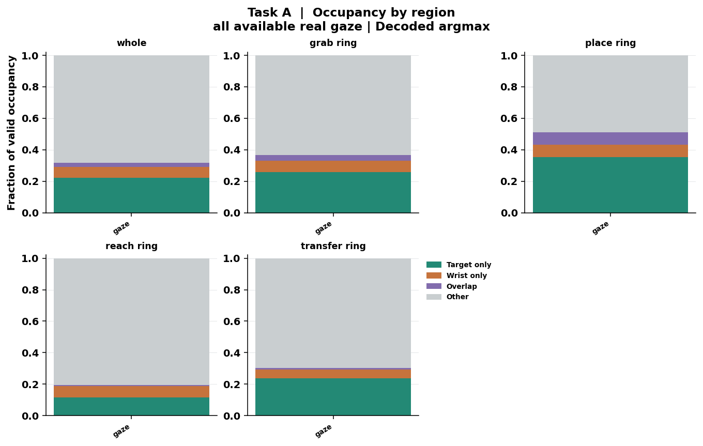

**数据范围：** v3，`real_all / main / gaze`，图位于 `decoded_argmax`。本图来源仍是真实 gaze，不是该解码器的模型轨迹。

四个互斥区域 T/P/O/N 的有效时间占用合计100%；target=T+O、腕部=P+O。灰色 Other 不是不专注的证据。

| 阶段 | T % | P % | O % | N % | Target % | 腕部 % |
| --- | --- | --- | --- | --- | --- | --- |
| 四阶段整体 | 22.17 | 6.72 | 2.73 | 68.39 | 24.89 | 9.45 |
| 接近环 | 11.54 | 7.18 | 0.84 | 80.44 | 12.38 | 8.02 |
| 抓取环 | 25.74 | 7.26 | 3.53 | 63.48 | 29.27 | 10.78 |
| 转移环 | 23.83 | 5.38 | 1.25 | 69.55 | 25.07 | 6.62 |
| 放置环 | 35.30 | 7.98 | 7.59 | 49.14 | 42.89 | 15.56 |

阶段柱高反映分配差异，不能忽略目标/双腕部覆盖和该阶段可估人数。重叠多时，inclusive占用接近不意味着能清楚分辨目标与器械的独立关注。

对应数值：[group_stage_summary.csv](20261105T063658759189Z_v3_full/decoded_argmax/group_stage_summary.csv)、[performance_correlations.csv](20261105T063658759189Z_v3_full/decoded_argmax/performance_correlations.csv)、[repetition_contrasts.csv](20261105T063658759189Z_v3_full/decoded_argmax/repetition_contrasts.csv)。

### 图 G32｜Task A｜decoded_argmax｜参与者轮次轨迹

**数据范围：** v3，`real_all / main / gaze`，图位于 `decoded_argmax`。本图来源仍是真实 gaze，不是该解码器的模型轨迹。

横轴为第1/2/3轮，纵轴为 C；每条线连接同一参与者，同轮 attempt 已平均。缺点不补零，线条不代表所有人每阶段都完整。

| 阶段 | 第3−第1轮 C，pp [CI] | 配对人数 | 前→后录像 |
| --- | --- | --- | --- |
| 四阶段整体 | 1.83 [-7.60, 10.07] | 11 | 11→11 |
| 接近环 | 1.51 [-7.83, 11.94] | 11 | 11→11 |
| 抓取环 | 3.20 [-4.09, 11.28] | 11 | 11→11 |
| 转移环 | -0.38 [-11.39, 9.55] | 11 | 11→11 |
| 放置环 | 2.64 [-15.35, 20.80] | 11 | 11→11 |

轮次改变与阶段时长、ROI和有效片段组成共同作用；图不能直接给出学习机制或注意质量的因果解释。

对应数值：[group_stage_summary.csv](20261105T063658759189Z_v3_full/decoded_argmax/group_stage_summary.csv)、[performance_correlations.csv](20261105T063658759189Z_v3_full/decoded_argmax/performance_correlations.csv)、[repetition_contrasts.csv](20261105T063658759189Z_v3_full/decoded_argmax/repetition_contrasts.csv)。

### 图 G33｜Task A｜decoded_argmax｜整体敏感性

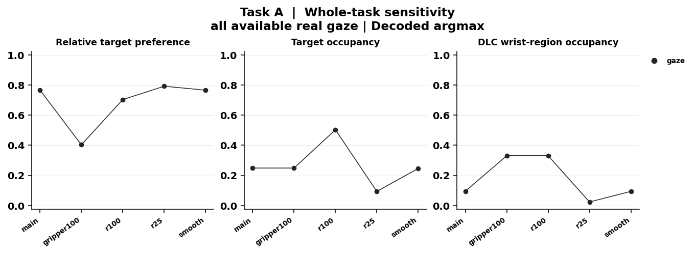

**数据范围：** v3，`real_all / 五种情景 / gaze`，图位于 `decoded_argmax`。本图来源仍是真实 gaze，不是该解码器的模型轨迹。

横轴为五种预设分析设置，不是连续时间；三个面板比较 C、target 和腕部占用。

| 情景 | C % [CI] | Target % [CI] | 腕部 % [CI] |
| --- | --- | --- | --- |
| main | 76.74 [70.23, 82.84] | 24.89 [21.13, 28.52] | 9.45 [6.33, 13.14] |
| r25 | 79.24 [72.35, 86.09] | 9.37 [7.44, 11.21] | 2.37 [1.52, 3.36] |
| r100 | 70.36 [64.01, 76.02] | 50.31 [45.05, 54.98] | 33.11 [26.37, 40.78] |
| gripper100 | 40.34 [31.68, 49.01] | 24.89 [21.13, 28.52] | 33.11 [26.37, 40.78] |
| smooth | 76.62 [70.16, 82.70] | 24.65 [20.89, 28.27] | 9.41 [6.31, 13.09] |

各情景均不按 valid 筛帧。非对称扩大腕部会改变可分辨区域及几何机会，不能把 C 改变当作同一指标下行为反转；smooth 同时含短缺口插值和平滑，不是观测精度验证。

对应数值：[group_stage_summary.csv](20261105T063658759189Z_v3_full/decoded_argmax/group_stage_summary.csv)、[performance_correlations.csv](20261105T063658759189Z_v3_full/decoded_argmax/performance_correlations.csv)、[repetition_contrasts.csv](20261105T063658759189Z_v3_full/decoded_argmax/repetition_contrasts.csv)。

### 图 G34｜Task C｜decoded_argmax｜驻留与切换

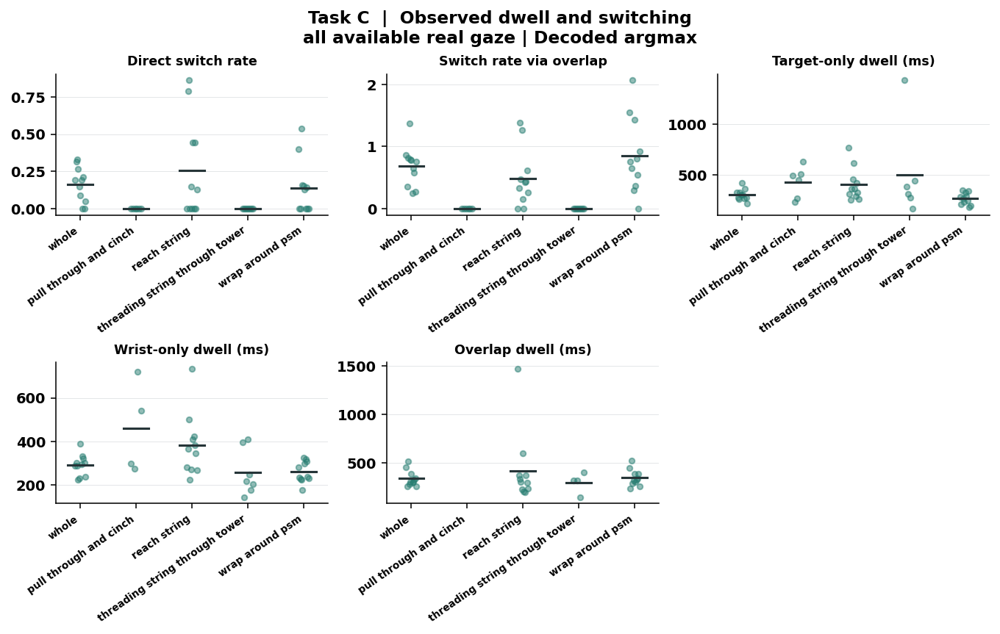

**数据范围：** v3，`real_all / main / gaze`，图位于 `decoded_argmax`。本图来源仍是真实 gaze，不是该解码器的模型轨迹。

面板为直接/经重叠切换率以及 T/P/O 驻留；切换率按有效分钟，驻留按毫秒。参与者点与群体均值不能当作全部 run 的池化中位数。

| 阶段 | T/P/O驻留 ms | 直接/经O切换 /min |
| --- | --- | --- |
| 四阶段整体 | 301.4/292.2/337.9 | 0.163/0.679 |
| 接近线 | 400.5/381.9/418.1 | 0.256/0.485 |
| 绕器械缠线 | 262.4/260.5/346.1 | 0.137/0.852 |
| 拉穿并收紧 | 427.4/458.7/NA | 0.000/0.000 |
| 穿塔引线 | 501.8/256.1/294.6 | 0.000/0.000 |

≥120 ms 是 AOI run 规则，不等同于生理 fixation；缺失、边界和重复阶段会截断时序。NA与0不同，不能从少量有效片段的零切换推断原始全过程没有转换。

对应数值：[group_stage_summary.csv](20261105T063658759189Z_v3_full/decoded_argmax/group_stage_summary.csv)、[performance_correlations.csv](20261105T063658759189Z_v3_full/decoded_argmax/performance_correlations.csv)、[repetition_contrasts.csv](20261105T063658759189Z_v3_full/decoded_argmax/repetition_contrasts.csv)。

### 图 G35｜Task C｜decoded_argmax｜目标偏好与成绩

**数据范围：** v3，`real_all / main / gaze`，图位于 `decoded_argmax`。本图来源仍是真实 gaze，不是该解码器的模型轨迹。

横轴为参与者平均 SimNow 成绩，纵轴为 C。空心点为参与者，使用指标和成绩同时有效的录像；不将帧作为独立点。

| 阶段 | ρ [95%CI] | LOO范围 | 不同成绩数 | 不可估bootstrap |
| --- | --- | --- | --- | --- |
| 四阶段整体 | -0.174 [-0.706, 0.575]；n=11，录像=50 | -0.387–0.031 | 9 | 0 |
| 接近线 | 0.009 [-0.687, 0.715]；n=11，录像=50 | -0.231–0.178 | 9 | 0 |
| 绕器械缠线 | -0.266 [-0.769, 0.423]；n=11，录像=50 | -0.407–-0.018 | 9 | 0 |
| 拉穿并收紧 | -0.203 [-1.000, 1.000]；n=6，录像=15 | -0.667–0.300 | 5 | 17 |
| 穿塔引线 | -0.405 [-0.941, 0.182]；n=8，录像=18 | -0.668–-0.204 | 3 | 1013 |

CI跨0时方向未确定。阶段线索仍需考虑多指标探索、并列成绩、失败0分和敏感性表；LOO方向一致不等于独立样本泛化。

对应数值：[group_stage_summary.csv](20261105T063658759189Z_v3_full/decoded_argmax/group_stage_summary.csv)、[performance_correlations.csv](20261105T063658759189Z_v3_full/decoded_argmax/performance_correlations.csv)、[repetition_contrasts.csv](20261105T063658759189Z_v3_full/decoded_argmax/repetition_contrasts.csv)。

### 图 G36｜Task C｜decoded_argmax｜腕部占用与成绩

**数据范围：** v3，`real_all / main / gaze`，图位于 `decoded_argmax`。本图来源仍是真实 gaze，不是该解码器的模型轨迹。

横轴为参与者平均 SimNow 成绩，纵轴为 L_gripper。空心点为参与者，使用指标和成绩同时有效的录像；不将帧作为独立点。

| 阶段 | ρ [95%CI] | LOO范围 | 不同成绩数 | 不可估bootstrap |
| --- | --- | --- | --- | --- |
| 四阶段整体 | 0.266 [-0.453, 0.778]；n=11，录像=50 | 0.018–0.444 | 9 | 0 |
| 接近线 | 0.624 [0.100, 0.906]；n=11，录像=50 | 0.553–0.736 | 9 | 0 |
| 绕器械缠线 | 0.294 [-0.437, 0.850]；n=11，录像=50 | 0.055–0.535 | 9 | 0 |
| 拉穿并收紧 | -0.145 [-1.000, 0.894]；n=6，录像=16 | -0.800–0.100 | 5 | 17 |
| 穿塔引线 | 0.078 [-0.779, 0.784]；n=8，录像=19 | -0.408–0.408 | 3 | 1013 |

CI跨0时方向未确定。阶段线索仍需考虑多指标探索、并列成绩、失败0分和敏感性表；LOO方向一致不等于独立样本泛化。

对应数值：[group_stage_summary.csv](20261105T063658759189Z_v3_full/decoded_argmax/group_stage_summary.csv)、[performance_correlations.csv](20261105T063658759189Z_v3_full/decoded_argmax/performance_correlations.csv)、[repetition_contrasts.csv](20261105T063658759189Z_v3_full/decoded_argmax/repetition_contrasts.csv)。

### 图 G37｜Task C｜decoded_argmax｜目标占用与成绩

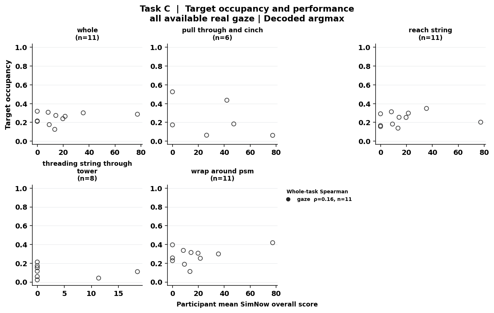

**数据范围：** v3，`real_all / main / gaze`，图位于 `decoded_argmax`。本图来源仍是真实 gaze，不是该解码器的模型轨迹。

横轴为参与者平均 SimNow 成绩，纵轴为 L_target。空心点为参与者，使用指标和成绩同时有效的录像；不将帧作为独立点。

| 阶段 | ρ [95%CI] | LOO范围 | 不同成绩数 | 不可估bootstrap |
| --- | --- | --- | --- | --- |
| 四阶段整体 | 0.156 [-0.561, 0.833]；n=11，录像=50 | 0.036–0.450 | 9 | 0 |
| 接近线 | 0.358 [-0.334, 0.848]；n=11，录像=50 | 0.215–0.498 | 9 | 0 |
| 绕器械缠线 | 0.193 [-0.574, 0.751]；n=11，录像=50 | -0.080–0.395 | 9 | 0 |
| 拉穿并收紧 | -0.464 [-1.000, 0.636]；n=6，录像=16 | -0.700–-0.051 | 5 | 17 |
| 穿塔引线 | -0.343 [-0.813, 0.282]；n=8，录像=19 | -0.579–-0.204 | 3 | 1013 |

CI跨0时方向未确定。阶段线索仍需考虑多指标探索、并列成绩、失败0分和敏感性表；LOO方向一致不等于独立样本泛化。

对应数值：[group_stage_summary.csv](20261105T063658759189Z_v3_full/decoded_argmax/group_stage_summary.csv)、[performance_correlations.csv](20261105T063658759189Z_v3_full/decoded_argmax/performance_correlations.csv)、[repetition_contrasts.csv](20261105T063658759189Z_v3_full/decoded_argmax/repetition_contrasts.csv)。

### 图 G38｜Task C｜decoded_argmax｜四区域占用

**数据范围：** v3，`real_all / main / gaze`，图位于 `decoded_argmax`。本图来源仍是真实 gaze，不是该解码器的模型轨迹。

四个互斥区域 T/P/O/N 的有效时间占用合计100%；target=T+O、腕部=P+O。灰色 Other 不是不专注的证据。

| 阶段 | T % | P % | O % | N % | Target % | 腕部 % |
| --- | --- | --- | --- | --- | --- | --- |
| 四阶段整体 | 12.80 | 11.48 | 11.80 | 63.92 | 24.60 | 23.28 |
| 接近线 | 17.97 | 13.90 | 5.35 | 62.77 | 23.33 | 19.25 |
| 绕器械缠线 | 9.23 | 10.11 | 19.02 | 61.65 | 28.24 | 29.13 |
| 拉穿并收紧 | 24.09 | 3.55 | 0.00 | 72.36 | 24.09 | 3.55 |
| 穿塔引线 | 8.41 | 7.78 | 2.72 | 81.08 | 11.13 | 10.50 |

阶段柱高反映分配差异，不能忽略目标/双腕部覆盖和该阶段可估人数。重叠多时，inclusive占用接近不意味着能清楚分辨目标与器械的独立关注。

对应数值：[group_stage_summary.csv](20261105T063658759189Z_v3_full/decoded_argmax/group_stage_summary.csv)、[performance_correlations.csv](20261105T063658759189Z_v3_full/decoded_argmax/performance_correlations.csv)、[repetition_contrasts.csv](20261105T063658759189Z_v3_full/decoded_argmax/repetition_contrasts.csv)。

### 图 G39｜Task C｜decoded_argmax｜参与者轮次轨迹

**数据范围：** v3，`real_all / main / gaze`，图位于 `decoded_argmax`。本图来源仍是真实 gaze，不是该解码器的模型轨迹。

横轴为第1/2/3轮，纵轴为 C；每条线连接同一参与者，同轮 attempt 已平均。缺点不补零，线条不代表所有人每阶段都完整。

| 阶段 | 第3−第1轮 C，pp [CI] | 配对人数 | 前→后录像 |
| --- | --- | --- | --- |
| 四阶段整体 | -22.61 [-33.91, -11.31] | 11 | 18→15 |
| 接近线 | -24.32 [-38.29, -9.64] | 11 | 18→15 |
| 绕器械缠线 | -22.56 [-31.64, -13.34] | 11 | 18→15 |
| 拉穿并收紧 | -13.22 [-30.92, 1.92] | 4 | 4→4 |
| 穿塔引线 | 22.52 [12.06, 38.12] | 3 | 4→4 |

轮次改变与阶段时长、ROI和有效片段组成共同作用；图不能直接给出学习机制或注意质量的因果解释。

对应数值：[group_stage_summary.csv](20261105T063658759189Z_v3_full/decoded_argmax/group_stage_summary.csv)、[performance_correlations.csv](20261105T063658759189Z_v3_full/decoded_argmax/performance_correlations.csv)、[repetition_contrasts.csv](20261105T063658759189Z_v3_full/decoded_argmax/repetition_contrasts.csv)。

### 图 G40｜Task C｜decoded_argmax｜整体敏感性

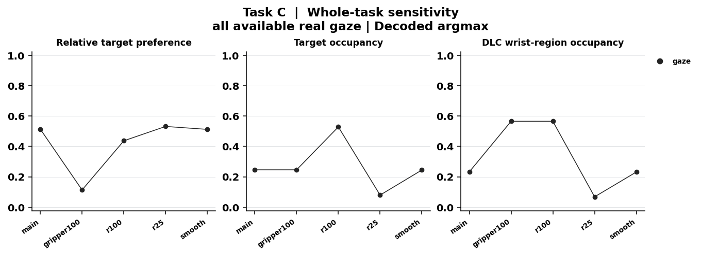

**数据范围：** v3，`real_all / 五种情景 / gaze`，图位于 `decoded_argmax`。本图来源仍是真实 gaze，不是该解码器的模型轨迹。

横轴为五种预设分析设置，不是连续时间；三个面板比较 C、target 和腕部占用。

| 情景 | C % [CI] | Target % [CI] | 腕部 % [CI] |
| --- | --- | --- | --- |
| main | 51.42 [44.18, 59.28] | 24.60 [21.11, 27.72] | 23.28 [19.87, 26.61] |
| r25 | 53.19 [46.64, 60.09] | 7.95 [6.52, 9.27] | 6.80 [5.31, 8.45] |
| r100 | 43.72 [35.90, 51.52] | 52.87 [47.04, 57.97] | 56.58 [51.15, 61.60] |
| gripper100 | 11.34 [7.75, 15.09] | 24.60 [21.11, 27.72] | 56.58 [51.15, 61.60] |
| smooth | 51.25 [43.83, 59.21] | 24.46 [20.98, 27.56] | 23.17 [19.81, 26.53] |

各情景均不按 valid 筛帧。非对称扩大腕部会改变可分辨区域及几何机会，不能把 C 改变当作同一指标下行为反转；smooth 同时含短缺口插值和平滑，不是观测精度验证。

对应数值：[group_stage_summary.csv](20261105T063658759189Z_v3_full/decoded_argmax/group_stage_summary.csv)、[performance_correlations.csv](20261105T063658759189Z_v3_full/decoded_argmax/performance_correlations.csv)、[repetition_contrasts.csv](20261105T063658759189Z_v3_full/decoded_argmax/repetition_contrasts.csv)。

### 图 G41｜Task A｜decoded_sample｜驻留与切换

**数据范围：** v3，`real_all / main / gaze`，图位于 `decoded_sample`。本图来源仍是真实 gaze，不是该解码器的模型轨迹。

面板为直接/经重叠切换率以及 T/P/O 驻留；切换率按有效分钟，驻留按毫秒。参与者点与群体均值不能当作全部 run 的池化中位数。

| 阶段 | T/P/O驻留 ms | 直接/经O切换 /min |
| --- | --- | --- |
| 四阶段整体 | 353.5/270.0/262.0 | 0.349/0.322 |
| 接近环 | 341.6/269.5/243.5 | 0.132/0.162 |
| 抓取环 | 378.0/382.2/309.7 | 0.303/0.449 |
| 转移环 | 351.1/278.8/247.3 | 0.374/0.194 |
| 放置环 | 508.3/311.6/295.3 | 0.748/0.785 |

≥120 ms 是 AOI run 规则，不等同于生理 fixation；缺失、边界和重复阶段会截断时序。NA与0不同，不能从少量有效片段的零切换推断原始全过程没有转换。

对应数值：[group_stage_summary.csv](20261105T063658759189Z_v3_full/decoded_sample/group_stage_summary.csv)、[performance_correlations.csv](20261105T063658759189Z_v3_full/decoded_sample/performance_correlations.csv)、[repetition_contrasts.csv](20261105T063658759189Z_v3_full/decoded_sample/repetition_contrasts.csv)。

### 图 G42｜Task A｜decoded_sample｜目标偏好与成绩

**数据范围：** v3，`real_all / main / gaze`，图位于 `decoded_sample`。本图来源仍是真实 gaze，不是该解码器的模型轨迹。

横轴为参与者平均 SimNow 成绩，纵轴为 C。空心点为参与者，使用指标和成绩同时有效的录像；不将帧作为独立点。

| 阶段 | ρ [95%CI] | LOO范围 | 不同成绩数 | 不可估bootstrap |
| --- | --- | --- | --- | --- |
| 四阶段整体 | 0.036 [-0.702, 0.785]；n=11，录像=33 | -0.176–0.285 | 11 | 0 |
| 接近环 | 0.027 [-0.640, 0.769]；n=11，录像=33 | -0.127–0.297 | 11 | 0 |
| 抓取环 | -0.173 [-0.787, 0.557]；n=11，录像=33 | -0.394–0.006 | 11 | 0 |
| 转移环 | 0.209 [-0.651, 0.822]；n=11，录像=33 | -0.055–0.382 | 11 | 0 |
| 放置环 | 0.082 [-0.701, 0.744]；n=11，录像=33 | -0.224–0.321 | 11 | 0 |

CI跨0时方向未确定。阶段线索仍需考虑多指标探索、并列成绩、失败0分和敏感性表；LOO方向一致不等于独立样本泛化。

对应数值：[group_stage_summary.csv](20261105T063658759189Z_v3_full/decoded_sample/group_stage_summary.csv)、[performance_correlations.csv](20261105T063658759189Z_v3_full/decoded_sample/performance_correlations.csv)、[repetition_contrasts.csv](20261105T063658759189Z_v3_full/decoded_sample/repetition_contrasts.csv)。

### 图 G43｜Task A｜decoded_sample｜腕部占用与成绩

**数据范围：** v3，`real_all / main / gaze`，图位于 `decoded_sample`。本图来源仍是真实 gaze，不是该解码器的模型轨迹。

横轴为参与者平均 SimNow 成绩，纵轴为 L_gripper。空心点为参与者，使用指标和成绩同时有效的录像；不将帧作为独立点。

| 阶段 | ρ [95%CI] | LOO范围 | 不同成绩数 | 不可估bootstrap |
| --- | --- | --- | --- | --- |
| 四阶段整体 | -0.109 [-0.748, 0.533]；n=11，录像=33 | -0.345–0.030 | 11 | 0 |
| 接近环 | 0.000 [-0.632, 0.621]；n=11，录像=33 | -0.224–0.164 | 11 | 0 |
| 抓取环 | 0.045 [-0.636, 0.684]；n=11，录像=33 | -0.176–0.224 | 11 | 0 |
| 转移环 | -0.009 [-0.593, 0.690]；n=11，录像=33 | -0.236–0.273 | 11 | 0 |
| 放置环 | 0.073 [-0.583, 0.703]；n=11，录像=33 | -0.139–0.273 | 11 | 0 |

CI跨0时方向未确定。阶段线索仍需考虑多指标探索、并列成绩、失败0分和敏感性表；LOO方向一致不等于独立样本泛化。

对应数值：[group_stage_summary.csv](20261105T063658759189Z_v3_full/decoded_sample/group_stage_summary.csv)、[performance_correlations.csv](20261105T063658759189Z_v3_full/decoded_sample/performance_correlations.csv)、[repetition_contrasts.csv](20261105T063658759189Z_v3_full/decoded_sample/repetition_contrasts.csv)。

### 图 G44｜Task A｜decoded_sample｜目标占用与成绩

**数据范围：** v3，`real_all / main / gaze`，图位于 `decoded_sample`。本图来源仍是真实 gaze，不是该解码器的模型轨迹。

横轴为参与者平均 SimNow 成绩，纵轴为 L_target。空心点为参与者，使用指标和成绩同时有效的录像；不将帧作为独立点。

| 阶段 | ρ [95%CI] | LOO范围 | 不同成绩数 | 不可估bootstrap |
| --- | --- | --- | --- | --- |
| 四阶段整体 | 0.082 [-0.528, 0.735]；n=11，录像=33 | -0.224–0.248 | 11 | 0 |
| 接近环 | 0.218 [-0.408, 0.725]；n=11，录像=33 | 0.030–0.406 | 11 | 0 |
| 抓取环 | 0.600 [0.000, 0.887]；n=11，录像=33 | 0.467–0.685 | 11 | 0 |
| 转移环 | 0.155 [-0.544, 0.716]；n=11，录像=33 | -0.127–0.309 | 11 | 0 |
| 放置环 | -0.109 [-0.760, 0.602]；n=11，录像=33 | -0.479–0.042 | 11 | 0 |

CI跨0时方向未确定。阶段线索仍需考虑多指标探索、并列成绩、失败0分和敏感性表；LOO方向一致不等于独立样本泛化。

对应数值：[group_stage_summary.csv](20261105T063658759189Z_v3_full/decoded_sample/group_stage_summary.csv)、[performance_correlations.csv](20261105T063658759189Z_v3_full/decoded_sample/performance_correlations.csv)、[repetition_contrasts.csv](20261105T063658759189Z_v3_full/decoded_sample/repetition_contrasts.csv)。

### 图 G45｜Task A｜decoded_sample｜四区域占用

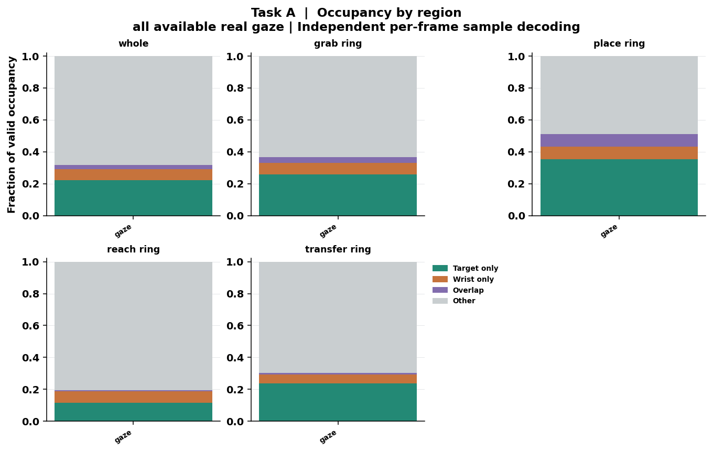

**数据范围：** v3，`real_all / main / gaze`，图位于 `decoded_sample`。本图来源仍是真实 gaze，不是该解码器的模型轨迹。

四个互斥区域 T/P/O/N 的有效时间占用合计100%；target=T+O、腕部=P+O。灰色 Other 不是不专注的证据。

| 阶段 | T % | P % | O % | N % | Target % | 腕部 % |
| --- | --- | --- | --- | --- | --- | --- |
| 四阶段整体 | 22.17 | 6.72 | 2.73 | 68.39 | 24.89 | 9.45 |
| 接近环 | 11.54 | 7.18 | 0.84 | 80.44 | 12.38 | 8.02 |
| 抓取环 | 25.74 | 7.26 | 3.53 | 63.48 | 29.27 | 10.78 |
| 转移环 | 23.83 | 5.38 | 1.25 | 69.55 | 25.07 | 6.62 |
| 放置环 | 35.30 | 7.98 | 7.59 | 49.14 | 42.89 | 15.56 |

阶段柱高反映分配差异，不能忽略目标/双腕部覆盖和该阶段可估人数。重叠多时，inclusive占用接近不意味着能清楚分辨目标与器械的独立关注。

对应数值：[group_stage_summary.csv](20261105T063658759189Z_v3_full/decoded_sample/group_stage_summary.csv)、[performance_correlations.csv](20261105T063658759189Z_v3_full/decoded_sample/performance_correlations.csv)、[repetition_contrasts.csv](20261105T063658759189Z_v3_full/decoded_sample/repetition_contrasts.csv)。

### 图 G46｜Task A｜decoded_sample｜参与者轮次轨迹

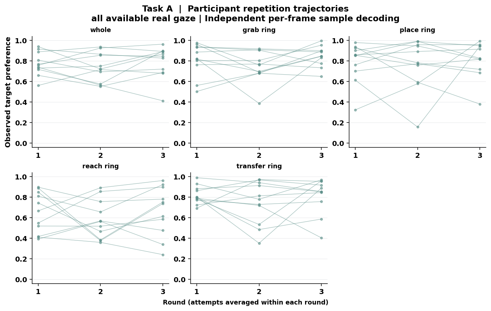

**数据范围：** v3，`real_all / main / gaze`，图位于 `decoded_sample`。本图来源仍是真实 gaze，不是该解码器的模型轨迹。

横轴为第1/2/3轮，纵轴为 C；每条线连接同一参与者，同轮 attempt 已平均。缺点不补零，线条不代表所有人每阶段都完整。

| 阶段 | 第3−第1轮 C，pp [CI] | 配对人数 | 前→后录像 |
| --- | --- | --- | --- |
| 四阶段整体 | 1.83 [-7.60, 10.07] | 11 | 11→11 |
| 接近环 | 1.51 [-7.83, 11.94] | 11 | 11→11 |
| 抓取环 | 3.20 [-4.09, 11.28] | 11 | 11→11 |
| 转移环 | -0.38 [-11.39, 9.55] | 11 | 11→11 |
| 放置环 | 2.64 [-15.35, 20.80] | 11 | 11→11 |

轮次改变与阶段时长、ROI和有效片段组成共同作用；图不能直接给出学习机制或注意质量的因果解释。

对应数值：[group_stage_summary.csv](20261105T063658759189Z_v3_full/decoded_sample/group_stage_summary.csv)、[performance_correlations.csv](20261105T063658759189Z_v3_full/decoded_sample/performance_correlations.csv)、[repetition_contrasts.csv](20261105T063658759189Z_v3_full/decoded_sample/repetition_contrasts.csv)。

### 图 G47｜Task A｜decoded_sample｜整体敏感性

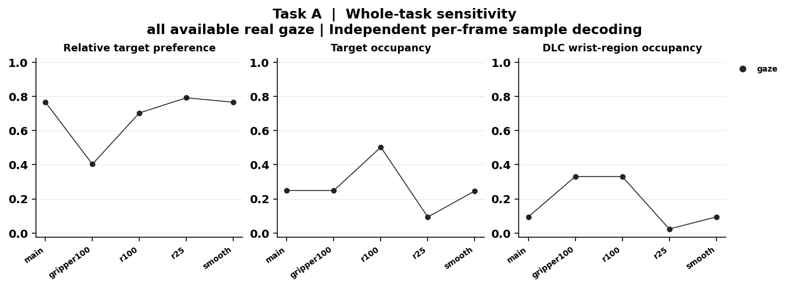

**数据范围：** v3，`real_all / 五种情景 / gaze`，图位于 `decoded_sample`。本图来源仍是真实 gaze，不是该解码器的模型轨迹。

横轴为五种预设分析设置，不是连续时间；三个面板比较 C、target 和腕部占用。

| 情景 | C % [CI] | Target % [CI] | 腕部 % [CI] |
| --- | --- | --- | --- |
| main | 76.74 [70.23, 82.84] | 24.89 [21.13, 28.52] | 9.45 [6.33, 13.14] |
| r25 | 79.24 [72.35, 86.09] | 9.37 [7.44, 11.21] | 2.37 [1.52, 3.36] |
| r100 | 70.36 [64.01, 76.02] | 50.31 [45.05, 54.98] | 33.11 [26.37, 40.78] |
| gripper100 | 40.34 [31.68, 49.01] | 24.89 [21.13, 28.52] | 33.11 [26.37, 40.78] |
| smooth | 76.62 [70.16, 82.70] | 24.65 [20.89, 28.27] | 9.41 [6.31, 13.09] |

各情景均不按 valid 筛帧。非对称扩大腕部会改变可分辨区域及几何机会，不能把 C 改变当作同一指标下行为反转；smooth 同时含短缺口插值和平滑，不是观测精度验证。

对应数值：[group_stage_summary.csv](20261105T063658759189Z_v3_full/decoded_sample/group_stage_summary.csv)、[performance_correlations.csv](20261105T063658759189Z_v3_full/decoded_sample/performance_correlations.csv)、[repetition_contrasts.csv](20261105T063658759189Z_v3_full/decoded_sample/repetition_contrasts.csv)。

### 图 G48｜Task C｜decoded_sample｜驻留与切换

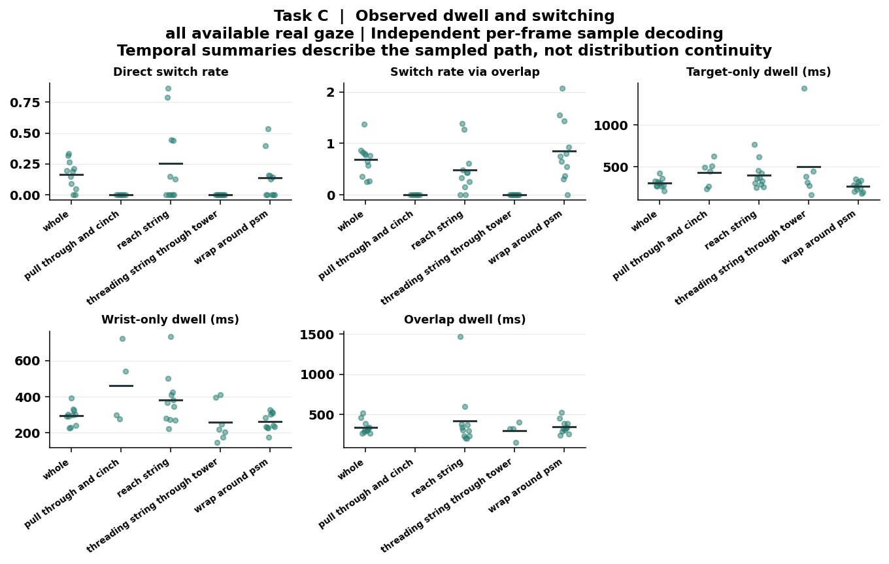

**数据范围：** v3，`real_all / main / gaze`，图位于 `decoded_sample`。本图来源仍是真实 gaze，不是该解码器的模型轨迹。

面板为直接/经重叠切换率以及 T/P/O 驻留；切换率按有效分钟，驻留按毫秒。参与者点与群体均值不能当作全部 run 的池化中位数。

| 阶段 | T/P/O驻留 ms | 直接/经O切换 /min |
| --- | --- | --- |
| 四阶段整体 | 301.4/292.2/337.9 | 0.163/0.679 |
| 接近线 | 400.5/381.9/418.1 | 0.256/0.485 |
| 绕器械缠线 | 262.4/260.5/346.1 | 0.137/0.852 |
| 拉穿并收紧 | 427.4/458.7/NA | 0.000/0.000 |
| 穿塔引线 | 501.8/256.1/294.6 | 0.000/0.000 |

≥120 ms 是 AOI run 规则，不等同于生理 fixation；缺失、边界和重复阶段会截断时序。NA与0不同，不能从少量有效片段的零切换推断原始全过程没有转换。

对应数值：[group_stage_summary.csv](20261105T063658759189Z_v3_full/decoded_sample/group_stage_summary.csv)、[performance_correlations.csv](20261105T063658759189Z_v3_full/decoded_sample/performance_correlations.csv)、[repetition_contrasts.csv](20261105T063658759189Z_v3_full/decoded_sample/repetition_contrasts.csv)。

### 图 G49｜Task C｜decoded_sample｜目标偏好与成绩

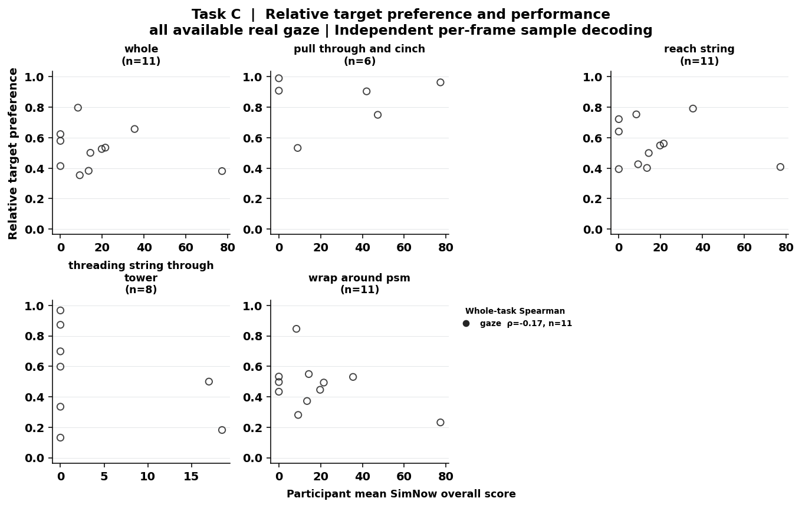

**数据范围：** v3，`real_all / main / gaze`，图位于 `decoded_sample`。本图来源仍是真实 gaze，不是该解码器的模型轨迹。

横轴为参与者平均 SimNow 成绩，纵轴为 C。空心点为参与者，使用指标和成绩同时有效的录像；不将帧作为独立点。

| 阶段 | ρ [95%CI] | LOO范围 | 不同成绩数 | 不可估bootstrap |
| --- | --- | --- | --- | --- |
| 四阶段整体 | -0.174 [-0.706, 0.575]；n=11，录像=50 | -0.387–0.031 | 9 | 0 |
| 接近线 | 0.009 [-0.687, 0.715]；n=11，录像=50 | -0.231–0.178 | 9 | 0 |
| 绕器械缠线 | -0.266 [-0.769, 0.423]；n=11，录像=50 | -0.407–-0.018 | 9 | 0 |
| 拉穿并收紧 | -0.203 [-1.000, 1.000]；n=6，录像=15 | -0.667–0.300 | 5 | 17 |
| 穿塔引线 | -0.405 [-0.941, 0.182]；n=8，录像=18 | -0.668–-0.204 | 3 | 1013 |

CI跨0时方向未确定。阶段线索仍需考虑多指标探索、并列成绩、失败0分和敏感性表；LOO方向一致不等于独立样本泛化。

对应数值：[group_stage_summary.csv](20261105T063658759189Z_v3_full/decoded_sample/group_stage_summary.csv)、[performance_correlations.csv](20261105T063658759189Z_v3_full/decoded_sample/performance_correlations.csv)、[repetition_contrasts.csv](20261105T063658759189Z_v3_full/decoded_sample/repetition_contrasts.csv)。

### 图 G50｜Task C｜decoded_sample｜腕部占用与成绩

**数据范围：** v3，`real_all / main / gaze`，图位于 `decoded_sample`。本图来源仍是真实 gaze，不是该解码器的模型轨迹。

横轴为参与者平均 SimNow 成绩，纵轴为 L_gripper。空心点为参与者，使用指标和成绩同时有效的录像；不将帧作为独立点。

| 阶段 | ρ [95%CI] | LOO范围 | 不同成绩数 | 不可估bootstrap |
| --- | --- | --- | --- | --- |
| 四阶段整体 | 0.266 [-0.453, 0.778]；n=11，录像=50 | 0.018–0.444 | 9 | 0 |
| 接近线 | 0.624 [0.100, 0.906]；n=11，录像=50 | 0.553–0.736 | 9 | 0 |
| 绕器械缠线 | 0.294 [-0.437, 0.850]；n=11，录像=50 | 0.055–0.535 | 9 | 0 |
| 拉穿并收紧 | -0.145 [-1.000, 0.894]；n=6，录像=16 | -0.800–0.100 | 5 | 17 |
| 穿塔引线 | 0.078 [-0.779, 0.784]；n=8，录像=19 | -0.408–0.408 | 3 | 1013 |

CI跨0时方向未确定。阶段线索仍需考虑多指标探索、并列成绩、失败0分和敏感性表；LOO方向一致不等于独立样本泛化。

对应数值：[group_stage_summary.csv](20261105T063658759189Z_v3_full/decoded_sample/group_stage_summary.csv)、[performance_correlations.csv](20261105T063658759189Z_v3_full/decoded_sample/performance_correlations.csv)、[repetition_contrasts.csv](20261105T063658759189Z_v3_full/decoded_sample/repetition_contrasts.csv)。

### 图 G51｜Task C｜decoded_sample｜目标占用与成绩

**数据范围：** v3，`real_all / main / gaze`，图位于 `decoded_sample`。本图来源仍是真实 gaze，不是该解码器的模型轨迹。

横轴为参与者平均 SimNow 成绩，纵轴为 L_target。空心点为参与者，使用指标和成绩同时有效的录像；不将帧作为独立点。

| 阶段 | ρ [95%CI] | LOO范围 | 不同成绩数 | 不可估bootstrap |
| --- | --- | --- | --- | --- |
| 四阶段整体 | 0.156 [-0.561, 0.833]；n=11，录像=50 | 0.036–0.450 | 9 | 0 |
| 接近线 | 0.358 [-0.334, 0.848]；n=11，录像=50 | 0.215–0.498 | 9 | 0 |
| 绕器械缠线 | 0.193 [-0.574, 0.751]；n=11，录像=50 | -0.080–0.395 | 9 | 0 |
| 拉穿并收紧 | -0.464 [-1.000, 0.636]；n=6，录像=16 | -0.700–-0.051 | 5 | 17 |
| 穿塔引线 | -0.343 [-0.813, 0.282]；n=8，录像=19 | -0.579–-0.204 | 3 | 1013 |

CI跨0时方向未确定。阶段线索仍需考虑多指标探索、并列成绩、失败0分和敏感性表；LOO方向一致不等于独立样本泛化。

对应数值：[group_stage_summary.csv](20261105T063658759189Z_v3_full/decoded_sample/group_stage_summary.csv)、[performance_correlations.csv](20261105T063658759189Z_v3_full/decoded_sample/performance_correlations.csv)、[repetition_contrasts.csv](20261105T063658759189Z_v3_full/decoded_sample/repetition_contrasts.csv)。

### 图 G52｜Task C｜decoded_sample｜四区域占用

**数据范围：** v3，`real_all / main / gaze`，图位于 `decoded_sample`。本图来源仍是真实 gaze，不是该解码器的模型轨迹。

四个互斥区域 T/P/O/N 的有效时间占用合计100%；target=T+O、腕部=P+O。灰色 Other 不是不专注的证据。

| 阶段 | T % | P % | O % | N % | Target % | 腕部 % |
| --- | --- | --- | --- | --- | --- | --- |
| 四阶段整体 | 12.80 | 11.48 | 11.80 | 63.92 | 24.60 | 23.28 |
| 接近线 | 17.97 | 13.90 | 5.35 | 62.77 | 23.33 | 19.25 |
| 绕器械缠线 | 9.23 | 10.11 | 19.02 | 61.65 | 28.24 | 29.13 |
| 拉穿并收紧 | 24.09 | 3.55 | 0.00 | 72.36 | 24.09 | 3.55 |
| 穿塔引线 | 8.41 | 7.78 | 2.72 | 81.08 | 11.13 | 10.50 |

阶段柱高反映分配差异，不能忽略目标/双腕部覆盖和该阶段可估人数。重叠多时，inclusive占用接近不意味着能清楚分辨目标与器械的独立关注。

对应数值：[group_stage_summary.csv](20261105T063658759189Z_v3_full/decoded_sample/group_stage_summary.csv)、[performance_correlations.csv](20261105T063658759189Z_v3_full/decoded_sample/performance_correlations.csv)、[repetition_contrasts.csv](20261105T063658759189Z_v3_full/decoded_sample/repetition_contrasts.csv)。

### 图 G53｜Task C｜decoded_sample｜参与者轮次轨迹

**数据范围：** v3，`real_all / main / gaze`，图位于 `decoded_sample`。本图来源仍是真实 gaze，不是该解码器的模型轨迹。

横轴为第1/2/3轮，纵轴为 C；每条线连接同一参与者，同轮 attempt 已平均。缺点不补零，线条不代表所有人每阶段都完整。

| 阶段 | 第3−第1轮 C，pp [CI] | 配对人数 | 前→后录像 |
| --- | --- | --- | --- |
| 四阶段整体 | -22.61 [-33.91, -11.31] | 11 | 18→15 |
| 接近线 | -24.32 [-38.29, -9.64] | 11 | 18→15 |
| 绕器械缠线 | -22.56 [-31.64, -13.34] | 11 | 18→15 |
| 拉穿并收紧 | -13.22 [-30.92, 1.92] | 4 | 4→4 |
| 穿塔引线 | 22.52 [12.06, 38.12] | 3 | 4→4 |

轮次改变与阶段时长、ROI和有效片段组成共同作用；图不能直接给出学习机制或注意质量的因果解释。

对应数值：[group_stage_summary.csv](20261105T063658759189Z_v3_full/decoded_sample/group_stage_summary.csv)、[performance_correlations.csv](20261105T063658759189Z_v3_full/decoded_sample/performance_correlations.csv)、[repetition_contrasts.csv](20261105T063658759189Z_v3_full/decoded_sample/repetition_contrasts.csv)。

### 图 G54｜Task C｜decoded_sample｜整体敏感性

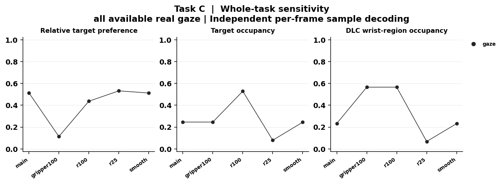

**数据范围：** v3，`real_all / 五种情景 / gaze`，图位于 `decoded_sample`。本图来源仍是真实 gaze，不是该解码器的模型轨迹。

横轴为五种预设分析设置，不是连续时间；三个面板比较 C、target 和腕部占用。

| 情景 | C % [CI] | Target % [CI] | 腕部 % [CI] |
| --- | --- | --- | --- |
| main | 51.42 [44.18, 59.28] | 24.60 [21.11, 27.72] | 23.28 [19.87, 26.61] |
| r25 | 53.19 [46.64, 60.09] | 7.95 [6.52, 9.27] | 6.80 [5.31, 8.45] |
| r100 | 43.72 [35.90, 51.52] | 52.87 [47.04, 57.97] | 56.58 [51.15, 61.60] |
| gripper100 | 11.34 [7.75, 15.09] | 24.60 [21.11, 27.72] | 56.58 [51.15, 61.60] |
| smooth | 51.25 [43.83, 59.21] | 24.46 [20.98, 27.56] | 23.17 [19.81, 26.53] |

各情景均不按 valid 筛帧。非对称扩大腕部会改变可分辨区域及几何机会，不能把 C 改变当作同一指标下行为反转；smooth 同时含短缺口插值和平滑，不是观测精度验证。

对应数值：[group_stage_summary.csv](20261105T063658759189Z_v3_full/decoded_sample/group_stage_summary.csv)、[performance_correlations.csv](20261105T063658759189Z_v3_full/decoded_sample/performance_correlations.csv)、[repetition_contrasts.csv](20261105T063658759189Z_v3_full/decoded_sample/repetition_contrasts.csv)。

## 附录：现行叠加与区域审计（29张）

此附录展示 v3 目录内的叠加图与被沿用的候选审计材料。审计不是空间精度真值，也不证明完整视频的器械可见性。候选端点没有替换主分析的腕部坐标。

### 主分析叠加：User1_1_1_grab_ring

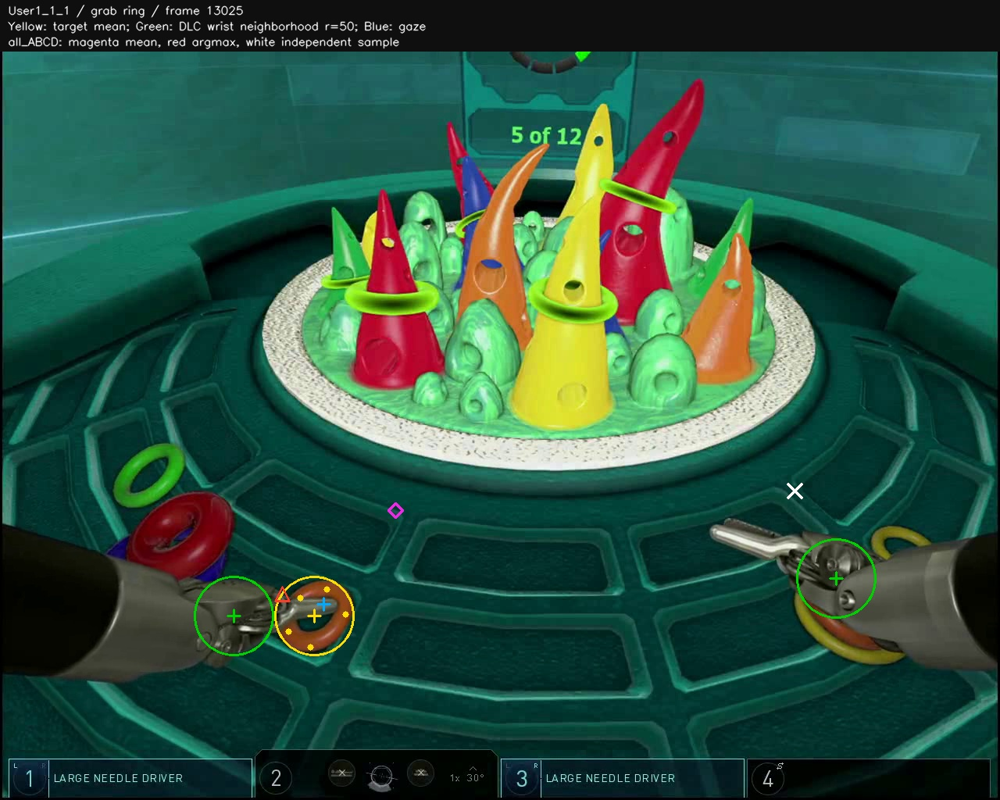

黄色为 target 均值与50px邻域，绿色为双侧 DLC 腕部50px邻域，蓝色为真实 gaze；紫色菱形、红色三角和白色叉分别表示示例模型期望点、argmax及独立随机样本。图像用于检查几何关系，单帧不能代表阶段占用或五模型排名；坐标在画面内也不保证实际器械可见。

### 主分析叠加：User1_1_1_place_ring

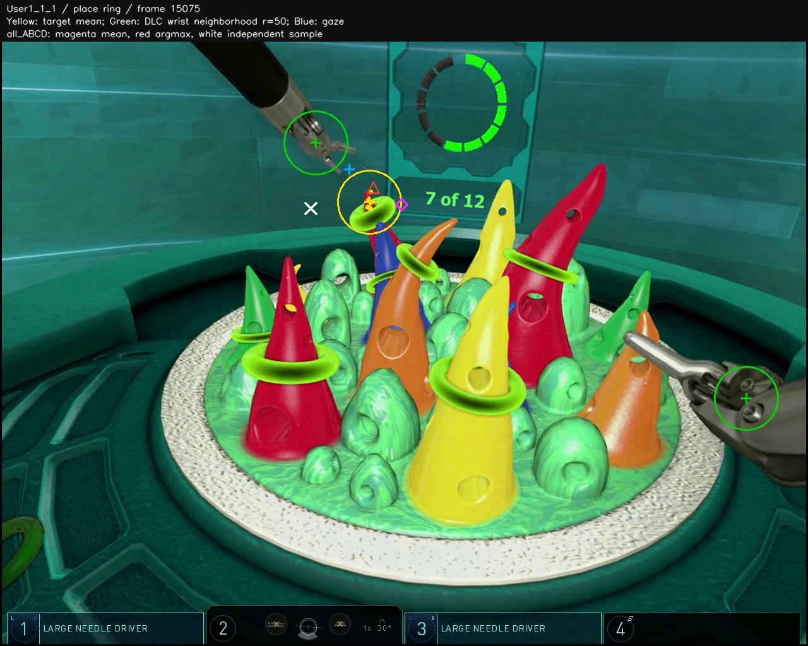

黄色为 target 均值与50px邻域，绿色为双侧 DLC 腕部50px邻域，蓝色为真实 gaze；紫色菱形、红色三角和白色叉分别表示示例模型期望点、argmax及独立随机样本。图像用于检查几何关系，单帧不能代表阶段占用或五模型排名；坐标在画面内也不保证实际器械可见。

### 主分析叠加：User1_1_1_reach_ring

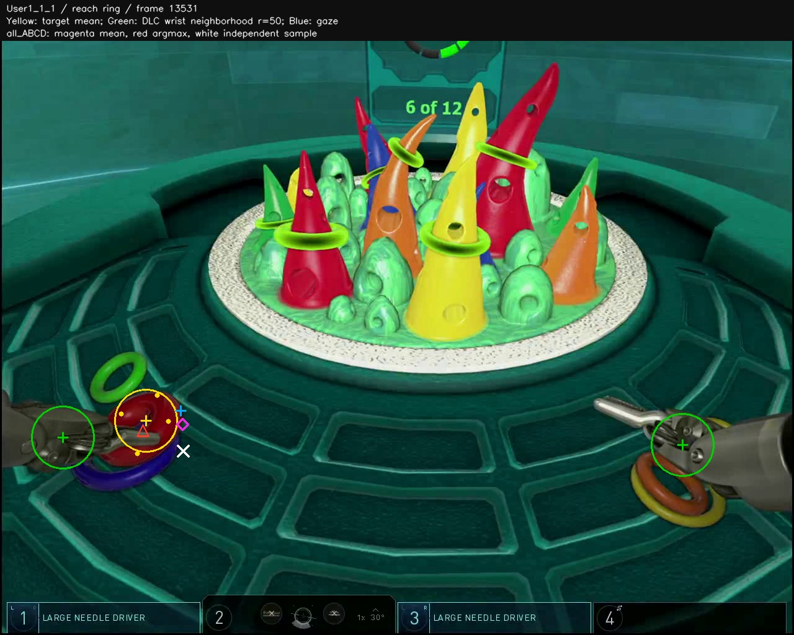

黄色为 target 均值与50px邻域，绿色为双侧 DLC 腕部50px邻域，蓝色为真实 gaze；紫色菱形、红色三角和白色叉分别表示示例模型期望点、argmax及独立随机样本。图像用于检查几何关系，单帧不能代表阶段占用或五模型排名；坐标在画面内也不保证实际器械可见。

### 主分析叠加：User1_1_1_transfer_ring

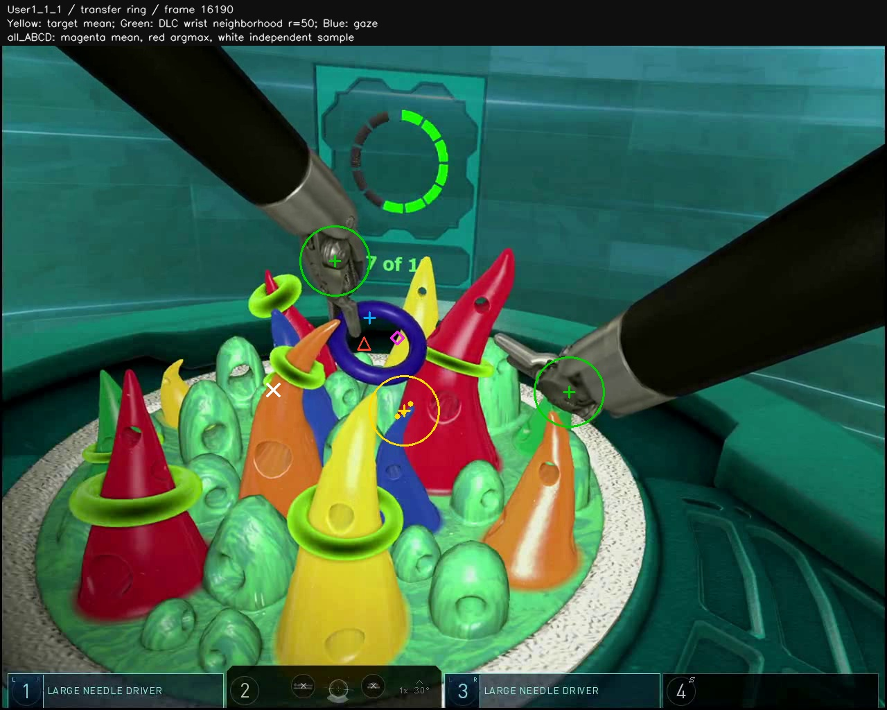

黄色为 target 均值与50px邻域，绿色为双侧 DLC 腕部50px邻域，蓝色为真实 gaze；紫色菱形、红色三角和白色叉分别表示示例模型期望点、argmax及独立随机样本。图像用于检查几何关系，单帧不能代表阶段占用或五模型排名；坐标在画面内也不保证实际器械可见。

### 主分析叠加：User1_5_2_pull_through_and_cinch

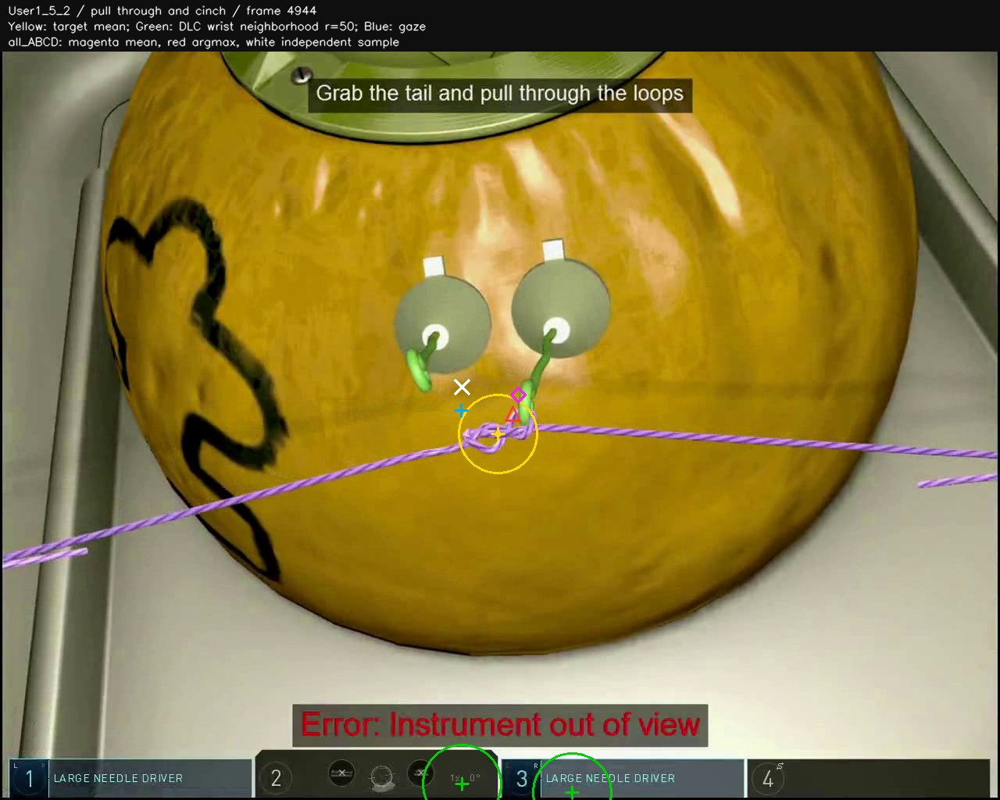

黄色为 target 均值与50px邻域，绿色为双侧 DLC 腕部50px邻域，蓝色为真实 gaze；紫色菱形、红色三角和白色叉分别表示示例模型期望点、argmax及独立随机样本。图像用于检查几何关系，单帧不能代表阶段占用或五模型排名；坐标在画面内也不保证实际器械可见。

### 主分析叠加：User1_5_2_reach_string

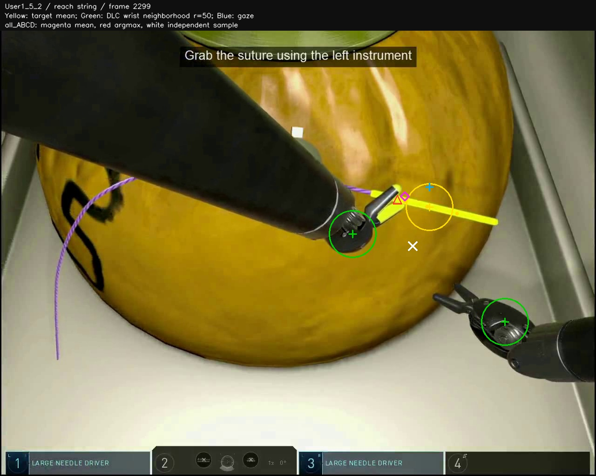

黄色为 target 均值与50px邻域，绿色为双侧 DLC 腕部50px邻域，蓝色为真实 gaze；紫色菱形、红色三角和白色叉分别表示示例模型期望点、argmax及独立随机样本。图像用于检查几何关系，单帧不能代表阶段占用或五模型排名；坐标在画面内也不保证实际器械可见。

### 主分析叠加：User1_5_2_threading_string_through_tower

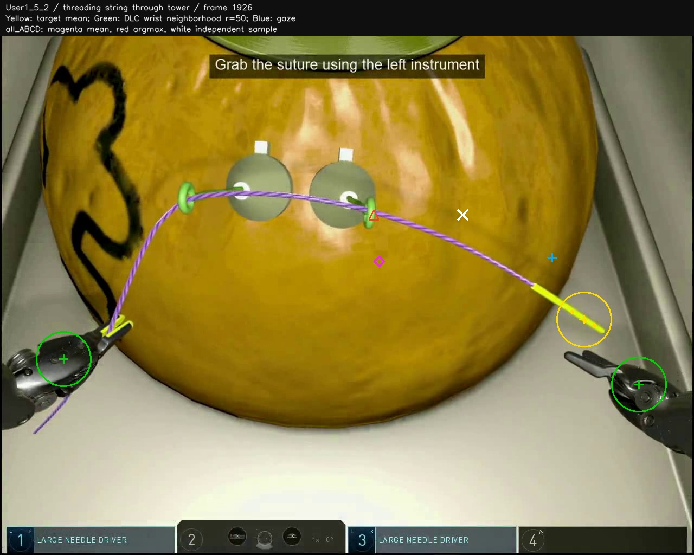

黄色为 target 均值与50px邻域，绿色为双侧 DLC 腕部50px邻域，蓝色为真实 gaze；紫色菱形、红色三角和白色叉分别表示示例模型期望点、argmax及独立随机样本。图像用于检查几何关系，单帧不能代表阶段占用或五模型排名；坐标在画面内也不保证实际器械可见。

### 主分析叠加：User1_5_2_wrap_around_psm

黄色为 target 均值与50px邻域，绿色为双侧 DLC 腕部50px邻域，蓝色为真实 gaze；紫色菱形、红色三角和白色叉分别表示示例模型期望点、argmax及独立随机样本。图像用于检查几何关系，单帧不能代表阶段占用或五模型排名；坐标在画面内也不保证实际器械可见。

候选验收共 16 帧、32 个侧别候选，几何放行 19 个，其中视觉记录为大致符合可见远端 11 个、错误近端 4 个、有歧义 4 个；双侧均放行 5 帧。没有独立人工参考坐标，不能换算成泛化错误率或定位准确度。

### 候选审计：contact_0

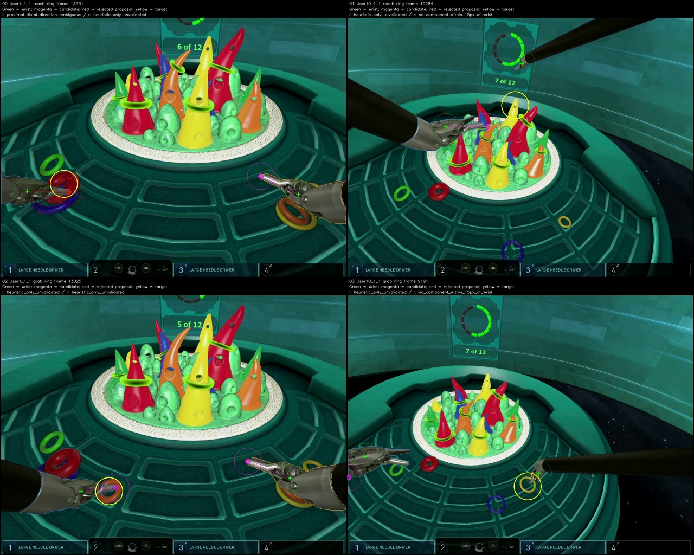

此拼图重复展示对应候选样例，不增加独立审计帧数。请结合单张样例及逐侧视觉记录区分：几何拒绝、错误近端、遮挡或语义歧义。

### 候选审计：contact_1

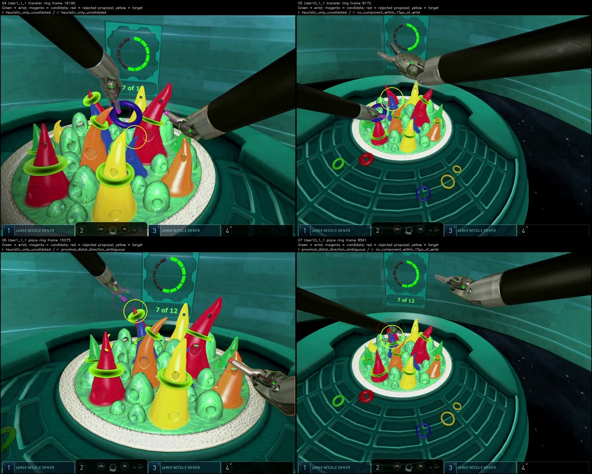

此拼图重复展示对应候选样例，不增加独立审计帧数。请结合单张样例及逐侧视觉记录区分：几何拒绝、错误近端、遮挡或语义歧义。

### 候选审计：contact_2

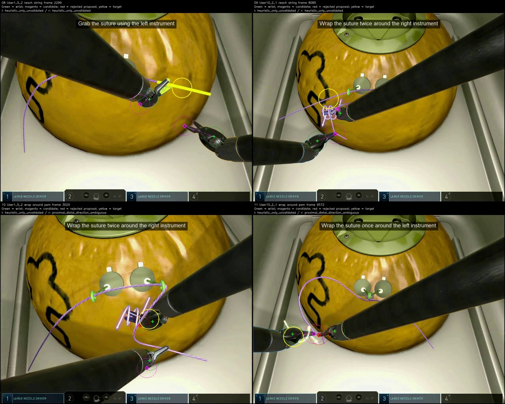

此拼图重复展示对应候选样例，不增加独立审计帧数。请结合单张样例及逐侧视觉记录区分：几何拒绝、错误近端、遮挡或语义歧义。

### 候选审计：contact_3

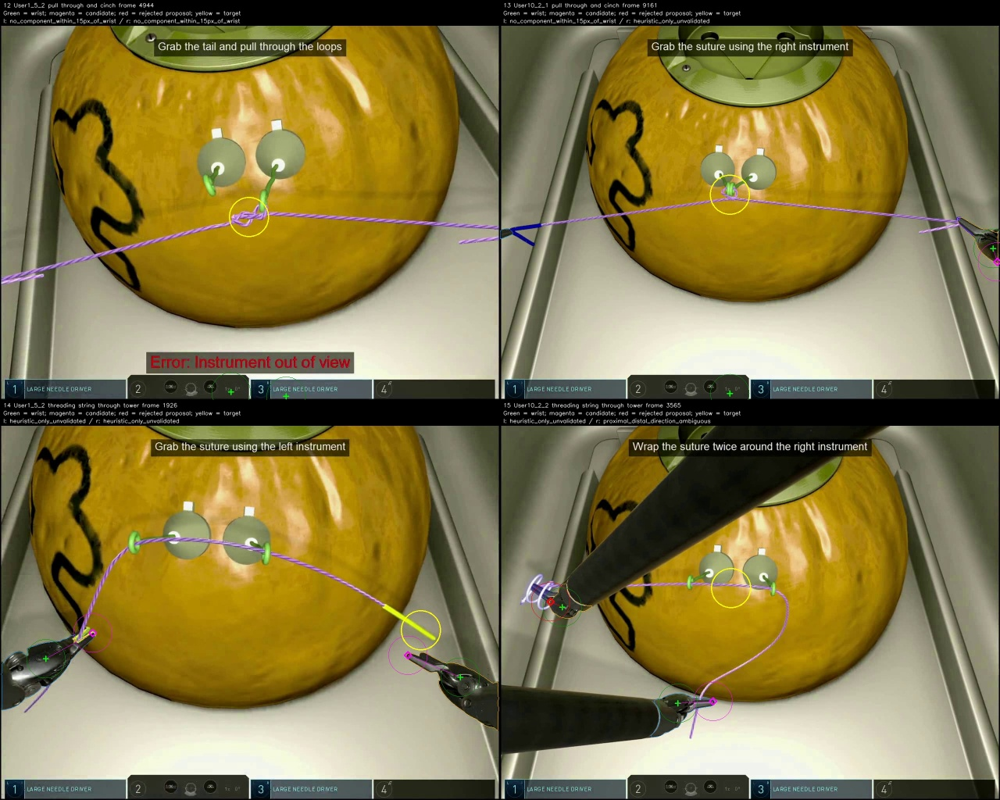

此拼图重复展示对应候选样例，不增加独立审计帧数。请结合单张样例及逐侧视觉记录区分：几何拒绝、错误近端、遮挡或语义歧义。

### 候选审计：mask_format_preview

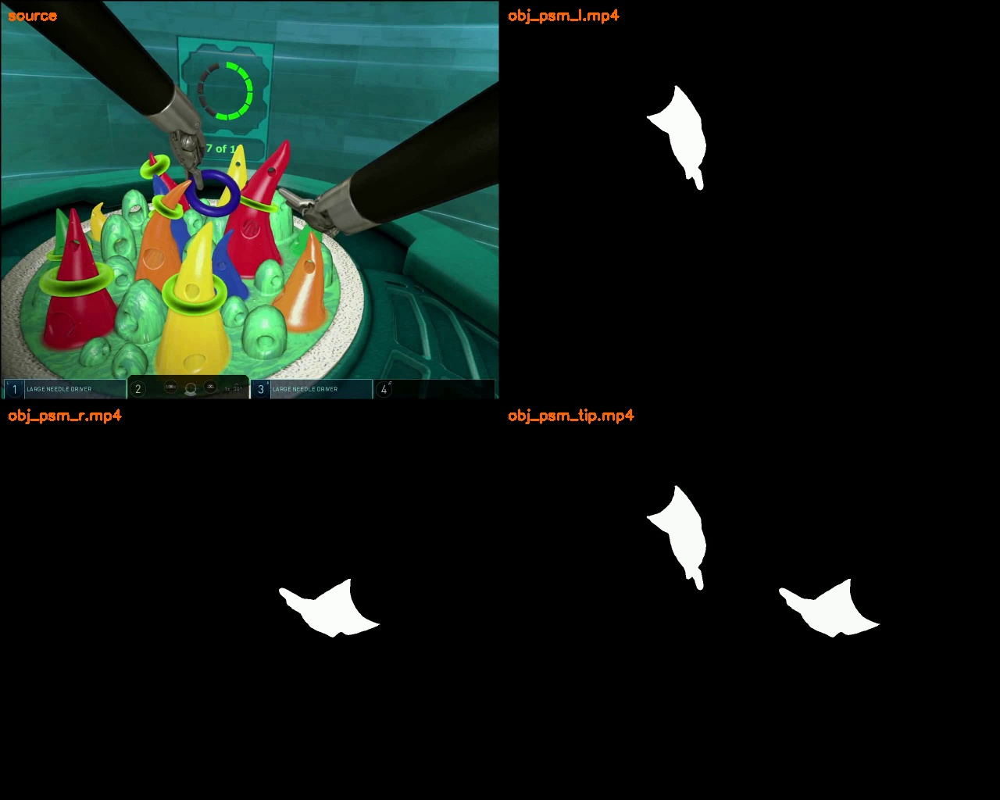

Mask格式预览用于辨识视频与左右器械分割内容。包含较大腕部或金属结构的掩码不是一个经过验证的jaw-tip坐标；尺寸/帧数匹配不等于逐帧语义和同步验收。

### 候选审计：sample_00_User1_1_1_reach_ring

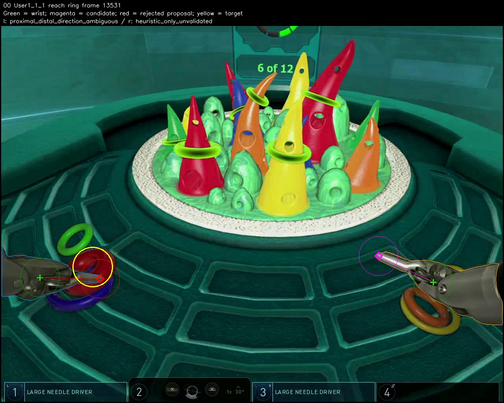

| content_id | stage | frame_number | side | accepted | visual_status | visual_note |
| --- | --- | --- | --- | --- | --- | --- |
| User1_1_1 | reach ring | 13531 | l | False | rejected_plausible_distal | Proposed red endpoint appears distal; abstention from weak axial sign. |
| User1_1_1 | reach ring | 13531 | r | True | consistent_visible_distal | Closed visible right jaw; candidate appears near distal endpoint. |

表中视觉状态是该样例既有人工复核记录；几何通过不是jaw-tip真值。需统一端点定义、独立标注与遮挡规则后才能替换主分析腕部。

### 候选审计：sample_01_User10_1_1_reach_ring

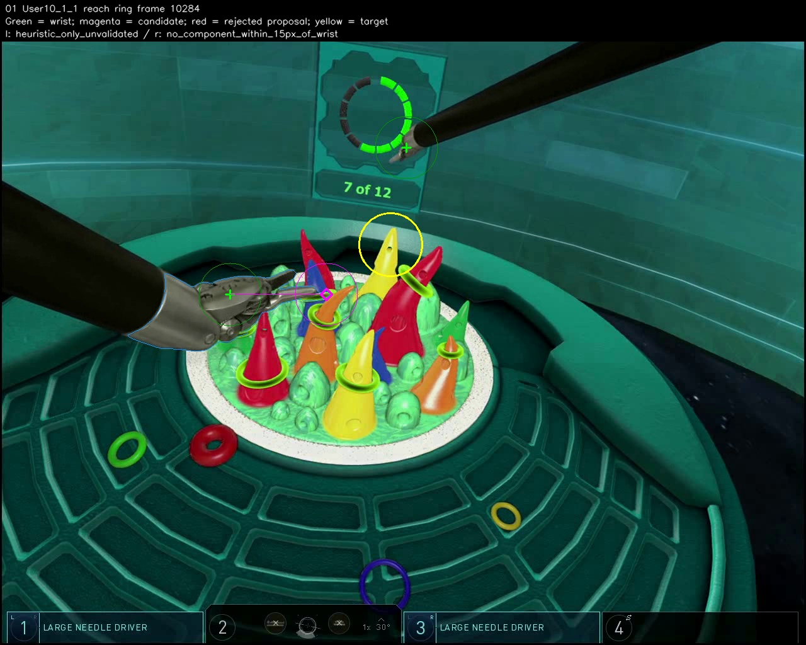

| content_id | stage | frame_number | side | accepted | visual_status | visual_note |
| --- | --- | --- | --- | --- | --- | --- |
| User10_1_1 | reach ring | 10284 | l | True | consistent_visible_distal | Candidate appears near distal endpoint of visible left jaw. |
| User10_1_1 | reach ring | 10284 | r | False | rejected_not_visible | Visible black shaft but identifiable distal metal jaw not available near DLC point. |

表中视觉状态是该样例既有人工复核记录；几何通过不是jaw-tip真值。需统一端点定义、独立标注与遮挡规则后才能替换主分析腕部。

### 候选审计：sample_02_User1_1_1_grab_ring

| content_id | stage | frame_number | side | accepted | visual_status | visual_note |
| --- | --- | --- | --- | --- | --- | --- |
| User1_1_1 | grab ring | 13025 | l | True | consistent_visible_distal | Candidate appears near visible ring-grasping distal endpoint. |
| User1_1_1 | grab ring | 13025 | r | True | consistent_visible_distal | Closed visible right jaw; candidate appears near distal endpoint. |

表中视觉状态是该样例既有人工复核记录；几何通过不是jaw-tip真值。需统一端点定义、独立标注与遮挡规则后才能替换主分析腕部。

### 候选审计：sample_03_User10_1_1_grab_ring

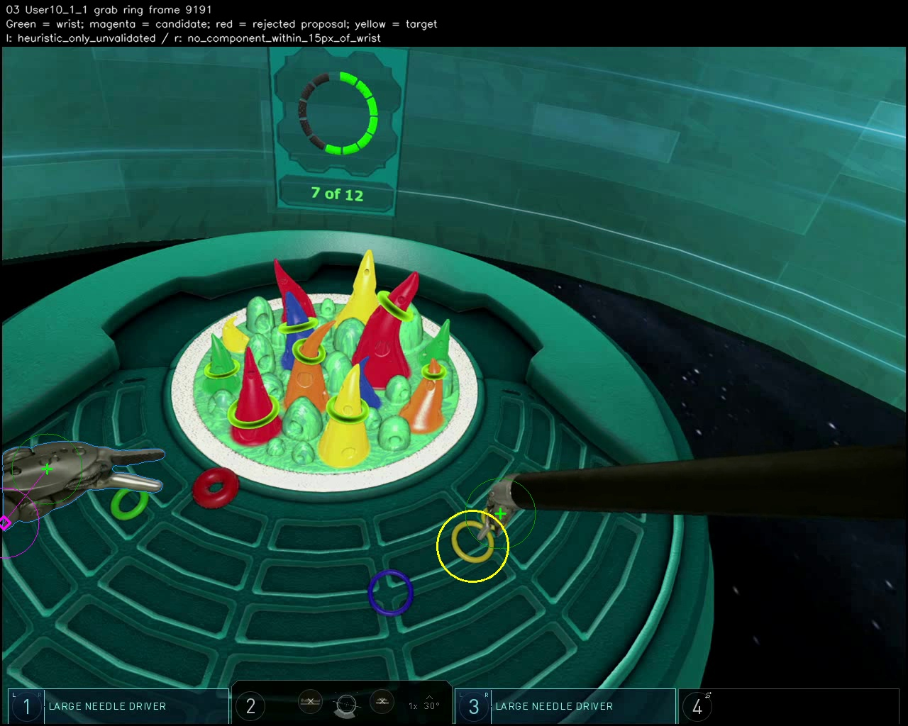

| content_id | stage | frame_number | side | accepted | visual_status | visual_note |
| --- | --- | --- | --- | --- | --- | --- |
| User10_1_1 | grab ring | 9191 | l | True | wrong_proximal | Accepted candidate at left image boundary; visible open jaws extend to the right. |
| User10_1_1 | grab ring | 9191 | r | False | rejected_not_visible | No visible distal metal jaw near DLC point on apparent black shaft end. |

表中视觉状态是该样例既有人工复核记录；几何通过不是jaw-tip真值。需统一端点定义、独立标注与遮挡规则后才能替换主分析腕部。

### 候选审计：sample_04_User1_1_1_transfer_ring

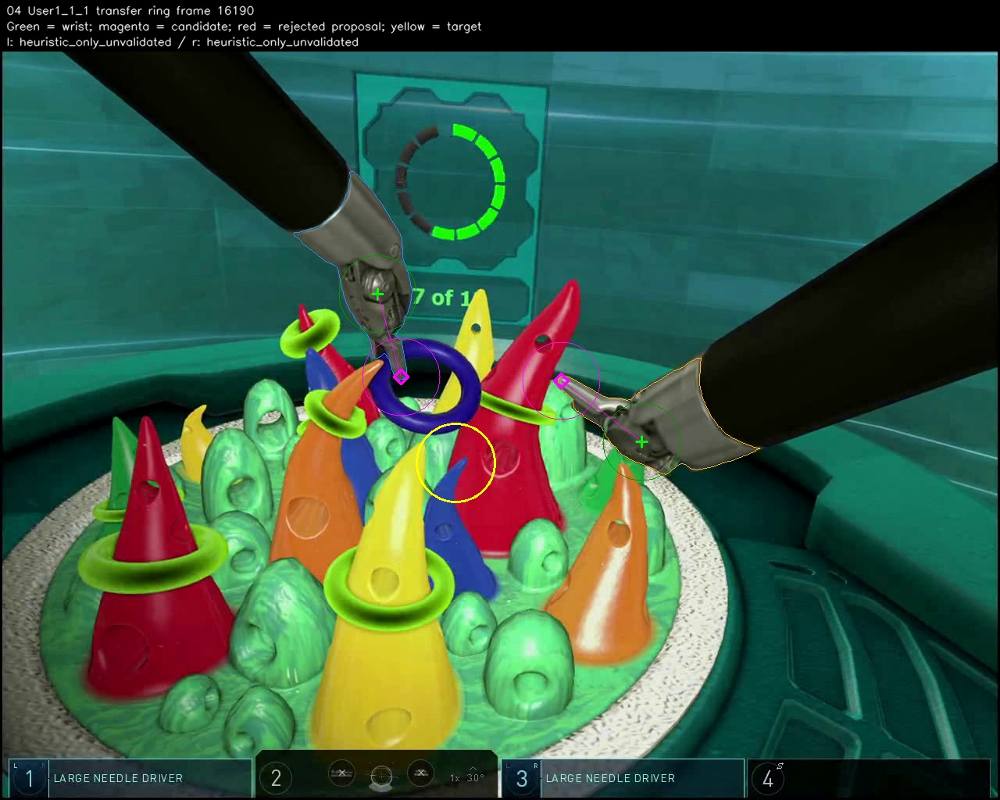

| content_id | stage | frame_number | side | accepted | visual_status | visual_note |
| --- | --- | --- | --- | --- | --- | --- |
| User1_1_1 | transfer ring | 16190 | l | True | consistent_visible_distal | Candidate appears at distal jaw within purple ring. |
| User1_1_1 | transfer ring | 16190 | r | True | consistent_visible_distal | Candidate appears near visible closed right jaw endpoint. |

表中视觉状态是该样例既有人工复核记录；几何通过不是jaw-tip真值。需统一端点定义、独立标注与遮挡规则后才能替换主分析腕部。

### 候选审计：sample_05_User10_1_1_transfer_ring

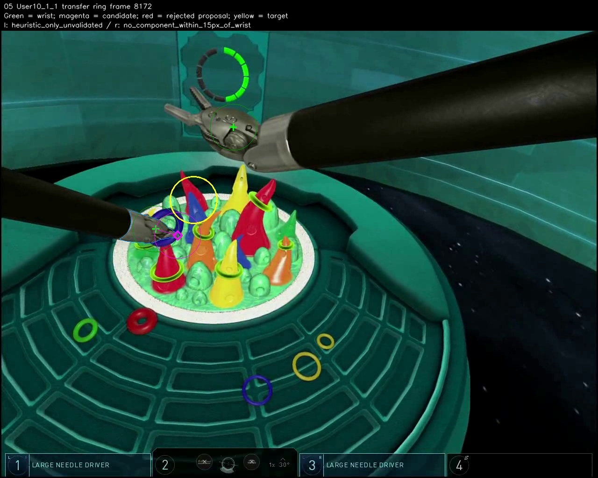

| content_id | stage | frame_number | side | accepted | visual_status | visual_note |
| --- | --- | --- | --- | --- | --- | --- |
| User10_1_1 | transfer ring | 8172 | l | True | consistent_visible_distal | Candidate appears near visible distal jaw beside ring; no reference coordinate available. |
| User10_1_1 | transfer ring | 8172 | r | False | rejected_missing_segment | Visible right metal instrument has no matching segmented component near wrist. |

表中视觉状态是该样例既有人工复核记录；几何通过不是jaw-tip真值。需统一端点定义、独立标注与遮挡规则后才能替换主分析腕部。

### 候选审计：sample_06_User1_1_1_place_ring

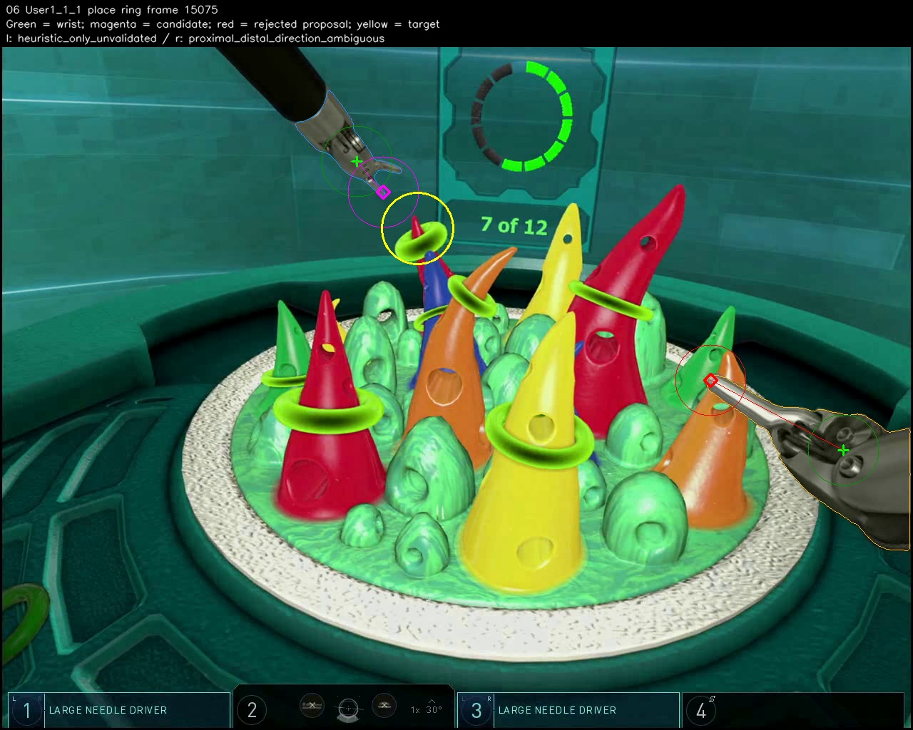

| content_id | stage | frame_number | side | accepted | visual_status | visual_note |
| --- | --- | --- | --- | --- | --- | --- |
| User1_1_1 | place ring | 15075 | l | True | ambiguous | Open jaws: candidate selects one prong; canonical jawtip versus midpoint undefined. |
| User1_1_1 | place ring | 15075 | r | False | rejected_plausible_distal | Proposed red endpoint appears distal; weak axial sign causes rejection. |

表中视觉状态是该样例既有人工复核记录；几何通过不是jaw-tip真值。需统一端点定义、独立标注与遮挡规则后才能替换主分析腕部。

### 候选审计：sample_07_User10_1_1_place_ring

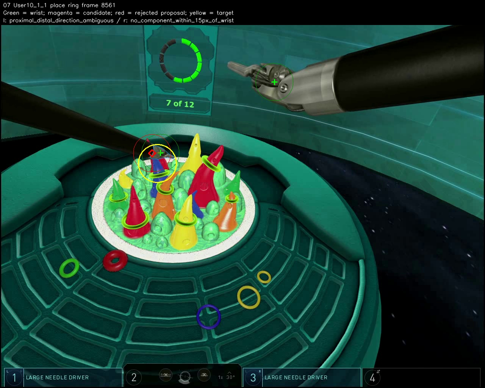

| content_id | stage | frame_number | side | accepted | visual_status | visual_note |
| --- | --- | --- | --- | --- | --- | --- |
| User10_1_1 | place ring | 8561 | l | False | ambiguous | Rejected direction; foreshortened tool and ring obscure distal geometry. |
| User10_1_1 | place ring | 8561 | r | False | rejected_missing_segment | Visible metal instrument lacks matching component near wrist. |

表中视觉状态是该样例既有人工复核记录；几何通过不是jaw-tip真值。需统一端点定义、独立标注与遮挡规则后才能替换主分析腕部。

### 候选审计：sample_08_User1_5_2_reach_string

| content_id | stage | frame_number | side | accepted | visual_status | visual_note |
| --- | --- | --- | --- | --- | --- | --- |
| User1_5_2 | reach string | 2299 | l | True | wrong_proximal | Accepted candidate selects wrist underside; visible jaws extend upper-right. |
| User1_5_2 | reach string | 2299 | r | True | consistent_visible_distal | Candidate appears near closed distal endpoint. |

表中视觉状态是该样例既有人工复核记录；几何通过不是jaw-tip真值。需统一端点定义、独立标注与遮挡规则后才能替换主分析腕部。

### 候选审计：sample_09_User10_2_1_reach_string

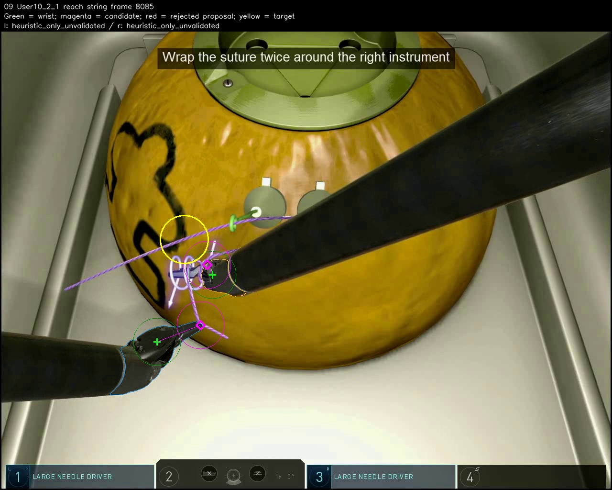

| content_id | stage | frame_number | side | accepted | visual_status | visual_note |
| --- | --- | --- | --- | --- | --- | --- |
| User10_2_1 | reach string | 8085 | l | True | consistent_visible_distal | Candidate appears near distal jaw grasping suture. |
| User10_2_1 | reach string | 8085 | r | True | ambiguous | Foreshortened jaw and surrounding loops prevent reliable anatomical endpoint judgment. |

表中视觉状态是该样例既有人工复核记录；几何通过不是jaw-tip真值。需统一端点定义、独立标注与遮挡规则后才能替换主分析腕部。

### 候选审计：sample_10_User1_5_2_wrap_around_psm

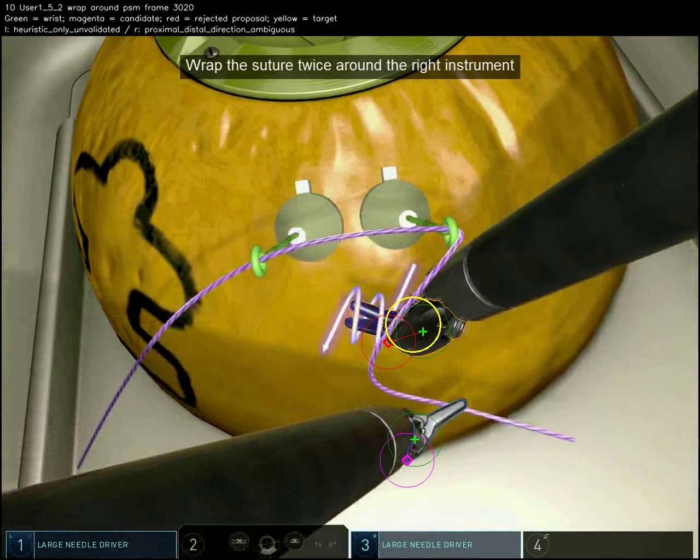

| content_id | stage | frame_number | side | accepted | visual_status | visual_note |
| --- | --- | --- | --- | --- | --- | --- |
| User1_5_2 | wrap around psm | 3020 | l | True | wrong_proximal | Accepted candidate selects proximal underside; visible jaw extends upper-right. |
| User1_5_2 | wrap around psm | 3020 | r | False | ambiguous | Rejected candidate lies by jaw and loops; exact jawtip is not established. |

表中视觉状态是该样例既有人工复核记录；几何通过不是jaw-tip真值。需统一端点定义、独立标注与遮挡规则后才能替换主分析腕部。

### 候选审计：sample_11_User10_2_1_wrap_around_psm

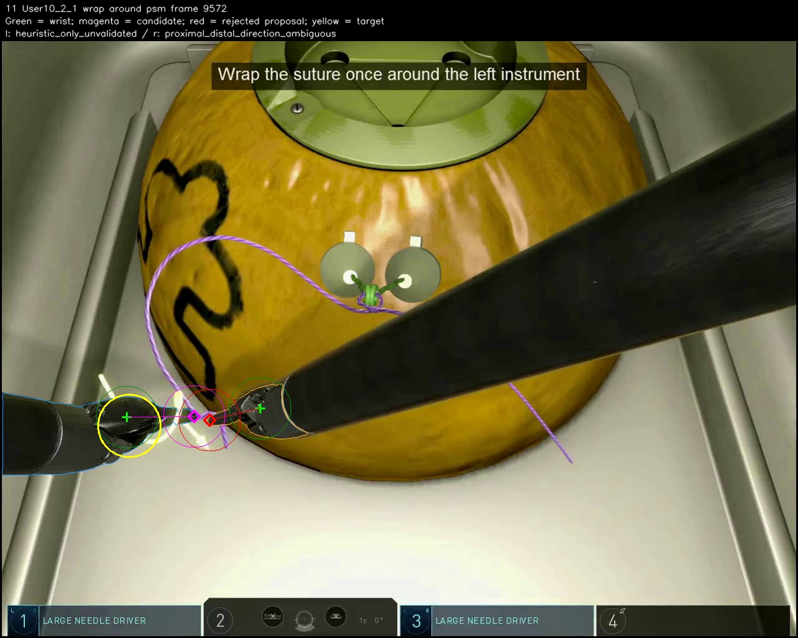

| content_id | stage | frame_number | side | accepted | visual_status | visual_note |
| --- | --- | --- | --- | --- | --- | --- |
| User10_2_1 | wrap around psm | 9572 | l | True | ambiguous | Instruments and suture cross at candidate; exact jawtip is not established. |
| User10_2_1 | wrap around psm | 9572 | r | False | rejected_plausible_distal | Proposed endpoint is plausibly distal but instruments overlap and sign is weak. |

表中视觉状态是该样例既有人工复核记录；几何通过不是jaw-tip真值。需统一端点定义、独立标注与遮挡规则后才能替换主分析腕部。

### 候选审计：sample_12_User1_5_2_pull_through_and_cinch

| content_id | stage | frame_number | side | accepted | visual_status | visual_note |
| --- | --- | --- | --- | --- | --- | --- |
| User1_5_2 | pull through and cinch | 4944 | l | False | rejected_not_visible | Instrument-out-of-view simulator warning; DLC point is on bottom HUD. |
| User1_5_2 | pull through and cinch | 4944 | r | False | rejected_not_visible | Instrument-out-of-view simulator warning; DLC point is on bottom HUD. |

表中视觉状态是该样例既有人工复核记录；几何通过不是jaw-tip真值。需统一端点定义、独立标注与遮挡规则后才能替换主分析腕部。

### 候选审计：sample_13_User10_2_1_pull_through_and_cinch

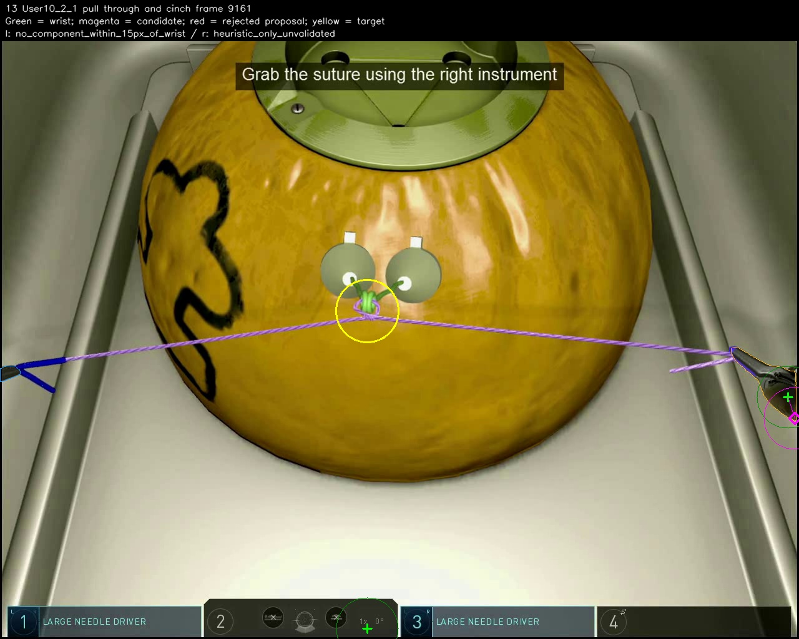

| content_id | stage | frame_number | side | accepted | visual_status | visual_note |
| --- | --- | --- | --- | --- | --- | --- |
| User10_2_1 | pull through and cinch | 9161 | l | False | rejected_not_visible | DLC point lies on bottom HUD; only small instrument portion appears at left image edge. |
| User10_2_1 | pull through and cinch | 9161 | r | True | wrong_proximal | Accepted point is at lower image-edge collar; visible jaw extends upper-left. |

表中视觉状态是该样例既有人工复核记录；几何通过不是jaw-tip真值。需统一端点定义、独立标注与遮挡规则后才能替换主分析腕部。

### 候选审计：sample_14_User1_5_2_threading_string_through_tower

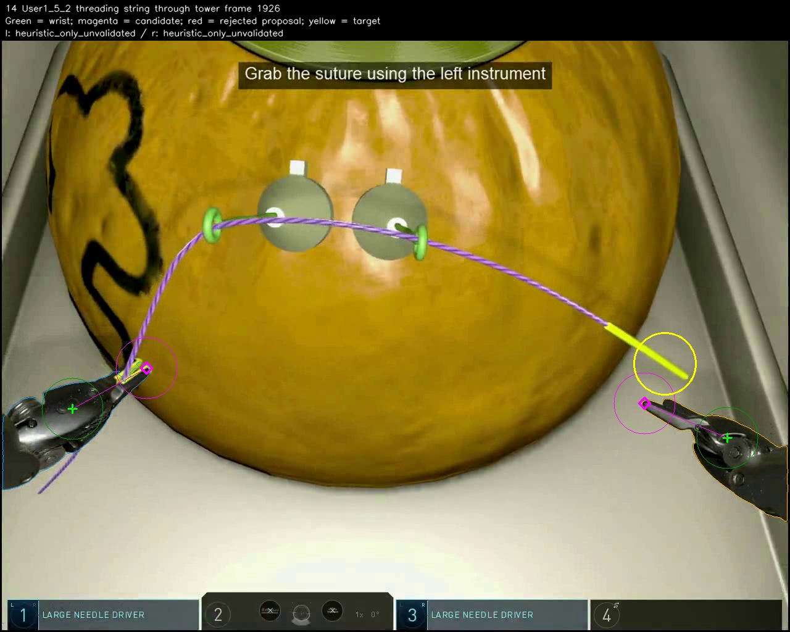

| content_id | stage | frame_number | side | accepted | visual_status | visual_note |
| --- | --- | --- | --- | --- | --- | --- |
| User1_5_2 | threading string through tower | 1926 | l | True | ambiguous | Open jaws and suture; candidate may select one prong rather than canonical jaw midpoint. |
| User1_5_2 | threading string through tower | 1926 | r | True | consistent_visible_distal | Candidate appears near visible closed distal jaw endpoint. |

表中视觉状态是该样例既有人工复核记录；几何通过不是jaw-tip真值。需统一端点定义、独立标注与遮挡规则后才能替换主分析腕部。

### 候选审计：sample_15_User10_2_2_threading_string_through_tower

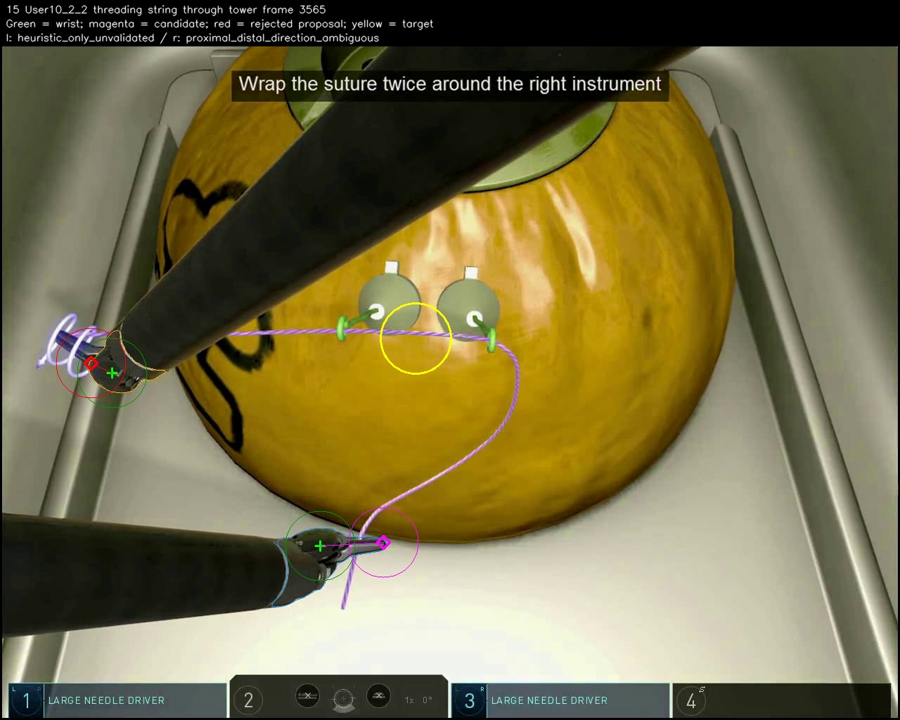

| content_id | stage | frame_number | side | accepted | visual_status | visual_note |
| --- | --- | --- | --- | --- | --- | --- |
| User10_2_2 | threading string through tower | 3565 | l | True | consistent_visible_distal | Candidate appears near visible distal endpoint. |
| User10_2_2 | threading string through tower | 3565 | r | False | ambiguous | Rejected candidate near foreshortened jaw with loops; anatomical endpoint ambiguous. |

表中视觉状态是该样例既有人工复核记录；几何通过不是jaw-tip真值。需统一端点定义、独立标注与遮挡规则后才能替换主分析腕部。

审计来源：[视觉记录](20261105T063658759189Z_v3_full/region_review/candidate_validation/visual_review.csv)、[验收汇总](20261105T063658759189Z_v3_full/region_review/candidate_validation/validation_summary.json)、[区域几何清单](20261105T063658759189Z_v3_full/region_review/occurrence_geometry_flags.csv)。

## 复核依据与当前版本边界

v3 独立验证核对 818,734 个坐标合格帧、9,400 行真实 gaze 统计、1,125 项概率试次以及 44,800 项采样帧区域。共同帧、面积/占用守恒、NA分母、drop ring排除等检查通过。它们验证计算一致性，不证明区域语义、校准精度或行为解释。

[运行配置](20261105T063658759189Z_v3_full/run_config.json) · [输入审计](20261105T063658759189Z_v3_full/recording_audit.csv) · [分析内置验证](20261105T063658759189Z_v3_full/validation.json) · [独立验证](20261105T063658759189Z_v3_full/independent_validation.json) · [文件清单](20261105T063658759189Z_v3_full/output_index.csv)。历史 v2 见 [原报告](20261105T063658759189Z_v2_full/report.md)。
