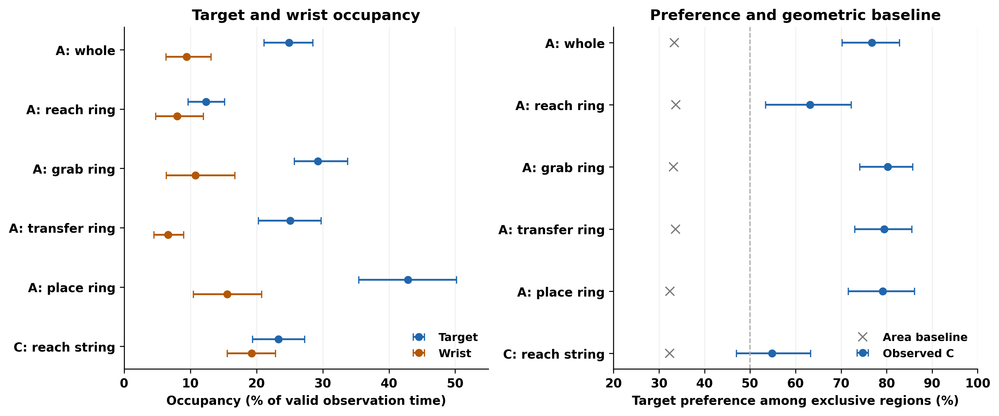
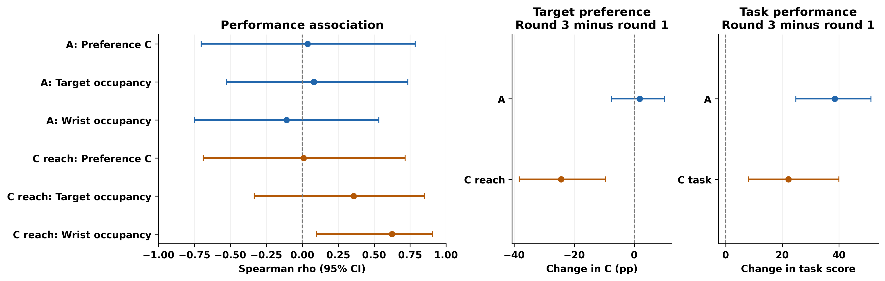

# GT84：目标锁定能否代表高质量注视？

**总论：目标锁定描述任务和阶段相关的注视分配，目前不能作为“越高越好”的通用技能或专家注视指标。A 呈目标邻域偏好；C reach string 的原始目标—腕部差方向不确定，但相对面积基线仍有目标富集。成绩提高可以与目标偏好下降并存。**

**版本与范围。** 本文更新至 v3（`20261105T063658759189Z_v3_full`），沿用原论文摘要范围：Task A（Sea Spikes）为 reach/grab/transfer/place ring 四阶段整体；Task C（Knot-tying）仅为 reach string。wrap、cinch、threading 的结果列在详细版补充范围，不能与本文 C 的数值混用。这是既定的范围选择，不是按本次结果择优选阶段。详细版同时提供与本文一致的 reach-string 证据。

**v3 gaze 规则。** 直接读取结构化 `UserN/npy/<ID>_gaze.npy` 的 `gaze_x`、`gaze_y`，按原视频 `Frame_Number` 匹配。仅要求两坐标有限且位于闭区间 `[0,1]`；不限制 `valid` 的取值。阶段、目标及双侧 DLC 几何条件继续生效，模型比较另取五模型共同有效帧。主分析及半径敏感性使用原始 gaze；平滑分支为独立敏感性。

GT84 包含 84 段录像、11 名参与者（A 33 段、C 51 段），不是 84 名独立被试。C reach string 的联合有效帧覆盖为 84.0%；占用可用 51 段，成绩相关可用 50 段。

**统计口径。** target 是有效目标槽位均值周围 50 px 圆盘，PSM 是左右 DLC 腕部/铰接点 50 px 邻域并集；两者均非完整物体 mask 或经验证的夹爪尖端。T/P/O 分别为目标独占、腕部独占、重叠：L_target=L_T+L_O，L_gripper=L_P+L_O，C=L_T/(L_T+L_P)，分母为 0 时不可估。先按原生时长计算每录像指标，再在参与者内、参与者间等权；方括号为 10,000 次参与者 bootstrap 的 95% CI（seed=42），pp 为百分点。CI 未校正多重比较；跨 0 不等于证实无效，极靠近 0 的端点不宜作稳定的二分结论。

C_U 为均匀画面落点下独占目标面积比例，C_excess=C−C_U；B=L_target−L_gripper。面积修正控制空间机会，不是技能校正。成绩关系使用参与者指标与 SimNow 任务总分的 Spearman ρ。

## 结论一：目标偏好依赖任务与动作，不能用同一阈值定义高质量注视

| 指标 | A 四阶段整体，n=11 | C reach string，n=11 |
|---|---|---|
| 目标占用 % | 24.89 [21.13, 28.52] | 23.33 [19.41, 27.28] |
| 腕部占用 % | 9.45 [6.33, 13.14] | 19.25 [15.57, 22.86] |
| 目标偏好 C % | 76.74 [70.23, 82.84] | 54.87 [47.03, 63.30] |
| 目标−腕部占用，pp | 15.45 [11.14, 19.59] | 4.07 [-0.10, 8.91] |
| 超出面积基线的偏好，pp | 43.39 [37.17, 49.24] | 22.54 [14.84, 30.84] |

A 的目标−腕部占用差为 15.45 [11.14, 19.59] pp，区间为正。A 的 target 占用在 reach ring 为 12.38%，place ring 为 42.89%；这是阶段描述，未据此宣称阶段间配对差显著。

C reach string 的 C 为 54.87 [47.03, 63.30]%，区间跨 50%；target−腕部差为 4.07 [-0.10, 8.91] pp，区间跨 0，不能确认原始占用更偏目标。但 C_U 为 32.33%，C_excess 为 22.54 [14.84, 30.84] pp，支持相对均匀空间机会的目标富集。

[矢量 PDF](paper_summary_figures/G1_task_and_phase_dependence.pdf)

**图1图注。** 左图为 target 与腕部占用；右图为 C 与面积基线，50% 虚线表示目标/腕部独占占用相等。点及误差线为参与者均值和 95% CI；A whole 仅作四阶段汇总，C 仅 reach string；未进行跨任务配对差检验。

## 结论二：目标锁定尚未被验证为表现越好数值越高的指标

| 与任务成绩的相关 ρ [95% CI] | A 整体 | C reach string |
|---|---|---|
| 目标偏好 C | 0.036 [-0.702, 0.785] | 0.009 [-0.687, 0.715] |
| 目标占用 | 0.082 [-0.528, 0.735] | 0.358 [-0.334, 0.848] |
| 腕部占用 | -0.109 [-0.748, 0.533] | 0.624 [0.100, 0.906] |

两项范围的 C、target 占用与表现关系区间均跨 0，未提供明确方向的证据；宽区间也不能证明绝对无关。不能把高 C 或高 target 占用直接定义为专家式注视。

C reach string 腕部占用存在探索性正相关，逐人留出范围 0.553–0.736；但该关联对分析设置敏感。当前五情景中，3 个（r25, r100, gripper100）的 CI 跨 0。它不能作为稳定技能指标或“注视腕部导致更好成绩”的证据。

| v3 情景 | C reach string 腕部占用—成绩 ρ [95% CI] |
|---|---|
| main | 0.624 [0.100, 0.906] |
| r25 | 0.587 [-0.084, 0.944] |
| r100 | 0.569 [-0.049, 0.841] |
| gripper100 | 0.569 [-0.049, 0.841] |
| smooth | 0.624 [0.100, 0.906] |

**成绩支持与失败录像。** C 的 50 条有成绩录像中，16 条为 Failed 且记 0 分；第 1 轮失败 9/18，第 3 轮 3/14。因此成绩变化同时包含任务完成状况和得分变化，不能单独解释为成功录像中的熟练度提升；相关分析的参与者均分也包含这些 0 分。另有一条 NotAttempted 无成绩。

## 结论三：练习中的成绩提升不要求目标锁定同步增强

| 同人第3轮−第1轮 | A 四阶段整体 | C reach string |
|---|---|---|
| 目标偏好 C 变化，pp | 1.83 [-7.60, 10.07] | -24.32 [-38.29, -9.64] |
| 目标占用变化，pp | -1.24 [-6.64, 3.80] | -11.34 [-17.32, -4.29] |
| 腕部占用变化，pp | -1.50 [-5.00, 2.65] | 8.26 [0.29, 15.73] |
| 任务总分变化，分 | 38.45 [24.82, 51.27] | 22.18 [8.14, 39.96] |

A 的成绩上升，而该任务的目标偏好指标 C 的变化区间跨 0。Task C 的成绩上升与 reach string 的 C、target 占用下降并存，支持“表现提升与目标锁定增强并非同义”。C 腕部变化下界为 0.29 pp，靠近 0；结合小样本与多重探索，应保留效应大小和区间，不把它单列为稳健的机制证据。

[矢量 PDF](paper_summary_figures/G2_quality_proxy_and_practice.pdf)

**图2图注。** 左图显示指标—任务总分 ρ 与 95% CI；中图为同人第3−第1轮 C 变化；右图为任务总分变化，非阶段评分。各对比匹配 11 人；A 前后各 11 段。C 注视指标 18→15 段，成绩 18→14 段，录像支持不同。并存变化不证明减少目标注视导致成绩提高。

## 对 Research Questions 的回答

| 问题 | GT84 支持的回答 |
|---|---|
| RQ1：适合动态、多模态注视的模型形式？ | 提供阶段相关的行为评价依据；本分析不能选择架构，未检验 memory、视频输入或 gaze 领先 PSM。 |
| RQ2：如何获得 higher-quality gaze，需不需要专家数据？ | 不能将高 target-locking 直接视作高质量。缺少专家参照及受控数据来源实验，无法判断新手能否替代专家监督。 |
| RQ3：跨任务是否提高低数据泛化/效率？ | GT84 提供行为参照，不直接比较训练策略；需看同一配对测试支持下的模型结果。 |

### 可用于论文的英文结果与结论段落

Observed target-directed gaze depended on task and phase. In Sea Spikes, target preference among exclusive regions was 76.74% (95% CI 70.23–82.84%). In the reach-string phase of Knot-tying, preference was 54.87% (47.03–63.30%), exceeding its geometric-area baseline by 22.54 percentage points (14.84–30.84). Neither scope yielded a clearly directed association between target preference and task performance. Across practice rounds, Knot-tying task scores increased by 22.18 points (8.14–39.96), while reach-string preference decreased by 24.32 percentage points (9.64–38.29). Scores included zero-valued failed attempts, and the exploratory wrist–performance association was sensitive to ROI settings. Target locking should therefore be treated as a context-dependent description of gaze allocation, rather than an established monotonic indicator of skill or expert-like gaze.

**证据与限制。** 11 人，小样本和多指标探索；50 px 为预设空间容差，并非独立校准的准确度。[占用](20261105T063658759189Z_v3_full/main_probability/group_stage_summary.csv) · [表现相关](20261105T063658759189Z_v3_full/main_probability/performance_correlations.csv) · [轮次差](20261105T063658759189Z_v3_full/main_probability/repetition_contrasts.csv) · [完整 GT84 详细版](gt84_analysis_zh.md) · [模型摘要](models10_vs_gt_paper_summary_zh.md)。
