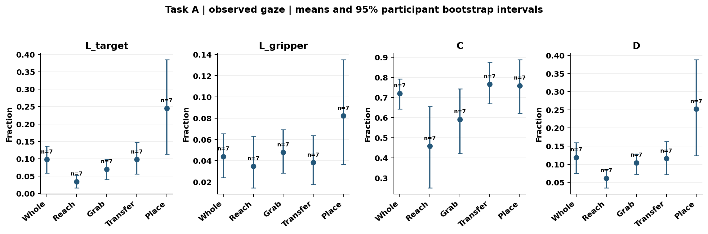
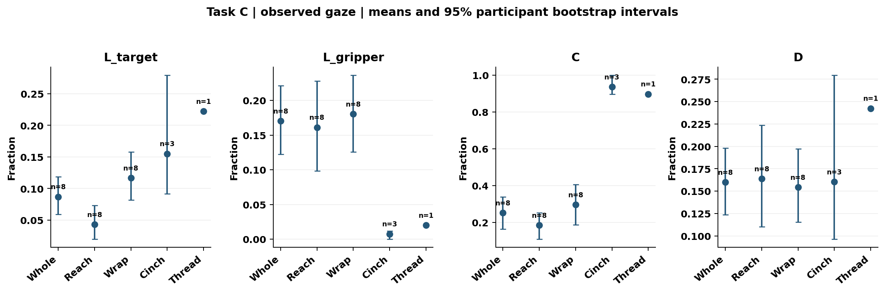

# GT16 Passive：被动观看中的目标锁定能否代表高质量注视？

**总论：目标锁定描述本批被动观看者在任务和阶段中的注视分配，尚不能作为“越高越好”的技能或专家式注视指标。main 条件下 A 四阶段整体偏向目标，C reach string 偏向腕部；这一解释依赖 ROI 定义、有效覆盖和现存数据映射。**

**版本与范围。** 本文根据 `passive` 已保存结果编写，更新日期为 2026-11-09，结构及论文范围参照 [GT84 摘要](gt84_paper_summary_zh.md)：Task A（Sea Spikes）采用 reach/grab/transfer/place ring 四阶段整体；Task C（Knot-tying）仅采用 reach string。wrap、cinch、threading 以及 C whole 见 [详细版](gt16_passive_analysis_zh.md)，不与本文 C 数值混用。文件名按指定保留 `gt84_passive_paper_summary_zh.md`，实际样本是 **16 条观看记录、8 名观看者**，不是 GT84 主动操作样本。

**数据与筛选。** 仅纳入观看者和源操作者均为 novice 的 A/C 记录；A 7 条/7 人，C 9 条/8 人，共 16 个源视频，所有 split 可纳入。gaze 来自 passive 观看者 NPY，按原始 `Frame_Number` 连接阶段、目标和双侧 DLC；仅要求 gaze 两坐标有限并在 `[0,1]`，不筛 `valid`。阶段内 main 联合有效帧覆盖 A reach ring 为 98.49%、其余三阶段 100%；C reach string 为 82.69%。现存 NPY 历史处理保留了坐标裁剪端点，gaze 可用率不能代表原始采集质量。

**统计口径与变量。** target 为有效目标槽位均值周围 50 px 圆盘；PSM 为双侧 DLC 腕部/铰接点 50 px 圆盘并集，均非完整物体 mask 或已验证夹爪尖端。T/P/O/N 为目标独占、腕部独占、重叠、两者之外。统一沿用 `L_target=L_T+L_O`、`L_gripper=L_P+L_O`、`D=L_T+L_P`、`C=L_T/D`、`B=L_target−L_gripper`；零分母为 NA。`area_T/P/O/N` 对应相同有效支持下时间加权面积 $A_T,A_P,A_O,A_N$，`C_U=A_T/(A_T+A_P)`，`C_excess=C−C_U`。Task C 是任务名，`C` 是偏好指标。

每条观看按原生时长加权，再在观看者内、观看者间等权。方括号为 10,000 次观看者 bootstrap 95% CI（seed=42）；pp 是百分点。各指标在单记录层计算后汇总，不由组均值再求比。未校正多重比较，未做跨任务或 passive−active 差值检验。

**映射边界。** 已验证的是存储 NPY、原帧、标注与 DLC 的规范关联；passive 时间轴继承源采集时间。实际物理播放时序和外部显示 viewport 尚未独立验证，本文不构成硬件同步校验。

## 结论一：目标与腕部的相对分配依赖任务和阶段

| 指标 | A 四阶段整体，n=7，观看=7 | C reach string，n=8，观看=9 |
| --- | --- | --- |
| 目标占用 `L_target`，% | 9.78 [5.92, 13.63] | 4.31 [1.98, 7.34] |
| 腕部占用 `L_gripper`，% | 4.40 [2.42, 6.55] | 16.12 [9.85, 22.79] |
| 独占占用 `D`，% | 11.85 [7.50, 15.90] | 16.40 [11.03, 22.37] |
| 目标偏好 `C`，% | 72.04 [64.32, 79.20] | 18.55 [10.96, 25.38] |
| 面积基线 `C_U`，% | 32.94 [32.41, 33.45] | 32.18 [31.42, 33.19] |
| 目标−腕部占用 `B`，pp | 5.38 [2.38, 9.30] | -11.81 [-18.51, -6.01] |
| 超出面积基线的偏好 `C_excess`，pp | 39.09 [31.70, 46.03] | -13.63 [-21.12, -7.08] |

A 的 `B=5.38 [2.38, 9.30] pp`，支持 main 下目标占用高于腕部；但 `C=72.04%` 是独占区域中的条件偏好，不能改写成 72.04% 时间看目标，其目标总占用仅 9.78%。

C reach string 的 `C=18.55 [10.96, 25.38]%`、`B=−11.81 [−18.51, −6.01] pp`，均指向腕部相对优势；`C_excess=−13.63 [−21.12, −7.08] pp` 表明 main 下独占目标偏好也低于几何面积机会。与此同时 `E_target=L_target−(A_T+A_O)=3.71 [1.38, 6.74] pp`，即目标本身仍高于其均匀面积占用；相对腕部偏低与目标自身富集可以并存。

[矢量 PDF](passive/figures/task_A_occupancy.pdf)

[矢量 PDF](passive/figures/task_C_occupancy.pdf)

**图1图注。** 复用本批完整阶段图，纵轴 Fraction 为 0–1 比例。本文 A 证据读取 Whole，C 证据只读取 Reach；其余阶段作背景展示，不改变论文纳入范围。点及误差线为观看者均值与 95% CI。C Cinch 仅 3 人、Thread 仅 1 人，Thread 无 CI；不能将少量阶段的高偏好推广到全体观看者。

## 结论二：面积参照和 ROI 尺度决定结论的具体含义

不能把原始 `C` 相对 50% 的方向与 `C_excess` 相对 0 的方向混为一谈。下面保留五种预设情景，不按结果挑选半径；半径顺序为 target/每侧腕部。

| 情景（半径 px） | A whole `C` % | A whole `C_excess` pp | C reach string `C` % | C reach string `C_excess` pp |
| --- | --- | --- | --- | --- |
| main 50/50 | 72.04 [64.32, 79.20] | 39.09 [31.70, 46.03] | 18.55 [10.96, 25.38] | -13.63 [-21.12, -7.08] |
| r25 25/25 | 70.24 [59.56, 80.04] | 36.80 [26.15, 46.53] | 14.61 [6.42, 22.99] | -18.99 [-27.16, -10.57] |
| r100 100/100 | 69.73 [61.98, 78.25] | 38.66 [31.40, 46.52] | 24.33 [15.35, 32.75] | -4.74 [-13.62, 3.65] |
| gripper100 50/100 | 28.35 [18.89, 40.81] | 19.32 [10.63, 31.13] | 2.68 [0.86, 5.00] | -4.29 [-6.44, -1.82] |
| smooth 50/50 | 73.03 [65.64, 80.27] | 40.08 [32.91, 46.99] | 17.59 [9.43, 25.72] | -14.59 [-22.52, -6.65] |

A 等半径 25/50/100 px 条件下 `C` 约为 70.24%/72.04%/69.73%；只扩大腕部 ROI 后降为 28.35%，`B=−7.82 [−12.96, −2.25] pp`，但 `C_excess` 仍为正。故“原始目标优势对所有定义都稳健”不成立。

C reach string 的原始 `B` 在五种情景均为负区间；但 r100 的 `C_excess=−4.74 [−13.62, 3.65] pp` 跨 0，低于面积基线的方向并未得到所有尺度下同等明确的支持。面积修正只控制几何机会，不能修正技能、目标语义或同步误差。

`smooth` 使用短缺口规则、41 Hz 网格和居中 3 点平均后映回原生支持，独立于使用原始存储 gaze 的主分析。时间行为也敏感：C whole 的经 O 切换率由 main 的 0.018 升至 smooth 的 0.176 次/有效分钟。该 whole 结果仅作时序补充，不替代 C reach string 的论文结果。

## 结论三：本批数据不能验证目标锁定与技能或练习收益的关系

| 要回答的问题 | 本批可支持的判断 |
| --- | --- |
| 高 `C` 或高 `L_target` 是否对应高分？ | 无观看者本人任务成绩及完成状态，成绩相关不适用；不能写为相关等于 0或已证明无关。 |
| 练习中成绩提高是否伴随目标锁定变化？ | 无已验证的观看者练习轮次，不计算第 3−第 1 轮差值。`seq` 为观看顺序，源 task/attempt 不是观看者练习。 |
| 被动观看是否达到主动操作或专家注视水平？ | 未建立匹配 active 对照，也无专家组或受控训练比较，不能从两份报告均值直接得出差异或替代结论。 |

主分析时间行为同样不足以提供技能机制证据：A whole 仅 2 次合格直接切换，C whole 仅 1 次经 O 切换；C reach string 两类合格切换均为 0。驻留是 ≥120 ms AOI run 的记录内中位数再分层平均，不是生理 fixation 检测。零切换不等于没有注意转移。

## 对 Research Questions 的回答

| 问题 | GT16 Passive 支持的回答 |
| --- | --- |
| RQ1：适合动态、多模态注视的模型形式？ | 提供阶段相关的行为评价依据；没有架构比较、memory/video 输入或 gaze 领先 PSM 检验，不能据此选择模型结构。 |
| RQ2：如何获得 higher-quality gaze，需不需要专家数据？ | 不能将高 target-locking 直接定义为高质量；本批仅 novice 观看 novice 源视频，无专家参照与受控数据来源实验，无法判断新手能否替代专家监督。 |
| RQ3：跨任务是否提高低数据泛化/效率？ | 本批为观察性真实 gaze 分析，未比较跨任务训练策略、样本效率或模型泛化。 |

### 可用于论文的英文结果与结论段落

Among 16 passive-viewing recordings from eight novice observers watching novice source operators, target-directed gaze depended on task and phase. Under the main 50-pixel target and bilateral wrist-region definitions, target preference among exclusive regions was 72.04% (95% CI 64.32–79.20%) for the four included Sea Spikes phases and 18.55% (10.96–25.38%) for the reach-string phase of Knot-tying. The corresponding excess over the geometric-area baseline was 39.09 percentage points (31.70–46.03) and −13.63 points (−21.12 to −7.08). The Knot-tying reach-string target-minus-wrist occupancy remained negative across all five settings, whereas its area-adjusted preference interval included zero at a 100-pixel radius. Observer-owned performance scores and verified practice rounds were unavailable, precluding tests of skill association or practice-related change. These results describe gaze allocation under the verified stored native-frame mapping; physical presentation timing and external-display viewport calibration were not independently established. Target locking should therefore be treated as a context-dependent behavioral descriptor, rather than a validated monotonic measure of skill or expert-like gaze.

**证据与限制。** A 7 人、C 8 人，小样本与多指标探索；每名观看者等权，未另建刺激/源操作者随机层级。50 px 是分析空间容差，并非独立校准准确度。主结论依赖现存坐标与规范映射，不能泛化为硬件同步已验证。[占用与敏感性](passive/group_stage_summary.csv) · [覆盖](passive/stage_coverage_summary.csv) · [适用性](passive/supplementary_applicability.json) · [验证边界](passive/final_output_validation.json) · [完整详细版](gt16_passive_analysis_zh.md)。
