# models10与GT对照：v3指标、完整结果与全图解读

更新日期：2026-11-06。当前结果来自`20261105T063658759189Z_v3_full`。本次仅更新文档与引用，不重算或更改v3数据。已取消valid取值筛选：直接读取结构化NPY的gaze_x/gaze_y，按原视频Frame_Number匹配，坐标必须有限且在归一化闭区间[0,1]内；其余阶段、目标及双侧DLC条件继续生效。

本报告覆盖92张当前配对统计图及29张区域叠加/候选审查图，共121张。历史图不再混入当前图册。论文摘要采用A whole与C reach string；完整Task C whole和全部阶段在本报告另行标注，二者不能混用。

[模型论文摘要](models10_vs_gt_paper_summary_zh.md) · [GT84详细报告](gt84_analysis_zh.md) · [v3修复差异](20261105T063658759189Z_v3_full/correction_summary_zh.md) · [源统计清单](20261105T063658759189Z_v3_full/statistics_manifest.json)

## 阅读导航

- [models10 的范围及主要结论](#model-section-001)
- [主概率质量：整体与阶段结果](#model-section-002)
- [配对误差、概率事件损失与模型间比较](#model-section-003)
- [点解码为什么不能替代概率分析](#model-section-004)
- [成绩相关、敏感性与可推广范围](#model-section-005)
- [结论及解释边界](#model-section-006)
- [论文范围专项：A四阶段整体与C reach string](#model-section-007)
- [指标与计算方法：完整阅读字典](#model-section-008)
- [配对图册：当前v3全部配对图片及逐图解释](#model-section-009)
- [附录：v3区域叠加图与候选定位质量](#model-section-010)

## models10 的范围及主要结论

本报告中的 **models10 指 10 段留出测试录像**，不是 10 个模型。实际比较五种来源：`all_ABCD`、`single_task`、`leave_out`、`spd_finetune`、`spd_zero_shot`。每种来源覆盖 10 段录像，合计 50 份预测；Task A 与 Task C 各 5 段、各 5 名参与者。两任务合计为 7 名不同参与者（User1、User7、User12 跨任务出现），不能当作 10 名独立受试者。

**核心结论：五模型的主概率质量均低估目标邻域占用；single_task 的目标 Brier 点估计最低，但并不支持所有任务、指标上的唯一赢家。模型能够优于若干简单空间基线，却没有普遍优于训练事件频率基线。期望点或 argmax 更接近 GT 的占用率，不等价于其逐帧事件预测更准确。**

主结论来自 `20261105T063658759189Z_v3_full/main_probability`。三种点解码分支是同帧支持下的诊断。图册逐张嵌入v3配对图，并给出读法、由同分支CSV计算的观察及结论边界。旧运行只保留为历史来源，不混入当前数值。

| 任务 | 测试录像 |
| --- | --- |
| A | User1_1_1、User7_1_1、User9_7_1、User11_6_1、User12_3_1 |
| C | User1_5_2、User5_3_2、User6_1_2、User7_4_1、User12_5_2 |

| 任务 | 共同有效帧 | 共同有效秒 | 测试录像/人数 |
| --- | --- | --- | --- |
| A | 58893 | 1256.0 | 5 / 5 |
| C | 36267 | 837.8 | 5 / 5 |

模型与 GT 的差值只使用 `paired_test` 的同一共同有效帧；gt84 的 `real_all` 不能直接充当模型误差的分母。主半径为目标/腕部各 50 px，gaze仅按坐标有限且在归一化闭区间[0,1]内筛选，valid取值完全不限，按真实帧间隔加权；随后录像在参与者内等权、参与者之间等权。所有比例表为 %，差值为百分点；方括号是参与者 bootstrap 95% CI（10,000 次，seed=42）。

## 主概率质量：整体与阶段结果

### Task A：整体占用

| 来源 | 目标 % | 腕部 % | 重叠 O % | D % | C % |
| --- | --- | --- | --- | --- | --- |
| gaze | 22.6 [18.2, 26.5]；n=5 | 9.8 [4.2, 16.5]；n=5 | 2.1 [0.3, 4.5]；n=5 | 28.1 [21.9, 33.6]；n=5 | 75.0 [65.4, 84.1]；n=5 |
| all_ABCD | 6.4 [5.8, 7.3]；n=5 | 7.1 [6.2, 8.4]；n=5 | 0.6 [0.2, 1.0]；n=5 | 12.3 [11.5, 13.2]；n=5 | 47.1 [41.4, 52.6]；n=5 |
| single_task | 6.8 [6.2, 7.7]；n=5 | 7.3 [6.0, 8.9]；n=5 | 0.6 [0.2, 1.1]；n=5 | 12.8 [12.0, 13.8]；n=5 | 48.1 [41.7, 54.5]；n=5 |
| leave_out | 4.9 [4.6, 5.3]；n=5 | 4.9 [3.8, 6.1]；n=5 | 0.5 [0.2, 0.8]；n=5 | 8.9 [8.0, 9.7]；n=5 | 50.6 [44.0, 56.5]；n=5 |
| spd_finetune | 6.5 [6.0, 7.3]；n=5 | 7.0 [6.1, 8.4]；n=5 | 0.6 [0.2, 1.0]；n=5 | 12.3 [11.5, 13.2]；n=5 | 47.8 [41.6, 53.4]；n=5 |
| spd_zero_shot | 5.2 [4.6, 5.9]；n=5 | 3.9 [2.9, 4.9]；n=5 | 0.4 [0.1, 0.7]；n=5 | 8.3 [7.2, 9.5]；n=5 | 58.1 [49.8, 65.0]；n=5 |

目标、腕部与重叠比例须结合阅读；C只针对独占区域，不能单独用于排名。表中各单元均来自v3对应任务、whole阶段和同一测试支持。

### Task A：逐阶段定位偏差

| 阶段 | 来源 | 目标 % | 腕部 % | C % | D % |
| --- | --- | --- | --- | --- | --- |
| reach ring | gaze | 11.0 [6.4, 15.3]；n=5 | 10.4 [4.0, 17.5]；n=5 | 55.2 [40.2, 71.5]；n=5 | 20.0 [12.1, 28.4]；n=5 |
| reach ring | all_ABCD | 3.7 [2.4, 5.4]；n=5 | 6.3 [5.1, 7.4]；n=5 | 35.5 [26.7, 47.8]；n=5 | 9.6 [8.0, 11.1]；n=5 |
| reach ring | single_task | 4.4 [3.0, 6.1]；n=5 | 6.6 [5.3, 8.0]；n=5 | 38.2 [31.4, 49.4]；n=5 | 10.4 [8.8, 12.1]；n=5 |
| reach ring | leave_out | 1.0 [0.5, 1.5]；n=5 | 3.7 [2.1, 5.2]；n=5 | 21.1 [10.8, 33.9]；n=5 | 4.4 [2.8, 5.9]；n=5 |
| reach ring | spd_finetune | 3.8 [2.4, 5.5]；n=5 | 6.2 [5.2, 7.4]；n=5 | 36.3 [27.1, 47.7]；n=5 | 9.6 [7.9, 11.2]；n=5 |
| reach ring | spd_zero_shot | 1.9 [1.1, 2.7]；n=5 | 3.6 [2.5, 4.8]；n=5 | 33.5 [23.9, 41.5]；n=5 | 5.2 [3.6, 6.6]；n=5 |
| grab ring | gaze | 27.9 [16.8, 41.4]；n=5 | 11.4 [3.5, 20.2]；n=5 | 76.0 [62.0, 87.6]；n=5 | 34.8 [22.1, 48.5]；n=5 |
| grab ring | all_ABCD | 9.7 [8.4, 11.1]；n=5 | 7.4 [5.3, 9.9]；n=5 | 58.0 [50.4, 65.7]；n=5 | 15.9 [13.5, 18.3]；n=5 |
| grab ring | single_task | 10.8 [9.1, 12.4]；n=5 | 8.6 [6.6, 11.1]；n=5 | 56.2 [49.9, 62.8]；n=5 | 18.0 [14.9, 20.8]；n=5 |
| grab ring | leave_out | 2.9 [1.9, 3.8]；n=5 | 3.1 [1.8, 4.4]；n=5 | 49.5 [35.3, 63.7]；n=5 | 5.4 [3.9, 6.6]；n=5 |
| grab ring | spd_finetune | 10.0 [8.8, 11.2]；n=5 | 7.0 [5.0, 9.4]；n=5 | 60.3 [53.1, 67.4]；n=5 | 15.8 [13.7, 18.0]；n=5 |
| grab ring | spd_zero_shot | 5.1 [3.3, 6.8]；n=5 | 3.8 [2.2, 5.3]；n=5 | 58.7 [51.3, 70.3]；n=5 | 8.0 [5.3, 11.1]；n=5 |
| transfer ring | gaze | 22.1 [20.1, 24.7]；n=5 | 5.4 [2.0, 9.0]；n=5 | 84.5 [76.5, 92.7]；n=5 | 25.2 [21.7, 29.1]；n=5 |
| transfer ring | all_ABCD | 5.2 [4.6, 5.8]；n=5 | 5.9 [4.9, 6.9]；n=5 | 46.9 [40.7, 53.1]；n=5 | 10.3 [9.5, 10.9]；n=5 |
| transfer ring | single_task | 5.4 [4.8, 6.0]；n=5 | 5.9 [4.6, 7.3]；n=5 | 48.2 [41.4, 55.7]；n=5 | 10.5 [9.4, 11.5]；n=5 |
| transfer ring | leave_out | 5.6 [5.2, 6.1]；n=5 | 4.7 [3.5, 5.8]；n=5 | 55.9 [49.0, 62.5]；n=5 | 9.5 [8.5, 10.6]；n=5 |
| transfer ring | spd_finetune | 5.2 [4.6, 5.8]；n=5 | 5.9 [4.7, 7.0]；n=5 | 47.2 [40.5, 53.9]；n=5 | 10.2 [9.5, 10.9]；n=5 |
| transfer ring | spd_zero_shot | 5.6 [4.6, 6.7]；n=5 | 3.3 [2.4, 4.3]；n=5 | 63.3 [54.1, 74.3]；n=5 | 8.3 [7.5, 9.0]；n=5 |
| place ring | gaze | 38.6 [23.2, 52.1]；n=5 | 15.7 [5.3, 26.4]；n=5 | 75.4 [52.2, 93.5]；n=5 | 41.4 [34.8, 48.5]；n=5 |
| place ring | all_ABCD | 11.2 [10.3, 12.1]；n=5 | 10.7 [9.0, 12.5]；n=5 | 51.2 [44.9, 57.3]；n=5 | 18.4 [16.1, 20.1]；n=5 |
| place ring | single_task | 11.0 [10.4, 11.5]；n=5 | 10.2 [8.1, 12.6]；n=5 | 52.1 [45.7, 59.2]；n=5 | 17.7 [15.8, 19.0]；n=5 |
| place ring | leave_out | 11.5 [10.8, 12.2]；n=5 | 8.8 [7.0, 10.7]；n=5 | 58.1 [52.9, 63.3]；n=5 | 17.1 [15.1, 19.1]；n=5 |
| place ring | spd_finetune | 11.3 [10.2, 12.3]；n=5 | 10.9 [9.4, 12.6]；n=5 | 50.9 [44.7, 55.8]；n=5 | 18.7 [16.6, 20.7]；n=5 |
| place ring | spd_zero_shot | 9.8 [8.5, 11.4]；n=5 | 5.3 [4.1, 6.6]；n=5 | 66.8 [59.8, 72.6]；n=5 | 13.0 [11.1, 15.0]；n=5 |

**reach ring**：GT 目标占用 11.0%，五模型为 1.0%–4.4%。该阶段 GT 与模型均有5人支持，可用来定位空间分配误差。

**grab ring**：GT 目标占用 27.9%，五模型为 2.9%–10.8%。该阶段 GT 与模型均有5人支持，可用来定位空间分配误差。

**transfer ring**：GT 目标占用 22.1%，五模型为 5.2%–5.6%。该阶段 GT 与模型均有5人支持，可用来定位空间分配误差。

**place ring**：GT 目标占用 38.6%，五模型为 9.8%–11.5%。该阶段 GT 与模型均有5人支持，可用来定位空间分配误差。

### Task C：整体占用

| 来源 | 目标 % | 腕部 % | 重叠 O % | D % | C % |
| --- | --- | --- | --- | --- | --- |
| gaze | 25.9 [12.5, 39.9]；n=5 | 21.3 [14.0, 28.5]；n=5 | 11.5 [5.4, 17.7]；n=5 | 24.2 [16.8, 31.7]；n=5 | 57.2 [34.7, 71.3]；n=5 |
| all_ABCD | 11.8 [10.3, 13.3]；n=5 | 14.7 [12.4, 16.3]；n=5 | 5.5 [4.9, 6.4]；n=5 | 15.4 [13.7, 17.3]；n=5 | 41.2 [32.3, 50.1]；n=5 |
| single_task | 12.1 [10.1, 14.3]；n=5 | 14.7 [11.9, 16.9]；n=5 | 5.7 [4.7, 7.0]；n=5 | 15.4 [13.4, 17.6]；n=5 | 42.0 [33.3, 51.3]；n=5 |
| leave_out | 6.3 [5.1, 7.3]；n=5 | 9.5 [6.8, 11.6]；n=5 | 2.9 [2.1, 3.9]；n=5 | 9.9 [7.6, 11.8]；n=5 | 34.9 [29.9, 40.8]；n=5 |
| spd_finetune | 11.1 [9.7, 12.5]；n=5 | 13.6 [11.7, 15.3]；n=5 | 5.2 [4.6, 5.9]；n=5 | 14.5 [12.7, 16.5]；n=5 | 41.5 [33.3, 50.2]；n=5 |
| spd_zero_shot | 8.7 [7.1, 10.1]；n=5 | 13.8 [11.3, 16.0]；n=5 | 4.1 [3.0, 5.1]；n=5 | 14.3 [12.2, 15.8]；n=5 | 32.2 [27.8, 35.9]；n=5 |

目标、腕部与重叠比例须结合阅读；C只针对独占区域，不能单独用于排名。表中各单元均来自v3对应任务、whole阶段和同一测试支持。

### Task C：逐阶段定位偏差

| 阶段 | 来源 | 目标 % | 腕部 % | C % | D % |
| --- | --- | --- | --- | --- | --- |
| reach string | gaze | 24.8 [7.8, 45.0]；n=5 | 20.0 [9.6, 30.8]；n=5 | 53.8 [27.3, 70.0]；n=5 | 25.7 [17.7, 34.8]；n=5 |
| reach string | all_ABCD | 8.5 [5.4, 11.7]；n=5 | 13.3 [9.5, 16.8]；n=5 | 35.1 [29.8, 39.5]；n=5 | 17.0 [12.6, 20.7]；n=5 |
| reach string | single_task | 8.8 [5.5, 12.1]；n=5 | 13.2 [8.6, 16.9]；n=5 | 36.7 [30.9, 41.2]；n=5 | 16.8 [12.1, 20.8]；n=5 |
| reach string | leave_out | 5.1 [2.8, 7.5]；n=5 | 9.1 [6.3, 10.9]；n=5 | 31.3 [24.8, 38.2]；n=5 | 11.1 [8.0, 13.5]；n=5 |
| reach string | spd_finetune | 8.2 [5.2, 11.1]；n=5 | 12.3 [8.6, 15.9]；n=5 | 36.5 [31.2, 41.1]；n=5 | 16.0 [12.0, 19.6]；n=5 |
| reach string | spd_zero_shot | 5.0 [2.5, 7.5]；n=5 | 13.0 [10.5, 15.2]；n=5 | 21.4 [15.0, 27.7]；n=5 | 14.6 [12.1, 17.1]；n=5 |
| wrap around psm | gaze | 30.0 [17.4, 42.7]；n=5 | 25.7 [17.5, 32.2]；n=5 | 57.0 [38.1, 71.8]；n=5 | 26.7 [18.6, 35.1]；n=5 |
| wrap around psm | all_ABCD | 14.9 [13.2, 17.2]；n=5 | 17.5 [15.7, 19.4]；n=5 | 42.0 [33.6, 50.0]；n=5 | 16.2 [14.3, 18.0]；n=5 |
| wrap around psm | single_task | 14.9 [13.1, 16.8]；n=5 | 17.6 [16.0, 19.2]；n=5 | 41.7 [34.3, 48.9]；n=5 | 16.1 [14.1, 18.0]；n=5 |
| wrap around psm | leave_out | 7.7 [6.1, 10.2]；n=5 | 10.9 [8.3, 13.6]；n=5 | 35.3 [30.5, 41.5]；n=5 | 10.1 [8.1, 12.1]；n=5 |
| wrap around psm | spd_finetune | 13.9 [12.0, 16.4]；n=5 | 16.3 [14.4, 18.0]；n=5 | 42.0 [34.4, 49.7]；n=5 | 15.1 [12.9, 17.0]；n=5 |
| wrap around psm | spd_zero_shot | 11.5 [10.3, 13.0]；n=5 | 15.6 [13.2, 18.5]；n=5 | 36.6 [32.5, 40.7]；n=5 | 15.1 [14.1, 16.1]；n=5 |
| pull through and cinch | gaze | 10.5 [8.1, 12.9]；n=2 | 0.8 [0.0, 1.7]；n=2 | 91.3 [82.7, 100.0]；n=2 | 11.3 [9.8, 12.9]；n=2 |
| pull through and cinch | all_ABCD | 12.5 [6.1, 18.8]；n=2 | 1.8 [0.1, 3.6]；n=2 | 81.6 [63.6, 99.5]；n=2 | 14.2 [9.4, 18.9]；n=2 |
| pull through and cinch | single_task | 13.7 [6.8, 20.6]；n=2 | 1.7 [0.0, 3.3]；n=2 | 83.7 [67.5, 99.8]；n=2 | 15.2 [9.7, 20.7]；n=2 |
| pull through and cinch | leave_out | 5.0 [3.8, 6.2]；n=2 | 1.2 [0.3, 2.1]；n=2 | 80.2 [64.8, 95.5]；n=2 | 6.1 [5.8, 6.5]；n=2 |
| pull through and cinch | spd_finetune | 12.6 [5.8, 19.4]；n=2 | 1.9 [0.1, 3.8]；n=2 | 80.3 [60.9, 99.7]；n=2 | 14.4 [9.3, 19.4]；n=2 |
| pull through and cinch | spd_zero_shot | 6.4 [5.6, 7.1]；n=2 | 3.1 [0.7, 5.6]；n=2 | 70.7 [50.3, 91.0]；n=2 | 9.3 [7.8, 10.8]；n=2 |
| threading string through tower | gaze | 12.0 [6.8, 21.4]；n=3 | 12.3 [0.0, 29.1]；n=3 | 66.8 [33.5, 100.0]；n=2 | 10.1 [0.0, 23.4]；n=3 |
| threading string through tower | all_ABCD | 6.1 [2.7, 11.2]；n=3 | 6.9 [1.9, 12.7]；n=3 | 39.6 [15.5, 58.3]；n=3 | 7.3 [2.4, 14.9]；n=3 |
| threading string through tower | single_task | 5.5 [3.5, 9.3]；n=3 | 5.1 [1.2, 10.1]；n=3 | 49.0 [23.4, 76.6]；n=3 | 6.4 [1.3, 12.9]；n=3 |
| threading string through tower | leave_out | 5.8 [0.5, 11.6]；n=3 | 7.4 [1.4, 13.1]；n=3 | 27.4 [11.5, 45.4]；n=3 | 6.9 [1.9, 15.7]；n=3 |
| threading string through tower | spd_finetune | 6.0 [3.1, 11.1]；n=3 | 6.7 [2.9, 12.1]；n=3 | 38.1 [15.8, 51.9]；n=3 | 7.5 [2.2, 14.3]；n=3 |
| threading string through tower | spd_zero_shot | 2.0 [0.4, 4.2]；n=3 | 6.1 [3.9, 8.9]；n=3 | 12.2 [2.6, 25.4]；n=3 | 6.0 [4.0, 9.7]；n=3 |

**reach string**：GT 目标占用 24.8%，五模型为 5.0%–8.8%。该阶段 GT 与模型均有5人支持，可用来定位空间分配误差。

**wrap around psm**：GT 目标占用 30.0%，五模型为 7.7%–14.9%。该阶段 GT 与模型均有5人支持，可用来定位空间分配误差。

**pull through and cinch**：GT 目标占用 10.5%，五模型为 5.0%–13.7%。该阶段只覆盖少量有效参与者，C 的可估人数还可能少于占用人数；高/低比例不能代表完整阶段。

**threading string through tower**：GT 目标占用 12.0%，五模型为 2.0%–6.1%。该阶段只覆盖少量有效参与者，C 的可估人数还可能少于占用人数；高/低比例不能代表完整阶段。

### 面积修正与互斥分区

下表保留全部四状态及面积修正指标的整体点估计。`L_T/L_P/L_O/L_N` 互斥且合计100%；目标占用包括 O，腕部占用也包括 O，所以二者之和不表示联合占用。面积修正控制 ROI 大小，不校正标注语义、追踪偏差或遮挡。`B` 是 L_T−L_P，`B_excess` 再减面积差。

Task A（单位均按100倍显示；B为百分点尺度）：

| 来源 | T | P | O | N | C_U | C_excess | E_target | E_gripper | B | B_excess |
| --- | --- | --- | --- | --- | --- | --- | --- | --- | --- | --- |
| gaze | 20.5 | 7.6 | 2.1 | 69.8 | 33.1 | 42.0 | 22.0 | 8.6 | 12.9 | 13.4 |
| all_ABCD | 5.8 | 6.5 | 0.6 | 87.1 | 33.1 | 14.0 | 5.8 | 5.9 | -0.7 | -0.1 |
| single_task | 6.2 | 6.7 | 0.6 | 86.5 | 33.1 | 15.0 | 6.2 | 6.1 | -0.5 | 0.1 |
| leave_out | 4.4 | 4.5 | 0.5 | 90.6 | 33.1 | 17.5 | 4.3 | 3.8 | -0.0 | 0.6 |
| spd_finetune | 5.9 | 6.4 | 0.6 | 87.0 | 33.1 | 14.8 | 5.9 | 5.9 | -0.5 | 0.0 |
| spd_zero_shot | 4.8 | 3.5 | 0.4 | 91.3 | 33.1 | 25.0 | 4.6 | 2.7 | 1.3 | 1.9 |

Task C（单位均按100倍显示；B为百分点尺度）：

| 来源 | T | P | O | N | C_U | C_excess | E_target | E_gripper | B | B_excess |
| --- | --- | --- | --- | --- | --- | --- | --- | --- | --- | --- |
| gaze | 14.4 | 9.8 | 11.5 | 64.3 | 27.8 | 29.4 | 25.3 | 20.1 | 4.6 | 5.2 |
| all_ABCD | 6.3 | 9.1 | 5.5 | 79.0 | 27.8 | 13.4 | 11.2 | 13.5 | -2.8 | -2.2 |
| single_task | 6.4 | 9.0 | 5.7 | 78.9 | 27.8 | 14.2 | 11.5 | 13.5 | -2.6 | -2.0 |
| leave_out | 3.4 | 6.6 | 2.9 | 87.2 | 27.8 | 7.1 | 5.7 | 8.3 | -3.2 | -2.6 |
| spd_finetune | 6.0 | 8.5 | 5.2 | 80.4 | 27.8 | 13.7 | 10.5 | 12.5 | -2.5 | -1.9 |
| spd_zero_shot | 4.6 | 9.7 | 4.1 | 81.6 | 27.8 | 4.3 | 8.1 | 12.7 | -5.1 | -4.6 |

同帧/同区域下所有来源的面积基线相同，故每任务只列一次（%）：

| 任务 | area_T | area_P | area_O | area_N |
| --- | --- | --- | --- | --- |
| A | 0.5653 | 1.1432 | 0.0331 | 98.2584 |
| C | 0.3628 | 0.9317 | 0.2361 | 98.4693 |

GT及模型的E_target/E_gripper通常为正，表示均比整幅图均匀落点更集中在ROI；这与模型仍低估GT不矛盾。B/B_excess记录未归一化的目标–腕部差，C/C_excess则先除以独占区域总量；D较小时二者可能给出不同的强弱印象。本输出未计算像素位置MAE/RMSE或Pearson相关，不能将abs_delta占用误差改称定位RMSE。

## 配对误差、概率事件损失与模型间比较

Δ=模型−GT，负值表示低估；平均绝对差先在配对观察上取绝对值再聚合，不能以均值之差绝对值替代。Brier 越低越好；它检查每帧是否命中目标/腕部的概率误差，并非目标占用均值的偏差。

### Task A：全部主要误差

| 模型 | Δ目标 pp | 绝对Δ目标 pp | Δ腕部 pp | 绝对Δ腕部 pp | ΔC pp | 绝对ΔC pp |
| --- | --- | --- | --- | --- | --- | --- |
| all_ABCD | -16.2 [-20.5, -11.6]；n=5 | 16.2 [11.6, 20.5]；n=5 | -2.6 [-9.3, 2.4]；n=5 | 5.0 [1.8, 10.4]；n=5 | -27.9 [-38.0, -17.5]；n=5 | 27.9 [17.5, 38.0]；n=5 |
| single_task | -15.8 [-20.1, -11.1]；n=5 | 15.8 [11.1, 20.1]；n=5 | -2.4 [-8.7, 2.1]；n=5 | 4.6 [1.6, 9.8]；n=5 | -27.0 [-36.6, -17.4]；n=5 | 27.0 [17.4, 36.6]；n=5 |
| leave_out | -17.7 [-21.7, -13.2]；n=5 | 17.7 [13.2, 21.7]；n=5 | -4.8 [-11.2, -0.0]；n=5 | 5.6 [1.9, 11.5]；n=5 | -24.5 [-32.3, -16.6]；n=5 | 24.5 [16.6, 32.3]；n=5 |
| spd_finetune | -16.1 [-20.4, -11.5]；n=5 | 16.1 [11.5, 20.4]；n=5 | -2.7 [-9.4, 2.3]；n=5 | 4.9 [1.7, 10.5]；n=5 | -27.2 [-37.2, -16.5]；n=5 | 27.2 [16.5, 37.2]；n=5 |
| spd_zero_shot | -17.4 [-21.8, -12.7]；n=5 | 17.4 [12.7, 21.8]；n=5 | -5.9 [-12.3, -1.3]；n=5 | 5.9 [1.5, 12.4]；n=5 | -16.9 [-25.0, -8.7]；n=5 | 16.9 [8.7, 25.0]；n=5 |

| 模型 | 目标 Brier | 腕部 Brier |
| --- | --- | --- |
| all_ABCD | 0.1922 [0.1565, 0.2225]；n=5 | 0.0866 [0.0412, 0.1419]；n=5 |
| single_task | 0.1914 [0.1566, 0.2215]；n=5 | 0.0869 [0.0419, 0.1407]；n=5 |
| leave_out | 0.1992 [0.1642, 0.2286]；n=5 | 0.0883 [0.0421, 0.1447]；n=5 |
| spd_finetune | 0.1928 [0.1579, 0.2226]；n=5 | 0.0868 [0.0411, 0.1419]；n=5 |
| spd_zero_shot | 0.2026 [0.1656, 0.2357]；n=5 | 0.0910 [0.0420, 0.1517]；n=5 |

Task A 五模型目标占用差中，95% CI完全低于0的模型数为 5/5。腕部与C的偏差方向及不确定性分别见上表。

### Task C：全部主要误差

| 模型 | Δ目标 pp | 绝对Δ目标 pp | Δ腕部 pp | 绝对Δ腕部 pp | ΔC pp | 绝对ΔC pp |
| --- | --- | --- | --- | --- | --- | --- |
| all_ABCD | -14.1 [-27.2, -1.9]；n=5 | 14.6 [2.9, 27.2]；n=5 | -6.6 [-12.3, -0.3]；n=5 | 8.4 [4.5, 12.3]；n=5 | -16.0 [-30.0, 0.9]；n=5 | 21.4 [11.9, 30.0]；n=5 |
| single_task | -13.8 [-26.8, -2.1]；n=5 | 14.2 [2.8, 26.8]；n=5 | -6.6 [-11.8, -0.4]；n=5 | 8.4 [5.0, 12.2]；n=5 | -15.2 [-29.6, 2.2]；n=5 | 21.0 [10.7, 29.6]；n=5 |
| leave_out | -19.6 [-33.0, -6.2]；n=5 | 19.6 [6.2, 33.0]；n=5 | -11.8 [-17.7, -5.6]；n=5 | 11.8 [5.6, 17.7]；n=5 | -22.3 [-37.8, -2.2]；n=5 | 28.5 [19.3, 37.8]；n=5 |
| spd_finetune | -14.8 [-28.0, -2.7]；n=5 | 15.0 [3.2, 28.0]；n=5 | -7.6 [-13.2, -1.6]；n=5 | 8.7 [4.2, 13.2]；n=5 | -15.7 [-30.0, 1.8]；n=5 | 21.6 [12.0, 30.0]；n=5 |
| spd_zero_shot | -17.2 [-30.5, -4.4]；n=5 | 17.7 [5.4, 30.5]；n=5 | -7.5 [-13.9, -0.8]；n=5 | 9.2 [4.9, 13.9]；n=5 | -25.1 [-37.5, -5.6]；n=5 | 29.9 [20.1, 37.5]；n=5 |

| 模型 | 目标 Brier | 腕部 Brier |
| --- | --- | --- |
| all_ABCD | 0.1930 [0.1033, 0.2892]；n=5 | 0.1542 [0.1111, 0.1974]；n=5 |
| single_task | 0.1883 [0.1020, 0.2850]；n=5 | 0.1517 [0.1096, 0.1938]；n=5 |
| leave_out | 0.2238 [0.1126, 0.3358]；n=5 | 0.1728 [0.1215, 0.2241]；n=5 |
| spd_finetune | 0.1958 [0.1037, 0.2948]；n=5 | 0.1555 [0.1119, 0.1991]；n=5 |
| spd_zero_shot | 0.2140 [0.1123, 0.3206]；n=5 | 0.1636 [0.1182, 0.2090]；n=5 |

Task C 五模型目标占用差中，95% CI完全低于0的模型数为 5/5。腕部与C的偏差方向及不确定性分别见上表。

### 四类基线及 Brier skill

BSS=1−模型 Brier/参照 Brier（在匹配参与者支持上先分别求均值后取比值）。正值优于该参照，负值劣于该参照；CI跨0表示相对优劣仍不确定。`train_heatmap` 积分完整训练平均热图，`center_point` 是固定中心点，`uniform_area` 是均匀落点区域概率，`train_rate` 是训练录像事件频率。GT_smoothed 使用真实 gaze，只作标签平滑诊断，不加入模型排名。

Task A 基线 Brier：

| 参照 | 事件 | Brier [95% CI] |
| --- | --- | --- |
| train_heatmap | target | 0.2194 [0.1759, 0.2569]；n=5 |
| center_point | target | 0.2267 [0.1822, 0.2651]；n=5 |
| uniform_area | target | 0.2234 [0.1796, 0.2617]；n=5 |
| train_rate | target | 0.1754 [0.1529, 0.1950]；n=5 |
| train_heatmap | gripper | 0.0938 [0.0414, 0.1583]；n=5 |
| center_point | gripper | 0.1178 [0.0505, 0.1956]；n=5 |
| uniform_area | gripper | 0.0954 [0.0416, 0.1615]；n=5 |
| train_rate | gripper | 0.0881 [0.0435, 0.1428]；n=5 |

Task A / target BSS：

| 模型 | train_heatmap | center_point | uniform_area | train_rate |
| --- | --- | --- | --- | --- |
| all_ABCD | 0.124 [0.108, 0.134]；n=5 | 0.152 [0.138, 0.161]；n=5 | 0.140 [0.125, 0.150]；n=5 | -0.096 [-0.141, -0.024]；n=5 |
| single_task | 0.127 [0.108, 0.138]；n=5 | 0.155 [0.139, 0.166]；n=5 | 0.143 [0.126, 0.154]；n=5 | -0.091 [-0.136, -0.024]；n=5 |
| leave_out | 0.092 [0.064, 0.116]；n=5 | 0.121 [0.098, 0.143]；n=5 | 0.109 [0.081, 0.132]；n=5 | -0.136 [-0.183, -0.074]；n=5 |
| spd_finetune | 0.121 [0.102, 0.133]；n=5 | 0.150 [0.133, 0.160]；n=5 | 0.137 [0.121, 0.149]；n=5 | -0.099 [-0.142, -0.033]；n=5 |
| spd_zero_shot | 0.076 [0.054, 0.099]；n=5 | 0.106 [0.086, 0.127]；n=5 | 0.093 [0.071, 0.115]；n=5 | -0.155 [-0.209, -0.083]；n=5 |

Task A / gripper BSS：

| 模型 | train_heatmap | center_point | uniform_area | train_rate |
| --- | --- | --- | --- | --- |
| all_ABCD | 0.076 [-0.019, 0.110]；n=5 | 0.264 [0.184, 0.310]；n=5 | 0.092 [-0.011, 0.128]；n=5 | 0.016 [-0.009, 0.055]；n=5 |
| single_task | 0.074 [-0.024, 0.114]；n=5 | 0.262 [0.171, 0.300]；n=5 | 0.089 [-0.013, 0.131]；n=5 | 0.013 [-0.013, 0.038]；n=5 |
| leave_out | 0.059 [-0.020, 0.088]；n=5 | 0.250 [0.165, 0.302]；n=5 | 0.074 [-0.012, 0.105]；n=5 | -0.003 [-0.016, 0.033]；n=5 |
| spd_finetune | 0.075 [-0.015, 0.111]；n=5 | 0.263 [0.185, 0.307]；n=5 | 0.090 [-0.007, 0.127]；n=5 | 0.015 [-0.014, 0.057]；n=5 |
| spd_zero_shot | 0.030 [-0.015, 0.046]；n=5 | 0.228 [0.146, 0.300]；n=5 | 0.046 [-0.009, 0.065]；n=5 | -0.033 [-0.067, 0.048]；n=5 |

Task C 基线 Brier：

| 参照 | 事件 | Brier [95% CI] |
| --- | --- | --- |
| train_heatmap | target | 0.2438 [0.1192, 0.3749]；n=5 |
| center_point | target | 0.2537 [0.1242, 0.3896]；n=5 |
| uniform_area | target | 0.2562 [0.1239, 0.3940]；n=5 |
| train_rate | target | 0.1926 [0.1219, 0.2661]；n=5 |
| train_heatmap | gripper | 0.1928 [0.1281, 0.2576]；n=5 |
| center_point | gripper | 0.2149 [0.1378, 0.2921]；n=5 |
| uniform_area | gripper | 0.2080 [0.1372, 0.2787]；n=5 |
| train_rate | gripper | 0.1676 [0.1262, 0.2090]；n=5 |

Task C / target BSS：

| 模型 | train_heatmap | center_point | uniform_area | train_rate |
| --- | --- | --- | --- | --- |
| all_ABCD | 0.208 [0.134, 0.236]；n=5 | 0.239 [0.169, 0.274]；n=5 | 0.247 [0.166, 0.276]；n=5 | -0.002 [-0.084, 0.156]；n=5 |
| single_task | 0.227 [0.144, 0.264]；n=5 | 0.258 [0.179, 0.286]；n=5 | 0.265 [0.176, 0.305]；n=5 | 0.022 [-0.064, 0.173]；n=5 |
| leave_out | 0.082 [0.051, 0.109]；n=5 | 0.118 [0.059, 0.165]；n=5 | 0.126 [0.086, 0.148]；n=5 | -0.162 [-0.274, 0.077]；n=5 |
| spd_finetune | 0.197 [0.130, 0.221]；n=5 | 0.228 [0.162, 0.268]；n=5 | 0.236 [0.162, 0.262]；n=5 | -0.017 [-0.101, 0.159]；n=5 |
| spd_zero_shot | 0.122 [0.046, 0.152]；n=5 | 0.157 [0.096, 0.184]；n=5 | 0.165 [0.079, 0.200]；n=5 | -0.111 [-0.205, 0.079]；n=5 |

Task C / gripper BSS：

| 模型 | train_heatmap | center_point | uniform_area | train_rate |
| --- | --- | --- | --- | --- |
| all_ABCD | 0.200 [0.118, 0.265]；n=5 | 0.283 [0.179, 0.338]；n=5 | 0.258 [0.184, 0.312]；n=5 | 0.080 [0.029, 0.144]；n=5 |
| single_task | 0.213 [0.126, 0.278]；n=5 | 0.294 [0.199, 0.348]；n=5 | 0.271 [0.197, 0.322]；n=5 | 0.095 [0.041, 0.163]；n=5 |
| leave_out | 0.104 [0.048, 0.161]；n=5 | 0.196 [0.114, 0.245]；n=5 | 0.169 [0.114, 0.216]；n=5 | -0.031 [-0.093, 0.054]；n=5 |
| spd_finetune | 0.194 [0.106, 0.269]；n=5 | 0.277 [0.173, 0.340]；n=5 | 0.252 [0.175, 0.314]；n=5 | 0.072 [0.011, 0.144]；n=5 |
| spd_zero_shot | 0.152 [0.069, 0.213]；n=5 | 0.239 [0.134, 0.295]；n=5 | 0.213 [0.136, 0.265]；n=5 | 0.024 [-0.021, 0.078]；n=5 |

**基线结论**：不同参照回答不同问题。逐项按BSS的正负及区间核对，优于中心或均匀面积不代表超越训练事件频率，也不代表完整注视分布已被恢复。

GT 平滑诊断：

| 任务 | 事件 | Brier [95% CI] |
| --- | --- | --- |
| A | target | 0.0648 [0.0521, 0.0770]；n=5 |
| A | gripper | 0.0339 [0.0170, 0.0535]；n=5 |
| C | target | 0.0753 [0.0405, 0.1101]；n=5 |
| C | gripper | 0.0675 [0.0476, 0.0873]；n=5 |

这些值利用真实 gaze 构造，不能视为可部署基线或严格理论上界。

### 模型两两比较：以配对差而非重叠 CI 排名

Task A 的全部模型 Brier 配对差（A−B；负值有利于A）：

| 模型 A | 模型 B | 指标 | 差值 [95% CI] |
| --- | --- | --- | --- |
| all_ABCD | leave_out | BS_target | -0.0070 [-0.0104, -0.0029]；n=5 |
| all_ABCD | leave_out | BS_gripper | -0.0017 [-0.0035, 0.0002]；n=5 |
| all_ABCD | single_task | BS_target | 0.0008 [-0.0002, 0.0015]；n=5 |
| all_ABCD | single_task | BS_gripper | -0.0002 [-0.0015, 0.0010]；n=5 |
| all_ABCD | spd_finetune | BS_target | -0.0006 [-0.0015, 0.0006]；n=5 |
| all_ABCD | spd_finetune | BS_gripper | -0.0001 [-0.0006, 0.0002]；n=5 |
| all_ABCD | spd_zero_shot | BS_target | -0.0104 [-0.0147, -0.0062]；n=5 |
| all_ABCD | spd_zero_shot | BS_gripper | -0.0043 [-0.0114, 0.0012]；n=5 |
| leave_out | single_task | BS_target | 0.0078 [0.0038, 0.0117]；n=5 |
| leave_out | single_task | BS_gripper | 0.0014 [-0.0003, 0.0042]；n=5 |
| leave_out | spd_finetune | BS_target | 0.0064 [0.0020, 0.0099]；n=5 |
| leave_out | spd_finetune | BS_gripper | 0.0015 [-0.0005, 0.0037]；n=5 |
| leave_out | spd_zero_shot | BS_target | -0.0035 [-0.0065, -0.0011]；n=5 |
| leave_out | spd_zero_shot | BS_gripper | -0.0027 [-0.0080, 0.0011]；n=5 |
| single_task | spd_finetune | BS_target | -0.0013 [-0.0025, 0.0001]；n=5 |
| single_task | spd_finetune | BS_gripper | 0.0001 [-0.0010, 0.0014]；n=5 |
| single_task | spd_zero_shot | BS_target | -0.0112 [-0.0157, -0.0067]；n=5 |
| single_task | spd_zero_shot | BS_gripper | -0.0041 [-0.0121, 0.0013]；n=5 |
| spd_finetune | spd_zero_shot | BS_target | -0.0099 [-0.0151, -0.0050]；n=5 |
| spd_finetune | spd_zero_shot | BS_gripper | -0.0042 [-0.0116, 0.0015]；n=5 |

对 single_task 目标 Brier 的证据：all_ABCD：差值区间跨0；leave_out：single_task较低，区间不跨0；spd_finetune：差值区间跨0；spd_zero_shot：single_task较低，区间不跨0。这些区间未作多重比较校正，作为探索性比较。

Task C 的全部模型 Brier 配对差（A−B；负值有利于A）：

| 模型 A | 模型 B | 指标 | 差值 [95% CI] |
| --- | --- | --- | --- |
| all_ABCD | leave_out | BS_target | -0.0308 [-0.0555, -0.0093]；n=5 |
| all_ABCD | leave_out | BS_gripper | -0.0186 [-0.0270, -0.0089]；n=5 |
| all_ABCD | single_task | BS_target | 0.0046 [0.0008, 0.0106]；n=5 |
| all_ABCD | single_task | BS_gripper | 0.0025 [-0.0002, 0.0052]；n=5 |
| all_ABCD | spd_finetune | BS_target | -0.0028 [-0.0060, 0.0003]；n=5 |
| all_ABCD | spd_finetune | BS_gripper | -0.0013 [-0.0036, 0.0007]；n=5 |
| all_ABCD | spd_zero_shot | BS_target | -0.0210 [-0.0329, -0.0091]；n=5 |
| all_ABCD | spd_zero_shot | BS_gripper | -0.0094 [-0.0135, -0.0048]；n=5 |
| leave_out | single_task | BS_target | 0.0355 [0.0105, 0.0647]；n=5 |
| leave_out | single_task | BS_gripper | 0.0211 [0.0098, 0.0317]；n=5 |
| leave_out | spd_finetune | BS_target | 0.0280 [0.0088, 0.0493]；n=5 |
| leave_out | spd_finetune | BS_gripper | 0.0173 [0.0069, 0.0266]；n=5 |
| leave_out | spd_zero_shot | BS_target | 0.0098 [-0.0021, 0.0257]；n=5 |
| leave_out | spd_zero_shot | BS_gripper | 0.0092 [0.0027, 0.0151]；n=5 |
| single_task | spd_finetune | BS_target | -0.0074 [-0.0164, -0.0017]；n=5 |
| single_task | spd_finetune | BS_gripper | -0.0038 [-0.0085, -0.0006]；n=5 |
| single_task | spd_zero_shot | BS_target | -0.0256 [-0.0410, -0.0103]；n=5 |
| single_task | spd_zero_shot | BS_gripper | -0.0120 [-0.0182, -0.0057]；n=5 |
| spd_finetune | spd_zero_shot | BS_target | -0.0182 [-0.0283, -0.0081]；n=5 |
| spd_finetune | spd_zero_shot | BS_gripper | -0.0082 [-0.0131, -0.0032]；n=5 |

对 single_task 目标 Brier 的证据：all_ABCD：single_task较低，区间不跨0；leave_out：single_task较低，区间不跨0；spd_finetune：single_task较低，区间不跨0；spd_zero_shot：single_task较低，区间不跨0。这些区间未作多重比较校正，作为探索性比较。

## 点解码为什么不能替代概率分析

期望点将多峰分布压成均值坐标，argmax 选择最强网格节点；随机点每帧独立抽取一个保存样本（固定seed）。前三者得到的区域命中是硬事件，概率主分析则平均 K=64 个样本的命中比例。保存 samples 与 probability 热图也可能有有限采样差异，因此分支差异不完全由点选择规则导致。

Task A：分支对照（目标/C 为%，Brier为原值；均为同一共同有效帧）：

| 分支 | 来源 | 目标 % | C % | 目标 Brier | 腕部 Brier |
| --- | --- | --- | --- | --- | --- |
| 主概率质量 | all_ABCD | 6.4 | 47.1 | 0.1922 | 0.0866 |
| 主概率质量 | single_task | 6.8 | 48.1 | 0.1914 | 0.0869 |
| 主概率质量 | leave_out | 4.9 | 50.6 | 0.1992 | 0.0883 |
| 主概率质量 | spd_finetune | 6.5 | 47.8 | 0.1928 | 0.0868 |
| 主概率质量 | spd_zero_shot | 5.2 | 58.1 | 0.2026 | 0.0910 |
| 期望点解码 | all_ABCD | 8.2 | 51.4 | 0.2412 | 0.1348 |
| 期望点解码 | single_task | 11.5 | 63.0 | 0.2430 | 0.1306 |
| 期望点解码 | leave_out | 6.7 | 64.8 | 0.2441 | 0.1262 |
| 期望点解码 | spd_finetune | 10.1 | 59.4 | 0.2466 | 0.1319 |
| 期望点解码 | spd_zero_shot | 4.3 | 78.3 | 0.2441 | 0.1045 |
| argmax 解码 | all_ABCD | 20.7 | 57.4 | 0.2752 | 0.2005 |
| argmax 解码 | single_task | 21.0 | 58.7 | 0.2803 | 0.1922 |
| argmax 解码 | leave_out | 13.4 | 64.5 | 0.2705 | 0.1559 |
| argmax 解码 | spd_finetune | 20.9 | 57.8 | 0.2756 | 0.1991 |
| argmax 解码 | spd_zero_shot | 14.4 | 77.6 | 0.2771 | 0.1348 |
| 逐帧随机点解码 | all_ABCD | 6.5 | 47.9 | 0.2475 | 0.1485 |
| 逐帧随机点解码 | single_task | 6.9 | 48.8 | 0.2513 | 0.1507 |
| 逐帧随机点解码 | leave_out | 5.0 | 50.5 | 0.2435 | 0.1323 |
| 逐帧随机点解码 | spd_finetune | 6.4 | 47.4 | 0.2497 | 0.1480 |
| 逐帧随机点解码 | spd_zero_shot | 5.1 | 58.5 | 0.2472 | 0.1258 |

Task C：分支对照（目标/C 为%，Brier为原值；均为同一共同有效帧）：

| 分支 | 来源 | 目标 % | C % | 目标 Brier | 腕部 Brier |
| --- | --- | --- | --- | --- | --- |
| 主概率质量 | all_ABCD | 11.8 | 41.2 | 0.1930 | 0.1542 |
| 主概率质量 | single_task | 12.1 | 42.0 | 0.1883 | 0.1517 |
| 主概率质量 | leave_out | 6.3 | 34.9 | 0.2238 | 0.1728 |
| 主概率质量 | spd_finetune | 11.1 | 41.5 | 0.1958 | 0.1555 |
| 主概率质量 | spd_zero_shot | 8.7 | 32.2 | 0.2140 | 0.1636 |
| 期望点解码 | all_ABCD | 19.9 | 46.7 | 0.2658 | 0.2488 |
| 期望点解码 | single_task | 24.3 | 53.1 | 0.2704 | 0.2526 |
| 期望点解码 | leave_out | 8.7 | 46.8 | 0.2891 | 0.2628 |
| 期望点解码 | spd_finetune | 20.1 | 51.6 | 0.2677 | 0.2375 |
| 期望点解码 | spd_zero_shot | 18.0 | 57.8 | 0.3106 | 0.2714 |
| argmax 解码 | all_ABCD | 35.2 | 58.6 | 0.3037 | 0.2893 |
| argmax 解码 | single_task | 35.4 | 56.5 | 0.2951 | 0.2859 |
| argmax 解码 | leave_out | 16.1 | 42.8 | 0.3112 | 0.3069 |
| argmax 解码 | spd_finetune | 33.5 | 58.3 | 0.3061 | 0.2864 |
| argmax 解码 | spd_zero_shot | 21.2 | 43.2 | 0.3165 | 0.3192 |
| 逐帧随机点解码 | all_ABCD | 11.7 | 41.4 | 0.2898 | 0.2702 |
| 逐帧随机点解码 | single_task | 12.4 | 42.6 | 0.2886 | 0.2661 |
| 逐帧随机点解码 | leave_out | 6.1 | 35.2 | 0.2790 | 0.2502 |
| 逐帧随机点解码 | spd_finetune | 11.1 | 42.5 | 0.2880 | 0.2595 |
| 逐帧随机点解码 | spd_zero_shot | 8.5 | 31.8 | 0.2898 | 0.2759 |

**解码结论**：期望点或 argmax 可以提高某些模型的目标占用，但硬分类错误会提高 Brier；接近一个总体占用均值，仍可能在错误的帧命中目标。主概率对简单空间基线多有正 BSS，而硬点解码的 BSS 多为负，说明对概率分布与单点决策必须分开评价。

### 硬事件漏报与误报

**期望点解码**：

| 任务 | 模型 | 目标 FPR % | 目标 FNR % | 腕部 FPR % | 腕部 FNR % |
| --- | --- | --- | --- | --- | --- |
| A | all_ABCD | 6.2 [4.3, 9.0]；n=5 | 85.8 [82.3, 89.3]；n=5 | 6.7 [4.2, 9.0]；n=5 | 82.1 [73.7, 89.7]；n=5 |
| A | single_task | 8.6 [5.5, 11.9]；n=5 | 79.5 [72.6, 86.3]；n=5 | 5.9 [3.5, 8.2]；n=5 | 83.3 [74.3, 92.3]；n=5 |
| A | leave_out | 5.6 [3.6, 7.5]；n=5 | 90.4 [84.1, 96.8]；n=5 | 4.2 [1.5, 7.1]；n=5 | 94.3 [90.6, 98.1]；n=5 |
| A | spd_finetune | 7.8 [5.8, 10.8]；n=5 | 83.1 [79.0, 87.2]；n=5 | 6.1 [4.0, 7.9]；n=5 | 86.6 [76.7, 96.5]；n=5 |
| A | spd_zero_shot | 3.8 [1.6, 7.1]；n=5 | 94.8 [93.4, 96.4]；n=5 | 1.0 [0.4, 1.6]；n=5 | 98.2 [96.0, 99.6]；n=5 |
| C | all_ABCD | 13.8 [8.9, 18.6]；n=5 | 65.7 [49.9, 80.8]；n=5 | 15.6 [10.2, 20.4]；n=5 | 60.5 [48.6, 73.1]；n=5 |
| C | single_task | 17.1 [12.1, 22.0]；n=5 | 58.0 [42.9, 72.5]；n=5 | 17.2 [10.3, 23.5]；n=5 | 57.0 [43.7, 71.0]；n=5 |
| C | leave_out | 7.5 [5.5, 10.7]；n=5 | 90.6 [87.6, 93.2]；n=5 | 10.6 [4.6, 16.4]；n=5 | 83.8 [75.1, 91.4]；n=5 |
| C | spd_finetune | 14.1 [9.4, 19.2]；n=5 | 66.6 [48.4, 84.8]；n=5 | 12.9 [7.7, 18.2]；n=5 | 66.1 [53.8, 78.3]；n=5 |
| C | spd_zero_shot | 15.3 [12.8, 17.7]；n=5 | 77.2 [70.5, 84.9]；n=5 | 13.3 [9.9, 16.7]；n=5 | 79.7 [69.4, 88.1]；n=5 |

**argmax 解码**：

| 任务 | 模型 | 目标 FPR % | 目标 FNR % | 腕部 FPR % | 腕部 FNR % |
| --- | --- | --- | --- | --- | --- |
| A | all_ABCD | 16.5 [14.1, 20.1]；n=5 | 65.7 [60.6, 71.6]；n=5 | 15.6 [9.0, 24.1]；n=5 | 70.4 [59.6, 81.2]；n=5 |
| A | single_task | 16.9 [14.1, 20.6]；n=5 | 65.6 [62.4, 68.6]；n=5 | 15.0 [8.1, 23.6]；n=5 | 70.4 [58.3, 82.9]；n=5 |
| A | leave_out | 11.5 [8.8, 13.5]；n=5 | 81.0 [76.4, 84.6]；n=5 | 8.3 [4.8, 11.2]；n=5 | 86.4 [79.4, 94.3]；n=5 |
| A | spd_finetune | 16.6 [14.1, 19.9]；n=5 | 65.7 [59.0, 72.6]；n=5 | 15.4 [9.5, 24.2]；n=5 | 69.3 [58.5, 79.7]；n=5 |
| A | spd_zero_shot | 12.6 [10.1, 14.5]；n=5 | 79.9 [73.6, 85.2]；n=5 | 4.9 [3.3, 6.7]；n=5 | 94.3 [90.6, 97.3]；n=5 |
| C | all_ABCD | 26.6 [19.7, 33.5]；n=5 | 40.6 [30.0, 52.4]；n=5 | 24.3 [18.4, 28.9]；n=5 | 49.1 [39.5, 58.3]；n=5 |
| C | single_task | 26.3 [18.7, 33.9]；n=5 | 37.8 [24.2, 51.4]；n=5 | 25.1 [15.9, 32.3]；n=5 | 44.5 [33.4, 58.8]；n=5 |
| C | leave_out | 13.5 [9.5, 18.5]；n=5 | 73.9 [60.4, 84.6]；n=5 | 19.1 [11.6, 26.5]；n=5 | 72.7 [68.0, 76.8]；n=5 |
| C | spd_finetune | 25.5 [19.5, 31.5]；n=5 | 42.8 [29.3, 56.0]；n=5 | 23.2 [15.9, 28.5]；n=5 | 52.0 [42.0, 61.2]；n=5 |
| C | spd_zero_shot | 18.0 [14.4, 21.8]；n=5 | 73.1 [65.6, 84.9]；n=5 | 22.5 [16.5, 30.4]；n=5 | 69.2 [58.4, 80.1]；n=5 |

**逐帧随机点解码**：

| 任务 | 模型 | 目标 FPR % | 目标 FNR % | 腕部 FPR % | 腕部 FNR % |
| --- | --- | --- | --- | --- | --- |
| A | all_ABCD | 5.6 [4.7, 6.6]；n=5 | 90.2 [89.9, 90.6]；n=5 | 6.8 [5.8, 8.1]；n=5 | 90.4 [89.4, 91.7]；n=5 |
| A | single_task | 6.0 [5.1, 7.3]；n=5 | 90.2 [89.5, 90.9]；n=5 | 7.0 [5.7, 8.8]；n=5 | 91.6 [89.6, 93.8]；n=5 |
| A | leave_out | 4.3 [3.6, 5.0]；n=5 | 92.9 [92.1, 93.9]；n=5 | 4.7 [3.8, 5.8]；n=5 | 93.2 [90.7, 95.8]；n=5 |
| A | spd_finetune | 5.6 [4.7, 6.8]；n=5 | 91.3 [90.6, 92.0]；n=5 | 6.7 [5.7, 8.4]；n=5 | 90.0 [89.3, 90.7]；n=5 |
| A | spd_zero_shot | 4.6 [3.7, 5.8]；n=5 | 93.2 [92.1, 94.3]；n=5 | 3.7 [2.8, 4.7]；n=5 | 95.7 [94.7, 96.5]；n=5 |
| C | all_ABCD | 10.0 [9.0, 11.0]；n=5 | 83.7 [82.4, 85.4]；n=5 | 12.9 [10.9, 14.5]；n=5 | 80.7 [78.5, 82.8]；n=5 |
| C | single_task | 10.4 [8.7, 11.9]；n=5 | 82.1 [80.5, 84.1]；n=5 | 12.9 [10.2, 15.1]；n=5 | 78.1 [76.4, 79.6]；n=5 |
| C | leave_out | 5.5 [4.3, 6.5]；n=5 | 91.9 [90.8, 92.9]；n=5 | 8.3 [5.9, 10.6]；n=5 | 87.8 [85.6, 90.3]；n=5 |
| C | spd_finetune | 9.5 [8.4, 10.5]；n=5 | 84.6 [82.2, 88.5]；n=5 | 11.5 [9.8, 13.0]；n=5 | 80.2 [77.7, 81.8]；n=5 |
| C | spd_zero_shot | 7.9 [6.9, 8.8]；n=5 | 89.9 [87.0, 93.3]；n=5 | 12.8 [10.1, 15.5]；n=5 | 83.3 [80.7, 87.1]；n=5 |

FPR 的分母是 GT 未命中的时间，FNR 的分母是 GT 命中的时间；与总体命中占用的分母不同。独立随机点分支的漏报较高，是该采样决策的性质，不应反推概率分布已经“完全不知道目标”。

### 驻留及切换

**期望点解码**（切换率为次/有效分钟，驻留为毫秒）：

| 任务 | 来源 | 直接切换/min | 经重叠切换/min | T驻留 ms | P驻留 ms | O驻留 ms |
| --- | --- | --- | --- | --- | --- | --- |
| A | gaze | 0.341 [0.046, 0.769]；n=5 | 0.318 [0.046, 0.687]；n=5 | 329.6 [308.6, 360.0]；n=5 | 272.7 [226.1, 318.6]；n=5 | 259.7 [202.4, 314.9]；n=5 |
| A | all_ABCD | 0.030 [0.000, 0.089]；n=5 | 0.000 [0.000, 0.000]；n=5 | 258.1 [232.0, 300.1]；n=5 | 229.7 [194.4, 274.4]；n=5 | 287.5 [166.5, 462.6]；n=3 |
| A | single_task | 0.000 [0.000, 0.000]；n=5 | 0.000 [0.000, 0.000]；n=5 | 244.4 [227.3, 261.3]；n=5 | 261.8 [218.8, 308.2]；n=5 | 246.8 [159.4, 402.9]；n=4 |
| A | leave_out | 0.000 [0.000, 0.000]；n=5 | 0.000 [0.000, 0.000]；n=5 | 263.3 [220.2, 306.5]；n=5 | 242.0 [199.8, 293.3]；n=4 | 214.3 [191.1, 245.0]；n=3 |
| A | spd_finetune | 0.000 [0.000, 0.000]；n=5 | 0.000 [0.000, 0.000]；n=5 | 264.0 [250.6, 277.5]；n=5 | 290.0 [236.3, 358.4]；n=5 | 202.5 [176.4, 232.0]；n=3 |
| A | spd_zero_shot | 0.000 [0.000, 0.000]；n=5 | 0.000 [0.000, 0.000]；n=5 | 336.0 [220.7, 467.1]；n=5 | 176.2 [138.4, 203.0]；n=4 | NA [NA, NA]；n=0 |
| C | gaze | 0.541 [0.101, 0.980]；n=5 | 0.849 [0.245, 1.543]；n=5 | 347.1 [280.9, 389.8]；n=5 | 334.5 [275.6, 419.1]；n=5 | 484.3 [290.3, 811.6]；n=5 |
| C | all_ABCD | 0.000 [0.000, 0.000]；n=5 | 0.000 [0.000, 0.000]；n=5 | 246.1 [216.5, 275.6]；n=5 | 225.1 [199.6, 245.7]；n=5 | 274.2 [208.9, 329.5]；n=5 |
| C | single_task | 0.000 [0.000, 0.000]；n=5 | 0.000 [0.000, 0.000]；n=5 | 289.6 [233.9, 345.3]；n=5 | 234.5 [208.2, 263.3]；n=5 | 323.6 [267.1, 378.9]；n=5 |
| C | leave_out | 0.000 [0.000, 0.000]；n=5 | 0.000 [0.000, 0.000]；n=5 | 246.2 [165.2, 371.4]；n=5 | 264.1 [228.0, 308.5]；n=4 | 275.4 [256.6, 298.1]；n=5 |
| C | spd_finetune | 0.000 [0.000, 0.000]；n=5 | 0.000 [0.000, 0.000]；n=5 | 283.5 [224.1, 345.4]；n=5 | 221.1 [208.5, 235.1]；n=5 | 251.1 [216.8, 287.4]；n=5 |
| C | spd_zero_shot | 0.000 [0.000, 0.000]；n=5 | 0.114 [0.000, 0.342]；n=5 | 262.7 [210.6, 341.9]；n=5 | 253.2 [197.2, 299.2]；n=5 | 257.4 [218.7, 293.2]；n=5 |

同录像可估支持上的模型−GT时间指标差：

| 任务 | 模型 | Δ直接/min | Δ经O/min | ΔT ms | ΔP ms | ΔO ms |
| --- | --- | --- | --- | --- | --- | --- |
| A | all_ABCD | -0.312 [-0.680, -0.046]；n=5 | -0.318 [-0.687, -0.046]；n=5 | -71.5 [-121.3, -12.6]；n=5 | -43.0 [-95.8, 25.3]；n=5 | -20.9 [-110.8, 157.4]；n=3 |
| A | single_task | -0.341 [-0.769, -0.046]；n=5 | -0.318 [-0.687, -0.046]；n=5 | -85.2 [-123.5, -57.7]；n=5 | -10.9 [-69.5, 44.1]；n=5 | -36.2 [-141.6, 100.2]；n=4 |
| A | leave_out | -0.341 [-0.769, -0.046]；n=5 | -0.318 [-0.687, -0.046]；n=5 | -66.2 [-98.6, -18.9]；n=5 | -44.4 [-70.9, -26.0]；n=4 | -94.1 [-137.2, -60.3]；n=3 |
| A | spd_finetune | -0.341 [-0.769, -0.046]；n=5 | -0.318 [-0.687, -0.046]；n=5 | -65.5 [-84.5, -49.0]；n=5 | 17.3 [-29.5, 62.8]；n=5 | -105.9 [-128.9, -76.7]；n=3 |
| A | spd_zero_shot | -0.341 [-0.769, -0.046]；n=5 | -0.318 [-0.687, -0.046]；n=5 | 6.4 [-94.5, 111.1]；n=5 | -110.3 [-184.4, -36.2]；n=4 | NA [NA, NA]；n=0 |
| C | all_ABCD | -0.541 [-0.980, -0.101]；n=5 | -0.849 [-1.543, -0.245]；n=5 | -101.0 [-157.2, -24.0]；n=5 | -109.4 [-189.4, -42.3]；n=5 | -210.2 [-497.9, -49.9]；n=5 |
| C | single_task | -0.541 [-0.980, -0.101]；n=5 | -0.849 [-1.543, -0.245]；n=5 | -57.5 [-135.7, 17.9]；n=5 | -100.0 [-199.6, -16.1]；n=5 | -160.8 [-441.1, 7.7]；n=5 |
| C | leave_out | -0.541 [-0.980, -0.101]；n=5 | -0.849 [-1.543, -0.245]；n=5 | -100.9 [-218.1, 36.1]；n=5 | -82.3 [-213.5, 40.3]；n=4 | -208.9 [-514.6, -34.8]；n=5 |
| C | spd_finetune | -0.541 [-0.980, -0.101]；n=5 | -0.849 [-1.543, -0.245]；n=5 | -63.5 [-165.8, 46.8]；n=5 | -113.5 [-196.8, -57.3]；n=5 | -233.2 [-530.3, -44.8]；n=5 |
| C | spd_zero_shot | -0.541 [-0.980, -0.101]；n=5 | -0.735 [-1.467, -0.198]；n=5 | -84.4 [-148.3, -9.5]；n=5 | -81.3 [-157.0, -9.1]；n=5 | -226.9 [-517.4, -64.7]；n=5 |

**argmax 解码**（切换率为次/有效分钟，驻留为毫秒）：

| 任务 | 来源 | 直接切换/min | 经重叠切换/min | T驻留 ms | P驻留 ms | O驻留 ms |
| --- | --- | --- | --- | --- | --- | --- |
| A | gaze | 0.341 [0.046, 0.769]；n=5 | 0.318 [0.046, 0.687]；n=5 | 329.6 [308.6, 360.0]；n=5 | 272.7 [226.1, 318.6]；n=5 | 259.7 [202.4, 314.9]；n=5 |
| A | all_ABCD | 0.060 [0.000, 0.180]；n=5 | 0.000 [0.000, 0.000]；n=5 | 243.9 [206.6, 278.3]；n=5 | 221.4 [213.0, 229.1]；n=5 | 214.3 [170.8, 249.9]；n=5 |
| A | single_task | 0.170 [0.046, 0.294]；n=5 | 0.059 [0.000, 0.177]；n=5 | 251.7 [226.1, 281.6]；n=5 | 231.6 [198.4, 270.8]；n=5 | 184.0 [160.0, 205.9]；n=5 |
| A | leave_out | 0.095 [0.000, 0.225]；n=5 | 0.000 [0.000, 0.000]；n=5 | 248.9 [238.2, 260.8]；n=5 | 219.0 [182.9, 250.8]；n=5 | 207.9 [171.3, 241.3]；n=5 |
| A | spd_finetune | 0.120 [0.000, 0.360]；n=5 | 0.000 [0.000, 0.000]；n=5 | 247.3 [221.2, 272.9]；n=5 | 228.6 [185.3, 263.3]；n=5 | 201.9 [166.6, 240.8]；n=5 |
| A | spd_zero_shot | 0.000 [0.000, 0.000]；n=5 | 0.000 [0.000, 0.000]；n=5 | 268.9 [217.8, 345.0]；n=5 | 228.1 [190.6, 289.9]；n=5 | 259.5 [199.5, 319.5]；n=2 |
| C | gaze | 0.541 [0.101, 0.980]；n=5 | 0.849 [0.245, 1.543]；n=5 | 347.1 [280.9, 389.8]；n=5 | 334.5 [275.6, 419.1]；n=5 | 484.3 [290.3, 811.6]；n=5 |
| C | all_ABCD | 0.000 [0.000, 0.000]；n=5 | 0.121 [0.000, 0.262]；n=5 | 238.4 [220.5, 258.2]；n=5 | 245.6 [228.9, 263.8]；n=5 | 261.1 [224.5, 290.8]；n=5 |
| C | single_task | 0.231 [0.047, 0.415]；n=5 | 0.114 [0.000, 0.342]；n=5 | 232.7 [203.2, 262.1]；n=5 | 247.3 [218.8, 284.3]；n=5 | 282.6 [240.8, 326.5]；n=5 |
| C | leave_out | 0.000 [0.000, 0.000]；n=5 | 0.114 [0.000, 0.342]；n=5 | 221.7 [187.8, 264.0]；n=5 | 240.8 [201.3, 281.1]；n=5 | 224.3 [196.6, 265.0]；n=5 |
| C | spd_finetune | 0.000 [0.000, 0.000]；n=5 | 0.165 [0.000, 0.392]；n=5 | 249.5 [224.0, 276.8]；n=5 | 239.8 [233.3, 245.9]；n=5 | 259.0 [226.3, 306.7]；n=5 |
| C | spd_zero_shot | 0.000 [0.000, 0.000]；n=5 | 0.000 [0.000, 0.000]；n=5 | 215.5 [193.0, 235.2]；n=5 | 220.4 [204.1, 236.7]；n=5 | 204.7 [180.4, 230.4]；n=5 |

同录像可估支持上的模型−GT时间指标差：

| 任务 | 模型 | Δ直接/min | Δ经O/min | ΔT ms | ΔP ms | ΔO ms |
| --- | --- | --- | --- | --- | --- | --- |
| A | all_ABCD | -0.281 [-0.756, 0.120]；n=5 | -0.318 [-0.687, -0.046]；n=5 | -85.7 [-141.8, -30.3]；n=5 | -51.3 [-93.1, -10.0]；n=5 | -45.4 [-82.9, 8.5]；n=5 |
| A | single_task | -0.171 [-0.533, 0.137]；n=5 | -0.259 [-0.667, 0.112]；n=5 | -77.8 [-122.5, -31.4]；n=5 | -41.1 [-106.8, 29.4]；n=5 | -75.7 [-121.5, -29.1]；n=5 |
| A | leave_out | -0.247 [-0.680, 0.130]；n=5 | -0.318 [-0.687, -0.046]；n=5 | -80.7 [-99.1, -65.0]；n=5 | -53.7 [-98.1, -8.9]；n=5 | -51.8 [-76.1, -29.6]；n=5 |
| A | spd_finetune | -0.221 [-0.756, 0.269]；n=5 | -0.318 [-0.687, -0.046]；n=5 | -82.3 [-127.5, -37.0]；n=5 | -44.1 [-93.1, 13.0]；n=5 | -57.8 [-113.6, 11.2]；n=5 |
| A | spd_zero_shot | -0.341 [-0.769, -0.046]；n=5 | -0.318 [-0.687, -0.046]；n=5 | -60.6 [-135.3, 32.5]；n=5 | -44.6 [-127.5, 45.9]；n=5 | -50.5 [-76.5, -24.6]；n=2 |
| C | all_ABCD | -0.541 [-0.980, -0.101]；n=5 | -0.728 [-1.332, -0.194]；n=5 | -108.7 [-157.3, -39.5]；n=5 | -88.9 [-171.6, -30.5]；n=5 | -223.2 [-560.1, -46.4]；n=5 |
| C | single_task | -0.310 [-0.611, 0.026]；n=5 | -0.735 [-1.467, -0.198]；n=5 | -114.4 [-175.8, -27.2]；n=5 | -87.3 [-192.2, 6.9]；n=5 | -201.7 [-541.8, -15.7]；n=5 |
| C | leave_out | -0.541 [-0.980, -0.101]；n=5 | -0.735 [-1.467, -0.198]；n=5 | -125.4 [-181.8, -58.2]；n=5 | -93.7 [-200.5, -15.4]；n=5 | -260.0 [-603.0, -49.9]；n=5 |
| C | spd_finetune | -0.541 [-0.980, -0.101]；n=5 | -0.685 [-1.429, -0.186]；n=5 | -97.6 [-137.7, -44.6]；n=5 | -94.8 [-174.6, -40.5]；n=5 | -225.3 [-559.4, -29.1]；n=5 |
| C | spd_zero_shot | -0.541 [-0.980, -0.101]；n=5 | -0.849 [-1.543, -0.245]；n=5 | -131.6 [-190.7, -56.3]；n=5 | -114.2 [-206.3, -56.7]；n=5 | -279.6 [-617.4, -88.6]；n=5 |

**逐帧随机点解码**（切换率为次/有效分钟，驻留为毫秒）：

| 任务 | 来源 | 直接切换/min | 经重叠切换/min | T驻留 ms | P驻留 ms | O驻留 ms |
| --- | --- | --- | --- | --- | --- | --- |
| A | gaze | 0.341 [0.046, 0.769]；n=5 | 0.318 [0.046, 0.687]；n=5 | 329.6 [308.6, 360.0]；n=5 | 272.7 [226.1, 318.6]；n=5 | 259.7 [202.4, 314.9]；n=5 |
| A | all_ABCD | 0.000 [0.000, 0.000]；n=5 | 0.000 [0.000, 0.000]；n=5 | NA [NA, NA]；n=0 | NA [NA, NA]；n=0 | NA [NA, NA]；n=0 |
| A | single_task | 0.000 [0.000, 0.000]；n=5 | 0.000 [0.000, 0.000]；n=5 | NA [NA, NA]；n=0 | 125.5 [NA, NA]；n=1 | NA [NA, NA]；n=0 |
| A | leave_out | 0.000 [0.000, 0.000]；n=5 | 0.000 [0.000, 0.000]；n=5 | NA [NA, NA]；n=0 | NA [NA, NA]；n=0 | NA [NA, NA]；n=0 |
| A | spd_finetune | 0.000 [0.000, 0.000]；n=5 | 0.000 [0.000, 0.000]；n=5 | NA [NA, NA]；n=0 | NA [NA, NA]；n=0 | NA [NA, NA]；n=0 |
| A | spd_zero_shot | 0.000 [0.000, 0.000]；n=5 | 0.000 [0.000, 0.000]；n=5 | NA [NA, NA]；n=0 | NA [NA, NA]；n=0 | NA [NA, NA]；n=0 |
| C | gaze | 0.541 [0.101, 0.980]；n=5 | 0.849 [0.245, 1.543]；n=5 | 347.1 [280.9, 389.8]；n=5 | 334.5 [275.6, 419.1]；n=5 | 484.3 [290.3, 811.6]；n=5 |
| C | all_ABCD | 0.000 [0.000, 0.000]；n=5 | 0.000 [0.000, 0.000]；n=5 | NA [NA, NA]；n=0 | 134.9 [NA, NA]；n=1 | NA [NA, NA]；n=0 |
| C | single_task | 0.000 [0.000, 0.000]；n=5 | 0.000 [0.000, 0.000]；n=5 | NA [NA, NA]；n=0 | 129.0 [NA, NA]；n=1 | NA [NA, NA]；n=0 |
| C | leave_out | 0.000 [0.000, 0.000]；n=5 | 0.000 [0.000, 0.000]；n=5 | NA [NA, NA]；n=0 | 137.0 [NA, NA]；n=1 | 150.5 [NA, NA]；n=1 |
| C | spd_finetune | 0.000 [0.000, 0.000]；n=5 | 0.000 [0.000, 0.000]；n=5 | NA [NA, NA]；n=0 | NA [NA, NA]；n=0 | NA [NA, NA]；n=0 |
| C | spd_zero_shot | 0.000 [0.000, 0.000]；n=5 | 0.000 [0.000, 0.000]；n=5 | NA [NA, NA]；n=0 | 138.4 [137.4, 139.4]；n=2 | NA [NA, NA]；n=0 |

同录像可估支持上的模型−GT时间指标差：

| 任务 | 模型 | Δ直接/min | Δ经O/min | ΔT ms | ΔP ms | ΔO ms |
| --- | --- | --- | --- | --- | --- | --- |
| A | all_ABCD | -0.341 [-0.769, -0.046]；n=5 | -0.318 [-0.687, -0.046]；n=5 | NA [NA, NA]；n=0 | NA [NA, NA]；n=0 | NA [NA, NA]；n=0 |
| A | single_task | -0.341 [-0.769, -0.046]；n=5 | -0.318 [-0.687, -0.046]；n=5 | NA [NA, NA]；n=0 | -205.4 [NA, NA]；n=1 | NA [NA, NA]；n=0 |
| A | leave_out | -0.341 [-0.769, -0.046]；n=5 | -0.318 [-0.687, -0.046]；n=5 | NA [NA, NA]；n=0 | NA [NA, NA]；n=0 | NA [NA, NA]；n=0 |
| A | spd_finetune | -0.341 [-0.769, -0.046]；n=5 | -0.318 [-0.687, -0.046]；n=5 | NA [NA, NA]；n=0 | NA [NA, NA]；n=0 | NA [NA, NA]；n=0 |
| A | spd_zero_shot | -0.341 [-0.769, -0.046]；n=5 | -0.318 [-0.687, -0.046]；n=5 | NA [NA, NA]；n=0 | NA [NA, NA]；n=0 | NA [NA, NA]；n=0 |
| C | all_ABCD | -0.541 [-0.980, -0.101]；n=5 | -0.849 [-1.543, -0.245]；n=5 | NA [NA, NA]；n=0 | -363.9 [NA, NA]；n=1 | NA [NA, NA]；n=0 |
| C | single_task | -0.541 [-0.980, -0.101]；n=5 | -0.849 [-1.543, -0.245]；n=5 | NA [NA, NA]；n=0 | -369.8 [NA, NA]；n=1 | NA [NA, NA]；n=0 |
| C | leave_out | -0.541 [-0.980, -0.101]；n=5 | -0.849 [-1.543, -0.245]；n=5 | NA [NA, NA]；n=0 | -361.8 [NA, NA]；n=1 | -177.1 [NA, NA]；n=1 |
| C | spd_finetune | -0.541 [-0.980, -0.101]；n=5 | -0.849 [-1.543, -0.245]；n=5 | NA [NA, NA]；n=0 | NA [NA, NA]；n=0 | NA [NA, NA]；n=0 |
| C | spd_zero_shot | -0.541 [-0.980, -0.101]；n=5 | -0.849 [-1.543, -0.245]；n=5 | NA [NA, NA]；n=0 | -278.6 [-361.4, -195.8]；n=2 | NA [NA, NA]；n=0 |

模型点解码的切换率通常远低于真实 gaze。驻留量汇总达到120 ms门槛的观察连续段；边界或缺失截断段达到门槛仍纳入，因而不是未删失完整注视时长；NA表示没有可估驻留段，不能填0。尤其逐帧随机点没有跨帧身份，连续驻留多被时长阈值剔除；“切换少/无驻留估计”不能解释成真实时间上稳定注视。

## 成绩相关、敏感性与可推广范围

### Task A 的整体 Spearman 相关

| 来源 | 指标 | ρ [95% CI] | 不同分数数 | 留一人ρ范围 | 有效/无定义bootstrap |
| --- | --- | --- | --- | --- | --- |
| gaze | C | 0.900 [0.111, 1.000]；n=5 | 5 | 0.800 至 1.000 | 9987 / 13 |
| gaze | L_target | -0.500 [-1.000, 1.000]；n=5 | 5 | -0.800 至 0.000 | 9987 / 13 |
| gaze | L_gripper | -0.800 [-1.000, -0.111]；n=5 | 5 | -0.800 至 -0.600 | 9987 / 13 |
| gaze | C_excess | 1.000 [1.000, 1.000]；n=5 | 5 | 1.000 至 1.000 | 9987 / 13 |
| gaze | E_target | -0.500 [-1.000, 1.000]；n=5 | 5 | -0.800 至 0.000 | 9987 / 13 |
| gaze | E_gripper | -0.800 [-1.000, -0.111]；n=5 | 5 | -0.800 至 -0.600 | 9987 / 13 |
| gaze | B | 0.900 [0.111, 1.000]；n=5 | 5 | 0.800 至 1.000 | 9987 / 13 |
| gaze | B_excess | 0.900 [0.111, 1.000]；n=5 | 5 | 0.800 至 1.000 | 9987 / 13 |
| all_ABCD | C | 0.100 [-1.000, 1.000]；n=5 | 5 | -0.400 至 0.600 | 9987 / 13 |
| all_ABCD | L_target | -0.500 [-1.000, 1.000]；n=5 | 5 | -0.800 至 0.000 | 9987 / 13 |
| all_ABCD | L_gripper | -0.500 [-1.000, 1.000]；n=5 | 5 | -0.800 至 0.000 | 9987 / 13 |
| all_ABCD | C_excess | 0.100 [-1.000, 1.000]；n=5 | 5 | -0.400 至 0.600 | 9987 / 13 |
| all_ABCD | E_target | -0.500 [-1.000, 1.000]；n=5 | 5 | -0.800 至 0.000 | 9987 / 13 |
| all_ABCD | E_gripper | -0.500 [-1.000, 1.000]；n=5 | 5 | -0.800 至 0.000 | 9987 / 13 |
| all_ABCD | B | 0.100 [-1.000, 1.000]；n=5 | 5 | -0.400 至 0.600 | 9987 / 13 |
| all_ABCD | B_excess | 0.100 [-1.000, 1.000]；n=5 | 5 | -0.400 至 0.600 | 9987 / 13 |
| single_task | C | 0.100 [-1.000, 1.000]；n=5 | 5 | -0.400 至 0.600 | 9987 / 13 |
| single_task | L_target | -0.300 [-1.000, 1.000]；n=5 | 5 | -0.800 至 0.400 | 9987 / 13 |
| single_task | L_gripper | -0.300 [-1.000, 1.000]；n=5 | 5 | -0.600 至 0.000 | 9987 / 13 |
| single_task | C_excess | 0.100 [-1.000, 1.000]；n=5 | 5 | -0.400 至 0.600 | 9987 / 13 |
| single_task | E_target | -0.300 [-1.000, 1.000]；n=5 | 5 | -0.800 至 0.400 | 9987 / 13 |
| single_task | E_gripper | -0.300 [-1.000, 1.000]；n=5 | 5 | -0.600 至 0.000 | 9987 / 13 |
| single_task | B | 0.100 [-1.000, 1.000]；n=5 | 5 | -0.400 至 0.600 | 9987 / 13 |
| single_task | B_excess | 0.100 [-1.000, 1.000]；n=5 | 5 | -0.400 至 0.600 | 9987 / 13 |
| leave_out | C | 0.500 [-1.000, 1.000]；n=5 | 5 | 0.000 至 0.800 | 9987 / 13 |
| leave_out | L_target | -0.800 [-1.000, -0.111]；n=5 | 5 | -0.800 至 -0.600 | 9987 / 13 |
| leave_out | L_gripper | -0.700 [-1.000, 0.875]；n=5 | 5 | -1.000 至 -0.400 | 9987 / 13 |
| leave_out | C_excess | 0.500 [-1.000, 1.000]；n=5 | 5 | 0.000 至 0.800 | 9987 / 13 |
| leave_out | E_target | -0.800 [-1.000, -0.111]；n=5 | 5 | -0.800 至 -0.600 | 9987 / 13 |
| leave_out | E_gripper | -0.700 [-1.000, 0.875]；n=5 | 5 | -1.000 至 -0.400 | 9987 / 13 |
| leave_out | B | 0.500 [-1.000, 1.000]；n=5 | 5 | 0.000 至 0.800 | 9987 / 13 |
| leave_out | B_excess | 0.500 [-1.000, 1.000]；n=5 | 5 | 0.000 至 0.800 | 9987 / 13 |
| spd_finetune | C | 0.100 [-1.000, 1.000]；n=5 | 5 | -0.400 至 0.600 | 9987 / 13 |
| spd_finetune | L_target | -0.500 [-1.000, 1.000]；n=5 | 5 | -0.800 至 0.000 | 9987 / 13 |
| spd_finetune | L_gripper | -0.500 [-1.000, 1.000]；n=5 | 5 | -0.800 至 0.000 | 9987 / 13 |
| spd_finetune | C_excess | 0.100 [-1.000, 1.000]；n=5 | 5 | -0.400 至 0.600 | 9987 / 13 |
| spd_finetune | E_target | -0.500 [-1.000, 1.000]；n=5 | 5 | -0.800 至 0.000 | 9987 / 13 |
| spd_finetune | E_gripper | -0.500 [-1.000, 1.000]；n=5 | 5 | -0.800 至 0.000 | 9987 / 13 |
| spd_finetune | B | 0.100 [-1.000, 1.000]；n=5 | 5 | -0.400 至 0.600 | 9987 / 13 |
| spd_finetune | B_excess | 0.100 [-1.000, 1.000]；n=5 | 5 | -0.400 至 0.600 | 9987 / 13 |
| spd_zero_shot | C | 0.600 [-1.000, 1.000]；n=5 | 5 | 0.400 至 0.800 | 9987 / 13 |
| spd_zero_shot | L_target | -0.300 [-1.000, 1.000]；n=5 | 5 | -0.800 至 0.400 | 9987 / 13 |
| spd_zero_shot | L_gripper | -0.600 [-1.000, 1.000]；n=5 | 5 | -0.800 至 -0.400 | 9987 / 13 |
| spd_zero_shot | C_excess | 0.600 [-1.000, 1.000]；n=5 | 5 | 0.400 至 0.800 | 9987 / 13 |
| spd_zero_shot | E_target | -0.300 [-1.000, 1.000]；n=5 | 5 | -0.800 至 0.400 | 9987 / 13 |
| spd_zero_shot | E_gripper | -0.700 [-1.000, 0.875]；n=5 | 5 | -1.000 至 -0.400 | 9987 / 13 |
| spd_zero_shot | B | 0.300 [-1.000, 1.000]；n=5 | 5 | 0.000 至 0.600 | 9987 / 13 |
| spd_zero_shot | B_excess | 0.300 [-1.000, 1.000]；n=5 | 5 | 0.000 至 0.600 | 9987 / 13 |

### Task C 的整体 Spearman 相关

| 来源 | 指标 | ρ [95% CI] | 不同分数数 | 留一人ρ范围 | 有效/无定义bootstrap |
| --- | --- | --- | --- | --- | --- |
| gaze | C | 0.354 [-0.395, 1.000]；n=5 | 2 | 0.258 至 0.775 | 6790 / 3210 |
| gaze | L_target | 0.707 [0.707, 1.000]；n=5 | 2 | 0.775 至 0.775 | 6790 / 3210 |
| gaze | L_gripper | 0.707 [0.707, 1.000]；n=5 | 2 | 0.775 至 0.775 | 6790 / 3210 |
| gaze | C_excess | 0.000 [-1.000, 1.000]；n=5 | 2 | -0.258 至 0.258 | 6790 / 3210 |
| gaze | E_target | 0.707 [0.707, 1.000]；n=5 | 2 | 0.775 至 0.775 | 6790 / 3210 |
| gaze | E_gripper | 0.707 [0.707, 1.000]；n=5 | 2 | 0.775 至 0.775 | 6790 / 3210 |
| gaze | B | 0.707 [0.707, 1.000]；n=5 | 2 | 0.775 至 0.775 | 6790 / 3210 |
| gaze | B_excess | 0.707 [0.707, 1.000]；n=5 | 2 | 0.775 至 0.775 | 6790 / 3210 |
| all_ABCD | C | 0.000 [-1.000, 1.000]；n=5 | 2 | -0.258 至 0.258 | 6790 / 3210 |
| all_ABCD | L_target | 0.354 [-0.395, 1.000]；n=5 | 2 | 0.258 至 0.775 | 6790 / 3210 |
| all_ABCD | L_gripper | 0.000 [-1.000, 1.000]；n=5 | 2 | -0.258 至 0.258 | 6790 / 3210 |
| all_ABCD | C_excess | -0.354 [-1.000, 0.395]；n=5 | 2 | -0.775 至 -0.258 | 6790 / 3210 |
| all_ABCD | E_target | 0.354 [-0.395, 1.000]；n=5 | 2 | 0.258 至 0.775 | 6790 / 3210 |
| all_ABCD | E_gripper | 0.000 [-1.000, 1.000]；n=5 | 2 | -0.258 至 0.258 | 6790 / 3210 |
| all_ABCD | B | -0.354 [-1.000, 0.395]；n=5 | 2 | -0.775 至 -0.258 | 6790 / 3210 |
| all_ABCD | B_excess | -0.354 [-1.000, 0.395]；n=5 | 2 | -0.775 至 -0.258 | 6790 / 3210 |
| single_task | C | 0.000 [-1.000, 1.000]；n=5 | 2 | -0.258 至 0.258 | 6790 / 3210 |
| single_task | L_target | 0.354 [-0.395, 1.000]；n=5 | 2 | 0.258 至 0.775 | 6790 / 3210 |
| single_task | L_gripper | 0.354 [-0.395, 1.000]；n=5 | 2 | 0.258 至 0.775 | 6790 / 3210 |
| single_task | C_excess | -0.354 [-1.000, 0.395]；n=5 | 2 | -0.775 至 -0.258 | 6790 / 3210 |
| single_task | E_target | 0.354 [-0.395, 1.000]；n=5 | 2 | 0.258 至 0.775 | 6790 / 3210 |
| single_task | E_gripper | 0.354 [-0.395, 1.000]；n=5 | 2 | 0.258 至 0.775 | 6790 / 3210 |
| single_task | B | -0.354 [-1.000, 0.395]；n=5 | 2 | -0.775 至 -0.258 | 6790 / 3210 |
| single_task | B_excess | -0.354 [-1.000, 0.395]；n=5 | 2 | -0.775 至 -0.258 | 6790 / 3210 |
| leave_out | C | 0.354 [-0.395, 1.000]；n=5 | 2 | 0.258 至 0.775 | 6790 / 3210 |
| leave_out | L_target | 0.354 [-0.395, 1.000]；n=5 | 2 | 0.258 至 0.775 | 6790 / 3210 |
| leave_out | L_gripper | 0.000 [-1.000, 1.000]；n=5 | 2 | -0.258 至 0.258 | 6790 / 3210 |
| leave_out | C_excess | 0.354 [-0.395, 1.000]；n=5 | 2 | 0.258 至 0.775 | 6790 / 3210 |
| leave_out | E_target | 0.354 [-0.395, 1.000]；n=5 | 2 | 0.258 至 0.775 | 6790 / 3210 |
| leave_out | E_gripper | 0.000 [-1.000, 1.000]；n=5 | 2 | -0.258 至 0.258 | 6790 / 3210 |
| leave_out | B | 0.354 [-0.395, 1.000]；n=5 | 2 | 0.258 至 0.775 | 6790 / 3210 |
| leave_out | B_excess | 0.354 [-0.395, 1.000]；n=5 | 2 | 0.258 至 0.775 | 6790 / 3210 |
| spd_finetune | C | 0.000 [-1.000, 1.000]；n=5 | 2 | -0.258 至 0.258 | 6790 / 3210 |
| spd_finetune | L_target | 0.354 [-0.395, 1.000]；n=5 | 2 | 0.258 至 0.775 | 6790 / 3210 |
| spd_finetune | L_gripper | 0.354 [-0.395, 1.000]；n=5 | 2 | 0.258 至 0.775 | 6790 / 3210 |
| spd_finetune | C_excess | -0.354 [-1.000, 0.395]；n=5 | 2 | -0.775 至 -0.258 | 6790 / 3210 |
| spd_finetune | E_target | 0.354 [-0.395, 1.000]；n=5 | 2 | 0.258 至 0.775 | 6790 / 3210 |
| spd_finetune | E_gripper | 0.354 [-0.395, 1.000]；n=5 | 2 | 0.258 至 0.775 | 6790 / 3210 |
| spd_finetune | B | -0.354 [-1.000, 0.395]；n=5 | 2 | -0.775 至 -0.258 | 6790 / 3210 |
| spd_finetune | B_excess | -0.354 [-1.000, 0.395]；n=5 | 2 | -0.775 至 -0.258 | 6790 / 3210 |
| spd_zero_shot | C | 0.707 [0.707, 1.000]；n=5 | 2 | 0.775 至 0.775 | 6790 / 3210 |
| spd_zero_shot | L_target | 0.354 [-0.395, 1.000]；n=5 | 2 | 0.258 至 0.775 | 6790 / 3210 |
| spd_zero_shot | L_gripper | -0.354 [-1.000, 0.395]；n=5 | 2 | -0.775 至 -0.258 | 6790 / 3210 |
| spd_zero_shot | C_excess | 0.354 [-0.395, 1.000]；n=5 | 2 | 0.258 至 0.775 | 6790 / 3210 |
| spd_zero_shot | E_target | 0.354 [-0.395, 1.000]；n=5 | 2 | 0.258 至 0.775 | 6790 / 3210 |
| spd_zero_shot | E_gripper | -0.354 [-1.000, 0.395]；n=5 | 2 | -0.775 至 -0.258 | 6790 / 3210 |
| spd_zero_shot | B | 0.354 [-0.395, 1.000]；n=5 | 2 | 0.258 至 0.775 | 6790 / 3210 |
| spd_zero_shot | B_excess | 0.354 [-0.395, 1.000]；n=5 | 2 | 0.258 至 0.775 | 6790 / 3210 |

测试成绩相关仅有每任务5人支持。Task C成绩并列明显，必须同时阅读不同分数数、留一人范围及无定义bootstrap次数；较高相关不等于技能识别泛化，也不能代替模型与GT一致性。

Task A C敏感性（%）：

| 来源 | main | r25 | r100 | gripper100 | smooth |
| --- | --- | --- | --- | --- | --- |
| gaze | 75.0 | 81.1 | 67.0 | 36.9 | 74.8 |
| all_ABCD | 47.1 | 47.1 | 43.6 | 15.4 | 47.1 |
| single_task | 48.1 | 47.9 | 44.6 | 16.1 | 48.1 |
| leave_out | 50.6 | 49.6 | 48.0 | 16.8 | 50.6 |
| spd_finetune | 47.8 | 47.8 | 44.3 | 15.8 | 47.8 |
| spd_zero_shot | 58.1 | 57.8 | 54.7 | 21.8 | 58.1 |

Task C C敏感性（%）：

| 来源 | main | r25 | r100 | gripper100 | smooth |
| --- | --- | --- | --- | --- | --- |
| gaze | 57.2 | 52.2 | 43.7 | 10.9 | 57.0 |
| all_ABCD | 41.2 | 44.8 | 34.2 | 5.4 | 41.2 |
| single_task | 42.0 | 45.3 | 36.2 | 5.9 | 42.0 |
| leave_out | 34.9 | 39.5 | 28.7 | 4.1 | 34.9 |
| spd_finetune | 41.5 | 45.2 | 34.5 | 5.5 | 41.5 |
| spd_zero_shot | 32.2 | 37.4 | 23.3 | 3.0 | 32.1 |

不对称扩大腕部半径会改变C的几何机会水平，不能将参数变化理解为行为改变。25 px小于约33 px的模型网格间距，需考虑离散化。v3所有条件均只按有限且位于[0,1]的坐标筛选；smooth另包含短缺口插值。旧gaze3和legacy123不属于当前情景。

配对测试集没有足够的同一参与者第1轮与第3轮配对（n=0）；各分支 repetition 图只显示有限散点，不能推断练习进步或模型学到了学习曲线。全84录像的重复轮次分析见 gt84 报告。

## 结论及解释边界

1. **目标概率质量偏差应以同帧配对差判断**：整体和阶段表均列出实际值与区间，不能用GT84全量均值替换10录像对照。

2. **点估计排名不是全面胜出证据**：模型两两比较需读取配对差及区间；whole与论文reach-string子范围可能给出不同的区间方向。

3. **基线决定有效的含义**：对中心、均匀面积或训练热图的改善不等于超过训练事件频率。

4. **高C、接近总体占用、成绩相关各是不同问题**：SPD zero-shot可出现较高 C，同时D小、目标占用少；期望点可接近GT总体均值但逐帧错误多；相关性受5人及成绩离散性制约。

5. **区域语义与缺失约束必须保留**：当前腕部是DLC腕部/铰接邻域，并非已验证jaw tip；目标是已有槽位均值圆盘。C任务cinch可用覆盖低，不能将缺失当零或概括完整行为。50 px是预设容差，不是已被独立眼动精度实验验证的阈值。

6. **留出录像不等于留出参与者**：同人其他录像可进入训练；bootstrap条件于现有模型和K=64样本，未完整覆盖重新训练及Monte Carlo采样误差。50份预测有40份导出侧checkpoint SHA未记录，现有文件哈希固定的是预测文件而非补全训练溯源。

主要可复核表：[group_stage_summary.csv](20261105T063658759189Z_v3_full/main_probability/group_stage_summary.csv)；[model_error_summary.csv](20261105T063658759189Z_v3_full/main_probability/model_error_summary.csv)；[model_paired_contrasts.csv](20261105T063658759189Z_v3_full/main_probability/model_paired_contrasts.csv)；[performance_correlations.csv](20261105T063658759189Z_v3_full/main_probability/performance_correlations.csv)；[performance_participants.csv](20261105T063658759189Z_v3_full/main_probability/performance_participants.csv)；[repetition_contrasts.csv](20261105T063658759189Z_v3_full/main_probability/repetition_contrasts.csv)。

---

## 论文范围专项：A四阶段整体与C reach string

本节与[模型论文摘要](models10_vs_gt_paper_summary_zh.md)使用完全相同的范围：A为whole，C仅为reach string。前文Task C whole保留四阶段，只作全任务补充；以下把子范围的占用、误差、基线及配对对照独立列全，避免用whole数字解释reach-string结论。主文阶段选择沿用既有论文范围，不根据此次v3结果调整。

**测试成绩的实际支持。** Failed录像若有有效成绩仍参与分析，0分不作为缺失。成绩是任务总分，不是阶段独立评分。

| 任务 | 测试录像 | 有效成绩 | 不同分数数 | Failed录像 | 其中0分Failed |
| --- | --- | --- | --- | --- | --- |
| A | 5 | 5 | 5 | 0 | 0 |
| C | 5 | 5 | 2 | 1 | 1 |

尤其Task C的并列和失败状态限制了相关分析的分辨率；不能将仅两类成绩的关联解释成连续技能水平识别。

| 任务 | 范围 | 录像 | 参与者 | 共同有效帧 | 共同有效秒 |
| --- | --- | --- | --- | --- | --- |
| A | whole | 5 | 5 | 58893 | 1256.038 |
| C | reach string | 5 | 5 | 12374 | 291.603 |

### 论文范围 A / whole：占用与面积机会

| 来源 | target % | 腕部 % | C % | D % | C_U % | C_excess pp | B pp |
| --- | --- | --- | --- | --- | --- | --- | --- |
| gaze | 22.61 [18.17, 26.48]；n=5 | 9.76 [4.25, 16.53]；n=5 | 75.05 [65.44, 84.14]；n=5 | 28.11 [21.86, 33.61]；n=5 | 33.08 [32.26, 33.97]；n=5 | 41.97 [32.85, 50.45]；n=5 | 12.85 [8.06, 17.36]；n=5 |
| all_ABCD | 6.43 [5.82, 7.29]；n=5 | 7.12 [6.19, 8.40]；n=5 | 47.13 [41.36, 52.63]；n=5 | 12.33 [11.49, 13.16]；n=5 | 33.08 [32.26, 33.97]；n=5 | 14.05 [8.86, 19.65]；n=5 | -0.70 [-2.27, 0.77]；n=5 |
| single_task | 6.81 [6.17, 7.69]；n=5 | 7.32 [6.04, 8.92]；n=5 | 48.08 [41.70, 54.47]；n=5 | 12.85 [12.02, 13.76]；n=5 | 33.08 [32.26, 33.97]；n=5 | 15.00 [9.23, 21.14]；n=5 | -0.51 [-2.29, 1.22]；n=5 |
| leave_out | 4.93 [4.62, 5.28]；n=5 | 4.94 [3.82, 6.07]；n=5 | 50.58 [43.99, 56.54]；n=5 | 8.90 [7.96, 9.72]；n=5 | 33.08 [32.26, 33.97]；n=5 | 17.50 [11.97, 22.96]；n=5 | -0.01 [-1.13, 1.05]；n=5 |
| spd_finetune | 6.51 [5.95, 7.33]；n=5 | 7.05 [6.08, 8.40]；n=5 | 47.84 [41.59, 53.42]；n=5 | 12.35 [11.51, 13.19]；n=5 | 33.08 [32.26, 33.97]；n=5 | 14.76 [8.95, 20.45]；n=5 | -0.54 [-2.24, 0.96]；n=5 |
| spd_zero_shot | 5.18 [4.58, 5.95]；n=5 | 3.88 [2.90, 4.88]；n=5 | 58.10 [49.80, 64.97]；n=5 | 8.26 [7.24, 9.45]；n=5 | 33.08 [32.26, 33.97]；n=5 | 25.02 [17.45, 30.96]；n=5 | 1.29 [-0.02, 2.47]；n=5 |

该表各指标分别使用其可估支持，n随指标列示。均值C不能用组均值T/P重新求比；C_excess只校正面积机会，不是技能校正。

| 模型 | Δtarget pp | Δ腕部 pp | ΔC pp | target Brier | 腕部 Brier |
| --- | --- | --- | --- | --- | --- |
| all_ABCD | -16.19 [-20.45, -11.60]；n=5 | -2.63 [-9.26, 2.39]；n=5 | -27.92 [-37.96, -17.51]；n=5 | 0.19220 [0.15652, 0.22248]；n=5 | 0.08664 [0.04121, 0.14189]；n=5 |
| single_task | -15.80 [-20.11, -11.12]；n=5 | -2.44 [-8.68, 2.14]；n=5 | -26.97 [-36.57, -17.36]；n=5 | 0.19144 [0.15659, 0.22155]；n=5 | 0.08688 [0.04186, 0.14074]；n=5 |
| leave_out | -17.68 [-21.67, -13.15]；n=5 | -4.82 [-11.17, -0.04]；n=5 | -24.47 [-32.33, -16.60]；n=5 | 0.19920 [0.16417, 0.22857]；n=5 | 0.08830 [0.04208, 0.14471]；n=5 |
| spd_finetune | -16.11 [-20.39, -11.53]；n=5 | -2.71 [-9.42, 2.33]；n=5 | -27.21 [-37.24, -16.51]；n=5 | 0.19276 [0.15791, 0.22265]；n=5 | 0.08676 [0.04114, 0.14191]；n=5 |
| spd_zero_shot | -17.44 [-21.81, -12.67]；n=5 | -5.87 [-12.31, -1.33]；n=5 | -16.95 [-24.98, -8.69]；n=5 | 0.20265 [0.16558, 0.23570]；n=5 | 0.09099 [0.04198, 0.15171]；n=5 |

**target事件BSS**（原量纲）：

| 模型 | train_heatmap | center_point | uniform_area | train_rate |
| --- | --- | --- | --- | --- |
| all_ABCD | 0.1238 [0.1085, 0.1341]；n=5 | 0.1522 [0.1381, 0.1610]；n=5 | 0.1398 [0.1254, 0.1502]；n=5 | -0.0958 [-0.1408, -0.0237]；n=5 |
| single_task | 0.1272 [0.1078, 0.1384]；n=5 | 0.1555 [0.1386, 0.1658]；n=5 | 0.1432 [0.1256, 0.1545]；n=5 | -0.0915 [-0.1361, -0.0241]；n=5 |
| leave_out | 0.0919 [0.0645, 0.1161]；n=5 | 0.1213 [0.0976, 0.1428]；n=5 | 0.1085 [0.0812, 0.1321]；n=5 | -0.1357 [-0.1831, -0.0737]；n=5 |
| spd_finetune | 0.1212 [0.1022, 0.1335]；n=5 | 0.1497 [0.1333, 0.1597]；n=5 | 0.1373 [0.1207, 0.1486]；n=5 | -0.0990 [-0.1417, -0.0328]；n=5 |
| spd_zero_shot | 0.0762 [0.0539, 0.0989]；n=5 | 0.1061 [0.0861, 0.1267]；n=5 | 0.0931 [0.0708, 0.1155]；n=5 | -0.1553 [-0.2086, -0.0830]；n=5 |

| 参照 | Brier [95% CI] |
| --- | --- |
| train_heatmap | 0.21935 [0.17589, 0.25694]；n=5 |
| center_point | 0.22669 [0.18221, 0.26513]；n=5 |
| uniform_area | 0.22344 [0.17959, 0.26166]；n=5 |
| train_rate | 0.17540 [0.15289, 0.19501]；n=5 |

**gripper事件BSS**（原量纲）：

| 模型 | train_heatmap | center_point | uniform_area | train_rate |
| --- | --- | --- | --- | --- |
| all_ABCD | 0.0763 [-0.0189, 0.1101]；n=5 | 0.2644 [0.1842, 0.3099]；n=5 | 0.0917 [-0.0112, 0.1275]；n=5 | 0.0161 [-0.0089, 0.0550]；n=5 |
| single_task | 0.0737 [-0.0242, 0.1143]；n=5 | 0.2624 [0.1715, 0.3004]；n=5 | 0.0892 [-0.0132, 0.1309]；n=5 | 0.0134 [-0.0126, 0.0384]；n=5 |
| leave_out | 0.0586 [-0.0200, 0.0880]；n=5 | 0.2504 [0.1649, 0.3020]；n=5 | 0.0743 [-0.0115, 0.1052]；n=5 | -0.0027 [-0.0159, 0.0332]；n=5 |
| spd_finetune | 0.0750 [-0.0146, 0.1105]；n=5 | 0.2634 [0.1845, 0.3068]；n=5 | 0.0904 [-0.0069, 0.1271]；n=5 | 0.0147 [-0.0137, 0.0571]；n=5 |
| spd_zero_shot | 0.0299 [-0.0153, 0.0464]；n=5 | 0.2275 [0.1456, 0.3001]；n=5 | 0.0461 [-0.0091, 0.0650]；n=5 | -0.0333 [-0.0671, 0.0476]；n=5 |

| 参照 | Brier [95% CI] |
| --- | --- |
| train_heatmap | 0.09380 [0.04135, 0.15833]；n=5 |
| center_point | 0.11779 [0.05052, 0.19562]；n=5 |
| uniform_area | 0.09539 [0.04160, 0.16146]；n=5 |
| train_rate | 0.08806 [0.04353, 0.14276]；n=5 |

**全部两两Brier配对差**（左−右，负值有利于左模型）：

| 左模型 | 右模型 | 事件 | 配对差 [95% CI] | 区间方向 |
| --- | --- | --- | --- | --- |
| all_ABCD | leave_out | BS_target | -0.00699 [-0.01044, -0.00290]；n=5 | 区间低于0 |
| all_ABCD | leave_out | BS_gripper | -0.00166 [-0.00354, 0.00016]；n=5 | 区间包含0 |
| all_ABCD | single_task | BS_target | 0.00076 [-0.00019, 0.00147]；n=5 | 区间包含0 |
| all_ABCD | single_task | BS_gripper | -0.00024 [-0.00149, 0.00098]；n=5 | 区间包含0 |
| all_ABCD | spd_finetune | BS_target | -0.00056 [-0.00153, 0.00064]；n=5 | 区间包含0 |
| all_ABCD | spd_finetune | BS_gripper | -0.00012 [-0.00058, 0.00020]；n=5 | 区间包含0 |
| all_ABCD | spd_zero_shot | BS_target | -0.01045 [-0.01468, -0.00617]；n=5 | 区间低于0 |
| all_ABCD | spd_zero_shot | BS_gripper | -0.00435 [-0.01144, 0.00121]；n=5 | 区间包含0 |
| leave_out | single_task | BS_target | 0.00775 [0.00385, 0.01165]；n=5 | 区间高于0 |
| leave_out | single_task | BS_gripper | 0.00142 [-0.00031, 0.00419]；n=5 | 区间包含0 |
| leave_out | spd_finetune | BS_target | 0.00644 [0.00199, 0.00988]；n=5 | 区间高于0 |
| leave_out | spd_finetune | BS_gripper | 0.00154 [-0.00046, 0.00366]；n=5 | 区间包含0 |
| leave_out | spd_zero_shot | BS_target | -0.00345 [-0.00648, -0.00113]；n=5 | 区间低于0 |
| leave_out | spd_zero_shot | BS_gripper | -0.00269 [-0.00796, 0.00106]；n=5 | 区间包含0 |
| single_task | spd_finetune | BS_target | -0.00131 [-0.00247, 0.00005]；n=5 | 区间包含0 |
| single_task | spd_finetune | BS_gripper | 0.00012 [-0.00101, 0.00136]；n=5 | 区间包含0 |
| single_task | spd_zero_shot | BS_target | -0.01120 [-0.01566, -0.00674]；n=5 | 区间低于0 |
| single_task | spd_zero_shot | BS_gripper | -0.00411 [-0.01212, 0.00128]；n=5 | 区间包含0 |
| spd_finetune | spd_zero_shot | BS_target | -0.00989 [-0.01506, -0.00503]；n=5 | 区间低于0 |
| spd_finetune | spd_zero_shot | BS_gripper | -0.00423 [-0.01157, 0.00150]；n=5 | 区间包含0 |

区间方向是对当前未校正bootstrap区间的描述，不是多重检验后的确认结论。接近0的界限尤其不应被写成稳定胜负。

**四分支Brier**（同录像和有效帧）：

| 分支 | 模型 | target Brier | 腕部 Brier |
| --- | --- | --- | --- |
| 主概率质量 | all_ABCD | 0.19220 [0.15652, 0.22248]；n=5 | 0.08664 [0.04121, 0.14189]；n=5 |
| 主概率质量 | single_task | 0.19144 [0.15659, 0.22155]；n=5 | 0.08688 [0.04186, 0.14074]；n=5 |
| 主概率质量 | leave_out | 0.19920 [0.16417, 0.22857]；n=5 | 0.08830 [0.04208, 0.14471]；n=5 |
| 主概率质量 | spd_finetune | 0.19276 [0.15791, 0.22265]；n=5 | 0.08676 [0.04114, 0.14191]；n=5 |
| 主概率质量 | spd_zero_shot | 0.20265 [0.16558, 0.23570]；n=5 | 0.09099 [0.04198, 0.15171]；n=5 |
| 期望点解码 | all_ABCD | 0.24117 [0.20287, 0.26529]；n=5 | 0.13482 [0.09036, 0.18435]；n=5 |
| 期望点解码 | single_task | 0.24296 [0.20364, 0.27270]；n=5 | 0.13058 [0.08376, 0.18583]；n=5 |
| 期望点解码 | leave_out | 0.24411 [0.21077, 0.27744]；n=5 | 0.12625 [0.06126, 0.19299]；n=5 |
| 期望点解码 | spd_finetune | 0.24661 [0.21169, 0.27110]；n=5 | 0.13194 [0.08399, 0.18771]；n=5 |
| 期望点解码 | spd_zero_shot | 0.24409 [0.20302, 0.27341]；n=5 | 0.10450 [0.04964, 0.17546]；n=5 |
| argmax 解码 | all_ABCD | 0.27520 [0.25535, 0.29210]；n=5 | 0.20050 [0.12311, 0.28435]；n=5 |
| argmax 解码 | single_task | 0.28029 [0.26669, 0.29614]；n=5 | 0.19225 [0.11484, 0.28098]；n=5 |
| argmax 解码 | leave_out | 0.27055 [0.25009, 0.29080]；n=5 | 0.15588 [0.09872, 0.21306]；n=5 |
| argmax 解码 | spd_finetune | 0.27560 [0.25825, 0.29073]；n=5 | 0.19911 [0.12769, 0.28473]；n=5 |
| argmax 解码 | spd_zero_shot | 0.27710 [0.23898, 0.31522]；n=5 | 0.13480 [0.07262, 0.20420]；n=5 |
| 逐帧随机点解码 | all_ABCD | 0.24750 [0.21296, 0.27470]；n=5 | 0.14854 [0.09494, 0.20973]；n=5 |
| 逐帧随机点解码 | single_task | 0.25133 [0.21589, 0.27922]；n=5 | 0.15072 [0.09511, 0.21180]；n=5 |
| 逐帧随机点解码 | leave_out | 0.24349 [0.20877, 0.27227]；n=5 | 0.13231 [0.07659, 0.19687]；n=5 |
| 逐帧随机点解码 | spd_finetune | 0.24965 [0.21572, 0.27576]；n=5 | 0.14802 [0.09460, 0.20640]；n=5 |
| 逐帧随机点解码 | spd_zero_shot | 0.24717 [0.21242, 0.27682]；n=5 | 0.12579 [0.06783, 0.19285]；n=5 |

**表现相关**（小样本探索）：

| 来源 | 指标 | ρ [95% CI] | 不同分数数 | 留一人范围 | 有效/无定义bootstrap |
| --- | --- | --- | --- | --- | --- |
| gaze | C | 0.900 [0.111, 1.000]；n=5 | 5 | 0.800—1.000 | 9987/13 |
| gaze | L_target | -0.500 [-1.000, 1.000]；n=5 | 5 | -0.800—0.000 | 9987/13 |
| gaze | L_gripper | -0.800 [-1.000, -0.111]；n=5 | 5 | -0.800—-0.600 | 9987/13 |
| all_ABCD | C | 0.100 [-1.000, 1.000]；n=5 | 5 | -0.400—0.600 | 9987/13 |
| all_ABCD | L_target | -0.500 [-1.000, 1.000]；n=5 | 5 | -0.800—0.000 | 9987/13 |
| all_ABCD | L_gripper | -0.500 [-1.000, 1.000]；n=5 | 5 | -0.800—0.000 | 9987/13 |
| single_task | C | 0.100 [-1.000, 1.000]；n=5 | 5 | -0.400—0.600 | 9987/13 |
| single_task | L_target | -0.300 [-1.000, 1.000]；n=5 | 5 | -0.800—0.400 | 9987/13 |
| single_task | L_gripper | -0.300 [-1.000, 1.000]；n=5 | 5 | -0.600—0.000 | 9987/13 |
| leave_out | C | 0.500 [-1.000, 1.000]；n=5 | 5 | 0.000—0.800 | 9987/13 |
| leave_out | L_target | -0.800 [-1.000, -0.111]；n=5 | 5 | -0.800—-0.600 | 9987/13 |
| leave_out | L_gripper | -0.700 [-1.000, 0.875]；n=5 | 5 | -1.000—-0.400 | 9987/13 |
| spd_finetune | C | 0.100 [-1.000, 1.000]；n=5 | 5 | -0.400—0.600 | 9987/13 |
| spd_finetune | L_target | -0.500 [-1.000, 1.000]；n=5 | 5 | -0.800—0.000 | 9987/13 |
| spd_finetune | L_gripper | -0.500 [-1.000, 1.000]；n=5 | 5 | -0.800—0.000 | 9987/13 |
| spd_zero_shot | C | 0.600 [-1.000, 1.000]；n=5 | 5 | 0.400—0.800 | 9987/13 |
| spd_zero_shot | L_target | -0.300 [-1.000, 1.000]；n=5 | 5 | -0.800—0.400 | 9987/13 |
| spd_zero_shot | L_gripper | -0.600 [-1.000, 1.000]；n=5 | 5 | -0.800—-0.400 | 9987/13 |

**C的五情景敏感性**（%）：

| 来源 | main | r25 | r100 | gripper100 | smooth |
| --- | --- | --- | --- | --- | --- |
| gaze | 75.05 [65.44, 84.14]；n=5 | 81.12 [69.06, 91.20]；n=5 | 67.00 [58.80, 74.55]；n=5 | 36.86 [27.02, 46.70]；n=5 | 74.80 [65.19, 83.77]；n=5 |
| all_ABCD | 47.13 [41.36, 52.63]；n=5 | 47.08 [42.00, 53.11]；n=5 | 43.62 [35.78, 50.88]；n=5 | 15.40 [10.55, 19.93]；n=5 | 47.14 [41.38, 52.65]；n=5 |
| single_task | 48.08 [41.70, 54.47]；n=5 | 47.88 [41.45, 55.20]；n=5 | 44.61 [36.00, 52.74]；n=5 | 16.13 [10.75, 21.50]；n=5 | 48.09 [41.70, 54.48]；n=5 |
| leave_out | 50.58 [43.99, 56.54]；n=5 | 49.57 [44.16, 54.97]；n=5 | 47.98 [38.51, 56.59]；n=5 | 16.75 [10.90, 22.06]；n=5 | 50.60 [43.99, 56.60]；n=5 |
| spd_finetune | 47.84 [41.59, 53.42]；n=5 | 47.78 [42.10, 53.87]；n=5 | 44.33 [35.95, 51.75]；n=5 | 15.78 [10.56, 20.38]；n=5 | 47.83 [41.58, 53.44]；n=5 |
| spd_zero_shot | 58.10 [49.80, 64.97]；n=5 | 57.78 [50.94, 63.77]；n=5 | 54.69 [44.11, 63.50]；n=5 | 21.85 [14.05, 28.84]；n=5 | 58.10 [49.81, 65.01]；n=5 |

### 论文范围 C / reach string：占用与面积机会

| 来源 | target % | 腕部 % | C % | D % | C_U % | C_excess pp | B pp |
| --- | --- | --- | --- | --- | --- | --- | --- |
| gaze | 24.83 [7.76, 44.99]；n=5 | 20.02 [9.57, 30.80]；n=5 | 53.75 [27.32, 70.01]；n=5 | 25.67 [17.66, 34.84]；n=5 | 31.44 [30.34, 32.67]；n=5 | 22.31 [-3.34, 38.68]；n=5 | 4.81 [-6.36, 14.67]；n=5 |
| all_ABCD | 8.54 [5.38, 11.69]；n=5 | 13.35 [9.46, 16.84]；n=5 | 35.13 [29.81, 39.55]；n=5 | 16.96 [12.57, 20.74]；n=5 | 31.44 [30.34, 32.67]；n=5 | 3.69 [-0.88, 8.21]；n=5 | -4.81 [-6.28, -3.33]；n=5 |
| single_task | 8.84 [5.54, 12.14]；n=5 | 13.19 [8.65, 16.85]；n=5 | 36.67 [30.93, 41.19]；n=5 | 16.78 [12.14, 20.82]；n=5 | 31.44 [30.34, 32.67]；n=5 | 5.23 [0.55, 9.29]；n=5 | -4.35 [-5.97, -2.72]；n=5 |
| leave_out | 5.15 [2.82, 7.54]；n=5 | 9.07 [6.28, 10.86]；n=5 | 31.26 [24.83, 38.24]；n=5 | 11.14 [8.00, 13.51]；n=5 | 31.44 [30.34, 32.67]；n=5 | -0.18 [-6.38, 6.60]；n=5 | -3.93 [-5.43, -2.42]；n=5 |
| spd_finetune | 8.15 [5.23, 11.13]；n=5 | 12.28 [8.58, 15.93]；n=5 | 36.52 [31.19, 41.11]；n=5 | 15.97 [11.98, 19.63]；n=5 | 31.44 [30.34, 32.67]；n=5 | 5.08 [0.26, 9.63]；n=5 | -4.13 [-5.69, -2.58]；n=5 |
| spd_zero_shot | 5.02 [2.54, 7.50]；n=5 | 13.03 [10.53, 15.20]；n=5 | 21.36 [14.98, 27.75]；n=5 | 14.64 [12.08, 17.08]；n=5 | 31.44 [30.34, 32.67]；n=5 | -10.08 [-16.81, -3.34]；n=5 | -8.01 [-9.08, -7.10]；n=5 |

该表各指标分别使用其可估支持，n随指标列示。均值C不能用组均值T/P重新求比；C_excess只校正面积机会，不是技能校正。

| 模型 | Δtarget pp | Δ腕部 pp | ΔC pp | target Brier | 腕部 Brier |
| --- | --- | --- | --- | --- | --- |
| all_ABCD | -16.29 [-33.92, -2.33]；n=5 | -6.68 [-14.56, 1.02]；n=5 | -18.63 [-34.46, 3.52]；n=5 | 0.18431 [0.06609, 0.32687]；n=5 | 0.14022 [0.07633, 0.20410]；n=5 |
| single_task | -15.99 [-33.62, -2.00]；n=5 | -6.84 [-14.59, 0.82]；n=5 | -17.08 [-32.50, 4.59]；n=5 | 0.18256 [0.06603, 0.32312]；n=5 | 0.13939 [0.07820, 0.20058]；n=5 |
| leave_out | -19.68 [-37.83, -4.94]；n=5 | -10.95 [-20.70, -2.20]；n=5 | -22.49 [-36.38, -2.15]；n=5 | 0.20466 [0.06856, 0.36545]；n=5 | 0.15654 [0.07970, 0.23337]；n=5 |
| spd_finetune | -16.68 [-34.51, -2.59]；n=5 | -7.74 [-15.52, 0.04]；n=5 | -17.23 [-33.44, 4.97]；n=5 | 0.18851 [0.06663, 0.33302]；n=5 | 0.14064 [0.07628, 0.20501]；n=5 |
| spd_zero_shot | -19.81 [-37.77, -4.90]；n=5 | -7.00 [-15.85, 1.52]；n=5 | -32.39 [-50.18, -6.87]；n=5 | 0.20973 [0.07374, 0.36905]；n=5 | 0.14751 [0.07651, 0.21850]；n=5 |

**target事件BSS**（原量纲）：

| 模型 | train_heatmap | center_point | uniform_area | train_rate |
| --- | --- | --- | --- | --- |
| all_ABCD | 0.2107 [0.1352, 0.2274]；n=5 | 0.2526 [0.1555, 0.2744]；n=5 | 0.2488 [0.1456, 0.2692]；n=5 | 0.0158 [-0.0871, 0.2884]；n=5 |
| single_task | 0.2182 [0.1369, 0.2393]；n=5 | 0.2597 [0.1556, 0.2844]；n=5 | 0.2560 [0.1458, 0.2835]；n=5 | 0.0251 [-0.0816, 0.2891]；n=5 |
| leave_out | 0.1235 [0.0623, 0.1605]；n=5 | 0.1700 [0.1015, 0.2022]；n=5 | 0.1659 [0.1029, 0.1926]；n=5 | -0.0929 [-0.2174, 0.2619]；n=5 |
| spd_finetune | 0.1927 [0.1293, 0.2109]；n=5 | 0.2355 [0.1498, 0.2595]；n=5 | 0.2317 [0.1399, 0.2533]；n=5 | -0.0066 [-0.1147, 0.2827]；n=5 |
| spd_zero_shot | 0.1019 [0.0350, 0.1255]；n=5 | 0.1495 [0.0577, 0.1806]；n=5 | 0.1452 [0.0466, 0.1725]；n=5 | -0.1200 [-0.2353, 0.2062]；n=5 |

| 参照 | Brier [95% CI] |
| --- | --- |
| train_heatmap | 0.23351 [0.07591, 0.42038]；n=5 |
| center_point | 0.24659 [0.07765, 0.44817]；n=5 |
| uniform_area | 0.24536 [0.07675, 0.44453]；n=5 |
| train_rate | 0.18726 [0.09289, 0.29875]；n=5 |

**gripper事件BSS**（原量纲）：

| 模型 | train_heatmap | center_point | uniform_area | train_rate |
| --- | --- | --- | --- | --- |
| all_ABCD | 0.2475 [0.1270, 0.3363]；n=5 | 0.2929 [0.1919, 0.3810]；n=5 | 0.2831 [0.1748, 0.3653]；n=5 | 0.1250 [0.0310, 0.2321]；n=5 |
| single_task | 0.2520 [0.1143, 0.3507]；n=5 | 0.2970 [0.1758, 0.3896]；n=5 | 0.2874 [0.1537, 0.3787]；n=5 | 0.1302 [0.0325, 0.2318]；n=5 |
| leave_out | 0.1599 [0.0938, 0.2100]；n=5 | 0.2106 [0.1446, 0.2631]；n=5 | 0.1997 [0.1268, 0.2452]；n=5 | 0.0232 [-0.0442, 0.1653]；n=5 |
| spd_finetune | 0.2452 [0.1227, 0.3512]；n=5 | 0.2907 [0.1865, 0.3954]；n=5 | 0.2810 [0.1727, 0.3800]；n=5 | 0.1223 [0.0071, 0.2385]；n=5 |
| spd_zero_shot | 0.2084 [0.1117, 0.3084]；n=5 | 0.2561 [0.1641, 0.3499]；n=5 | 0.2459 [0.1583, 0.3344]；n=5 | 0.0795 [-0.0404, 0.2204]；n=5 |

| 参照 | Brier [95% CI] |
| --- | --- |
| train_heatmap | 0.18634 [0.08974, 0.28674]；n=5 |
| center_point | 0.19829 [0.09610, 0.30605]；n=5 |
| uniform_area | 0.19560 [0.09355, 0.30079]；n=5 |
| train_rate | 0.16025 [0.09549, 0.22700]；n=5 |

**全部两两Brier配对差**（左−右，负值有利于左模型）：

| 左模型 | 右模型 | 事件 | 配对差 [95% CI] | 区间方向 |
| --- | --- | --- | --- | --- |
| all_ABCD | leave_out | BS_target | -0.02036 [-0.03851, -0.00221]；n=5 | 区间低于0 |
| all_ABCD | leave_out | BS_gripper | -0.01632 [-0.03675, 0.00015]；n=5 | 区间包含0 |
| all_ABCD | single_task | BS_target | 0.00175 [-0.00369, 0.00705]；n=5 | 区间包含0 |
| all_ABCD | single_task | BS_gripper | 0.00083 [-0.00235, 0.00401]；n=5 | 区间包含0 |
| all_ABCD | spd_finetune | BS_target | -0.00420 [-0.00786, -0.00056]；n=5 | 区间低于0 |
| all_ABCD | spd_finetune | BS_gripper | -0.00043 [-0.00438, 0.00314]；n=5 | 区间包含0 |
| all_ABCD | spd_zero_shot | BS_target | -0.02542 [-0.04320, -0.00822]；n=5 | 区间低于0 |
| all_ABCD | spd_zero_shot | BS_gripper | -0.00729 [-0.01448, 0.00013]；n=5 | 区间包含0 |
| leave_out | single_task | BS_target | 0.02211 [0.00016, 0.04512]；n=5 | 区间高于0 |
| leave_out | single_task | BS_gripper | 0.01715 [-0.00094, 0.03927]；n=5 | 区间包含0 |
| leave_out | spd_finetune | BS_target | 0.01616 [0.00037, 0.03195]；n=5 | 区间高于0 |
| leave_out | spd_finetune | BS_gripper | 0.01589 [-0.00042, 0.03883]；n=5 | 区间包含0 |
| leave_out | spd_zero_shot | BS_target | -0.00506 [-0.01141, -0.00033]；n=5 | 区间低于0 |
| leave_out | spd_zero_shot | BS_gripper | 0.00903 [-0.00191, 0.02435]；n=5 | 区间包含0 |
| single_task | spd_finetune | BS_target | -0.00595 [-0.01382, 0.00021]；n=5 | 区间包含0 |
| single_task | spd_finetune | BS_gripper | -0.00126 [-0.00694, 0.00227]；n=5 | 区间包含0 |
| single_task | spd_zero_shot | BS_target | -0.02717 [-0.04663, -0.00770]；n=5 | 区间低于0 |
| single_task | spd_zero_shot | BS_gripper | -0.00812 [-0.01839, 0.00168]；n=5 | 区间包含0 |
| spd_finetune | spd_zero_shot | BS_target | -0.02122 [-0.03604, -0.00711]；n=5 | 区间低于0 |
| spd_finetune | spd_zero_shot | BS_gripper | -0.00686 [-0.01466, 0.00016]；n=5 | 区间包含0 |

区间方向是对当前未校正bootstrap区间的描述，不是多重检验后的确认结论。接近0的界限尤其不应被写成稳定胜负。

**四分支Brier**（同录像和有效帧）：

| 分支 | 模型 | target Brier | 腕部 Brier |
| --- | --- | --- | --- |
| 主概率质量 | all_ABCD | 0.18431 [0.06609, 0.32687]；n=5 | 0.14022 [0.07633, 0.20410]；n=5 |
| 主概率质量 | single_task | 0.18256 [0.06603, 0.32312]；n=5 | 0.13939 [0.07820, 0.20058]；n=5 |
| 主概率质量 | leave_out | 0.20466 [0.06856, 0.36545]；n=5 | 0.15654 [0.07970, 0.23337]；n=5 |
| 主概率质量 | spd_finetune | 0.18851 [0.06663, 0.33302]；n=5 | 0.14064 [0.07628, 0.20501]；n=5 |
| 主概率质量 | spd_zero_shot | 0.20973 [0.07374, 0.36905]；n=5 | 0.14751 [0.07651, 0.21850]；n=5 |
| 期望点解码 | all_ABCD | 0.23179 [0.13267, 0.35228]；n=5 | 0.18585 [0.09146, 0.29053]；n=5 |
| 期望点解码 | single_task | 0.24022 [0.13368, 0.36537]；n=5 | 0.18560 [0.09892, 0.27118]；n=5 |
| 期望点解码 | leave_out | 0.23135 [0.10204, 0.38763]；n=5 | 0.24251 [0.13807, 0.34431]；n=5 |
| 期望点解码 | spd_finetune | 0.22941 [0.13524, 0.35493]；n=5 | 0.17389 [0.08848, 0.26015]；n=5 |
| 期望点解码 | spd_zero_shot | 0.23116 [0.08746, 0.38031]；n=5 | 0.23191 [0.15324, 0.31057]；n=5 |
| argmax 解码 | all_ABCD | 0.25391 [0.16385, 0.33802]；n=5 | 0.26700 [0.14623, 0.37341]；n=5 |
| argmax 解码 | single_task | 0.24968 [0.15461, 0.35013]；n=5 | 0.24201 [0.13226, 0.31348]；n=5 |
| argmax 解码 | leave_out | 0.24908 [0.12517, 0.37087]；n=5 | 0.32182 [0.17267, 0.42113]；n=5 |
| argmax 解码 | spd_finetune | 0.27164 [0.17476, 0.35435]；n=5 | 0.25655 [0.13824, 0.34849]；n=5 |
| argmax 解码 | spd_zero_shot | 0.25201 [0.12503, 0.38178]；n=5 | 0.32548 [0.23556, 0.41684]；n=5 |
| 逐帧随机点解码 | all_ABCD | 0.25819 [0.11735, 0.41430]；n=5 | 0.24801 [0.16467, 0.33135]；n=5 |
| 逐帧随机点解码 | single_task | 0.25345 [0.11110, 0.40842]；n=5 | 0.23619 [0.15380, 0.31858]；n=5 |
| 逐帧随机点解码 | leave_out | 0.25167 [0.09221, 0.43171]；n=5 | 0.22913 [0.13967, 0.31860]；n=5 |
| 逐帧随机点解码 | spd_finetune | 0.25641 [0.11084, 0.41771]；n=5 | 0.23355 [0.15138, 0.31572]；n=5 |
| 逐帧随机点解码 | spd_zero_shot | 0.25456 [0.10068, 0.43126]；n=5 | 0.25482 [0.16747, 0.34217]；n=5 |

**表现相关**（小样本探索）：

| 来源 | 指标 | ρ [95% CI] | 不同分数数 | 留一人范围 | 有效/无定义bootstrap |
| --- | --- | --- | --- | --- | --- |
| gaze | C | 0.707 [0.707, 1.000]；n=5 | 2 | 0.775—0.775 | 6790/3210 |
| gaze | L_target | 0.707 [0.707, 1.000]；n=5 | 2 | 0.775—0.775 | 6790/3210 |
| gaze | L_gripper | 0.707 [0.707, 1.000]；n=5 | 2 | 0.775—0.775 | 6790/3210 |
| all_ABCD | C | -0.354 [-1.000, 0.395]；n=5 | 2 | -0.775—-0.258 | 6790/3210 |
| all_ABCD | L_target | 0.707 [0.707, 1.000]；n=5 | 2 | 0.775—0.775 | 6790/3210 |
| all_ABCD | L_gripper | 0.707 [0.707, 1.000]；n=5 | 2 | 0.775—0.775 | 6790/3210 |
| single_task | C | -0.354 [-1.000, 0.395]；n=5 | 2 | -0.775—-0.258 | 6790/3210 |
| single_task | L_target | 0.707 [0.707, 1.000]；n=5 | 2 | 0.775—0.775 | 6790/3210 |
| single_task | L_gripper | 0.707 [0.707, 1.000]；n=5 | 2 | 0.775—0.775 | 6790/3210 |
| leave_out | C | 0.707 [0.707, 1.000]；n=5 | 2 | 0.775—0.775 | 6790/3210 |
| leave_out | L_target | 0.707 [0.707, 1.000]；n=5 | 2 | 0.775—0.775 | 6790/3210 |
| leave_out | L_gripper | 0.707 [0.707, 1.000]；n=5 | 2 | 0.775—0.775 | 6790/3210 |
| spd_finetune | C | -0.354 [-1.000, 0.395]；n=5 | 2 | -0.775—-0.258 | 6790/3210 |
| spd_finetune | L_target | 0.707 [0.707, 1.000]；n=5 | 2 | 0.775—0.775 | 6790/3210 |
| spd_finetune | L_gripper | 0.707 [0.707, 1.000]；n=5 | 2 | 0.775—0.775 | 6790/3210 |
| spd_zero_shot | C | 0.354 [-0.395, 1.000]；n=5 | 2 | 0.258—0.775 | 6790/3210 |
| spd_zero_shot | L_target | 0.707 [0.707, 1.000]；n=5 | 2 | 0.775—0.775 | 6790/3210 |
| spd_zero_shot | L_gripper | 0.707 [0.707, 1.000]；n=5 | 2 | 0.775—0.775 | 6790/3210 |

**C的五情景敏感性**（%）：

| 来源 | main | r25 | r100 | gripper100 | smooth |
| --- | --- | --- | --- | --- | --- |
| gaze | 53.75 [27.32, 70.01]；n=5 | 60.99 [28.60, 87.05]；n=5 | 45.37 [28.22, 62.44]；n=5 | 20.53 [5.17, 35.89]；n=5 | 53.94 [27.44, 70.68]；n=5 |
| all_ABCD | 35.13 [29.81, 39.55]；n=5 | 38.17 [32.47, 42.60]；n=5 | 30.55 [23.10, 36.07]；n=5 | 7.92 [5.06, 10.96]；n=5 | 35.13 [29.81, 39.57]；n=5 |
| single_task | 36.67 [30.93, 41.19]；n=5 | 39.93 [33.75, 44.05]；n=5 | 32.60 [25.16, 37.85]；n=5 | 8.45 [5.48, 11.92]；n=5 | 36.67 [30.93, 41.21]；n=5 |
| leave_out | 31.26 [24.83, 38.24]；n=5 | 33.75 [26.22, 41.28]；n=5 | 28.77 [19.33, 37.53]；n=5 | 6.99 [4.44, 9.35]；n=5 | 31.28 [24.85, 38.25]；n=5 |
| spd_finetune | 36.52 [31.19, 41.11]；n=5 | 39.71 [34.20, 43.73]；n=5 | 31.68 [24.94, 37.06]；n=5 | 8.42 [5.55, 11.65]；n=5 | 36.53 [31.18, 41.13]；n=5 |
| spd_zero_shot | 21.36 [14.98, 27.75]；n=5 | 25.35 [18.46, 33.40]；n=5 | 16.05 [10.74, 21.35]；n=5 | 3.44 [2.17, 4.70]；n=5 | 21.38 [15.00, 27.75]；n=5 |

### Task C全阶段与论文子范围：范围改变会影响哪条比较

以下固定左模型为single_task、右模型为all_ABCD，仅改变C阶段范围，显示目标Brier的配对差。

| 范围 | single_task−all_ABCD [95% CI] | 区间方向 |
| --- | --- | --- |
| whole | -0.00463 [-0.01055, -0.00077]；n=5 | 区间低于0 |
| reach string | -0.00175 [-0.00705, 0.00369]；n=5 | 区间包含0 |
| wrap around psm | -0.00616 [-0.01281, -0.00196]；n=5 | 区间低于0 |
| pull through and cinch | -0.00131 [-0.00263, 0.00001]；n=2 | 区间包含0 |
| threading string through tower | 0.00191 [-0.00094, 0.00740]；n=3 | 区间包含0 |

因此论文范围内“区间包含0”不能外推为所有Task C阶段或whole均无差异；反过来也不能用whole的不跨0区间宣称reach string确定更优。当前分析没有进行阶段间配对差异的交互检验，不能直接把两区间方向不同称为显著阶段差异。

---

## 指标与计算方法：完整阅读字典

本节按实际保存的计算源码与 CSV 字段解释指标，而非根据图标题推测。主定义来自新版的 [计算入口](20261105T063658759189Z_v3_full/code_snapshot/analyze_target_locking.py)、[几何与时间计算](20261105T063658759189Z_v3_full/code_snapshot/tl_geometry.py)、[点指标](20261105T063658759189Z_v3_full/code_snapshot/tl_common.py) 和 [统计汇总](20261105T063658759189Z_v3_full/code_snapshot/tl_stats.py)。本文比例均可乘 100 表示百分比；两个比例之差乘 100 后是**百分点**，不是相对增长百分比。NA 表示不可估，不等于 0。

### 分析对象、区域与分支

- `real_all`：84 份录像中的可用真实 gaze，Task A 为 33 份、Task C 为 51 份，各 11 位参与者；它是 GT84 的分析集合。
- `paired_test`：五种模型预测均存在的共同测试录像；A/C 各 5 份、各 5 人，共 10 份。模型比较中的 GT 必须取这 10 份录像的共同有效帧，不能以 GT84 均值替代。
- `source=gaze`：真实眼动单点。`all_ABCD`、`single_task`、`leave_out`、`spd_finetune`、`spd_zero_shot` 是五种模型来源。
- `whole`：四个预定阶段所含有效时间合并后计算的录像整体指标，不是四个阶段指标的简单平均。`drop ring` 不在预定八阶段内，未纳入。
- target 中心 $z_i$：当前帧中坐标有限且位于画面内的有效标注槽位的算术平均。主 ROI 是这个均值中心周围半径 50 px 的**一个圆盘**，不是每个标注点圆盘的并集。`target_count` 是有效槽位数；`target_slotmask/slotmask` 是有效槽位的位掩码。
- gripper/PSM 区域：左右 DLC 腕部或铰接点周围半径 50 px 圆盘的并集，重叠部分只算一次。名称中的 `gripper` 是历史字段名，不能据此把它解释为已验证的 jaw tip 或整个器械。主分析要求左右两点均有限且在画面内；没有另加 DLC likelihood 阈值。

四个互斥区域为 $T$=target-only、$P$=wrist-only、$O$=target 与 wrist 重叠、$N$=两者之外。帧级代码为 −1=不可用、0=N、1=T、2=P、3=O。圆盘边界以距离平方“≤半径平方”计入。归一化 gaze/model 坐标乘画面宽高得到像素坐标；模型 40×32 网格含两端节点。1280×1024 画面上的节点间距约为 32.82×33.03 px，因此 25 px 敏感性需要结合量化尺度理解。

| 分支 | 每帧预测量 | 指标解释与限制 |
| --- | --- | --- |
| `main_probability` / `probability_mc` | 保存的 $K=64$ 个样本中落入区域 $r$ 的比例 $q_{ir}=K^{-1}\sum_k 1(x_{ik}\in r_i)$ | 主分析度量分布的区域概率质量，不先压成一个点；单帧概率步长 1/64。若单帧区域命中概率为q，二项抽样标准差为 `sqrt(q(1−q)/64)`，理论上限为 $\sqrt{0.25/64}=0.0625$，参与者 bootstrap 不完整覆盖重新采样的不确定性。没有可解释的连续模型轨迹，因此不输出硬混淆/驻留/切换指标。 |
| `decoded_expectation` | 归一化保存概率图的像素期望位置 $\sum p_{uv}(x_u,y_v)$ | 多峰分布的期望可能落在峰之间；这是点预测的几何命中，不等于 ROI 内概率质量。 |
| `decoded_argmax` | 保存概率图最大值的网格节点 | 并列峰取按行优先（y 后 x）扫描的第一个最大值。峰值换位可产生轨迹跳变。 |
| `decoded_sample` | seed=42，用 NumPy PCG64 每帧独立均匀选择一个已保存样本索引 | 可复现的一条随机解码路径。样本列没有跨帧联合轨迹身份，驻留/切换不能代表模型分布的真实时间连贯性。 |

真实 gaze 在各分支仍为同一真实点观测；新版 `real_all` 图在不同解码分支中重复展示同一份真实数据，并不是四次独立实验。保存概率图与有限 K 原始样本经验分布不必完全一致，分支间差异不能全部归因于“选点规则”。

### 时间权重、有效分母与聚合层级

时间来自按原始 Frame_Number 对齐的精确 `video_ts.csv` 纳秒时间戳。相邻原始帧号必须连续、时间递增且间隔不超过 100 ms；每个符合条件的间隔向两侧帧各分配一半作为 $w_i$ 秒。首尾不外推，断帧与大间隔不补时，孤立帧权重为 0。该时间是保存的记录时钟；它本身不能验证曝光延迟或设备时钟同步误差。

主有效帧同时满足：属于预定阶段、有有效 target、左右 DLC 坐标有效、gaze 坐标有限且位于归一化 [0,1] 内，且不限制 gaze valid 取值。配对集合再与五模型的有效概率图、全部 K 样本、三种解码位置共同求交集。故同一情景下各模型/分支的 `valid_n` 和 `valid_s` 相同。

对某录像某阶段的有效集合 $V$，$W=\sum_{i\in V}w_i$。先在录像内计算每项指标，再在参与者内对有效录像**等权平均**，最后对参与者**等权平均**。不能把全体帧直接池化后得到的比例当作报告的组均值。各指标分别排除其不可估值，因此 C、驻留等的 n 可能小于占用指标的 n。`valid_n>0` 不保证 `valid_s>0`；仅有孤立有效帧时占用仍不可估。

### 占用、偏好、面积修正：所有主行为指标

令 $L_r=\sum_{i\in V}w_i q_{ir}/W$。对 gaze 或解码点，$q_{ir}$ 是命中区域的 0/1 指示；对模型主分析，它是该区域的样本概率。令 $a_{ir}$ 为区域 r 的画面面积比例，$A_r=\sum w_i a_{ir}/W$。面积在画面内全部像素中心 `(列+0.5, 行+0.5)` 上精确计数，圆盘超出画面的部分剔除，左右圆盘取并集。不是直接用无限平面上的 $\pi r^2$。

| 保存字段 | 定义 | 结果说明什么 |
| --- | --- | --- |
| `L_T`, `L_P`, `L_O`, `L_N` | 各互斥区域的时间加权占用/概率；四项合计 1 | T/P 分别刻画可独立归属的目标/腕部空间；O 表示区域重合，不能强行归因给其中一方；N 高表示大部分时间/概率位于预设 ROI 外，不等同于行为错误。 |
| `L_target` | $L_T+L_O$ | 总目标邻域命中率，越高意味着越多观察时间或模型概率进入 target 圆盘。 |
| `L_gripper` | $L_P+L_O$ | 总腕部邻域命中率。它与 `L_target` 同时包含 O，二者不能直接相加当作总命中率。 |
| `D` | $L_T+L_P$ | 可分辨的独占区域总占用。D 低时，高 C 可能只来自很小的空间/时间子集。 |
| `C` | $L_T/(L_T+L_P)$；D=0 则 NA | 在独占区域中偏向 target 的条件比例；0.5 表示 T/P 占用相等。它不是总体 target 命中率，也不是预测准确率。 |
| `B` | $L_T-L_P=L_{target}-L_{gripper}$ | 有符号目标优势，范围 [−1,1]。单录像指标满足 $B=D(2C-1)$（C 可估时）；它同时受偏好方向和独占占用多少影响。 |
| `area_T`, `area_P`, `area_O`, `area_N` | 上述 $A_T,A_P,A_O,A_N$，合计 1 | 均匀随机落点的几何机会水平。以有效帧、相同时间权重平均。 |
| `C_U` | $A_T/(A_T+A_P)$，零分母为 NA | 均匀面积参照下的独占目标偏好；通常不应预设为 0.5，因为两侧腕部并集可比一个 target 圆盘大。它是“加权面积的比”，不是逐帧面积比的均值。 |
| `C_excess` | $C-C_U$ | 超过几何面积机会水平的目标偏好。正值表明相对面积参照更偏向 target，不能直接解释为优于模型或熟练度更高。 |
| `E_target` | $L_{target}-(A_T+A_O)$ | target 命中超过均匀随机画面落点的幅度；0 为面积机会水平。 |
| `E_gripper` | $L_{gripper}-(A_P+A_O)$ | 腕部命中超过面积机会水平的幅度。 |
| `B_excess` | $L_T-L_P-A_T+A_P$，也等于 $E_{target}-E_{gripper}$ | 去除两类 ROI 面积不平衡后的净目标优势。 |
| `C_reason` | 空值=可估；`zero_exclusive_occupancy`=独占分母为0；`no_valid_frames`=有效时长为0 | 区分“未出现可区分注视”和“没有有效观察”，不能统一填零。 |

面积修正只校正 ROI 的几何机会大小，不会自动消除追踪误差、遮挡、目标语义不明确或有效帧选择偏差。组水平 C 是参与者 C 的均值，不能拿组水平 T/P 再相除来“校验”它；B 的线性恒等式仅在支持集合相同时可直接沿聚合保留。

### 模型对 GT 的差值、概率损失及四类参照

| 指标 | 计算定义 | 阅读方向 |
| --- | --- | --- |
| `delta_C`, `delta_L_target`, `delta_L_gripper` | 同一录像、阶段、共同帧上模型指标减 gaze 指标，再按参与者层级汇总 | 负值为低估，正值为高估；0 为该汇总量匹配。占用相符仍不保证逐帧命中相符。 |
| `abs_delta_*` | 先对每个录像的模型−GT 差取绝对值，再录像/参与者平均 | 越小越接近；不是“组均值差的绝对值”，后者可因正负抵消掩盖误差。 |
| `BS_target`, `BS_gripper` | $BS_e=\sum w_i(q_{ie}-y_{ie})^2/W$，其中目标事件 $q_{it}+q_{io}$，腕部事件 $q_{ip}+q_{io}$，GT 为对应 0/1 命中 | Brier 范围 [0,1]、越小越好；0 表示事件预测全对。它评价 ROI 事件概率，不是像素距离、整图相似度或四分类总损失。硬点预测时 BS 恰等于该二元事件的时间加权错误率。 |
| `BS_<event>_<reference>` | 将同帧模型事件概率替换成指定参照后按同式计算 | 用于判断低 Brier 是否仅反映低事件频率或静态偏置。相同参照在五模型间去重后单独汇总。 |
| `BSS_target`, `BSS_gripper` + `reference` | $1-\overline{BS}_{model}/\overline{BS}_{reference}$；横线是同一可用试次支持上先参与者内、再参与者间等权均值 | 大于0=优于指定参照；0=相当；小于0=更差；最大为1、下界不固定。参照平均BS为0则不可估。**不是先求每人的BSS再平均。** |
| `estimate_A_minus_B` | 先按参与者和录像匹配模型A/B，逐录像相减，再参与者内、参与者间平均 | 对 BS、绝对误差、FPR/FNR 等越小越好指标，负值偏向A；对有符号偏差/切换差则不能仅凭负值判优。 |
| agreement 表的 `gaze`, `model` | 对 C、L_target、L_gripper、B，先仅保留该指标在双方都可估的共同录像，再计算参与者均值 | agreement 图虚线 y=x 为一致；下方为模型低估。它展示配对数值，当前表没有另算 Pearson、ICC、R² 或一致性界限。 |

四个评价基线与一个诊断参考的精确定义如下。

| 参照 | 定义与训练方式 | 能回答的问题 |
| --- | --- | --- |
| `center_point` | 每帧固定在画面中心 `(W/2,H/2)`，随当前 ROI 是否包含中心给出0/1事件 | 是否超过固定中央落点；它不是均匀分布的软概率。 |
| `uniform_area` | 当前帧 target/wrist 在画面中的面积比例，作为软事件概率 | 是否超过对空间完全无偏好的均匀随机落点。 |
| `train_heatmap` | 每个任务×情景×阶段，仅训练录像真实 gaze 生成32×40网格 Gaussian 核（σ=1网格单位），用有效原生时间权重池化平均、归一化保留完整图，再对测试帧ROI积分 | 是否超过训练数据的静态空间先验。每个含端点网格节点表示一个像素中心 Voronoi 单元的概率质量，ROI积分按单元被覆盖像素比例计算，不把热图压成期望点。 |
| `train_rate` | 同任务×情景×阶段训练集有效时长中的 target/wrist 事件率，每个测试帧使用同一软概率 | 是否超过不随当前画面变化的训练事件频率。两事件各自拟合，内部 `rateq` 只是边际概率容器，不应当作四互斥类别分布。 |
| `GT_smoothed` | 以当前测试帧真实 gaze 为中心的 σ=1 网格 Gaussian 图，再积分 ROI | 描述标签空间平滑本身对占用和 Brier 的影响；因为使用测试真值，属于诊断，不是独立预测器、严格上界或BSS分母。 |

训练基线在训练录像间按有效时长池化；这与最终评价的“试次等权、参与者等权”不同，是源码的实际设计。基线清单与配对测试录像无交集，但同一人的其他录像可在训练集。包括 zero-shot 在内所有模型使用同一任务训练参照作为评价标尺；不能据此说 zero-shot 模型自身使用了该训练集。

### 点解码专属：硬事件错误、混淆矩阵、驻留和切换

`FP_<event>_s` 为模型命中、GT未命中的有效秒数；`FN_*_s` 为模型未命中、GT命中；`TP_*_s` 为都命中；`TN_*_s` 为都未命中。对应 `_n` 保存帧数。`FPR=FP_s/(FP_s+TN_s)`，分母是GT阴性时间；`FNR=FN_s/(FN_s+TP_s)`，分母是GT阳性时间。零分母为 NA。汇总先算每录像的率再平均，不以所有参与者秒数池化替代。低 FPR 可与高 FNR 同时存在，表示很少误报但大量漏检。

四分类混淆记录 `frames` 和 `seconds`。`joint_share` 为每录像中某个“GT类→预测类”秒数除以该录像全部有效秒数，再依次参与者内/间平均；16格总计1。`conditional_given_actual` 为每录像某GT类内分配到各预测类的比例，再分层平均；某GT类从未出现时该行不可估。图中是后者，按行读：行是GT、列是预测，对角线大说明该GT类更常被正确分类。`n_joint` 与 `n_conditional` 是该格实际支持人数，支持不同的格不能简单当作一个大样本池化概率表。

时间分析先把同一 occurrence 内连续相同标签组成 run。原始断帧、>100 ms 间隔、阶段/occurrence 边界、已知 target identity 变化和不可用标签会截断可连接路径；不能跳过 other 或缺失时间拼接。有效槽位 bitmask 改变只作为审计，不自动等于已知物体身份变化。持续时间为该 run 所含帧的原生权重之和。

| 时间字段（v3 带分支前缀） | 定义、单位与边界 |
| --- | --- |
| `valid_seconds` | 点分类有效时间之和，秒；在点分支与 `valid_s` 对应。概率分支未计算时间行为，因此混合表遗留的此列为空。 |
| `dwell_<state>_median_s` | 对 other、target_only、psm_only、overlap 分别取**观察到的时长≥120 ms**的连续run的中位数，单位秒；没有合格run则NA。 |
| `dwell_T_ms`, `dwell_P_ms`, `dwell_O_ms` | 上述 T/P/O 中位数×1000，毫秒。组水平是录像run中位数经过两层均值汇总，不是所有run合并的总体中位数。 |
| `dwell_<state>_n` | ≥120 ms 合格run数量。数量多可来自观察更长或切分更多，不能单独解释为更集中。 |
| `dwell_<state>_n_censored` | 合格run中接触观察边界或相邻缺失分类的截断run数量。达到120 ms的截断run仍纳入中位数，报告没有做生存分析删失校正。 |
| `all_<state>_runs`, `all_<state>_runs_censored` | 所有run（不设120 ms门槛）数量及其中截断数量；用于了解阈值筛掉多少片段及边界影响。 |
| `direct_count` | 相邻且均≥120 ms的 T→P 或 P→T run 次数，两方向相加。 |
| `via_count` | T→O→P 或 P→O→T 次数；两端T/P均≥120 ms，中间必须恰为一个连续O run，**O自身不要求≥120 ms**。 |
| `direct_rate`, `via_rate` | 相应次数×60/有效秒数，单位次/有效分钟。0表示有观察但没有满足条件的切换；无有效时长为NA。 |
| `delta_direct_rate`, `delta_via_rate`, `delta_dwell_*_ms` | 同录像模型值−GT值，只有两者均可估才进入差值；不能以双方各自不同支持的均值相减替代。 |

120 ms 是本分析的 AOI run 筛选规则，不是独立眼动事件检测器；不能把所有这些片段直接称为生理意义的 fixation。随机 sample 分支即使出现驻留数值，也只能解读为这条独立逐帧抽样路径的结果。

### 成绩关系、轮次变化与统计不确定性

| 统计字段 | 精确定义与解释 |
| --- | --- |
| `score` | 本地任务成绩表的 SimNow 总成绩；仅状态 Completed 或 Failed 且实际成绩有限的录像可用于成绩分析，不将失败等同于缺失。 |
| `mean_score`, `mean_metric` | 对每个特定指标，先筛选该指标与成绩均有效的**同一批录像**，再按参与者平均；不同指标可能使用不同录像支持。 |
| `rho` | 参与者层面 Spearman 秩相关：平均秩处理并列，计算两变量秩的 Pearson 相关；至少3人且双方均非恒定才输出。正/负表示排序同向/反向，不是因果、预测准确率或跨参与者泛化证据。分析的行为指标为 C、L_target、L_gripper、C_excess、E_target、E_gripper、B、B_excess。 |
| `distinct_scores`, `status` | 成绩不同取值数，以及 `defined`、`fewer_than_3_participants`、`constant_score`、`constant_metric` 等可估性原因；并列过多会削弱可解释性。 |
| `held_out`, `n_retained`, `loo_defined`, `loo_min`, `loo_max` | 每次去掉一位参与者重新算ρ；剩余至少3人且变量不恒定才可估。保存被去掉的人、剩余人数，以及有效留一估计数和最小/最大值；用于判断是否被单个人驱动。 |
| `round` | 每位参与者×任务内，将不同 TaskNum 排序得到第1/2/3轮，先于内容筛选建立；Attempt是同一轮重试，不是round。 |
| `mean_paired_change` | 同人后轮−前轮（1→3、1→2、2→3），先对同轮各次录像等权平均，只有两轮对应指标均有效才配对；随后对参与者平均。 |
| `n_matched_participants`, `n_recordings_from/to` | 该轮次差值实际配对人数与前后轮支持录像数；成绩与占用可有不同录像支持，不能因人数相同就称完全相同试次。 |
| `mean` / `estimate`、`ci_low/high` | 组点估计及参与者bootstrap 2.5/97.5百分位区间。模型对比先在录像层配对，bootstrap再重采样参与者，保留配对关系。 |
| `bootstrap_defined/undefined` | 10,000次、seed=42重复中可估/不可估的次数；ρ重采样中会重新排名并处理新增并列。恒定样本等不可估重复不进入分位数。整体不满足估计条件时二者均可记0，因此不能总把相加不足10000判为错误。 |
| `n_participants`, `n_trials`, `n_paired_trials` | 对该特定指标可估的参与者数、支持录像数、配对录像数；不是独立帧数。`trials_total/trials_valid` 为全部/有有效帧录像数，`n_trials_<metric>` 为该指标实际可估的录像数。 |

均值及BSS区间至少需要2位有效参与者；相关区间至少3人。参与者重采样近似表示当前样本下的个体差异，条件于已训练模型、已保存预测及标注，不覆盖重新训练模型、重新采样预测、重新标注或未测眼动校准误差。n=5时可行的bootstrap权重组合有限，区间不能视为大样本精度证据。当前未作多重比较校正，不输出确认性 p 值；模型排名、阶段差异和成绩相关应按描述/探索结果阅读。

### 覆盖率与敏感性条件

| 覆盖字段 | 定义 |
| --- | --- |
| `total_n`, `total_s` | 所选阶段全部保留帧数、对应原生时间权重之和；whole合计预定四阶段。 |
| `target_n`, `target_coverage_fraction` | 有有效target中心的帧数及其/total_n。 |
| `gaze_n`, `dlc_geometry_n` | 通过当前情景gaze规则的帧数、双侧DLC坐标通过画内几何条件的帧数。二者为边际覆盖，不能与target比例相乘得到联合有效率。 |
| `valid_n`, `valid_s`, `fraction` | 所有GT有效条件交集的帧数、有效秒数、valid_n/total_n；fraction是帧比例，不是有效时间比例。 |
| `paired_n`, `paired_s`, `paired_available` | 进一步要求所有模型和解码共同有效后的帧数/秒数，以及录像是否具备五模型预测。 |
| `interpolated_fraction` | smooth情景中，最终GT有效帧里由插值补齐原缺失gaze位置的比例；不统计原有点被平滑移动的比例。 |
| `psm_definition`, `target_definition`, `semantic_quality_flags` | 区域定义与语义提示；不是额外的帧剔除开关。 |

| v3情景 | target / wrist半径 | gaze及预处理 | 能检验的影响 |
| --- | --- | --- | --- |
| `main` | 50 / 50 px | 坐标有限且在归一化闭区间[0,1]，不限制valid，原始点 | 主定义。 |
| `r25` | 25 / 25 px | 同main | 更严空间命中与模型网格量化影响。 |
| `r100` | 100 / 100 px | 同main | 同步扩大两ROI后的占用、重叠和偏好变化。 |
| `gripper100` | 50 / 100 px | 同main | 不对称区域大小改变；C下降可能来自定义变化，不能直接解释为行为逆转。 |
| `smooth` | 50 / 50 px | 以坐标有限且在归一化[0,1]的原始点为起点（不限制valid），同occurrence内≤100 ms有效两端间线性补齐，41 Hz网格、居中3点平均，再映回原生时间 | 同时包含短缺失补齐与平滑的影响；端点采用保持边界，不能跨occurrence或长缺失桥接。 |

上述情景一次改变预设条件，是稳健性检查，不是依据结果挑最优半径。即使主/敏感性ρ改变正负，若均接近0或CI宽，也不能称实质性策略反转。

### 来源审计和候选区域指标

以下是用于判断结果可信范围的辅助计算指标，不是模型准确率。

| 字段族/文件 | 定义与意义 |
| --- | --- |
| `recording_audit` 的 `original_npy_rows`, `retained_frames`, `deleted_video_ts_rows` | 原始NPY条目、按记录时间轴保留的视频帧、被删除时间记录数。`video_nominal_fps` 是视频元数据帧率；`native_median_hz=1e9/median(diff(timestamp_ns))` 是记录时间间隔的倒数。 |
| `npy_video_timestamp_differences`, `*_max_abs_ns`, `*_median_abs_ns`, `npy_nonincreasing_timestamp_steps` | NPY与精确视频时间逐帧不一致数、绝对差最大/中位数、NPY非递增步数。单位ns；报告显示s时除1e9。这些衡量保存时间轴差异，不等于硬件同步误差。 |
| `valid_code_counts`, `gaze_coordinate_valid_n`, `gaze_valid_n`, `gaze_legacy123_coordinate_valid_n`, `gaze_strict3_coordinate_valid_n` | 原始状态计数、坐标通过[0,1]域检查的数量及实际gaze纳入数；历史状态分组计数仅供诊断，v3的gaze_valid_n等于坐标合格数量。 |
| `raw_match_*`、原始时间解析计数 | 对原始gaze按最近Capture Unix时间匹配，等距取较早样本；容差为视频记录时间间隔中位数的1.5倍。保存容差内匹配数、时间绝对差中位数/95百分位/最大值（ms），以及原始时间可解析/不可解析、重复时间戳数量。 |
| `raw_<left/right/combined>_status_compared_n/match_n/match_fraction/confusion` | 在容差内且原始状态有限的帧上，NPY valid与原始状态码的比较数、相等数、相等比例及枚举交叉计数。不同枚举相等不自动代表含义相等；代码来源一致也不证明空间定位精度。 |
| backup/export差异计数 | `backup_video_timestamp_match_n` / `backup_valid_code_match_n` 核对备份时间/状态；`current_backup_gaze_changed_over_0_01px_n` 与 `export_current_gaze_changed_over_0_01px_n` 统计像素位置改变>0.01 px帧数；`export_current_valid_code_difference_n` 统计导出/当前有效码差异。 |
| `raw_norm_to_npy_median_error_px`、`projection_*` | 原始归一化坐标或候选校准矩阵重投影位置与当前/备份NPY的欧氏像素差。投影候选保存可比帧数、中位数和95百分位；每只眼按中位差选最小候选。它是历史坐标来源诊断，搜索过多份矩阵，不能当作独立校准精度。 |
| `knot_center_*` | 检查额外 knot_center 字段存在、有效、与slot1重复、冲突、缺slot1及格式异常数量，按 `knot_center_match_tolerance_px` 比较；不自动创建独立新目标。 |
| `native_drop_ring_n/s`, `included_drop_ring_s` | 原始额外drop ring标签帧数/秒数，以及本分析实际纳入秒数；后者为0。 |
| `prediction_audit` 的 `valid_maps/invalid_maps`, `max_mass_error`, `invalid_sample_points/frames` | 概率图非负、有限且总质量>0的有效性统计；总概率质量与1差的最大值；样本不有限或不在[0,1]的点/帧数。 |
| `num_samples`, `argmax_tied_frames`, `samples_grid_roundoff_max` | K值、最大概率并列帧数、样本乘[39,31]后与最近整数的最大差；分别描述采样数、argmax歧义、网格吻合度。 |
| `frame_match`, `time_match`, `model_*_match`, SHA256等 | 检验预测与原始帧号/时间轴一致、固定输入文件身份；checkpoint SHA缺失不能靠预测文件hash补回。`sample_index_sha256`固定随机选取索引；不是预测精度。 |
| mask inventory | 左/右/tip mask是否存在、可打开、帧数/分辨率/fps、文件字节等；`*_metadata_match`只要求帧数/宽高相同且可打开，不证明每帧内容同步或标注正确。 |
| `count_changes` | occurrence内相邻有效槽位bitmask变化次数，不只是“点数量变化”，也不是经过验证的物体身份切换。 |
| `max_point_radius_px`, `frames_point_radius_gt50` | 有效槽位到其均值中心的最大距离（先逐帧、再occurrence取最大）；至少一个槽位距离>50 px的帧数。可提示单圆盘没有覆盖全部槽位，不足以自动诊断漂移。 |
| `frac_center_within50_of_wrist` | occurrence中有target的帧里，target中心距最近左右腕点**<50 px**的比例；反映几何接近，不是gaze占用率。 |
| `target_points`, `label_mode`, `mode_counts`, `frames/target_frames` | 标注槽位数量、标注来源/模式、各模式帧数，以及occurrence总帧/有target帧数；用于定位覆盖与语义支持。 |

候选tip仅用于附图审查，未替换主分析腕部点。`component_area` 为掩码连通域像素数（候选域至少100像素）；`wrist_component_distance_px` 为腕点到该域最近像素距离，需≤15 px。`elongation` 为PCA最大/最小特征值之比，需≥1.5；`axial_wrist_offset_px` 为腕点相对域中心沿所选主轴方向的偏移绝对值，需≥10 px。取主轴投影99.8百分位末端向内3 px的像素组成cap，其均值为候选点；`direction_x/y` 是主轴单位向量。`tip_distance_px` 为腕点到候选欧氏距离，需20–260 px；`cap_width_px` 为cap在垂直主轴方向的跨度，需≤45 px；`cap_branches` 为cap中面积≥max(3,15% cap像素数)的连通分支数，需≤1。满足上述规则才 `accepted=True`。`quality_score=min(1,offset/30)×min(1,elongation/4)` 只对通过候选赋值，否则0，是工程评分，**不是正确率或概率**。`visual_status/note` 为抽样人工复核；`reference_error_px` 只有独立参考tip坐标存在时才有意义，当前没有该真值可用于定量准确度验证。

完整性检查 `occupancy_conservation`、`area_conservation` 检查四类占用/面积之和；`NA_denominator_check` 检查C零分母处理；`paired_frame_support_identical_across_branches` 检查模型/分支共同支持；`whole_equals_stage_exposures` 检查whole与阶段帧数、时长合计一致。它们通过说明内部计算一致，不证明ROI语义、原始标注或模型泛化正确。

### v3与历史运行的边界

v3取消v2的2/3状态码筛选，主分析只要求gaze_x/gaze_y有限且在归一化[0,1]；gaze3、legacy123不再作为当前分析分支。主概率/三个点解码、区域与时间计算方式沿用既定定义，在新支持上重建训练参照和统计。历史运行保留在各自目录，不能把其均值、基线或图拼入当前比较。更早v1主模型使用期望点，train_center也不是当前完整train_heatmap。

本目录没有计算或输出AUC、NSS、KL、逐帧模型—真实gaze的像素距离误差、ICC、R²、正式p值或独立jaw-tip定位精度。不能因为图名写agreement、Brier skill或候选quality就补推这些未测指标。

---

## 配对图册：当前v3全部配对图片及逐图解释

阅读顺序为v3主概率、期望点、argmax、逐帧随机点。所有图的数值解释均取自该图同目录分支 CSV。图中比例轴0–1，本文换算为%；散点代表参与者，颜色/形状区分来源；阶段面板中的样本量可能不同。以下文字同时明确Brier双面板中的事件、参照和数值。BSS图解中的“全正/全负”计数指五个模型中有几个模型的95% CI整体高于/低于0，非仅点估计的符号。

### 主概率质量

#### 图M001｜Task A｜主概率质量｜相对目标偏好 C：GT–模型一致性

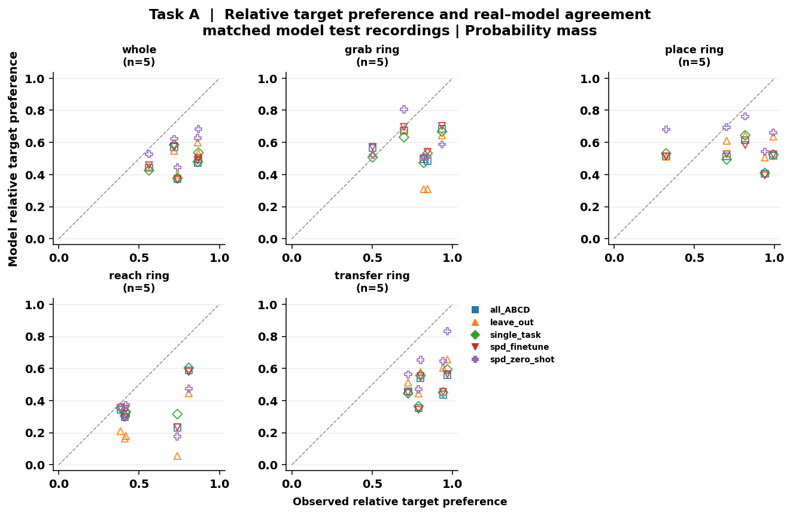

**图中内容**：横轴是真实gaze，纵轴是模型的参与者均值；虚线y=x为完全一致。下方代表模型低估，上方代表高估。整体与阶段分面展示，非逐帧点散布。

**整体结果**：GT 相对目标偏好 C=75.0%；模型：all_ABCD 47.1%；single_task 48.1%；leave_out 50.6%；spd_finetune 47.8%；spd_zero_shot 58.1%。

**配对偏差（百分点）**：all_ABCD -27.9 [-38.0, -17.5]；single_task -27.0 [-36.6, -17.4]；leave_out -24.5 [-32.3, -16.6]；spd_finetune -27.2 [-37.2, -16.5]；spd_zero_shot -16.9 [-25.0, -8.7]。

**说明**：C评价的是可分辨区域内的相对分配，纵向偏差不能解释成全部观察时间的注意差；需同时看D和目标占用。

数据表：[group_stage_summary.csv](20261105T063658759189Z_v3_full/main_probability/group_stage_summary.csv)；[model_error_summary.csv](20261105T063658759189Z_v3_full/main_probability/model_error_summary.csv)。

#### 图M002｜Task A｜主概率质量｜腕部占用：GT–模型一致性

**图中内容**：横轴是真实gaze，纵轴是模型的参与者均值；虚线y=x为完全一致。下方代表模型低估，上方代表高估。整体与阶段分面展示，非逐帧点散布。

**整体结果**：GT 腕部占用=9.8%；模型：all_ABCD 7.1%；single_task 7.3%；leave_out 4.9%；spd_finetune 7.0%；spd_zero_shot 3.9%。

**配对偏差（百分点）**：all_ABCD -2.6 [-9.3, 2.4]；single_task -2.4 [-8.7, 2.1]；leave_out -4.8 [-11.2, -0.0]；spd_finetune -2.7 [-9.4, 2.3]；spd_zero_shot -5.9 [-12.3, -1.3]。

**说明**：腕部点的绝对数值较低时，视觉上靠近原点不等于误差可以忽略；须按配对差及CI判断。

数据表：[group_stage_summary.csv](20261105T063658759189Z_v3_full/main_probability/group_stage_summary.csv)；[model_error_summary.csv](20261105T063658759189Z_v3_full/main_probability/model_error_summary.csv)。

#### 图M003｜Task A｜主概率质量｜目标占用：GT–模型一致性

**图中内容**：横轴是真实gaze，纵轴是模型的参与者均值；虚线y=x为完全一致。下方代表模型低估，上方代表高估。整体与阶段分面展示，非逐帧点散布。

**整体结果**：GT 目标占用=22.6%；模型：all_ABCD 6.4%；single_task 6.8%；leave_out 4.9%；spd_finetune 6.5%；spd_zero_shot 5.2%。

**配对偏差（百分点）**：all_ABCD -16.2 [-20.5, -11.6]；single_task -15.8 [-20.1, -11.1]；leave_out -17.7 [-21.7, -13.2]；spd_finetune -16.1 [-20.4, -11.5]；spd_zero_shot -17.4 [-21.8, -12.7]。

**说明**：整体均值中5/5模型的目标占用低于GT，其余应按图及配对差分开判断；均值靠近对角线仍不保证逐帧预测正确。

数据表：[group_stage_summary.csv](20261105T063658759189Z_v3_full/main_probability/group_stage_summary.csv)；[model_error_summary.csv](20261105T063658759189Z_v3_full/main_probability/model_error_summary.csv)。

#### 图M004｜Task A｜主概率质量｜Brier skill及区间

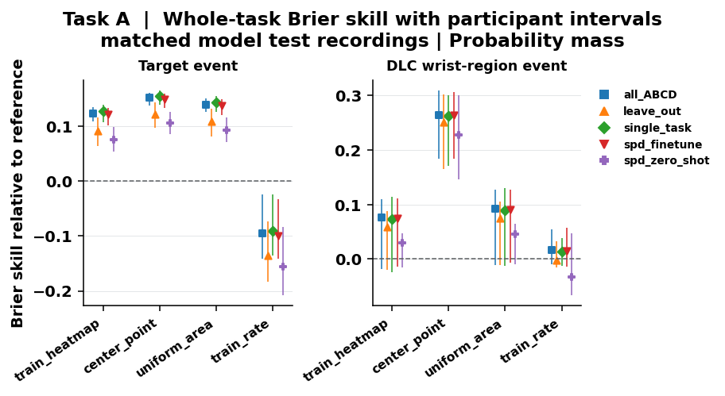

**图中内容**：左面板目标事件，右面板腕部事件；横轴参照基线，纵轴BSS，竖线是参与者bootstrap CI，虚线0表示与基线相当。值越高越好，CI不跨0才有较明确方向。

**target**：train_heatmap: 0.076–0.127（5/5全正、0/5全负）；center_point: 0.106–0.155（5/5全正、0/5全负）；uniform_area: 0.093–0.143（5/5全正、0/5全负）；train_rate: -0.155–-0.091（0/5全正、5/5全负）。

**gripper**：train_heatmap: 0.030–0.076（0/5全正、0/5全负）；center_point: 0.228–0.264（5/5全正、0/5全负）；uniform_area: 0.046–0.092（0/5全正、0/5全负）；train_rate: -0.033–0.016（0/5全正、0/5全负）。

**说明**：概率质量对若干空间基线的提升与对train_rate的不足同时存在，必须指明参照，不能只挑正值宣称整体领先。

数据表：[group_stage_summary.csv](20261105T063658759189Z_v3_full/main_probability/group_stage_summary.csv)；[model_error_summary.csv](20261105T063658759189Z_v3_full/main_probability/model_error_summary.csv)。

#### 图M005｜Task A｜主概率质量｜相对目标偏好 C：与成绩的关系

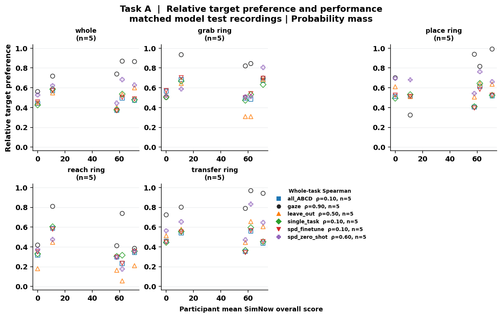

**图中内容**：横轴参与者平均SimNow成绩，纵轴相对目标偏好 C；每个面板为整体或阶段，右侧图例给整体Spearmanρ。相同x上的多个点并非重复测量证据。

**整体ρ及95% CI**：gaze 0.900 [0.111, 1.000]；all_ABCD 0.100 [-1.000, 1.000]；single_task 0.100 [-1.000, 1.000]；leave_out 0.500 [-1.000, 1.000]；spd_finetune 0.100 [-1.000, 1.000]；spd_zero_shot 0.600 [-1.000, 1.000]。

**说明**：只有5名参与者，图示斜向排列和高ρ都可能受个别点影响；C、绝对占用及真实–模型一致性是不同问题。

数据表：[group_stage_summary.csv](20261105T063658759189Z_v3_full/main_probability/group_stage_summary.csv)；[performance_correlations.csv](20261105T063658759189Z_v3_full/main_probability/performance_correlations.csv)。

#### 图M006｜Task A｜主概率质量｜腕部占用：与成绩的关系

**图中内容**：横轴参与者平均SimNow成绩，纵轴腕部占用；每个面板为整体或阶段，右侧图例给整体Spearmanρ。相同x上的多个点并非重复测量证据。

**整体ρ及95% CI**：gaze -0.800 [-1.000, -0.111]；all_ABCD -0.500 [-1.000, 1.000]；single_task -0.300 [-1.000, 1.000]；leave_out -0.700 [-1.000, 0.875]；spd_finetune -0.500 [-1.000, 1.000]；spd_zero_shot -0.600 [-1.000, 1.000]。

**说明**：只有5名参与者，图示斜向排列和高ρ都可能受个别点影响；C、绝对占用及真实–模型一致性是不同问题。

数据表：[group_stage_summary.csv](20261105T063658759189Z_v3_full/main_probability/group_stage_summary.csv)；[performance_correlations.csv](20261105T063658759189Z_v3_full/main_probability/performance_correlations.csv)。

#### 图M007｜Task A｜主概率质量｜目标占用：与成绩的关系

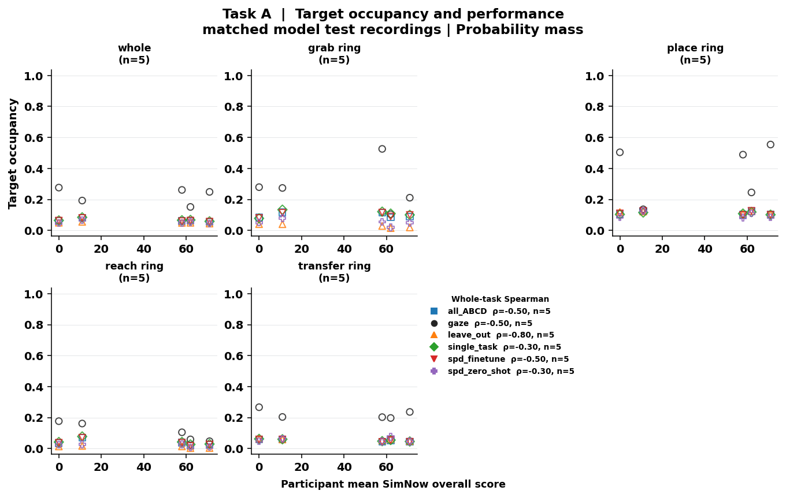

**图中内容**：横轴参与者平均SimNow成绩，纵轴目标占用；每个面板为整体或阶段，右侧图例给整体Spearmanρ。相同x上的多个点并非重复测量证据。

**整体ρ及95% CI**：gaze -0.500 [-1.000, 1.000]；all_ABCD -0.500 [-1.000, 1.000]；single_task -0.300 [-1.000, 1.000]；leave_out -0.800 [-1.000, -0.111]；spd_finetune -0.500 [-1.000, 1.000]；spd_zero_shot -0.300 [-1.000, 1.000]。

**说明**：只有5名参与者，图示斜向排列和高ρ都可能受个别点影响；C、绝对占用及真实–模型一致性是不同问题。

数据表：[group_stage_summary.csv](20261105T063658759189Z_v3_full/main_probability/group_stage_summary.csv)；[performance_correlations.csv](20261105T063658759189Z_v3_full/main_probability/performance_correlations.csv)。

#### 图M008｜Task A｜主概率质量｜四区域占用

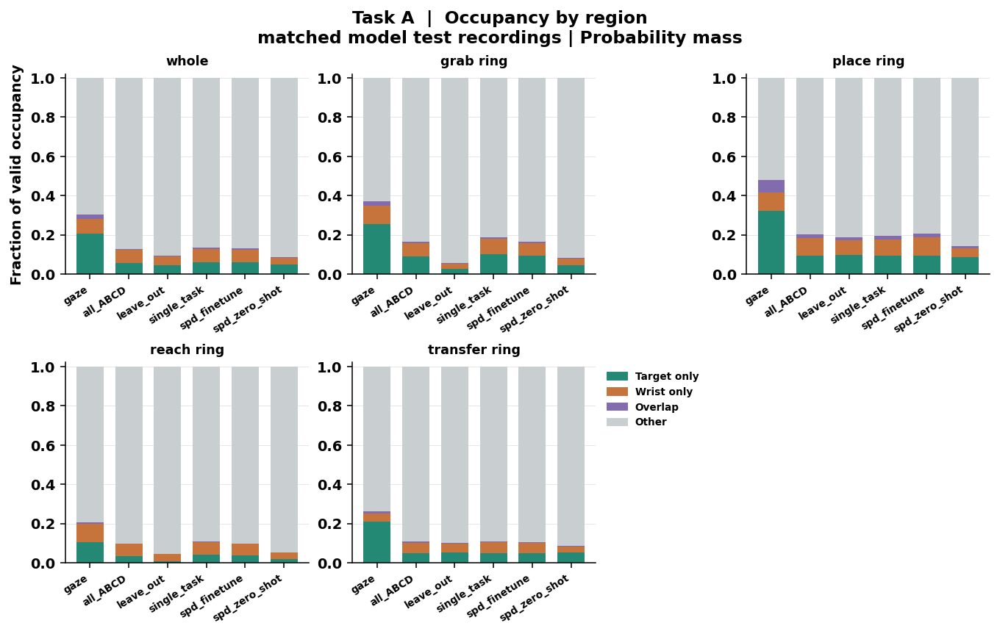

**图中内容**：各面板为整体/阶段，横轴为GT与五模型；堆叠绿色T、橙色P、紫色O、灰色N互斥且总高为1。目标总占用=T+O，腕部总占用=P+O。

**数值观察**：整体 GT 目标22.6%、腕部9.8%、N=69.8%；五模型目标为all_ABCD 6.4%；single_task 6.8%；leave_out 4.9%；spd_finetune 6.5%；spd_zero_shot 5.2%。

**说明**：大面积灰色表明模型的大部分概率质量落在目标/腕部之外，而GT在操作相关区域更集中。Task A的GT绿色目标独占更突出，模型目标偏好不足不能仅归因于两ROI重叠。

数据表：[group_stage_summary.csv](20261105T063658759189Z_v3_full/main_probability/group_stage_summary.csv)；[participant_stage_summary.csv](20261105T063658759189Z_v3_full/main_probability/participant_stage_summary.csv)。

#### 图M009｜Task A｜主概率质量｜重复轮次

**图中内容**：横轴重复轮次1/2/3，纵轴GT的C，按参与者绘制；每人只有一个测试录像，图中可见的是分散点而不是完整三轮学习轨迹。

**数据支持**：整体第1→3轮匹配人数=0，配对ΔC=NA个百分点。

**说明**：本图不能估计同一参与者的练习变化；不同轮次上不同人的点高低不构成纵向证据。各解码分支此图仍显示GT，而非模型随轮次变化。

数据表：[group_stage_summary.csv](20261105T063658759189Z_v3_full/main_probability/group_stage_summary.csv)；[repetition_contrasts.csv](20261105T063658759189Z_v3_full/main_probability/repetition_contrasts.csv)。

#### 图M010｜Task A｜主概率质量｜参数与有效性敏感性

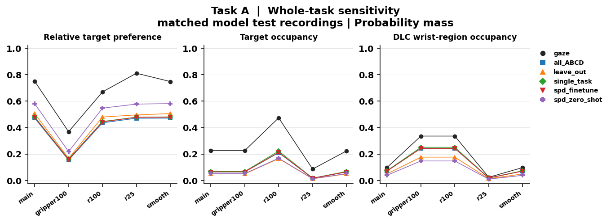

**图中内容**：三个面板依次为C、目标占用、腕部占用；横轴改变ROI半径或平滑条件，线为来源均值。连接线仅便于比较离散条件，不是时间序列。

**GT 条件读数**：main（C=75.0%，目标=22.6%，腕部=9.8%）；gripper100（C=36.9%，目标=22.6%，腕部=33.6%）；r100（C=67.0%，目标=47.3%，腕部=33.6%）；r25（C=81.1%，目标=8.6%，腕部=2.4%）；smooth（C=74.8%，目标=22.3%，腕部=9.8%）。

**模型在main→gripper100的C变化**：all_ABCD 47.1%→15.4%；single_task 48.1%→16.1%；leave_out 50.6%→16.8%；spd_finetune 47.8%→15.8%；spd_zero_shot 58.1%→21.8%。

**说明**：不对称扩大腕部区域显著压低C，体现ROI几何依赖；对称扩大半径则提高占用并改变重叠。所有当前情景均不按valid筛帧；smooth可能补齐短缺口，比较时仍需核对支持集合。

数据表：[group_stage_summary.csv](20261105T063658759189Z_v3_full/main_probability/group_stage_summary.csv)；[participant_stage_summary.csv](20261105T063658759189Z_v3_full/main_probability/participant_stage_summary.csv)。

#### 图M011｜Task C｜主概率质量｜相对目标偏好 C：GT–模型一致性

**图中内容**：横轴是真实gaze，纵轴是模型的参与者均值；虚线y=x为完全一致。下方代表模型低估，上方代表高估。整体与阶段分面展示，非逐帧点散布。

**整体结果**：GT 相对目标偏好 C=57.2%；模型：all_ABCD 41.2%；single_task 42.0%；leave_out 34.9%；spd_finetune 41.5%；spd_zero_shot 32.2%。

**配对偏差（百分点）**：all_ABCD -16.0 [-30.0, 0.9]；single_task -15.2 [-29.6, 2.2]；leave_out -22.3 [-37.8, -2.2]；spd_finetune -15.7 [-30.0, 1.8]；spd_zero_shot -25.1 [-37.5, -5.6]。

**说明**：C评价的是可分辨区域内的相对分配，纵向偏差不能解释成全部观察时间的注意差；需同时看D和目标占用。C任务cinch/穿塔阶段可估人数少，不能将个别点推广到全部参与者。

数据表：[group_stage_summary.csv](20261105T063658759189Z_v3_full/main_probability/group_stage_summary.csv)；[model_error_summary.csv](20261105T063658759189Z_v3_full/main_probability/model_error_summary.csv)。

#### 图M012｜Task C｜主概率质量｜腕部占用：GT–模型一致性

**图中内容**：横轴是真实gaze，纵轴是模型的参与者均值；虚线y=x为完全一致。下方代表模型低估，上方代表高估。整体与阶段分面展示，非逐帧点散布。

**整体结果**：GT 腕部占用=21.3%；模型：all_ABCD 14.7%；single_task 14.7%；leave_out 9.5%；spd_finetune 13.6%；spd_zero_shot 13.8%。

**配对偏差（百分点）**：all_ABCD -6.6 [-12.3, -0.3]；single_task -6.6 [-11.8, -0.4]；leave_out -11.8 [-17.7, -5.6]；spd_finetune -7.6 [-13.2, -1.6]；spd_zero_shot -7.5 [-13.9, -0.8]。

**说明**：腕部点的绝对数值较低时，视觉上靠近原点不等于误差可以忽略；须按配对差及CI判断。C任务cinch/穿塔阶段可估人数少，不能将个别点推广到全部参与者。

数据表：[group_stage_summary.csv](20261105T063658759189Z_v3_full/main_probability/group_stage_summary.csv)；[model_error_summary.csv](20261105T063658759189Z_v3_full/main_probability/model_error_summary.csv)。

#### 图M013｜Task C｜主概率质量｜目标占用：GT–模型一致性

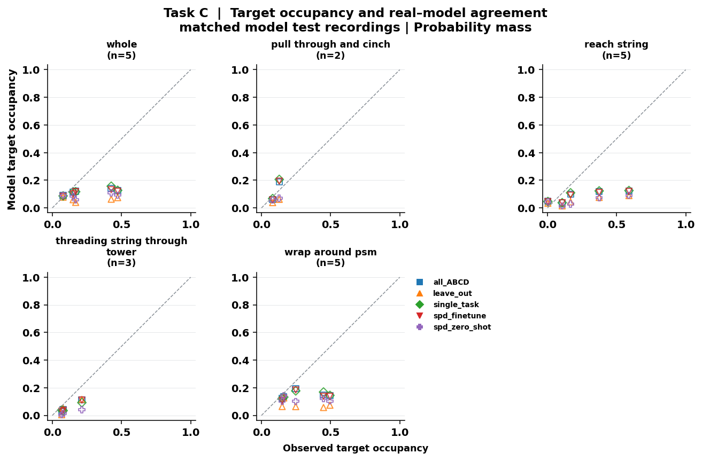

**图中内容**：横轴是真实gaze，纵轴是模型的参与者均值；虚线y=x为完全一致。下方代表模型低估，上方代表高估。整体与阶段分面展示，非逐帧点散布。

**整体结果**：GT 目标占用=25.9%；模型：all_ABCD 11.8%；single_task 12.1%；leave_out 6.3%；spd_finetune 11.1%；spd_zero_shot 8.7%。

**配对偏差（百分点）**：all_ABCD -14.1 [-27.2, -1.9]；single_task -13.8 [-26.8, -2.1]；leave_out -19.6 [-33.0, -6.2]；spd_finetune -14.8 [-28.0, -2.7]；spd_zero_shot -17.2 [-30.5, -4.4]。

**说明**：整体均值中5/5模型的目标占用低于GT，其余应按图及配对差分开判断；均值靠近对角线仍不保证逐帧预测正确。C任务cinch/穿塔阶段可估人数少，不能将个别点推广到全部参与者。

数据表：[group_stage_summary.csv](20261105T063658759189Z_v3_full/main_probability/group_stage_summary.csv)；[model_error_summary.csv](20261105T063658759189Z_v3_full/main_probability/model_error_summary.csv)。

#### 图M014｜Task C｜主概率质量｜Brier skill及区间

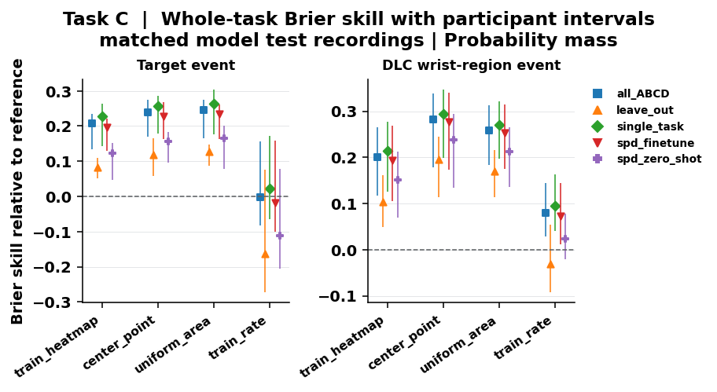

**图中内容**：左面板目标事件，右面板腕部事件；横轴参照基线，纵轴BSS，竖线是参与者bootstrap CI，虚线0表示与基线相当。值越高越好，CI不跨0才有较明确方向。

**target**：train_heatmap: 0.082–0.227（5/5全正、0/5全负）；center_point: 0.118–0.258（5/5全正、0/5全负）；uniform_area: 0.126–0.265（5/5全正、0/5全负）；train_rate: -0.162–0.022（0/5全正、0/5全负）。

**gripper**：train_heatmap: 0.104–0.213（5/5全正、0/5全负）；center_point: 0.196–0.294（5/5全正、0/5全负）；uniform_area: 0.169–0.271（5/5全正、0/5全负）；train_rate: -0.031–0.095（3/5全正、0/5全负）。

**说明**：概率质量对若干空间基线的提升与对train_rate的不足同时存在，必须指明参照，不能只挑正值宣称整体领先。

数据表：[group_stage_summary.csv](20261105T063658759189Z_v3_full/main_probability/group_stage_summary.csv)；[model_error_summary.csv](20261105T063658759189Z_v3_full/main_probability/model_error_summary.csv)。

#### 图M015｜Task C｜主概率质量｜相对目标偏好 C：与成绩的关系

**图中内容**：横轴参与者平均SimNow成绩，纵轴相对目标偏好 C；每个面板为整体或阶段，右侧图例给整体Spearmanρ。相同x上的多个点并非重复测量证据。

**整体ρ及95% CI**：gaze 0.354 [-0.395, 1.000]；all_ABCD 0.000 [-1.000, 1.000]；single_task 0.000 [-1.000, 1.000]；leave_out 0.354 [-0.395, 1.000]；spd_finetune 0.000 [-1.000, 1.000]；spd_zero_shot 0.707 [0.707, 1.000]。

**说明**：测试成绩仅两个不同取值，大量点竖直堆叠；部分bootstrap因分数不变而无定义。较高ρ不能证明连续技能水平识别，cinch/穿塔阶段不足以稳定估相关。

数据表：[group_stage_summary.csv](20261105T063658759189Z_v3_full/main_probability/group_stage_summary.csv)；[performance_correlations.csv](20261105T063658759189Z_v3_full/main_probability/performance_correlations.csv)。

#### 图M016｜Task C｜主概率质量｜腕部占用：与成绩的关系

**图中内容**：横轴参与者平均SimNow成绩，纵轴腕部占用；每个面板为整体或阶段，右侧图例给整体Spearmanρ。相同x上的多个点并非重复测量证据。

**整体ρ及95% CI**：gaze 0.707 [0.707, 1.000]；all_ABCD 0.000 [-1.000, 1.000]；single_task 0.354 [-0.395, 1.000]；leave_out 0.000 [-1.000, 1.000]；spd_finetune 0.354 [-0.395, 1.000]；spd_zero_shot -0.354 [-1.000, 0.395]。

**说明**：测试成绩仅两个不同取值，大量点竖直堆叠；部分bootstrap因分数不变而无定义。较高ρ不能证明连续技能水平识别，cinch/穿塔阶段不足以稳定估相关。

数据表：[group_stage_summary.csv](20261105T063658759189Z_v3_full/main_probability/group_stage_summary.csv)；[performance_correlations.csv](20261105T063658759189Z_v3_full/main_probability/performance_correlations.csv)。

#### 图M017｜Task C｜主概率质量｜目标占用：与成绩的关系

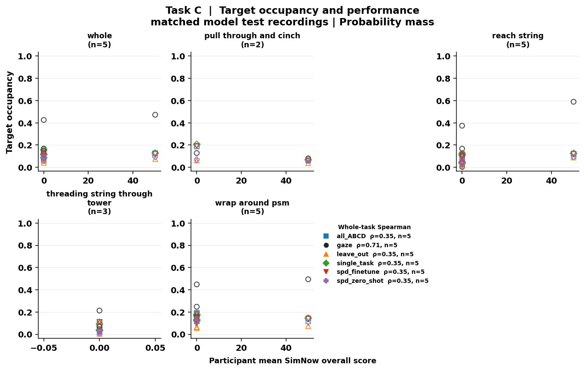

**图中内容**：横轴参与者平均SimNow成绩，纵轴目标占用；每个面板为整体或阶段，右侧图例给整体Spearmanρ。相同x上的多个点并非重复测量证据。

**整体ρ及95% CI**：gaze 0.707 [0.707, 1.000]；all_ABCD 0.354 [-0.395, 1.000]；single_task 0.354 [-0.395, 1.000]；leave_out 0.354 [-0.395, 1.000]；spd_finetune 0.354 [-0.395, 1.000]；spd_zero_shot 0.354 [-0.395, 1.000]。

**说明**：测试成绩仅两个不同取值，大量点竖直堆叠；部分bootstrap因分数不变而无定义。较高ρ不能证明连续技能水平识别，cinch/穿塔阶段不足以稳定估相关。

数据表：[group_stage_summary.csv](20261105T063658759189Z_v3_full/main_probability/group_stage_summary.csv)；[performance_correlations.csv](20261105T063658759189Z_v3_full/main_probability/performance_correlations.csv)。

#### 图M018｜Task C｜主概率质量｜四区域占用

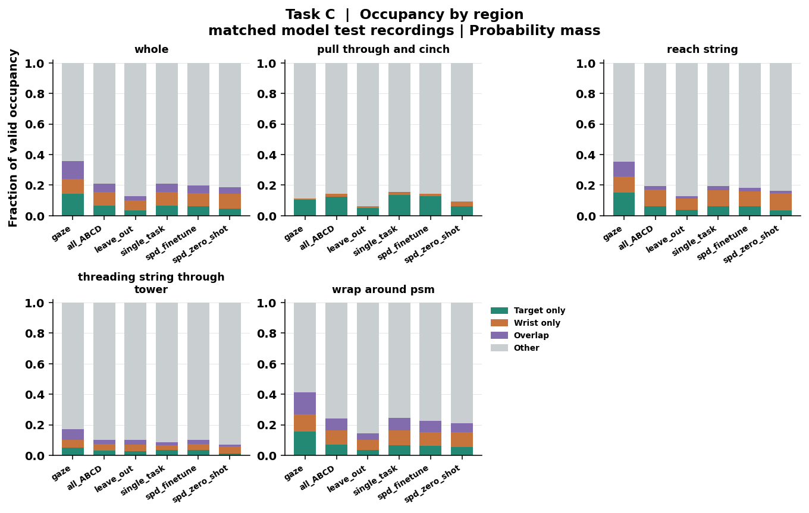

**图中内容**：各面板为整体/阶段，横轴为GT与五模型；堆叠绿色T、橙色P、紫色O、灰色N互斥且总高为1。目标总占用=T+O，腕部总占用=P+O。

**数值观察**：整体 GT 目标25.9%、腕部21.3%、N=64.3%；五模型目标为all_ABCD 11.8%；single_task 12.1%；leave_out 6.3%；spd_finetune 11.1%；spd_zero_shot 8.7%。

**说明**：大面积灰色表明模型的大部分概率质量落在目标/腕部之外，而GT在操作相关区域更集中。Task C中紫色重叠较明显，O不能用来区分目标与腕部偏好。

数据表：[group_stage_summary.csv](20261105T063658759189Z_v3_full/main_probability/group_stage_summary.csv)；[participant_stage_summary.csv](20261105T063658759189Z_v3_full/main_probability/participant_stage_summary.csv)。

#### 图M019｜Task C｜主概率质量｜重复轮次

**图中内容**：横轴重复轮次1/2/3，纵轴GT的C，按参与者绘制；每人只有一个测试录像，图中可见的是分散点而不是完整三轮学习轨迹。

**数据支持**：整体第1→3轮匹配人数=0，配对ΔC=NA个百分点。

**说明**：本图不能估计同一参与者的练习变化；不同轮次上不同人的点高低不构成纵向证据。各解码分支此图仍显示GT，而非模型随轮次变化。

数据表：[group_stage_summary.csv](20261105T063658759189Z_v3_full/main_probability/group_stage_summary.csv)；[repetition_contrasts.csv](20261105T063658759189Z_v3_full/main_probability/repetition_contrasts.csv)。

#### 图M020｜Task C｜主概率质量｜参数与有效性敏感性

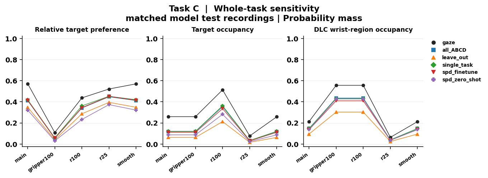

**图中内容**：三个面板依次为C、目标占用、腕部占用；横轴改变ROI半径或平滑条件，线为来源均值。连接线仅便于比较离散条件，不是时间序列。

**GT 条件读数**：main（C=57.2%，目标=25.9%，腕部=21.3%）；gripper100（C=10.9%，目标=25.9%，腕部=55.6%）；r100（C=43.7%，目标=51.3%，腕部=55.6%）；r25（C=52.2%，目标=7.7%，腕部=6.3%）；smooth（C=57.0%，目标=25.9%，腕部=21.3%）。

**模型在main→gripper100的C变化**：all_ABCD 41.2%→5.4%；single_task 42.0%→5.9%；leave_out 34.9%→4.1%；spd_finetune 41.5%→5.5%；spd_zero_shot 32.2%→3.0%。

**说明**：不对称扩大腕部区域显著压低C，体现ROI几何依赖；对称扩大半径则提高占用并改变重叠。所有当前情景均不按valid筛帧；smooth可能补齐短缺口，比较时仍需核对支持集合。

数据表：[group_stage_summary.csv](20261105T063658759189Z_v3_full/main_probability/group_stage_summary.csv)；[participant_stage_summary.csv](20261105T063658759189Z_v3_full/main_probability/participant_stage_summary.csv)。

### 期望点解码

#### 图M021｜Task A｜期望点解码｜相对目标偏好 C：GT–模型一致性

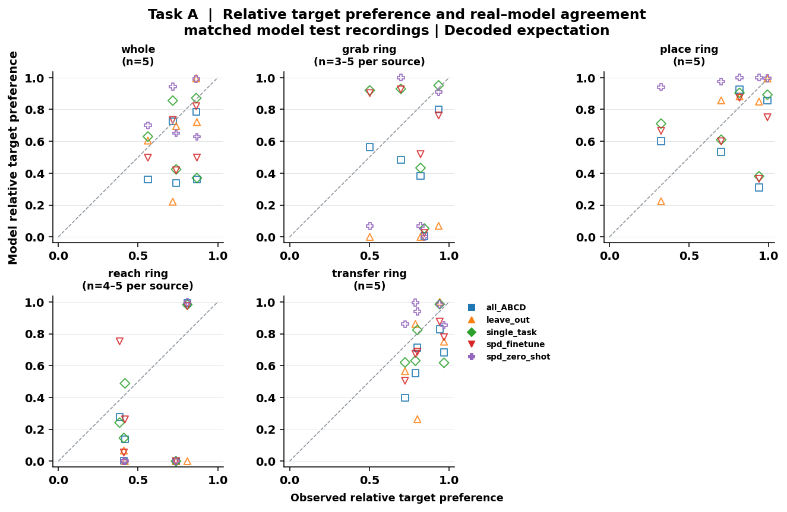

**图中内容**：横轴是真实gaze，纵轴是模型的参与者均值；虚线y=x为完全一致。下方代表模型低估，上方代表高估。整体与阶段分面展示，非逐帧点散布。

**整体结果**：GT 相对目标偏好 C=75.0%；模型：all_ABCD 51.4%；single_task 63.0%；leave_out 64.8%；spd_finetune 59.4%；spd_zero_shot 78.3%。

**配对偏差（百分点）**：all_ABCD -23.6 [-40.4, -6.9]；single_task -12.0 [-34.9, 8.4]；leave_out -10.3 [-31.5, 6.1]；spd_finetune -15.7 [-29.6, -2.4]；spd_zero_shot 3.3 [-13.4, 17.1]。

**说明**：C评价的是可分辨区域内的相对分配，纵向偏差不能解释成全部观察时间的注意差；需同时看D和目标占用。

数据表：[group_stage_summary.csv](20261105T063658759189Z_v3_full/decoded_expectation/group_stage_summary.csv)；[model_error_summary.csv](20261105T063658759189Z_v3_full/decoded_expectation/model_error_summary.csv)。

#### 图M022｜Task A｜期望点解码｜腕部占用：GT–模型一致性

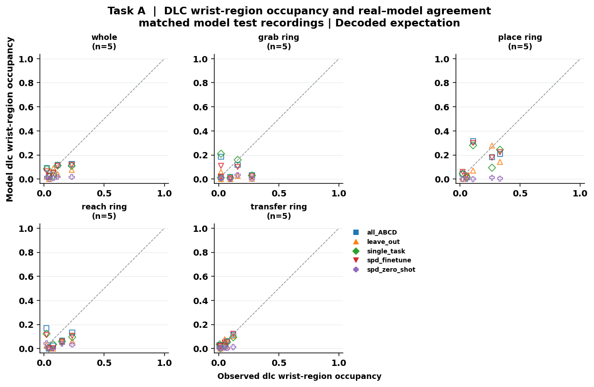

**图中内容**：横轴是真实gaze，纵轴是模型的参与者均值；虚线y=x为完全一致。下方代表模型低估，上方代表高估。整体与阶段分面展示，非逐帧点散布。

**整体结果**：GT 腕部占用=9.8%；模型：all_ABCD 8.2%；single_task 7.1%；leave_out 4.5%；spd_finetune 7.3%；spd_zero_shot 1.1%。

**配对偏差（百分点）**：all_ABCD -1.6 [-6.8, 3.4]；single_task -2.6 [-8.0, 2.6]；leave_out -5.2 [-10.7, -0.6]；spd_finetune -2.4 [-7.3, 1.6]；spd_zero_shot -8.6 [-15.1, -3.2]。

**说明**：腕部点的绝对数值较低时，视觉上靠近原点不等于误差可以忽略；须按配对差及CI判断。

数据表：[group_stage_summary.csv](20261105T063658759189Z_v3_full/decoded_expectation/group_stage_summary.csv)；[model_error_summary.csv](20261105T063658759189Z_v3_full/decoded_expectation/model_error_summary.csv)。

#### 图M023｜Task A｜期望点解码｜目标占用：GT–模型一致性

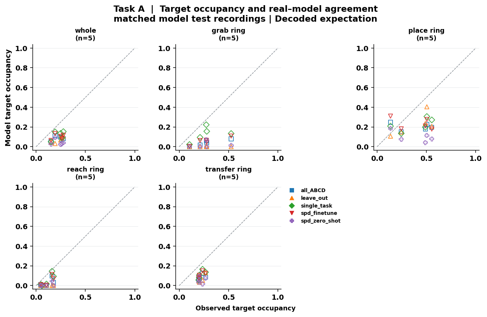

**图中内容**：横轴是真实gaze，纵轴是模型的参与者均值；虚线y=x为完全一致。下方代表模型低估，上方代表高估。整体与阶段分面展示，非逐帧点散布。

**整体结果**：GT 目标占用=22.6%；模型：all_ABCD 8.2%；single_task 11.5%；leave_out 6.7%；spd_finetune 10.1%；spd_zero_shot 4.3%。

**配对偏差（百分点）**：all_ABCD -14.4 [-18.4, -10.4]；single_task -11.1 [-14.6, -7.3]；leave_out -15.9 [-17.7, -13.2]；spd_finetune -12.5 [-16.3, -8.5]；spd_zero_shot -18.3 [-23.2, -13.2]。

**说明**：整体均值中5/5模型的目标占用低于GT，其余应按图及配对差分开判断；均值靠近对角线仍不保证逐帧预测正确。

数据表：[group_stage_summary.csv](20261105T063658759189Z_v3_full/decoded_expectation/group_stage_summary.csv)；[model_error_summary.csv](20261105T063658759189Z_v3_full/decoded_expectation/model_error_summary.csv)。

#### 图M024｜Task A｜期望点解码｜Brier skill及区间

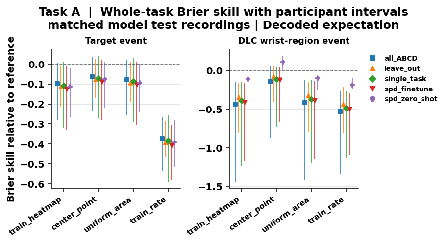

**图中内容**：左面板目标事件，右面板腕部事件；横轴参照基线，纵轴BSS，竖线是参与者bootstrap CI，虚线0表示与基线相当。值越高越好，CI不跨0才有较明确方向。

**target**：train_heatmap: -0.124–-0.099（0/5全正、3/5全负）；center_point: -0.088–-0.064（0/5全正、0/5全负）；uniform_area: -0.104–-0.079（0/5全正、1/5全负）；train_rate: -0.406–-0.375（0/5全正、5/5全负）。

**gripper**：train_heatmap: -0.437–-0.114（0/5全正、5/5全负）；center_point: -0.145–0.113（1/5全正、0/5全负）；uniform_area: -0.413–-0.096（0/5全正、5/5全负）；train_rate: -0.531–-0.187（0/5全正、5/5全负）。

**说明**：硬点决策的BSS多数低于0；区域占用更接近GT不能抵消逐帧硬分类的代价。

数据表：[group_stage_summary.csv](20261105T063658759189Z_v3_full/decoded_expectation/group_stage_summary.csv)；[model_error_summary.csv](20261105T063658759189Z_v3_full/decoded_expectation/model_error_summary.csv)。

#### 图M025｜Task A｜期望点解码｜四状态混淆

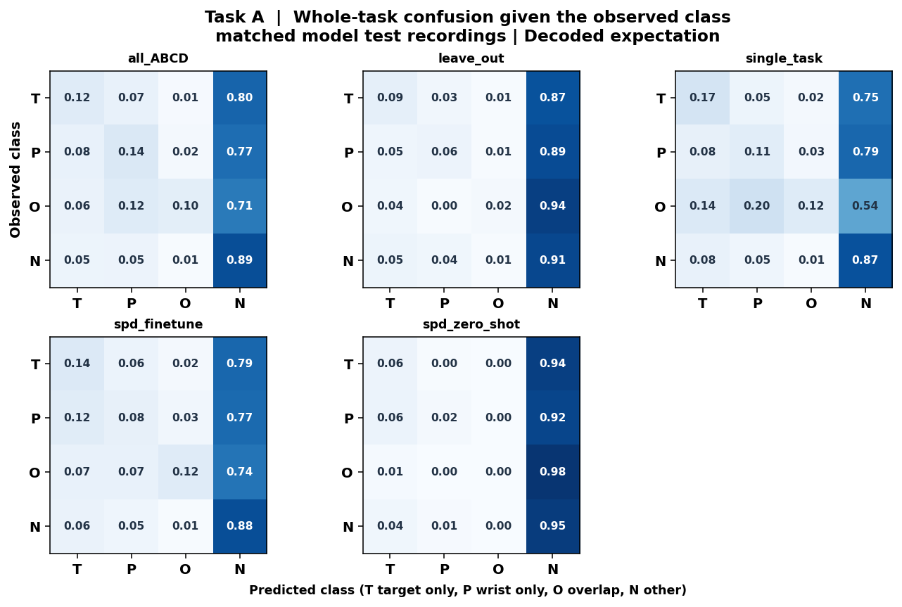

**图中内容**：每个面板一模型，行是真实T/P/O/N，列是预测T/P/O/N；颜色/单元值是给定真实类别后的条件概率（按录像、参与者逐层平均）。对角线是该类正确命中，T→N是目标独占被判成其他。

| 模型 | T→T % | T→N % | P→P % | O→O % | N→N % |
| --- | --- | --- | --- | --- | --- |
| all_ABCD | 12.0 | 79.8 | 14.1 | 10.1 | 88.6 |
| single_task | 17.3 | 75.4 | 10.9 | 12.3 | 87.1 |
| leave_out | 8.9 | 87.1 | 5.8 | 2.0 | 90.7 |
| spd_finetune | 13.7 | 78.6 | 7.9 | 11.8 | 88.3 |
| spd_zero_shot | 5.5 | 94.0 | 2.2 | 0.4 | 95.2 |

**说明**：N→N通常较高而T/P/O对角线较低，说明大量“其他”帧容易命中，但目标相关类别仍易漏掉；不能靠总体准确率证明目标锁定能力。这里T→T不是含重叠的完整目标召回率。

数据表：[group_stage_summary.csv](20261105T063658759189Z_v3_full/decoded_expectation/group_stage_summary.csv)；[confusion_summary.csv](20261105T063658759189Z_v3_full/decoded_expectation/confusion_summary.csv)。

#### 图M026｜Task A｜期望点解码｜驻留与切换

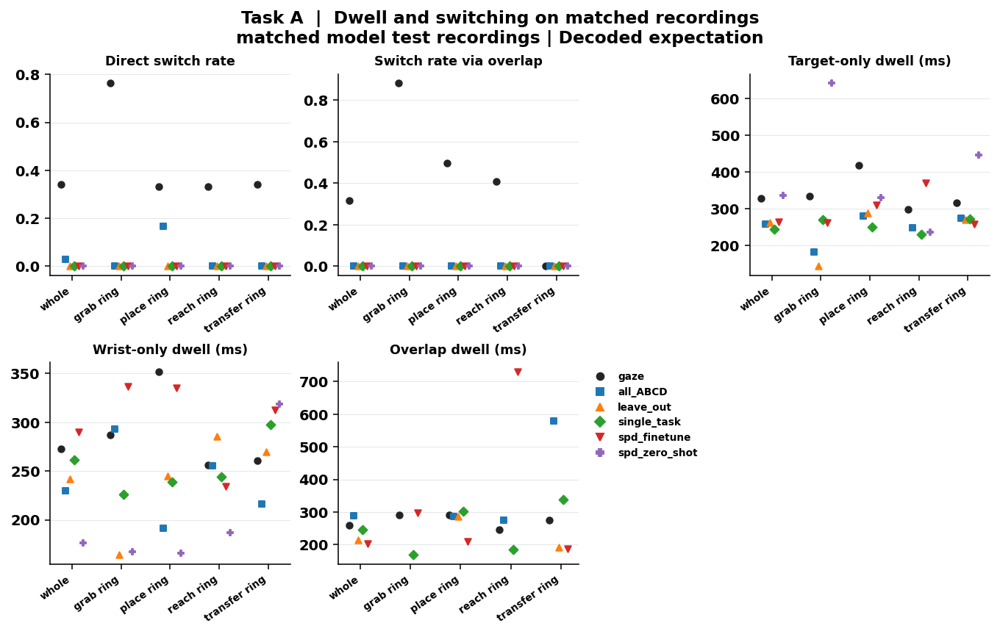

**图中内容**：五个面板分别为直接切换率、经重叠切换率、T/P/O驻留中位时长的参与者均值；横轴整体与阶段，各颜色代表来源。达到120 ms门槛的观察段进入驻留统计；边界或缺失截断段达到门槛仍纳入。

| 来源 | 直接/min | 经O/min | T ms | P ms | O ms |
| --- | --- | --- | --- | --- | --- |
| gaze | 0.341 | 0.318 | 329.6 | 272.7 | 259.7 |
| all_ABCD | 0.030 | 0.000 | 258.1 | 229.7 | 287.5 |
| single_task | 0.000 | 0.000 | 244.4 | 261.8 | 246.8 |
| leave_out | 0.000 | 0.000 | 263.3 | 242.0 | 214.3 |
| spd_finetune | 0.000 | 0.000 | 264.0 | 290.0 | 202.5 |
| spd_zero_shot | 0.000 | 0.000 | 336.0 | 176.2 | NA |

**说明**：模型切换率与GT有明显差异；驻留相近也不能推出切换过程被重现，且各来源达到时长门槛的观察段数量不同。

数据表：[group_stage_summary.csv](20261105T063658759189Z_v3_full/decoded_expectation/group_stage_summary.csv)；[participant_stage_summary.csv](20261105T063658759189Z_v3_full/decoded_expectation/participant_stage_summary.csv)。

#### 图M027｜Task A｜期望点解码｜相对目标偏好 C：与成绩的关系

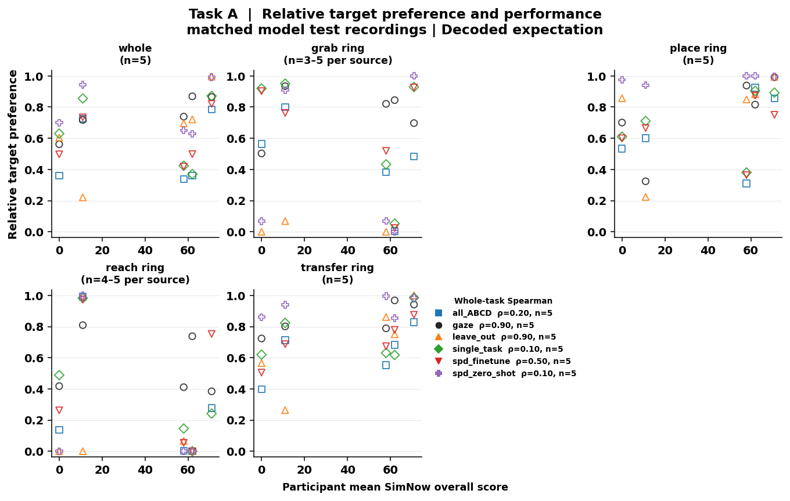

**图中内容**：横轴参与者平均SimNow成绩，纵轴相对目标偏好 C；每个面板为整体或阶段，右侧图例给整体Spearmanρ。相同x上的多个点并非重复测量证据。

**整体ρ及95% CI**：gaze 0.900 [0.111, 1.000]；all_ABCD 0.200 [-1.000, 1.000]；single_task 0.100 [-1.000, 1.000]；leave_out 0.900 [0.111, 1.000]；spd_finetune 0.500 [-1.000, 1.000]；spd_zero_shot 0.100 [-1.000, 1.000]。

**说明**：只有5名参与者，图示斜向排列和高ρ都可能受个别点影响；C、绝对占用及真实–模型一致性是不同问题。

数据表：[group_stage_summary.csv](20261105T063658759189Z_v3_full/decoded_expectation/group_stage_summary.csv)；[performance_correlations.csv](20261105T063658759189Z_v3_full/decoded_expectation/performance_correlations.csv)。

#### 图M028｜Task A｜期望点解码｜腕部占用：与成绩的关系

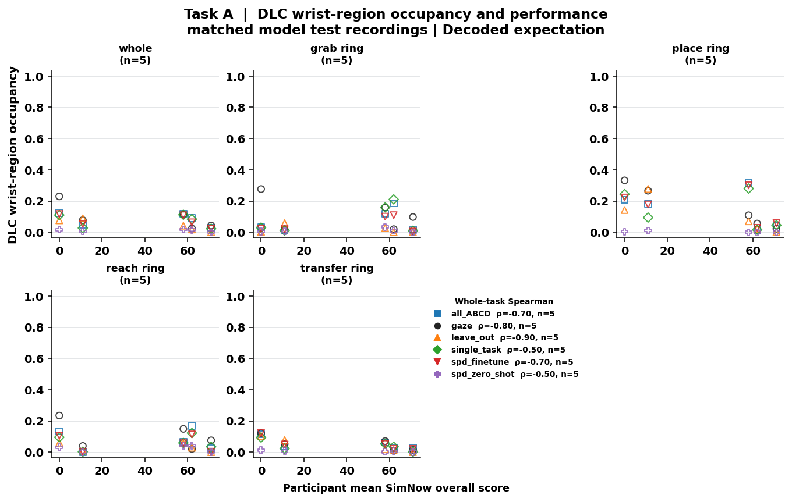

**图中内容**：横轴参与者平均SimNow成绩，纵轴腕部占用；每个面板为整体或阶段，右侧图例给整体Spearmanρ。相同x上的多个点并非重复测量证据。

**整体ρ及95% CI**：gaze -0.800 [-1.000, -0.111]；all_ABCD -0.700 [-1.000, 0.875]；single_task -0.500 [-1.000, 1.000]；leave_out -0.900 [-1.000, -0.111]；spd_finetune -0.700 [-1.000, 0.875]；spd_zero_shot -0.500 [-1.000, 1.000]。

**说明**：只有5名参与者，图示斜向排列和高ρ都可能受个别点影响；C、绝对占用及真实–模型一致性是不同问题。

数据表：[group_stage_summary.csv](20261105T063658759189Z_v3_full/decoded_expectation/group_stage_summary.csv)；[performance_correlations.csv](20261105T063658759189Z_v3_full/decoded_expectation/performance_correlations.csv)。

#### 图M029｜Task A｜期望点解码｜目标占用：与成绩的关系

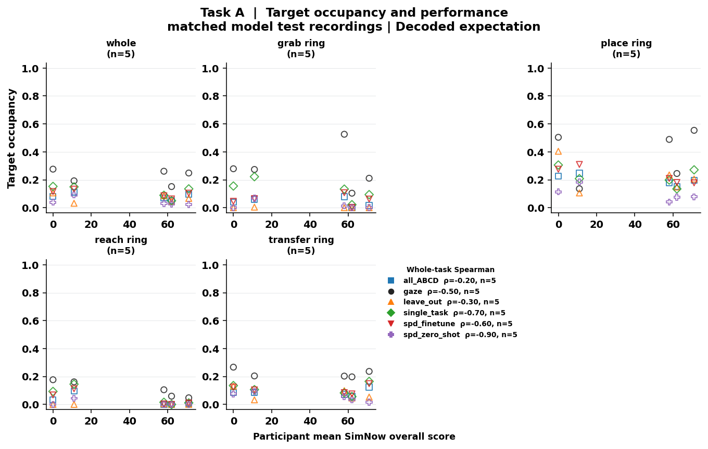

**图中内容**：横轴参与者平均SimNow成绩，纵轴目标占用；每个面板为整体或阶段，右侧图例给整体Spearmanρ。相同x上的多个点并非重复测量证据。

**整体ρ及95% CI**：gaze -0.500 [-1.000, 1.000]；all_ABCD -0.200 [-1.000, 1.000]；single_task -0.700 [-1.000, 0.875]；leave_out -0.300 [-1.000, 1.000]；spd_finetune -0.600 [-1.000, 1.000]；spd_zero_shot -0.900 [-1.000, -0.111]。

**说明**：只有5名参与者，图示斜向排列和高ρ都可能受个别点影响；C、绝对占用及真实–模型一致性是不同问题。

数据表：[group_stage_summary.csv](20261105T063658759189Z_v3_full/decoded_expectation/group_stage_summary.csv)；[performance_correlations.csv](20261105T063658759189Z_v3_full/decoded_expectation/performance_correlations.csv)。

#### 图M030｜Task A｜期望点解码｜四区域占用

**图中内容**：各面板为整体/阶段，横轴为GT与五模型；堆叠绿色T、橙色P、紫色O、灰色N互斥且总高为1。目标总占用=T+O，腕部总占用=P+O。

**数值观察**：整体 GT 目标22.6%、腕部9.8%、N=69.8%；五模型目标为all_ABCD 8.2%；single_task 11.5%；leave_out 6.7%；spd_finetune 10.1%；spd_zero_shot 4.3%。

**说明**：硬点选择改变了区域占用；即使彩色总量接近GT，仍需结合事件Brier与混淆矩阵判断是否在正确帧命中。Task A的GT绿色目标独占更突出，模型目标偏好不足不能仅归因于两ROI重叠。

数据表：[group_stage_summary.csv](20261105T063658759189Z_v3_full/decoded_expectation/group_stage_summary.csv)；[participant_stage_summary.csv](20261105T063658759189Z_v3_full/decoded_expectation/participant_stage_summary.csv)。

#### 图M031｜Task A｜期望点解码｜重复轮次

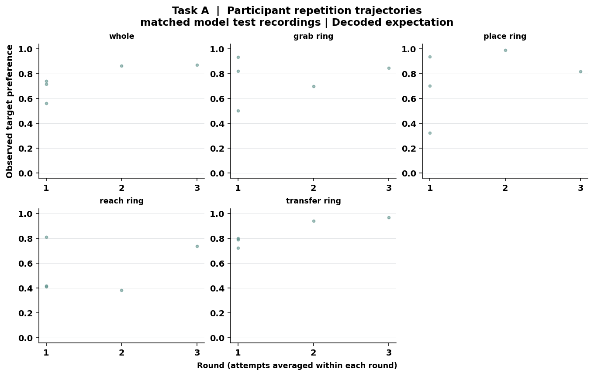

**图中内容**：横轴重复轮次1/2/3，纵轴GT的C，按参与者绘制；每人只有一个测试录像，图中可见的是分散点而不是完整三轮学习轨迹。

**数据支持**：整体第1→3轮匹配人数=0，配对ΔC=NA个百分点。

**说明**：本图不能估计同一参与者的练习变化；不同轮次上不同人的点高低不构成纵向证据。各解码分支此图仍显示GT，而非模型随轮次变化。

数据表：[group_stage_summary.csv](20261105T063658759189Z_v3_full/decoded_expectation/group_stage_summary.csv)；[repetition_contrasts.csv](20261105T063658759189Z_v3_full/decoded_expectation/repetition_contrasts.csv)。

#### 图M032｜Task A｜期望点解码｜参数与有效性敏感性

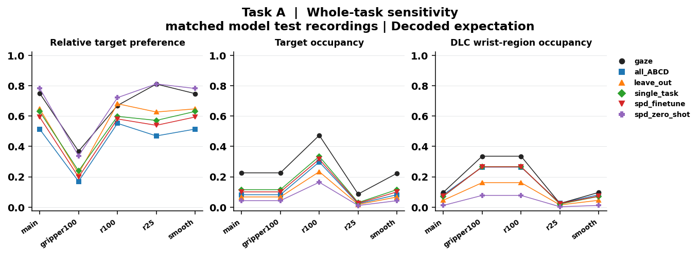

**图中内容**：三个面板依次为C、目标占用、腕部占用；横轴改变ROI半径或平滑条件，线为来源均值。连接线仅便于比较离散条件，不是时间序列。

**GT 条件读数**：main（C=75.0%，目标=22.6%，腕部=9.8%）；gripper100（C=36.9%，目标=22.6%，腕部=33.6%）；r100（C=67.0%，目标=47.3%，腕部=33.6%）；r25（C=81.1%，目标=8.6%，腕部=2.4%）；smooth（C=74.8%，目标=22.3%，腕部=9.8%）。

**模型在main→gripper100的C变化**：all_ABCD 51.4%→17.0%；single_task 63.0%→23.9%；leave_out 64.8%→22.1%；spd_finetune 59.4%→19.8%；spd_zero_shot 78.3%→33.8%。

**说明**：不对称扩大腕部区域显著压低C，体现ROI几何依赖；对称扩大半径则提高占用并改变重叠。所有当前情景均不按valid筛帧；smooth可能补齐短缺口，比较时仍需核对支持集合。

数据表：[group_stage_summary.csv](20261105T063658759189Z_v3_full/decoded_expectation/group_stage_summary.csv)；[participant_stage_summary.csv](20261105T063658759189Z_v3_full/decoded_expectation/participant_stage_summary.csv)。

#### 图M033｜Task C｜期望点解码｜相对目标偏好 C：GT–模型一致性

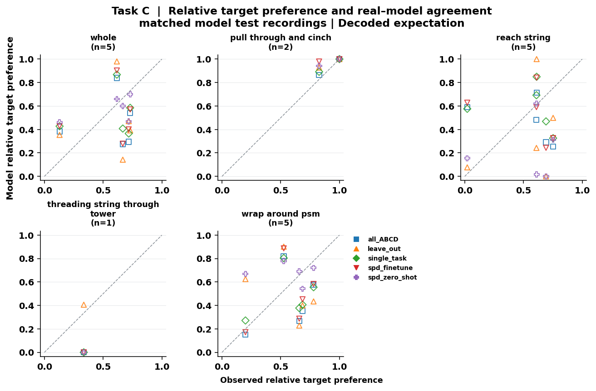

**图中内容**：横轴是真实gaze，纵轴是模型的参与者均值；虚线y=x为完全一致。下方代表模型低估，上方代表高估。整体与阶段分面展示，非逐帧点散布。

**整体结果**：GT 相对目标偏好 C=57.2%；模型：all_ABCD 46.7%；single_task 53.1%；leave_out 46.8%；spd_finetune 51.6%；spd_zero_shot 57.8%。

**配对偏差（百分点）**：all_ABCD -10.6 [-36.4, 15.3]；single_task -4.2 [-27.4, 19.1]；leave_out -10.5 [-39.5, 19.5]；spd_finetune -5.6 [-31.4, 20.3]；spd_zero_shot 0.6 [-14.7, 18.8]。

**说明**：C评价的是可分辨区域内的相对分配，纵向偏差不能解释成全部观察时间的注意差；需同时看D和目标占用。C任务cinch/穿塔阶段可估人数少，不能将个别点推广到全部参与者。

数据表：[group_stage_summary.csv](20261105T063658759189Z_v3_full/decoded_expectation/group_stage_summary.csv)；[model_error_summary.csv](20261105T063658759189Z_v3_full/decoded_expectation/model_error_summary.csv)。

#### 图M034｜Task C｜期望点解码｜腕部占用：GT–模型一致性

**图中内容**：横轴是真实gaze，纵轴是模型的参与者均值；虚线y=x为完全一致。下方代表模型低估，上方代表高估。整体与阶段分面展示，非逐帧点散布。

**整体结果**：GT 腕部占用=21.3%；模型：all_ABCD 20.7%；single_task 22.8%；leave_out 11.5%；spd_finetune 17.7%；spd_zero_shot 15.1%。

**配对偏差（百分点）**：all_ABCD -0.6 [-6.9, 6.4]；single_task 1.5 [-6.0, 9.8]；leave_out -9.8 [-17.5, -1.5]；spd_finetune -3.6 [-10.2, 3.5]；spd_zero_shot -6.2 [-12.2, 0.8]。

**说明**：腕部点的绝对数值较低时，视觉上靠近原点不等于误差可以忽略；须按配对差及CI判断。C任务cinch/穿塔阶段可估人数少，不能将个别点推广到全部参与者。

数据表：[group_stage_summary.csv](20261105T063658759189Z_v3_full/decoded_expectation/group_stage_summary.csv)；[model_error_summary.csv](20261105T063658759189Z_v3_full/decoded_expectation/model_error_summary.csv)。

#### 图M035｜Task C｜期望点解码｜目标占用：GT–模型一致性

**图中内容**：横轴是真实gaze，纵轴是模型的参与者均值；虚线y=x为完全一致。下方代表模型低估，上方代表高估。整体与阶段分面展示，非逐帧点散布。

**整体结果**：GT 目标占用=25.9%；模型：all_ABCD 19.9%；single_task 24.3%；leave_out 8.7%；spd_finetune 20.1%；spd_zero_shot 18.0%。

**配对偏差（百分点）**：all_ABCD -6.0 [-19.6, 4.7]；single_task -1.6 [-14.9, 7.6]；leave_out -17.2 [-31.9, -3.4]；spd_finetune -5.8 [-19.5, 5.7]；spd_zero_shot -7.9 [-21.0, 4.9]。

**说明**：整体均值中5/5模型的目标占用低于GT，其余应按图及配对差分开判断；均值靠近对角线仍不保证逐帧预测正确。C任务cinch/穿塔阶段可估人数少，不能将个别点推广到全部参与者。

数据表：[group_stage_summary.csv](20261105T063658759189Z_v3_full/decoded_expectation/group_stage_summary.csv)；[model_error_summary.csv](20261105T063658759189Z_v3_full/decoded_expectation/model_error_summary.csv)。

#### 图M036｜Task C｜期望点解码｜Brier skill及区间

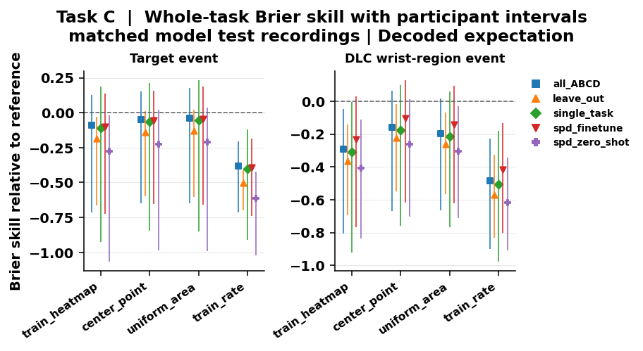

**图中内容**：左面板目标事件，右面板腕部事件；横轴参照基线，纵轴BSS，竖线是参与者bootstrap CI，虚线0表示与基线相当。值越高越好，CI不跨0才有较明确方向。

**target**：train_heatmap: -0.274–-0.090（0/5全正、2/5全负）；center_point: -0.224–-0.048（0/5全正、0/5全负）；uniform_area: -0.213–-0.038（0/5全正、0/5全负）；train_rate: -0.613–-0.380（0/5全正、5/5全负）。

**gripper**：train_heatmap: -0.407–-0.231（0/5全正、4/5全负）；center_point: -0.263–-0.105（0/5全正、1/5全负）；uniform_area: -0.305–-0.142（0/5全正、2/5全负）；train_rate: -0.620–-0.417（0/5全正、5/5全负）。

**说明**：硬点决策的BSS多数低于0；区域占用更接近GT不能抵消逐帧硬分类的代价。

数据表：[group_stage_summary.csv](20261105T063658759189Z_v3_full/decoded_expectation/group_stage_summary.csv)；[model_error_summary.csv](20261105T063658759189Z_v3_full/decoded_expectation/model_error_summary.csv)。

#### 图M037｜Task C｜期望点解码｜四状态混淆

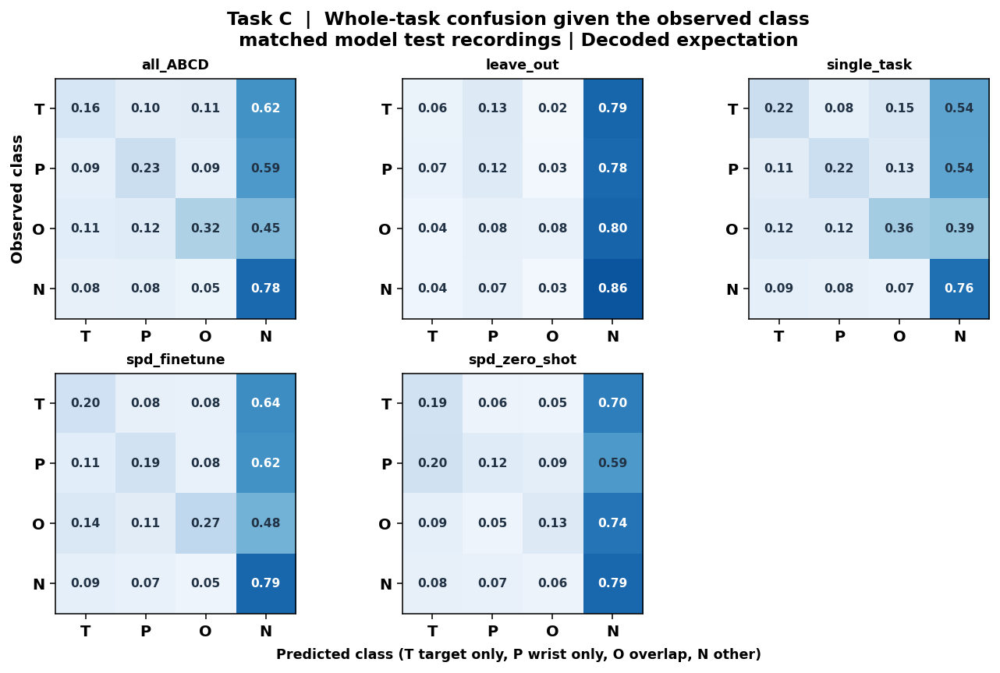

**图中内容**：每个面板一模型，行是真实T/P/O/N，列是预测T/P/O/N；颜色/单元值是给定真实类别后的条件概率（按录像、参与者逐层平均）。对角线是该类正确命中，T→N是目标独占被判成其他。

| 模型 | T→T % | T→N % | P→P % | O→O % | N→N % |
| --- | --- | --- | --- | --- | --- |
| all_ABCD | 16.2 | 62.2 | 22.5 | 32.3 | 78.3 |
| single_task | 22.3 | 54.4 | 21.9 | 35.8 | 75.8 |
| leave_out | 6.3 | 79.5 | 12.5 | 7.8 | 85.9 |
| spd_finetune | 20.1 | 64.3 | 19.0 | 26.6 | 79.2 |
| spd_zero_shot | 19.4 | 69.9 | 11.9 | 12.9 | 78.8 |

**说明**：N→N通常较高而T/P/O对角线较低，说明大量“其他”帧容易命中，但目标相关类别仍易漏掉；不能靠总体准确率证明目标锁定能力。这里T→T不是含重叠的完整目标召回率。

数据表：[group_stage_summary.csv](20261105T063658759189Z_v3_full/decoded_expectation/group_stage_summary.csv)；[confusion_summary.csv](20261105T063658759189Z_v3_full/decoded_expectation/confusion_summary.csv)。

#### 图M038｜Task C｜期望点解码｜驻留与切换

**图中内容**：五个面板分别为直接切换率、经重叠切换率、T/P/O驻留中位时长的参与者均值；横轴整体与阶段，各颜色代表来源。达到120 ms门槛的观察段进入驻留统计；边界或缺失截断段达到门槛仍纳入。

| 来源 | 直接/min | 经O/min | T ms | P ms | O ms |
| --- | --- | --- | --- | --- | --- |
| gaze | 0.541 | 0.849 | 347.1 | 334.5 | 484.3 |
| all_ABCD | 0.000 | 0.000 | 246.1 | 225.1 | 274.2 |
| single_task | 0.000 | 0.000 | 289.6 | 234.5 | 323.6 |
| leave_out | 0.000 | 0.000 | 246.2 | 264.1 | 275.4 |
| spd_finetune | 0.000 | 0.000 | 283.5 | 221.1 | 251.1 |
| spd_zero_shot | 0.000 | 0.114 | 262.7 | 253.2 | 257.4 |

**说明**：模型切换率与GT有明显差异；驻留相近也不能推出切换过程被重现，且各来源达到时长门槛的观察段数量不同。

数据表：[group_stage_summary.csv](20261105T063658759189Z_v3_full/decoded_expectation/group_stage_summary.csv)；[participant_stage_summary.csv](20261105T063658759189Z_v3_full/decoded_expectation/participant_stage_summary.csv)。

#### 图M039｜Task C｜期望点解码｜相对目标偏好 C：与成绩的关系

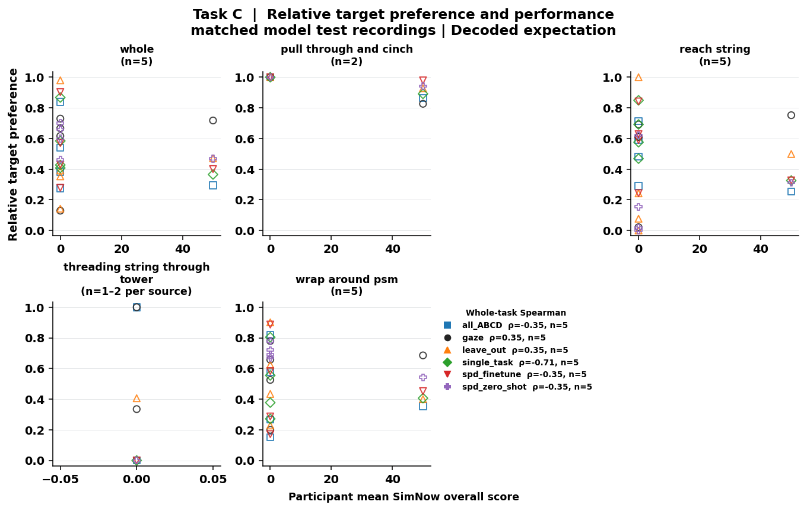

**图中内容**：横轴参与者平均SimNow成绩，纵轴相对目标偏好 C；每个面板为整体或阶段，右侧图例给整体Spearmanρ。相同x上的多个点并非重复测量证据。

**整体ρ及95% CI**：gaze 0.354 [-0.395, 1.000]；all_ABCD -0.354 [-1.000, 0.395]；single_task -0.707 [-1.000, -0.707]；leave_out 0.354 [-0.395, 1.000]；spd_finetune -0.354 [-1.000, 0.395]；spd_zero_shot -0.354 [-1.000, 0.395]。

**说明**：测试成绩仅两个不同取值，大量点竖直堆叠；部分bootstrap因分数不变而无定义。较高ρ不能证明连续技能水平识别，cinch/穿塔阶段不足以稳定估相关。

数据表：[group_stage_summary.csv](20261105T063658759189Z_v3_full/decoded_expectation/group_stage_summary.csv)；[performance_correlations.csv](20261105T063658759189Z_v3_full/decoded_expectation/performance_correlations.csv)。

#### 图M040｜Task C｜期望点解码｜腕部占用：与成绩的关系

**图中内容**：横轴参与者平均SimNow成绩，纵轴腕部占用；每个面板为整体或阶段，右侧图例给整体Spearmanρ。相同x上的多个点并非重复测量证据。

**整体ρ及95% CI**：gaze 0.707 [0.707, 1.000]；all_ABCD 0.354 [-0.395, 1.000]；single_task 0.354 [-0.395, 1.000]；leave_out -0.354 [-1.000, 0.395]；spd_finetune 0.354 [-0.395, 1.000]；spd_zero_shot 0.354 [-0.395, 1.000]。

**说明**：测试成绩仅两个不同取值，大量点竖直堆叠；部分bootstrap因分数不变而无定义。较高ρ不能证明连续技能水平识别，cinch/穿塔阶段不足以稳定估相关。

数据表：[group_stage_summary.csv](20261105T063658759189Z_v3_full/decoded_expectation/group_stage_summary.csv)；[performance_correlations.csv](20261105T063658759189Z_v3_full/decoded_expectation/performance_correlations.csv)。

#### 图M041｜Task C｜期望点解码｜目标占用：与成绩的关系

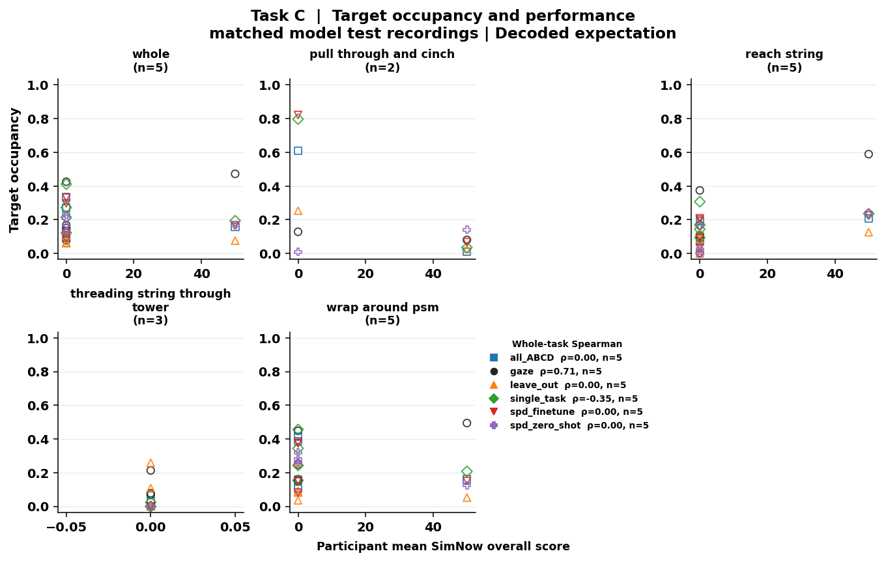

**图中内容**：横轴参与者平均SimNow成绩，纵轴目标占用；每个面板为整体或阶段，右侧图例给整体Spearmanρ。相同x上的多个点并非重复测量证据。

**整体ρ及95% CI**：gaze 0.707 [0.707, 1.000]；all_ABCD 0.000 [-1.000, 1.000]；single_task -0.354 [-1.000, 0.395]；leave_out 0.000 [-1.000, 1.000]；spd_finetune 0.000 [-1.000, 1.000]；spd_zero_shot 0.000 [-1.000, 1.000]。

**说明**：测试成绩仅两个不同取值，大量点竖直堆叠；部分bootstrap因分数不变而无定义。较高ρ不能证明连续技能水平识别，cinch/穿塔阶段不足以稳定估相关。

数据表：[group_stage_summary.csv](20261105T063658759189Z_v3_full/decoded_expectation/group_stage_summary.csv)；[performance_correlations.csv](20261105T063658759189Z_v3_full/decoded_expectation/performance_correlations.csv)。

#### 图M042｜Task C｜期望点解码｜四区域占用

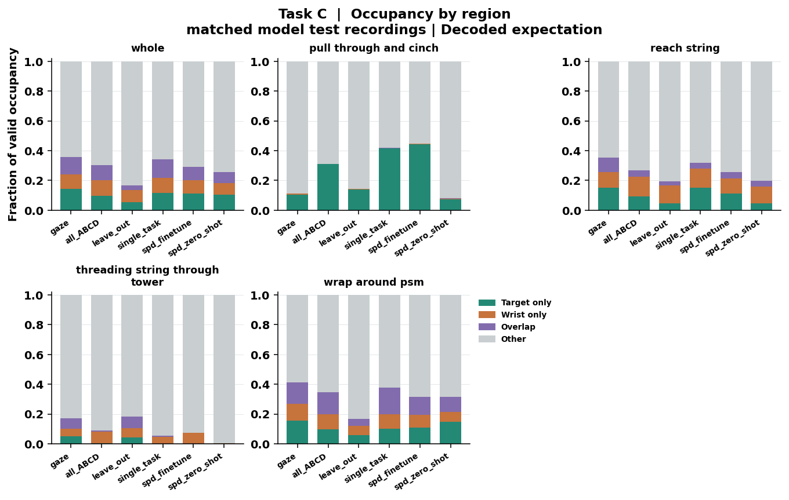

**图中内容**：各面板为整体/阶段，横轴为GT与五模型；堆叠绿色T、橙色P、紫色O、灰色N互斥且总高为1。目标总占用=T+O，腕部总占用=P+O。

**数值观察**：整体 GT 目标25.9%、腕部21.3%、N=64.3%；五模型目标为all_ABCD 19.9%；single_task 24.3%；leave_out 8.7%；spd_finetune 20.1%；spd_zero_shot 18.0%。

**说明**：硬点选择改变了区域占用；即使彩色总量接近GT，仍需结合事件Brier与混淆矩阵判断是否在正确帧命中。Task C中紫色重叠较明显，O不能用来区分目标与腕部偏好。

数据表：[group_stage_summary.csv](20261105T063658759189Z_v3_full/decoded_expectation/group_stage_summary.csv)；[participant_stage_summary.csv](20261105T063658759189Z_v3_full/decoded_expectation/participant_stage_summary.csv)。

#### 图M043｜Task C｜期望点解码｜重复轮次

**图中内容**：横轴重复轮次1/2/3，纵轴GT的C，按参与者绘制；每人只有一个测试录像，图中可见的是分散点而不是完整三轮学习轨迹。

**数据支持**：整体第1→3轮匹配人数=0，配对ΔC=NA个百分点。

**说明**：本图不能估计同一参与者的练习变化；不同轮次上不同人的点高低不构成纵向证据。各解码分支此图仍显示GT，而非模型随轮次变化。

数据表：[group_stage_summary.csv](20261105T063658759189Z_v3_full/decoded_expectation/group_stage_summary.csv)；[repetition_contrasts.csv](20261105T063658759189Z_v3_full/decoded_expectation/repetition_contrasts.csv)。

#### 图M044｜Task C｜期望点解码｜参数与有效性敏感性

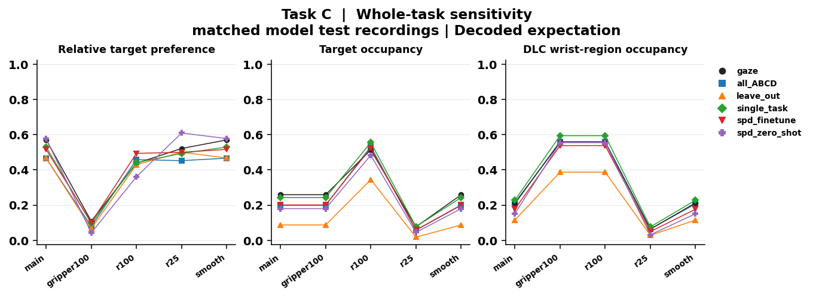

**图中内容**：三个面板依次为C、目标占用、腕部占用；横轴改变ROI半径或平滑条件，线为来源均值。连接线仅便于比较离散条件，不是时间序列。

**GT 条件读数**：main（C=57.2%，目标=25.9%，腕部=21.3%）；gripper100（C=10.9%，目标=25.9%，腕部=55.6%）；r100（C=43.7%，目标=51.3%，腕部=55.6%）；r25（C=52.2%，目标=7.7%，腕部=6.3%）；smooth（C=57.0%，目标=25.9%，腕部=21.3%）。

**模型在main→gripper100的C变化**：all_ABCD 46.7%→8.0%；single_task 53.1%→9.6%；leave_out 46.8%→6.7%；spd_finetune 51.6%→10.2%；spd_zero_shot 57.8%→4.3%。

**说明**：不对称扩大腕部区域显著压低C，体现ROI几何依赖；对称扩大半径则提高占用并改变重叠。所有当前情景均不按valid筛帧；smooth可能补齐短缺口，比较时仍需核对支持集合。

数据表：[group_stage_summary.csv](20261105T063658759189Z_v3_full/decoded_expectation/group_stage_summary.csv)；[participant_stage_summary.csv](20261105T063658759189Z_v3_full/decoded_expectation/participant_stage_summary.csv)。

### argmax 解码

#### 图M045｜Task A｜argmax 解码｜相对目标偏好 C：GT–模型一致性

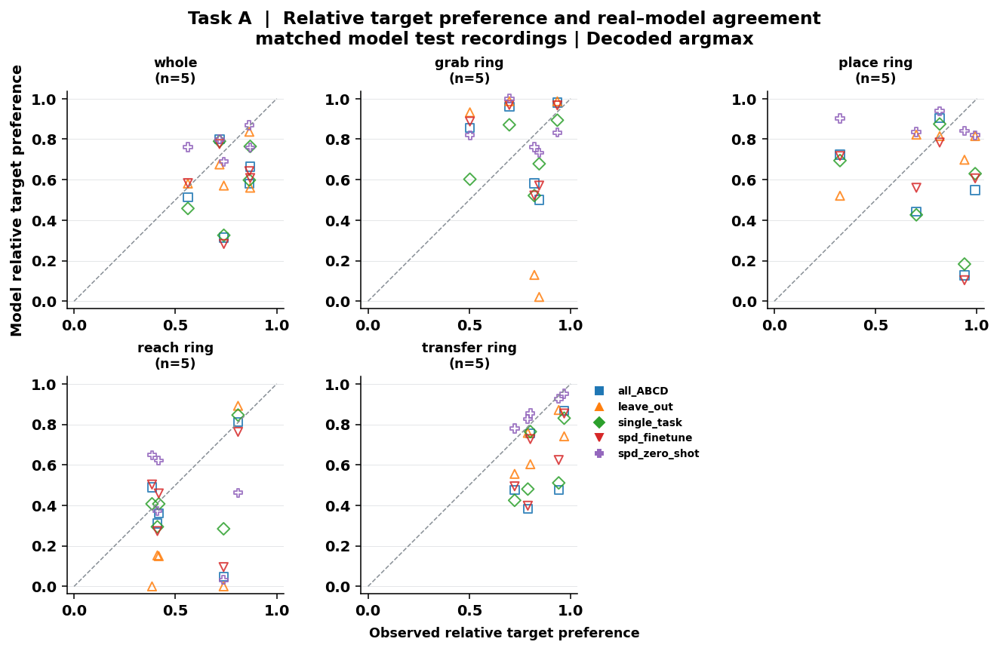

**图中内容**：横轴是真实gaze，纵轴是模型的参与者均值；虚线y=x为完全一致。下方代表模型低估，上方代表高估。整体与阶段分面展示，非逐帧点散布。

**整体结果**：GT 相对目标偏好 C=75.0%；模型：all_ABCD 57.4%；single_task 58.7%；leave_out 64.5%；spd_finetune 57.8%；spd_zero_shot 77.6%。

**配对偏差（百分点）**：all_ABCD -17.6 [-32.5, -2.0]；single_task -16.3 [-32.2, -3.1]；leave_out -10.6 [-22.4, -1.2]；spd_finetune -17.2 [-33.1, -1.3]；spd_zero_shot 2.5 [-6.3, 12.1]。

**说明**：C评价的是可分辨区域内的相对分配，纵向偏差不能解释成全部观察时间的注意差；需同时看D和目标占用。

数据表：[group_stage_summary.csv](20261105T063658759189Z_v3_full/decoded_argmax/group_stage_summary.csv)；[model_error_summary.csv](20261105T063658759189Z_v3_full/decoded_argmax/model_error_summary.csv)。

#### 图M046｜Task A｜argmax 解码｜腕部占用：GT–模型一致性

**图中内容**：横轴是真实gaze，纵轴是模型的参与者均值；虚线y=x为完全一致。下方代表模型低估，上方代表高估。整体与阶段分面展示，非逐帧点散布。

**整体结果**：GT 腕部占用=9.8%；模型：all_ABCD 17.4%；single_task 16.9%；leave_out 8.9%；spd_finetune 17.3%；spd_zero_shot 5.0%。

**配对偏差（百分点）**：all_ABCD 7.6 [1.4, 15.6]；single_task 7.2 [1.7, 14.6]；leave_out -0.8 [-6.6, 4.5]；spd_finetune 7.5 [1.2, 15.9]；spd_zero_shot -4.8 [-11.2, -0.2]。

**说明**：腕部点的绝对数值较低时，视觉上靠近原点不等于误差可以忽略；须按配对差及CI判断。

数据表：[group_stage_summary.csv](20261105T063658759189Z_v3_full/decoded_argmax/group_stage_summary.csv)；[model_error_summary.csv](20261105T063658759189Z_v3_full/decoded_argmax/model_error_summary.csv)。

#### 图M047｜Task A｜argmax 解码｜目标占用：GT–模型一致性

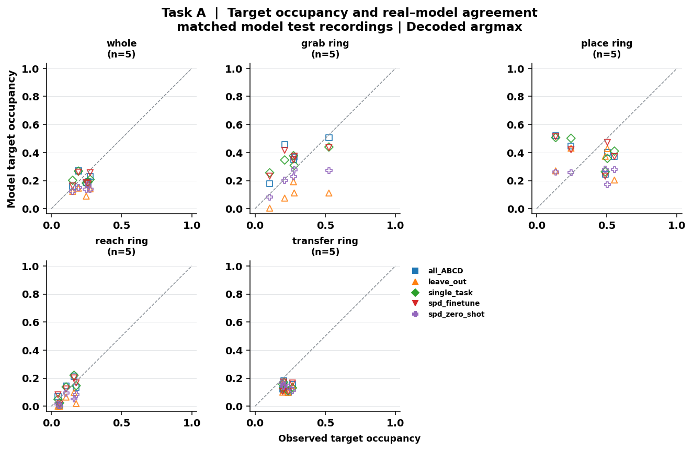

**图中内容**：横轴是真实gaze，纵轴是模型的参与者均值；虚线y=x为完全一致。下方代表模型低估，上方代表高估。整体与阶段分面展示，非逐帧点散布。

**整体结果**：GT 目标占用=22.6%；模型：all_ABCD 20.7%；single_task 21.0%；leave_out 13.4%；spd_finetune 20.9%；spd_zero_shot 14.4%。

**配对偏差（百分点）**：all_ABCD -1.9 [-6.3, 3.5]；single_task -1.6 [-6.9, 4.1]；leave_out -9.2 [-13.6, -4.8]；spd_finetune -1.7 [-6.2, 3.1]；spd_zero_shot -8.2 [-11.7, -4.7]。

**说明**：整体均值中5/5模型的目标占用低于GT，其余应按图及配对差分开判断；均值靠近对角线仍不保证逐帧预测正确。

数据表：[group_stage_summary.csv](20261105T063658759189Z_v3_full/decoded_argmax/group_stage_summary.csv)；[model_error_summary.csv](20261105T063658759189Z_v3_full/decoded_argmax/model_error_summary.csv)。

#### 图M048｜Task A｜argmax 解码｜Brier skill及区间

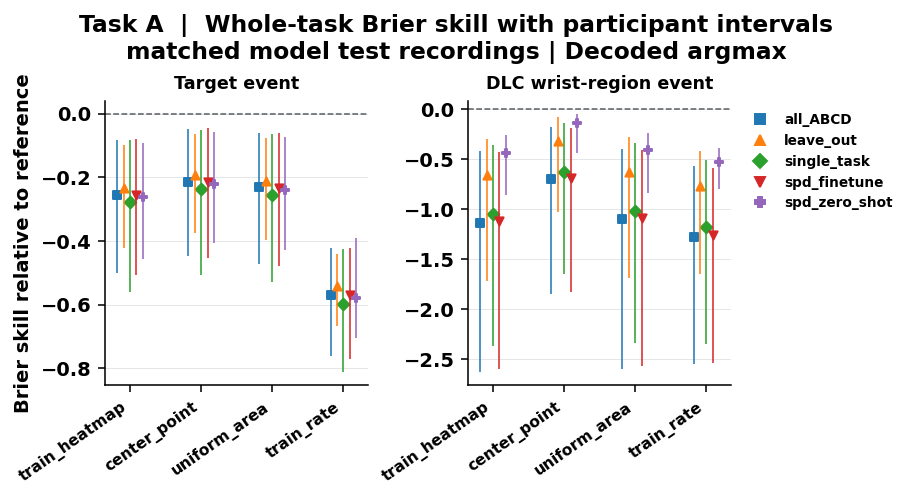

**图中内容**：左面板目标事件，右面板腕部事件；横轴参照基线，纵轴BSS，竖线是参与者bootstrap CI，虚线0表示与基线相当。值越高越好，CI不跨0才有较明确方向。

**target**：train_heatmap: -0.278–-0.233（0/5全正、5/5全负）；center_point: -0.236–-0.193（0/5全正、5/5全负）；uniform_area: -0.254–-0.211（0/5全正、5/5全负）；train_rate: -0.598–-0.542（0/5全正、5/5全负）。

**gripper**：train_heatmap: -1.138–-0.437（0/5全正、5/5全负）；center_point: -0.702–-0.144（0/5全正、5/5全负）；uniform_area: -1.102–-0.413（0/5全正、5/5全负）；train_rate: -1.277–-0.531（0/5全正、5/5全负）。

**说明**：硬点决策的BSS多数低于0；区域占用更接近GT不能抵消逐帧硬分类的代价。

数据表：[group_stage_summary.csv](20261105T063658759189Z_v3_full/decoded_argmax/group_stage_summary.csv)；[model_error_summary.csv](20261105T063658759189Z_v3_full/decoded_argmax/model_error_summary.csv)。

#### 图M049｜Task A｜argmax 解码｜四状态混淆

**图中内容**：每个面板一模型，行是真实T/P/O/N，列是预测T/P/O/N；颜色/单元值是给定真实类别后的条件概率（按录像、参与者逐层平均）。对角线是该类正确命中，T→N是目标独占被判成其他。

| 模型 | T→T % | T→N % | P→P % | O→O % | N→N % |
| --- | --- | --- | --- | --- | --- |
| all_ABCD | 28.5 | 50.0 | 20.8 | 23.0 | 73.4 |
| single_task | 29.0 | 49.2 | 20.1 | 31.5 | 73.6 |
| leave_out | 16.2 | 74.9 | 11.3 | 7.0 | 83.1 |
| spd_finetune | 28.4 | 50.4 | 20.3 | 27.5 | 73.4 |
| spd_zero_shot | 18.4 | 76.3 | 3.8 | 13.4 | 83.7 |

**说明**：N→N通常较高而T/P/O对角线较低，说明大量“其他”帧容易命中，但目标相关类别仍易漏掉；不能靠总体准确率证明目标锁定能力。这里T→T不是含重叠的完整目标召回率。

数据表：[group_stage_summary.csv](20261105T063658759189Z_v3_full/decoded_argmax/group_stage_summary.csv)；[confusion_summary.csv](20261105T063658759189Z_v3_full/decoded_argmax/confusion_summary.csv)。

#### 图M050｜Task A｜argmax 解码｜驻留与切换

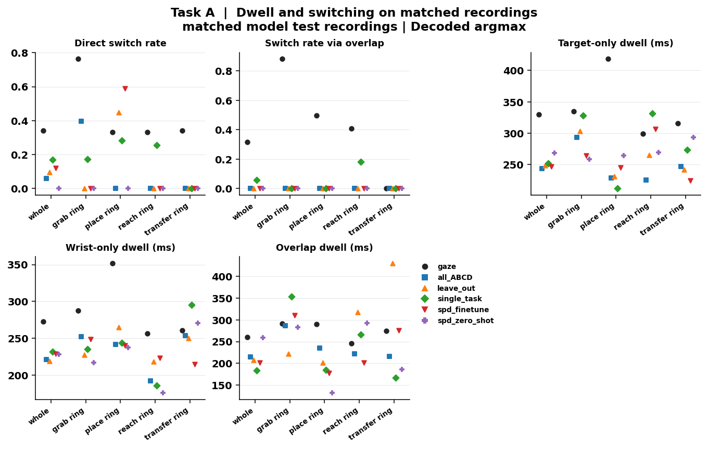

**图中内容**：五个面板分别为直接切换率、经重叠切换率、T/P/O驻留中位时长的参与者均值；横轴整体与阶段，各颜色代表来源。达到120 ms门槛的观察段进入驻留统计；边界或缺失截断段达到门槛仍纳入。

| 来源 | 直接/min | 经O/min | T ms | P ms | O ms |
| --- | --- | --- | --- | --- | --- |
| gaze | 0.341 | 0.318 | 329.6 | 272.7 | 259.7 |
| all_ABCD | 0.060 | 0.000 | 243.9 | 221.4 | 214.3 |
| single_task | 0.170 | 0.059 | 251.7 | 231.6 | 184.0 |
| leave_out | 0.095 | 0.000 | 248.9 | 219.0 | 207.9 |
| spd_finetune | 0.120 | 0.000 | 247.3 | 228.6 | 201.9 |
| spd_zero_shot | 0.000 | 0.000 | 268.9 | 228.1 | 259.5 |

**说明**：模型切换率与GT有明显差异；驻留相近也不能推出切换过程被重现，且各来源达到时长门槛的观察段数量不同。

数据表：[group_stage_summary.csv](20261105T063658759189Z_v3_full/decoded_argmax/group_stage_summary.csv)；[participant_stage_summary.csv](20261105T063658759189Z_v3_full/decoded_argmax/participant_stage_summary.csv)。

#### 图M051｜Task A｜argmax 解码｜相对目标偏好 C：与成绩的关系

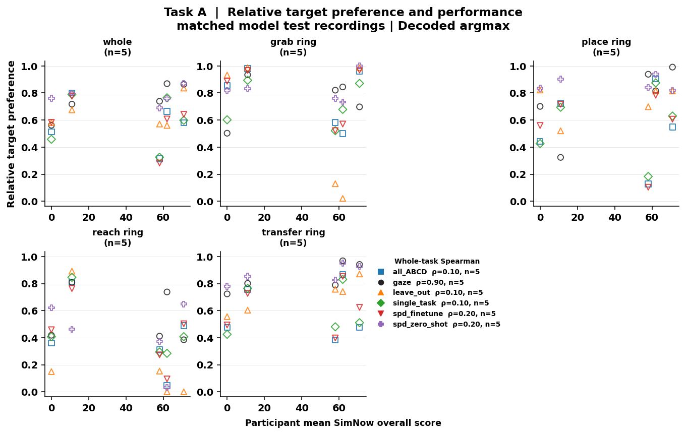

**图中内容**：横轴参与者平均SimNow成绩，纵轴相对目标偏好 C；每个面板为整体或阶段，右侧图例给整体Spearmanρ。相同x上的多个点并非重复测量证据。

**整体ρ及95% CI**：gaze 0.900 [0.111, 1.000]；all_ABCD 0.100 [-1.000, 1.000]；single_task 0.100 [-1.000, 1.000]；leave_out 0.100 [-1.000, 1.000]；spd_finetune 0.200 [-1.000, 1.000]；spd_zero_shot 0.200 [-1.000, 1.000]。

**说明**：只有5名参与者，图示斜向排列和高ρ都可能受个别点影响；C、绝对占用及真实–模型一致性是不同问题。

数据表：[group_stage_summary.csv](20261105T063658759189Z_v3_full/decoded_argmax/group_stage_summary.csv)；[performance_correlations.csv](20261105T063658759189Z_v3_full/decoded_argmax/performance_correlations.csv)。

#### 图M052｜Task A｜argmax 解码｜腕部占用：与成绩的关系

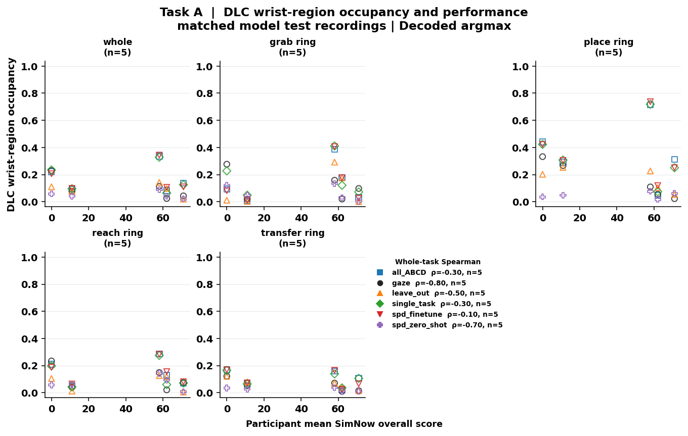

**图中内容**：横轴参与者平均SimNow成绩，纵轴腕部占用；每个面板为整体或阶段，右侧图例给整体Spearmanρ。相同x上的多个点并非重复测量证据。

**整体ρ及95% CI**：gaze -0.800 [-1.000, -0.111]；all_ABCD -0.300 [-1.000, 1.000]；single_task -0.300 [-1.000, 1.000]；leave_out -0.500 [-1.000, 1.000]；spd_finetune -0.100 [-1.000, 1.000]；spd_zero_shot -0.700 [-1.000, 0.875]。

**说明**：只有5名参与者，图示斜向排列和高ρ都可能受个别点影响；C、绝对占用及真实–模型一致性是不同问题。

数据表：[group_stage_summary.csv](20261105T063658759189Z_v3_full/decoded_argmax/group_stage_summary.csv)；[performance_correlations.csv](20261105T063658759189Z_v3_full/decoded_argmax/performance_correlations.csv)。

#### 图M053｜Task A｜argmax 解码｜目标占用：与成绩的关系

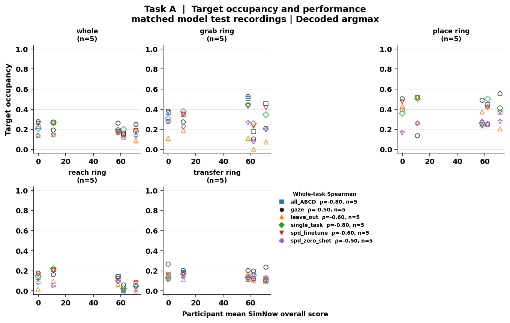

**图中内容**：横轴参与者平均SimNow成绩，纵轴目标占用；每个面板为整体或阶段，右侧图例给整体Spearmanρ。相同x上的多个点并非重复测量证据。

**整体ρ及95% CI**：gaze -0.500 [-1.000, 1.000]；all_ABCD -0.800 [-1.000, -0.111]；single_task -0.800 [-1.000, -0.111]；leave_out -0.600 [-1.000, 1.000]；spd_finetune -0.600 [-1.000, 1.000]；spd_zero_shot -0.500 [-1.000, 1.000]。

**说明**：只有5名参与者，图示斜向排列和高ρ都可能受个别点影响；C、绝对占用及真实–模型一致性是不同问题。

数据表：[group_stage_summary.csv](20261105T063658759189Z_v3_full/decoded_argmax/group_stage_summary.csv)；[performance_correlations.csv](20261105T063658759189Z_v3_full/decoded_argmax/performance_correlations.csv)。

#### 图M054｜Task A｜argmax 解码｜四区域占用

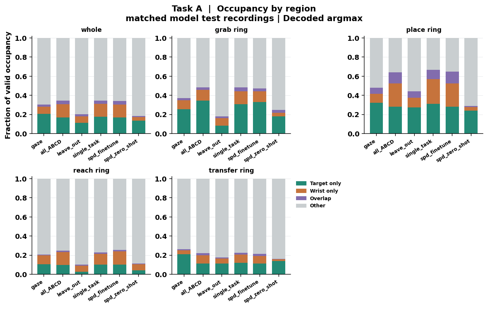

**图中内容**：各面板为整体/阶段，横轴为GT与五模型；堆叠绿色T、橙色P、紫色O、灰色N互斥且总高为1。目标总占用=T+O，腕部总占用=P+O。

**数值观察**：整体 GT 目标22.6%、腕部9.8%、N=69.8%；五模型目标为all_ABCD 20.7%；single_task 21.0%；leave_out 13.4%；spd_finetune 20.9%；spd_zero_shot 14.4%。

**说明**：硬点选择改变了区域占用；即使彩色总量接近GT，仍需结合事件Brier与混淆矩阵判断是否在正确帧命中。Task A的GT绿色目标独占更突出，模型目标偏好不足不能仅归因于两ROI重叠。

数据表：[group_stage_summary.csv](20261105T063658759189Z_v3_full/decoded_argmax/group_stage_summary.csv)；[participant_stage_summary.csv](20261105T063658759189Z_v3_full/decoded_argmax/participant_stage_summary.csv)。

#### 图M055｜Task A｜argmax 解码｜重复轮次

**图中内容**：横轴重复轮次1/2/3，纵轴GT的C，按参与者绘制；每人只有一个测试录像，图中可见的是分散点而不是完整三轮学习轨迹。

**数据支持**：整体第1→3轮匹配人数=0，配对ΔC=NA个百分点。

**说明**：本图不能估计同一参与者的练习变化；不同轮次上不同人的点高低不构成纵向证据。各解码分支此图仍显示GT，而非模型随轮次变化。

数据表：[group_stage_summary.csv](20261105T063658759189Z_v3_full/decoded_argmax/group_stage_summary.csv)；[repetition_contrasts.csv](20261105T063658759189Z_v3_full/decoded_argmax/repetition_contrasts.csv)。

#### 图M056｜Task A｜argmax 解码｜参数与有效性敏感性

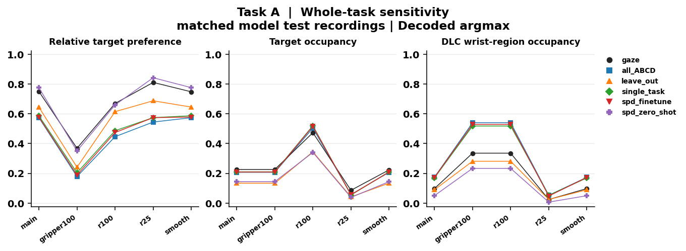

**图中内容**：三个面板依次为C、目标占用、腕部占用；横轴改变ROI半径或平滑条件，线为来源均值。连接线仅便于比较离散条件，不是时间序列。

**GT 条件读数**：main（C=75.0%，目标=22.6%，腕部=9.8%）；gripper100（C=36.9%，目标=22.6%，腕部=33.6%）；r100（C=67.0%，目标=47.3%，腕部=33.6%）；r25（C=81.1%，目标=8.6%，腕部=2.4%）；smooth（C=74.8%，目标=22.3%，腕部=9.8%）。

**模型在main→gripper100的C变化**：all_ABCD 57.4%→17.8%；single_task 58.7%→20.4%；leave_out 64.5%→24.1%；spd_finetune 57.8%→18.9%；spd_zero_shot 77.6%→35.0%。

**说明**：不对称扩大腕部区域显著压低C，体现ROI几何依赖；对称扩大半径则提高占用并改变重叠。所有当前情景均不按valid筛帧；smooth可能补齐短缺口，比较时仍需核对支持集合。

数据表：[group_stage_summary.csv](20261105T063658759189Z_v3_full/decoded_argmax/group_stage_summary.csv)；[participant_stage_summary.csv](20261105T063658759189Z_v3_full/decoded_argmax/participant_stage_summary.csv)。

#### 图M057｜Task C｜argmax 解码｜相对目标偏好 C：GT–模型一致性

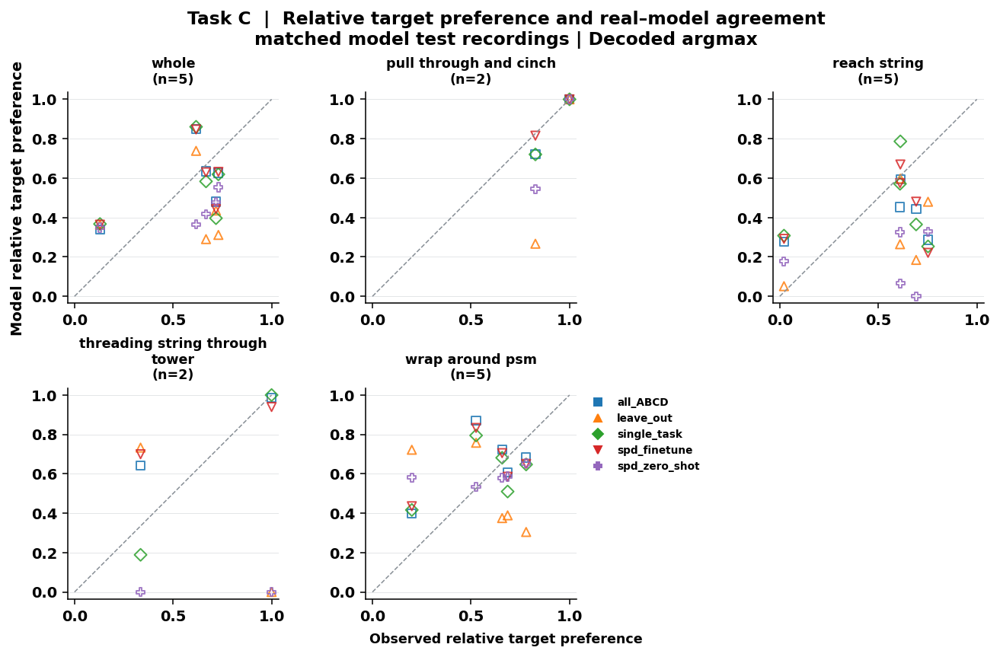

**图中内容**：横轴是真实gaze，纵轴是模型的参与者均值；虚线y=x为完全一致。下方代表模型低估，上方代表高估。整体与阶段分面展示，非逐帧点散布。

**整体结果**：GT 相对目标偏好 C=57.2%；模型：all_ABCD 58.6%；single_task 56.5%；leave_out 42.8%；spd_finetune 58.3%；spd_zero_shot 43.2%。

**配对偏差（百分点）**：all_ABCD 1.4 [-14.3, 16.6]；single_task -0.7 [-19.0, 17.5]；leave_out -14.4 [-37.5, 9.0]；spd_finetune 1.1 [-15.7, 17.8]；spd_zero_shot -14.0 [-24.9, 4.6]。

**说明**：C评价的是可分辨区域内的相对分配，纵向偏差不能解释成全部观察时间的注意差；需同时看D和目标占用。C任务cinch/穿塔阶段可估人数少，不能将个别点推广到全部参与者。

数据表：[group_stage_summary.csv](20261105T063658759189Z_v3_full/decoded_argmax/group_stage_summary.csv)；[model_error_summary.csv](20261105T063658759189Z_v3_full/decoded_argmax/model_error_summary.csv)。

#### 图M058｜Task C｜argmax 解码｜腕部占用：GT–模型一致性

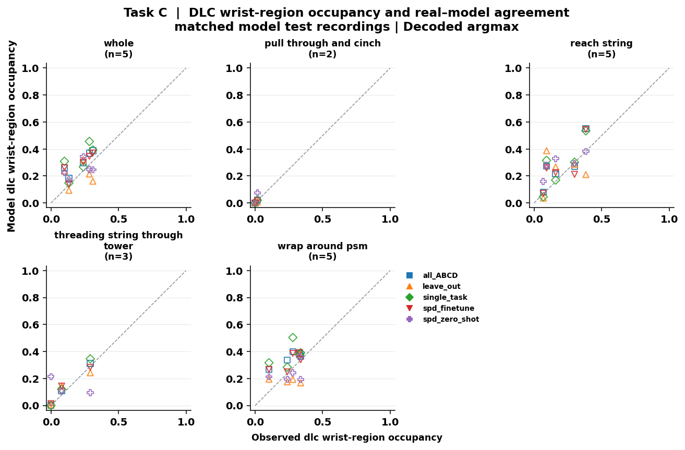

**图中内容**：横轴是真实gaze，纵轴是模型的参与者均值；虚线y=x为完全一致。下方代表模型低估，上方代表高估。整体与阶段分面展示，非逐帧点散布。

**整体结果**：GT 腕部占用=21.3%；模型：all_ABCD 29.9%；single_task 31.5%；leave_out 20.5%；spd_finetune 28.4%；spd_zero_shot 24.7%。

**配对偏差（百分点）**：all_ABCD 8.6 [5.8, 12.6]；single_task 10.2 [3.4, 16.9]；leave_out -0.8 [-9.5, 7.9]；spd_finetune 7.1 [3.1, 12.2]；spd_zero_shot 3.4 [-3.1, 10.0]。

**说明**：腕部点的绝对数值较低时，视觉上靠近原点不等于误差可以忽略；须按配对差及CI判断。C任务cinch/穿塔阶段可估人数少，不能将个别点推广到全部参与者。

数据表：[group_stage_summary.csv](20261105T063658759189Z_v3_full/decoded_argmax/group_stage_summary.csv)；[model_error_summary.csv](20261105T063658759189Z_v3_full/decoded_argmax/model_error_summary.csv)。

#### 图M059｜Task C｜argmax 解码｜目标占用：GT–模型一致性

**图中内容**：横轴是真实gaze，纵轴是模型的参与者均值；虚线y=x为完全一致。下方代表模型低估，上方代表高估。整体与阶段分面展示，非逐帧点散布。

**整体结果**：GT 目标占用=25.9%；模型：all_ABCD 35.2%；single_task 35.4%；leave_out 16.1%；spd_finetune 33.5%；spd_zero_shot 21.2%。

**配对偏差（百分点）**：all_ABCD 9.2 [-1.5, 18.8]；single_task 9.5 [-3.0, 18.6]；leave_out -9.8 [-26.4, 6.2]；spd_finetune 7.6 [-4.6, 17.4]；spd_zero_shot -4.7 [-16.5, 7.9]。

**说明**：整体均值中2/5模型的目标占用低于GT，其余应按图及配对差分开判断；均值靠近对角线仍不保证逐帧预测正确。C任务cinch/穿塔阶段可估人数少，不能将个别点推广到全部参与者。

数据表：[group_stage_summary.csv](20261105T063658759189Z_v3_full/decoded_argmax/group_stage_summary.csv)；[model_error_summary.csv](20261105T063658759189Z_v3_full/decoded_argmax/model_error_summary.csv)。

#### 图M060｜Task C｜argmax 解码｜Brier skill及区间

**图中内容**：左面板目标事件，右面板腕部事件；横轴参照基线，纵轴BSS，竖线是参与者bootstrap CI，虚线0表示与基线相当。值越高越好，CI不跨0才有较明确方向。

**target**：train_heatmap: -0.298–-0.210（0/5全正、1/5全负）；center_point: -0.247–-0.163（0/5全正、0/5全负）；uniform_area: -0.235–-0.152（0/5全正、0/5全负）；train_rate: -0.644–-0.532（0/5全正、5/5全负）。

**gripper**：train_heatmap: -0.655–-0.483（0/5全正、5/5全负）；center_point: -0.485–-0.330（0/5全正、3/5全负）；uniform_area: -0.535–-0.375（0/5全正、5/5全负）；train_rate: -0.905–-0.706（0/5全正、5/5全负）。

**说明**：硬点决策的BSS多数低于0；区域占用更接近GT不能抵消逐帧硬分类的代价。

数据表：[group_stage_summary.csv](20261105T063658759189Z_v3_full/decoded_argmax/group_stage_summary.csv)；[model_error_summary.csv](20261105T063658759189Z_v3_full/decoded_argmax/model_error_summary.csv)。

#### 图M061｜Task C｜argmax 解码｜四状态混淆

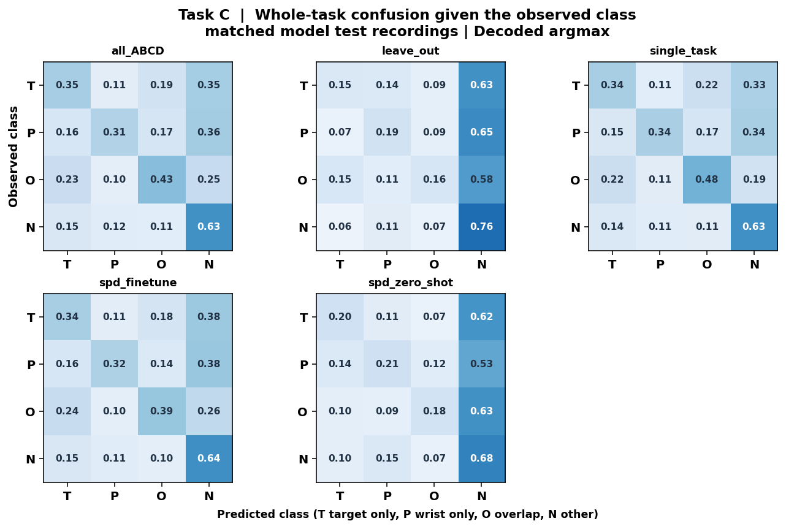

**图中内容**：每个面板一模型，行是真实T/P/O/N，列是预测T/P/O/N；颜色/单元值是给定真实类别后的条件概率（按录像、参与者逐层平均）。对角线是该类正确命中，T→N是目标独占被判成其他。

| 模型 | T→T % | T→N % | P→P % | O→O % | N→N % |
| --- | --- | --- | --- | --- | --- |
| all_ABCD | 35.0 | 35.3 | 31.4 | 42.8 | 62.8 |
| single_task | 34.4 | 33.1 | 33.8 | 47.8 | 63.2 |
| leave_out | 14.7 | 62.6 | 18.9 | 15.9 | 76.2 |
| spd_finetune | 34.3 | 37.6 | 32.2 | 39.3 | 63.6 |
| spd_zero_shot | 20.1 | 61.7 | 21.1 | 18.4 | 68.2 |

**说明**：N→N通常较高而T/P/O对角线较低，说明大量“其他”帧容易命中，但目标相关类别仍易漏掉；不能靠总体准确率证明目标锁定能力。这里T→T不是含重叠的完整目标召回率。

数据表：[group_stage_summary.csv](20261105T063658759189Z_v3_full/decoded_argmax/group_stage_summary.csv)；[confusion_summary.csv](20261105T063658759189Z_v3_full/decoded_argmax/confusion_summary.csv)。

#### 图M062｜Task C｜argmax 解码｜驻留与切换

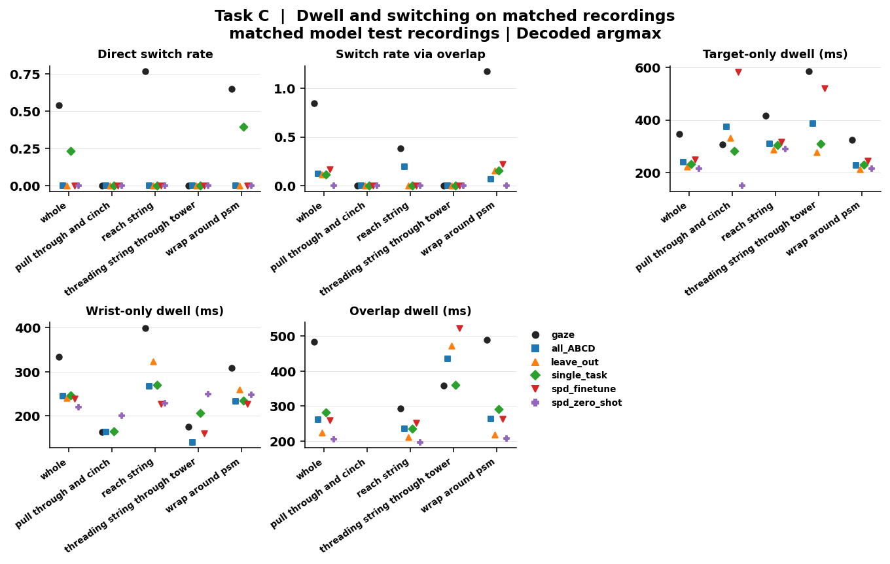

**图中内容**：五个面板分别为直接切换率、经重叠切换率、T/P/O驻留中位时长的参与者均值；横轴整体与阶段，各颜色代表来源。达到120 ms门槛的观察段进入驻留统计；边界或缺失截断段达到门槛仍纳入。

| 来源 | 直接/min | 经O/min | T ms | P ms | O ms |
| --- | --- | --- | --- | --- | --- |
| gaze | 0.541 | 0.849 | 347.1 | 334.5 | 484.3 |
| all_ABCD | 0.000 | 0.121 | 238.4 | 245.6 | 261.1 |
| single_task | 0.231 | 0.114 | 232.7 | 247.3 | 282.6 |
| leave_out | 0.000 | 0.114 | 221.7 | 240.8 | 224.3 |
| spd_finetune | 0.000 | 0.165 | 249.5 | 239.8 | 259.0 |
| spd_zero_shot | 0.000 | 0.000 | 215.5 | 220.4 | 204.7 |

**说明**：模型切换率与GT有明显差异；驻留相近也不能推出切换过程被重现，且各来源达到时长门槛的观察段数量不同。

数据表：[group_stage_summary.csv](20261105T063658759189Z_v3_full/decoded_argmax/group_stage_summary.csv)；[participant_stage_summary.csv](20261105T063658759189Z_v3_full/decoded_argmax/participant_stage_summary.csv)。

#### 图M063｜Task C｜argmax 解码｜相对目标偏好 C：与成绩的关系

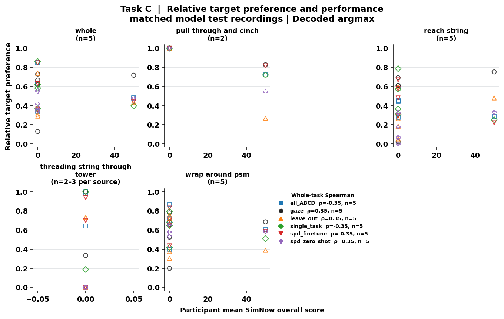

**图中内容**：横轴参与者平均SimNow成绩，纵轴相对目标偏好 C；每个面板为整体或阶段，右侧图例给整体Spearmanρ。相同x上的多个点并非重复测量证据。

**整体ρ及95% CI**：gaze 0.354 [-0.395, 1.000]；all_ABCD -0.354 [-1.000, 0.395]；single_task -0.354 [-1.000, 0.395]；leave_out 0.354 [-0.395, 1.000]；spd_finetune -0.354 [-1.000, 0.395]；spd_zero_shot 0.354 [-0.395, 1.000]。

**说明**：测试成绩仅两个不同取值，大量点竖直堆叠；部分bootstrap因分数不变而无定义。较高ρ不能证明连续技能水平识别，cinch/穿塔阶段不足以稳定估相关。

数据表：[group_stage_summary.csv](20261105T063658759189Z_v3_full/decoded_argmax/group_stage_summary.csv)；[performance_correlations.csv](20261105T063658759189Z_v3_full/decoded_argmax/performance_correlations.csv)。

#### 图M064｜Task C｜argmax 解码｜腕部占用：与成绩的关系

**图中内容**：横轴参与者平均SimNow成绩，纵轴腕部占用；每个面板为整体或阶段，右侧图例给整体Spearmanρ。相同x上的多个点并非重复测量证据。

**整体ρ及95% CI**：gaze 0.707 [0.707, 1.000]；all_ABCD 0.707 [0.707, 1.000]；single_task 0.354 [-0.395, 1.000]；leave_out -0.354 [-1.000, 0.395]；spd_finetune 0.707 [0.707, 1.000]；spd_zero_shot 0.000 [-1.000, 1.000]。

**说明**：测试成绩仅两个不同取值，大量点竖直堆叠；部分bootstrap因分数不变而无定义。较高ρ不能证明连续技能水平识别，cinch/穿塔阶段不足以稳定估相关。

数据表：[group_stage_summary.csv](20261105T063658759189Z_v3_full/decoded_argmax/group_stage_summary.csv)；[performance_correlations.csv](20261105T063658759189Z_v3_full/decoded_argmax/performance_correlations.csv)。

#### 图M065｜Task C｜argmax 解码｜目标占用：与成绩的关系

**图中内容**：横轴参与者平均SimNow成绩，纵轴目标占用；每个面板为整体或阶段，右侧图例给整体Spearmanρ。相同x上的多个点并非重复测量证据。

**整体ρ及95% CI**：gaze 0.707 [0.707, 1.000]；all_ABCD 0.000 [-1.000, 1.000]；single_task -0.354 [-1.000, 0.395]；leave_out -0.354 [-1.000, 0.395]；spd_finetune -0.354 [-1.000, 0.395]；spd_zero_shot 0.000 [-1.000, 1.000]。

**说明**：测试成绩仅两个不同取值，大量点竖直堆叠；部分bootstrap因分数不变而无定义。较高ρ不能证明连续技能水平识别，cinch/穿塔阶段不足以稳定估相关。

数据表：[group_stage_summary.csv](20261105T063658759189Z_v3_full/decoded_argmax/group_stage_summary.csv)；[performance_correlations.csv](20261105T063658759189Z_v3_full/decoded_argmax/performance_correlations.csv)。

#### 图M066｜Task C｜argmax 解码｜四区域占用

**图中内容**：各面板为整体/阶段，横轴为GT与五模型；堆叠绿色T、橙色P、紫色O、灰色N互斥且总高为1。目标总占用=T+O，腕部总占用=P+O。

**数值观察**：整体 GT 目标25.9%、腕部21.3%、N=64.3%；五模型目标为all_ABCD 35.2%；single_task 35.4%；leave_out 16.1%；spd_finetune 33.5%；spd_zero_shot 21.2%。

**说明**：硬点选择改变了区域占用；即使彩色总量接近GT，仍需结合事件Brier与混淆矩阵判断是否在正确帧命中。Task C中紫色重叠较明显，O不能用来区分目标与腕部偏好。

数据表：[group_stage_summary.csv](20261105T063658759189Z_v3_full/decoded_argmax/group_stage_summary.csv)；[participant_stage_summary.csv](20261105T063658759189Z_v3_full/decoded_argmax/participant_stage_summary.csv)。

#### 图M067｜Task C｜argmax 解码｜重复轮次

**图中内容**：横轴重复轮次1/2/3，纵轴GT的C，按参与者绘制；每人只有一个测试录像，图中可见的是分散点而不是完整三轮学习轨迹。

**数据支持**：整体第1→3轮匹配人数=0，配对ΔC=NA个百分点。

**说明**：本图不能估计同一参与者的练习变化；不同轮次上不同人的点高低不构成纵向证据。各解码分支此图仍显示GT，而非模型随轮次变化。

数据表：[group_stage_summary.csv](20261105T063658759189Z_v3_full/decoded_argmax/group_stage_summary.csv)；[repetition_contrasts.csv](20261105T063658759189Z_v3_full/decoded_argmax/repetition_contrasts.csv)。

#### 图M068｜Task C｜argmax 解码｜参数与有效性敏感性

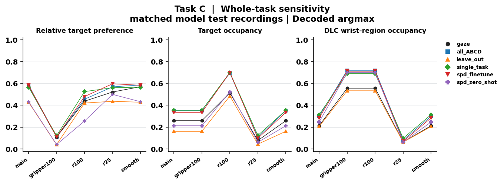

**图中内容**：三个面板依次为C、目标占用、腕部占用；横轴改变ROI半径或平滑条件，线为来源均值。连接线仅便于比较离散条件，不是时间序列。

**GT 条件读数**：main（C=57.2%，目标=25.9%，腕部=21.3%）；gripper100（C=10.9%，目标=25.9%，腕部=55.6%）；r100（C=43.7%，目标=51.3%，腕部=55.6%）；r25（C=52.2%，目标=7.7%，腕部=6.3%）；smooth（C=57.0%，目标=25.9%，腕部=21.3%）。

**模型在main→gripper100的C变化**：all_ABCD 58.6%→11.1%；single_task 56.5%→12.1%；leave_out 42.8%→3.9%；spd_finetune 58.3%→10.9%；spd_zero_shot 43.2%→4.0%。

**说明**：不对称扩大腕部区域显著压低C，体现ROI几何依赖；对称扩大半径则提高占用并改变重叠。所有当前情景均不按valid筛帧；smooth可能补齐短缺口，比较时仍需核对支持集合。

数据表：[group_stage_summary.csv](20261105T063658759189Z_v3_full/decoded_argmax/group_stage_summary.csv)；[participant_stage_summary.csv](20261105T063658759189Z_v3_full/decoded_argmax/participant_stage_summary.csv)。

### 逐帧随机点解码

#### 图M069｜Task A｜逐帧随机点解码｜相对目标偏好 C：GT–模型一致性

**图中内容**：横轴是真实gaze，纵轴是模型的参与者均值；虚线y=x为完全一致。下方代表模型低估，上方代表高估。整体与阶段分面展示，非逐帧点散布。

**整体结果**：GT 相对目标偏好 C=75.0%；模型：all_ABCD 47.9%；single_task 48.8%；leave_out 50.5%；spd_finetune 47.4%；spd_zero_shot 58.5%。

**配对偏差（百分点）**：all_ABCD -27.2 [-36.8, -17.5]；single_task -26.3 [-36.5, -16.1]；leave_out -24.5 [-31.9, -16.6]；spd_finetune -27.7 [-38.3, -16.4]；spd_zero_shot -16.6 [-25.0, -8.1]。

**说明**：C评价的是可分辨区域内的相对分配，纵向偏差不能解释成全部观察时间的注意差；需同时看D和目标占用。

数据表：[group_stage_summary.csv](20261105T063658759189Z_v3_full/decoded_sample/group_stage_summary.csv)；[model_error_summary.csv](20261105T063658759189Z_v3_full/decoded_sample/model_error_summary.csv)。

#### 图M070｜Task A｜逐帧随机点解码｜腕部占用：GT–模型一致性

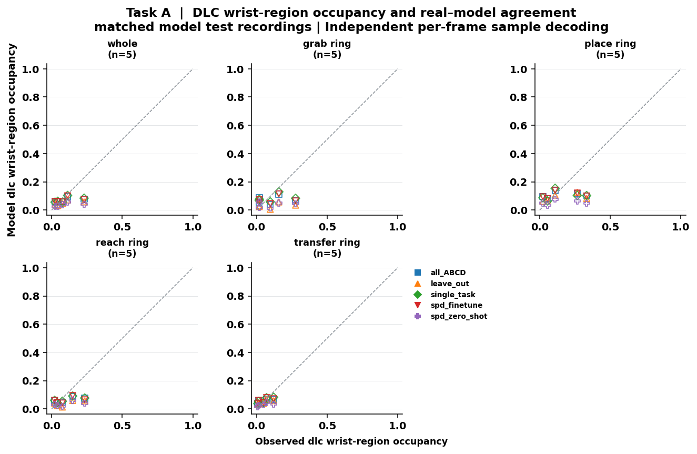

**图中内容**：横轴是真实gaze，纵轴是模型的参与者均值；虚线y=x为完全一致。下方代表模型低估，上方代表高估。整体与阶段分面展示，非逐帧点散布。

**整体结果**：GT 腕部占用=9.8%；模型：all_ABCD 7.0%；single_task 7.2%；leave_out 5.0%；spd_finetune 7.1%；spd_zero_shot 3.7%。

**配对偏差（百分点）**：all_ABCD -2.7 [-9.2, 2.2]；single_task -2.5 [-8.6, 1.9]；leave_out -4.8 [-11.2, 0.0]；spd_finetune -2.7 [-9.3, 2.1]；spd_zero_shot -6.0 [-12.5, -1.4]。

**说明**：腕部点的绝对数值较低时，视觉上靠近原点不等于误差可以忽略；须按配对差及CI判断。

数据表：[group_stage_summary.csv](20261105T063658759189Z_v3_full/decoded_sample/group_stage_summary.csv)；[model_error_summary.csv](20261105T063658759189Z_v3_full/decoded_sample/model_error_summary.csv)。

#### 图M071｜Task A｜逐帧随机点解码｜目标占用：GT–模型一致性

**图中内容**：横轴是真实gaze，纵轴是模型的参与者均值；虚线y=x为完全一致。下方代表模型低估，上方代表高估。整体与阶段分面展示，非逐帧点散布。

**整体结果**：GT 目标占用=22.6%；模型：all_ABCD 6.5%；single_task 6.9%；leave_out 5.0%；spd_finetune 6.4%；spd_zero_shot 5.1%。

**配对偏差（百分点）**：all_ABCD -16.1 [-20.4, -11.4]；single_task -15.7 [-20.2, -11.0]；leave_out -17.6 [-21.6, -13.0]；spd_finetune -16.2 [-20.4, -11.8]；spd_zero_shot -17.5 [-22.0, -12.5]。

**说明**：整体均值中5/5模型的目标占用低于GT，其余应按图及配对差分开判断；均值靠近对角线仍不保证逐帧预测正确。

数据表：[group_stage_summary.csv](20261105T063658759189Z_v3_full/decoded_sample/group_stage_summary.csv)；[model_error_summary.csv](20261105T063658759189Z_v3_full/decoded_sample/model_error_summary.csv)。

#### 图M072｜Task A｜逐帧随机点解码｜Brier skill及区间

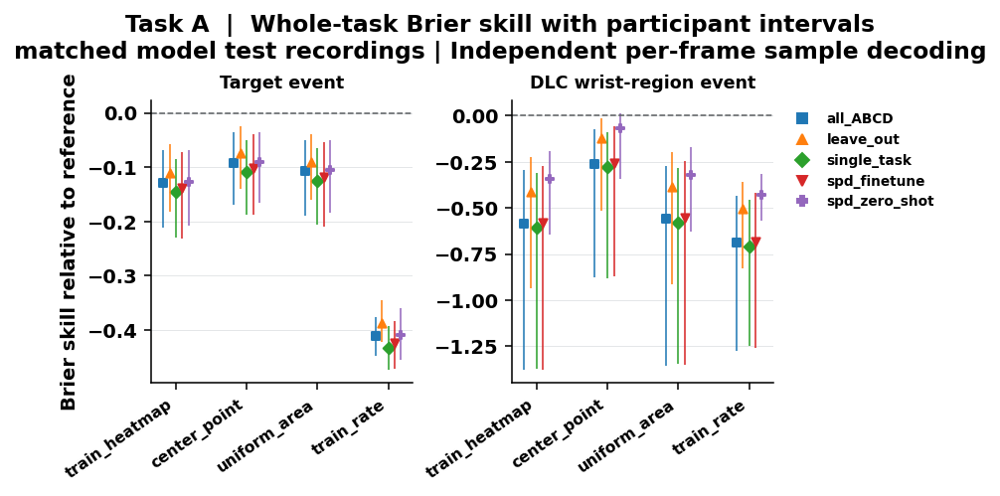

**图中内容**：左面板目标事件，右面板腕部事件；横轴参照基线，纵轴BSS，竖线是参与者bootstrap CI，虚线0表示与基线相当。值越高越好，CI不跨0才有较明确方向。

**target**：train_heatmap: -0.146–-0.110（0/5全正、5/5全负）；center_point: -0.109–-0.074（0/5全正、5/5全负）；uniform_area: -0.125–-0.090（0/5全正、5/5全负）；train_rate: -0.433–-0.388（0/5全正、5/5全负）。

**gripper**：train_heatmap: -0.607–-0.341（0/5全正、5/5全负）；center_point: -0.280–-0.068（0/5全正、4/5全负）；uniform_area: -0.580–-0.319（0/5全正、5/5全负）；train_rate: -0.712–-0.429（0/5全正、5/5全负）。

**说明**：硬点决策的BSS多数低于0；区域占用更接近GT不能抵消逐帧硬分类的代价。

数据表：[group_stage_summary.csv](20261105T063658759189Z_v3_full/decoded_sample/group_stage_summary.csv)；[model_error_summary.csv](20261105T063658759189Z_v3_full/decoded_sample/model_error_summary.csv)。

#### 图M073｜Task A｜逐帧随机点解码｜四状态混淆

**图中内容**：每个面板一模型，行是真实T/P/O/N，列是预测T/P/O/N；颜色/单元值是给定真实类别后的条件概率（按录像、参与者逐层平均）。对角线是该类正确命中，T→N是目标独占被判成其他。

| 模型 | T→T % | T→N % | P→P % | O→O % | N→N % |
| --- | --- | --- | --- | --- | --- |
| all_ABCD | 8.9 | 83.2 | 8.3 | 4.9 | 88.5 |
| single_task | 9.0 | 83.1 | 7.2 | 3.7 | 87.8 |
| leave_out | 6.4 | 87.8 | 5.8 | 2.8 | 91.7 |
| spd_finetune | 8.0 | 84.3 | 8.7 | 8.2 | 88.5 |
| spd_zero_shot | 6.3 | 89.8 | 3.5 | 3.7 | 92.2 |

**说明**：N→N通常较高而T/P/O对角线较低，说明大量“其他”帧容易命中，但目标相关类别仍易漏掉；不能靠总体准确率证明目标锁定能力。这里T→T不是含重叠的完整目标召回率。

数据表：[group_stage_summary.csv](20261105T063658759189Z_v3_full/decoded_sample/group_stage_summary.csv)；[confusion_summary.csv](20261105T063658759189Z_v3_full/decoded_sample/confusion_summary.csv)。

#### 图M074｜Task A｜逐帧随机点解码｜驻留与切换

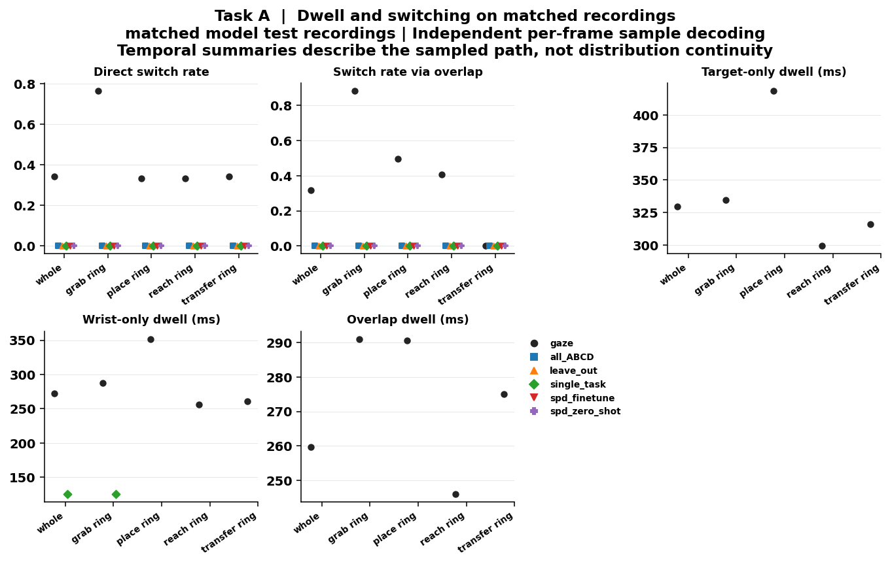

**图中内容**：五个面板分别为直接切换率、经重叠切换率、T/P/O驻留中位时长的参与者均值；横轴整体与阶段，各颜色代表来源。达到120 ms门槛的观察段进入驻留统计；边界或缺失截断段达到门槛仍纳入。

| 来源 | 直接/min | 经O/min | T ms | P ms | O ms |
| --- | --- | --- | --- | --- | --- |
| gaze | 0.341 | 0.318 | 329.6 | 272.7 | 259.7 |
| all_ABCD | 0.000 | 0.000 | NA | NA | NA |
| single_task | 0.000 | 0.000 | NA | 125.5 | NA |
| leave_out | 0.000 | 0.000 | NA | NA | NA |
| spd_finetune | 0.000 | 0.000 | NA | NA | NA |
| spd_zero_shot | 0.000 | 0.000 | NA | NA | NA |

**说明**：逐帧随机点没有连续轨迹身份，短段多被阈值剔除，NA和接近0切换率是该解码规则的诊断，不是预测分布稳定的证明。

数据表：[group_stage_summary.csv](20261105T063658759189Z_v3_full/decoded_sample/group_stage_summary.csv)；[participant_stage_summary.csv](20261105T063658759189Z_v3_full/decoded_sample/participant_stage_summary.csv)。

#### 图M075｜Task A｜逐帧随机点解码｜相对目标偏好 C：与成绩的关系

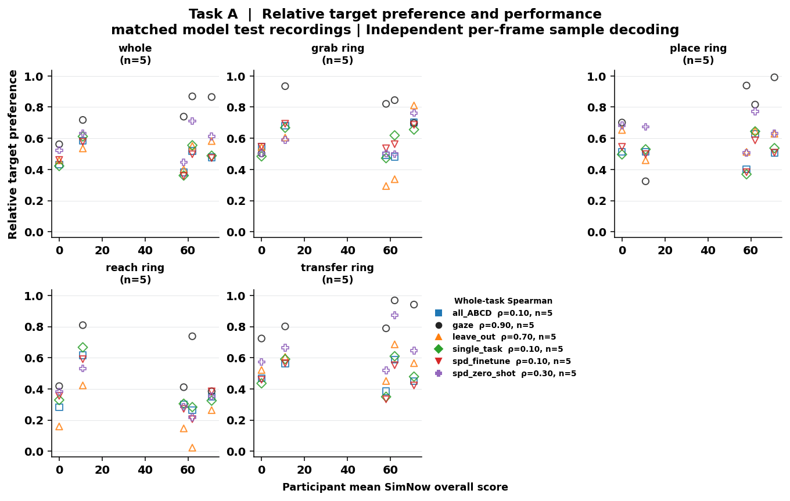

**图中内容**：横轴参与者平均SimNow成绩，纵轴相对目标偏好 C；每个面板为整体或阶段，右侧图例给整体Spearmanρ。相同x上的多个点并非重复测量证据。

**整体ρ及95% CI**：gaze 0.900 [0.111, 1.000]；all_ABCD 0.100 [-1.000, 1.000]；single_task 0.100 [-1.000, 1.000]；leave_out 0.700 [-0.875, 1.000]；spd_finetune 0.100 [-1.000, 1.000]；spd_zero_shot 0.300 [-1.000, 1.000]。

**说明**：只有5名参与者，图示斜向排列和高ρ都可能受个别点影响；C、绝对占用及真实–模型一致性是不同问题。

数据表：[group_stage_summary.csv](20261105T063658759189Z_v3_full/decoded_sample/group_stage_summary.csv)；[performance_correlations.csv](20261105T063658759189Z_v3_full/decoded_sample/performance_correlations.csv)。

#### 图M076｜Task A｜逐帧随机点解码｜腕部占用：与成绩的关系

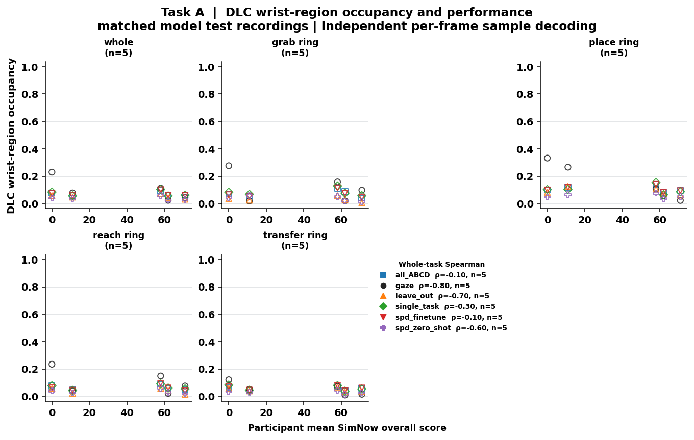

**图中内容**：横轴参与者平均SimNow成绩，纵轴腕部占用；每个面板为整体或阶段，右侧图例给整体Spearmanρ。相同x上的多个点并非重复测量证据。

**整体ρ及95% CI**：gaze -0.800 [-1.000, -0.111]；all_ABCD -0.100 [-1.000, 1.000]；single_task -0.300 [-1.000, 1.000]；leave_out -0.700 [-1.000, 0.875]；spd_finetune -0.100 [-1.000, 1.000]；spd_zero_shot -0.600 [-1.000, 1.000]。

**说明**：只有5名参与者，图示斜向排列和高ρ都可能受个别点影响；C、绝对占用及真实–模型一致性是不同问题。

数据表：[group_stage_summary.csv](20261105T063658759189Z_v3_full/decoded_sample/group_stage_summary.csv)；[performance_correlations.csv](20261105T063658759189Z_v3_full/decoded_sample/performance_correlations.csv)。

#### 图M077｜Task A｜逐帧随机点解码｜目标占用：与成绩的关系

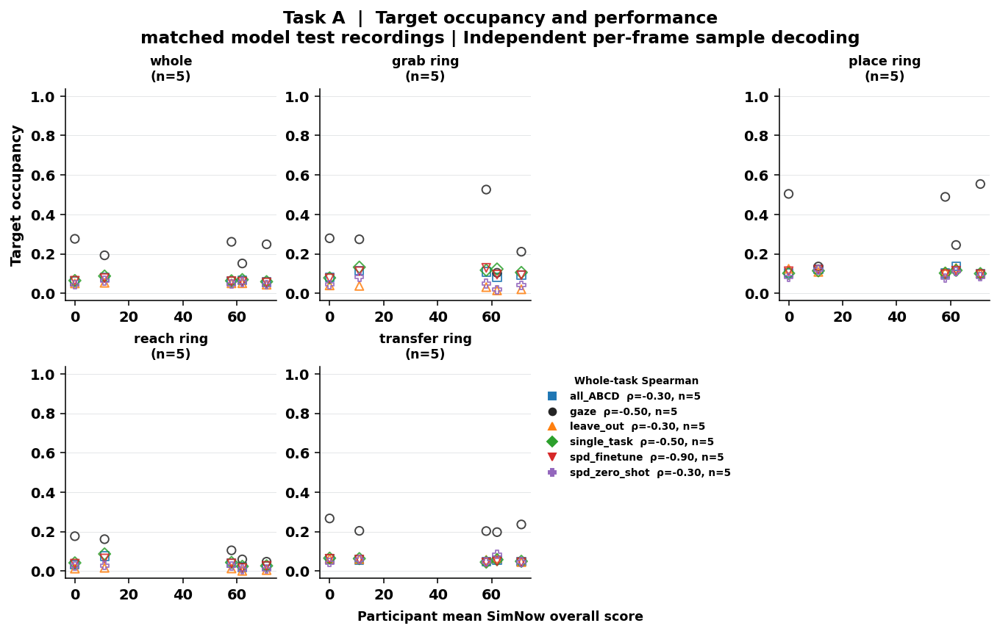

**图中内容**：横轴参与者平均SimNow成绩，纵轴目标占用；每个面板为整体或阶段，右侧图例给整体Spearmanρ。相同x上的多个点并非重复测量证据。

**整体ρ及95% CI**：gaze -0.500 [-1.000, 1.000]；all_ABCD -0.300 [-1.000, 1.000]；single_task -0.500 [-1.000, 1.000]；leave_out -0.300 [-1.000, 1.000]；spd_finetune -0.900 [-1.000, -0.111]；spd_zero_shot -0.300 [-1.000, 1.000]。

**说明**：只有5名参与者，图示斜向排列和高ρ都可能受个别点影响；C、绝对占用及真实–模型一致性是不同问题。

数据表：[group_stage_summary.csv](20261105T063658759189Z_v3_full/decoded_sample/group_stage_summary.csv)；[performance_correlations.csv](20261105T063658759189Z_v3_full/decoded_sample/performance_correlations.csv)。

#### 图M078｜Task A｜逐帧随机点解码｜四区域占用

**图中内容**：各面板为整体/阶段，横轴为GT与五模型；堆叠绿色T、橙色P、紫色O、灰色N互斥且总高为1。目标总占用=T+O，腕部总占用=P+O。

**数值观察**：整体 GT 目标22.6%、腕部9.8%、N=69.8%；五模型目标为all_ABCD 6.5%；single_task 6.9%；leave_out 5.0%；spd_finetune 6.4%；spd_zero_shot 5.1%。

**说明**：大面积灰色表明模型的大部分概率质量落在目标/腕部之外，而GT在操作相关区域更集中。Task A的GT绿色目标独占更突出，模型目标偏好不足不能仅归因于两ROI重叠。

数据表：[group_stage_summary.csv](20261105T063658759189Z_v3_full/decoded_sample/group_stage_summary.csv)；[participant_stage_summary.csv](20261105T063658759189Z_v3_full/decoded_sample/participant_stage_summary.csv)。

#### 图M079｜Task A｜逐帧随机点解码｜重复轮次

**图中内容**：横轴重复轮次1/2/3，纵轴GT的C，按参与者绘制；每人只有一个测试录像，图中可见的是分散点而不是完整三轮学习轨迹。

**数据支持**：整体第1→3轮匹配人数=0，配对ΔC=NA个百分点。

**说明**：本图不能估计同一参与者的练习变化；不同轮次上不同人的点高低不构成纵向证据。各解码分支此图仍显示GT，而非模型随轮次变化。

数据表：[group_stage_summary.csv](20261105T063658759189Z_v3_full/decoded_sample/group_stage_summary.csv)；[repetition_contrasts.csv](20261105T063658759189Z_v3_full/decoded_sample/repetition_contrasts.csv)。

#### 图M080｜Task A｜逐帧随机点解码｜参数与有效性敏感性

**图中内容**：三个面板依次为C、目标占用、腕部占用；横轴改变ROI半径或平滑条件，线为来源均值。连接线仅便于比较离散条件，不是时间序列。

**GT 条件读数**：main（C=75.0%，目标=22.6%，腕部=9.8%）；gripper100（C=36.9%，目标=22.6%，腕部=33.6%）；r100（C=67.0%，目标=47.3%，腕部=33.6%）；r25（C=81.1%，目标=8.6%，腕部=2.4%）；smooth（C=74.8%，目标=22.3%，腕部=9.8%）。

**模型在main→gripper100的C变化**：all_ABCD 47.9%→15.9%；single_task 48.8%→16.4%；leave_out 50.5%→17.1%；spd_finetune 47.4%→15.4%；spd_zero_shot 58.5%→22.1%。

**说明**：不对称扩大腕部区域显著压低C，体现ROI几何依赖；对称扩大半径则提高占用并改变重叠。所有当前情景均不按valid筛帧；smooth可能补齐短缺口，比较时仍需核对支持集合。

数据表：[group_stage_summary.csv](20261105T063658759189Z_v3_full/decoded_sample/group_stage_summary.csv)；[participant_stage_summary.csv](20261105T063658759189Z_v3_full/decoded_sample/participant_stage_summary.csv)。

#### 图M081｜Task C｜逐帧随机点解码｜相对目标偏好 C：GT–模型一致性

**图中内容**：横轴是真实gaze，纵轴是模型的参与者均值；虚线y=x为完全一致。下方代表模型低估，上方代表高估。整体与阶段分面展示，非逐帧点散布。

**整体结果**：GT 相对目标偏好 C=57.2%；模型：all_ABCD 41.4%；single_task 42.6%；leave_out 35.2%；spd_finetune 42.5%；spd_zero_shot 31.8%。

**配对偏差（百分点）**：all_ABCD -15.8 [-29.3, 0.6]；single_task -14.7 [-29.7, 2.7]；leave_out -22.0 [-37.2, -2.7]；spd_finetune -14.7 [-29.0, 2.3]；spd_zero_shot -25.4 [-38.0, -7.0]。

**说明**：C评价的是可分辨区域内的相对分配，纵向偏差不能解释成全部观察时间的注意差；需同时看D和目标占用。C任务cinch/穿塔阶段可估人数少，不能将个别点推广到全部参与者。

数据表：[group_stage_summary.csv](20261105T063658759189Z_v3_full/decoded_sample/group_stage_summary.csv)；[model_error_summary.csv](20261105T063658759189Z_v3_full/decoded_sample/model_error_summary.csv)。

#### 图M082｜Task C｜逐帧随机点解码｜腕部占用：GT–模型一致性

**图中内容**：横轴是真实gaze，纵轴是模型的参与者均值；虚线y=x为完全一致。下方代表模型低估，上方代表高估。整体与阶段分面展示，非逐帧点散布。

**整体结果**：GT 腕部占用=21.3%；模型：all_ABCD 14.4%；single_task 14.8%；leave_out 9.2%；spd_finetune 13.3%；spd_zero_shot 13.7%。

**配对偏差（百分点）**：all_ABCD -6.9 [-12.4, -0.8]；single_task -6.5 [-11.9, 0.0]；leave_out -12.1 [-17.9, -6.0]；spd_finetune -7.9 [-13.5, -2.0]；spd_zero_shot -7.6 [-14.2, -1.1]。

**说明**：腕部点的绝对数值较低时，视觉上靠近原点不等于误差可以忽略；须按配对差及CI判断。C任务cinch/穿塔阶段可估人数少，不能将个别点推广到全部参与者。

数据表：[group_stage_summary.csv](20261105T063658759189Z_v3_full/decoded_sample/group_stage_summary.csv)；[model_error_summary.csv](20261105T063658759189Z_v3_full/decoded_sample/model_error_summary.csv)。

#### 图M083｜Task C｜逐帧随机点解码｜目标占用：GT–模型一致性

**图中内容**：横轴是真实gaze，纵轴是模型的参与者均值；虚线y=x为完全一致。下方代表模型低估，上方代表高估。整体与阶段分面展示，非逐帧点散布。

**整体结果**：GT 目标占用=25.9%；模型：all_ABCD 11.7%；single_task 12.4%；leave_out 6.1%；spd_finetune 11.1%；spd_zero_shot 8.5%。

**配对偏差（百分点）**：all_ABCD -14.3 [-27.1, -2.3]；single_task -13.5 [-26.7, -1.7]；leave_out -19.8 [-33.0, -6.6]；spd_finetune -14.8 [-27.7, -2.9]；spd_zero_shot -17.4 [-30.5, -4.6]。

**说明**：整体均值中5/5模型的目标占用低于GT，其余应按图及配对差分开判断；均值靠近对角线仍不保证逐帧预测正确。C任务cinch/穿塔阶段可估人数少，不能将个别点推广到全部参与者。

数据表：[group_stage_summary.csv](20261105T063658759189Z_v3_full/decoded_sample/group_stage_summary.csv)；[model_error_summary.csv](20261105T063658759189Z_v3_full/decoded_sample/model_error_summary.csv)。

#### 图M084｜Task C｜逐帧随机点解码｜Brier skill及区间

**图中内容**：左面板目标事件，右面板腕部事件；横轴参照基线，纵轴BSS，竖线是参与者bootstrap CI，虚线0表示与基线相当。值越高越好，CI不跨0才有较明确方向。

**target**：train_heatmap: -0.189–-0.144（0/5全正、5/5全负）；center_point: -0.142–-0.100（0/5全正、3/5全负）；uniform_area: -0.131–-0.089（0/5全正、2/5全负）；train_rate: -0.505–-0.449（0/5全正、5/5全负）。

**gripper**：train_heatmap: -0.431–-0.298（0/5全正、5/5全负）；center_point: -0.284–-0.164（0/5全正、5/5全负）；uniform_area: -0.327–-0.203（0/5全正、5/5全负）；train_rate: -0.647–-0.493（0/5全正、5/5全负）。

**说明**：硬点决策的BSS多数低于0；区域占用更接近GT不能抵消逐帧硬分类的代价。

数据表：[group_stage_summary.csv](20261105T063658759189Z_v3_full/decoded_sample/group_stage_summary.csv)；[model_error_summary.csv](20261105T063658759189Z_v3_full/decoded_sample/model_error_summary.csv)。

#### 图M085｜Task C｜逐帧随机点解码｜四状态混淆

**图中内容**：每个面板一模型，行是真实T/P/O/N，列是预测T/P/O/N；颜色/单元值是给定真实类别后的条件概率（按录像、参与者逐层平均）。对角线是该类正确命中，T→N是目标独占被判成其他。

| 模型 | T→T % | T→N % | P→P % | O→O % | N→N % |
| --- | --- | --- | --- | --- | --- |
| all_ABCD | 9.0 | 75.0 | 13.0 | 10.8 | 82.5 |
| single_task | 10.2 | 72.4 | 14.6 | 12.3 | 82.5 |
| leave_out | 5.6 | 84.3 | 8.3 | 5.3 | 89.1 |
| spd_finetune | 9.3 | 77.5 | 14.3 | 10.6 | 83.7 |
| spd_zero_shot | 6.4 | 78.0 | 12.1 | 5.7 | 83.7 |

**说明**：N→N通常较高而T/P/O对角线较低，说明大量“其他”帧容易命中，但目标相关类别仍易漏掉；不能靠总体准确率证明目标锁定能力。这里T→T不是含重叠的完整目标召回率。

数据表：[group_stage_summary.csv](20261105T063658759189Z_v3_full/decoded_sample/group_stage_summary.csv)；[confusion_summary.csv](20261105T063658759189Z_v3_full/decoded_sample/confusion_summary.csv)。

#### 图M086｜Task C｜逐帧随机点解码｜驻留与切换

**图中内容**：五个面板分别为直接切换率、经重叠切换率、T/P/O驻留中位时长的参与者均值；横轴整体与阶段，各颜色代表来源。达到120 ms门槛的观察段进入驻留统计；边界或缺失截断段达到门槛仍纳入。

| 来源 | 直接/min | 经O/min | T ms | P ms | O ms |
| --- | --- | --- | --- | --- | --- |
| gaze | 0.541 | 0.849 | 347.1 | 334.5 | 484.3 |
| all_ABCD | 0.000 | 0.000 | NA | 134.9 | NA |
| single_task | 0.000 | 0.000 | NA | 129.0 | NA |
| leave_out | 0.000 | 0.000 | NA | 137.0 | 150.5 |
| spd_finetune | 0.000 | 0.000 | NA | NA | NA |
| spd_zero_shot | 0.000 | 0.000 | NA | 138.4 | NA |

**说明**：逐帧随机点没有连续轨迹身份，短段多被阈值剔除，NA和接近0切换率是该解码规则的诊断，不是预测分布稳定的证明。

数据表：[group_stage_summary.csv](20261105T063658759189Z_v3_full/decoded_sample/group_stage_summary.csv)；[participant_stage_summary.csv](20261105T063658759189Z_v3_full/decoded_sample/participant_stage_summary.csv)。

#### 图M087｜Task C｜逐帧随机点解码｜相对目标偏好 C：与成绩的关系

**图中内容**：横轴参与者平均SimNow成绩，纵轴相对目标偏好 C；每个面板为整体或阶段，右侧图例给整体Spearmanρ。相同x上的多个点并非重复测量证据。

**整体ρ及95% CI**：gaze 0.354 [-0.395, 1.000]；all_ABCD 0.000 [-1.000, 1.000]；single_task 0.000 [-1.000, 1.000]；leave_out 0.354 [-0.395, 1.000]；spd_finetune 0.000 [-1.000, 1.000]；spd_zero_shot 0.354 [-0.395, 1.000]。

**说明**：测试成绩仅两个不同取值，大量点竖直堆叠；部分bootstrap因分数不变而无定义。较高ρ不能证明连续技能水平识别，cinch/穿塔阶段不足以稳定估相关。

数据表：[group_stage_summary.csv](20261105T063658759189Z_v3_full/decoded_sample/group_stage_summary.csv)；[performance_correlations.csv](20261105T063658759189Z_v3_full/decoded_sample/performance_correlations.csv)。

#### 图M088｜Task C｜逐帧随机点解码｜腕部占用：与成绩的关系

**图中内容**：横轴参与者平均SimNow成绩，纵轴腕部占用；每个面板为整体或阶段，右侧图例给整体Spearmanρ。相同x上的多个点并非重复测量证据。

**整体ρ及95% CI**：gaze 0.707 [0.707, 1.000]；all_ABCD 0.000 [-1.000, 1.000]；single_task 0.354 [-0.395, 1.000]；leave_out 0.354 [-0.395, 1.000]；spd_finetune 0.707 [0.707, 1.000]；spd_zero_shot -0.354 [-1.000, 0.395]。

**说明**：测试成绩仅两个不同取值，大量点竖直堆叠；部分bootstrap因分数不变而无定义。较高ρ不能证明连续技能水平识别，cinch/穿塔阶段不足以稳定估相关。

数据表：[group_stage_summary.csv](20261105T063658759189Z_v3_full/decoded_sample/group_stage_summary.csv)；[performance_correlations.csv](20261105T063658759189Z_v3_full/decoded_sample/performance_correlations.csv)。

#### 图M089｜Task C｜逐帧随机点解码｜目标占用：与成绩的关系

**图中内容**：横轴参与者平均SimNow成绩，纵轴目标占用；每个面板为整体或阶段，右侧图例给整体Spearmanρ。相同x上的多个点并非重复测量证据。

**整体ρ及95% CI**：gaze 0.707 [0.707, 1.000]；all_ABCD 0.354 [-0.395, 1.000]；single_task 0.000 [-1.000, 1.000]；leave_out 0.707 [0.707, 1.000]；spd_finetune 0.354 [-0.395, 1.000]；spd_zero_shot 0.354 [-0.395, 1.000]。

**说明**：测试成绩仅两个不同取值，大量点竖直堆叠；部分bootstrap因分数不变而无定义。较高ρ不能证明连续技能水平识别，cinch/穿塔阶段不足以稳定估相关。

数据表：[group_stage_summary.csv](20261105T063658759189Z_v3_full/decoded_sample/group_stage_summary.csv)；[performance_correlations.csv](20261105T063658759189Z_v3_full/decoded_sample/performance_correlations.csv)。

#### 图M090｜Task C｜逐帧随机点解码｜四区域占用

**图中内容**：各面板为整体/阶段，横轴为GT与五模型；堆叠绿色T、橙色P、紫色O、灰色N互斥且总高为1。目标总占用=T+O，腕部总占用=P+O。

**数值观察**：整体 GT 目标25.9%、腕部21.3%、N=64.3%；五模型目标为all_ABCD 11.7%；single_task 12.4%；leave_out 6.1%；spd_finetune 11.1%；spd_zero_shot 8.5%。

**说明**：大面积灰色表明模型的大部分概率质量落在目标/腕部之外，而GT在操作相关区域更集中。Task C中紫色重叠较明显，O不能用来区分目标与腕部偏好。

数据表：[group_stage_summary.csv](20261105T063658759189Z_v3_full/decoded_sample/group_stage_summary.csv)；[participant_stage_summary.csv](20261105T063658759189Z_v3_full/decoded_sample/participant_stage_summary.csv)。

#### 图M091｜Task C｜逐帧随机点解码｜重复轮次

**图中内容**：横轴重复轮次1/2/3，纵轴GT的C，按参与者绘制；每人只有一个测试录像，图中可见的是分散点而不是完整三轮学习轨迹。

**数据支持**：整体第1→3轮匹配人数=0，配对ΔC=NA个百分点。

**说明**：本图不能估计同一参与者的练习变化；不同轮次上不同人的点高低不构成纵向证据。各解码分支此图仍显示GT，而非模型随轮次变化。

数据表：[group_stage_summary.csv](20261105T063658759189Z_v3_full/decoded_sample/group_stage_summary.csv)；[repetition_contrasts.csv](20261105T063658759189Z_v3_full/decoded_sample/repetition_contrasts.csv)。

#### 图M092｜Task C｜逐帧随机点解码｜参数与有效性敏感性

**图中内容**：三个面板依次为C、目标占用、腕部占用；横轴改变ROI半径或平滑条件，线为来源均值。连接线仅便于比较离散条件，不是时间序列。

**GT 条件读数**：main（C=57.2%，目标=25.9%，腕部=21.3%）；gripper100（C=10.9%，目标=25.9%，腕部=55.6%）；r100（C=43.7%，目标=51.3%，腕部=55.6%）；r25（C=52.2%，目标=7.7%，腕部=6.3%）；smooth（C=57.0%，目标=25.9%，腕部=21.3%）。

**模型在main→gripper100的C变化**：all_ABCD 41.4%→5.4%；single_task 42.6%→6.0%；leave_out 35.2%→4.1%；spd_finetune 42.5%→5.6%；spd_zero_shot 31.8%→3.3%。

**说明**：不对称扩大腕部区域显著压低C，体现ROI几何依赖；对称扩大半径则提高占用并改变重叠。所有当前情景均不按valid筛帧；smooth可能补齐短缺口，比较时仍需核对支持集合。

数据表：[group_stage_summary.csv](20261105T063658759189Z_v3_full/decoded_sample/group_stage_summary.csv)；[participant_stage_summary.csv](20261105T063658759189Z_v3_full/decoded_sample/participant_stage_summary.csv)。

---

## 附录：v3区域叠加图与候选定位质量

下列图是区域定义与定位语义的辅助证据。叠加图使用当前v3保存的代表帧；candidate_validation是沿用的候选人工视觉审查资料，未因本次gaze筛选修复重新取得独立参考真值，候选也未替换主分析腕部点。

| 视觉审查状态 | 侧别数 |
| --- | --- |
| consistent_visible_distal | 11 |
| ambiguous | 7 |
| rejected_not_visible | 5 |
| wrong_proximal | 4 |
| rejected_plausible_distal | 3 |
| rejected_missing_segment | 2 |

候选几何通过并不意味着远端点正确；参考坐标缺失时不能计算正式定位精度。独立侧别数也不是独立录像数。

### 代表帧：User1_1_1_grab_ring

黄色表示已有target槽位及其均值邻域；绿色为双侧DLC腕部邻域；蓝色为gaze。其余标记显示all_ABCD的期望、argmax和独立样本解码。单帧点接近区域不代表完整预测概率质量，也不代表逐时段性能。读图应检查目标与腕部是否重叠、标注是否贴合可见结构，以及器械是否真实可见；区域几何合格不自动保证语义有效。

### 代表帧：User1_1_1_place_ring

黄色表示已有target槽位及其均值邻域；绿色为双侧DLC腕部邻域；蓝色为gaze。其余标记显示all_ABCD的期望、argmax和独立样本解码。单帧点接近区域不代表完整预测概率质量，也不代表逐时段性能。读图应检查目标与腕部是否重叠、标注是否贴合可见结构，以及器械是否真实可见；区域几何合格不自动保证语义有效。

### 代表帧：User1_1_1_reach_ring

黄色表示已有target槽位及其均值邻域；绿色为双侧DLC腕部邻域；蓝色为gaze。其余标记显示all_ABCD的期望、argmax和独立样本解码。单帧点接近区域不代表完整预测概率质量，也不代表逐时段性能。读图应检查目标与腕部是否重叠、标注是否贴合可见结构，以及器械是否真实可见；区域几何合格不自动保证语义有效。

### 代表帧：User1_1_1_transfer_ring

黄色表示已有target槽位及其均值邻域；绿色为双侧DLC腕部邻域；蓝色为gaze。其余标记显示all_ABCD的期望、argmax和独立样本解码。单帧点接近区域不代表完整预测概率质量，也不代表逐时段性能。读图应检查目标与腕部是否重叠、标注是否贴合可见结构，以及器械是否真实可见；区域几何合格不自动保证语义有效。

### 代表帧：User1_5_2_pull_through_and_cinch

黄色表示已有target槽位及其均值邻域；绿色为双侧DLC腕部邻域；蓝色为gaze。其余标记显示all_ABCD的期望、argmax和独立样本解码。单帧点接近区域不代表完整预测概率质量，也不代表逐时段性能。读图应检查目标与腕部是否重叠、标注是否贴合可见结构，以及器械是否真实可见；区域几何合格不自动保证语义有效。

### 代表帧：User1_5_2_reach_string

黄色表示已有target槽位及其均值邻域；绿色为双侧DLC腕部邻域；蓝色为gaze。其余标记显示all_ABCD的期望、argmax和独立样本解码。单帧点接近区域不代表完整预测概率质量，也不代表逐时段性能。读图应检查目标与腕部是否重叠、标注是否贴合可见结构，以及器械是否真实可见；区域几何合格不自动保证语义有效。

### 代表帧：User1_5_2_threading_string_through_tower

黄色表示已有target槽位及其均值邻域；绿色为双侧DLC腕部邻域；蓝色为gaze。其余标记显示all_ABCD的期望、argmax和独立样本解码。单帧点接近区域不代表完整预测概率质量，也不代表逐时段性能。读图应检查目标与腕部是否重叠、标注是否贴合可见结构，以及器械是否真实可见；区域几何合格不自动保证语义有效。

### 代表帧：User1_5_2_wrap_around_psm

黄色表示已有target槽位及其均值邻域；绿色为双侧DLC腕部邻域；蓝色为gaze。其余标记显示all_ABCD的期望、argmax和独立样本解码。单帧点接近区域不代表完整预测概率质量，也不代表逐时段性能。读图应检查目标与腕部是否重叠、标注是否贴合可见结构，以及器械是否真实可见；区域几何合格不自动保证语义有效。

### 候选区域审查：contact_0

该图用于查看样本或掩码格式，不用于估计总体通过率、定位精度或模型性能。逐样本状态见同目录visual_review.csv，掩码存在/分辨率一致不证明逐帧内容同步。

### 候选区域审查：contact_1

该图用于查看样本或掩码格式，不用于估计总体通过率、定位精度或模型性能。逐样本状态见同目录visual_review.csv，掩码存在/分辨率一致不证明逐帧内容同步。

### 候选区域审查：contact_2

该图用于查看样本或掩码格式，不用于估计总体通过率、定位精度或模型性能。逐样本状态见同目录visual_review.csv，掩码存在/分辨率一致不证明逐帧内容同步。

### 候选区域审查：contact_3

该图用于查看样本或掩码格式，不用于估计总体通过率、定位精度或模型性能。逐样本状态见同目录visual_review.csv，掩码存在/分辨率一致不证明逐帧内容同步。

### 候选区域审查：mask_format_preview

该图用于查看样本或掩码格式，不用于估计总体通过率、定位精度或模型性能。逐样本状态见同目录visual_review.csv，掩码存在/分辨率一致不证明逐帧内容同步。

### 候选区域审查：sample_00_User1_1_1_reach_ring

| 侧别 | 几何通过 | 视觉状态 | 已有审查备注 |
| --- | --- | --- | --- |
| l | False | rejected_plausible_distal | Proposed red endpoint appears distal; abstention from weak axial sign. |
| r | True | consistent_visible_distal | Closed visible right jaw; candidate appears near distal endpoint. |

备注来自已保存视觉审查，不是本次新增专家真值。图中候选通过/拒绝与视觉可解释性需分别判断；主分析仍使用DLC腕部邻域。

### 候选区域审查：sample_01_User10_1_1_reach_ring

| 侧别 | 几何通过 | 视觉状态 | 已有审查备注 |
| --- | --- | --- | --- |
| l | True | consistent_visible_distal | Candidate appears near distal endpoint of visible left jaw. |
| r | False | rejected_not_visible | Visible black shaft but identifiable distal metal jaw not available near DLC point. |

备注来自已保存视觉审查，不是本次新增专家真值。图中候选通过/拒绝与视觉可解释性需分别判断；主分析仍使用DLC腕部邻域。

### 候选区域审查：sample_02_User1_1_1_grab_ring

| 侧别 | 几何通过 | 视觉状态 | 已有审查备注 |
| --- | --- | --- | --- |
| l | True | consistent_visible_distal | Candidate appears near visible ring-grasping distal endpoint. |
| r | True | consistent_visible_distal | Closed visible right jaw; candidate appears near distal endpoint. |

备注来自已保存视觉审查，不是本次新增专家真值。图中候选通过/拒绝与视觉可解释性需分别判断；主分析仍使用DLC腕部邻域。

### 候选区域审查：sample_03_User10_1_1_grab_ring

| 侧别 | 几何通过 | 视觉状态 | 已有审查备注 |
| --- | --- | --- | --- |
| l | True | wrong_proximal | Accepted candidate at left image boundary; visible open jaws extend to the right. |
| r | False | rejected_not_visible | No visible distal metal jaw near DLC point on apparent black shaft end. |

备注来自已保存视觉审查，不是本次新增专家真值。图中候选通过/拒绝与视觉可解释性需分别判断；主分析仍使用DLC腕部邻域。

### 候选区域审查：sample_04_User1_1_1_transfer_ring

| 侧别 | 几何通过 | 视觉状态 | 已有审查备注 |
| --- | --- | --- | --- |
| l | True | consistent_visible_distal | Candidate appears at distal jaw within purple ring. |
| r | True | consistent_visible_distal | Candidate appears near visible closed right jaw endpoint. |

备注来自已保存视觉审查，不是本次新增专家真值。图中候选通过/拒绝与视觉可解释性需分别判断；主分析仍使用DLC腕部邻域。

### 候选区域审查：sample_05_User10_1_1_transfer_ring

| 侧别 | 几何通过 | 视觉状态 | 已有审查备注 |
| --- | --- | --- | --- |
| l | True | consistent_visible_distal | Candidate appears near visible distal jaw beside ring; no reference coordinate available. |
| r | False | rejected_missing_segment | Visible right metal instrument has no matching segmented component near wrist. |

备注来自已保存视觉审查，不是本次新增专家真值。图中候选通过/拒绝与视觉可解释性需分别判断；主分析仍使用DLC腕部邻域。

### 候选区域审查：sample_06_User1_1_1_place_ring

| 侧别 | 几何通过 | 视觉状态 | 已有审查备注 |
| --- | --- | --- | --- |
| l | True | ambiguous | Open jaws: candidate selects one prong; canonical jawtip versus midpoint undefined. |
| r | False | rejected_plausible_distal | Proposed red endpoint appears distal; weak axial sign causes rejection. |

备注来自已保存视觉审查，不是本次新增专家真值。图中候选通过/拒绝与视觉可解释性需分别判断；主分析仍使用DLC腕部邻域。

### 候选区域审查：sample_07_User10_1_1_place_ring

| 侧别 | 几何通过 | 视觉状态 | 已有审查备注 |
| --- | --- | --- | --- |
| l | False | ambiguous | Rejected direction; foreshortened tool and ring obscure distal geometry. |
| r | False | rejected_missing_segment | Visible metal instrument lacks matching component near wrist. |

备注来自已保存视觉审查，不是本次新增专家真值。图中候选通过/拒绝与视觉可解释性需分别判断；主分析仍使用DLC腕部邻域。

### 候选区域审查：sample_08_User1_5_2_reach_string

| 侧别 | 几何通过 | 视觉状态 | 已有审查备注 |
| --- | --- | --- | --- |
| l | True | wrong_proximal | Accepted candidate selects wrist underside; visible jaws extend upper-right. |
| r | True | consistent_visible_distal | Candidate appears near closed distal endpoint. |

备注来自已保存视觉审查，不是本次新增专家真值。图中候选通过/拒绝与视觉可解释性需分别判断；主分析仍使用DLC腕部邻域。

### 候选区域审查：sample_09_User10_2_1_reach_string

| 侧别 | 几何通过 | 视觉状态 | 已有审查备注 |
| --- | --- | --- | --- |
| l | True | consistent_visible_distal | Candidate appears near distal jaw grasping suture. |
| r | True | ambiguous | Foreshortened jaw and surrounding loops prevent reliable anatomical endpoint judgment. |

备注来自已保存视觉审查，不是本次新增专家真值。图中候选通过/拒绝与视觉可解释性需分别判断；主分析仍使用DLC腕部邻域。

### 候选区域审查：sample_10_User1_5_2_wrap_around_psm

| 侧别 | 几何通过 | 视觉状态 | 已有审查备注 |
| --- | --- | --- | --- |
| l | True | wrong_proximal | Accepted candidate selects proximal underside; visible jaw extends upper-right. |
| r | False | ambiguous | Rejected candidate lies by jaw and loops; exact jawtip is not established. |

备注来自已保存视觉审查，不是本次新增专家真值。图中候选通过/拒绝与视觉可解释性需分别判断；主分析仍使用DLC腕部邻域。

### 候选区域审查：sample_11_User10_2_1_wrap_around_psm

| 侧别 | 几何通过 | 视觉状态 | 已有审查备注 |
| --- | --- | --- | --- |
| l | True | ambiguous | Instruments and suture cross at candidate; exact jawtip is not established. |
| r | False | rejected_plausible_distal | Proposed endpoint is plausibly distal but instruments overlap and sign is weak. |

备注来自已保存视觉审查，不是本次新增专家真值。图中候选通过/拒绝与视觉可解释性需分别判断；主分析仍使用DLC腕部邻域。

### 候选区域审查：sample_12_User1_5_2_pull_through_and_cinch

| 侧别 | 几何通过 | 视觉状态 | 已有审查备注 |
| --- | --- | --- | --- |
| l | False | rejected_not_visible | Instrument-out-of-view simulator warning; DLC point is on bottom HUD. |
| r | False | rejected_not_visible | Instrument-out-of-view simulator warning; DLC point is on bottom HUD. |

备注来自已保存视觉审查，不是本次新增专家真值。图中候选通过/拒绝与视觉可解释性需分别判断；主分析仍使用DLC腕部邻域。

### 候选区域审查：sample_13_User10_2_1_pull_through_and_cinch

| 侧别 | 几何通过 | 视觉状态 | 已有审查备注 |
| --- | --- | --- | --- |
| l | False | rejected_not_visible | DLC point lies on bottom HUD; only small instrument portion appears at left image edge. |
| r | True | wrong_proximal | Accepted point is at lower image-edge collar; visible jaw extends upper-left. |

备注来自已保存视觉审查，不是本次新增专家真值。图中候选通过/拒绝与视觉可解释性需分别判断；主分析仍使用DLC腕部邻域。

### 候选区域审查：sample_14_User1_5_2_threading_string_through_tower

| 侧别 | 几何通过 | 视觉状态 | 已有审查备注 |
| --- | --- | --- | --- |
| l | True | ambiguous | Open jaws and suture; candidate may select one prong rather than canonical jaw midpoint. |
| r | True | consistent_visible_distal | Candidate appears near visible closed distal jaw endpoint. |

备注来自已保存视觉审查，不是本次新增专家真值。图中候选通过/拒绝与视觉可解释性需分别判断；主分析仍使用DLC腕部邻域。

### 候选区域审查：sample_15_User10_2_2_threading_string_through_tower

| 侧别 | 几何通过 | 视觉状态 | 已有审查备注 |
| --- | --- | --- | --- |
| l | True | consistent_visible_distal | Candidate appears near visible distal endpoint. |
| r | False | ambiguous | Rejected candidate near foreshortened jaw with loops; anatomical endpoint ambiguous. |

备注来自已保存视觉审查，不是本次新增专家真值。图中候选通过/拒绝与视觉可解释性需分别判断；主分析仍使用DLC腕部邻域。

---

## 验证与来源

v3独立验证核对818,734个坐标合格帧，9,400行gaze统计、1,125项概率试次以及44,800项样本帧区域。源码与验证见[配置](20261105T063658759189Z_v3_full/run_config.json)、[独立验证](20261105T063658759189Z_v3_full/independent_validation.json)、[输入审计](20261105T063658759189Z_v3_full/recording_audit.csv)、[预测审计](20261105T063658759189Z_v3_full/prediction_audit.csv)。这些检查支持计算一致性，不证明ROI语义、眼动校准或模型泛化正确。
