# models10 与 GT 对照：指标、结果与全图解读

编制日期：2026-11-05。数据来自本目录已生成的CSV、配置、代码快照和图片；本次汇总没有重跑模型或修改任何原始结果。

**阅读范围：** 本报告嵌入153张原图并逐张解释；另一份报告见[gt84_analysis_zh.md](gt84_analysis_zh.md)。两份报告合计覆盖目录原有全部221张图片（184张统计图、37张叠加/区域审计图），其中37张共享图在两份中重复收入，便于独立阅读。

**版本约定：** 当前结论依据`20261105T063658759189Z_v2_full`；`20261105T033217114891Z_full`已被原报告标记为superseded，仅作为历史结果展示。两版的有效帧、基线及模型表示不同，不能拼成同一对照表。当前v2的概率主分析与三个点解码分支也必须分别解释。

**图片阅读：** 图片使用标准Markdown内嵌语法和相对于本文件的路径。请将本文件保留在`target_locking_analysis`根目录，使用支持本地图片的Markdown预览打开；如移动报告，应保留两个运行子目录的相对位置。图上个别标题拥挤时，以图旁正文及原始CSV数值为准。

## 阅读导航

- [models10 的范围及主要结论](#section-001)
- [主概率质量：整体与阶段结果](#section-002)
- [配对误差、概率事件损失与模型间比较](#section-008)
- [点解码为什么不能替代概率分析](#section-013)
- [成绩相关、敏感性与可推广范围](#section-016)
- [结论及解释边界](#section-019)
- [指标与计算方法：完整阅读字典](#section-020)
- [配对图册：全部116张图片及逐图解释](#section-030)
- [附录：共享区域叠加图与定位质量审计（37张）](#section-152)

---

## models10 的范围及主要结论

本报告中的 **models10 指 10 段留出测试录像**，不是 10 个模型。实际比较五种来源：`all_ABCD`、`single_task`、`leave_out`、`spd_finetune`、`spd_zero_shot`。每种来源覆盖 10 段录像，合计 50 份预测；Task A 与 Task C 各 5 段、各 5 名参与者。两任务合计为 7 名不同参与者（User1、User7、User12 跨任务出现），不能当作 10 名独立受试者。

**核心结论：五模型的主概率质量均低估目标邻域占用；single_task 的目标 Brier 点估计最低，但并不支持所有任务、指标上的唯一赢家。模型能够优于若干简单空间基线，却没有普遍优于训练事件频率基线。期望点或 argmax 更接近 GT 的占用率，不等价于其逐帧事件预测更准确。**

主结论来自 `20261105T063658759189Z_v2_full/main_probability`。旧版仅在图册末尾保留，明确作为历史结果；新版三种点解码分支是同帧支持下的诊断。全部 116 张配对图在下方按分支逐张嵌入，每张图均给出读法、定量观察及结论边界。

| 任务 | 测试录像 |
| --- | --- |
| A | User1_1_1、User7_1_1、User9_7_1、User11_6_1、User12_3_1 |
| C | User1_5_2、User5_3_2、User6_1_2、User7_4_1、User12_5_2 |

| 任务 | 共同有效帧 | 共同有效秒 | 测试录像/人数 |
| --- | --- | --- | --- |
| A | 58649 | 1250.9 | 5 / 5 |
| C | 36186 | 835.8 | 5 / 5 |

模型与 GT 的差值只使用 `paired_test` 的同一共同有效帧；gt84 的 `real_all` 不能直接充当模型误差的分母。主半径为目标/腕部各 50 px，gaze 使用状态 2/3，按真实帧间隔加权；随后录像在参与者内等权、参与者之间等权。所有比例表为 %，差值为百分点；方括号是参与者 bootstrap 95% CI（10,000 次，seed=42）。

## 主概率质量：整体与阶段结果

### Task A：整体占用

| 来源 | 目标 % | 腕部 % | 重叠 O % | D % | C % |
| --- | --- | --- | --- | --- | --- |
| gaze | 22.7 [18.2, 26.5]；n=5 | 9.8 [4.3, 16.5]；n=5 | 2.1 [0.3, 4.5]；n=5 | 28.2 [21.9, 33.6]；n=5 | 75.0 [65.4, 84.1]；n=5 |
| all_ABCD | 6.4 [5.8, 7.3]；n=5 | 7.1 [6.2, 8.4]；n=5 | 0.6 [0.2, 1.0]；n=5 | 12.3 [11.5, 13.2]；n=5 | 47.2 [41.4, 52.6]；n=5 |
| single_task | 6.8 [6.2, 7.7]；n=5 | 7.3 [6.0, 8.9]；n=5 | 0.6 [0.2, 1.1]；n=5 | 12.9 [12.0, 13.8]；n=5 | 48.1 [41.7, 54.5]；n=5 |
| leave_out | 4.9 [4.6, 5.3]；n=5 | 4.9 [3.8, 6.1]；n=5 | 0.5 [0.2, 0.8]；n=5 | 8.9 [8.0, 9.7]；n=5 | 50.6 [44.0, 56.6]；n=5 |
| spd_finetune | 6.5 [6.0, 7.3]；n=5 | 7.1 [6.1, 8.4]；n=5 | 0.6 [0.2, 1.0]；n=5 | 12.4 [11.5, 13.2]；n=5 | 47.9 [41.6, 53.4]；n=5 |
| spd_zero_shot | 5.2 [4.6, 6.0]；n=5 | 3.9 [2.9, 4.9]；n=5 | 0.4 [0.1, 0.7]；n=5 | 8.3 [7.2, 9.4]；n=5 | 58.1 [49.8, 65.0]；n=5 |

Task A 的 GT 以目标为主（C=75.0%），五模型 C 仅为47.2%–58.1%；模型并非只整体缩小占用，还压低了可分辨区域内的目标偏好。SPD zero-shot 的 C 最高，却只有5.2%目标占用、8.3%的 D，因此不能以较高 C 判定其最好。

### Task A：逐阶段定位偏差

| 阶段 | 来源 | 目标 % | 腕部 % | C % | D % |
| --- | --- | --- | --- | --- | --- |
| reach ring | gaze | 11.0 [6.4, 15.4]；n=5 | 10.4 [4.0, 17.5]；n=5 | 55.1 [40.1, 71.5]；n=5 | 20.0 [12.1, 28.5]；n=5 |
| reach ring | all_ABCD | 3.7 [2.4, 5.4]；n=5 | 6.3 [5.1, 7.4]；n=5 | 35.6 [26.9, 47.9]；n=5 | 9.6 [8.0, 11.1]；n=5 |
| reach ring | single_task | 4.4 [3.1, 6.1]；n=5 | 6.6 [5.3, 8.0]；n=5 | 38.2 [31.4, 49.5]；n=5 | 10.5 [8.8, 12.1]；n=5 |
| reach ring | leave_out | 1.0 [0.5, 1.5]；n=5 | 3.7 [2.1, 5.2]；n=5 | 21.1 [10.8, 34.0]；n=5 | 4.4 [2.8, 5.9]；n=5 |
| reach ring | spd_finetune | 3.8 [2.4, 5.5]；n=5 | 6.2 [5.2, 7.4]；n=5 | 36.3 [27.2, 47.8]；n=5 | 9.6 [8.0, 11.2]；n=5 |
| reach ring | spd_zero_shot | 1.9 [1.2, 2.7]；n=5 | 3.6 [2.5, 4.8]；n=5 | 33.6 [24.0, 41.6]；n=5 | 5.2 [3.6, 6.6]；n=5 |
| grab ring | gaze | 27.9 [16.9, 41.4]；n=5 | 11.5 [3.5, 20.2]；n=5 | 76.0 [61.9, 87.6]；n=5 | 34.8 [22.2, 48.5]；n=5 |
| grab ring | all_ABCD | 9.7 [8.4, 11.0]；n=5 | 7.4 [5.3, 9.9]；n=5 | 58.0 [50.4, 65.7]；n=5 | 15.9 [13.5, 18.3]；n=5 |
| grab ring | single_task | 10.8 [9.1, 12.4]；n=5 | 8.6 [6.6, 11.1]；n=5 | 56.2 [49.8, 62.8]；n=5 | 18.0 [14.9, 20.8]；n=5 |
| grab ring | leave_out | 2.8 [1.9, 3.8]；n=5 | 3.1 [1.8, 4.4]；n=5 | 49.5 [35.3, 63.6]；n=5 | 5.4 [3.9, 6.6]；n=5 |
| grab ring | spd_finetune | 10.0 [8.8, 11.2]；n=5 | 7.0 [5.0, 9.4]；n=5 | 60.2 [53.1, 67.4]；n=5 | 15.8 [13.7, 18.1]；n=5 |
| grab ring | spd_zero_shot | 5.1 [3.3, 6.8]；n=5 | 3.8 [2.2, 5.3]；n=5 | 58.7 [51.3, 70.3]；n=5 | 8.0 [5.3, 11.1]；n=5 |
| transfer ring | gaze | 22.2 [20.1, 24.7]；n=5 | 5.4 [2.0, 9.0]；n=5 | 84.5 [76.5, 92.7]；n=5 | 25.2 [21.7, 29.2]；n=5 |
| transfer ring | all_ABCD | 5.2 [4.6, 5.8]；n=5 | 5.9 [4.8, 6.9]；n=5 | 46.9 [40.7, 53.2]；n=5 | 10.3 [9.5, 10.9]；n=5 |
| transfer ring | single_task | 5.4 [4.8, 6.0]；n=5 | 5.9 [4.6, 7.3]；n=5 | 48.2 [41.4, 55.7]；n=5 | 10.5 [9.4, 11.5]；n=5 |
| transfer ring | leave_out | 5.6 [5.1, 6.1]；n=5 | 4.6 [3.5, 5.8]；n=5 | 55.9 [49.0, 62.5]；n=5 | 9.5 [8.5, 10.6]；n=5 |
| transfer ring | spd_finetune | 5.2 [4.6, 5.8]；n=5 | 5.9 [4.7, 7.0]；n=5 | 47.2 [40.6, 53.9]；n=5 | 10.2 [9.5, 10.9]；n=5 |
| transfer ring | spd_zero_shot | 5.6 [4.6, 6.7]；n=5 | 3.3 [2.3, 4.3]；n=5 | 63.3 [54.0, 74.4]；n=5 | 8.3 [7.5, 9.0]；n=5 |
| place ring | gaze | 38.7 [23.2, 52.2]；n=5 | 15.7 [5.3, 26.4]；n=5 | 75.4 [52.2, 93.5]；n=5 | 41.5 [34.9, 48.7]；n=5 |
| place ring | all_ABCD | 11.2 [10.3, 12.1]；n=5 | 10.7 [9.1, 12.5]；n=5 | 51.2 [44.9, 57.3]；n=5 | 18.4 [16.1, 20.1]；n=5 |
| place ring | single_task | 11.0 [10.4, 11.5]；n=5 | 10.2 [8.1, 12.6]；n=5 | 52.1 [45.7, 59.2]；n=5 | 17.7 [15.8, 19.0]；n=5 |
| place ring | leave_out | 11.5 [10.8, 12.2]；n=5 | 8.8 [7.0, 10.7]；n=5 | 58.1 [52.9, 63.3]；n=5 | 17.1 [15.1, 19.1]；n=5 |
| place ring | spd_finetune | 11.3 [10.2, 12.3]；n=5 | 10.9 [9.4, 12.6]；n=5 | 50.8 [44.7, 55.8]；n=5 | 18.7 [16.6, 20.7]；n=5 |
| place ring | spd_zero_shot | 9.8 [8.5, 11.4]；n=5 | 5.3 [4.2, 6.6]；n=5 | 66.8 [59.8, 72.5]；n=5 | 13.0 [11.1, 15.0]；n=5 |

**reach ring**：GT 目标占用 11.0%，五模型为 1.0%–4.4%。该阶段 GT 与模型均有5人支持，可用来定位空间分配误差。

**grab ring**：GT 目标占用 27.9%，五模型为 2.8%–10.8%。该阶段 GT 与模型均有5人支持，可用来定位空间分配误差。

**transfer ring**：GT 目标占用 22.2%，五模型为 5.2%–5.6%。该阶段 GT 与模型均有5人支持，可用来定位空间分配误差。

**place ring**：GT 目标占用 38.7%，五模型为 9.8%–11.5%。该阶段 GT 与模型均有5人支持，可用来定位空间分配误差。

### Task C：整体占用

| 来源 | 目标 % | 腕部 % | 重叠 O % | D % | C % |
| --- | --- | --- | --- | --- | --- |
| gaze | 25.9 [12.6, 39.9]；n=5 | 21.3 [14.1, 28.6]；n=5 | 11.5 [5.4, 17.7]；n=5 | 24.2 [16.8, 31.7]；n=5 | 57.2 [34.7, 71.3]；n=5 |
| all_ABCD | 11.8 [10.3, 13.3]；n=5 | 14.7 [12.4, 16.3]；n=5 | 5.5 [4.9, 6.4]；n=5 | 15.4 [13.7, 17.3]；n=5 | 41.2 [32.4, 50.1]；n=5 |
| single_task | 12.1 [10.1, 14.3]；n=5 | 14.7 [11.9, 16.9]；n=5 | 5.7 [4.7, 7.0]；n=5 | 15.4 [13.4, 17.6]；n=5 | 42.0 [33.3, 51.3]；n=5 |
| leave_out | 6.3 [5.1, 7.3]；n=5 | 9.5 [6.8, 11.6]；n=5 | 2.9 [2.1, 3.9]；n=5 | 9.9 [7.6, 11.8]；n=5 | 34.9 [29.9, 40.8]；n=5 |
| spd_finetune | 11.1 [9.7, 12.5]；n=5 | 13.6 [11.7, 15.3]；n=5 | 5.1 [4.6, 5.9]；n=5 | 14.5 [12.7, 16.5]；n=5 | 41.6 [33.3, 50.2]；n=5 |
| spd_zero_shot | 8.7 [7.1, 10.1]；n=5 | 13.8 [11.3, 15.9]；n=5 | 4.1 [3.0, 5.1]；n=5 | 14.3 [12.2, 15.8]；n=5 | 32.2 [27.8, 35.9]；n=5 |

Task C 的目标与腕部区域重叠更明显：GT 的 O=11.5%，模型 O=2.9%–5.7%。五模型 C 都低于 GT 的57.2%，但部分 ΔC 区间跨0；所有模型 Δ目标的区间均为负，目标概率质量不足的证据更一致。

### Task C：逐阶段定位偏差

| 阶段 | 来源 | 目标 % | 腕部 % | C % | D % |
| --- | --- | --- | --- | --- | --- |
| reach string | gaze | 24.8 [7.8, 44.9]；n=5 | 20.0 [9.6, 30.8]；n=5 | 53.7 [27.3, 70.0]；n=5 | 25.7 [17.7, 34.8]；n=5 |
| reach string | all_ABCD | 8.5 [5.4, 11.7]；n=5 | 13.4 [9.5, 16.8]；n=5 | 35.1 [29.8, 39.5]；n=5 | 17.0 [12.6, 20.7]；n=5 |
| reach string | single_task | 8.8 [5.5, 12.1]；n=5 | 13.2 [8.6, 16.9]；n=5 | 36.7 [30.9, 41.2]；n=5 | 16.8 [12.1, 20.8]；n=5 |
| reach string | leave_out | 5.1 [2.8, 7.5]；n=5 | 9.1 [6.3, 10.9]；n=5 | 31.3 [24.9, 38.3]；n=5 | 11.1 [8.0, 13.5]；n=5 |
| reach string | spd_finetune | 8.2 [5.2, 11.1]；n=5 | 12.3 [8.6, 15.9]；n=5 | 36.5 [31.2, 41.1]；n=5 | 16.0 [12.0, 19.6]；n=5 |
| reach string | spd_zero_shot | 5.0 [2.5, 7.5]；n=5 | 13.0 [10.5, 15.2]；n=5 | 21.4 [15.0, 27.7]；n=5 | 14.6 [12.1, 17.1]；n=5 |
| wrap around psm | gaze | 30.1 [17.4, 42.7]；n=5 | 25.7 [17.5, 32.2]；n=5 | 57.0 [38.1, 71.8]；n=5 | 26.7 [18.7, 35.1]；n=5 |
| wrap around psm | all_ABCD | 14.9 [13.2, 17.2]；n=5 | 17.5 [15.7, 19.4]；n=5 | 42.0 [33.6, 50.0]；n=5 | 16.2 [14.3, 18.0]；n=5 |
| wrap around psm | single_task | 14.9 [13.1, 16.8]；n=5 | 17.6 [16.0, 19.1]；n=5 | 41.7 [34.3, 48.9]；n=5 | 16.2 [14.1, 18.0]；n=5 |
| wrap around psm | leave_out | 7.7 [6.1, 10.2]；n=5 | 10.9 [8.3, 13.6]；n=5 | 35.3 [30.5, 41.5]；n=5 | 10.1 [8.1, 12.1]；n=5 |
| wrap around psm | spd_finetune | 13.9 [12.0, 16.4]；n=5 | 16.3 [14.4, 18.0]；n=5 | 42.0 [34.4, 49.7]；n=5 | 15.1 [12.9, 17.0]；n=5 |
| wrap around psm | spd_zero_shot | 11.5 [10.3, 13.0]；n=5 | 15.6 [13.2, 18.5]；n=5 | 36.6 [32.6, 40.7]；n=5 | 15.1 [14.1, 16.1]；n=5 |
| pull through and cinch | gaze | 10.5 [8.1, 12.9]；n=2 | 0.9 [0.0, 1.7]；n=2 | 91.3 [82.7, 100.0]；n=2 | 11.3 [9.8, 12.9]；n=2 |
| pull through and cinch | all_ABCD | 12.5 [6.1, 18.8]；n=2 | 1.8 [0.1, 3.6]；n=2 | 81.6 [63.6, 99.5]；n=2 | 14.2 [9.4, 18.9]；n=2 |
| pull through and cinch | single_task | 13.7 [6.8, 20.6]；n=2 | 1.7 [0.0, 3.4]；n=2 | 83.6 [67.5, 99.8]；n=2 | 15.2 [9.7, 20.7]；n=2 |
| pull through and cinch | leave_out | 5.0 [3.8, 6.2]；n=2 | 1.2 [0.3, 2.1]；n=2 | 80.2 [64.9, 95.5]；n=2 | 6.1 [5.8, 6.5]；n=2 |
| pull through and cinch | spd_finetune | 12.6 [5.8, 19.4]；n=2 | 1.9 [0.1, 3.8]；n=2 | 80.3 [60.9, 99.7]；n=2 | 14.4 [9.3, 19.4]；n=2 |
| pull through and cinch | spd_zero_shot | 6.4 [5.7, 7.1]；n=2 | 3.1 [0.7, 5.6]；n=2 | 70.7 [50.4, 91.0]；n=2 | 9.3 [7.8, 10.8]；n=2 |
| threading string through tower | gaze | 12.0 [6.8, 21.4]；n=3 | 12.3 [0.0, 29.1]；n=3 | 66.8 [33.5, 100.0]；n=2 | 10.1 [0.0, 23.4]；n=3 |
| threading string through tower | all_ABCD | 6.1 [2.7, 11.2]；n=3 | 6.9 [1.9, 12.7]；n=3 | 39.6 [15.5, 58.3]；n=3 | 7.3 [2.4, 14.9]；n=3 |
| threading string through tower | single_task | 5.5 [3.5, 9.3]；n=3 | 5.1 [1.2, 10.1]；n=3 | 49.0 [23.4, 76.6]；n=3 | 6.4 [1.3, 12.9]；n=3 |
| threading string through tower | leave_out | 5.8 [0.5, 11.6]；n=3 | 7.4 [1.4, 13.1]；n=3 | 27.4 [11.5, 45.4]；n=3 | 6.9 [1.9, 15.7]；n=3 |
| threading string through tower | spd_finetune | 6.0 [3.1, 11.1]；n=3 | 6.7 [2.9, 12.1]；n=3 | 38.1 [15.8, 51.9]；n=3 | 7.5 [2.2, 14.3]；n=3 |
| threading string through tower | spd_zero_shot | 2.0 [0.4, 4.2]；n=3 | 6.1 [3.9, 8.9]；n=3 | 12.2 [2.6, 25.4]；n=3 | 6.0 [4.0, 9.7]；n=3 |

**reach string**：GT 目标占用 24.8%，五模型为 5.0%–8.8%。该阶段 GT 与模型均有5人支持，可用来定位空间分配误差。

**wrap around psm**：GT 目标占用 30.1%，五模型为 7.7%–14.9%。该阶段 GT 与模型均有5人支持，可用来定位空间分配误差。

**pull through and cinch**：GT 目标占用 10.5%，五模型为 5.0%–13.7%。该阶段只覆盖少量有效参与者，C 的可估人数还可能少于占用人数；高/低比例不能代表完整阶段。

**threading string through tower**：GT 目标占用 12.0%，五模型为 2.0%–6.1%。该阶段只覆盖少量有效参与者，C 的可估人数还可能少于占用人数；高/低比例不能代表完整阶段。

### 面积修正与互斥分区

下表保留全部四状态及面积修正指标的整体点估计。`L_T/L_P/L_O/L_N` 互斥且合计100%；目标占用包括 O，腕部占用也包括 O，所以二者之和不表示联合占用。面积修正控制 ROI 大小，不校正标注语义、追踪偏差或遮挡。`B` 是 L_T−L_P，`B_excess` 再减面积差。

Task A（单位均按100倍显示；B为百分点尺度）：

| 来源 | T | P | O | N | C_U | C_excess | E_target | E_gripper | B | B_excess |
| --- | --- | --- | --- | --- | --- | --- | --- | --- | --- | --- |
| gaze | 20.5 | 7.6 | 2.1 | 69.7 | 33.1 | 42.0 | 22.1 | 8.6 | 12.9 | 13.5 |
| all_ABCD | 5.8 | 6.5 | 0.6 | 87.0 | 33.1 | 14.1 | 5.8 | 6.0 | -0.7 | -0.1 |
| single_task | 6.2 | 6.7 | 0.6 | 86.5 | 33.1 | 15.0 | 6.2 | 6.1 | -0.5 | 0.1 |
| leave_out | 4.5 | 4.4 | 0.5 | 90.6 | 33.1 | 17.5 | 4.3 | 3.8 | 0.0 | 0.6 |
| spd_finetune | 5.9 | 6.4 | 0.6 | 87.0 | 33.1 | 14.8 | 5.9 | 5.9 | -0.5 | 0.0 |
| spd_zero_shot | 4.8 | 3.5 | 0.4 | 91.3 | 33.1 | 25.1 | 4.6 | 2.7 | 1.3 | 1.9 |

Task C（单位均按100倍显示；B为百分点尺度）：

| 来源 | T | P | O | N | C_U | C_excess | E_target | E_gripper | B | B_excess |
| --- | --- | --- | --- | --- | --- | --- | --- | --- | --- | --- |
| gaze | 14.4 | 9.8 | 11.5 | 64.3 | 27.8 | 29.4 | 25.3 | 20.1 | 4.6 | 5.2 |
| all_ABCD | 6.3 | 9.1 | 5.5 | 79.0 | 27.8 | 13.4 | 11.3 | 13.5 | -2.8 | -2.2 |
| single_task | 6.4 | 9.0 | 5.7 | 78.9 | 27.8 | 14.2 | 11.5 | 13.5 | -2.6 | -2.0 |
| leave_out | 3.4 | 6.6 | 2.9 | 87.1 | 27.8 | 7.1 | 5.7 | 8.3 | -3.2 | -2.6 |
| spd_finetune | 6.0 | 8.5 | 5.1 | 80.4 | 27.8 | 13.7 | 10.5 | 12.5 | -2.5 | -1.9 |
| spd_zero_shot | 4.6 | 9.7 | 4.1 | 81.6 | 27.8 | 4.3 | 8.1 | 12.7 | -5.1 | -4.6 |

同帧/同区域下所有来源的面积基线相同，故每任务只列一次（%）：

| 任务 | area_T | area_P | area_O | area_N |
| --- | --- | --- | --- | --- |
| A | 0.5653 | 1.1431 | 0.0331 | 98.2584 |
| C | 0.3629 | 0.9318 | 0.2361 | 98.4692 |

GT及模型的E_target/E_gripper通常为正，表示均比整幅图均匀落点更集中在ROI；这与模型仍低估GT不矛盾。B/B_excess记录未归一化的目标–腕部差，C/C_excess则先除以独占区域总量；D较小时二者可能给出不同的强弱印象。本输出未计算像素位置MAE/RMSE或Pearson相关，不能将abs_delta占用误差改称定位RMSE。

## 配对误差、概率事件损失与模型间比较

Δ=模型−GT，负值表示低估；平均绝对差先在配对观察上取绝对值再聚合，不能以均值之差绝对值替代。Brier 越低越好；它检查每帧是否命中目标/腕部的概率误差，并非目标占用均值的偏差。

### Task A：全部主要误差

| 模型 | Δ目标 pp | 绝对Δ目标 pp | Δ腕部 pp | 绝对Δ腕部 pp | ΔC pp | 绝对ΔC pp |
| --- | --- | --- | --- | --- | --- | --- |
| all_ABCD | -16.2 [-20.5, -11.6]；n=5 | 16.2 [11.6, 20.5]；n=5 | -2.6 [-9.3, 2.4]；n=5 | 5.0 [1.8, 10.4]；n=5 | -27.9 [-37.9, -17.5]；n=5 | 27.9 [17.5, 37.9]；n=5 |
| single_task | -15.9 [-20.2, -11.1]；n=5 | 15.9 [11.1, 20.2]；n=5 | -2.5 [-8.7, 2.1]；n=5 | 4.6 [1.6, 9.8]；n=5 | -26.9 [-36.6, -17.3]；n=5 | 26.9 [17.3, 36.6]；n=5 |
| leave_out | -17.7 [-21.7, -13.2]；n=5 | 17.7 [13.2, 21.7]；n=5 | -4.8 [-11.2, -0.1]；n=5 | 5.6 [2.0, 11.5]；n=5 | -24.4 [-32.3, -16.6]；n=5 | 24.4 [16.6, 32.3]；n=5 |
| spd_finetune | -16.2 [-20.5, -11.5]；n=5 | 16.2 [11.5, 20.5]；n=5 | -2.7 [-9.4, 2.3]；n=5 | 4.9 [1.7, 10.5]；n=5 | -27.2 [-37.2, -16.5]；n=5 | 27.2 [16.5, 37.2]；n=5 |
| spd_zero_shot | -17.5 [-21.9, -12.7]；n=5 | 17.5 [12.7, 21.9]；n=5 | -5.9 [-12.3, -1.3]；n=5 | 6.0 [1.5, 12.4]；n=5 | -16.9 [-25.0, -8.7]；n=5 | 16.9 [8.7, 25.0]；n=5 |

| 模型 | 目标 Brier | 腕部 Brier |
| --- | --- | --- |
| all_ABCD | 0.1927 [0.1568, 0.2230]；n=5 | 0.0868 [0.0414, 0.1420]；n=5 |
| single_task | 0.1920 [0.1569, 0.2221]；n=5 | 0.0870 [0.0420, 0.1409]；n=5 |
| leave_out | 0.1997 [0.1644, 0.2292]；n=5 | 0.0885 [0.0423, 0.1448]；n=5 |
| spd_finetune | 0.1933 [0.1582, 0.2232]；n=5 | 0.0869 [0.0413, 0.1420]；n=5 |
| spd_zero_shot | 0.2032 [0.1659, 0.2363]；n=5 | 0.0912 [0.0422, 0.1519]；n=5 |

Task A 五模型目标占用差的95% CI均为负。腕部差异相对较小，all_ABCD、single_task、spd_finetune 的腕部差CI跨0，不能据均值一概判为明确低估。

### Task C：全部主要误差

| 模型 | Δ目标 pp | 绝对Δ目标 pp | Δ腕部 pp | 绝对Δ腕部 pp | ΔC pp | 绝对ΔC pp |
| --- | --- | --- | --- | --- | --- | --- |
| all_ABCD | -14.1 [-27.3, -1.9]；n=5 | 14.6 [2.9, 27.3]；n=5 | -6.6 [-12.3, -0.3]；n=5 | 8.4 [4.5, 12.3]；n=5 | -16.0 [-30.0, 0.9]；n=5 | 21.4 [11.9, 30.0]；n=5 |
| single_task | -13.9 [-26.8, -2.1]；n=5 | 14.2 [2.8, 26.8]；n=5 | -6.6 [-11.9, -0.4]；n=5 | 8.4 [5.0, 12.2]；n=5 | -15.2 [-29.6, 2.2]；n=5 | 21.0 [10.7, 29.6]；n=5 |
| leave_out | -19.7 [-33.0, -6.3]；n=5 | 19.7 [6.3, 33.0]；n=5 | -11.8 [-17.7, -5.6]；n=5 | 11.8 [5.6, 17.7]；n=5 | -22.3 [-37.8, -2.3]；n=5 | 28.5 [19.3, 37.8]；n=5 |
| spd_finetune | -14.8 [-28.0, -2.7]；n=5 | 15.0 [3.2, 28.0]；n=5 | -7.7 [-13.3, -1.6]；n=5 | 8.7 [4.2, 13.3]；n=5 | -15.7 [-30.0, 1.8]；n=5 | 21.6 [12.0, 30.0]；n=5 |
| spd_zero_shot | -17.2 [-30.5, -4.4]；n=5 | 17.7 [5.4, 30.5]；n=5 | -7.5 [-13.9, -0.8]；n=5 | 9.2 [4.9, 13.9]；n=5 | -25.1 [-37.5, -5.6]；n=5 | 29.9 [20.1, 37.5]；n=5 |

| 模型 | 目标 Brier | 腕部 Brier |
| --- | --- | --- |
| all_ABCD | 0.1931 [0.1034, 0.2893]；n=5 | 0.1543 [0.1112, 0.1975]；n=5 |
| single_task | 0.1885 [0.1022, 0.2851]；n=5 | 0.1518 [0.1097, 0.1939]；n=5 |
| leave_out | 0.2240 [0.1128, 0.3360]；n=5 | 0.1730 [0.1217, 0.2242]；n=5 |
| spd_finetune | 0.1959 [0.1039, 0.2949]；n=5 | 0.1556 [0.1120, 0.1992]；n=5 |
| spd_zero_shot | 0.2142 [0.1125, 0.3209]；n=5 | 0.1638 [0.1184, 0.2092]；n=5 |

Task C 五模型目标占用差的95% CI均为负。目标低估幅度13.9–19.7个百分点，腕部低估6.6–11.8个百分点；两种事件需要分别评价。

### 四类基线及 Brier skill

BSS=1−模型 Brier/参照 Brier（在匹配参与者支持上先分别求均值后取比值）。正值优于该参照，负值劣于该参照；CI跨0表示相对优劣仍不确定。`train_heatmap` 积分完整训练平均热图，`center_point` 是固定中心点，`uniform_area` 是均匀落点区域概率，`train_rate` 是训练录像事件频率。GT_smoothed 使用真实 gaze，只作标签平滑诊断，不加入模型排名。

Task A 基线 Brier：

| 参照 | 事件 | Brier [95% CI] |
| --- | --- | --- |
| train_heatmap | target | 0.2200 [0.1762, 0.2576]；n=5 |
| center_point | target | 0.2273 [0.1825, 0.2658]；n=5 |
| uniform_area | target | 0.2241 [0.1799, 0.2623]；n=5 |
| train_rate | target | 0.1758 [0.1532, 0.1953]；n=5 |
| train_heatmap | gripper | 0.0940 [0.0415, 0.1585]；n=5 |
| center_point | gripper | 0.1180 [0.0507, 0.1958]；n=5 |
| uniform_area | gripper | 0.0956 [0.0418, 0.1616]；n=5 |
| train_rate | gripper | 0.0882 [0.0437, 0.1428]；n=5 |

Task A / target BSS：

| 模型 | train_heatmap | center_point | uniform_area | train_rate |
| --- | --- | --- | --- | --- |
| all_ABCD | 0.124 [0.108, 0.134]；n=5 | 0.152 [0.138, 0.161]；n=5 | 0.140 [0.126, 0.150]；n=5 | -0.096 [-0.142, -0.023]；n=5 |
| single_task | 0.127 [0.108, 0.139]；n=5 | 0.156 [0.139, 0.166]；n=5 | 0.143 [0.126, 0.155]；n=5 | -0.092 [-0.137, -0.024]；n=5 |
| leave_out | 0.092 [0.065, 0.116]；n=5 | 0.121 [0.098, 0.143]；n=5 | 0.109 [0.081, 0.132]；n=5 | -0.136 [-0.184, -0.073]；n=5 |
| spd_finetune | 0.121 [0.102, 0.133]；n=5 | 0.150 [0.133, 0.160]；n=5 | 0.137 [0.121, 0.149]；n=5 | -0.100 [-0.143, -0.032]；n=5 |
| spd_zero_shot | 0.076 [0.054, 0.099]；n=5 | 0.106 [0.086, 0.127]；n=5 | 0.093 [0.071, 0.116]；n=5 | -0.156 [-0.210, -0.083]；n=5 |

Task A / gripper BSS：

| 模型 | train_heatmap | center_point | uniform_area | train_rate |
| --- | --- | --- | --- | --- |
| all_ABCD | 0.076 [-0.018, 0.110]；n=5 | 0.264 [0.184, 0.310]；n=5 | 0.092 [-0.011, 0.128]；n=5 | 0.016 [-0.009, 0.055]；n=5 |
| single_task | 0.074 [-0.024, 0.114]；n=5 | 0.262 [0.171, 0.300]；n=5 | 0.089 [-0.013, 0.131]；n=5 | 0.013 [-0.013, 0.039]；n=5 |
| leave_out | 0.059 [-0.020, 0.088]；n=5 | 0.250 [0.165, 0.302]；n=5 | 0.074 [-0.011, 0.105]；n=5 | -0.003 [-0.016, 0.033]；n=5 |
| spd_finetune | 0.075 [-0.014, 0.111]；n=5 | 0.263 [0.185, 0.307]；n=5 | 0.091 [-0.006, 0.127]；n=5 | 0.015 [-0.014, 0.057]；n=5 |
| spd_zero_shot | 0.030 [-0.015, 0.046]；n=5 | 0.227 [0.147, 0.300]；n=5 | 0.046 [-0.009, 0.065]；n=5 | -0.033 [-0.067, 0.048]；n=5 |

Task C 基线 Brier：

| 参照 | 事件 | Brier [95% CI] |
| --- | --- | --- |
| train_heatmap | target | 0.2440 [0.1194, 0.3750]；n=5 |
| center_point | target | 0.2539 [0.1245, 0.3898]；n=5 |
| uniform_area | target | 0.2564 [0.1241, 0.3942]；n=5 |
| train_rate | target | 0.1926 [0.1222, 0.2660]；n=5 |
| train_heatmap | gripper | 0.1930 [0.1282, 0.2578]；n=5 |
| center_point | gripper | 0.2152 [0.1380, 0.2923]；n=5 |
| uniform_area | gripper | 0.2082 [0.1374, 0.2789]；n=5 |
| train_rate | gripper | 0.1677 [0.1264, 0.2090]；n=5 |

Task C / target BSS：

| 模型 | train_heatmap | center_point | uniform_area | train_rate |
| --- | --- | --- | --- | --- |
| all_ABCD | 0.208 [0.134, 0.235]；n=5 | 0.239 [0.169, 0.274]；n=5 | 0.247 [0.167, 0.276]；n=5 | -0.003 [-0.085, 0.157]；n=5 |
| single_task | 0.227 [0.144, 0.264]；n=5 | 0.258 [0.179, 0.286]；n=5 | 0.265 [0.176, 0.305]；n=5 | 0.022 [-0.065, 0.174]；n=5 |
| leave_out | 0.082 [0.051, 0.109]；n=5 | 0.118 [0.059, 0.165]；n=5 | 0.126 [0.086, 0.148]；n=5 | -0.163 [-0.275, 0.077]；n=5 |
| spd_finetune | 0.197 [0.130, 0.221]；n=5 | 0.228 [0.162, 0.268]；n=5 | 0.236 [0.163, 0.262]；n=5 | -0.017 [-0.102, 0.160]；n=5 |
| spd_zero_shot | 0.122 [0.046, 0.152]；n=5 | 0.156 [0.096, 0.184]；n=5 | 0.165 [0.079, 0.200]；n=5 | -0.112 [-0.206, 0.079]；n=5 |

Task C / gripper BSS：

| 模型 | train_heatmap | center_point | uniform_area | train_rate |
| --- | --- | --- | --- | --- |
| all_ABCD | 0.200 [0.118, 0.265]；n=5 | 0.283 [0.179, 0.338]；n=5 | 0.259 [0.184, 0.313]；n=5 | 0.080 [0.029, 0.145]；n=5 |
| single_task | 0.213 [0.126, 0.277]；n=5 | 0.294 [0.199, 0.348]；n=5 | 0.271 [0.197, 0.322]；n=5 | 0.095 [0.040, 0.164]；n=5 |
| leave_out | 0.104 [0.048, 0.161]；n=5 | 0.196 [0.114, 0.245]；n=5 | 0.169 [0.115, 0.216]；n=5 | -0.031 [-0.093, 0.054]；n=5 |
| spd_finetune | 0.194 [0.106, 0.269]；n=5 | 0.277 [0.173, 0.340]；n=5 | 0.252 [0.175, 0.314]；n=5 | 0.072 [0.011, 0.145]；n=5 |
| spd_zero_shot | 0.151 [0.069, 0.212]；n=5 | 0.239 [0.134, 0.295]；n=5 | 0.213 [0.136, 0.265]；n=5 | 0.023 [-0.022, 0.078]；n=5 |

**基线结论**：Task A 五模型目标 BSS 对训练热图、中心点、均匀面积均为正，而对 train_rate 全为负且95% CI不跨0。这说明其事件损失优于这些空间参照，但目标事件概率仍没有超过较强的训练频率参照。Task C 的 single_task 对 train_rate 的目标 BSS=0.022，CI跨0；腕部 BSS=0.095 [0.040, 0.164]，后者存在更明确的增益。不能把“优于中心基线”扩写为“模型整体已准确重现真实注视”。

GT 平滑诊断：

| 任务 | 事件 | Brier [95% CI] |
| --- | --- | --- |
| A | target | 0.0649 [0.0522, 0.0772]；n=5 |
| A | gripper | 0.0340 [0.0171, 0.0536]；n=5 |
| C | target | 0.0753 [0.0405, 0.1102]；n=5 |
| C | gripper | 0.0676 [0.0476, 0.0874]；n=5 |

这些值利用真实 gaze 构造，不能视为可部署基线或严格理论上界。

### 模型两两比较：以配对差而非重叠 CI 排名

Task A 的全部模型 Brier 配对差（A−B；负值有利于A）：

| 模型 A | 模型 B | 指标 | 差值 [95% CI] |
| --- | --- | --- | --- |
| all_ABCD | leave_out | BS_target | -0.0070 [-0.0105, -0.0029]；n=5 |
| all_ABCD | leave_out | BS_gripper | -0.0017 [-0.0035, 0.0002]；n=5 |
| all_ABCD | single_task | BS_target | 0.0008 [-0.0002, 0.0015]；n=5 |
| all_ABCD | single_task | BS_gripper | -0.0002 [-0.0015, 0.0010]；n=5 |
| all_ABCD | spd_finetune | BS_target | -0.0006 [-0.0015, 0.0006]；n=5 |
| all_ABCD | spd_finetune | BS_gripper | -0.0001 [-0.0006, 0.0002]；n=5 |
| all_ABCD | spd_zero_shot | BS_target | -0.0105 [-0.0147, -0.0062]；n=5 |
| all_ABCD | spd_zero_shot | BS_gripper | -0.0044 [-0.0115, 0.0012]；n=5 |
| leave_out | single_task | BS_target | 0.0078 [0.0038, 0.0117]；n=5 |
| leave_out | single_task | BS_gripper | 0.0014 [-0.0003, 0.0042]；n=5 |
| leave_out | spd_finetune | BS_target | 0.0064 [0.0020, 0.0099]；n=5 |
| leave_out | spd_finetune | BS_gripper | 0.0015 [-0.0005, 0.0037]；n=5 |
| leave_out | spd_zero_shot | BS_target | -0.0035 [-0.0065, -0.0012]；n=5 |
| leave_out | spd_zero_shot | BS_gripper | -0.0027 [-0.0080, 0.0011]；n=5 |
| single_task | spd_finetune | BS_target | -0.0013 [-0.0025, 0.0001]；n=5 |
| single_task | spd_finetune | BS_gripper | 0.0001 [-0.0010, 0.0014]；n=5 |
| single_task | spd_zero_shot | BS_target | -0.0112 [-0.0157, -0.0068]；n=5 |
| single_task | spd_zero_shot | BS_gripper | -0.0041 [-0.0121, 0.0013]；n=5 |
| spd_finetune | spd_zero_shot | BS_target | -0.0099 [-0.0151, -0.0051]；n=5 |
| spd_finetune | spd_zero_shot | BS_gripper | -0.0042 [-0.0116, 0.0015]；n=5 |

对 single_task 目标 Brier 的证据：all_ABCD：差值区间跨0；leave_out：single_task较低，区间不跨0；spd_finetune：差值区间跨0；spd_zero_shot：single_task较低，区间不跨0。这些区间未作多重比较校正，作为探索性比较。

Task C 的全部模型 Brier 配对差（A−B；负值有利于A）：

| 模型 A | 模型 B | 指标 | 差值 [95% CI] |
| --- | --- | --- | --- |
| all_ABCD | leave_out | BS_target | -0.0309 [-0.0555, -0.0094]；n=5 |
| all_ABCD | leave_out | BS_gripper | -0.0186 [-0.0270, -0.0089]；n=5 |
| all_ABCD | single_task | BS_target | 0.0046 [0.0008, 0.0106]；n=5 |
| all_ABCD | single_task | BS_gripper | 0.0025 [-0.0002, 0.0052]；n=5 |
| all_ABCD | spd_finetune | BS_target | -0.0028 [-0.0060, 0.0003]；n=5 |
| all_ABCD | spd_finetune | BS_gripper | -0.0013 [-0.0036, 0.0007]；n=5 |
| all_ABCD | spd_zero_shot | BS_target | -0.0210 [-0.0330, -0.0091]；n=5 |
| all_ABCD | spd_zero_shot | BS_gripper | -0.0095 [-0.0135, -0.0049]；n=5 |
| leave_out | single_task | BS_target | 0.0355 [0.0106, 0.0648]；n=5 |
| leave_out | single_task | BS_gripper | 0.0211 [0.0098, 0.0317]；n=5 |
| leave_out | spd_finetune | BS_target | 0.0281 [0.0089, 0.0493]；n=5 |
| leave_out | spd_finetune | BS_gripper | 0.0173 [0.0070, 0.0266]；n=5 |
| leave_out | spd_zero_shot | BS_target | 0.0098 [-0.0021, 0.0257]；n=5 |
| leave_out | spd_zero_shot | BS_gripper | 0.0092 [0.0027, 0.0150]；n=5 |
| single_task | spd_finetune | BS_target | -0.0075 [-0.0164, -0.0017]；n=5 |
| single_task | spd_finetune | BS_gripper | -0.0038 [-0.0085, -0.0006]；n=5 |
| single_task | spd_zero_shot | BS_target | -0.0257 [-0.0411, -0.0103]；n=5 |
| single_task | spd_zero_shot | BS_gripper | -0.0120 [-0.0182, -0.0057]；n=5 |
| spd_finetune | spd_zero_shot | BS_target | -0.0182 [-0.0284, -0.0081]；n=5 |
| spd_finetune | spd_zero_shot | BS_gripper | -0.0082 [-0.0131, -0.0032]；n=5 |

对 single_task 目标 Brier 的证据：all_ABCD：single_task较低，区间不跨0；leave_out：single_task较低，区间不跨0；spd_finetune：single_task较低，区间不跨0；spd_zero_shot：single_task较低，区间不跨0。这些区间未作多重比较校正，作为探索性比较。

## 点解码为什么不能替代概率分析

期望点将多峰分布压成均值坐标，argmax 选择最强网格节点；随机点每帧独立抽取一个保存样本（固定seed）。前三者得到的区域命中是硬事件，概率主分析则平均 K=64 个样本的命中比例。保存 samples 与 probability 热图也可能有有限采样差异，因此分支差异不完全由点选择规则导致。

Task A：分支对照（目标/C 为%，Brier为原值；均为同一共同有效帧）：

| 分支 | 来源 | 目标 % | C % | 目标 Brier | 腕部 Brier |
| --- | --- | --- | --- | --- | --- |
| 主概率质量 | all_ABCD | 6.4 | 47.2 | 0.1927 | 0.0868 |
| 主概率质量 | single_task | 6.8 | 48.1 | 0.1920 | 0.0870 |
| 主概率质量 | leave_out | 4.9 | 50.6 | 0.1997 | 0.0885 |
| 主概率质量 | spd_finetune | 6.5 | 47.9 | 0.1933 | 0.0869 |
| 主概率质量 | spd_zero_shot | 5.2 | 58.1 | 0.2032 | 0.0912 |
| 期望点解码 | all_ABCD | 8.2 | 51.4 | 0.2417 | 0.1349 |
| 期望点解码 | single_task | 11.5 | 63.0 | 0.2432 | 0.1306 |
| 期望点解码 | leave_out | 6.7 | 64.8 | 0.2446 | 0.1263 |
| 期望点解码 | spd_finetune | 10.1 | 59.4 | 0.2471 | 0.1320 |
| 期望点解码 | spd_zero_shot | 4.3 | 78.4 | 0.2446 | 0.1046 |
| argmax 解码 | all_ABCD | 20.7 | 57.4 | 0.2755 | 0.2007 |
| argmax 解码 | single_task | 21.0 | 58.7 | 0.2806 | 0.1924 |
| argmax 解码 | leave_out | 13.4 | 64.4 | 0.2710 | 0.1561 |
| argmax 解码 | spd_finetune | 20.9 | 57.9 | 0.2760 | 0.1992 |
| argmax 解码 | spd_zero_shot | 14.4 | 77.5 | 0.2776 | 0.1351 |
| 逐帧随机点解码 | all_ABCD | 6.5 | 47.9 | 0.2481 | 0.1488 |
| 逐帧随机点解码 | single_task | 6.9 | 48.9 | 0.2519 | 0.1508 |
| 逐帧随机点解码 | leave_out | 5.0 | 50.5 | 0.2440 | 0.1325 |
| 逐帧随机点解码 | spd_finetune | 6.4 | 47.4 | 0.2503 | 0.1482 |
| 逐帧随机点解码 | spd_zero_shot | 5.1 | 58.6 | 0.2478 | 0.1259 |

Task C：分支对照（目标/C 为%，Brier为原值；均为同一共同有效帧）：

| 分支 | 来源 | 目标 % | C % | 目标 Brier | 腕部 Brier |
| --- | --- | --- | --- | --- | --- |
| 主概率质量 | all_ABCD | 11.8 | 41.2 | 0.1931 | 0.1543 |
| 主概率质量 | single_task | 12.1 | 42.0 | 0.1885 | 0.1518 |
| 主概率质量 | leave_out | 6.3 | 34.9 | 0.2240 | 0.1730 |
| 主概率质量 | spd_finetune | 11.1 | 41.6 | 0.1959 | 0.1556 |
| 主概率质量 | spd_zero_shot | 8.7 | 32.2 | 0.2142 | 0.1638 |
| 期望点解码 | all_ABCD | 19.9 | 46.6 | 0.2659 | 0.2489 |
| 期望点解码 | single_task | 24.3 | 53.1 | 0.2705 | 0.2526 |
| 期望点解码 | leave_out | 8.7 | 46.8 | 0.2894 | 0.2631 |
| 期望点解码 | spd_finetune | 20.1 | 51.6 | 0.2678 | 0.2376 |
| 期望点解码 | spd_zero_shot | 18.0 | 57.8 | 0.3109 | 0.2717 |
| argmax 解码 | all_ABCD | 35.2 | 58.6 | 0.3038 | 0.2894 |
| argmax 解码 | single_task | 35.4 | 56.5 | 0.2950 | 0.2860 |
| argmax 解码 | leave_out | 16.1 | 42.8 | 0.3113 | 0.3070 |
| argmax 解码 | spd_finetune | 33.5 | 58.3 | 0.3062 | 0.2865 |
| argmax 解码 | spd_zero_shot | 21.2 | 43.2 | 0.3167 | 0.3195 |
| 逐帧随机点解码 | all_ABCD | 11.7 | 41.4 | 0.2900 | 0.2704 |
| 逐帧随机点解码 | single_task | 12.4 | 42.6 | 0.2888 | 0.2663 |
| 逐帧随机点解码 | leave_out | 6.1 | 35.3 | 0.2792 | 0.2504 |
| 逐帧随机点解码 | spd_finetune | 11.1 | 42.5 | 0.2882 | 0.2597 |
| 逐帧随机点解码 | spd_zero_shot | 8.5 | 31.8 | 0.2900 | 0.2761 |

**解码结论**：期望点或 argmax 可以提高某些模型的目标占用，但硬分类错误会提高 Brier；接近一个总体占用均值，仍可能在错误的帧命中目标。主概率对简单空间基线多有正 BSS，而硬点解码的 BSS 多为负，说明对概率分布与单点决策必须分开评价。

### 硬事件漏报与误报

**期望点解码**：

| 任务 | 模型 | 目标 FPR % | 目标 FNR % | 腕部 FPR % | 腕部 FNR % |
| --- | --- | --- | --- | --- | --- |
| A | all_ABCD | 6.2 [4.3, 9.0]；n=5 | 85.8 [82.3, 89.3]；n=5 | 6.7 [4.2, 9.0]；n=5 | 82.1 [73.7, 89.7]；n=5 |
| A | single_task | 8.5 [5.4, 11.9]；n=5 | 79.5 [72.6, 86.3]；n=5 | 5.9 [3.5, 8.2]；n=5 | 83.3 [74.2, 92.3]；n=5 |
| A | leave_out | 5.6 [3.6, 7.5]；n=5 | 90.4 [84.1, 96.8]；n=5 | 4.2 [1.5, 7.0]；n=5 | 94.3 [90.6, 98.1]；n=5 |
| A | spd_finetune | 7.8 [5.8, 10.8]；n=5 | 83.1 [78.9, 87.2]；n=5 | 6.1 [4.0, 7.9]；n=5 | 86.6 [76.7, 96.5]；n=5 |
| A | spd_zero_shot | 3.8 [1.6, 7.1]；n=5 | 94.8 [93.4, 96.4]；n=5 | 1.0 [0.4, 1.6]；n=5 | 98.2 [96.0, 99.6]；n=5 |
| C | all_ABCD | 13.8 [8.9, 18.6]；n=5 | 65.7 [49.9, 80.8]；n=5 | 15.6 [10.2, 20.5]；n=5 | 60.5 [48.6, 73.1]；n=5 |
| C | single_task | 17.1 [12.1, 22.0]；n=5 | 58.0 [42.9, 72.6]；n=5 | 17.2 [10.3, 23.5]；n=5 | 57.0 [43.7, 71.0]；n=5 |
| C | leave_out | 7.5 [5.5, 10.7]；n=5 | 90.5 [87.6, 93.2]；n=5 | 10.6 [4.6, 16.5]；n=5 | 83.8 [75.1, 91.4]；n=5 |
| C | spd_finetune | 14.1 [9.4, 19.2]；n=5 | 66.6 [48.4, 84.8]；n=5 | 12.9 [7.7, 18.2]；n=5 | 66.1 [53.8, 78.3]；n=5 |
| C | spd_zero_shot | 15.3 [12.8, 17.8]；n=5 | 77.2 [70.5, 84.9]；n=5 | 13.3 [9.9, 16.7]；n=5 | 79.7 [69.5, 88.1]；n=5 |

**argmax 解码**：

| 任务 | 模型 | 目标 FPR % | 目标 FNR % | 腕部 FPR % | 腕部 FNR % |
| --- | --- | --- | --- | --- | --- |
| A | all_ABCD | 16.5 [14.1, 20.1]；n=5 | 65.7 [60.6, 71.5]；n=5 | 15.6 [9.0, 24.1]；n=5 | 70.4 [59.6, 81.2]；n=5 |
| A | single_task | 16.9 [14.1, 20.6]；n=5 | 65.6 [62.4, 68.6]；n=5 | 15.0 [8.1, 23.6]；n=5 | 70.3 [58.3, 82.8]；n=5 |
| A | leave_out | 11.5 [8.8, 13.5]；n=5 | 81.0 [76.4, 84.7]；n=5 | 8.3 [4.8, 11.2]；n=5 | 86.3 [79.4, 94.3]；n=5 |
| A | spd_finetune | 16.7 [14.1, 19.9]；n=5 | 65.7 [59.0, 72.4]；n=5 | 15.4 [9.6, 24.1]；n=5 | 69.3 [58.5, 79.7]；n=5 |
| A | spd_zero_shot | 12.6 [10.1, 14.5]；n=5 | 79.9 [73.6, 85.2]；n=5 | 4.9 [3.3, 6.7]；n=5 | 94.3 [90.6, 97.3]；n=5 |
| C | all_ABCD | 26.6 [19.6, 33.5]；n=5 | 40.6 [30.0, 52.4]；n=5 | 24.3 [18.4, 28.9]；n=5 | 49.1 [39.5, 58.3]；n=5 |
| C | single_task | 26.3 [18.7, 33.9]；n=5 | 37.8 [24.2, 51.4]；n=5 | 25.1 [15.9, 32.3]；n=5 | 44.5 [33.4, 58.8]；n=5 |
| C | leave_out | 13.5 [9.5, 18.5]；n=5 | 73.9 [60.5, 84.6]；n=5 | 19.1 [11.6, 26.5]；n=5 | 72.7 [68.0, 76.8]；n=5 |
| C | spd_finetune | 25.5 [19.5, 31.5]；n=5 | 42.8 [29.3, 56.0]；n=5 | 23.2 [15.9, 28.5]；n=5 | 52.0 [42.0, 61.2]；n=5 |
| C | spd_zero_shot | 18.0 [14.4, 21.7]；n=5 | 73.1 [65.7, 84.9]；n=5 | 22.5 [16.6, 30.4]；n=5 | 69.2 [58.4, 80.1]；n=5 |

**逐帧随机点解码**：

| 任务 | 模型 | 目标 FPR % | 目标 FNR % | 腕部 FPR % | 腕部 FNR % |
| --- | --- | --- | --- | --- | --- |
| A | all_ABCD | 5.6 [4.7, 6.7]；n=5 | 90.2 [90.0, 90.5]；n=5 | 6.8 [5.8, 8.1]；n=5 | 90.3 [89.4, 91.6]；n=5 |
| A | single_task | 6.0 [5.1, 7.3]；n=5 | 90.2 [89.5, 90.9]；n=5 | 7.0 [5.7, 8.8]；n=5 | 91.6 [89.6, 93.8]；n=5 |
| A | leave_out | 4.3 [3.6, 5.0]；n=5 | 92.9 [92.0, 93.9]；n=5 | 4.7 [3.8, 5.8]；n=5 | 93.2 [90.7, 95.8]；n=5 |
| A | spd_finetune | 5.6 [4.7, 6.7]；n=5 | 91.3 [90.6, 92.0]；n=5 | 6.7 [5.7, 8.4]；n=5 | 90.0 [89.3, 90.7]；n=5 |
| A | spd_zero_shot | 4.6 [3.7, 5.8]；n=5 | 93.2 [92.1, 94.3]；n=5 | 3.7 [2.7, 4.7]；n=5 | 95.7 [94.7, 96.5]；n=5 |
| C | all_ABCD | 10.1 [9.0, 11.0]；n=5 | 83.7 [82.4, 85.4]；n=5 | 12.9 [10.9, 14.5]；n=5 | 80.7 [78.5, 82.8]；n=5 |
| C | single_task | 10.4 [8.7, 11.9]；n=5 | 82.1 [80.5, 84.1]；n=5 | 12.9 [10.2, 15.1]；n=5 | 78.1 [76.4, 79.6]；n=5 |
| C | leave_out | 5.5 [4.3, 6.5]；n=5 | 91.8 [90.8, 92.9]；n=5 | 8.3 [5.9, 10.6]；n=5 | 87.8 [85.5, 90.3]；n=5 |
| C | spd_finetune | 9.5 [8.4, 10.5]；n=5 | 84.6 [82.2, 88.5]；n=5 | 11.5 [9.8, 13.0]；n=5 | 80.2 [77.7, 81.8]；n=5 |
| C | spd_zero_shot | 7.9 [6.9, 8.8]；n=5 | 89.9 [87.0, 93.3]；n=5 | 12.8 [10.1, 15.5]；n=5 | 83.3 [80.7, 87.1]；n=5 |

FPR 的分母是 GT 未命中的时间，FNR 的分母是 GT 命中的时间；与总体命中占用的分母不同。独立随机点分支的漏报较高，是该采样决策的性质，不应反推概率分布已经“完全不知道目标”。

### 驻留及切换

**期望点解码**（切换率为次/有效分钟，驻留为毫秒）：

| 任务 | 来源 | 直接切换/min | 经重叠切换/min | T驻留 ms | P驻留 ms | O驻留 ms |
| --- | --- | --- | --- | --- | --- | --- |
| A | gaze | 0.342 [0.046, 0.770]；n=5 | 0.319 [0.046, 0.688]；n=5 | 327.0 [303.5, 357.4]；n=5 | 272.7 [226.1, 318.6]；n=5 | 259.7 [202.4, 314.9]；n=5 |
| A | all_ABCD | 0.030 [0.000, 0.089]；n=5 | 0.000 [0.000, 0.000]；n=5 | 257.9 [231.6, 300.1]；n=5 | 228.8 [191.8, 272.6]；n=5 | 287.5 [166.5, 462.6]；n=3 |
| A | single_task | 0.000 [0.000, 0.000]；n=5 | 0.000 [0.000, 0.000]；n=5 | 241.6 [226.0, 256.2]；n=5 | 239.1 [218.6, 271.0]；n=5 | 246.8 [159.4, 402.9]；n=4 |
| A | leave_out | 0.000 [0.000, 0.000]；n=5 | 0.000 [0.000, 0.000]；n=5 | 266.4 [223.3, 309.6]；n=5 | 233.7 [199.6, 292.8]；n=4 | 214.3 [191.1, 245.0]；n=3 |
| A | spd_finetune | 0.000 [0.000, 0.000]；n=5 | 0.000 [0.000, 0.000]；n=5 | 269.2 [260.3, 278.2]；n=5 | 276.4 [237.9, 315.9]；n=5 | 202.5 [176.4, 232.0]；n=3 |
| A | spd_zero_shot | 0.000 [0.000, 0.000]；n=5 | 0.000 [0.000, 0.000]；n=5 | 311.2 [190.7, 451.8]；n=5 | 176.0 [138.0, 203.0]；n=4 | NA [NA, NA]；n=0 |
| C | gaze | 0.542 [0.101, 0.982]；n=5 | 0.851 [0.245, 1.547]；n=5 | 347.1 [280.9, 389.8]；n=5 | 334.5 [275.6, 419.1]；n=5 | 482.6 [290.3, 811.6]；n=5 |
| C | all_ABCD | 0.000 [0.000, 0.000]；n=5 | 0.000 [0.000, 0.000]；n=5 | 254.0 [222.6, 281.1]；n=5 | 225.2 [199.7, 245.8]；n=5 | 274.2 [208.9, 329.5]；n=5 |
| C | single_task | 0.000 [0.000, 0.000]；n=5 | 0.000 [0.000, 0.000]；n=5 | 282.9 [224.2, 341.6]；n=5 | 228.1 [208.2, 247.9]；n=5 | 323.6 [267.1, 378.9]；n=5 |
| C | leave_out | 0.000 [0.000, 0.000]；n=5 | 0.000 [0.000, 0.000]；n=5 | 244.8 [163.9, 370.0]；n=5 | 261.7 [223.3, 306.1]；n=4 | 279.7 [259.7, 299.7]；n=5 |
| C | spd_finetune | 0.000 [0.000, 0.000]；n=5 | 0.000 [0.000, 0.000]；n=5 | 278.4 [218.9, 345.4]；n=5 | 223.7 [208.5, 242.0]；n=5 | 250.8 [215.7, 287.4]；n=5 |
| C | spd_zero_shot | 0.000 [0.000, 0.000]；n=5 | 0.114 [0.000, 0.343]；n=5 | 262.7 [210.6, 341.9]；n=5 | 252.8 [197.2, 298.4]；n=5 | 267.2 [223.7, 305.0]；n=5 |

同录像可估支持上的模型−GT时间指标差：

| 任务 | 模型 | Δ直接/min | Δ经O/min | ΔT ms | ΔP ms | ΔO ms |
| --- | --- | --- | --- | --- | --- | --- |
| A | all_ABCD | -0.312 [-0.681, -0.046]；n=5 | -0.319 [-0.688, -0.046]；n=5 | -69.1 [-119.5, -11.4]；n=5 | -43.9 [-100.0, 25.3]；n=5 | -20.9 [-110.8, 157.4]；n=3 |
| A | single_task | -0.342 [-0.770, -0.046]；n=5 | -0.319 [-0.688, -0.046]；n=5 | -85.4 [-122.4, -63.0]；n=5 | -33.6 [-97.2, 32.7]；n=5 | -36.2 [-141.6, 100.2]；n=4 |
| A | leave_out | -0.342 [-0.770, -0.046]；n=5 | -0.319 [-0.688, -0.046]；n=5 | -60.6 [-93.5, -15.8]；n=5 | -52.7 [-99.0, -23.9]；n=4 | -94.1 [-137.2, -60.3]；n=3 |
| A | spd_finetune | -0.342 [-0.770, -0.046]；n=5 | -0.319 [-0.688, -0.046]；n=5 | -57.8 [-81.2, -36.2]；n=5 | 3.7 [-35.1, 39.7]；n=5 | -105.9 [-128.9, -76.7]；n=3 |
| A | spd_zero_shot | -0.342 [-0.770, -0.046]；n=5 | -0.319 [-0.688, -0.046]；n=5 | -15.8 [-128.4, 99.1]；n=5 | -110.4 [-184.6, -36.2]；n=4 | NA [NA, NA]；n=0 |
| C | all_ABCD | -0.542 [-0.982, -0.101]；n=5 | -0.851 [-1.547, -0.245]；n=5 | -93.1 [-144.9, -21.8]；n=5 | -109.3 [-189.4, -42.3]；n=5 | -208.4 [-496.2, -45.1]；n=5 |
| C | single_task | -0.542 [-0.982, -0.101]；n=5 | -0.851 [-1.547, -0.245]；n=5 | -64.2 [-149.2, 15.0]；n=5 | -106.5 [-199.6, -35.4]；n=5 | -159.0 [-441.1, 11.1]；n=5 |
| C | leave_out | -0.542 [-0.982, -0.101]；n=5 | -0.851 [-1.547, -0.245]；n=5 | -102.3 [-218.1, 34.7]；n=5 | -84.7 [-220.7, 40.3]；n=4 | -202.9 [-508.5, -29.6]；n=5 |
| C | spd_finetune | -0.542 [-0.982, -0.101]；n=5 | -0.851 [-1.547, -0.245]；n=5 | -68.7 [-170.9, 46.8]；n=5 | -110.9 [-193.1, -56.0]；n=5 | -231.8 [-530.6, -43.7]；n=5 |
| C | spd_zero_shot | -0.542 [-0.982, -0.101]；n=5 | -0.737 [-1.470, -0.199]；n=5 | -84.4 [-148.3, -9.5]；n=5 | -81.7 [-158.1, -9.1]；n=5 | -215.4 [-513.5, -48.2]；n=5 |

**argmax 解码**（切换率为次/有效分钟，驻留为毫秒）：

| 任务 | 来源 | 直接切换/min | 经重叠切换/min | T驻留 ms | P驻留 ms | O驻留 ms |
| --- | --- | --- | --- | --- | --- | --- |
| A | gaze | 0.342 [0.046, 0.770]；n=5 | 0.319 [0.046, 0.688]；n=5 | 327.0 [303.5, 357.4]；n=5 | 272.7 [226.1, 318.6]；n=5 | 259.7 [202.4, 314.9]；n=5 |
| A | all_ABCD | 0.061 [0.000, 0.182]；n=5 | 0.000 [0.000, 0.000]；n=5 | 245.2 [207.1, 280.6]；n=5 | 222.5 [215.9, 229.1]；n=5 | 214.4 [170.9, 249.9]；n=5 |
| A | single_task | 0.171 [0.046, 0.296]；n=5 | 0.059 [0.000, 0.178]；n=5 | 252.4 [227.4, 282.2]；n=5 | 228.4 [190.2, 270.7]；n=5 | 181.0 [160.0, 198.3]；n=5 |
| A | leave_out | 0.095 [0.000, 0.227]；n=5 | 0.000 [0.000, 0.000]；n=5 | 248.3 [236.8, 260.3]；n=5 | 210.5 [178.6, 237.7]；n=5 | 207.9 [171.3, 241.3]；n=5 |
| A | spd_finetune | 0.121 [0.000, 0.363]；n=5 | 0.000 [0.000, 0.000]；n=5 | 248.0 [221.2, 274.3]；n=5 | 229.0 [185.6, 264.3]；n=5 | 204.7 [171.4, 240.8]；n=5 |
| A | spd_zero_shot | 0.000 [0.000, 0.000]；n=5 | 0.000 [0.000, 0.000]；n=5 | 268.0 [217.0, 345.0]；n=5 | 222.1 [185.6, 286.3]；n=5 | 259.5 [199.5, 319.5]；n=2 |
| C | gaze | 0.542 [0.101, 0.982]；n=5 | 0.851 [0.245, 1.547]；n=5 | 347.1 [280.9, 389.8]；n=5 | 334.5 [275.6, 419.1]；n=5 | 482.6 [290.3, 811.6]；n=5 |
| C | all_ABCD | 0.000 [0.000, 0.000]；n=5 | 0.121 [0.000, 0.263]；n=5 | 239.9 [221.4, 259.6]；n=5 | 245.2 [227.9, 263.9]；n=5 | 262.6 [225.8, 293.6]；n=5 |
| C | single_task | 0.232 [0.047, 0.416]；n=5 | 0.114 [0.000, 0.343]；n=5 | 229.8 [203.2, 256.3]；n=5 | 247.4 [218.8, 284.7]；n=5 | 282.6 [240.8, 326.5]；n=5 |
| C | leave_out | 0.000 [0.000, 0.000]；n=5 | 0.114 [0.000, 0.343]；n=5 | 222.0 [188.1, 264.0]；n=5 | 240.8 [201.3, 281.1]；n=5 | 224.3 [196.6, 265.0]；n=5 |
| C | spd_finetune | 0.000 [0.000, 0.000]；n=5 | 0.165 [0.000, 0.393]；n=5 | 250.0 [225.4, 277.3]；n=5 | 239.7 [233.3, 245.7]；n=5 | 259.0 [226.3, 306.7]；n=5 |
| C | spd_zero_shot | 0.000 [0.000, 0.000]；n=5 | 0.000 [0.000, 0.000]；n=5 | 215.5 [193.0, 235.2]；n=5 | 221.5 [206.3, 236.7]；n=5 | 208.4 [182.9, 232.9]；n=5 |

同录像可估支持上的模型−GT时间指标差：

| 任务 | 模型 | Δ直接/min | Δ经O/min | ΔT ms | ΔP ms | ΔO ms |
| --- | --- | --- | --- | --- | --- | --- |
| A | all_ABCD | -0.281 [-0.757, 0.121]；n=5 | -0.319 [-0.688, -0.046]；n=5 | -81.8 [-140.6, -22.9]；n=5 | -50.2 [-92.6, -7.8]；n=5 | -45.3 [-82.8, 8.5]；n=5 |
| A | single_task | -0.171 [-0.533, 0.138]；n=5 | -0.260 [-0.668, 0.112]；n=5 | -74.6 [-122.5, -20.8]；n=5 | -44.3 [-108.0, 29.1]；n=5 | -78.8 [-124.0, -29.4]；n=5 |
| A | leave_out | -0.246 [-0.681, 0.132]；n=5 | -0.319 [-0.688, -0.046]；n=5 | -78.7 [-101.8, -55.6]；n=5 | -62.2 [-106.3, -18.0]；n=5 | -51.8 [-76.1, -29.6]；n=5 |
| A | spd_finetune | -0.221 [-0.757, 0.272]；n=5 | -0.319 [-0.688, -0.046]；n=5 | -79.0 [-126.8, -33.0]；n=5 | -43.7 [-93.3, 14.6]；n=5 | -55.0 [-112.0, 12.8]；n=5 |
| A | spd_zero_shot | -0.342 [-0.770, -0.046]；n=5 | -0.319 [-0.688, -0.046]；n=5 | -59.0 [-133.0, 33.3]；n=5 | -50.6 [-131.6, 43.5]；n=5 | -50.5 [-76.5, -24.6]；n=2 |
| C | all_ABCD | -0.542 [-0.982, -0.101]；n=5 | -0.730 [-1.335, -0.195]；n=5 | -107.2 [-156.5, -37.3]；n=5 | -89.3 [-173.1, -30.3]；n=5 | -220.0 [-556.8, -46.4]；n=5 |
| C | single_task | -0.310 [-0.612, 0.026]；n=5 | -0.737 [-1.470, -0.199]；n=5 | -117.3 [-175.8, -30.1]；n=5 | -87.1 [-192.2, 7.3]；n=5 | -200.0 [-541.8, -13.7]；n=5 |
| C | leave_out | -0.542 [-0.982, -0.101]；n=5 | -0.737 [-1.470, -0.199]；n=5 | -125.1 [-181.6, -58.2]；n=5 | -93.7 [-200.5, -15.4]；n=5 | -258.3 [-601.3, -49.9]；n=5 |
| C | spd_finetune | -0.542 [-0.982, -0.101]；n=5 | -0.686 [-1.432, -0.187]；n=5 | -97.1 [-137.7, -43.2]；n=5 | -94.8 [-174.9, -40.3]；n=5 | -223.6 [-559.4, -29.1]；n=5 |
| C | spd_zero_shot | -0.542 [-0.982, -0.101]；n=5 | -0.851 [-1.547, -0.245]；n=5 | -131.6 [-190.7, -56.3]；n=5 | -113.0 [-202.8, -56.7]；n=5 | -274.2 [-612.0, -88.1]；n=5 |

**逐帧随机点解码**（切换率为次/有效分钟，驻留为毫秒）：

| 任务 | 来源 | 直接切换/min | 经重叠切换/min | T驻留 ms | P驻留 ms | O驻留 ms |
| --- | --- | --- | --- | --- | --- | --- |
| A | gaze | 0.342 [0.046, 0.770]；n=5 | 0.319 [0.046, 0.688]；n=5 | 327.0 [303.5, 357.4]；n=5 | 272.7 [226.1, 318.6]；n=5 | 259.7 [202.4, 314.9]；n=5 |
| A | all_ABCD | 0.000 [0.000, 0.000]；n=5 | 0.000 [0.000, 0.000]；n=5 | NA [NA, NA]；n=0 | NA [NA, NA]；n=0 | NA [NA, NA]；n=0 |
| A | single_task | 0.000 [0.000, 0.000]；n=5 | 0.000 [0.000, 0.000]；n=5 | NA [NA, NA]；n=0 | 125.5 [NA, NA]；n=1 | NA [NA, NA]；n=0 |
| A | leave_out | 0.000 [0.000, 0.000]；n=5 | 0.000 [0.000, 0.000]；n=5 | NA [NA, NA]；n=0 | NA [NA, NA]；n=0 | NA [NA, NA]；n=0 |
| A | spd_finetune | 0.000 [0.000, 0.000]；n=5 | 0.000 [0.000, 0.000]；n=5 | NA [NA, NA]；n=0 | NA [NA, NA]；n=0 | NA [NA, NA]；n=0 |
| A | spd_zero_shot | 0.000 [0.000, 0.000]；n=5 | 0.000 [0.000, 0.000]；n=5 | NA [NA, NA]；n=0 | NA [NA, NA]；n=0 | NA [NA, NA]；n=0 |
| C | gaze | 0.542 [0.101, 0.982]；n=5 | 0.851 [0.245, 1.547]；n=5 | 347.1 [280.9, 389.8]；n=5 | 334.5 [275.6, 419.1]；n=5 | 482.6 [290.3, 811.6]；n=5 |
| C | all_ABCD | 0.000 [0.000, 0.000]；n=5 | 0.000 [0.000, 0.000]；n=5 | NA [NA, NA]；n=0 | 134.9 [NA, NA]；n=1 | NA [NA, NA]；n=0 |
| C | single_task | 0.000 [0.000, 0.000]；n=5 | 0.000 [0.000, 0.000]；n=5 | NA [NA, NA]；n=0 | 129.0 [NA, NA]；n=1 | NA [NA, NA]；n=0 |
| C | leave_out | 0.000 [0.000, 0.000]；n=5 | 0.000 [0.000, 0.000]；n=5 | NA [NA, NA]；n=0 | 137.0 [NA, NA]；n=1 | 150.5 [NA, NA]；n=1 |
| C | spd_finetune | 0.000 [0.000, 0.000]；n=5 | 0.000 [0.000, 0.000]；n=5 | NA [NA, NA]；n=0 | NA [NA, NA]；n=0 | NA [NA, NA]；n=0 |
| C | spd_zero_shot | 0.000 [0.000, 0.000]；n=5 | 0.000 [0.000, 0.000]；n=5 | NA [NA, NA]；n=0 | 138.4 [137.4, 139.4]；n=2 | NA [NA, NA]；n=0 |

同录像可估支持上的模型−GT时间指标差：

| 任务 | 模型 | Δ直接/min | Δ经O/min | ΔT ms | ΔP ms | ΔO ms |
| --- | --- | --- | --- | --- | --- | --- |
| A | all_ABCD | -0.342 [-0.770, -0.046]；n=5 | -0.319 [-0.688, -0.046]；n=5 | NA [NA, NA]；n=0 | NA [NA, NA]；n=0 | NA [NA, NA]；n=0 |
| A | single_task | -0.342 [-0.770, -0.046]；n=5 | -0.319 [-0.688, -0.046]；n=5 | NA [NA, NA]；n=0 | -205.4 [NA, NA]；n=1 | NA [NA, NA]；n=0 |
| A | leave_out | -0.342 [-0.770, -0.046]；n=5 | -0.319 [-0.688, -0.046]；n=5 | NA [NA, NA]；n=0 | NA [NA, NA]；n=0 | NA [NA, NA]；n=0 |
| A | spd_finetune | -0.342 [-0.770, -0.046]；n=5 | -0.319 [-0.688, -0.046]；n=5 | NA [NA, NA]；n=0 | NA [NA, NA]；n=0 | NA [NA, NA]；n=0 |
| A | spd_zero_shot | -0.342 [-0.770, -0.046]；n=5 | -0.319 [-0.688, -0.046]；n=5 | NA [NA, NA]；n=0 | NA [NA, NA]；n=0 | NA [NA, NA]；n=0 |
| C | all_ABCD | -0.542 [-0.982, -0.101]；n=5 | -0.851 [-1.547, -0.245]；n=5 | NA [NA, NA]；n=0 | -363.9 [NA, NA]；n=1 | NA [NA, NA]；n=0 |
| C | single_task | -0.542 [-0.982, -0.101]；n=5 | -0.851 [-1.547, -0.245]；n=5 | NA [NA, NA]；n=0 | -369.8 [NA, NA]；n=1 | NA [NA, NA]；n=0 |
| C | leave_out | -0.542 [-0.982, -0.101]；n=5 | -0.851 [-1.547, -0.245]；n=5 | NA [NA, NA]；n=0 | -361.8 [NA, NA]；n=1 | -177.1 [NA, NA]；n=1 |
| C | spd_finetune | -0.542 [-0.982, -0.101]；n=5 | -0.851 [-1.547, -0.245]；n=5 | NA [NA, NA]；n=0 | NA [NA, NA]；n=0 | NA [NA, NA]；n=0 |
| C | spd_zero_shot | -0.542 [-0.982, -0.101]；n=5 | -0.851 [-1.547, -0.245]；n=5 | NA [NA, NA]；n=0 | -278.6 [-361.4, -195.8]；n=2 | NA [NA, NA]；n=0 |

模型点解码的切换率通常远低于真实 gaze。驻留量汇总达到120 ms门槛的观察连续段；边界或缺失截断段达到门槛仍纳入，因而不是未删失完整注视时长；NA表示没有可估驻留段，不能填0。尤其逐帧随机点没有跨帧身份，连续驻留多被时长阈值剔除；“切换少/无驻留估计”不能解释成真实时间上稳定注视。

## 成绩相关、敏感性与可推广范围

### Task A 的整体 Spearman 相关

| 来源 | 指标 | ρ [95% CI] | 不同分数数 | 留一人ρ范围 | 有效/无定义bootstrap |
| --- | --- | --- | --- | --- | --- |
| gaze | C | 0.900 [0.111, 1.000]；n=5 | 5 | 0.800 至 1.000 | 9987 / 13 |
| gaze | L_target | -0.500 [-1.000, 1.000]；n=5 | 5 | -0.800 至 0.000 | 9987 / 13 |
| gaze | L_gripper | -0.800 [-1.000, -0.111]；n=5 | 5 | -0.800 至 -0.600 | 9987 / 13 |
| gaze | C_excess | 1.000 [1.000, 1.000]；n=5 | 5 | 1.000 至 1.000 | 9987 / 13 |
| gaze | E_target | -0.500 [-1.000, 1.000]；n=5 | 5 | -0.800 至 0.000 | 9987 / 13 |
| gaze | E_gripper | -0.800 [-1.000, -0.111]；n=5 | 5 | -0.800 至 -0.600 | 9987 / 13 |
| gaze | B | 0.900 [0.111, 1.000]；n=5 | 5 | 0.800 至 1.000 | 9987 / 13 |
| gaze | B_excess | 0.900 [0.111, 1.000]；n=5 | 5 | 0.800 至 1.000 | 9987 / 13 |
| all_ABCD | C | 0.100 [-1.000, 1.000]；n=5 | 5 | -0.400 至 0.600 | 9987 / 13 |
| all_ABCD | L_target | -0.500 [-1.000, 1.000]；n=5 | 5 | -0.800 至 0.000 | 9987 / 13 |
| all_ABCD | L_gripper | -0.200 [-1.000, 1.000]；n=5 | 5 | -0.800 至 0.200 | 9987 / 13 |
| all_ABCD | C_excess | 0.100 [-1.000, 1.000]；n=5 | 5 | -0.400 至 0.600 | 9987 / 13 |
| all_ABCD | E_target | -0.500 [-1.000, 1.000]；n=5 | 5 | -0.800 至 0.000 | 9987 / 13 |
| all_ABCD | E_gripper | -0.200 [-1.000, 1.000]；n=5 | 5 | -0.800 至 0.200 | 9987 / 13 |
| all_ABCD | B | 0.100 [-1.000, 1.000]；n=5 | 5 | -0.400 至 0.600 | 9987 / 13 |
| all_ABCD | B_excess | 0.100 [-1.000, 1.000]；n=5 | 5 | -0.400 至 0.600 | 9987 / 13 |
| single_task | C | 0.100 [-1.000, 1.000]；n=5 | 5 | -0.400 至 0.600 | 9987 / 13 |
| single_task | L_target | -0.300 [-1.000, 1.000]；n=5 | 5 | -0.800 至 0.400 | 9987 / 13 |
| single_task | L_gripper | -0.300 [-1.000, 1.000]；n=5 | 5 | -0.600 至 0.000 | 9987 / 13 |
| single_task | C_excess | 0.100 [-1.000, 1.000]；n=5 | 5 | -0.400 至 0.600 | 9987 / 13 |
| single_task | E_target | -0.300 [-1.000, 1.000]；n=5 | 5 | -0.800 至 0.400 | 9987 / 13 |
| single_task | E_gripper | -0.300 [-1.000, 1.000]；n=5 | 5 | -0.600 至 0.000 | 9987 / 13 |
| single_task | B | 0.100 [-1.000, 1.000]；n=5 | 5 | -0.400 至 0.600 | 9987 / 13 |
| single_task | B_excess | 0.100 [-1.000, 1.000]；n=5 | 5 | -0.400 至 0.600 | 9987 / 13 |
| leave_out | C | 0.500 [-1.000, 1.000]；n=5 | 5 | 0.000 至 0.800 | 9987 / 13 |
| leave_out | L_target | -0.800 [-1.000, -0.111]；n=5 | 5 | -0.800 至 -0.600 | 9987 / 13 |
| leave_out | L_gripper | -0.700 [-1.000, 0.875]；n=5 | 5 | -1.000 至 -0.400 | 9987 / 13 |
| leave_out | C_excess | 0.500 [-1.000, 1.000]；n=5 | 5 | 0.000 至 0.800 | 9987 / 13 |
| leave_out | E_target | -0.800 [-1.000, -0.111]；n=5 | 5 | -0.800 至 -0.600 | 9987 / 13 |
| leave_out | E_gripper | -0.700 [-1.000, 0.875]；n=5 | 5 | -1.000 至 -0.400 | 9987 / 13 |
| leave_out | B | 0.500 [-1.000, 1.000]；n=5 | 5 | 0.000 至 0.800 | 9987 / 13 |
| leave_out | B_excess | 0.500 [-1.000, 1.000]；n=5 | 5 | 0.000 至 0.800 | 9987 / 13 |
| spd_finetune | C | 0.100 [-1.000, 1.000]；n=5 | 5 | -0.400 至 0.600 | 9987 / 13 |
| spd_finetune | L_target | -0.500 [-1.000, 1.000]；n=5 | 5 | -0.800 至 0.000 | 9987 / 13 |
| spd_finetune | L_gripper | -0.500 [-1.000, 1.000]；n=5 | 5 | -0.800 至 0.000 | 9987 / 13 |
| spd_finetune | C_excess | 0.100 [-1.000, 1.000]；n=5 | 5 | -0.400 至 0.600 | 9987 / 13 |
| spd_finetune | E_target | -0.500 [-1.000, 1.000]；n=5 | 5 | -0.800 至 0.000 | 9987 / 13 |
| spd_finetune | E_gripper | -0.500 [-1.000, 1.000]；n=5 | 5 | -0.800 至 0.000 | 9987 / 13 |
| spd_finetune | B | 0.100 [-1.000, 1.000]；n=5 | 5 | -0.400 至 0.600 | 9987 / 13 |
| spd_finetune | B_excess | 0.100 [-1.000, 1.000]；n=5 | 5 | -0.400 至 0.600 | 9987 / 13 |
| spd_zero_shot | C | 0.600 [-1.000, 1.000]；n=5 | 5 | 0.400 至 0.800 | 9987 / 13 |
| spd_zero_shot | L_target | -0.300 [-1.000, 1.000]；n=5 | 5 | -0.800 至 0.400 | 9987 / 13 |
| spd_zero_shot | L_gripper | -0.600 [-1.000, 1.000]；n=5 | 5 | -0.800 至 -0.400 | 9987 / 13 |
| spd_zero_shot | C_excess | 0.600 [-1.000, 1.000]；n=5 | 5 | 0.400 至 0.800 | 9987 / 13 |
| spd_zero_shot | E_target | -0.300 [-1.000, 1.000]；n=5 | 5 | -0.800 至 0.400 | 9987 / 13 |
| spd_zero_shot | E_gripper | -0.700 [-1.000, 0.875]；n=5 | 5 | -1.000 至 -0.400 | 9987 / 13 |
| spd_zero_shot | B | 0.300 [-1.000, 1.000]；n=5 | 5 | 0.000 至 0.600 | 9987 / 13 |
| spd_zero_shot | B_excess | 0.300 [-1.000, 1.000]；n=5 | 5 | 0.000 至 0.600 | 9987 / 13 |

### Task C 的整体 Spearman 相关

| 来源 | 指标 | ρ [95% CI] | 不同分数数 | 留一人ρ范围 | 有效/无定义bootstrap |
| --- | --- | --- | --- | --- | --- |
| gaze | C | 0.354 [-0.395, 1.000]；n=5 | 2 | 0.258 至 0.775 | 6790 / 3210 |
| gaze | L_target | 0.707 [0.707, 1.000]；n=5 | 2 | 0.775 至 0.775 | 6790 / 3210 |
| gaze | L_gripper | 0.707 [0.707, 1.000]；n=5 | 2 | 0.775 至 0.775 | 6790 / 3210 |
| gaze | C_excess | 0.000 [-1.000, 1.000]；n=5 | 2 | -0.258 至 0.258 | 6790 / 3210 |
| gaze | E_target | 0.707 [0.707, 1.000]；n=5 | 2 | 0.775 至 0.775 | 6790 / 3210 |
| gaze | E_gripper | 0.707 [0.707, 1.000]；n=5 | 2 | 0.775 至 0.775 | 6790 / 3210 |
| gaze | B | 0.707 [0.707, 1.000]；n=5 | 2 | 0.775 至 0.775 | 6790 / 3210 |
| gaze | B_excess | 0.707 [0.707, 1.000]；n=5 | 2 | 0.775 至 0.775 | 6790 / 3210 |
| all_ABCD | C | 0.000 [-1.000, 1.000]；n=5 | 2 | -0.258 至 0.258 | 6790 / 3210 |
| all_ABCD | L_target | 0.354 [-0.395, 1.000]；n=5 | 2 | 0.258 至 0.775 | 6790 / 3210 |
| all_ABCD | L_gripper | 0.000 [-1.000, 1.000]；n=5 | 2 | -0.258 至 0.258 | 6790 / 3210 |
| all_ABCD | C_excess | -0.354 [-1.000, 0.395]；n=5 | 2 | -0.775 至 -0.258 | 6790 / 3210 |
| all_ABCD | E_target | 0.354 [-0.395, 1.000]；n=5 | 2 | 0.258 至 0.775 | 6790 / 3210 |
| all_ABCD | E_gripper | 0.000 [-1.000, 1.000]；n=5 | 2 | -0.258 至 0.258 | 6790 / 3210 |
| all_ABCD | B | -0.354 [-1.000, 0.395]；n=5 | 2 | -0.775 至 -0.258 | 6790 / 3210 |
| all_ABCD | B_excess | -0.354 [-1.000, 0.395]；n=5 | 2 | -0.775 至 -0.258 | 6790 / 3210 |
| single_task | C | 0.000 [-1.000, 1.000]；n=5 | 2 | -0.258 至 0.258 | 6790 / 3210 |
| single_task | L_target | 0.354 [-0.395, 1.000]；n=5 | 2 | 0.258 至 0.775 | 6790 / 3210 |
| single_task | L_gripper | 0.354 [-0.395, 1.000]；n=5 | 2 | 0.258 至 0.775 | 6790 / 3210 |
| single_task | C_excess | -0.354 [-1.000, 0.395]；n=5 | 2 | -0.775 至 -0.258 | 6790 / 3210 |
| single_task | E_target | 0.354 [-0.395, 1.000]；n=5 | 2 | 0.258 至 0.775 | 6790 / 3210 |
| single_task | E_gripper | 0.354 [-0.395, 1.000]；n=5 | 2 | 0.258 至 0.775 | 6790 / 3210 |
| single_task | B | -0.354 [-1.000, 0.395]；n=5 | 2 | -0.775 至 -0.258 | 6790 / 3210 |
| single_task | B_excess | -0.354 [-1.000, 0.395]；n=5 | 2 | -0.775 至 -0.258 | 6790 / 3210 |
| leave_out | C | 0.354 [-0.395, 1.000]；n=5 | 2 | 0.258 至 0.775 | 6790 / 3210 |
| leave_out | L_target | 0.354 [-0.395, 1.000]；n=5 | 2 | 0.258 至 0.775 | 6790 / 3210 |
| leave_out | L_gripper | 0.000 [-1.000, 1.000]；n=5 | 2 | -0.258 至 0.258 | 6790 / 3210 |
| leave_out | C_excess | 0.354 [-0.395, 1.000]；n=5 | 2 | 0.258 至 0.775 | 6790 / 3210 |
| leave_out | E_target | 0.354 [-0.395, 1.000]；n=5 | 2 | 0.258 至 0.775 | 6790 / 3210 |
| leave_out | E_gripper | 0.000 [-1.000, 1.000]；n=5 | 2 | -0.258 至 0.258 | 6790 / 3210 |
| leave_out | B | 0.354 [-0.395, 1.000]；n=5 | 2 | 0.258 至 0.775 | 6790 / 3210 |
| leave_out | B_excess | 0.354 [-0.395, 1.000]；n=5 | 2 | 0.258 至 0.775 | 6790 / 3210 |
| spd_finetune | C | 0.000 [-1.000, 1.000]；n=5 | 2 | -0.258 至 0.258 | 6790 / 3210 |
| spd_finetune | L_target | 0.354 [-0.395, 1.000]；n=5 | 2 | 0.258 至 0.775 | 6790 / 3210 |
| spd_finetune | L_gripper | 0.354 [-0.395, 1.000]；n=5 | 2 | 0.258 至 0.775 | 6790 / 3210 |
| spd_finetune | C_excess | -0.354 [-1.000, 0.395]；n=5 | 2 | -0.775 至 -0.258 | 6790 / 3210 |
| spd_finetune | E_target | 0.354 [-0.395, 1.000]；n=5 | 2 | 0.258 至 0.775 | 6790 / 3210 |
| spd_finetune | E_gripper | 0.354 [-0.395, 1.000]；n=5 | 2 | 0.258 至 0.775 | 6790 / 3210 |
| spd_finetune | B | -0.354 [-1.000, 0.395]；n=5 | 2 | -0.775 至 -0.258 | 6790 / 3210 |
| spd_finetune | B_excess | -0.354 [-1.000, 0.395]；n=5 | 2 | -0.775 至 -0.258 | 6790 / 3210 |
| spd_zero_shot | C | 0.707 [0.707, 1.000]；n=5 | 2 | 0.775 至 0.775 | 6790 / 3210 |
| spd_zero_shot | L_target | 0.354 [-0.395, 1.000]；n=5 | 2 | 0.258 至 0.775 | 6790 / 3210 |
| spd_zero_shot | L_gripper | -0.354 [-1.000, 0.395]；n=5 | 2 | -0.775 至 -0.258 | 6790 / 3210 |
| spd_zero_shot | C_excess | 0.354 [-0.395, 1.000]；n=5 | 2 | 0.258 至 0.775 | 6790 / 3210 |
| spd_zero_shot | E_target | 0.354 [-0.395, 1.000]；n=5 | 2 | 0.258 至 0.775 | 6790 / 3210 |
| spd_zero_shot | E_gripper | -0.354 [-1.000, 0.395]；n=5 | 2 | -0.775 至 -0.258 | 6790 / 3210 |
| spd_zero_shot | B | 0.354 [-0.395, 1.000]；n=5 | 2 | 0.258 至 0.775 | 6790 / 3210 |
| spd_zero_shot | B_excess | 0.354 [-0.395, 1.000]；n=5 | 2 | 0.258 至 0.775 | 6790 / 3210 |

Task A 的 GT C–成绩ρ=0.900，但只有5人，区间及留一人结果应同时阅读。Task C 测试集成绩只有两个不同取值；GT 目标/腕部ρ=0.707，部分bootstrap区间为[0.707,1.000]，但有3,210/10,000次重抽样因分数或指标不变而无定义。只报告有定义抽样的区间容易显得过于乐观，不能据此声称已验证技能识别泛化。模型与成绩的相关也不能代替模型与GT的一致性。

Task A C敏感性（%）：

| 来源 | main | r25 | r100 | gripper100 | gaze3 | legacy123 | smooth |
| --- | --- | --- | --- | --- | --- | --- | --- |
| gaze | 75.0 | 81.1 | 67.0 | 36.8 | 71.8 | 75.0 | 74.8 |
| all_ABCD | 47.2 | 47.1 | 43.7 | 15.4 | 49.0 | 47.1 | 47.1 |
| single_task | 48.1 | 47.9 | 44.6 | 16.1 | 45.9 | 48.1 | 48.1 |
| leave_out | 50.6 | 49.6 | 48.0 | 16.8 | 46.7 | 50.6 | 50.6 |
| spd_finetune | 47.9 | 47.8 | 44.4 | 15.8 | 48.0 | 47.8 | 47.8 |
| spd_zero_shot | 58.1 | 57.8 | 54.8 | 21.9 | 53.5 | 58.1 | 58.1 |

Task C C敏感性（%）：

| 来源 | main | r25 | r100 | gripper100 | gaze3 | legacy123 | smooth |
| --- | --- | --- | --- | --- | --- | --- | --- |
| gaze | 57.2 | 52.2 | 43.8 | 10.9 | 54.9 | 57.2 | 57.1 |
| all_ABCD | 41.2 | 44.8 | 34.2 | 5.4 | 36.5 | 41.2 | 41.2 |
| single_task | 42.0 | 45.3 | 36.2 | 5.9 | 37.6 | 42.0 | 42.0 |
| leave_out | 34.9 | 39.5 | 28.7 | 4.1 | 28.1 | 34.9 | 34.9 |
| spd_finetune | 41.6 | 45.2 | 34.5 | 5.5 | 37.0 | 41.5 | 41.5 |
| spd_zero_shot | 32.2 | 37.4 | 23.3 | 3.0 | 26.2 | 32.2 | 32.2 |

放大腕部半径到100 px且保持目标50 px，会明显降低 C（GT：A由75.0%降至36.8%，C由57.2%降至10.9%）。这揭示相对偏好高度依赖区域几何；它不是参数无关的心理“目标专注度”。25 px接近/小于模型网格间距，需考虑离散化。严格 gaze3 同时改变样本支持，不能只看曲线升降。旧状态1/2/3和平滑场景与主值相近，只支持这些特定处理下的局部稳定性。

配对测试集没有足够的同一参与者第1轮与第3轮配对（n=0）；各分支 repetition 图只显示有限散点，不能推断练习进步或模型学到了学习曲线。全84录像的重复轮次分析见 gt84 报告。

## 结论及解释边界

1. **目标概率质量普遍不足**：A五模型目标占用4.9%–6.8%，GT22.7%；C为6.3%–12.1%，GT25.9%。两个任务的所有模型 Δ目标区间均为负。

2. **single_task值得优先作为当前基准，但不能宣布全面胜出**：目标 Brier 在两任务最低（A0.1920、C0.1885），其相对其他模型的证据强度见配对差表。Task A 与 all_ABCD 的差很小且CI跨0。

3. **基线决定“有效”的含义**：对中心/均匀/训练平均热图的改善不等于超越训练事件频率。Task A目标仍劣于train_rate，Task C有些腕部概率出现明确增益。

4. **高C、接近总体占用、成绩相关各是不同问题**：SPD zero-shot可出现较高 C，同时D小、目标占用少；期望点可接近GT总体均值但逐帧错误多；相关性受5人及成绩离散性制约。

5. **区域语义与缺失约束必须保留**：当前腕部是DLC腕部/铰接邻域，并非已验证jaw tip；目标是已有槽位均值圆盘。C任务cinch可用覆盖低，不能将缺失当零或概括完整行为。50 px是预设容差，不是已被独立眼动精度实验验证的阈值。

6. **留出录像不等于留出参与者**：同人其他录像可进入训练；bootstrap条件于现有模型和K=64样本，未完整覆盖重新训练及Monte Carlo采样误差。50份预测有40份导出侧checkpoint SHA未记录，现有文件哈希固定的是预测文件而非补全训练溯源。

主要可复核表：[group_stage_summary.csv](20261105T063658759189Z_v2_full/main_probability/group_stage_summary.csv)；[model_error_summary.csv](20261105T063658759189Z_v2_full/main_probability/model_error_summary.csv)；[model_paired_contrasts.csv](20261105T063658759189Z_v2_full/main_probability/model_paired_contrasts.csv)；[performance_correlations.csv](20261105T063658759189Z_v2_full/main_probability/performance_correlations.csv)；[performance_participants.csv](20261105T063658759189Z_v2_full/main_probability/performance_participants.csv)；[repetition_contrasts.csv](20261105T063658759189Z_v2_full/main_probability/repetition_contrasts.csv)。

---

## 指标与计算方法：完整阅读字典

本节按实际保存的计算源码与 CSV 字段解释指标，而非根据图标题推测。主定义来自新版的 [计算入口](20261105T063658759189Z_v2_full/code_snapshot/analyze_target_locking.py)、[几何与时间计算](20261105T063658759189Z_v2_full/code_snapshot/tl_geometry.py)、[点指标](20261105T063658759189Z_v2_full/code_snapshot/tl_common.py) 和 [统计汇总](20261105T063658759189Z_v2_full/code_snapshot/tl_stats.py)。本文比例均可乘 100 表示百分比；两个比例之差乘 100 后是**百分点**，不是相对增长百分比。NA 表示不可估，不等于 0。

### 分析对象、区域与分支

- `real_all`：84 份录像中的可用真实 gaze，Task A 为 33 份、Task C 为 51 份，各 11 位参与者；它是 GT84 的分析集合。
- `paired_test`：五种模型预测均存在的共同测试录像；A/C 各 5 份、各 5 人，共 10 份。模型比较中的 GT 必须取这 10 份录像的共同有效帧，不能以 GT84 均值替代。
- `source=gaze`：真实眼动单点。`all_ABCD`、`single_task`、`leave_out`、`spd_finetune`、`spd_zero_shot` 是五种模型来源。
- `whole`：四个预定阶段所含有效时间合并后计算的录像整体指标，不是四个阶段指标的简单平均。`drop ring` 不在预定八阶段内，未纳入。
- target 中心 $z_i$：当前帧中坐标有限且位于画面内的有效标注槽位的算术平均。主 ROI 是这个均值中心周围半径 50 px 的**一个圆盘**，不是每个标注点圆盘的并集。`target_count` 是有效槽位数；`target_slotmask/slotmask` 是有效槽位的位掩码。
- gripper/PSM 区域：左右 DLC 腕部或铰接点周围半径 50 px 圆盘的并集，重叠部分只算一次。名称中的 `gripper` 是历史字段名，不能据此把它解释为已验证的 jaw tip 或整个器械。主分析要求左右两点均有限且在画面内；没有另加 DLC likelihood 阈值。

四个互斥区域为 $T$=target-only、$P$=wrist-only、$O$=target 与 wrist 重叠、$N$=两者之外。帧级代码为 −1=不可用、0=N、1=T、2=P、3=O。圆盘边界以距离平方“≤半径平方”计入。归一化 gaze/model 坐标乘画面宽高得到像素坐标；模型 40×32 网格含两端节点。1280×1024 画面上的节点间距约为 32.82×33.03 px，因此 25 px 敏感性需要结合量化尺度理解。

| 分支 | 每帧预测量 | 指标解释与限制 |
| --- | --- | --- |
| `main_probability` / `probability_mc` | 保存的 $K=64$ 个样本中落入区域 $r$ 的比例 $q_{ir}=K^{-1}\sum_k 1(x_{ik}\in r_i)$ | 主分析度量分布的区域概率质量，不先压成一个点；单帧概率步长 1/64。若单帧区域命中概率为q，二项抽样标准差为 `sqrt(q(1−q)/64)`，理论上限为 $\sqrt{0.25/64}=0.0625$，参与者 bootstrap 不完整覆盖重新采样的不确定性。没有可解释的连续模型轨迹，因此不输出硬混淆/驻留/切换指标。 |
| `decoded_expectation` | 归一化保存概率图的像素期望位置 $\sum p_{uv}(x_u,y_v)$ | 多峰分布的期望可能落在峰之间；这是点预测的几何命中，不等于 ROI 内概率质量。 |
| `decoded_argmax` | 保存概率图最大值的网格节点 | 并列峰取按行优先（y 后 x）扫描的第一个最大值。峰值换位可产生轨迹跳变。 |
| `decoded_sample` | seed=42，用 NumPy PCG64 每帧独立均匀选择一个已保存样本索引 | 可复现的一条随机解码路径。样本列没有跨帧联合轨迹身份，驻留/切换不能代表模型分布的真实时间连贯性。 |

真实 gaze 在各分支仍为同一真实点观测；新版 `real_all` 图在不同解码分支中重复展示同一份真实数据，并不是四次独立实验。保存概率图与有限 K 原始样本经验分布不必完全一致，分支间差异不能全部归因于“选点规则”。

### 时间权重、有效分母与聚合层级

时间来自按原始 Frame_Number 对齐的精确 `video_ts.csv` 纳秒时间戳。相邻原始帧号必须连续、时间递增且间隔不超过 100 ms；每个符合条件的间隔向两侧帧各分配一半作为 $w_i$ 秒。首尾不外推，断帧与大间隔不补时，孤立帧权重为 0。该时间是保存的记录时钟；它本身不能验证曝光延迟或设备时钟同步误差。

主有效帧同时满足：属于预定阶段、有有效 target、左右 DLC 坐标有效、gaze 坐标有限且位于归一化 [0,1] 内，以及 gaze valid code 为 2 或 3。配对集合再与五模型的有效概率图、全部 K 样本、三种解码位置共同求交集。故同一情景下各模型/分支的 `valid_n` 和 `valid_s` 相同。

对某录像某阶段的有效集合 $V$，$W=\sum_{i\in V}w_i$。先在录像内计算每项指标，再在参与者内对有效录像**等权平均**，最后对参与者**等权平均**。不能把全体帧直接池化后得到的比例当作报告的组均值。各指标分别排除其不可估值，因此 C、驻留等的 n 可能小于占用指标的 n。`valid_n>0` 不保证 `valid_s>0`；仅有孤立有效帧时占用仍不可估。

### 占用、偏好、面积修正：所有主行为指标

令 $L_r=\sum_{i\in V}w_i q_{ir}/W$。对 gaze 或解码点，$q_{ir}$ 是命中区域的 0/1 指示；对模型主分析，它是该区域的样本概率。令 $a_{ir}$ 为区域 r 的画面面积比例，$A_r=\sum w_i a_{ir}/W$。面积在画面内全部像素中心 `(列+0.5, 行+0.5)` 上精确计数，圆盘超出画面的部分剔除，左右圆盘取并集。不是直接用无限平面上的 $\pi r^2$。

| 保存字段 | 定义 | 结果说明什么 |
| --- | --- | --- |
| `L_T`, `L_P`, `L_O`, `L_N` | 各互斥区域的时间加权占用/概率；四项合计 1 | T/P 分别刻画可独立归属的目标/腕部空间；O 表示区域重合，不能强行归因给其中一方；N 高表示大部分时间/概率位于预设 ROI 外，不等同于行为错误。 |
| `L_target` | $L_T+L_O$ | 总目标邻域命中率，越高意味着越多观察时间或模型概率进入 target 圆盘。 |
| `L_gripper` | $L_P+L_O$ | 总腕部邻域命中率。它与 `L_target` 同时包含 O，二者不能直接相加当作总命中率。 |
| `D` | $L_T+L_P$ | 可分辨的独占区域总占用。D 低时，高 C 可能只来自很小的空间/时间子集。 |
| `C` | $L_T/(L_T+L_P)$；D=0 则 NA | 在独占区域中偏向 target 的条件比例；0.5 表示 T/P 占用相等。它不是总体 target 命中率，也不是预测准确率。 |
| `B` | $L_T-L_P=L_{target}-L_{gripper}$ | 有符号目标优势，范围 [−1,1]。单录像指标满足 $B=D(2C-1)$（C 可估时）；它同时受偏好方向和独占占用多少影响。 |
| `area_T`, `area_P`, `area_O`, `area_N` | 上述 $A_T,A_P,A_O,A_N$，合计 1 | 均匀随机落点的几何机会水平。以有效帧、相同时间权重平均。 |
| `C_U` | $A_T/(A_T+A_P)$，零分母为 NA | 均匀面积参照下的独占目标偏好；通常不应预设为 0.5，因为两侧腕部并集可比一个 target 圆盘大。它是“加权面积的比”，不是逐帧面积比的均值。 |
| `C_excess` | $C-C_U$ | 超过几何面积机会水平的目标偏好。正值表明相对面积参照更偏向 target，不能直接解释为优于模型或熟练度更高。 |
| `E_target` | $L_{target}-(A_T+A_O)$ | target 命中超过均匀随机画面落点的幅度；0 为面积机会水平。 |
| `E_gripper` | $L_{gripper}-(A_P+A_O)$ | 腕部命中超过面积机会水平的幅度。 |
| `B_excess` | $L_T-L_P-A_T+A_P$，也等于 $E_{target}-E_{gripper}$ | 去除两类 ROI 面积不平衡后的净目标优势。 |
| `C_reason` | 空值=可估；`zero_exclusive_occupancy`=独占分母为0；`no_valid_frames`=有效时长为0 | 区分“未出现可区分注视”和“没有有效观察”，不能统一填零。 |

面积修正只校正 ROI 的几何机会大小，不会自动消除追踪误差、遮挡、目标语义不明确或有效帧选择偏差。组水平 C 是参与者 C 的均值，不能拿组水平 T/P 再相除来“校验”它；B 的线性恒等式仅在支持集合相同时可直接沿聚合保留。

### 模型对 GT 的差值、概率损失及四类参照

| 指标 | 计算定义 | 阅读方向 |
| --- | --- | --- |
| `delta_C`, `delta_L_target`, `delta_L_gripper` | 同一录像、阶段、共同帧上模型指标减 gaze 指标，再按参与者层级汇总 | 负值为低估，正值为高估；0 为该汇总量匹配。占用相符仍不保证逐帧命中相符。 |
| `abs_delta_*` | 先对每个录像的模型−GT 差取绝对值，再录像/参与者平均 | 越小越接近；不是“组均值差的绝对值”，后者可因正负抵消掩盖误差。 |
| `BS_target`, `BS_gripper` | $BS_e=\sum w_i(q_{ie}-y_{ie})^2/W$，其中目标事件 $q_{it}+q_{io}$，腕部事件 $q_{ip}+q_{io}$，GT 为对应 0/1 命中 | Brier 范围 [0,1]、越小越好；0 表示事件预测全对。它评价 ROI 事件概率，不是像素距离、整图相似度或四分类总损失。硬点预测时 BS 恰等于该二元事件的时间加权错误率。 |
| `BS_<event>_<reference>` | 将同帧模型事件概率替换成指定参照后按同式计算 | 用于判断低 Brier 是否仅反映低事件频率或静态偏置。相同参照在五模型间去重后单独汇总。 |
| `BSS_target`, `BSS_gripper` + `reference` | $1-\overline{BS}_{model}/\overline{BS}_{reference}$；横线是同一可用试次支持上先参与者内、再参与者间等权均值 | 大于0=优于指定参照；0=相当；小于0=更差；最大为1、下界不固定。参照平均BS为0则不可估。**不是先求每人的BSS再平均。** |
| `estimate_A_minus_B` | 先按参与者和录像匹配模型A/B，逐录像相减，再参与者内、参与者间平均 | 对 BS、绝对误差、FPR/FNR 等越小越好指标，负值偏向A；对有符号偏差/切换差则不能仅凭负值判优。 |
| agreement 表的 `gaze`, `model` | 对 C、L_target、L_gripper、B，先仅保留该指标在双方都可估的共同录像，再计算参与者均值 | agreement 图虚线 y=x 为一致；下方为模型低估。它展示配对数值，当前表没有另算 Pearson、ICC、R² 或一致性界限。 |

四个评价基线与一个诊断参考的精确定义如下。

| 参照 | 定义与训练方式 | 能回答的问题 |
| --- | --- | --- |
| `center_point` | 每帧固定在画面中心 `(W/2,H/2)`，随当前 ROI 是否包含中心给出0/1事件 | 是否超过固定中央落点；它不是均匀分布的软概率。 |
| `uniform_area` | 当前帧 target/wrist 在画面中的面积比例，作为软事件概率 | 是否超过对空间完全无偏好的均匀随机落点。 |
| `train_heatmap` | 每个任务×情景×阶段，仅训练录像真实 gaze 生成32×40网格 Gaussian 核（σ=1网格单位），用有效原生时间权重池化平均、归一化保留完整图，再对测试帧ROI积分 | 是否超过训练数据的静态空间先验。每个含端点网格节点表示一个像素中心 Voronoi 单元的概率质量，ROI积分按单元被覆盖像素比例计算，不把热图压成期望点。 |
| `train_rate` | 同任务×情景×阶段训练集有效时长中的 target/wrist 事件率，每个测试帧使用同一软概率 | 是否超过不随当前画面变化的训练事件频率。两事件各自拟合，内部 `rateq` 只是边际概率容器，不应当作四互斥类别分布。 |
| `GT_smoothed` | 以当前测试帧真实 gaze 为中心的 σ=1 网格 Gaussian 图，再积分 ROI | 描述标签空间平滑本身对占用和 Brier 的影响；因为使用测试真值，属于诊断，不是独立预测器、严格上界或BSS分母。 |

训练基线在训练录像间按有效时长池化；这与最终评价的“试次等权、参与者等权”不同，是源码的实际设计。基线清单与配对测试录像无交集，但同一人的其他录像可在训练集。包括 zero-shot 在内所有模型使用同一任务训练参照作为评价标尺；不能据此说 zero-shot 模型自身使用了该训练集。

### 点解码专属：硬事件错误、混淆矩阵、驻留和切换

`FP_<event>_s` 为模型命中、GT未命中的有效秒数；`FN_*_s` 为模型未命中、GT命中；`TP_*_s` 为都命中；`TN_*_s` 为都未命中。对应 `_n` 保存帧数。`FPR=FP_s/(FP_s+TN_s)`，分母是GT阴性时间；`FNR=FN_s/(FN_s+TP_s)`，分母是GT阳性时间。零分母为 NA。汇总先算每录像的率再平均，不以所有参与者秒数池化替代。低 FPR 可与高 FNR 同时存在，表示很少误报但大量漏检。

四分类混淆记录 `frames` 和 `seconds`。`joint_share` 为每录像中某个“GT类→预测类”秒数除以该录像全部有效秒数，再依次参与者内/间平均；16格总计1。`conditional_given_actual` 为每录像某GT类内分配到各预测类的比例，再分层平均；某GT类从未出现时该行不可估。图中是后者，按行读：行是GT、列是预测，对角线大说明该GT类更常被正确分类。`n_joint` 与 `n_conditional` 是该格实际支持人数，支持不同的格不能简单当作一个大样本池化概率表。

时间分析先把同一 occurrence 内连续相同标签组成 run。原始断帧、>100 ms 间隔、阶段/occurrence 边界、已知 target identity 变化和不可用标签会截断可连接路径；不能跳过 other 或缺失时间拼接。有效槽位 bitmask 改变只作为审计，不自动等于已知物体身份变化。持续时间为该 run 所含帧的原生权重之和。

| 时间字段（v2 带分支前缀） | 定义、单位与边界 |
| --- | --- |
| `valid_seconds` | 点分类有效时间之和，秒；在点分支与 `valid_s` 对应。概率分支未计算时间行为，因此混合表遗留的此列为空。 |
| `dwell_<state>_median_s` | 对 other、target_only、psm_only、overlap 分别取**观察到的时长≥120 ms**的连续run的中位数，单位秒；没有合格run则NA。 |
| `dwell_T_ms`, `dwell_P_ms`, `dwell_O_ms` | 上述 T/P/O 中位数×1000，毫秒。组水平是录像run中位数经过两层均值汇总，不是所有run合并的总体中位数。 |
| `dwell_<state>_n` | ≥120 ms 合格run数量。数量多可来自观察更长或切分更多，不能单独解释为更集中。 |
| `dwell_<state>_n_censored` | 合格run中接触观察边界或相邻缺失分类的截断run数量。达到120 ms的截断run仍纳入中位数，报告没有做生存分析删失校正。 |
| `all_<state>_runs`, `all_<state>_runs_censored` | 所有run（不设120 ms门槛）数量及其中截断数量；用于了解阈值筛掉多少片段及边界影响。 |
| `direct_count` | 相邻且均≥120 ms的 T→P 或 P→T run 次数，两方向相加。 |
| `via_count` | T→O→P 或 P→O→T 次数；两端T/P均≥120 ms，中间必须恰为一个连续O run，**O自身不要求≥120 ms**。 |
| `direct_rate`, `via_rate` | 相应次数×60/有效秒数，单位次/有效分钟。0表示有观察但没有满足条件的切换；无有效时长为NA。 |
| `delta_direct_rate`, `delta_via_rate`, `delta_dwell_*_ms` | 同录像模型值−GT值，只有两者均可估才进入差值；不能以双方各自不同支持的均值相减替代。 |

120 ms 是本分析的 AOI run 筛选规则，不是独立眼动事件检测器；不能把所有这些片段直接称为生理意义的 fixation。随机 sample 分支即使出现驻留数值，也只能解读为这条独立逐帧抽样路径的结果。

### 成绩关系、轮次变化与统计不确定性

| 统计字段 | 精确定义与解释 |
| --- | --- |
| `score` | 本地任务成绩表的 SimNow 总成绩；仅状态 Completed 或 Failed 且实际成绩有限的录像可用于成绩分析，不将失败等同于缺失。 |
| `mean_score`, `mean_metric` | 对每个特定指标，先筛选该指标与成绩均有效的**同一批录像**，再按参与者平均；不同指标可能使用不同录像支持。 |
| `rho` | 参与者层面 Spearman 秩相关：平均秩处理并列，计算两变量秩的 Pearson 相关；至少3人且双方均非恒定才输出。正/负表示排序同向/反向，不是因果、预测准确率或跨参与者泛化证据。分析的行为指标为 C、L_target、L_gripper、C_excess、E_target、E_gripper、B、B_excess。 |
| `distinct_scores`, `status` | 成绩不同取值数，以及 `defined`、`fewer_than_3_participants`、`constant_score`、`constant_metric` 等可估性原因；并列过多会削弱可解释性。 |
| `held_out`, `n_retained`, `loo_defined`, `loo_min`, `loo_max` | 每次去掉一位参与者重新算ρ；剩余至少3人且变量不恒定才可估。保存被去掉的人、剩余人数，以及有效留一估计数和最小/最大值；用于判断是否被单个人驱动。 |
| `round` | 每位参与者×任务内，将不同 TaskNum 排序得到第1/2/3轮，先于内容筛选建立；Attempt是同一轮重试，不是round。 |
| `mean_paired_change` | 同人后轮−前轮（1→3、1→2、2→3），先对同轮各次录像等权平均，只有两轮对应指标均有效才配对；随后对参与者平均。 |
| `n_matched_participants`, `n_recordings_from/to` | 该轮次差值实际配对人数与前后轮支持录像数；成绩与占用可有不同录像支持，不能因人数相同就称完全相同试次。 |
| `mean` / `estimate`、`ci_low/high` | 组点估计及参与者bootstrap 2.5/97.5百分位区间。模型对比先在录像层配对，bootstrap再重采样参与者，保留配对关系。 |
| `bootstrap_defined/undefined` | 10,000次、seed=42重复中可估/不可估的次数；ρ重采样中会重新排名并处理新增并列。恒定样本等不可估重复不进入分位数。整体不满足估计条件时二者均可记0，因此不能总把相加不足10000判为错误。 |
| `n_participants`, `n_trials`, `n_paired_trials` | 对该特定指标可估的参与者数、支持录像数、配对录像数；不是独立帧数。`trials_total/trials_valid` 为全部/有有效帧录像数，`n_trials_<metric>` 为该指标实际可估的录像数。 |

均值及BSS区间至少需要2位有效参与者；相关区间至少3人。参与者重采样近似表示当前样本下的个体差异，条件于已训练模型、已保存预测及标注，不覆盖重新训练模型、重新采样预测、重新标注或未测眼动校准误差。n=5时可行的bootstrap权重组合有限，区间不能视为大样本精度证据。当前未作多重比较校正，不输出确认性 p 值；模型排名、阶段差异和成绩相关应按描述/探索结果阅读。

### 覆盖率与敏感性条件

| 覆盖字段 | 定义 |
| --- | --- |
| `total_n`, `total_s` | 所选阶段全部保留帧数、对应原生时间权重之和；whole合计预定四阶段。 |
| `target_n`, `target_coverage_fraction` | 有有效target中心的帧数及其/total_n。 |
| `gaze_n`, `dlc_geometry_n` | 通过当前情景gaze规则的帧数、双侧DLC坐标通过画内几何条件的帧数。二者为边际覆盖，不能与target比例相乘得到联合有效率。 |
| `valid_n`, `valid_s`, `fraction` | 所有GT有效条件交集的帧数、有效秒数、valid_n/total_n；fraction是帧比例，不是有效时间比例。 |
| `paired_n`, `paired_s`, `paired_available` | 进一步要求所有模型和解码共同有效后的帧数/秒数，以及录像是否具备五模型预测。 |
| `interpolated_fraction` | smooth情景中，最终GT有效帧里由插值补齐原缺失gaze位置的比例；不统计原有点被平滑移动的比例。 |
| `psm_definition`, `target_definition`, `semantic_quality_flags` | 区域定义与语义提示；不是额外的帧剔除开关。 |

| v2情景 | target / wrist半径 | gaze及预处理 | 能检验的影响 |
| --- | --- | --- | --- |
| `main` | 50 / 50 px | code2/3，原始点 | 主定义。 |
| `r25` | 25 / 25 px | 同main | 更严空间命中与模型网格量化影响。 |
| `r100` | 100 / 100 px | 同main | 同步扩大两ROI后的占用、重叠和偏好变化。 |
| `gripper100` | 50 / 100 px | 同main | 不对称区域大小改变；C下降可能来自定义变化，不能直接解释为行为逆转。 |
| `gaze3` | 50 / 50 px | 仅code3 | 更严格眼动状态筛选，样本/时间支持会减少。 |
| `legacy123` | 50 / 50 px | code1/2/3 | 与旧眼动质量规则比较；不是直接复用旧运行。 |
| `smooth` | 50 / 50 px | 以code2/3原始有效点为起点，同occurrence内≤100 ms有效两端间线性补齐，41 Hz网格、居中3点平均，再映回原生时间 | 同时包含短缺失补齐与平滑的影响；端点采用保持边界，不能跨occurrence或长缺失桥接。 |

上述情景一次改变预设条件，是稳健性检查，不是依据结果挑最优半径。即使主/敏感性ρ改变正负，若均接近0或CI宽，也不能称实质性策略反转。

### 来源审计和候选区域指标

以下是用于判断结果可信范围的辅助计算指标，不是模型准确率。

| 字段族/文件 | 定义与意义 |
| --- | --- |
| `recording_audit` 的 `original_npy_rows`, `retained_frames`, `deleted_video_ts_rows` | 原始NPY条目、按记录时间轴保留的视频帧、被删除时间记录数。`video_nominal_fps` 是视频元数据帧率；`native_median_hz=1e9/median(diff(timestamp_ns))` 是记录时间间隔的倒数。 |
| `npy_video_timestamp_differences`, `*_max_abs_ns`, `*_median_abs_ns`, `npy_nonincreasing_timestamp_steps` | NPY与精确视频时间逐帧不一致数、绝对差最大/中位数、NPY非递增步数。单位ns；报告显示s时除1e9。这些衡量保存时间轴差异，不等于硬件同步误差。 |
| `valid_code_counts`, `gaze_coordinate_valid_n`, `gaze_valid_n`, `gaze_legacy123_coordinate_valid_n`, `gaze_strict3_coordinate_valid_n` | 原始状态计数、坐标通过[0,1]域检查的数量以及三种状态规则下数量。 |
| `raw_match_*`、原始时间解析计数 | 对原始gaze按最近Capture Unix时间匹配，等距取较早样本；容差为视频记录时间间隔中位数的1.5倍。保存容差内匹配数、时间绝对差中位数/95百分位/最大值（ms），以及原始时间可解析/不可解析、重复时间戳数量。 |
| `raw_<left/right/combined>_status_compared_n/match_n/match_fraction/confusion` | 在容差内且原始状态有限的帧上，NPY valid与原始状态码的比较数、相等数、相等比例及枚举交叉计数。不同枚举相等不自动代表含义相等；代码来源一致也不证明空间定位精度。 |
| backup/export差异计数 | `backup_video_timestamp_match_n` / `backup_valid_code_match_n` 核对备份时间/状态；`current_backup_gaze_changed_over_0_01px_n` 与 `export_current_gaze_changed_over_0_01px_n` 统计像素位置改变>0.01 px帧数；`export_current_valid_code_difference_n` 统计导出/当前有效码差异。 |
| `raw_norm_to_npy_median_error_px`、`projection_*` | 原始归一化坐标或候选校准矩阵重投影位置与当前/备份NPY的欧氏像素差。投影候选保存可比帧数、中位数和95百分位；每只眼按中位差选最小候选。它是历史坐标来源诊断，搜索过多份矩阵，不能当作独立校准精度。 |
| `knot_center_*` | 检查额外 knot_center 字段存在、有效、与slot1重复、冲突、缺slot1及格式异常数量，按 `knot_center_match_tolerance_px` 比较；不自动创建独立新目标。 |
| `native_drop_ring_n/s`, `included_drop_ring_s` | 原始额外drop ring标签帧数/秒数，以及本分析实际纳入秒数；后者为0。 |
| `prediction_audit` 的 `valid_maps/invalid_maps`, `max_mass_error`, `invalid_sample_points/frames` | 概率图非负、有限且总质量>0的有效性统计；总概率质量与1差的最大值；样本不有限或不在[0,1]的点/帧数。 |
| `num_samples`, `argmax_tied_frames`, `samples_grid_roundoff_max` | K值、最大概率并列帧数、样本乘[39,31]后与最近整数的最大差；分别描述采样数、argmax歧义、网格吻合度。 |
| `frame_match`, `time_match`, `model_*_match`, SHA256等 | 检验预测与原始帧号/时间轴一致、固定输入文件身份；checkpoint SHA缺失不能靠预测文件hash补回。`sample_index_sha256`固定随机选取索引；不是预测精度。 |
| mask inventory | 左/右/tip mask是否存在、可打开、帧数/分辨率/fps、文件字节等；`*_metadata_match`只要求帧数/宽高相同且可打开，不证明每帧内容同步或标注正确。 |
| `count_changes` | occurrence内相邻有效槽位bitmask变化次数，不只是“点数量变化”，也不是经过验证的物体身份切换。 |
| `max_point_radius_px`, `frames_point_radius_gt50` | 有效槽位到其均值中心的最大距离（先逐帧、再occurrence取最大）；至少一个槽位距离>50 px的帧数。可提示单圆盘没有覆盖全部槽位，不足以自动诊断漂移。 |
| `frac_center_within50_of_wrist` | occurrence中有target的帧里，target中心距最近左右腕点**<50 px**的比例；反映几何接近，不是gaze占用率。 |
| `target_points`, `label_mode`, `mode_counts`, `frames/target_frames` | 标注槽位数量、标注来源/模式、各模式帧数，以及occurrence总帧/有target帧数；用于定位覆盖与语义支持。 |

候选tip仅用于附图审查，未替换主分析腕部点。`component_area` 为掩码连通域像素数（候选域至少100像素）；`wrist_component_distance_px` 为腕点到该域最近像素距离，需≤15 px。`elongation` 为PCA最大/最小特征值之比，需≥1.5；`axial_wrist_offset_px` 为腕点相对域中心沿所选主轴方向的偏移绝对值，需≥10 px。取主轴投影99.8百分位末端向内3 px的像素组成cap，其均值为候选点；`direction_x/y` 是主轴单位向量。`tip_distance_px` 为腕点到候选欧氏距离，需20–260 px；`cap_width_px` 为cap在垂直主轴方向的跨度，需≤45 px；`cap_branches` 为cap中面积≥max(3,15% cap像素数)的连通分支数，需≤1。满足上述规则才 `accepted=True`。`quality_score=min(1,offset/30)×min(1,elongation/4)` 只对通过候选赋值，否则0，是工程评分，**不是正确率或概率**。`visual_status/note` 为抽样人工复核；`reference_error_px` 只有独立参考tip坐标存在时才有意义，当前没有该真值可用于定量准确度验证。

完整性检查 `occupancy_conservation`、`area_conservation` 检查四类占用/面积之和；`NA_denominator_check` 检查C零分母处理；`paired_frame_support_identical_across_branches` 检查模型/分支共同支持；`whole_equals_stage_exposures` 检查whole与阶段帧数、时长合计一致。它们通过说明内部计算一致，不证明ROI语义、原始标注或模型泛化正确。

### 旧版与新版的指标差异

`20261105T033217114891Z_full` 已在配置中标记 `superseded`。旧图保留用于完整追溯，但其均值/排名不进入新版结论：旧主模型是保存热图的**期望点**，gaze使用code1/2/3；新版主模型为64样本ROI概率、gaze使用code2/3且所有分支重新共同取帧。旧 `center` 对应固定中心点，`uniform` 对应均匀面积；旧 `train_center` 把训练平均平滑热图解码为一个期望点，并非新版积分完整图的 `train_heatmap`。旧 `mean_u/mean_v` 是这一训练热图期望点的归一化坐标。旧 `dlc90` 情景额外要求双侧 DLC likelihood≥0.9，旧 `dlc_n` 为通过该情景阈值的帧数；新版未保留它，新增 gaze3/legacy123 质量敏感性。旧图中时间、Brier与confusion属于旧帧支持的硬点结果；不能与新版概率指标直接拼成一条趋势。

本目录没有计算或输出 AUC、NSS、KL、逐帧模型—真实gaze的像素距离误差、ICC、R²、正式p值或独立jaw-tip定位精度。不能因为图名写 agreement、Brier skill 或候选quality就补推这些未测指标。

---

## 配对图册：全部116张图片及逐图解释

阅读顺序为新版主概率、期望点、argmax、逐帧随机点，最后是旧版历史图。所有图的数值解释均取自该图同目录分支 CSV。图中比例轴0–1，本文换算为%；散点代表参与者，颜色/形状区分来源；阶段面板中的样本量可能不同。Brier双面板图存在原图标题挤压，以下文字同时明确事件、参照和数值。BSS图解中的“全正/全负”计数指五个模型中有几个模型的95% CI整体高于/低于0，非仅点估计的符号。

### 主概率质量

#### 图M001｜Task A｜主概率质量｜相对目标偏好 C：GT–模型一致性

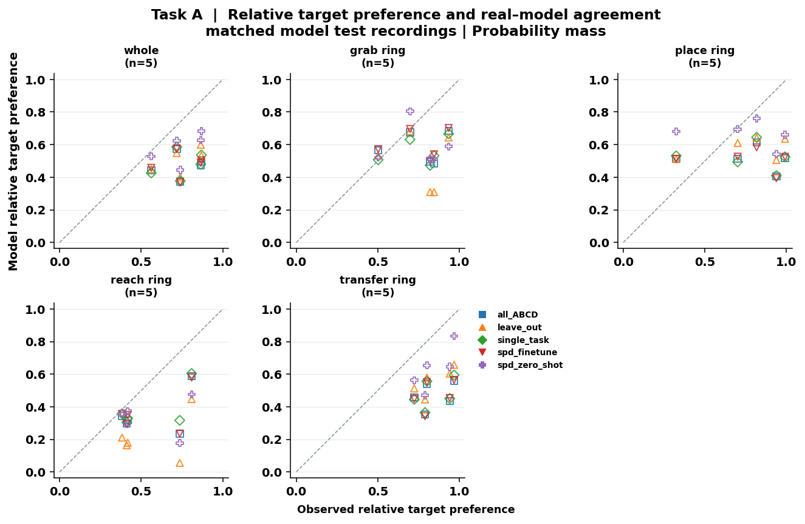

**图中内容**：横轴是真实gaze，纵轴是模型的参与者均值；虚线y=x为完全一致。下方代表模型低估，上方代表高估。整体与阶段分面展示，非逐帧点散布。

**整体结果**：GT 相对目标偏好 C=75.0%；模型：all_ABCD 47.2%；single_task 48.1%；leave_out 50.6%；spd_finetune 47.9%；spd_zero_shot 58.1%。

**配对偏差（百分点）**：all_ABCD -27.9 [-37.9, -17.5]；single_task -26.9 [-36.6, -17.3]；leave_out -24.4 [-32.3, -16.6]；spd_finetune -27.2 [-37.2, -16.5]；spd_zero_shot -16.9 [-25.0, -8.7]。

**说明**：C评价的是可分辨区域内的相对分配，纵向偏差不能解释成全部观察时间的注意差；需同时看D和目标占用。

数据表：[group_stage_summary.csv](20261105T063658759189Z_v2_full/main_probability/group_stage_summary.csv)；[model_error_summary.csv](20261105T063658759189Z_v2_full/main_probability/model_error_summary.csv)。

#### 图M002｜Task A｜主概率质量｜腕部占用：GT–模型一致性

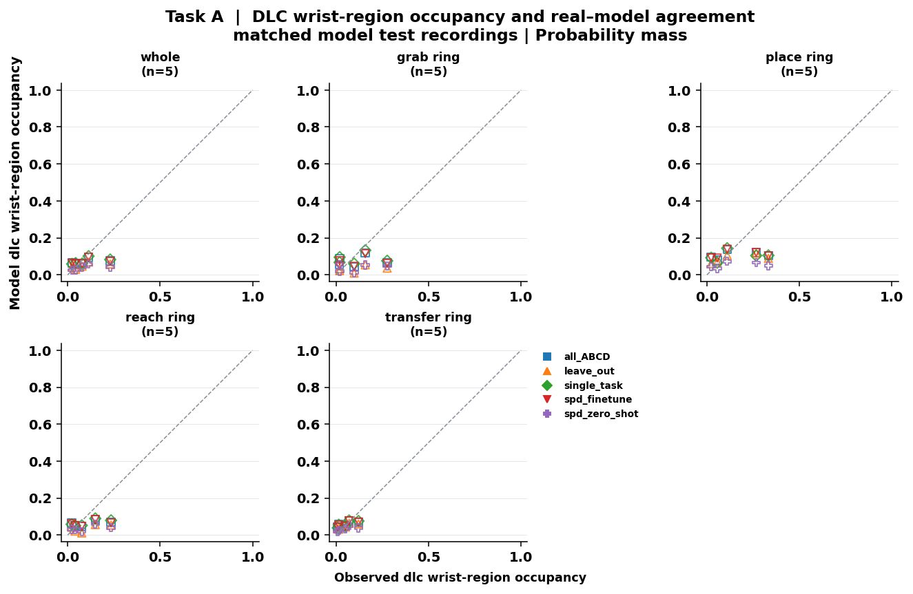

**图中内容**：横轴是真实gaze，纵轴是模型的参与者均值；虚线y=x为完全一致。下方代表模型低估，上方代表高估。整体与阶段分面展示，非逐帧点散布。

**整体结果**：GT 腕部占用=9.8%；模型：all_ABCD 7.1%；single_task 7.3%；leave_out 4.9%；spd_finetune 7.1%；spd_zero_shot 3.9%。

**配对偏差（百分点）**：all_ABCD -2.6 [-9.3, 2.4]；single_task -2.5 [-8.7, 2.1]；leave_out -4.8 [-11.2, -0.1]；spd_finetune -2.7 [-9.4, 2.3]；spd_zero_shot -5.9 [-12.3, -1.3]。

**说明**：腕部点的绝对数值较低时，视觉上靠近原点不等于误差可以忽略；须按配对差及CI判断。

数据表：[group_stage_summary.csv](20261105T063658759189Z_v2_full/main_probability/group_stage_summary.csv)；[model_error_summary.csv](20261105T063658759189Z_v2_full/main_probability/model_error_summary.csv)。

#### 图M003｜Task A｜主概率质量｜目标占用：GT–模型一致性

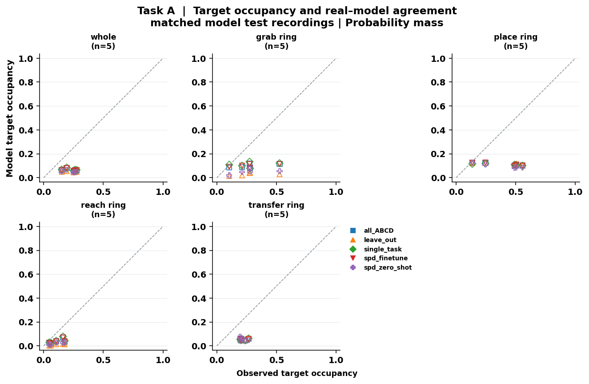

**图中内容**：横轴是真实gaze，纵轴是模型的参与者均值；虚线y=x为完全一致。下方代表模型低估，上方代表高估。整体与阶段分面展示，非逐帧点散布。

**整体结果**：GT 目标占用=22.7%；模型：all_ABCD 6.4%；single_task 6.8%；leave_out 4.9%；spd_finetune 6.5%；spd_zero_shot 5.2%。

**配对偏差（百分点）**：all_ABCD -16.2 [-20.5, -11.6]；single_task -15.9 [-20.2, -11.1]；leave_out -17.7 [-21.7, -13.2]；spd_finetune -16.2 [-20.5, -11.5]；spd_zero_shot -17.5 [-21.9, -12.7]。

**说明**：整体均值中5/5模型的目标占用低于GT，其余应按图及配对差分开判断；均值靠近对角线仍不保证逐帧预测正确。

数据表：[group_stage_summary.csv](20261105T063658759189Z_v2_full/main_probability/group_stage_summary.csv)；[model_error_summary.csv](20261105T063658759189Z_v2_full/main_probability/model_error_summary.csv)。

#### 图M004｜Task A｜主概率质量｜Brier skill及区间

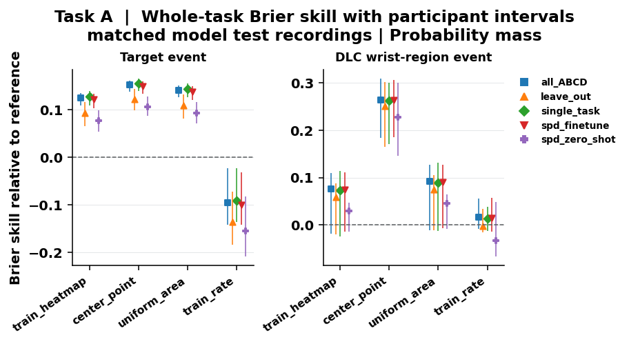

**图中内容**：左面板目标事件，右面板腕部事件；横轴参照基线，纵轴BSS，竖线是参与者bootstrap CI，虚线0表示与基线相当。值越高越好，CI不跨0才有较明确方向。

**target**：train_heatmap: 0.076–0.127（5/5全正、0/5全负）；center_point: 0.106–0.156（5/5全正、0/5全负）；uniform_area: 0.093–0.143（5/5全正、0/5全负）；train_rate: -0.156–-0.092（0/5全正、5/5全负）。

**gripper**：train_heatmap: 0.030–0.076（0/5全正、0/5全负）；center_point: 0.227–0.264（5/5全正、0/5全负）；uniform_area: 0.046–0.092（0/5全正、0/5全负）；train_rate: -0.033–0.016（0/5全正、0/5全负）。

**说明**：概率质量对若干空间基线的提升与对train_rate的不足同时存在，必须指明参照，不能只挑正值宣称整体领先。

数据表：[group_stage_summary.csv](20261105T063658759189Z_v2_full/main_probability/group_stage_summary.csv)；[model_error_summary.csv](20261105T063658759189Z_v2_full/main_probability/model_error_summary.csv)。

#### 图M005｜Task A｜主概率质量｜相对目标偏好 C：与成绩的关系

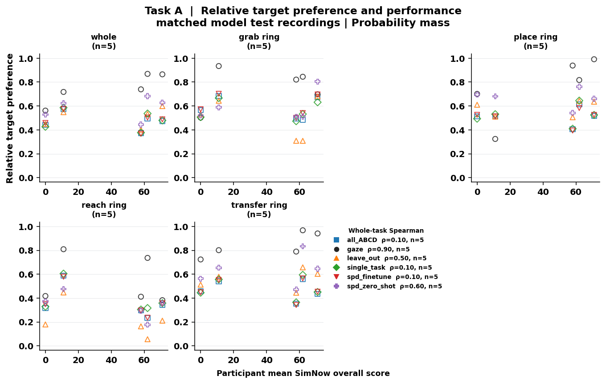

**图中内容**：横轴参与者平均SimNow成绩，纵轴相对目标偏好 C；每个面板为整体或阶段，右侧图例给整体Spearmanρ。相同x上的多个点并非重复测量证据。

**整体ρ及95% CI**：gaze 0.900 [0.111, 1.000]；all_ABCD 0.100 [-1.000, 1.000]；single_task 0.100 [-1.000, 1.000]；leave_out 0.500 [-1.000, 1.000]；spd_finetune 0.100 [-1.000, 1.000]；spd_zero_shot 0.600 [-1.000, 1.000]。

**说明**：只有5名参与者，图示斜向排列和高ρ都可能受个别点影响；C、绝对占用及真实–模型一致性是不同问题。

数据表：[group_stage_summary.csv](20261105T063658759189Z_v2_full/main_probability/group_stage_summary.csv)；[performance_correlations.csv](20261105T063658759189Z_v2_full/main_probability/performance_correlations.csv)。

#### 图M006｜Task A｜主概率质量｜腕部占用：与成绩的关系

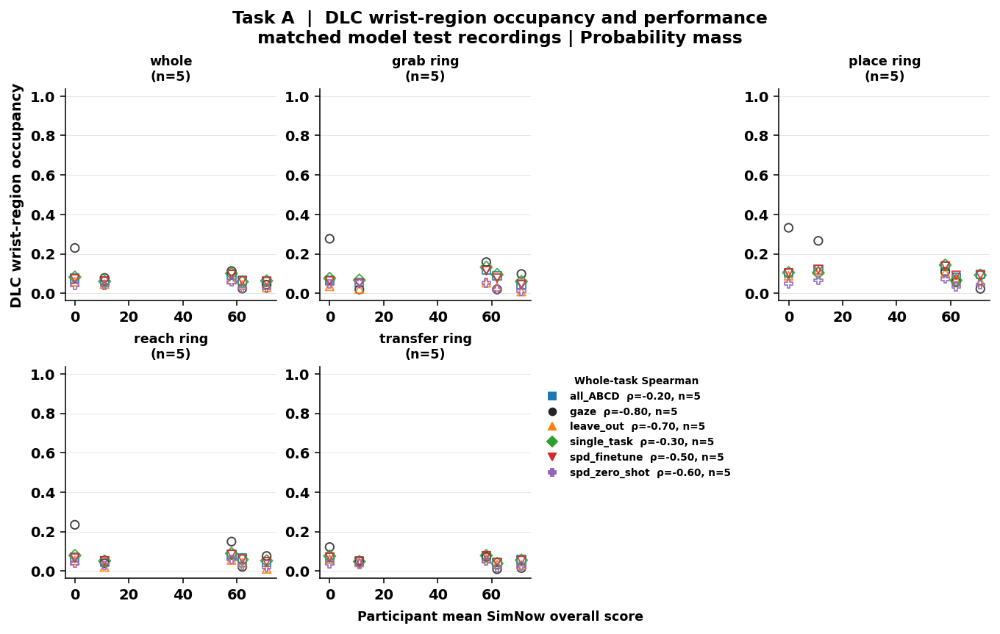

**图中内容**：横轴参与者平均SimNow成绩，纵轴腕部占用；每个面板为整体或阶段，右侧图例给整体Spearmanρ。相同x上的多个点并非重复测量证据。

**整体ρ及95% CI**：gaze -0.800 [-1.000, -0.111]；all_ABCD -0.200 [-1.000, 1.000]；single_task -0.300 [-1.000, 1.000]；leave_out -0.700 [-1.000, 0.875]；spd_finetune -0.500 [-1.000, 1.000]；spd_zero_shot -0.600 [-1.000, 1.000]。

**说明**：只有5名参与者，图示斜向排列和高ρ都可能受个别点影响；C、绝对占用及真实–模型一致性是不同问题。

数据表：[group_stage_summary.csv](20261105T063658759189Z_v2_full/main_probability/group_stage_summary.csv)；[performance_correlations.csv](20261105T063658759189Z_v2_full/main_probability/performance_correlations.csv)。

#### 图M007｜Task A｜主概率质量｜目标占用：与成绩的关系

**图中内容**：横轴参与者平均SimNow成绩，纵轴目标占用；每个面板为整体或阶段，右侧图例给整体Spearmanρ。相同x上的多个点并非重复测量证据。

**整体ρ及95% CI**：gaze -0.500 [-1.000, 1.000]；all_ABCD -0.500 [-1.000, 1.000]；single_task -0.300 [-1.000, 1.000]；leave_out -0.800 [-1.000, -0.111]；spd_finetune -0.500 [-1.000, 1.000]；spd_zero_shot -0.300 [-1.000, 1.000]。

**说明**：只有5名参与者，图示斜向排列和高ρ都可能受个别点影响；C、绝对占用及真实–模型一致性是不同问题。

数据表：[group_stage_summary.csv](20261105T063658759189Z_v2_full/main_probability/group_stage_summary.csv)；[performance_correlations.csv](20261105T063658759189Z_v2_full/main_probability/performance_correlations.csv)。

#### 图M008｜Task A｜主概率质量｜四区域占用

**图中内容**：各面板为整体/阶段，横轴为GT与五模型；堆叠绿色T、橙色P、紫色O、灰色N互斥且总高为1。目标总占用=T+O，腕部总占用=P+O。

**数值观察**：整体 GT 目标22.7%、腕部9.8%、N=69.7%；五模型目标为all_ABCD 6.4%；single_task 6.8%；leave_out 4.9%；spd_finetune 6.5%；spd_zero_shot 5.2%。

**说明**：大面积灰色表明模型的大部分概率质量落在目标/腕部之外，而GT在操作相关区域更集中。Task A的GT绿色目标独占更突出，模型目标偏好不足不能仅归因于两ROI重叠。

数据表：[group_stage_summary.csv](20261105T063658759189Z_v2_full/main_probability/group_stage_summary.csv)；[participant_stage_summary.csv](20261105T063658759189Z_v2_full/main_probability/participant_stage_summary.csv)。

#### 图M009｜Task A｜主概率质量｜重复轮次

**图中内容**：横轴重复轮次1/2/3，纵轴GT的C，按参与者绘制；每人只有一个测试录像，图中可见的是分散点而不是完整三轮学习轨迹。

**数据支持**：整体第1→3轮匹配人数=0，配对ΔC=NA个百分点。

**说明**：本图不能估计同一参与者的练习变化；不同轮次上不同人的点高低不构成纵向证据。各解码分支此图仍显示GT，而非模型随轮次变化。

数据表：[group_stage_summary.csv](20261105T063658759189Z_v2_full/main_probability/group_stage_summary.csv)；[repetition_contrasts.csv](20261105T063658759189Z_v2_full/main_probability/repetition_contrasts.csv)。

#### 图M010｜Task A｜主概率质量｜参数与有效性敏感性

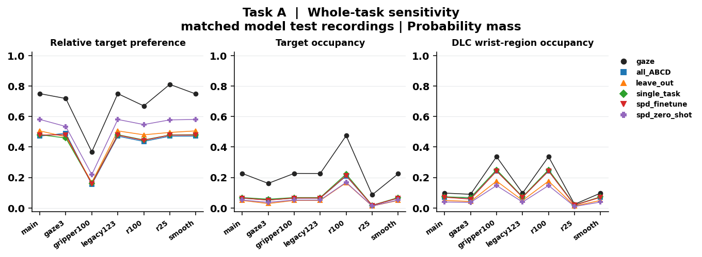

**图中内容**：三个面板依次为C、目标占用、腕部占用；横轴改变ROI半径、gaze有效码或平滑条件，线为来源均值。连接线仅便于比较离散条件，不是时间序列。

**GT 条件读数**：main（C=75.0%，目标=22.7%，腕部=9.8%）；gaze3（C=71.8%，目标=16.1%，腕部=9.0%）；gripper100（C=36.8%，目标=22.7%，腕部=33.7%）；legacy123（C=75.0%，目标=22.6%，腕部=9.8%）；r100（C=67.0%，目标=47.5%，腕部=33.7%）；r25（C=81.1%，目标=8.6%，腕部=2.4%）；smooth（C=74.8%，目标=22.4%，腕部=9.8%）。

**模型在main→gripper100的C变化**：all_ABCD 47.2%→15.4%；single_task 48.1%→16.1%；leave_out 50.6%→16.8%；spd_finetune 47.9%→15.8%；spd_zero_shot 58.1%→21.9%。

**说明**：不对称扩大腕部区域显著压低C，体现ROI几何依赖；对称扩大半径则提高占用并改变重叠。严格gaze状态同时改变有效帧，不能将所有曲线差异只归于行为改变。

数据表：[group_stage_summary.csv](20261105T063658759189Z_v2_full/main_probability/group_stage_summary.csv)；[participant_stage_summary.csv](20261105T063658759189Z_v2_full/main_probability/participant_stage_summary.csv)。

#### 图M011｜Task C｜主概率质量｜相对目标偏好 C：GT–模型一致性

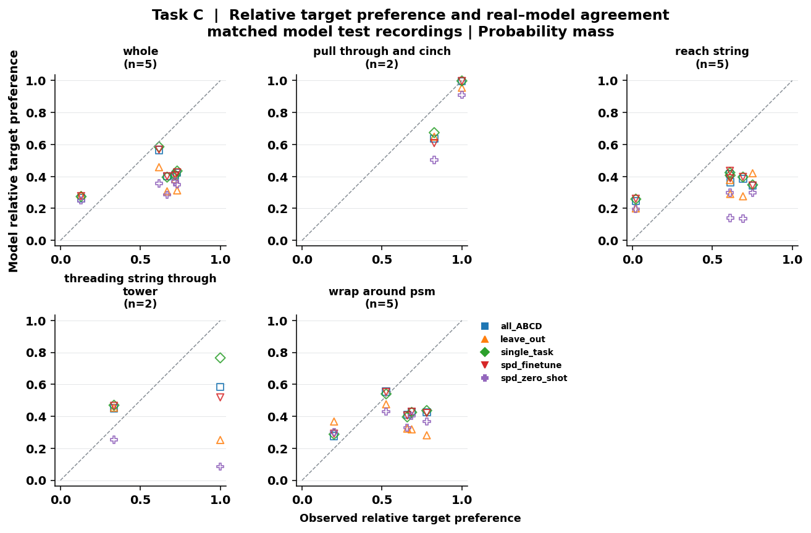

**图中内容**：横轴是真实gaze，纵轴是模型的参与者均值；虚线y=x为完全一致。下方代表模型低估，上方代表高估。整体与阶段分面展示，非逐帧点散布。

**整体结果**：GT 相对目标偏好 C=57.2%；模型：all_ABCD 41.2%；single_task 42.0%；leave_out 34.9%；spd_finetune 41.6%；spd_zero_shot 32.2%。

**配对偏差（百分点）**：all_ABCD -16.0 [-30.0, 0.9]；single_task -15.2 [-29.6, 2.2]；leave_out -22.3 [-37.8, -2.3]；spd_finetune -15.7 [-30.0, 1.8]；spd_zero_shot -25.1 [-37.5, -5.6]。

**说明**：C评价的是可分辨区域内的相对分配，纵向偏差不能解释成全部观察时间的注意差；需同时看D和目标占用。C任务cinch/穿塔阶段可估人数少，不能将个别点推广到全部参与者。

数据表：[group_stage_summary.csv](20261105T063658759189Z_v2_full/main_probability/group_stage_summary.csv)；[model_error_summary.csv](20261105T063658759189Z_v2_full/main_probability/model_error_summary.csv)。

#### 图M012｜Task C｜主概率质量｜腕部占用：GT–模型一致性

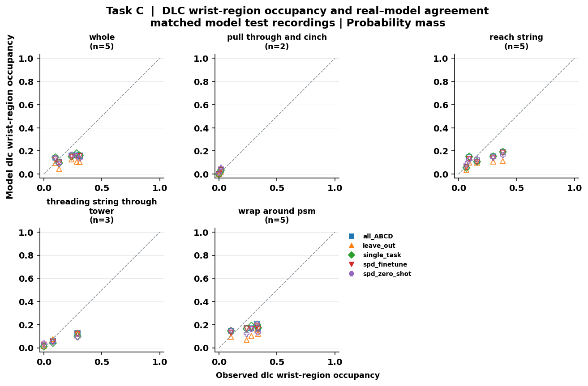

**图中内容**：横轴是真实gaze，纵轴是模型的参与者均值；虚线y=x为完全一致。下方代表模型低估，上方代表高估。整体与阶段分面展示，非逐帧点散布。

**整体结果**：GT 腕部占用=21.3%；模型：all_ABCD 14.7%；single_task 14.7%；leave_out 9.5%；spd_finetune 13.6%；spd_zero_shot 13.8%。

**配对偏差（百分点）**：all_ABCD -6.6 [-12.3, -0.3]；single_task -6.6 [-11.9, -0.4]；leave_out -11.8 [-17.7, -5.6]；spd_finetune -7.7 [-13.3, -1.6]；spd_zero_shot -7.5 [-13.9, -0.8]。

**说明**：腕部点的绝对数值较低时，视觉上靠近原点不等于误差可以忽略；须按配对差及CI判断。C任务cinch/穿塔阶段可估人数少，不能将个别点推广到全部参与者。

数据表：[group_stage_summary.csv](20261105T063658759189Z_v2_full/main_probability/group_stage_summary.csv)；[model_error_summary.csv](20261105T063658759189Z_v2_full/main_probability/model_error_summary.csv)。

#### 图M013｜Task C｜主概率质量｜目标占用：GT–模型一致性

**图中内容**：横轴是真实gaze，纵轴是模型的参与者均值；虚线y=x为完全一致。下方代表模型低估，上方代表高估。整体与阶段分面展示，非逐帧点散布。

**整体结果**：GT 目标占用=25.9%；模型：all_ABCD 11.8%；single_task 12.1%；leave_out 6.3%；spd_finetune 11.1%；spd_zero_shot 8.7%。

**配对偏差（百分点）**：all_ABCD -14.1 [-27.3, -1.9]；single_task -13.9 [-26.8, -2.1]；leave_out -19.7 [-33.0, -6.3]；spd_finetune -14.8 [-28.0, -2.7]；spd_zero_shot -17.2 [-30.5, -4.4]。

**说明**：整体均值中5/5模型的目标占用低于GT，其余应按图及配对差分开判断；均值靠近对角线仍不保证逐帧预测正确。C任务cinch/穿塔阶段可估人数少，不能将个别点推广到全部参与者。

数据表：[group_stage_summary.csv](20261105T063658759189Z_v2_full/main_probability/group_stage_summary.csv)；[model_error_summary.csv](20261105T063658759189Z_v2_full/main_probability/model_error_summary.csv)。

#### 图M014｜Task C｜主概率质量｜Brier skill及区间

**图中内容**：左面板目标事件，右面板腕部事件；横轴参照基线，纵轴BSS，竖线是参与者bootstrap CI，虚线0表示与基线相当。值越高越好，CI不跨0才有较明确方向。

**target**：train_heatmap: 0.082–0.227（5/5全正、0/5全负）；center_point: 0.118–0.258（5/5全正、0/5全负）；uniform_area: 0.126–0.265（5/5全正、0/5全负）；train_rate: -0.163–0.022（0/5全正、0/5全负）。

**gripper**：train_heatmap: 0.104–0.213（5/5全正、0/5全负）；center_point: 0.196–0.294（5/5全正、0/5全负）；uniform_area: 0.169–0.271（5/5全正、0/5全负）；train_rate: -0.031–0.095（3/5全正、0/5全负）。

**说明**：概率质量对若干空间基线的提升与对train_rate的不足同时存在，必须指明参照，不能只挑正值宣称整体领先。

数据表：[group_stage_summary.csv](20261105T063658759189Z_v2_full/main_probability/group_stage_summary.csv)；[model_error_summary.csv](20261105T063658759189Z_v2_full/main_probability/model_error_summary.csv)。

#### 图M015｜Task C｜主概率质量｜相对目标偏好 C：与成绩的关系

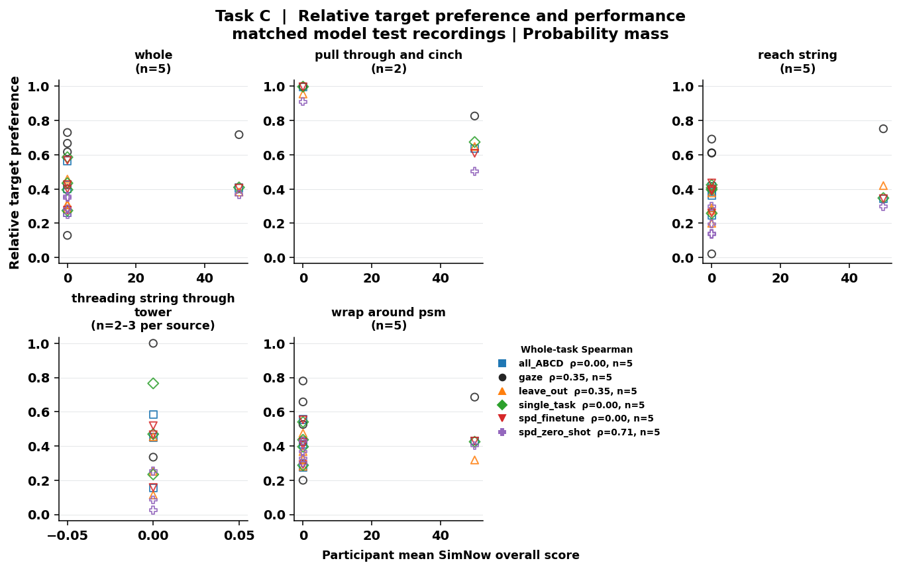

**图中内容**：横轴参与者平均SimNow成绩，纵轴相对目标偏好 C；每个面板为整体或阶段，右侧图例给整体Spearmanρ。相同x上的多个点并非重复测量证据。

**整体ρ及95% CI**：gaze 0.354 [-0.395, 1.000]；all_ABCD 0.000 [-1.000, 1.000]；single_task 0.000 [-1.000, 1.000]；leave_out 0.354 [-0.395, 1.000]；spd_finetune 0.000 [-1.000, 1.000]；spd_zero_shot 0.707 [0.707, 1.000]。

**说明**：测试成绩仅两个不同取值，大量点竖直堆叠；部分bootstrap因分数不变而无定义。较高ρ不能证明连续技能水平识别，cinch/穿塔阶段不足以稳定估相关。

数据表：[group_stage_summary.csv](20261105T063658759189Z_v2_full/main_probability/group_stage_summary.csv)；[performance_correlations.csv](20261105T063658759189Z_v2_full/main_probability/performance_correlations.csv)。

#### 图M016｜Task C｜主概率质量｜腕部占用：与成绩的关系

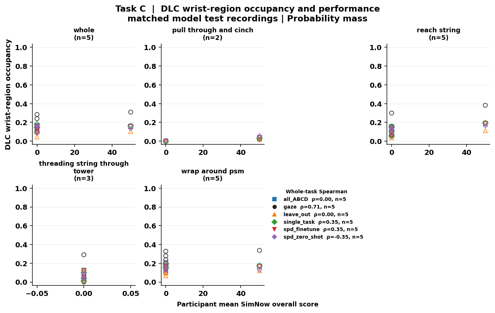

**图中内容**：横轴参与者平均SimNow成绩，纵轴腕部占用；每个面板为整体或阶段，右侧图例给整体Spearmanρ。相同x上的多个点并非重复测量证据。

**整体ρ及95% CI**：gaze 0.707 [0.707, 1.000]；all_ABCD 0.000 [-1.000, 1.000]；single_task 0.354 [-0.395, 1.000]；leave_out 0.000 [-1.000, 1.000]；spd_finetune 0.354 [-0.395, 1.000]；spd_zero_shot -0.354 [-1.000, 0.395]。

**说明**：测试成绩仅两个不同取值，大量点竖直堆叠；部分bootstrap因分数不变而无定义。较高ρ不能证明连续技能水平识别，cinch/穿塔阶段不足以稳定估相关。

数据表：[group_stage_summary.csv](20261105T063658759189Z_v2_full/main_probability/group_stage_summary.csv)；[performance_correlations.csv](20261105T063658759189Z_v2_full/main_probability/performance_correlations.csv)。

#### 图M017｜Task C｜主概率质量｜目标占用：与成绩的关系

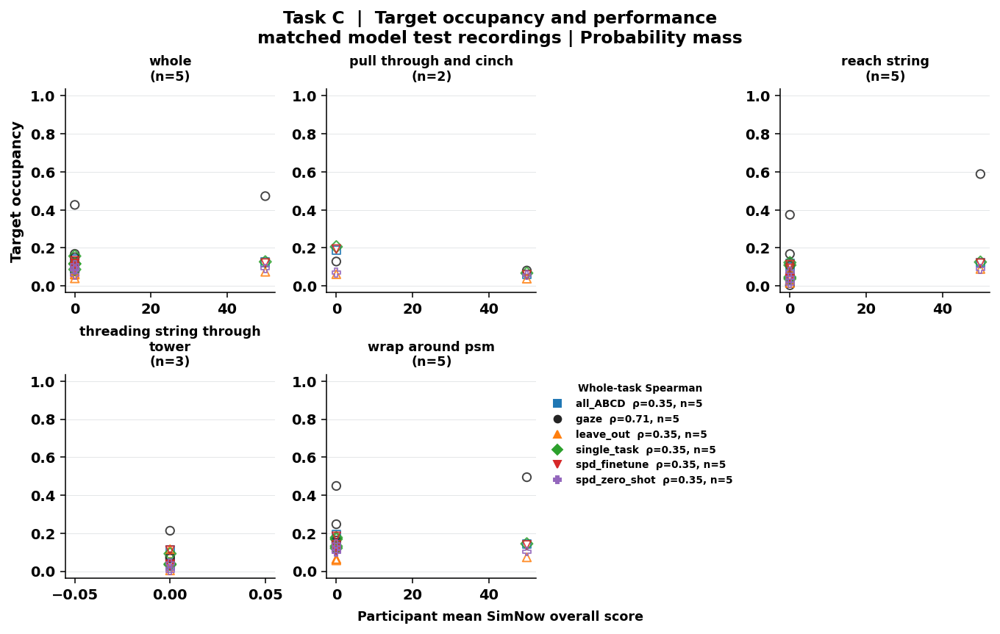

**图中内容**：横轴参与者平均SimNow成绩，纵轴目标占用；每个面板为整体或阶段，右侧图例给整体Spearmanρ。相同x上的多个点并非重复测量证据。

**整体ρ及95% CI**：gaze 0.707 [0.707, 1.000]；all_ABCD 0.354 [-0.395, 1.000]；single_task 0.354 [-0.395, 1.000]；leave_out 0.354 [-0.395, 1.000]；spd_finetune 0.354 [-0.395, 1.000]；spd_zero_shot 0.354 [-0.395, 1.000]。

**说明**：测试成绩仅两个不同取值，大量点竖直堆叠；部分bootstrap因分数不变而无定义。较高ρ不能证明连续技能水平识别，cinch/穿塔阶段不足以稳定估相关。

数据表：[group_stage_summary.csv](20261105T063658759189Z_v2_full/main_probability/group_stage_summary.csv)；[performance_correlations.csv](20261105T063658759189Z_v2_full/main_probability/performance_correlations.csv)。

#### 图M018｜Task C｜主概率质量｜四区域占用

**图中内容**：各面板为整体/阶段，横轴为GT与五模型；堆叠绿色T、橙色P、紫色O、灰色N互斥且总高为1。目标总占用=T+O，腕部总占用=P+O。

**数值观察**：整体 GT 目标25.9%、腕部21.3%、N=64.3%；五模型目标为all_ABCD 11.8%；single_task 12.1%；leave_out 6.3%；spd_finetune 11.1%；spd_zero_shot 8.7%。

**说明**：大面积灰色表明模型的大部分概率质量落在目标/腕部之外，而GT在操作相关区域更集中。Task C中紫色重叠较明显，O不能用来区分目标与腕部偏好。

数据表：[group_stage_summary.csv](20261105T063658759189Z_v2_full/main_probability/group_stage_summary.csv)；[participant_stage_summary.csv](20261105T063658759189Z_v2_full/main_probability/participant_stage_summary.csv)。

#### 图M019｜Task C｜主概率质量｜重复轮次

**图中内容**：横轴重复轮次1/2/3，纵轴GT的C，按参与者绘制；每人只有一个测试录像，图中可见的是分散点而不是完整三轮学习轨迹。

**数据支持**：整体第1→3轮匹配人数=0，配对ΔC=NA个百分点。

**说明**：本图不能估计同一参与者的练习变化；不同轮次上不同人的点高低不构成纵向证据。各解码分支此图仍显示GT，而非模型随轮次变化。

数据表：[group_stage_summary.csv](20261105T063658759189Z_v2_full/main_probability/group_stage_summary.csv)；[repetition_contrasts.csv](20261105T063658759189Z_v2_full/main_probability/repetition_contrasts.csv)。

#### 图M020｜Task C｜主概率质量｜参数与有效性敏感性

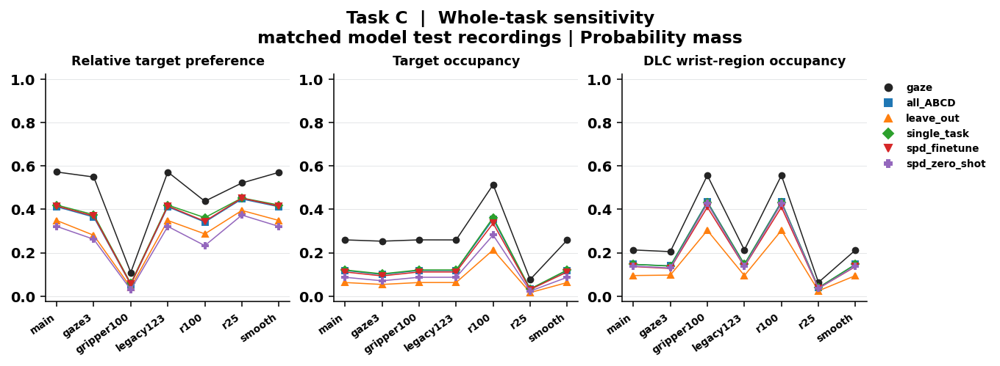

**图中内容**：三个面板依次为C、目标占用、腕部占用；横轴改变ROI半径、gaze有效码或平滑条件，线为来源均值。连接线仅便于比较离散条件，不是时间序列。

**GT 条件读数**：main（C=57.2%，目标=25.9%，腕部=21.3%）；gaze3（C=54.9%，目标=25.3%，腕部=20.5%）；gripper100（C=10.9%，目标=25.9%，腕部=55.7%）；legacy123（C=57.2%，目标=25.9%，腕部=21.3%）；r100（C=43.8%，目标=51.4%，腕部=55.7%）；r25（C=52.2%，目标=7.7%，腕部=6.3%）；smooth（C=57.1%，目标=25.9%，腕部=21.3%）。

**模型在main→gripper100的C变化**：all_ABCD 41.2%→5.4%；single_task 42.0%→5.9%；leave_out 34.9%→4.1%；spd_finetune 41.6%→5.5%；spd_zero_shot 32.2%→3.0%。

**说明**：不对称扩大腕部区域显著压低C，体现ROI几何依赖；对称扩大半径则提高占用并改变重叠。严格gaze状态同时改变有效帧，不能将所有曲线差异只归于行为改变。

数据表：[group_stage_summary.csv](20261105T063658759189Z_v2_full/main_probability/group_stage_summary.csv)；[participant_stage_summary.csv](20261105T063658759189Z_v2_full/main_probability/participant_stage_summary.csv)。

### 期望点解码

#### 图M021｜Task A｜期望点解码｜相对目标偏好 C：GT–模型一致性

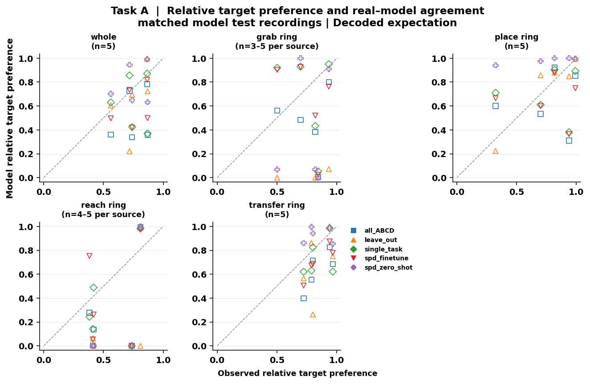

**图中内容**：横轴是真实gaze，纵轴是模型的参与者均值；虚线y=x为完全一致。下方代表模型低估，上方代表高估。整体与阶段分面展示，非逐帧点散布。

**整体结果**：GT 相对目标偏好 C=75.0%；模型：all_ABCD 51.4%；single_task 63.0%；leave_out 64.8%；spd_finetune 59.4%；spd_zero_shot 78.4%。

**配对偏差（百分点）**：all_ABCD -23.7 [-40.4, -6.9]；single_task -12.0 [-34.9, 8.4]；leave_out -10.2 [-31.6, 6.1]；spd_finetune -15.7 [-29.5, -2.4]；spd_zero_shot 3.3 [-13.2, 17.2]。

**说明**：C评价的是可分辨区域内的相对分配，纵向偏差不能解释成全部观察时间的注意差；需同时看D和目标占用。

数据表：[group_stage_summary.csv](20261105T063658759189Z_v2_full/decoded_expectation/group_stage_summary.csv)；[model_error_summary.csv](20261105T063658759189Z_v2_full/decoded_expectation/model_error_summary.csv)。

#### 图M022｜Task A｜期望点解码｜腕部占用：GT–模型一致性

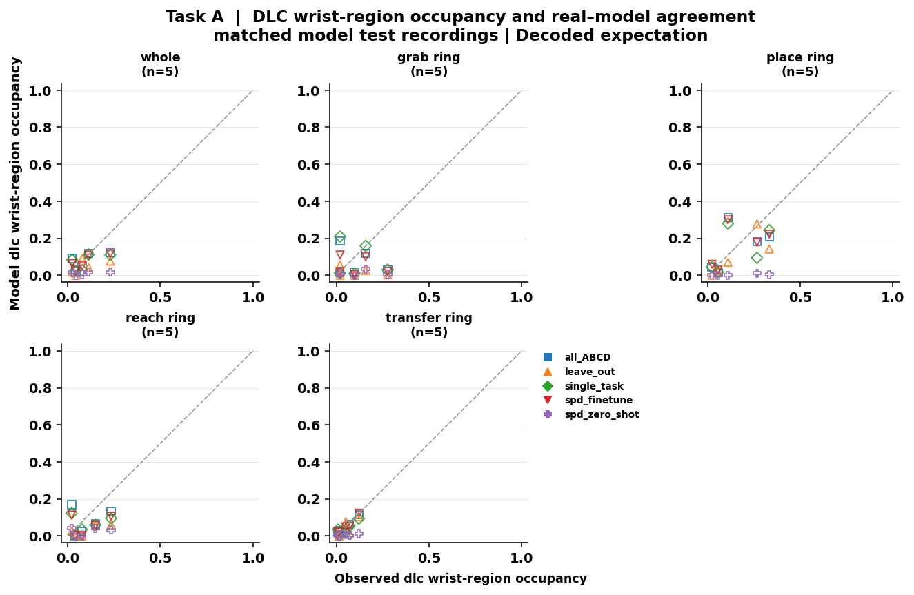

**图中内容**：横轴是真实gaze，纵轴是模型的参与者均值；虚线y=x为完全一致。下方代表模型低估，上方代表高估。整体与阶段分面展示，非逐帧点散布。

**整体结果**：GT 腕部占用=9.8%；模型：all_ABCD 8.2%；single_task 7.1%；leave_out 4.5%；spd_finetune 7.3%；spd_zero_shot 1.1%。

**配对偏差（百分点）**：all_ABCD -1.6 [-6.8, 3.4]；single_task -2.6 [-8.0, 2.5]；leave_out -5.3 [-10.8, -0.7]；spd_finetune -2.4 [-7.4, 1.5]；spd_zero_shot -8.7 [-15.1, -3.3]。

**说明**：腕部点的绝对数值较低时，视觉上靠近原点不等于误差可以忽略；须按配对差及CI判断。

数据表：[group_stage_summary.csv](20261105T063658759189Z_v2_full/decoded_expectation/group_stage_summary.csv)；[model_error_summary.csv](20261105T063658759189Z_v2_full/decoded_expectation/model_error_summary.csv)。

#### 图M023｜Task A｜期望点解码｜目标占用：GT–模型一致性

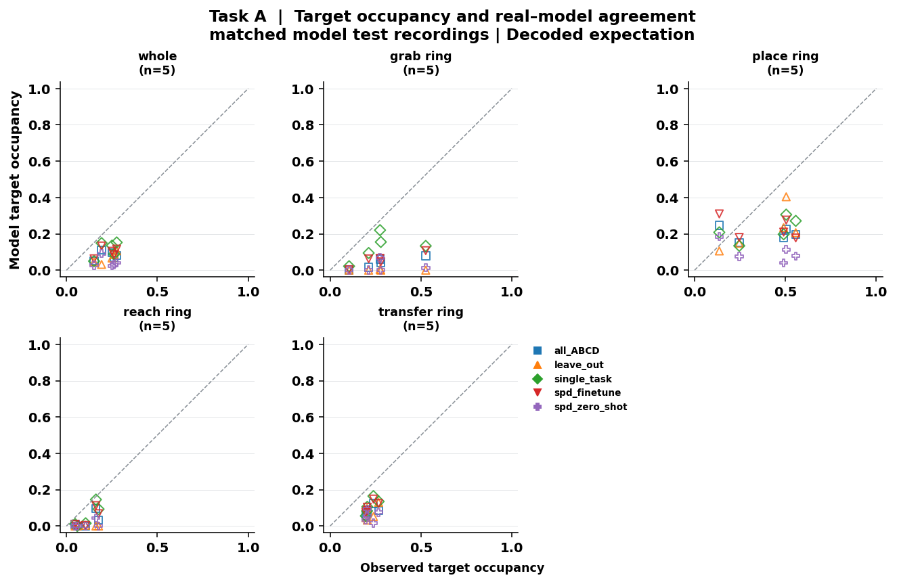

**图中内容**：横轴是真实gaze，纵轴是模型的参与者均值；虚线y=x为完全一致。下方代表模型低估，上方代表高估。整体与阶段分面展示，非逐帧点散布。

**整体结果**：GT 目标占用=22.7%；模型：all_ABCD 8.2%；single_task 11.5%；leave_out 6.7%；spd_finetune 10.1%；spd_zero_shot 4.3%。

**配对偏差（百分点）**：all_ABCD -14.5 [-18.4, -10.4]；single_task -11.1 [-14.7, -7.4]；leave_out -16.0 [-17.8, -13.1]；spd_finetune -12.6 [-16.4, -8.6]；spd_zero_shot -18.4 [-23.2, -13.2]。

**说明**：整体均值中5/5模型的目标占用低于GT，其余应按图及配对差分开判断；均值靠近对角线仍不保证逐帧预测正确。

数据表：[group_stage_summary.csv](20261105T063658759189Z_v2_full/decoded_expectation/group_stage_summary.csv)；[model_error_summary.csv](20261105T063658759189Z_v2_full/decoded_expectation/model_error_summary.csv)。

#### 图M024｜Task A｜期望点解码｜Brier skill及区间

**图中内容**：左面板目标事件，右面板腕部事件；横轴参照基线，纵轴BSS，竖线是参与者bootstrap CI，虚线0表示与基线相当。值越高越好，CI不跨0才有较明确方向。

**target**：train_heatmap: -0.123–-0.099（0/5全正、3/5全负）；center_point: -0.087–-0.063（0/5全正、0/5全负）；uniform_area: -0.103–-0.078（0/5全正、1/5全负）；train_rate: -0.406–-0.375（0/5全正、5/5全负）。

**gripper**：train_heatmap: -0.435–-0.113（0/5全正、5/5全负）；center_point: -0.143–0.113（1/5全正、0/5全负）；uniform_area: -0.411–-0.094（0/5全正、5/5全负）；train_rate: -0.529–-0.186（0/5全正、5/5全负）。

**说明**：硬点决策的BSS多数低于0；区域占用更接近GT不能抵消逐帧硬分类的代价。

数据表：[group_stage_summary.csv](20261105T063658759189Z_v2_full/decoded_expectation/group_stage_summary.csv)；[model_error_summary.csv](20261105T063658759189Z_v2_full/decoded_expectation/model_error_summary.csv)。

#### 图M025｜Task A｜期望点解码｜四状态混淆

**图中内容**：每个面板一模型，行是真实T/P/O/N，列是预测T/P/O/N；颜色/单元值是给定真实类别后的条件概率（按录像、参与者逐层平均）。对角线是该类正确命中，T→N是目标独占被判成其他。

| 模型 | T→T % | T→N % | P→P % | O→O % | N→N % |
| --- | --- | --- | --- | --- | --- |
| all_ABCD | 12.0 | 79.8 | 14.1 | 10.2 | 88.6 |
| single_task | 17.4 | 75.5 | 11.0 | 12.3 | 87.2 |
| leave_out | 8.9 | 87.1 | 5.8 | 2.0 | 90.7 |
| spd_finetune | 13.6 | 78.7 | 7.9 | 11.8 | 88.3 |
| spd_zero_shot | 5.5 | 94.0 | 2.2 | 0.4 | 95.2 |

**说明**：N→N通常较高而T/P/O对角线较低，说明大量“其他”帧容易命中，但目标相关类别仍易漏掉；不能靠总体准确率证明目标锁定能力。这里T→T不是含重叠的完整目标召回率。

数据表：[group_stage_summary.csv](20261105T063658759189Z_v2_full/decoded_expectation/group_stage_summary.csv)；[confusion_summary.csv](20261105T063658759189Z_v2_full/decoded_expectation/confusion_summary.csv)。

#### 图M026｜Task A｜期望点解码｜驻留与切换

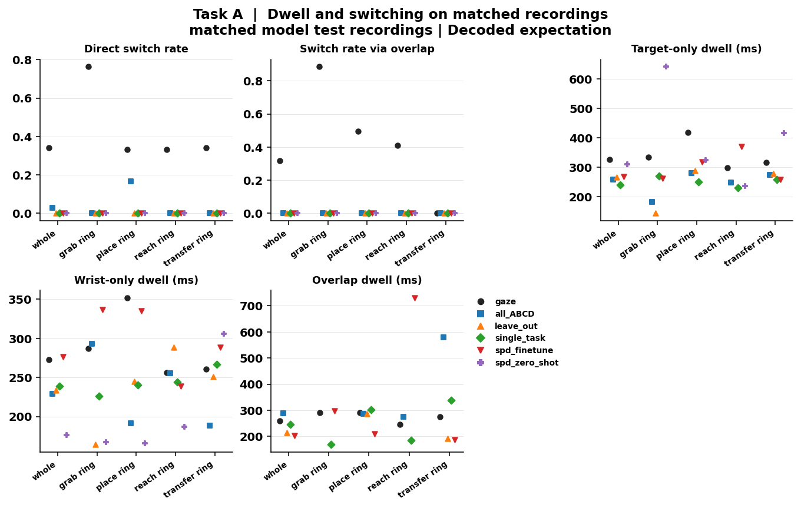

**图中内容**：五个面板分别为直接切换率、经重叠切换率、T/P/O驻留中位时长的参与者均值；横轴整体与阶段，各颜色代表来源。达到120 ms门槛的观察段进入驻留统计；边界或缺失截断段达到门槛仍纳入。

| 来源 | 直接/min | 经O/min | T ms | P ms | O ms |
| --- | --- | --- | --- | --- | --- |
| gaze | 0.342 | 0.319 | 327.0 | 272.7 | 259.7 |
| all_ABCD | 0.030 | 0.000 | 257.9 | 228.8 | 287.5 |
| single_task | 0.000 | 0.000 | 241.6 | 239.1 | 246.8 |
| leave_out | 0.000 | 0.000 | 266.4 | 233.7 | 214.3 |
| spd_finetune | 0.000 | 0.000 | 269.2 | 276.4 | 202.5 |
| spd_zero_shot | 0.000 | 0.000 | 311.2 | 176.0 | NA |

**说明**：模型切换率与GT有明显差异；驻留相近也不能推出切换过程被重现，且各来源达到时长门槛的观察段数量不同。

数据表：[group_stage_summary.csv](20261105T063658759189Z_v2_full/decoded_expectation/group_stage_summary.csv)；[participant_stage_summary.csv](20261105T063658759189Z_v2_full/decoded_expectation/participant_stage_summary.csv)。

#### 图M027｜Task A｜期望点解码｜相对目标偏好 C：与成绩的关系

**图中内容**：横轴参与者平均SimNow成绩，纵轴相对目标偏好 C；每个面板为整体或阶段，右侧图例给整体Spearmanρ。相同x上的多个点并非重复测量证据。

**整体ρ及95% CI**：gaze 0.900 [0.111, 1.000]；all_ABCD 0.200 [-1.000, 1.000]；single_task 0.100 [-1.000, 1.000]；leave_out 0.900 [0.111, 1.000]；spd_finetune 0.500 [-1.000, 1.000]；spd_zero_shot 0.100 [-1.000, 1.000]。

**说明**：只有5名参与者，图示斜向排列和高ρ都可能受个别点影响；C、绝对占用及真实–模型一致性是不同问题。

数据表：[group_stage_summary.csv](20261105T063658759189Z_v2_full/decoded_expectation/group_stage_summary.csv)；[performance_correlations.csv](20261105T063658759189Z_v2_full/decoded_expectation/performance_correlations.csv)。

#### 图M028｜Task A｜期望点解码｜腕部占用：与成绩的关系

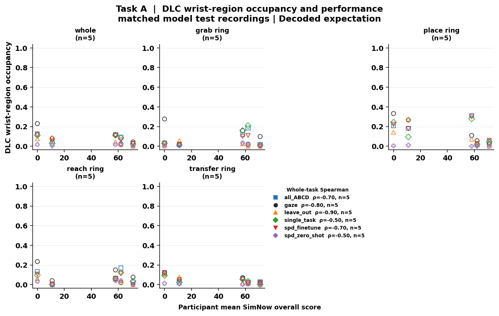

**图中内容**：横轴参与者平均SimNow成绩，纵轴腕部占用；每个面板为整体或阶段，右侧图例给整体Spearmanρ。相同x上的多个点并非重复测量证据。

**整体ρ及95% CI**：gaze -0.800 [-1.000, -0.111]；all_ABCD -0.700 [-1.000, 0.875]；single_task -0.500 [-1.000, 1.000]；leave_out -0.900 [-1.000, -0.111]；spd_finetune -0.700 [-1.000, 0.875]；spd_zero_shot -0.500 [-1.000, 1.000]。

**说明**：只有5名参与者，图示斜向排列和高ρ都可能受个别点影响；C、绝对占用及真实–模型一致性是不同问题。

数据表：[group_stage_summary.csv](20261105T063658759189Z_v2_full/decoded_expectation/group_stage_summary.csv)；[performance_correlations.csv](20261105T063658759189Z_v2_full/decoded_expectation/performance_correlations.csv)。

#### 图M029｜Task A｜期望点解码｜目标占用：与成绩的关系

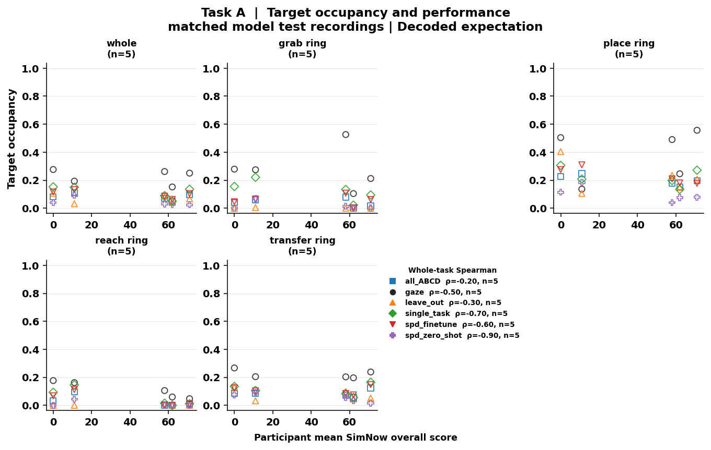

**图中内容**：横轴参与者平均SimNow成绩，纵轴目标占用；每个面板为整体或阶段，右侧图例给整体Spearmanρ。相同x上的多个点并非重复测量证据。

**整体ρ及95% CI**：gaze -0.500 [-1.000, 1.000]；all_ABCD -0.200 [-1.000, 1.000]；single_task -0.700 [-1.000, 0.875]；leave_out -0.300 [-1.000, 1.000]；spd_finetune -0.600 [-1.000, 1.000]；spd_zero_shot -0.900 [-1.000, -0.111]。

**说明**：只有5名参与者，图示斜向排列和高ρ都可能受个别点影响；C、绝对占用及真实–模型一致性是不同问题。

数据表：[group_stage_summary.csv](20261105T063658759189Z_v2_full/decoded_expectation/group_stage_summary.csv)；[performance_correlations.csv](20261105T063658759189Z_v2_full/decoded_expectation/performance_correlations.csv)。

#### 图M030｜Task A｜期望点解码｜四区域占用

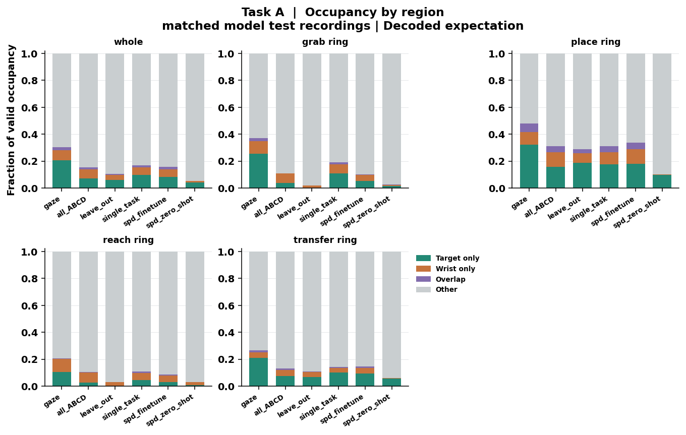

**图中内容**：各面板为整体/阶段，横轴为GT与五模型；堆叠绿色T、橙色P、紫色O、灰色N互斥且总高为1。目标总占用=T+O，腕部总占用=P+O。

**数值观察**：整体 GT 目标22.7%、腕部9.8%、N=69.7%；五模型目标为all_ABCD 8.2%；single_task 11.5%；leave_out 6.7%；spd_finetune 10.1%；spd_zero_shot 4.3%。

**说明**：硬点选择改变了区域占用；即使彩色总量接近GT，仍需结合事件Brier与混淆矩阵判断是否在正确帧命中。Task A的GT绿色目标独占更突出，模型目标偏好不足不能仅归因于两ROI重叠。

数据表：[group_stage_summary.csv](20261105T063658759189Z_v2_full/decoded_expectation/group_stage_summary.csv)；[participant_stage_summary.csv](20261105T063658759189Z_v2_full/decoded_expectation/participant_stage_summary.csv)。

#### 图M031｜Task A｜期望点解码｜重复轮次

**图中内容**：横轴重复轮次1/2/3，纵轴GT的C，按参与者绘制；每人只有一个测试录像，图中可见的是分散点而不是完整三轮学习轨迹。

**数据支持**：整体第1→3轮匹配人数=0，配对ΔC=NA个百分点。

**说明**：本图不能估计同一参与者的练习变化；不同轮次上不同人的点高低不构成纵向证据。各解码分支此图仍显示GT，而非模型随轮次变化。

数据表：[group_stage_summary.csv](20261105T063658759189Z_v2_full/decoded_expectation/group_stage_summary.csv)；[repetition_contrasts.csv](20261105T063658759189Z_v2_full/decoded_expectation/repetition_contrasts.csv)。

#### 图M032｜Task A｜期望点解码｜参数与有效性敏感性

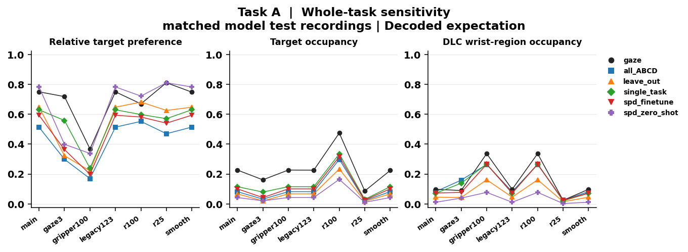

**图中内容**：三个面板依次为C、目标占用、腕部占用；横轴改变ROI半径、gaze有效码或平滑条件，线为来源均值。连接线仅便于比较离散条件，不是时间序列。

**GT 条件读数**：main（C=75.0%，目标=22.7%，腕部=9.8%）；gaze3（C=71.8%，目标=16.1%，腕部=9.0%）；gripper100（C=36.8%，目标=22.7%，腕部=33.7%）；legacy123（C=75.0%，目标=22.6%，腕部=9.8%）；r100（C=67.0%，目标=47.5%，腕部=33.7%）；r25（C=81.1%，目标=8.6%，腕部=2.4%）；smooth（C=74.8%，目标=22.4%，腕部=9.8%）。

**模型在main→gripper100的C变化**：all_ABCD 51.4%→17.0%；single_task 63.0%→23.9%；leave_out 64.8%→22.1%；spd_finetune 59.4%→19.8%；spd_zero_shot 78.4%→33.8%。

**说明**：不对称扩大腕部区域显著压低C，体现ROI几何依赖；对称扩大半径则提高占用并改变重叠。严格gaze状态同时改变有效帧，不能将所有曲线差异只归于行为改变。

数据表：[group_stage_summary.csv](20261105T063658759189Z_v2_full/decoded_expectation/group_stage_summary.csv)；[participant_stage_summary.csv](20261105T063658759189Z_v2_full/decoded_expectation/participant_stage_summary.csv)。

#### 图M033｜Task C｜期望点解码｜相对目标偏好 C：GT–模型一致性

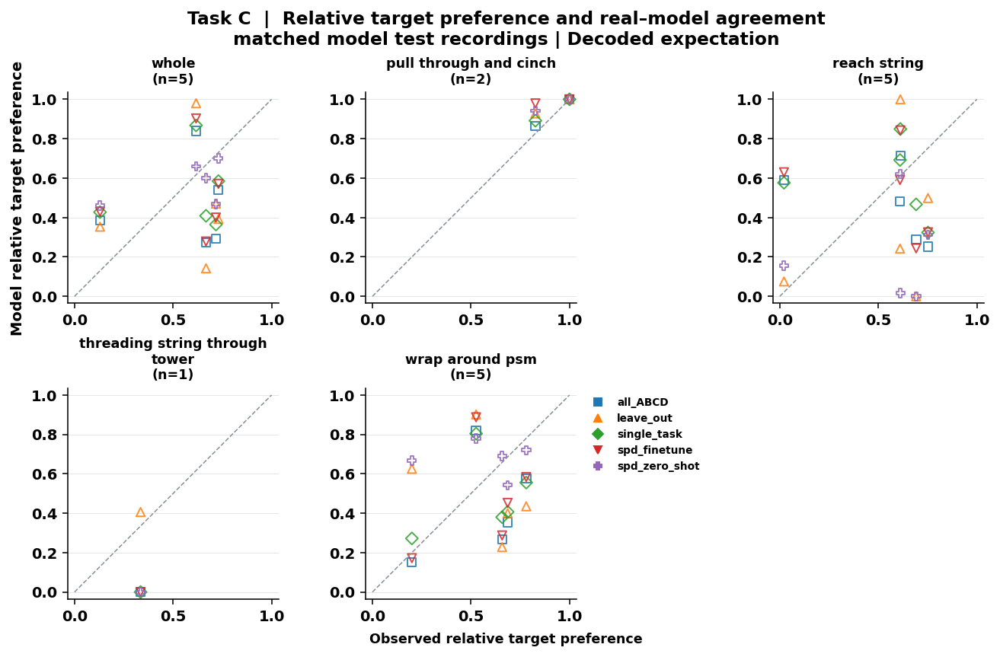

**图中内容**：横轴是真实gaze，纵轴是模型的参与者均值；虚线y=x为完全一致。下方代表模型低估，上方代表高估。整体与阶段分面展示，非逐帧点散布。

**整体结果**：GT 相对目标偏好 C=57.2%；模型：all_ABCD 46.6%；single_task 53.1%；leave_out 46.8%；spd_finetune 51.6%；spd_zero_shot 57.8%。

**配对偏差（百分点）**：all_ABCD -10.6 [-36.5, 15.3]；single_task -4.2 [-27.4, 19.0]；leave_out -10.5 [-39.5, 19.5]；spd_finetune -5.6 [-31.5, 20.3]；spd_zero_shot 0.6 [-14.7, 18.7]。

**说明**：C评价的是可分辨区域内的相对分配，纵向偏差不能解释成全部观察时间的注意差；需同时看D和目标占用。C任务cinch/穿塔阶段可估人数少，不能将个别点推广到全部参与者。

数据表：[group_stage_summary.csv](20261105T063658759189Z_v2_full/decoded_expectation/group_stage_summary.csv)；[model_error_summary.csv](20261105T063658759189Z_v2_full/decoded_expectation/model_error_summary.csv)。

#### 图M034｜Task C｜期望点解码｜腕部占用：GT–模型一致性

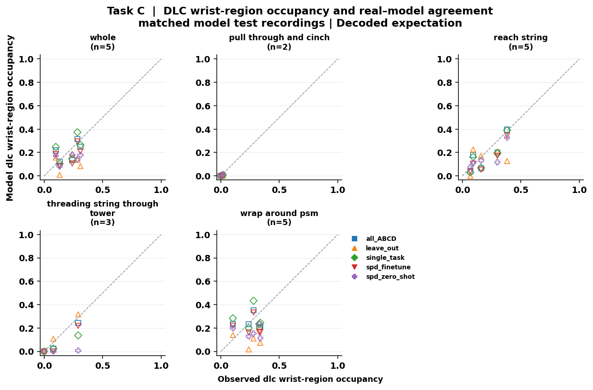

**图中内容**：横轴是真实gaze，纵轴是模型的参与者均值；虚线y=x为完全一致。下方代表模型低估，上方代表高估。整体与阶段分面展示，非逐帧点散布。

**整体结果**：GT 腕部占用=21.3%；模型：all_ABCD 20.7%；single_task 22.7%；leave_out 11.5%；spd_finetune 17.7%；spd_zero_shot 15.1%。

**配对偏差（百分点）**：all_ABCD -0.6 [-6.9, 6.4]；single_task 1.4 [-6.1, 9.8]；leave_out -9.8 [-17.5, -1.5]；spd_finetune -3.6 [-10.3, 3.5]；spd_zero_shot -6.2 [-12.2, 0.8]。

**说明**：腕部点的绝对数值较低时，视觉上靠近原点不等于误差可以忽略；须按配对差及CI判断。C任务cinch/穿塔阶段可估人数少，不能将个别点推广到全部参与者。

数据表：[group_stage_summary.csv](20261105T063658759189Z_v2_full/decoded_expectation/group_stage_summary.csv)；[model_error_summary.csv](20261105T063658759189Z_v2_full/decoded_expectation/model_error_summary.csv)。

#### 图M035｜Task C｜期望点解码｜目标占用：GT–模型一致性

**图中内容**：横轴是真实gaze，纵轴是模型的参与者均值；虚线y=x为完全一致。下方代表模型低估，上方代表高估。整体与阶段分面展示，非逐帧点散布。

**整体结果**：GT 目标占用=25.9%；模型：all_ABCD 19.9%；single_task 24.3%；leave_out 8.7%；spd_finetune 20.1%；spd_zero_shot 18.0%。

**配对偏差（百分点）**：all_ABCD -6.1 [-19.6, 4.7]；single_task -1.6 [-14.9, 7.5]；leave_out -17.2 [-31.9, -3.4]；spd_finetune -5.8 [-19.5, 5.7]；spd_zero_shot -7.9 [-21.0, 4.9]。

**说明**：整体均值中5/5模型的目标占用低于GT，其余应按图及配对差分开判断；均值靠近对角线仍不保证逐帧预测正确。C任务cinch/穿塔阶段可估人数少，不能将个别点推广到全部参与者。

数据表：[group_stage_summary.csv](20261105T063658759189Z_v2_full/decoded_expectation/group_stage_summary.csv)；[model_error_summary.csv](20261105T063658759189Z_v2_full/decoded_expectation/model_error_summary.csv)。

#### 图M036｜Task C｜期望点解码｜Brier skill及区间

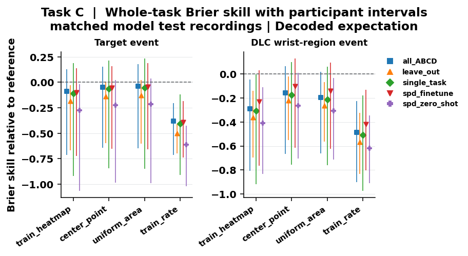

**图中内容**：左面板目标事件，右面板腕部事件；横轴参照基线，纵轴BSS，竖线是参与者bootstrap CI，虚线0表示与基线相当。值越高越好，CI不跨0才有较明确方向。

**target**：train_heatmap: -0.274–-0.090（0/5全正、2/5全负）；center_point: -0.224–-0.047（0/5全正、0/5全负）；uniform_area: -0.213–-0.037（0/5全正、0/5全负）；train_rate: -0.614–-0.380（0/5全正、5/5全负）。

**gripper**：train_heatmap: -0.408–-0.231（0/5全正、4/5全负）；center_point: -0.263–-0.104（0/5全正、1/5全负）；uniform_area: -0.305–-0.141（0/5全正、2/5全负）；train_rate: -0.620–-0.417（0/5全正、5/5全负）。

**说明**：硬点决策的BSS多数低于0；区域占用更接近GT不能抵消逐帧硬分类的代价。

数据表：[group_stage_summary.csv](20261105T063658759189Z_v2_full/decoded_expectation/group_stage_summary.csv)；[model_error_summary.csv](20261105T063658759189Z_v2_full/decoded_expectation/model_error_summary.csv)。

#### 图M037｜Task C｜期望点解码｜四状态混淆

**图中内容**：每个面板一模型，行是真实T/P/O/N，列是预测T/P/O/N；颜色/单元值是给定真实类别后的条件概率（按录像、参与者逐层平均）。对角线是该类正确命中，T→N是目标独占被判成其他。

| 模型 | T→T % | T→N % | P→P % | O→O % | N→N % |
| --- | --- | --- | --- | --- | --- |
| all_ABCD | 16.2 | 62.2 | 22.5 | 32.3 | 78.3 |
| single_task | 22.3 | 54.4 | 21.8 | 35.8 | 75.8 |
| leave_out | 6.3 | 79.5 | 12.5 | 7.8 | 85.9 |
| spd_finetune | 20.1 | 64.3 | 19.0 | 26.6 | 79.2 |
| spd_zero_shot | 19.4 | 69.9 | 11.9 | 12.9 | 78.8 |

**说明**：N→N通常较高而T/P/O对角线较低，说明大量“其他”帧容易命中，但目标相关类别仍易漏掉；不能靠总体准确率证明目标锁定能力。这里T→T不是含重叠的完整目标召回率。

数据表：[group_stage_summary.csv](20261105T063658759189Z_v2_full/decoded_expectation/group_stage_summary.csv)；[confusion_summary.csv](20261105T063658759189Z_v2_full/decoded_expectation/confusion_summary.csv)。

#### 图M038｜Task C｜期望点解码｜驻留与切换

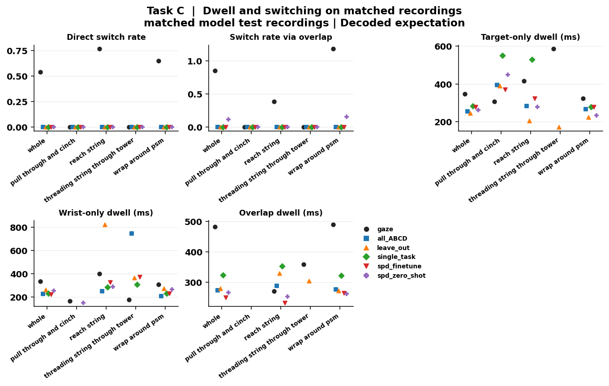

**图中内容**：五个面板分别为直接切换率、经重叠切换率、T/P/O驻留中位时长的参与者均值；横轴整体与阶段，各颜色代表来源。达到120 ms门槛的观察段进入驻留统计；边界或缺失截断段达到门槛仍纳入。

| 来源 | 直接/min | 经O/min | T ms | P ms | O ms |
| --- | --- | --- | --- | --- | --- |
| gaze | 0.542 | 0.851 | 347.1 | 334.5 | 482.6 |
| all_ABCD | 0.000 | 0.000 | 254.0 | 225.2 | 274.2 |
| single_task | 0.000 | 0.000 | 282.9 | 228.1 | 323.6 |
| leave_out | 0.000 | 0.000 | 244.8 | 261.7 | 279.7 |
| spd_finetune | 0.000 | 0.000 | 278.4 | 223.7 | 250.8 |
| spd_zero_shot | 0.000 | 0.114 | 262.7 | 252.8 | 267.2 |

**说明**：模型切换率与GT有明显差异；驻留相近也不能推出切换过程被重现，且各来源达到时长门槛的观察段数量不同。

数据表：[group_stage_summary.csv](20261105T063658759189Z_v2_full/decoded_expectation/group_stage_summary.csv)；[participant_stage_summary.csv](20261105T063658759189Z_v2_full/decoded_expectation/participant_stage_summary.csv)。

#### 图M039｜Task C｜期望点解码｜相对目标偏好 C：与成绩的关系

**图中内容**：横轴参与者平均SimNow成绩，纵轴相对目标偏好 C；每个面板为整体或阶段，右侧图例给整体Spearmanρ。相同x上的多个点并非重复测量证据。

**整体ρ及95% CI**：gaze 0.354 [-0.395, 1.000]；all_ABCD -0.354 [-1.000, 0.395]；single_task -0.707 [-1.000, -0.707]；leave_out 0.354 [-0.395, 1.000]；spd_finetune -0.354 [-1.000, 0.395]；spd_zero_shot -0.354 [-1.000, 0.395]。

**说明**：测试成绩仅两个不同取值，大量点竖直堆叠；部分bootstrap因分数不变而无定义。较高ρ不能证明连续技能水平识别，cinch/穿塔阶段不足以稳定估相关。

数据表：[group_stage_summary.csv](20261105T063658759189Z_v2_full/decoded_expectation/group_stage_summary.csv)；[performance_correlations.csv](20261105T063658759189Z_v2_full/decoded_expectation/performance_correlations.csv)。

#### 图M040｜Task C｜期望点解码｜腕部占用：与成绩的关系

**图中内容**：横轴参与者平均SimNow成绩，纵轴腕部占用；每个面板为整体或阶段，右侧图例给整体Spearmanρ。相同x上的多个点并非重复测量证据。

**整体ρ及95% CI**：gaze 0.707 [0.707, 1.000]；all_ABCD 0.354 [-0.395, 1.000]；single_task 0.354 [-0.395, 1.000]；leave_out -0.354 [-1.000, 0.395]；spd_finetune 0.354 [-0.395, 1.000]；spd_zero_shot 0.354 [-0.395, 1.000]。

**说明**：测试成绩仅两个不同取值，大量点竖直堆叠；部分bootstrap因分数不变而无定义。较高ρ不能证明连续技能水平识别，cinch/穿塔阶段不足以稳定估相关。

数据表：[group_stage_summary.csv](20261105T063658759189Z_v2_full/decoded_expectation/group_stage_summary.csv)；[performance_correlations.csv](20261105T063658759189Z_v2_full/decoded_expectation/performance_correlations.csv)。

#### 图M041｜Task C｜期望点解码｜目标占用：与成绩的关系

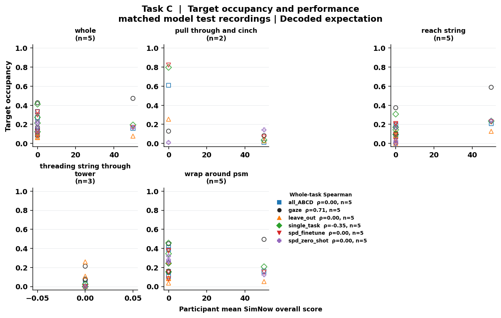

**图中内容**：横轴参与者平均SimNow成绩，纵轴目标占用；每个面板为整体或阶段，右侧图例给整体Spearmanρ。相同x上的多个点并非重复测量证据。

**整体ρ及95% CI**：gaze 0.707 [0.707, 1.000]；all_ABCD 0.000 [-1.000, 1.000]；single_task -0.354 [-1.000, 0.395]；leave_out 0.000 [-1.000, 1.000]；spd_finetune 0.000 [-1.000, 1.000]；spd_zero_shot 0.000 [-1.000, 1.000]。

**说明**：测试成绩仅两个不同取值，大量点竖直堆叠；部分bootstrap因分数不变而无定义。较高ρ不能证明连续技能水平识别，cinch/穿塔阶段不足以稳定估相关。

数据表：[group_stage_summary.csv](20261105T063658759189Z_v2_full/decoded_expectation/group_stage_summary.csv)；[performance_correlations.csv](20261105T063658759189Z_v2_full/decoded_expectation/performance_correlations.csv)。

#### 图M042｜Task C｜期望点解码｜四区域占用

**图中内容**：各面板为整体/阶段，横轴为GT与五模型；堆叠绿色T、橙色P、紫色O、灰色N互斥且总高为1。目标总占用=T+O，腕部总占用=P+O。

**数值观察**：整体 GT 目标25.9%、腕部21.3%、N=64.3%；五模型目标为all_ABCD 19.9%；single_task 24.3%；leave_out 8.7%；spd_finetune 20.1%；spd_zero_shot 18.0%。

**说明**：硬点选择改变了区域占用；即使彩色总量接近GT，仍需结合事件Brier与混淆矩阵判断是否在正确帧命中。Task C中紫色重叠较明显，O不能用来区分目标与腕部偏好。

数据表：[group_stage_summary.csv](20261105T063658759189Z_v2_full/decoded_expectation/group_stage_summary.csv)；[participant_stage_summary.csv](20261105T063658759189Z_v2_full/decoded_expectation/participant_stage_summary.csv)。

#### 图M043｜Task C｜期望点解码｜重复轮次

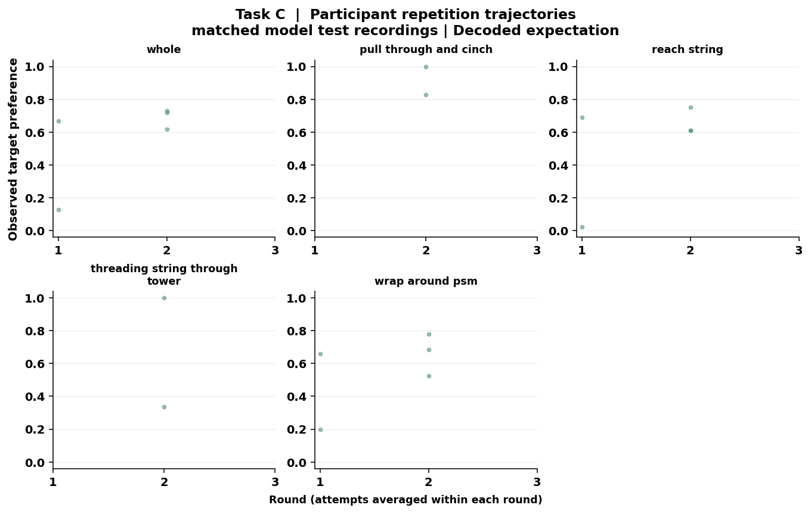

**图中内容**：横轴重复轮次1/2/3，纵轴GT的C，按参与者绘制；每人只有一个测试录像，图中可见的是分散点而不是完整三轮学习轨迹。

**数据支持**：整体第1→3轮匹配人数=0，配对ΔC=NA个百分点。

**说明**：本图不能估计同一参与者的练习变化；不同轮次上不同人的点高低不构成纵向证据。各解码分支此图仍显示GT，而非模型随轮次变化。

数据表：[group_stage_summary.csv](20261105T063658759189Z_v2_full/decoded_expectation/group_stage_summary.csv)；[repetition_contrasts.csv](20261105T063658759189Z_v2_full/decoded_expectation/repetition_contrasts.csv)。

#### 图M044｜Task C｜期望点解码｜参数与有效性敏感性

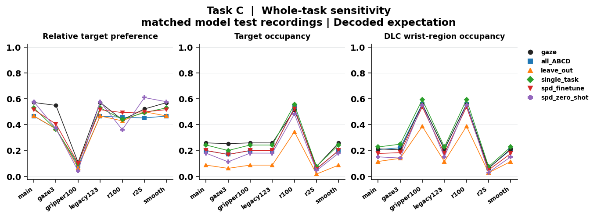

**图中内容**：三个面板依次为C、目标占用、腕部占用；横轴改变ROI半径、gaze有效码或平滑条件，线为来源均值。连接线仅便于比较离散条件，不是时间序列。

**GT 条件读数**：main（C=57.2%，目标=25.9%，腕部=21.3%）；gaze3（C=54.9%，目标=25.3%，腕部=20.5%）；gripper100（C=10.9%，目标=25.9%，腕部=55.7%）；legacy123（C=57.2%，目标=25.9%，腕部=21.3%）；r100（C=43.8%，目标=51.4%，腕部=55.7%）；r25（C=52.2%，目标=7.7%，腕部=6.3%）；smooth（C=57.1%，目标=25.9%，腕部=21.3%）。

**模型在main→gripper100的C变化**：all_ABCD 46.6%→8.0%；single_task 53.1%→9.6%；leave_out 46.8%→6.7%；spd_finetune 51.6%→10.2%；spd_zero_shot 57.8%→4.3%。

**说明**：不对称扩大腕部区域显著压低C，体现ROI几何依赖；对称扩大半径则提高占用并改变重叠。严格gaze状态同时改变有效帧，不能将所有曲线差异只归于行为改变。

数据表：[group_stage_summary.csv](20261105T063658759189Z_v2_full/decoded_expectation/group_stage_summary.csv)；[participant_stage_summary.csv](20261105T063658759189Z_v2_full/decoded_expectation/participant_stage_summary.csv)。

### argmax 解码

#### 图M045｜Task A｜argmax 解码｜相对目标偏好 C：GT–模型一致性

**图中内容**：横轴是真实gaze，纵轴是模型的参与者均值；虚线y=x为完全一致。下方代表模型低估，上方代表高估。整体与阶段分面展示，非逐帧点散布。

**整体结果**：GT 相对目标偏好 C=75.0%；模型：all_ABCD 57.4%；single_task 58.7%；leave_out 64.4%；spd_finetune 57.9%；spd_zero_shot 77.5%。

**配对偏差（百分点）**：all_ABCD -17.6 [-32.5, -2.0]；single_task -16.3 [-32.2, -3.1]；leave_out -10.6 [-22.5, -1.3]；spd_finetune -17.2 [-33.1, -1.3]；spd_zero_shot 2.5 [-6.4, 12.1]。

**说明**：C评价的是可分辨区域内的相对分配，纵向偏差不能解释成全部观察时间的注意差；需同时看D和目标占用。

数据表：[group_stage_summary.csv](20261105T063658759189Z_v2_full/decoded_argmax/group_stage_summary.csv)；[model_error_summary.csv](20261105T063658759189Z_v2_full/decoded_argmax/model_error_summary.csv)。

#### 图M046｜Task A｜argmax 解码｜腕部占用：GT–模型一致性

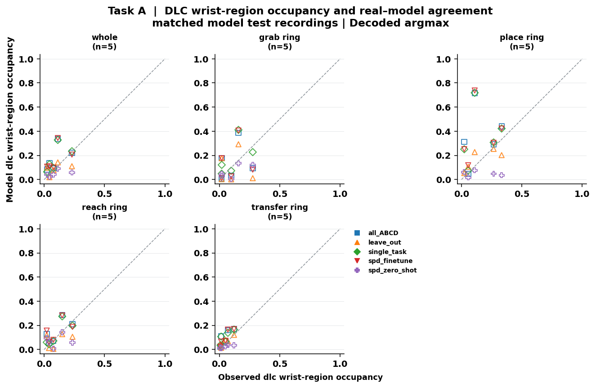

**图中内容**：横轴是真实gaze，纵轴是模型的参与者均值；虚线y=x为完全一致。下方代表模型低估，上方代表高估。整体与阶段分面展示，非逐帧点散布。

**整体结果**：GT 腕部占用=9.8%；模型：all_ABCD 17.4%；single_task 17.0%；leave_out 9.0%；spd_finetune 17.3%；spd_zero_shot 5.0%。

**配对偏差（百分点）**：all_ABCD 7.6 [1.4, 15.6]；single_task 7.2 [1.7, 14.6]；leave_out -0.8 [-6.6, 4.5]；spd_finetune 7.5 [1.2, 15.9]；spd_zero_shot -4.8 [-11.2, -0.2]。

**说明**：腕部点的绝对数值较低时，视觉上靠近原点不等于误差可以忽略；须按配对差及CI判断。

数据表：[group_stage_summary.csv](20261105T063658759189Z_v2_full/decoded_argmax/group_stage_summary.csv)；[model_error_summary.csv](20261105T063658759189Z_v2_full/decoded_argmax/model_error_summary.csv)。

#### 图M047｜Task A｜argmax 解码｜目标占用：GT–模型一致性

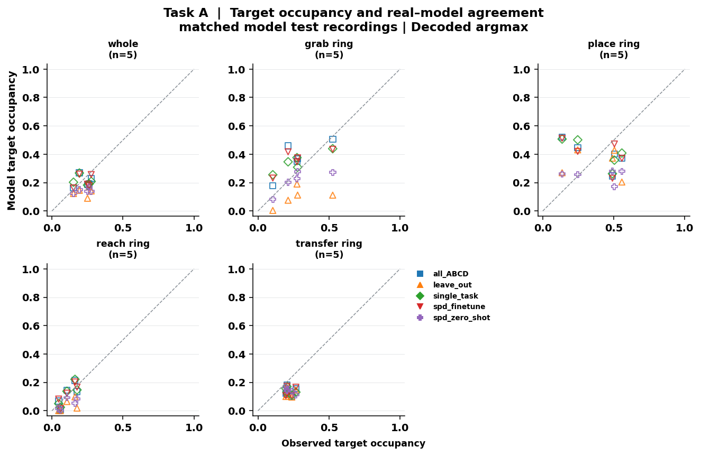

**图中内容**：横轴是真实gaze，纵轴是模型的参与者均值；虚线y=x为完全一致。下方代表模型低估，上方代表高估。整体与阶段分面展示，非逐帧点散布。

**整体结果**：GT 目标占用=22.7%；模型：all_ABCD 20.7%；single_task 21.0%；leave_out 13.4%；spd_finetune 20.9%；spd_zero_shot 14.4%。

**配对偏差（百分点）**：all_ABCD -1.9 [-6.4, 3.5]；single_task -1.6 [-6.9, 4.1]；leave_out -9.3 [-13.7, -4.9]；spd_finetune -1.7 [-6.2, 3.0]；spd_zero_shot -8.3 [-11.8, -4.7]。

**说明**：整体均值中5/5模型的目标占用低于GT，其余应按图及配对差分开判断；均值靠近对角线仍不保证逐帧预测正确。

数据表：[group_stage_summary.csv](20261105T063658759189Z_v2_full/decoded_argmax/group_stage_summary.csv)；[model_error_summary.csv](20261105T063658759189Z_v2_full/decoded_argmax/model_error_summary.csv)。

#### 图M048｜Task A｜argmax 解码｜Brier skill及区间

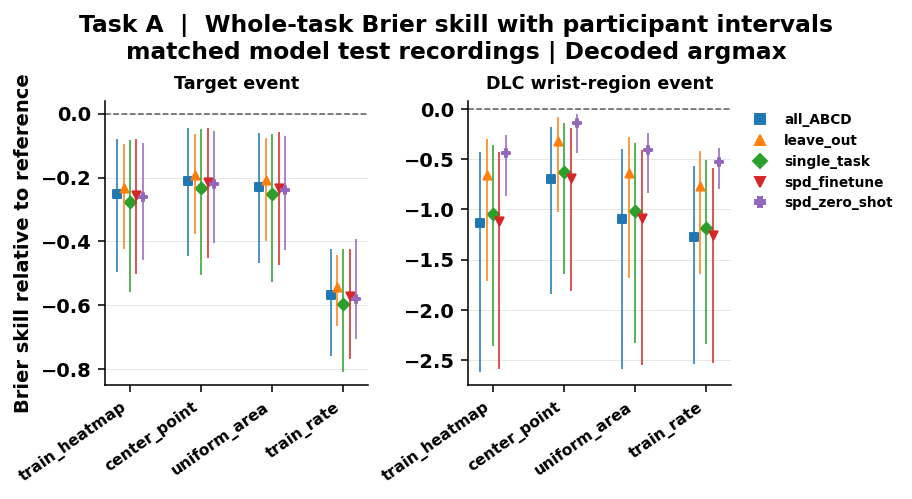

**图中内容**：左面板目标事件，右面板腕部事件；横轴参照基线，纵轴BSS，竖线是参与者bootstrap CI，虚线0表示与基线相当。值越高越好，CI不跨0才有较明确方向。

**target**：train_heatmap: -0.276–-0.232（0/5全正、5/5全负）；center_point: -0.234–-0.192（0/5全正、5/5全负）；uniform_area: -0.252–-0.209（0/5全正、5/5全负）；train_rate: -0.596–-0.542（0/5全正、5/5全负）。

**gripper**：train_heatmap: -1.136–-0.437（0/5全正、5/5全负）；center_point: -0.701–-0.145（0/5全正、5/5全负）；uniform_area: -1.100–-0.413（0/5全正、5/5全负）；train_rate: -1.275–-0.531（0/5全正、5/5全负）。

**说明**：硬点决策的BSS多数低于0；区域占用更接近GT不能抵消逐帧硬分类的代价。

数据表：[group_stage_summary.csv](20261105T063658759189Z_v2_full/decoded_argmax/group_stage_summary.csv)；[model_error_summary.csv](20261105T063658759189Z_v2_full/decoded_argmax/model_error_summary.csv)。

#### 图M049｜Task A｜argmax 解码｜四状态混淆

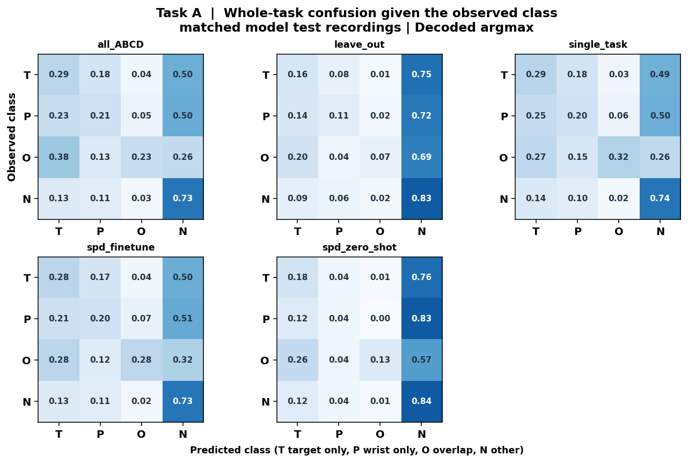

**图中内容**：每个面板一模型，行是真实T/P/O/N，列是预测T/P/O/N；颜色/单元值是给定真实类别后的条件概率（按录像、参与者逐层平均）。对角线是该类正确命中，T→N是目标独占被判成其他。

| 模型 | T→T % | T→N % | P→P % | O→O % | N→N % |
| --- | --- | --- | --- | --- | --- |
| all_ABCD | 28.5 | 49.9 | 20.8 | 23.1 | 73.3 |
| single_task | 29.0 | 49.2 | 20.1 | 31.5 | 73.6 |
| leave_out | 16.2 | 75.0 | 11.3 | 7.1 | 83.1 |
| spd_finetune | 28.4 | 50.3 | 20.3 | 27.5 | 73.4 |
| spd_zero_shot | 18.4 | 76.2 | 3.8 | 13.4 | 83.7 |

**说明**：N→N通常较高而T/P/O对角线较低，说明大量“其他”帧容易命中，但目标相关类别仍易漏掉；不能靠总体准确率证明目标锁定能力。这里T→T不是含重叠的完整目标召回率。

数据表：[group_stage_summary.csv](20261105T063658759189Z_v2_full/decoded_argmax/group_stage_summary.csv)；[confusion_summary.csv](20261105T063658759189Z_v2_full/decoded_argmax/confusion_summary.csv)。

#### 图M050｜Task A｜argmax 解码｜驻留与切换

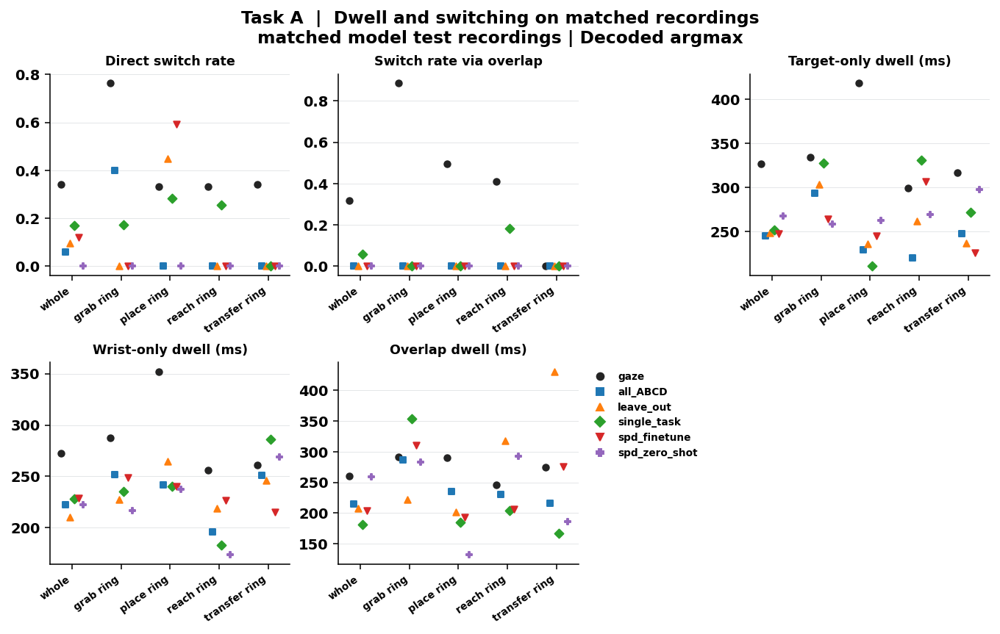

**图中内容**：五个面板分别为直接切换率、经重叠切换率、T/P/O驻留中位时长的参与者均值；横轴整体与阶段，各颜色代表来源。达到120 ms门槛的观察段进入驻留统计；边界或缺失截断段达到门槛仍纳入。

| 来源 | 直接/min | 经O/min | T ms | P ms | O ms |
| --- | --- | --- | --- | --- | --- |
| gaze | 0.342 | 0.319 | 327.0 | 272.7 | 259.7 |
| all_ABCD | 0.061 | 0.000 | 245.2 | 222.5 | 214.4 |
| single_task | 0.171 | 0.059 | 252.4 | 228.4 | 181.0 |
| leave_out | 0.095 | 0.000 | 248.3 | 210.5 | 207.9 |
| spd_finetune | 0.121 | 0.000 | 248.0 | 229.0 | 204.7 |
| spd_zero_shot | 0.000 | 0.000 | 268.0 | 222.1 | 259.5 |

**说明**：模型切换率与GT有明显差异；驻留相近也不能推出切换过程被重现，且各来源达到时长门槛的观察段数量不同。

数据表：[group_stage_summary.csv](20261105T063658759189Z_v2_full/decoded_argmax/group_stage_summary.csv)；[participant_stage_summary.csv](20261105T063658759189Z_v2_full/decoded_argmax/participant_stage_summary.csv)。

#### 图M051｜Task A｜argmax 解码｜相对目标偏好 C：与成绩的关系

**图中内容**：横轴参与者平均SimNow成绩，纵轴相对目标偏好 C；每个面板为整体或阶段，右侧图例给整体Spearmanρ。相同x上的多个点并非重复测量证据。

**整体ρ及95% CI**：gaze 0.900 [0.111, 1.000]；all_ABCD 0.100 [-1.000, 1.000]；single_task 0.100 [-1.000, 1.000]；leave_out 0.100 [-1.000, 1.000]；spd_finetune 0.200 [-1.000, 1.000]；spd_zero_shot 0.200 [-1.000, 1.000]。

**说明**：只有5名参与者，图示斜向排列和高ρ都可能受个别点影响；C、绝对占用及真实–模型一致性是不同问题。

数据表：[group_stage_summary.csv](20261105T063658759189Z_v2_full/decoded_argmax/group_stage_summary.csv)；[performance_correlations.csv](20261105T063658759189Z_v2_full/decoded_argmax/performance_correlations.csv)。

#### 图M052｜Task A｜argmax 解码｜腕部占用：与成绩的关系

**图中内容**：横轴参与者平均SimNow成绩，纵轴腕部占用；每个面板为整体或阶段，右侧图例给整体Spearmanρ。相同x上的多个点并非重复测量证据。

**整体ρ及95% CI**：gaze -0.800 [-1.000, -0.111]；all_ABCD -0.300 [-1.000, 1.000]；single_task -0.300 [-1.000, 1.000]；leave_out -0.500 [-1.000, 1.000]；spd_finetune -0.100 [-1.000, 1.000]；spd_zero_shot -0.700 [-1.000, 0.875]。

**说明**：只有5名参与者，图示斜向排列和高ρ都可能受个别点影响；C、绝对占用及真实–模型一致性是不同问题。

数据表：[group_stage_summary.csv](20261105T063658759189Z_v2_full/decoded_argmax/group_stage_summary.csv)；[performance_correlations.csv](20261105T063658759189Z_v2_full/decoded_argmax/performance_correlations.csv)。

#### 图M053｜Task A｜argmax 解码｜目标占用：与成绩的关系

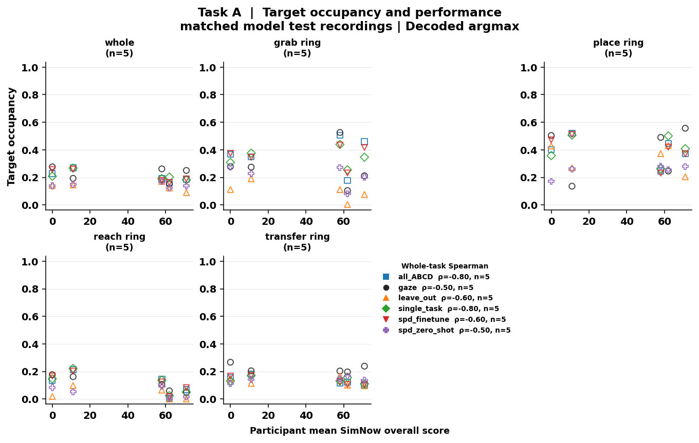

**图中内容**：横轴参与者平均SimNow成绩，纵轴目标占用；每个面板为整体或阶段，右侧图例给整体Spearmanρ。相同x上的多个点并非重复测量证据。

**整体ρ及95% CI**：gaze -0.500 [-1.000, 1.000]；all_ABCD -0.800 [-1.000, -0.111]；single_task -0.800 [-1.000, -0.111]；leave_out -0.600 [-1.000, 1.000]；spd_finetune -0.600 [-1.000, 1.000]；spd_zero_shot -0.500 [-1.000, 1.000]。

**说明**：只有5名参与者，图示斜向排列和高ρ都可能受个别点影响；C、绝对占用及真实–模型一致性是不同问题。

数据表：[group_stage_summary.csv](20261105T063658759189Z_v2_full/decoded_argmax/group_stage_summary.csv)；[performance_correlations.csv](20261105T063658759189Z_v2_full/decoded_argmax/performance_correlations.csv)。

#### 图M054｜Task A｜argmax 解码｜四区域占用

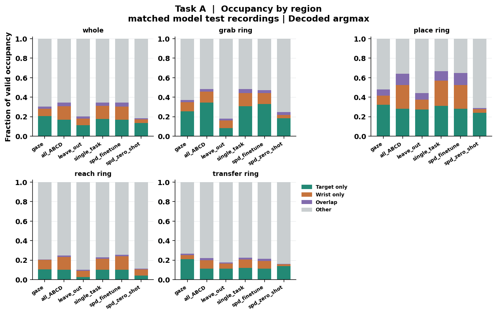

**图中内容**：各面板为整体/阶段，横轴为GT与五模型；堆叠绿色T、橙色P、紫色O、灰色N互斥且总高为1。目标总占用=T+O，腕部总占用=P+O。

**数值观察**：整体 GT 目标22.7%、腕部9.8%、N=69.7%；五模型目标为all_ABCD 20.7%；single_task 21.0%；leave_out 13.4%；spd_finetune 20.9%；spd_zero_shot 14.4%。

**说明**：硬点选择改变了区域占用；即使彩色总量接近GT，仍需结合事件Brier与混淆矩阵判断是否在正确帧命中。Task A的GT绿色目标独占更突出，模型目标偏好不足不能仅归因于两ROI重叠。

数据表：[group_stage_summary.csv](20261105T063658759189Z_v2_full/decoded_argmax/group_stage_summary.csv)；[participant_stage_summary.csv](20261105T063658759189Z_v2_full/decoded_argmax/participant_stage_summary.csv)。

#### 图M055｜Task A｜argmax 解码｜重复轮次

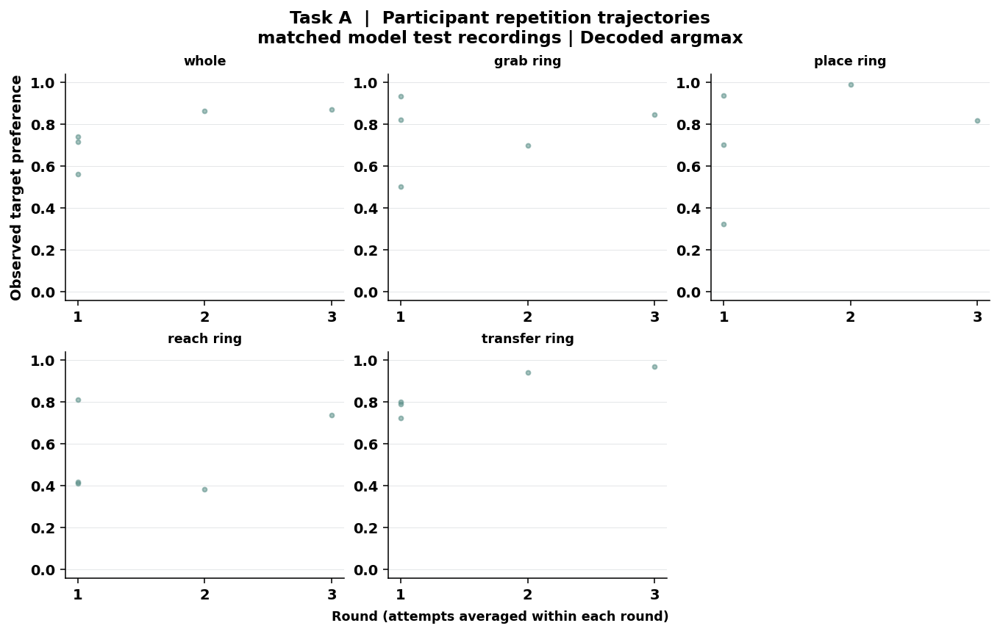

**图中内容**：横轴重复轮次1/2/3，纵轴GT的C，按参与者绘制；每人只有一个测试录像，图中可见的是分散点而不是完整三轮学习轨迹。

**数据支持**：整体第1→3轮匹配人数=0，配对ΔC=NA个百分点。

**说明**：本图不能估计同一参与者的练习变化；不同轮次上不同人的点高低不构成纵向证据。各解码分支此图仍显示GT，而非模型随轮次变化。

数据表：[group_stage_summary.csv](20261105T063658759189Z_v2_full/decoded_argmax/group_stage_summary.csv)；[repetition_contrasts.csv](20261105T063658759189Z_v2_full/decoded_argmax/repetition_contrasts.csv)。

#### 图M056｜Task A｜argmax 解码｜参数与有效性敏感性

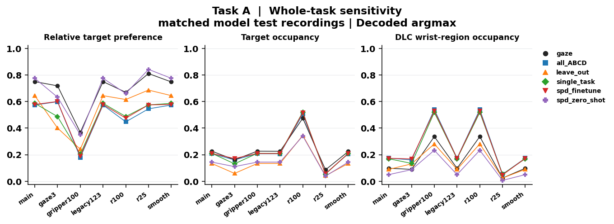

**图中内容**：三个面板依次为C、目标占用、腕部占用；横轴改变ROI半径、gaze有效码或平滑条件，线为来源均值。连接线仅便于比较离散条件，不是时间序列。

**GT 条件读数**：main（C=75.0%，目标=22.7%，腕部=9.8%）；gaze3（C=71.8%，目标=16.1%，腕部=9.0%）；gripper100（C=36.8%，目标=22.7%，腕部=33.7%）；legacy123（C=75.0%，目标=22.6%，腕部=9.8%）；r100（C=67.0%，目标=47.5%，腕部=33.7%）；r25（C=81.1%，目标=8.6%，腕部=2.4%）；smooth（C=74.8%，目标=22.4%，腕部=9.8%）。

**模型在main→gripper100的C变化**：all_ABCD 57.4%→17.9%；single_task 58.7%→20.4%；leave_out 64.4%→24.1%；spd_finetune 57.9%→18.9%；spd_zero_shot 77.5%→35.1%。

**说明**：不对称扩大腕部区域显著压低C，体现ROI几何依赖；对称扩大半径则提高占用并改变重叠。严格gaze状态同时改变有效帧，不能将所有曲线差异只归于行为改变。

数据表：[group_stage_summary.csv](20261105T063658759189Z_v2_full/decoded_argmax/group_stage_summary.csv)；[participant_stage_summary.csv](20261105T063658759189Z_v2_full/decoded_argmax/participant_stage_summary.csv)。

#### 图M057｜Task C｜argmax 解码｜相对目标偏好 C：GT–模型一致性

**图中内容**：横轴是真实gaze，纵轴是模型的参与者均值；虚线y=x为完全一致。下方代表模型低估，上方代表高估。整体与阶段分面展示，非逐帧点散布。

**整体结果**：GT 相对目标偏好 C=57.2%；模型：all_ABCD 58.6%；single_task 56.5%；leave_out 42.8%；spd_finetune 58.3%；spd_zero_shot 43.2%。

**配对偏差（百分点）**：all_ABCD 1.3 [-14.3, 16.6]；single_task -0.7 [-19.0, 17.4]；leave_out -14.4 [-37.5, 8.9]；spd_finetune 1.1 [-15.7, 17.7]；spd_zero_shot -14.0 [-24.9, 4.5]。

**说明**：C评价的是可分辨区域内的相对分配，纵向偏差不能解释成全部观察时间的注意差；需同时看D和目标占用。C任务cinch/穿塔阶段可估人数少，不能将个别点推广到全部参与者。

数据表：[group_stage_summary.csv](20261105T063658759189Z_v2_full/decoded_argmax/group_stage_summary.csv)；[model_error_summary.csv](20261105T063658759189Z_v2_full/decoded_argmax/model_error_summary.csv)。

#### 图M058｜Task C｜argmax 解码｜腕部占用：GT–模型一致性

**图中内容**：横轴是真实gaze，纵轴是模型的参与者均值；虚线y=x为完全一致。下方代表模型低估，上方代表高估。整体与阶段分面展示，非逐帧点散布。

**整体结果**：GT 腕部占用=21.3%；模型：all_ABCD 29.9%；single_task 31.5%；leave_out 20.5%；spd_finetune 28.4%；spd_zero_shot 24.7%。

**配对偏差（百分点）**：all_ABCD 8.6 [5.8, 12.6]；single_task 10.1 [3.4, 16.9]；leave_out -0.8 [-9.5, 7.9]；spd_finetune 7.1 [3.0, 12.2]；spd_zero_shot 3.4 [-3.1, 10.0]。

**说明**：腕部点的绝对数值较低时，视觉上靠近原点不等于误差可以忽略；须按配对差及CI判断。C任务cinch/穿塔阶段可估人数少，不能将个别点推广到全部参与者。

数据表：[group_stage_summary.csv](20261105T063658759189Z_v2_full/decoded_argmax/group_stage_summary.csv)；[model_error_summary.csv](20261105T063658759189Z_v2_full/decoded_argmax/model_error_summary.csv)。

#### 图M059｜Task C｜argmax 解码｜目标占用：GT–模型一致性

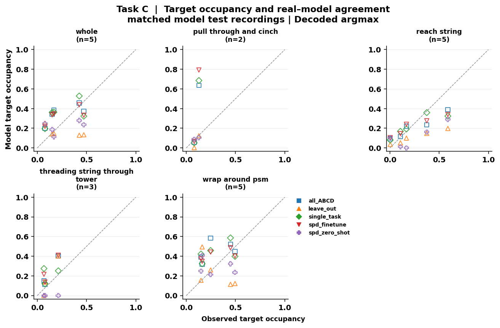

**图中内容**：横轴是真实gaze，纵轴是模型的参与者均值；虚线y=x为完全一致。下方代表模型低估，上方代表高估。整体与阶段分面展示，非逐帧点散布。

**整体结果**：GT 目标占用=25.9%；模型：all_ABCD 35.2%；single_task 35.4%；leave_out 16.1%；spd_finetune 33.5%；spd_zero_shot 21.2%。

**配对偏差（百分点）**：all_ABCD 9.2 [-1.5, 18.7]；single_task 9.5 [-3.0, 18.6]；leave_out -9.8 [-26.4, 6.2]；spd_finetune 7.6 [-4.6, 17.4]；spd_zero_shot -4.7 [-16.5, 7.9]。

**说明**：整体均值中2/5模型的目标占用低于GT，其余应按图及配对差分开判断；均值靠近对角线仍不保证逐帧预测正确。C任务cinch/穿塔阶段可估人数少，不能将个别点推广到全部参与者。

数据表：[group_stage_summary.csv](20261105T063658759189Z_v2_full/decoded_argmax/group_stage_summary.csv)；[model_error_summary.csv](20261105T063658759189Z_v2_full/decoded_argmax/model_error_summary.csv)。

#### 图M060｜Task C｜argmax 解码｜Brier skill及区间

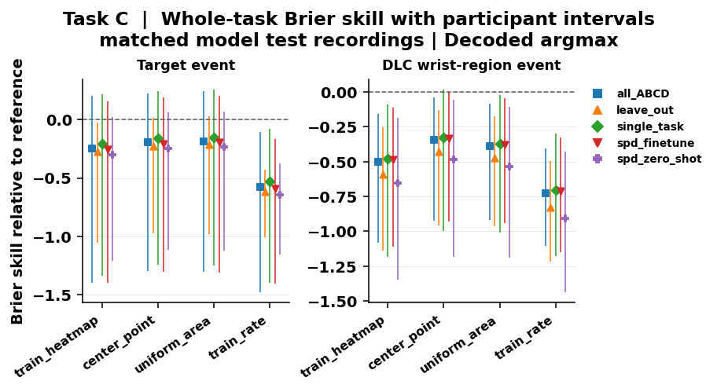

**图中内容**：左面板目标事件，右面板腕部事件；横轴参照基线，纵轴BSS，竖线是参与者bootstrap CI，虚线0表示与基线相当。值越高越好，CI不跨0才有较明确方向。

**target**：train_heatmap: -0.298–-0.209（0/5全正、1/5全负）；center_point: -0.247–-0.162（0/5全正、0/5全负）；uniform_area: -0.235–-0.150（0/5全正、0/5全负）；train_rate: -0.644–-0.531（0/5全正、5/5全负）。

**gripper**：train_heatmap: -0.655–-0.482（0/5全正、5/5全负）；center_point: -0.485–-0.329（0/5全正、3/5全负）；uniform_area: -0.535–-0.374（0/5全正、5/5全负）；train_rate: -0.905–-0.705（0/5全正、5/5全负）。

**说明**：硬点决策的BSS多数低于0；区域占用更接近GT不能抵消逐帧硬分类的代价。

数据表：[group_stage_summary.csv](20261105T063658759189Z_v2_full/decoded_argmax/group_stage_summary.csv)；[model_error_summary.csv](20261105T063658759189Z_v2_full/decoded_argmax/model_error_summary.csv)。

#### 图M061｜Task C｜argmax 解码｜四状态混淆

**图中内容**：每个面板一模型，行是真实T/P/O/N，列是预测T/P/O/N；颜色/单元值是给定真实类别后的条件概率（按录像、参与者逐层平均）。对角线是该类正确命中，T→N是目标独占被判成其他。

| 模型 | T→T % | T→N % | P→P % | O→O % | N→N % |
| --- | --- | --- | --- | --- | --- |
| all_ABCD | 35.0 | 35.3 | 31.4 | 42.8 | 62.8 |
| single_task | 34.4 | 33.1 | 33.8 | 47.8 | 63.2 |
| leave_out | 14.7 | 62.6 | 18.9 | 15.9 | 76.2 |
| spd_finetune | 34.3 | 37.6 | 32.2 | 39.3 | 63.6 |
| spd_zero_shot | 20.1 | 61.7 | 21.1 | 18.4 | 68.2 |

**说明**：N→N通常较高而T/P/O对角线较低，说明大量“其他”帧容易命中，但目标相关类别仍易漏掉；不能靠总体准确率证明目标锁定能力。这里T→T不是含重叠的完整目标召回率。

数据表：[group_stage_summary.csv](20261105T063658759189Z_v2_full/decoded_argmax/group_stage_summary.csv)；[confusion_summary.csv](20261105T063658759189Z_v2_full/decoded_argmax/confusion_summary.csv)。

#### 图M062｜Task C｜argmax 解码｜驻留与切换

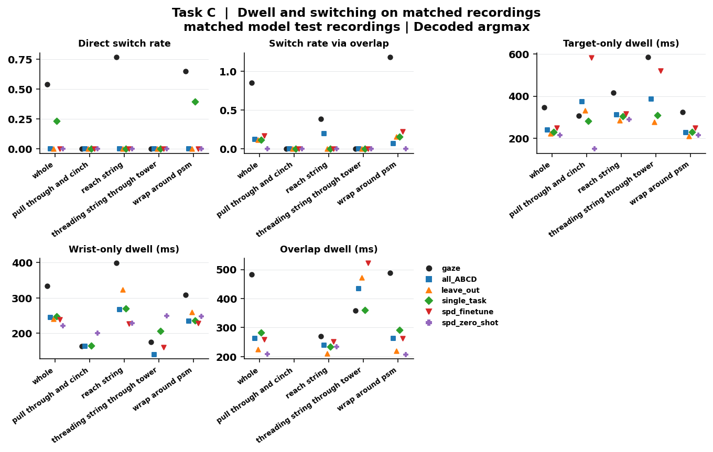

**图中内容**：五个面板分别为直接切换率、经重叠切换率、T/P/O驻留中位时长的参与者均值；横轴整体与阶段，各颜色代表来源。达到120 ms门槛的观察段进入驻留统计；边界或缺失截断段达到门槛仍纳入。

| 来源 | 直接/min | 经O/min | T ms | P ms | O ms |
| --- | --- | --- | --- | --- | --- |
| gaze | 0.542 | 0.851 | 347.1 | 334.5 | 482.6 |
| all_ABCD | 0.000 | 0.121 | 239.9 | 245.2 | 262.6 |
| single_task | 0.232 | 0.114 | 229.8 | 247.4 | 282.6 |
| leave_out | 0.000 | 0.114 | 222.0 | 240.8 | 224.3 |
| spd_finetune | 0.000 | 0.165 | 250.0 | 239.7 | 259.0 |
| spd_zero_shot | 0.000 | 0.000 | 215.5 | 221.5 | 208.4 |

**说明**：模型切换率与GT有明显差异；驻留相近也不能推出切换过程被重现，且各来源达到时长门槛的观察段数量不同。

数据表：[group_stage_summary.csv](20261105T063658759189Z_v2_full/decoded_argmax/group_stage_summary.csv)；[participant_stage_summary.csv](20261105T063658759189Z_v2_full/decoded_argmax/participant_stage_summary.csv)。

#### 图M063｜Task C｜argmax 解码｜相对目标偏好 C：与成绩的关系

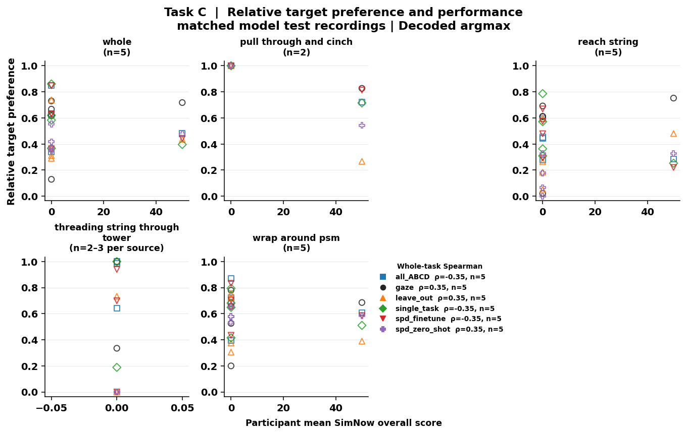

**图中内容**：横轴参与者平均SimNow成绩，纵轴相对目标偏好 C；每个面板为整体或阶段，右侧图例给整体Spearmanρ。相同x上的多个点并非重复测量证据。

**整体ρ及95% CI**：gaze 0.354 [-0.395, 1.000]；all_ABCD -0.354 [-1.000, 0.395]；single_task -0.354 [-1.000, 0.395]；leave_out 0.354 [-0.395, 1.000]；spd_finetune -0.354 [-1.000, 0.395]；spd_zero_shot 0.354 [-0.395, 1.000]。

**说明**：测试成绩仅两个不同取值，大量点竖直堆叠；部分bootstrap因分数不变而无定义。较高ρ不能证明连续技能水平识别，cinch/穿塔阶段不足以稳定估相关。

数据表：[group_stage_summary.csv](20261105T063658759189Z_v2_full/decoded_argmax/group_stage_summary.csv)；[performance_correlations.csv](20261105T063658759189Z_v2_full/decoded_argmax/performance_correlations.csv)。

#### 图M064｜Task C｜argmax 解码｜腕部占用：与成绩的关系

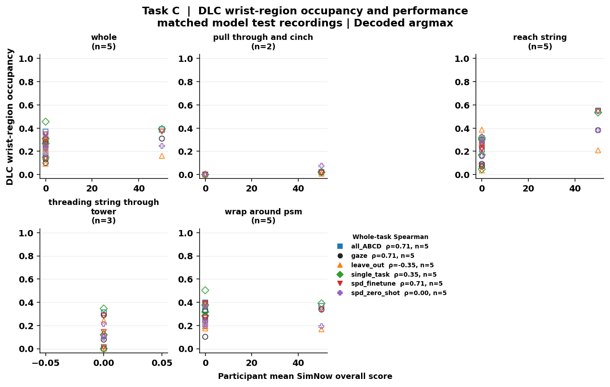

**图中内容**：横轴参与者平均SimNow成绩，纵轴腕部占用；每个面板为整体或阶段，右侧图例给整体Spearmanρ。相同x上的多个点并非重复测量证据。

**整体ρ及95% CI**：gaze 0.707 [0.707, 1.000]；all_ABCD 0.707 [0.707, 1.000]；single_task 0.354 [-0.395, 1.000]；leave_out -0.354 [-1.000, 0.395]；spd_finetune 0.707 [0.707, 1.000]；spd_zero_shot 0.000 [-1.000, 1.000]。

**说明**：测试成绩仅两个不同取值，大量点竖直堆叠；部分bootstrap因分数不变而无定义。较高ρ不能证明连续技能水平识别，cinch/穿塔阶段不足以稳定估相关。

数据表：[group_stage_summary.csv](20261105T063658759189Z_v2_full/decoded_argmax/group_stage_summary.csv)；[performance_correlations.csv](20261105T063658759189Z_v2_full/decoded_argmax/performance_correlations.csv)。

#### 图M065｜Task C｜argmax 解码｜目标占用：与成绩的关系

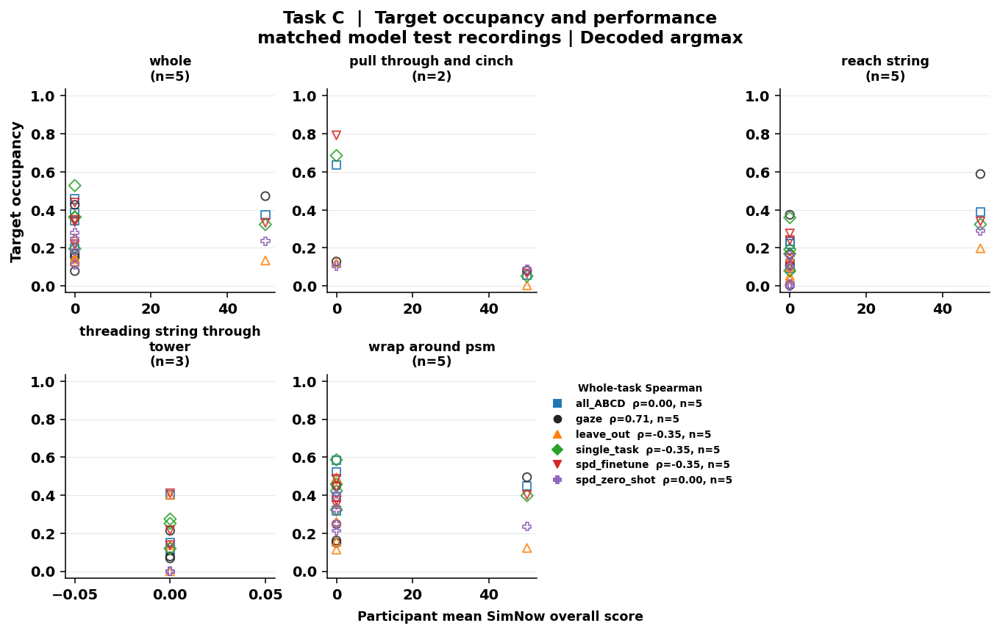

**图中内容**：横轴参与者平均SimNow成绩，纵轴目标占用；每个面板为整体或阶段，右侧图例给整体Spearmanρ。相同x上的多个点并非重复测量证据。

**整体ρ及95% CI**：gaze 0.707 [0.707, 1.000]；all_ABCD 0.000 [-1.000, 1.000]；single_task -0.354 [-1.000, 0.395]；leave_out -0.354 [-1.000, 0.395]；spd_finetune -0.354 [-1.000, 0.395]；spd_zero_shot 0.000 [-1.000, 1.000]。

**说明**：测试成绩仅两个不同取值，大量点竖直堆叠；部分bootstrap因分数不变而无定义。较高ρ不能证明连续技能水平识别，cinch/穿塔阶段不足以稳定估相关。

数据表：[group_stage_summary.csv](20261105T063658759189Z_v2_full/decoded_argmax/group_stage_summary.csv)；[performance_correlations.csv](20261105T063658759189Z_v2_full/decoded_argmax/performance_correlations.csv)。

#### 图M066｜Task C｜argmax 解码｜四区域占用

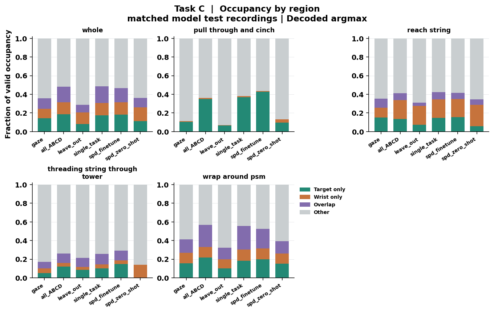

**图中内容**：各面板为整体/阶段，横轴为GT与五模型；堆叠绿色T、橙色P、紫色O、灰色N互斥且总高为1。目标总占用=T+O，腕部总占用=P+O。

**数值观察**：整体 GT 目标25.9%、腕部21.3%、N=64.3%；五模型目标为all_ABCD 35.2%；single_task 35.4%；leave_out 16.1%；spd_finetune 33.5%；spd_zero_shot 21.2%。

**说明**：硬点选择改变了区域占用；即使彩色总量接近GT，仍需结合事件Brier与混淆矩阵判断是否在正确帧命中。Task C中紫色重叠较明显，O不能用来区分目标与腕部偏好。

数据表：[group_stage_summary.csv](20261105T063658759189Z_v2_full/decoded_argmax/group_stage_summary.csv)；[participant_stage_summary.csv](20261105T063658759189Z_v2_full/decoded_argmax/participant_stage_summary.csv)。

#### 图M067｜Task C｜argmax 解码｜重复轮次

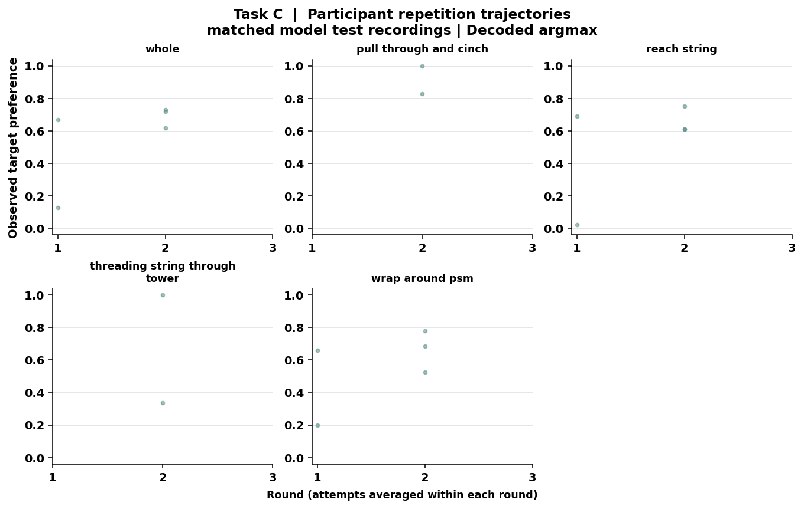

**图中内容**：横轴重复轮次1/2/3，纵轴GT的C，按参与者绘制；每人只有一个测试录像，图中可见的是分散点而不是完整三轮学习轨迹。

**数据支持**：整体第1→3轮匹配人数=0，配对ΔC=NA个百分点。

**说明**：本图不能估计同一参与者的练习变化；不同轮次上不同人的点高低不构成纵向证据。各解码分支此图仍显示GT，而非模型随轮次变化。

数据表：[group_stage_summary.csv](20261105T063658759189Z_v2_full/decoded_argmax/group_stage_summary.csv)；[repetition_contrasts.csv](20261105T063658759189Z_v2_full/decoded_argmax/repetition_contrasts.csv)。

#### 图M068｜Task C｜argmax 解码｜参数与有效性敏感性

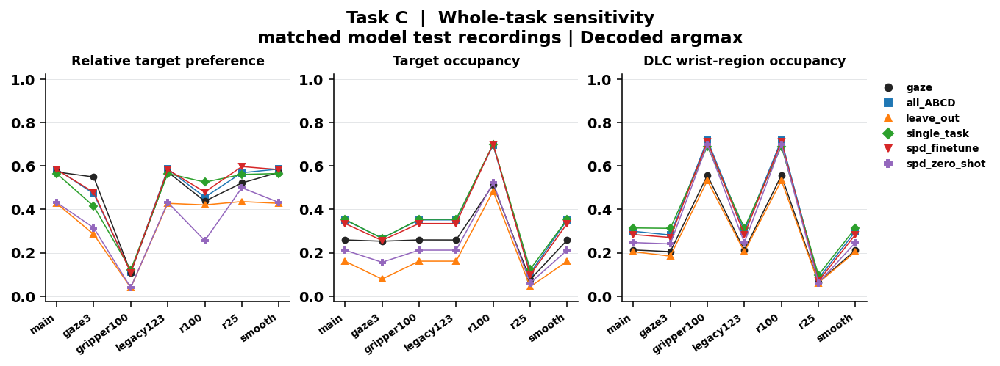

**图中内容**：三个面板依次为C、目标占用、腕部占用；横轴改变ROI半径、gaze有效码或平滑条件，线为来源均值。连接线仅便于比较离散条件，不是时间序列。

**GT 条件读数**：main（C=57.2%，目标=25.9%，腕部=21.3%）；gaze3（C=54.9%，目标=25.3%，腕部=20.5%）；gripper100（C=10.9%，目标=25.9%，腕部=55.7%）；legacy123（C=57.2%，目标=25.9%，腕部=21.3%）；r100（C=43.8%，目标=51.4%，腕部=55.7%）；r25（C=52.2%，目标=7.7%，腕部=6.3%）；smooth（C=57.1%，目标=25.9%，腕部=21.3%）。

**模型在main→gripper100的C变化**：all_ABCD 58.6%→11.1%；single_task 56.5%→12.1%；leave_out 42.8%→3.9%；spd_finetune 58.3%→10.9%；spd_zero_shot 43.2%→4.0%。

**说明**：不对称扩大腕部区域显著压低C，体现ROI几何依赖；对称扩大半径则提高占用并改变重叠。严格gaze状态同时改变有效帧，不能将所有曲线差异只归于行为改变。

数据表：[group_stage_summary.csv](20261105T063658759189Z_v2_full/decoded_argmax/group_stage_summary.csv)；[participant_stage_summary.csv](20261105T063658759189Z_v2_full/decoded_argmax/participant_stage_summary.csv)。

### 逐帧随机点解码

#### 图M069｜Task A｜逐帧随机点解码｜相对目标偏好 C：GT–模型一致性

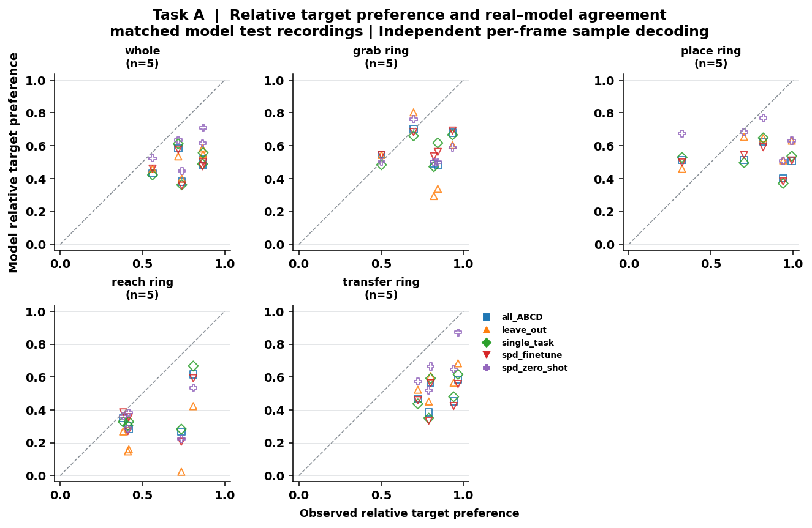

**图中内容**：横轴是真实gaze，纵轴是模型的参与者均值；虚线y=x为完全一致。下方代表模型低估，上方代表高估。整体与阶段分面展示，非逐帧点散布。

**整体结果**：GT 相对目标偏好 C=75.0%；模型：all_ABCD 47.9%；single_task 48.9%；leave_out 50.5%；spd_finetune 47.4%；spd_zero_shot 58.6%。

**配对偏差（百分点）**：all_ABCD -27.2 [-36.8, -17.5]；single_task -26.2 [-36.3, -16.0]；leave_out -24.5 [-32.0, -16.6]；spd_finetune -27.6 [-38.2, -16.5]；spd_zero_shot -16.5 [-24.9, -8.1]。

**说明**：C评价的是可分辨区域内的相对分配，纵向偏差不能解释成全部观察时间的注意差；需同时看D和目标占用。

数据表：[group_stage_summary.csv](20261105T063658759189Z_v2_full/decoded_sample/group_stage_summary.csv)；[model_error_summary.csv](20261105T063658759189Z_v2_full/decoded_sample/model_error_summary.csv)。

#### 图M070｜Task A｜逐帧随机点解码｜腕部占用：GT–模型一致性

**图中内容**：横轴是真实gaze，纵轴是模型的参与者均值；虚线y=x为完全一致。下方代表模型低估，上方代表高估。整体与阶段分面展示，非逐帧点散布。

**整体结果**：GT 腕部占用=9.8%；模型：all_ABCD 7.1%；single_task 7.2%；leave_out 5.0%；spd_finetune 7.1%；spd_zero_shot 3.7%。

**配对偏差（百分点）**：all_ABCD -2.7 [-9.2, 2.2]；single_task -2.5 [-8.6, 1.8]；leave_out -4.8 [-11.2, 0.0]；spd_finetune -2.7 [-9.3, 2.1]；spd_zero_shot -6.0 [-12.5, -1.4]。

**说明**：腕部点的绝对数值较低时，视觉上靠近原点不等于误差可以忽略；须按配对差及CI判断。

数据表：[group_stage_summary.csv](20261105T063658759189Z_v2_full/decoded_sample/group_stage_summary.csv)；[model_error_summary.csv](20261105T063658759189Z_v2_full/decoded_sample/model_error_summary.csv)。

#### 图M071｜Task A｜逐帧随机点解码｜目标占用：GT–模型一致性

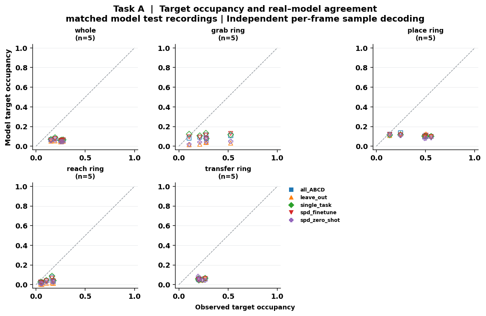

**图中内容**：横轴是真实gaze，纵轴是模型的参与者均值；虚线y=x为完全一致。下方代表模型低估，上方代表高估。整体与阶段分面展示，非逐帧点散布。

**整体结果**：GT 目标占用=22.7%；模型：all_ABCD 6.5%；single_task 6.9%；leave_out 5.0%；spd_finetune 6.4%；spd_zero_shot 5.1%。

**配对偏差（百分点）**：all_ABCD -16.1 [-20.5, -11.4]；single_task -15.8 [-20.2, -11.0]；leave_out -17.7 [-21.6, -13.1]；spd_finetune -16.3 [-20.4, -11.8]；spd_zero_shot -17.6 [-22.1, -12.6]。

**说明**：整体均值中5/5模型的目标占用低于GT，其余应按图及配对差分开判断；均值靠近对角线仍不保证逐帧预测正确。

数据表：[group_stage_summary.csv](20261105T063658759189Z_v2_full/decoded_sample/group_stage_summary.csv)；[model_error_summary.csv](20261105T063658759189Z_v2_full/decoded_sample/model_error_summary.csv)。

#### 图M072｜Task A｜逐帧随机点解码｜Brier skill及区间

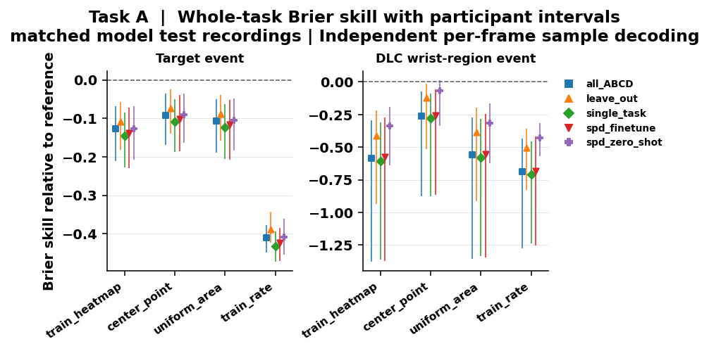

**图中内容**：左面板目标事件，右面板腕部事件；横轴参照基线，纵轴BSS，竖线是参与者bootstrap CI，虚线0表示与基线相当。值越高越好，CI不跨0才有较明确方向。

**target**：train_heatmap: -0.145–-0.109（0/5全正、5/5全负）；center_point: -0.108–-0.073（0/5全正、5/5全负）；uniform_area: -0.124–-0.089（0/5全正、5/5全负）；train_rate: -0.433–-0.388（0/5全正、5/5全负）。

**gripper**：train_heatmap: -0.605–-0.340（0/5全正、5/5全负）；center_point: -0.278–-0.067（0/5全正、4/5全负）；uniform_area: -0.578–-0.317（0/5全正、5/5全负）；train_rate: -0.709–-0.427（0/5全正、5/5全负）。

**说明**：硬点决策的BSS多数低于0；区域占用更接近GT不能抵消逐帧硬分类的代价。

数据表：[group_stage_summary.csv](20261105T063658759189Z_v2_full/decoded_sample/group_stage_summary.csv)；[model_error_summary.csv](20261105T063658759189Z_v2_full/decoded_sample/model_error_summary.csv)。

#### 图M073｜Task A｜逐帧随机点解码｜四状态混淆

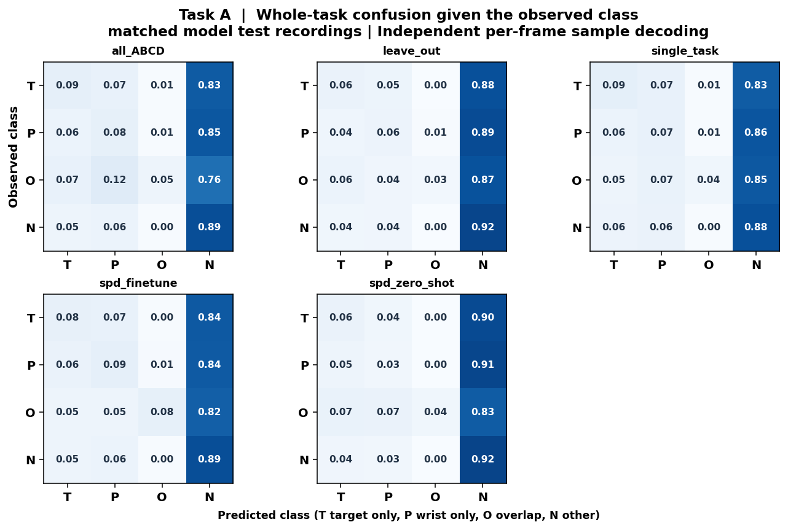

**图中内容**：每个面板一模型，行是真实T/P/O/N，列是预测T/P/O/N；颜色/单元值是给定真实类别后的条件概率（按录像、参与者逐层平均）。对角线是该类正确命中，T→N是目标独占被判成其他。

| 模型 | T→T % | T→N % | P→P % | O→O % | N→N % |
| --- | --- | --- | --- | --- | --- |
| all_ABCD | 8.9 | 83.2 | 8.3 | 4.9 | 88.5 |
| single_task | 9.0 | 83.1 | 7.2 | 3.7 | 87.8 |
| leave_out | 6.5 | 87.8 | 5.8 | 2.8 | 91.7 |
| spd_finetune | 8.0 | 84.2 | 8.7 | 8.2 | 88.5 |
| spd_zero_shot | 6.3 | 89.8 | 3.5 | 3.7 | 92.2 |

**说明**：N→N通常较高而T/P/O对角线较低，说明大量“其他”帧容易命中，但目标相关类别仍易漏掉；不能靠总体准确率证明目标锁定能力。这里T→T不是含重叠的完整目标召回率。

数据表：[group_stage_summary.csv](20261105T063658759189Z_v2_full/decoded_sample/group_stage_summary.csv)；[confusion_summary.csv](20261105T063658759189Z_v2_full/decoded_sample/confusion_summary.csv)。

#### 图M074｜Task A｜逐帧随机点解码｜驻留与切换

**图中内容**：五个面板分别为直接切换率、经重叠切换率、T/P/O驻留中位时长的参与者均值；横轴整体与阶段，各颜色代表来源。达到120 ms门槛的观察段进入驻留统计；边界或缺失截断段达到门槛仍纳入。

| 来源 | 直接/min | 经O/min | T ms | P ms | O ms |
| --- | --- | --- | --- | --- | --- |
| gaze | 0.342 | 0.319 | 327.0 | 272.7 | 259.7 |
| all_ABCD | 0.000 | 0.000 | NA | NA | NA |
| single_task | 0.000 | 0.000 | NA | 125.5 | NA |
| leave_out | 0.000 | 0.000 | NA | NA | NA |
| spd_finetune | 0.000 | 0.000 | NA | NA | NA |
| spd_zero_shot | 0.000 | 0.000 | NA | NA | NA |

**说明**：逐帧随机点没有连续轨迹身份，短段多被阈值剔除，NA和接近0切换率是该解码规则的诊断，不是预测分布稳定的证明。

数据表：[group_stage_summary.csv](20261105T063658759189Z_v2_full/decoded_sample/group_stage_summary.csv)；[participant_stage_summary.csv](20261105T063658759189Z_v2_full/decoded_sample/participant_stage_summary.csv)。

#### 图M075｜Task A｜逐帧随机点解码｜相对目标偏好 C：与成绩的关系

**图中内容**：横轴参与者平均SimNow成绩，纵轴相对目标偏好 C；每个面板为整体或阶段，右侧图例给整体Spearmanρ。相同x上的多个点并非重复测量证据。

**整体ρ及95% CI**：gaze 0.900 [0.111, 1.000]；all_ABCD 0.100 [-1.000, 1.000]；single_task 0.100 [-1.000, 1.000]；leave_out 0.700 [-0.875, 1.000]；spd_finetune 0.100 [-1.000, 1.000]；spd_zero_shot 0.300 [-1.000, 1.000]。

**说明**：只有5名参与者，图示斜向排列和高ρ都可能受个别点影响；C、绝对占用及真实–模型一致性是不同问题。

数据表：[group_stage_summary.csv](20261105T063658759189Z_v2_full/decoded_sample/group_stage_summary.csv)；[performance_correlations.csv](20261105T063658759189Z_v2_full/decoded_sample/performance_correlations.csv)。

#### 图M076｜Task A｜逐帧随机点解码｜腕部占用：与成绩的关系

**图中内容**：横轴参与者平均SimNow成绩，纵轴腕部占用；每个面板为整体或阶段，右侧图例给整体Spearmanρ。相同x上的多个点并非重复测量证据。

**整体ρ及95% CI**：gaze -0.800 [-1.000, -0.111]；all_ABCD -0.100 [-1.000, 1.000]；single_task -0.300 [-1.000, 1.000]；leave_out -0.700 [-1.000, 0.875]；spd_finetune -0.100 [-1.000, 1.000]；spd_zero_shot -0.600 [-1.000, 1.000]。

**说明**：只有5名参与者，图示斜向排列和高ρ都可能受个别点影响；C、绝对占用及真实–模型一致性是不同问题。

数据表：[group_stage_summary.csv](20261105T063658759189Z_v2_full/decoded_sample/group_stage_summary.csv)；[performance_correlations.csv](20261105T063658759189Z_v2_full/decoded_sample/performance_correlations.csv)。

#### 图M077｜Task A｜逐帧随机点解码｜目标占用：与成绩的关系

**图中内容**：横轴参与者平均SimNow成绩，纵轴目标占用；每个面板为整体或阶段，右侧图例给整体Spearmanρ。相同x上的多个点并非重复测量证据。

**整体ρ及95% CI**：gaze -0.500 [-1.000, 1.000]；all_ABCD -0.300 [-1.000, 1.000]；single_task -0.500 [-1.000, 1.000]；leave_out -0.300 [-1.000, 1.000]；spd_finetune -0.900 [-1.000, -0.111]；spd_zero_shot 0.100 [-1.000, 1.000]。

**说明**：只有5名参与者，图示斜向排列和高ρ都可能受个别点影响；C、绝对占用及真实–模型一致性是不同问题。

数据表：[group_stage_summary.csv](20261105T063658759189Z_v2_full/decoded_sample/group_stage_summary.csv)；[performance_correlations.csv](20261105T063658759189Z_v2_full/decoded_sample/performance_correlations.csv)。

#### 图M078｜Task A｜逐帧随机点解码｜四区域占用

**图中内容**：各面板为整体/阶段，横轴为GT与五模型；堆叠绿色T、橙色P、紫色O、灰色N互斥且总高为1。目标总占用=T+O，腕部总占用=P+O。

**数值观察**：整体 GT 目标22.7%、腕部9.8%、N=69.7%；五模型目标为all_ABCD 6.5%；single_task 6.9%；leave_out 5.0%；spd_finetune 6.4%；spd_zero_shot 5.1%。

**说明**：大面积灰色表明模型的大部分概率质量落在目标/腕部之外，而GT在操作相关区域更集中。Task A的GT绿色目标独占更突出，模型目标偏好不足不能仅归因于两ROI重叠。

数据表：[group_stage_summary.csv](20261105T063658759189Z_v2_full/decoded_sample/group_stage_summary.csv)；[participant_stage_summary.csv](20261105T063658759189Z_v2_full/decoded_sample/participant_stage_summary.csv)。

#### 图M079｜Task A｜逐帧随机点解码｜重复轮次

**图中内容**：横轴重复轮次1/2/3，纵轴GT的C，按参与者绘制；每人只有一个测试录像，图中可见的是分散点而不是完整三轮学习轨迹。

**数据支持**：整体第1→3轮匹配人数=0，配对ΔC=NA个百分点。

**说明**：本图不能估计同一参与者的练习变化；不同轮次上不同人的点高低不构成纵向证据。各解码分支此图仍显示GT，而非模型随轮次变化。

数据表：[group_stage_summary.csv](20261105T063658759189Z_v2_full/decoded_sample/group_stage_summary.csv)；[repetition_contrasts.csv](20261105T063658759189Z_v2_full/decoded_sample/repetition_contrasts.csv)。

#### 图M080｜Task A｜逐帧随机点解码｜参数与有效性敏感性

**图中内容**：三个面板依次为C、目标占用、腕部占用；横轴改变ROI半径、gaze有效码或平滑条件，线为来源均值。连接线仅便于比较离散条件，不是时间序列。

**GT 条件读数**：main（C=75.0%，目标=22.7%，腕部=9.8%）；gaze3（C=71.8%，目标=16.1%，腕部=9.0%）；gripper100（C=36.8%，目标=22.7%，腕部=33.7%）；legacy123（C=75.0%，目标=22.6%，腕部=9.8%）；r100（C=67.0%，目标=47.5%，腕部=33.7%）；r25（C=81.1%，目标=8.6%，腕部=2.4%）；smooth（C=74.8%，目标=22.4%，腕部=9.8%）。

**模型在main→gripper100的C变化**：all_ABCD 47.9%→15.9%；single_task 48.9%→16.4%；leave_out 50.5%→17.1%；spd_finetune 47.4%→15.4%；spd_zero_shot 58.6%→22.2%。

**说明**：不对称扩大腕部区域显著压低C，体现ROI几何依赖；对称扩大半径则提高占用并改变重叠。严格gaze状态同时改变有效帧，不能将所有曲线差异只归于行为改变。

数据表：[group_stage_summary.csv](20261105T063658759189Z_v2_full/decoded_sample/group_stage_summary.csv)；[participant_stage_summary.csv](20261105T063658759189Z_v2_full/decoded_sample/participant_stage_summary.csv)。

#### 图M081｜Task C｜逐帧随机点解码｜相对目标偏好 C：GT–模型一致性

**图中内容**：横轴是真实gaze，纵轴是模型的参与者均值；虚线y=x为完全一致。下方代表模型低估，上方代表高估。整体与阶段分面展示，非逐帧点散布。

**整体结果**：GT 相对目标偏好 C=57.2%；模型：all_ABCD 41.4%；single_task 42.6%；leave_out 35.3%；spd_finetune 42.5%；spd_zero_shot 31.8%。

**配对偏差（百分点）**：all_ABCD -15.9 [-29.4, 0.7]；single_task -14.7 [-29.7, 2.7]；leave_out -22.0 [-37.2, -2.7]；spd_finetune -14.8 [-29.0, 2.4]；spd_zero_shot -25.4 [-38.0, -7.0]。

**说明**：C评价的是可分辨区域内的相对分配，纵向偏差不能解释成全部观察时间的注意差；需同时看D和目标占用。C任务cinch/穿塔阶段可估人数少，不能将个别点推广到全部参与者。

数据表：[group_stage_summary.csv](20261105T063658759189Z_v2_full/decoded_sample/group_stage_summary.csv)；[model_error_summary.csv](20261105T063658759189Z_v2_full/decoded_sample/model_error_summary.csv)。

#### 图M082｜Task C｜逐帧随机点解码｜腕部占用：GT–模型一致性

**图中内容**：横轴是真实gaze，纵轴是模型的参与者均值；虚线y=x为完全一致。下方代表模型低估，上方代表高估。整体与阶段分面展示，非逐帧点散布。

**整体结果**：GT 腕部占用=21.3%；模型：all_ABCD 14.4%；single_task 14.8%；leave_out 9.2%；spd_finetune 13.4%；spd_zero_shot 13.7%。

**配对偏差（百分点）**：all_ABCD -6.9 [-12.4, -0.8]；single_task -6.5 [-11.9, 0.0]；leave_out -12.1 [-17.9, -6.0]；spd_finetune -8.0 [-13.5, -2.0]；spd_zero_shot -7.6 [-14.2, -1.1]。

**说明**：腕部点的绝对数值较低时，视觉上靠近原点不等于误差可以忽略；须按配对差及CI判断。C任务cinch/穿塔阶段可估人数少，不能将个别点推广到全部参与者。

数据表：[group_stage_summary.csv](20261105T063658759189Z_v2_full/decoded_sample/group_stage_summary.csv)；[model_error_summary.csv](20261105T063658759189Z_v2_full/decoded_sample/model_error_summary.csv)。

#### 图M083｜Task C｜逐帧随机点解码｜目标占用：GT–模型一致性

**图中内容**：横轴是真实gaze，纵轴是模型的参与者均值；虚线y=x为完全一致。下方代表模型低估，上方代表高估。整体与阶段分面展示，非逐帧点散布。

**整体结果**：GT 目标占用=25.9%；模型：all_ABCD 11.7%；single_task 12.4%；leave_out 6.1%；spd_finetune 11.1%；spd_zero_shot 8.5%。

**配对偏差（百分点）**：all_ABCD -14.3 [-27.1, -2.4]；single_task -13.5 [-26.7, -1.7]；leave_out -19.8 [-33.0, -6.6]；spd_finetune -14.8 [-27.7, -2.9]；spd_zero_shot -17.4 [-30.6, -4.7]。

**说明**：整体均值中5/5模型的目标占用低于GT，其余应按图及配对差分开判断；均值靠近对角线仍不保证逐帧预测正确。C任务cinch/穿塔阶段可估人数少，不能将个别点推广到全部参与者。

数据表：[group_stage_summary.csv](20261105T063658759189Z_v2_full/decoded_sample/group_stage_summary.csv)；[model_error_summary.csv](20261105T063658759189Z_v2_full/decoded_sample/model_error_summary.csv)。

#### 图M084｜Task C｜逐帧随机点解码｜Brier skill及区间

**图中内容**：左面板目标事件，右面板腕部事件；横轴参照基线，纵轴BSS，竖线是参与者bootstrap CI，虚线0表示与基线相当。值越高越好，CI不跨0才有较明确方向。

**target**：train_heatmap: -0.189–-0.144（0/5全正、5/5全负）；center_point: -0.142–-0.100（0/5全正、3/5全负）；uniform_area: -0.131–-0.089（0/5全正、2/5全负）；train_rate: -0.505–-0.449（0/5全正、5/5全负）。

**gripper**：train_heatmap: -0.430–-0.297（0/5全正、5/5全负）；center_point: -0.283–-0.164（0/5全正、5/5全负）；uniform_area: -0.326–-0.203（0/5全正、5/5全负）；train_rate: -0.646–-0.493（0/5全正、5/5全负）。

**说明**：硬点决策的BSS多数低于0；区域占用更接近GT不能抵消逐帧硬分类的代价。

数据表：[group_stage_summary.csv](20261105T063658759189Z_v2_full/decoded_sample/group_stage_summary.csv)；[model_error_summary.csv](20261105T063658759189Z_v2_full/decoded_sample/model_error_summary.csv)。

#### 图M085｜Task C｜逐帧随机点解码｜四状态混淆

**图中内容**：每个面板一模型，行是真实T/P/O/N，列是预测T/P/O/N；颜色/单元值是给定真实类别后的条件概率（按录像、参与者逐层平均）。对角线是该类正确命中，T→N是目标独占被判成其他。

| 模型 | T→T % | T→N % | P→P % | O→O % | N→N % |
| --- | --- | --- | --- | --- | --- |
| all_ABCD | 9.0 | 75.0 | 13.0 | 10.8 | 82.5 |
| single_task | 10.2 | 72.4 | 14.6 | 12.3 | 82.5 |
| leave_out | 5.6 | 84.3 | 8.3 | 5.3 | 89.1 |
| spd_finetune | 9.3 | 77.5 | 14.3 | 10.7 | 83.7 |
| spd_zero_shot | 6.4 | 78.0 | 12.1 | 5.6 | 83.7 |

**说明**：N→N通常较高而T/P/O对角线较低，说明大量“其他”帧容易命中，但目标相关类别仍易漏掉；不能靠总体准确率证明目标锁定能力。这里T→T不是含重叠的完整目标召回率。

数据表：[group_stage_summary.csv](20261105T063658759189Z_v2_full/decoded_sample/group_stage_summary.csv)；[confusion_summary.csv](20261105T063658759189Z_v2_full/decoded_sample/confusion_summary.csv)。

#### 图M086｜Task C｜逐帧随机点解码｜驻留与切换

**图中内容**：五个面板分别为直接切换率、经重叠切换率、T/P/O驻留中位时长的参与者均值；横轴整体与阶段，各颜色代表来源。达到120 ms门槛的观察段进入驻留统计；边界或缺失截断段达到门槛仍纳入。

| 来源 | 直接/min | 经O/min | T ms | P ms | O ms |
| --- | --- | --- | --- | --- | --- |
| gaze | 0.542 | 0.851 | 347.1 | 334.5 | 482.6 |
| all_ABCD | 0.000 | 0.000 | NA | 134.9 | NA |
| single_task | 0.000 | 0.000 | NA | 129.0 | NA |
| leave_out | 0.000 | 0.000 | NA | 137.0 | 150.5 |
| spd_finetune | 0.000 | 0.000 | NA | NA | NA |
| spd_zero_shot | 0.000 | 0.000 | NA | 138.4 | NA |

**说明**：逐帧随机点没有连续轨迹身份，短段多被阈值剔除，NA和接近0切换率是该解码规则的诊断，不是预测分布稳定的证明。

数据表：[group_stage_summary.csv](20261105T063658759189Z_v2_full/decoded_sample/group_stage_summary.csv)；[participant_stage_summary.csv](20261105T063658759189Z_v2_full/decoded_sample/participant_stage_summary.csv)。

#### 图M087｜Task C｜逐帧随机点解码｜相对目标偏好 C：与成绩的关系

**图中内容**：横轴参与者平均SimNow成绩，纵轴相对目标偏好 C；每个面板为整体或阶段，右侧图例给整体Spearmanρ。相同x上的多个点并非重复测量证据。

**整体ρ及95% CI**：gaze 0.354 [-0.395, 1.000]；all_ABCD 0.000 [-1.000, 1.000]；single_task 0.000 [-1.000, 1.000]；leave_out 0.354 [-0.395, 1.000]；spd_finetune 0.000 [-1.000, 1.000]；spd_zero_shot 0.354 [-0.395, 1.000]。

**说明**：测试成绩仅两个不同取值，大量点竖直堆叠；部分bootstrap因分数不变而无定义。较高ρ不能证明连续技能水平识别，cinch/穿塔阶段不足以稳定估相关。

数据表：[group_stage_summary.csv](20261105T063658759189Z_v2_full/decoded_sample/group_stage_summary.csv)；[performance_correlations.csv](20261105T063658759189Z_v2_full/decoded_sample/performance_correlations.csv)。

#### 图M088｜Task C｜逐帧随机点解码｜腕部占用：与成绩的关系

**图中内容**：横轴参与者平均SimNow成绩，纵轴腕部占用；每个面板为整体或阶段，右侧图例给整体Spearmanρ。相同x上的多个点并非重复测量证据。

**整体ρ及95% CI**：gaze 0.707 [0.707, 1.000]；all_ABCD 0.000 [-1.000, 1.000]；single_task 0.354 [-0.395, 1.000]；leave_out 0.354 [-0.395, 1.000]；spd_finetune 0.707 [0.707, 1.000]；spd_zero_shot -0.354 [-1.000, 0.395]。

**说明**：测试成绩仅两个不同取值，大量点竖直堆叠；部分bootstrap因分数不变而无定义。较高ρ不能证明连续技能水平识别，cinch/穿塔阶段不足以稳定估相关。

数据表：[group_stage_summary.csv](20261105T063658759189Z_v2_full/decoded_sample/group_stage_summary.csv)；[performance_correlations.csv](20261105T063658759189Z_v2_full/decoded_sample/performance_correlations.csv)。

#### 图M089｜Task C｜逐帧随机点解码｜目标占用：与成绩的关系

**图中内容**：横轴参与者平均SimNow成绩，纵轴目标占用；每个面板为整体或阶段，右侧图例给整体Spearmanρ。相同x上的多个点并非重复测量证据。

**整体ρ及95% CI**：gaze 0.707 [0.707, 1.000]；all_ABCD 0.354 [-0.395, 1.000]；single_task 0.000 [-1.000, 1.000]；leave_out 0.707 [0.707, 1.000]；spd_finetune 0.354 [-0.395, 1.000]；spd_zero_shot 0.354 [-0.395, 1.000]。

**说明**：测试成绩仅两个不同取值，大量点竖直堆叠；部分bootstrap因分数不变而无定义。较高ρ不能证明连续技能水平识别，cinch/穿塔阶段不足以稳定估相关。

数据表：[group_stage_summary.csv](20261105T063658759189Z_v2_full/decoded_sample/group_stage_summary.csv)；[performance_correlations.csv](20261105T063658759189Z_v2_full/decoded_sample/performance_correlations.csv)。

#### 图M090｜Task C｜逐帧随机点解码｜四区域占用

**图中内容**：各面板为整体/阶段，横轴为GT与五模型；堆叠绿色T、橙色P、紫色O、灰色N互斥且总高为1。目标总占用=T+O，腕部总占用=P+O。

**数值观察**：整体 GT 目标25.9%、腕部21.3%、N=64.3%；五模型目标为all_ABCD 11.7%；single_task 12.4%；leave_out 6.1%；spd_finetune 11.1%；spd_zero_shot 8.5%。

**说明**：大面积灰色表明模型的大部分概率质量落在目标/腕部之外，而GT在操作相关区域更集中。Task C中紫色重叠较明显，O不能用来区分目标与腕部偏好。

数据表：[group_stage_summary.csv](20261105T063658759189Z_v2_full/decoded_sample/group_stage_summary.csv)；[participant_stage_summary.csv](20261105T063658759189Z_v2_full/decoded_sample/participant_stage_summary.csv)。

#### 图M091｜Task C｜逐帧随机点解码｜重复轮次

**图中内容**：横轴重复轮次1/2/3，纵轴GT的C，按参与者绘制；每人只有一个测试录像，图中可见的是分散点而不是完整三轮学习轨迹。

**数据支持**：整体第1→3轮匹配人数=0，配对ΔC=NA个百分点。

**说明**：本图不能估计同一参与者的练习变化；不同轮次上不同人的点高低不构成纵向证据。各解码分支此图仍显示GT，而非模型随轮次变化。

数据表：[group_stage_summary.csv](20261105T063658759189Z_v2_full/decoded_sample/group_stage_summary.csv)；[repetition_contrasts.csv](20261105T063658759189Z_v2_full/decoded_sample/repetition_contrasts.csv)。

#### 图M092｜Task C｜逐帧随机点解码｜参数与有效性敏感性

**图中内容**：三个面板依次为C、目标占用、腕部占用；横轴改变ROI半径、gaze有效码或平滑条件，线为来源均值。连接线仅便于比较离散条件，不是时间序列。

**GT 条件读数**：main（C=57.2%，目标=25.9%，腕部=21.3%）；gaze3（C=54.9%，目标=25.3%，腕部=20.5%）；gripper100（C=10.9%，目标=25.9%，腕部=55.7%）；legacy123（C=57.2%，目标=25.9%，腕部=21.3%）；r100（C=43.8%，目标=51.4%，腕部=55.7%）；r25（C=52.2%，目标=7.7%，腕部=6.3%）；smooth（C=57.1%，目标=25.9%，腕部=21.3%）。

**模型在main→gripper100的C变化**：all_ABCD 41.4%→5.4%；single_task 42.6%→6.0%；leave_out 35.3%→4.1%；spd_finetune 42.5%→5.6%；spd_zero_shot 31.8%→3.3%。

**说明**：不对称扩大腕部区域显著压低C，体现ROI几何依赖；对称扩大半径则提高占用并改变重叠。严格gaze状态同时改变有效帧，不能将所有曲线差异只归于行为改变。

数据表：[group_stage_summary.csv](20261105T063658759189Z_v2_full/decoded_sample/group_stage_summary.csv)；[participant_stage_summary.csv](20261105T063658759189Z_v2_full/decoded_sample/participant_stage_summary.csv)。

### 旧版期望点（已被替代）

#### 图M093｜Task A｜旧版期望点（已被替代）｜相对目标偏好 C：GT–模型一致性

**历史图**：本图使用旧有效状态/帧集及旧基线定义，已被v2替代；以下数值只解释旧图，不与新版概率数值混算。

**图中内容**：横轴是真实gaze，纵轴是模型的参与者均值；虚线y=x为完全一致。下方代表模型低估，上方代表高估。整体与阶段分面展示，非逐帧点散布。

**整体结果**：GT 相对目标偏好 C=75.0%；模型：all_ABCD 51.4%；single_task 63.0%；leave_out 64.8%；spd_finetune 59.4%；spd_zero_shot 78.3%。

**配对偏差（百分点）**：all_ABCD -23.6 [-40.4, -6.9]；single_task -12.0 [-34.9, 8.4]；leave_out -10.3 [-31.5, 6.1]；spd_finetune -15.7 [-29.6, -2.4]；spd_zero_shot 3.3 [-13.4, 17.1]。

**说明**：C评价的是可分辨区域内的相对分配，纵向偏差不能解释成全部观察时间的注意差；需同时看D和目标占用。

数据表：[group_stage_summary.csv](20261105T033217114891Z_full/group_stage_summary.csv)；[model_error_summary.csv](20261105T033217114891Z_full/model_error_summary.csv)。

#### 图M094｜Task A｜旧版期望点（已被替代）｜腕部占用：GT–模型一致性

**历史图**：本图使用旧有效状态/帧集及旧基线定义，已被v2替代；以下数值只解释旧图，不与新版概率数值混算。

**图中内容**：横轴是真实gaze，纵轴是模型的参与者均值；虚线y=x为完全一致。下方代表模型低估，上方代表高估。整体与阶段分面展示，非逐帧点散布。

**整体结果**：GT 腕部占用=9.8%；模型：all_ABCD 8.2%；single_task 7.1%；leave_out 4.5%；spd_finetune 7.3%；spd_zero_shot 1.1%。

**配对偏差（百分点）**：all_ABCD -1.6 [-6.8, 3.4]；single_task -2.6 [-8.0, 2.6]；leave_out -5.2 [-10.7, -0.6]；spd_finetune -2.4 [-7.3, 1.6]；spd_zero_shot -8.6 [-15.1, -3.2]。

**说明**：腕部点的绝对数值较低时，视觉上靠近原点不等于误差可以忽略；须按配对差及CI判断。

数据表：[group_stage_summary.csv](20261105T033217114891Z_full/group_stage_summary.csv)；[model_error_summary.csv](20261105T033217114891Z_full/model_error_summary.csv)。

#### 图M095｜Task A｜旧版期望点（已被替代）｜目标占用：GT–模型一致性

**历史图**：本图使用旧有效状态/帧集及旧基线定义，已被v2替代；以下数值只解释旧图，不与新版概率数值混算。

**图中内容**：横轴是真实gaze，纵轴是模型的参与者均值；虚线y=x为完全一致。下方代表模型低估，上方代表高估。整体与阶段分面展示，非逐帧点散布。

**整体结果**：GT 目标占用=22.6%；模型：all_ABCD 8.2%；single_task 11.5%；leave_out 6.7%；spd_finetune 10.1%；spd_zero_shot 4.3%。

**配对偏差（百分点）**：all_ABCD -14.4 [-18.4, -10.4]；single_task -11.1 [-14.6, -7.3]；leave_out -15.9 [-17.7, -13.2]；spd_finetune -12.5 [-16.3, -8.5]；spd_zero_shot -18.3 [-23.2, -13.2]。

**说明**：整体均值中5/5模型的目标占用低于GT，其余应按图及配对差分开判断；均值靠近对角线仍不保证逐帧预测正确。

数据表：[group_stage_summary.csv](20261105T033217114891Z_full/group_stage_summary.csv)；[model_error_summary.csv](20261105T033217114891Z_full/model_error_summary.csv)。

#### 图M096｜Task A｜旧版期望点（已被替代）｜Brier skill及区间

**历史图**：本图使用旧有效状态/帧集及旧基线定义，已被v2替代；以下数值只解释旧图，不与新版概率数值混算。

**图中内容**：左面板目标事件，右面板腕部事件；横轴参照基线，纵轴BSS，竖线是参与者bootstrap CI，虚线0表示与基线相当。值越高越好，CI不跨0才有较明确方向。

**target**：center: -0.088–-0.064（0/5全正、0/5全负）；train_center: -0.112–-0.088（0/5全正、3/5全负）；train_rate: -0.406–-0.375（0/5全正、5/5全负）；uniform: -0.104–-0.079（0/5全正、1/5全负）。

**gripper**：center: -0.145–0.113（1/5全正、0/5全负）；train_center: -0.221–0.054（0/5全正、3/5全负）；train_rate: -0.531–-0.187（0/5全正、5/5全负）；uniform: -0.413–-0.096（0/5全正、5/5全负）。

**说明**：硬点决策的BSS多数低于0；区域占用更接近GT不能抵消逐帧硬分类的代价。旧图train_center是旧训练中心点，不能当成新版完整train_heatmap。

数据表：[group_stage_summary.csv](20261105T033217114891Z_full/group_stage_summary.csv)；[model_error_summary.csv](20261105T033217114891Z_full/model_error_summary.csv)。

#### 图M097｜Task A｜旧版期望点（已被替代）｜四状态混淆

**历史图**：本图使用旧有效状态/帧集及旧基线定义，已被v2替代；以下数值只解释旧图，不与新版概率数值混算。

**图中内容**：每个面板一模型，行是真实T/P/O/N，列是预测T/P/O/N；颜色/单元值是给定真实类别后的条件概率（按录像、参与者逐层平均）。对角线是该类正确命中，T→N是目标独占被判成其他。

| 模型 | T→T % | T→N % | P→P % | O→O % | N→N % |
| --- | --- | --- | --- | --- | --- |
| all_ABCD | 12.0 | 79.8 | 14.1 | 10.1 | 88.6 |
| single_task | 17.3 | 75.4 | 10.9 | 12.3 | 87.1 |
| leave_out | 8.9 | 87.1 | 5.8 | 2.0 | 90.7 |
| spd_finetune | 13.7 | 78.6 | 7.9 | 11.8 | 88.3 |
| spd_zero_shot | 5.5 | 94.0 | 2.2 | 0.4 | 95.2 |

**说明**：N→N通常较高而T/P/O对角线较低，说明大量“其他”帧容易命中，但目标相关类别仍易漏掉；不能靠总体准确率证明目标锁定能力。这里T→T不是含重叠的完整目标召回率。

数据表：[group_stage_summary.csv](20261105T033217114891Z_full/group_stage_summary.csv)；[confusion_summary.csv](20261105T033217114891Z_full/confusion_summary.csv)。

#### 图M098｜Task A｜旧版期望点（已被替代）｜驻留与切换

**历史图**：本图使用旧有效状态/帧集及旧基线定义，已被v2替代；以下数值只解释旧图，不与新版概率数值混算。

**图中内容**：五个面板分别为直接切换率、经重叠切换率、T/P/O驻留中位时长的参与者均值；横轴整体与阶段，各颜色代表来源。达到120 ms门槛的观察段进入驻留统计；边界或缺失截断段达到门槛仍纳入。

| 来源 | 直接/min | 经O/min | T ms | P ms | O ms |
| --- | --- | --- | --- | --- | --- |
| gaze | 0.341 | 0.318 | 329.6 | 272.7 | 259.7 |
| all_ABCD | 0.030 | 0.000 | 258.1 | 229.7 | 287.5 |
| single_task | 0.000 | 0.000 | 244.4 | 261.8 | 246.8 |
| leave_out | 0.000 | 0.000 | 263.3 | 242.0 | 214.3 |
| spd_finetune | 0.000 | 0.000 | 264.0 | 290.0 | 202.5 |
| spd_zero_shot | 0.000 | 0.000 | 336.0 | 176.2 | NA |

**说明**：模型切换率与GT有明显差异；驻留相近也不能推出切换过程被重现，且各来源达到时长门槛的观察段数量不同。

数据表：[group_stage_summary.csv](20261105T033217114891Z_full/group_stage_summary.csv)；[participant_stage_summary.csv](20261105T033217114891Z_full/participant_stage_summary.csv)。

#### 图M099｜Task A｜旧版期望点（已被替代）｜相对目标偏好 C：与成绩的关系

**历史图**：本图使用旧有效状态/帧集及旧基线定义，已被v2替代；以下数值只解释旧图，不与新版概率数值混算。

**图中内容**：横轴参与者平均SimNow成绩，纵轴相对目标偏好 C；每个面板为整体或阶段，右侧图例给整体Spearmanρ。相同x上的多个点并非重复测量证据。

**整体ρ及95% CI**：gaze 0.900 [0.111, 1.000]；all_ABCD 0.200 [-1.000, 1.000]；single_task 0.100 [-1.000, 1.000]；leave_out 0.900 [0.111, 1.000]；spd_finetune 0.500 [-1.000, 1.000]；spd_zero_shot 0.100 [-1.000, 1.000]。

**说明**：只有5名参与者，图示斜向排列和高ρ都可能受个别点影响；C、绝对占用及真实–模型一致性是不同问题。

数据表：[group_stage_summary.csv](20261105T033217114891Z_full/group_stage_summary.csv)；[performance_correlations.csv](20261105T033217114891Z_full/performance_correlations.csv)。

#### 图M100｜Task A｜旧版期望点（已被替代）｜腕部占用：与成绩的关系

**历史图**：本图使用旧有效状态/帧集及旧基线定义，已被v2替代；以下数值只解释旧图，不与新版概率数值混算。

**图中内容**：横轴参与者平均SimNow成绩，纵轴腕部占用；每个面板为整体或阶段，右侧图例给整体Spearmanρ。相同x上的多个点并非重复测量证据。

**整体ρ及95% CI**：gaze -0.800 [-1.000, -0.111]；all_ABCD -0.700 [-1.000, 0.875]；single_task -0.500 [-1.000, 1.000]；leave_out -0.900 [-1.000, -0.111]；spd_finetune -0.700 [-1.000, 0.875]；spd_zero_shot -0.500 [-1.000, 1.000]。

**说明**：只有5名参与者，图示斜向排列和高ρ都可能受个别点影响；C、绝对占用及真实–模型一致性是不同问题。

数据表：[group_stage_summary.csv](20261105T033217114891Z_full/group_stage_summary.csv)；[performance_correlations.csv](20261105T033217114891Z_full/performance_correlations.csv)。

#### 图M101｜Task A｜旧版期望点（已被替代）｜目标占用：与成绩的关系

**历史图**：本图使用旧有效状态/帧集及旧基线定义，已被v2替代；以下数值只解释旧图，不与新版概率数值混算。

**图中内容**：横轴参与者平均SimNow成绩，纵轴目标占用；每个面板为整体或阶段，右侧图例给整体Spearmanρ。相同x上的多个点并非重复测量证据。

**整体ρ及95% CI**：gaze -0.500 [-1.000, 1.000]；all_ABCD -0.200 [-1.000, 1.000]；single_task -0.700 [-1.000, 0.875]；leave_out -0.300 [-1.000, 1.000]；spd_finetune -0.600 [-1.000, 1.000]；spd_zero_shot -0.900 [-1.000, -0.111]。

**说明**：只有5名参与者，图示斜向排列和高ρ都可能受个别点影响；C、绝对占用及真实–模型一致性是不同问题。

数据表：[group_stage_summary.csv](20261105T033217114891Z_full/group_stage_summary.csv)；[performance_correlations.csv](20261105T033217114891Z_full/performance_correlations.csv)。

#### 图M102｜Task A｜旧版期望点（已被替代）｜四区域占用

**历史图**：本图使用旧有效状态/帧集及旧基线定义，已被v2替代；以下数值只解释旧图，不与新版概率数值混算。

**图中内容**：各面板为整体/阶段，横轴为GT与五模型；堆叠绿色T、橙色P、紫色O、灰色N互斥且总高为1。目标总占用=T+O，腕部总占用=P+O。

**数值观察**：整体 GT 目标22.6%、腕部9.8%、N=69.8%；五模型目标为all_ABCD 8.2%；single_task 11.5%；leave_out 6.7%；spd_finetune 10.1%；spd_zero_shot 4.3%。

**说明**：硬点选择改变了区域占用；即使彩色总量接近GT，仍需结合事件Brier与混淆矩阵判断是否在正确帧命中。Task A的GT绿色目标独占更突出，模型目标偏好不足不能仅归因于两ROI重叠。

数据表：[group_stage_summary.csv](20261105T033217114891Z_full/group_stage_summary.csv)；[participant_stage_summary.csv](20261105T033217114891Z_full/participant_stage_summary.csv)。

#### 图M103｜Task A｜旧版期望点（已被替代）｜重复轮次

**历史图**：本图使用旧有效状态/帧集及旧基线定义，已被v2替代；以下数值只解释旧图，不与新版概率数值混算。

**图中内容**：横轴重复轮次1/2/3，纵轴GT的C，按参与者绘制；每人只有一个测试录像，图中可见的是分散点而不是完整三轮学习轨迹。

**数据支持**：整体第1→3轮匹配人数=0，配对ΔC=NA个百分点。

**说明**：本图不能估计同一参与者的练习变化；不同轮次上不同人的点高低不构成纵向证据。各解码分支此图仍显示GT，而非模型随轮次变化。

数据表：[group_stage_summary.csv](20261105T033217114891Z_full/group_stage_summary.csv)；[repetition_contrasts.csv](20261105T033217114891Z_full/repetition_contrasts.csv)。

#### 图M104｜Task A｜旧版期望点（已被替代）｜参数与有效性敏感性

**历史图**：本图使用旧有效状态/帧集及旧基线定义，已被v2替代；以下数值只解释旧图，不与新版概率数值混算。

**图中内容**：三个面板依次为C、目标占用、腕部占用；横轴改变ROI半径、gaze有效码或平滑条件，线为来源均值。连接线仅便于比较离散条件，不是时间序列。

**GT 条件读数**：main（C=75.0%，目标=22.6%，腕部=9.8%）；dlc90（C=78.4%，目标=28.1%，腕部=13.9%）；gripper100（C=36.9%，目标=22.6%，腕部=33.6%）；r100（C=67.0%，目标=47.3%，腕部=33.6%）；r25（C=81.1%，目标=8.6%，腕部=2.4%）；smooth（C=74.8%，目标=22.3%，腕部=9.8%）。

**模型在main→gripper100的C变化**：all_ABCD 51.4%→17.0%；single_task 63.0%→23.9%；leave_out 64.8%→22.1%；spd_finetune 59.4%→19.8%；spd_zero_shot 78.3%→33.8%。

**说明**：不对称扩大腕部区域显著压低C，体现ROI几何依赖；对称扩大半径则提高占用并改变重叠。严格gaze状态同时改变有效帧，不能将所有曲线差异只归于行为改变。

数据表：[group_stage_summary.csv](20261105T033217114891Z_full/group_stage_summary.csv)；[participant_stage_summary.csv](20261105T033217114891Z_full/participant_stage_summary.csv)。

#### 图M105｜Task C｜旧版期望点（已被替代）｜相对目标偏好 C：GT–模型一致性

**历史图**：本图使用旧有效状态/帧集及旧基线定义，已被v2替代；以下数值只解释旧图，不与新版概率数值混算。

**图中内容**：横轴是真实gaze，纵轴是模型的参与者均值；虚线y=x为完全一致。下方代表模型低估，上方代表高估。整体与阶段分面展示，非逐帧点散布。

**整体结果**：GT 相对目标偏好 C=57.2%；模型：all_ABCD 46.7%；single_task 53.1%；leave_out 46.8%；spd_finetune 51.6%；spd_zero_shot 57.8%。

**配对偏差（百分点）**：all_ABCD -10.6 [-36.4, 15.3]；single_task -4.2 [-27.4, 19.1]；leave_out -10.5 [-39.5, 19.5]；spd_finetune -5.6 [-31.4, 20.3]；spd_zero_shot 0.6 [-14.7, 18.8]。

**说明**：C评价的是可分辨区域内的相对分配，纵向偏差不能解释成全部观察时间的注意差；需同时看D和目标占用。C任务cinch/穿塔阶段可估人数少，不能将个别点推广到全部参与者。

数据表：[group_stage_summary.csv](20261105T033217114891Z_full/group_stage_summary.csv)；[model_error_summary.csv](20261105T033217114891Z_full/model_error_summary.csv)。

#### 图M106｜Task C｜旧版期望点（已被替代）｜腕部占用：GT–模型一致性

**历史图**：本图使用旧有效状态/帧集及旧基线定义，已被v2替代；以下数值只解释旧图，不与新版概率数值混算。

**图中内容**：横轴是真实gaze，纵轴是模型的参与者均值；虚线y=x为完全一致。下方代表模型低估，上方代表高估。整体与阶段分面展示，非逐帧点散布。

**整体结果**：GT 腕部占用=21.3%；模型：all_ABCD 20.7%；single_task 22.8%；leave_out 11.5%；spd_finetune 17.7%；spd_zero_shot 15.1%。

**配对偏差（百分点）**：all_ABCD -0.6 [-6.9, 6.4]；single_task 1.5 [-6.0, 9.8]；leave_out -9.8 [-17.5, -1.5]；spd_finetune -3.6 [-10.2, 3.5]；spd_zero_shot -6.2 [-12.2, 0.8]。

**说明**：腕部点的绝对数值较低时，视觉上靠近原点不等于误差可以忽略；须按配对差及CI判断。C任务cinch/穿塔阶段可估人数少，不能将个别点推广到全部参与者。

数据表：[group_stage_summary.csv](20261105T033217114891Z_full/group_stage_summary.csv)；[model_error_summary.csv](20261105T033217114891Z_full/model_error_summary.csv)。

#### 图M107｜Task C｜旧版期望点（已被替代）｜目标占用：GT–模型一致性

**历史图**：本图使用旧有效状态/帧集及旧基线定义，已被v2替代；以下数值只解释旧图，不与新版概率数值混算。

**图中内容**：横轴是真实gaze，纵轴是模型的参与者均值；虚线y=x为完全一致。下方代表模型低估，上方代表高估。整体与阶段分面展示，非逐帧点散布。

**整体结果**：GT 目标占用=25.9%；模型：all_ABCD 19.9%；single_task 24.3%；leave_out 8.7%；spd_finetune 20.1%；spd_zero_shot 18.0%。

**配对偏差（百分点）**：all_ABCD -6.0 [-19.6, 4.7]；single_task -1.6 [-14.9, 7.6]；leave_out -17.2 [-31.9, -3.4]；spd_finetune -5.8 [-19.5, 5.7]；spd_zero_shot -7.9 [-21.0, 4.9]。

**说明**：整体均值中5/5模型的目标占用低于GT，其余应按图及配对差分开判断；均值靠近对角线仍不保证逐帧预测正确。C任务cinch/穿塔阶段可估人数少，不能将个别点推广到全部参与者。

数据表：[group_stage_summary.csv](20261105T033217114891Z_full/group_stage_summary.csv)；[model_error_summary.csv](20261105T033217114891Z_full/model_error_summary.csv)。

#### 图M108｜Task C｜旧版期望点（已被替代）｜Brier skill及区间

**历史图**：本图使用旧有效状态/帧集及旧基线定义，已被v2替代；以下数值只解释旧图，不与新版概率数值混算。

**图中内容**：左面板目标事件，右面板腕部事件；横轴参照基线，纵轴BSS，竖线是参与者bootstrap CI，虚线0表示与基线相当。值越高越好，CI不跨0才有较明确方向。

**target**：center: -0.224–-0.048（0/5全正、0/5全负）；train_center: -0.128–0.035（0/5全正、0/5全负）；train_rate: -0.613–-0.380（0/5全正、5/5全负）；uniform: -0.213–-0.038（0/5全正、0/5全负）。

**gripper**：center: -0.263–-0.105（0/5全正、1/5全负）；train_center: -0.043–0.088（0/5全正、0/5全负）；train_rate: -0.620–-0.417（0/5全正、5/5全负）；uniform: -0.305–-0.142（0/5全正、2/5全负）。

**说明**：硬点决策的BSS多数低于0；区域占用更接近GT不能抵消逐帧硬分类的代价。旧图train_center是旧训练中心点，不能当成新版完整train_heatmap。

数据表：[group_stage_summary.csv](20261105T033217114891Z_full/group_stage_summary.csv)；[model_error_summary.csv](20261105T033217114891Z_full/model_error_summary.csv)。

#### 图M109｜Task C｜旧版期望点（已被替代）｜四状态混淆

**历史图**：本图使用旧有效状态/帧集及旧基线定义，已被v2替代；以下数值只解释旧图，不与新版概率数值混算。

**图中内容**：每个面板一模型，行是真实T/P/O/N，列是预测T/P/O/N；颜色/单元值是给定真实类别后的条件概率（按录像、参与者逐层平均）。对角线是该类正确命中，T→N是目标独占被判成其他。

| 模型 | T→T % | T→N % | P→P % | O→O % | N→N % |
| --- | --- | --- | --- | --- | --- |
| all_ABCD | 16.2 | 62.2 | 22.5 | 32.3 | 78.3 |
| single_task | 22.3 | 54.4 | 21.9 | 35.8 | 75.8 |
| leave_out | 6.3 | 79.5 | 12.5 | 7.8 | 85.9 |
| spd_finetune | 20.1 | 64.3 | 19.0 | 26.6 | 79.2 |
| spd_zero_shot | 19.4 | 69.9 | 11.9 | 12.9 | 78.8 |

**说明**：N→N通常较高而T/P/O对角线较低，说明大量“其他”帧容易命中，但目标相关类别仍易漏掉；不能靠总体准确率证明目标锁定能力。这里T→T不是含重叠的完整目标召回率。

数据表：[group_stage_summary.csv](20261105T033217114891Z_full/group_stage_summary.csv)；[confusion_summary.csv](20261105T033217114891Z_full/confusion_summary.csv)。

#### 图M110｜Task C｜旧版期望点（已被替代）｜驻留与切换

**历史图**：本图使用旧有效状态/帧集及旧基线定义，已被v2替代；以下数值只解释旧图，不与新版概率数值混算。

**图中内容**：五个面板分别为直接切换率、经重叠切换率、T/P/O驻留中位时长的参与者均值；横轴整体与阶段，各颜色代表来源。达到120 ms门槛的观察段进入驻留统计；边界或缺失截断段达到门槛仍纳入。

| 来源 | 直接/min | 经O/min | T ms | P ms | O ms |
| --- | --- | --- | --- | --- | --- |
| gaze | 0.541 | 0.849 | 347.1 | 334.5 | 484.3 |
| all_ABCD | 0.000 | 0.000 | 246.1 | 225.1 | 274.2 |
| single_task | 0.000 | 0.000 | 289.6 | 234.5 | 323.6 |
| leave_out | 0.000 | 0.000 | 246.2 | 264.1 | 275.4 |
| spd_finetune | 0.000 | 0.000 | 283.5 | 221.1 | 251.1 |
| spd_zero_shot | 0.000 | 0.114 | 262.7 | 253.2 | 257.4 |

**说明**：模型切换率与GT有明显差异；驻留相近也不能推出切换过程被重现，且各来源达到时长门槛的观察段数量不同。

数据表：[group_stage_summary.csv](20261105T033217114891Z_full/group_stage_summary.csv)；[participant_stage_summary.csv](20261105T033217114891Z_full/participant_stage_summary.csv)。

#### 图M111｜Task C｜旧版期望点（已被替代）｜相对目标偏好 C：与成绩的关系

**历史图**：本图使用旧有效状态/帧集及旧基线定义，已被v2替代；以下数值只解释旧图，不与新版概率数值混算。

**图中内容**：横轴参与者平均SimNow成绩，纵轴相对目标偏好 C；每个面板为整体或阶段，右侧图例给整体Spearmanρ。相同x上的多个点并非重复测量证据。

**整体ρ及95% CI**：gaze 0.354 [-0.395, 1.000]；all_ABCD -0.354 [-1.000, 0.395]；single_task -0.707 [-1.000, -0.707]；leave_out 0.354 [-0.395, 1.000]；spd_finetune -0.354 [-1.000, 0.395]；spd_zero_shot -0.354 [-1.000, 0.395]。

**说明**：测试成绩仅两个不同取值，大量点竖直堆叠；部分bootstrap因分数不变而无定义。较高ρ不能证明连续技能水平识别，cinch/穿塔阶段不足以稳定估相关。

数据表：[group_stage_summary.csv](20261105T033217114891Z_full/group_stage_summary.csv)；[performance_correlations.csv](20261105T033217114891Z_full/performance_correlations.csv)。

#### 图M112｜Task C｜旧版期望点（已被替代）｜腕部占用：与成绩的关系

**历史图**：本图使用旧有效状态/帧集及旧基线定义，已被v2替代；以下数值只解释旧图，不与新版概率数值混算。

**图中内容**：横轴参与者平均SimNow成绩，纵轴腕部占用；每个面板为整体或阶段，右侧图例给整体Spearmanρ。相同x上的多个点并非重复测量证据。

**整体ρ及95% CI**：gaze 0.707 [0.707, 1.000]；all_ABCD 0.354 [-0.395, 1.000]；single_task 0.354 [-0.395, 1.000]；leave_out -0.354 [-1.000, 0.395]；spd_finetune 0.354 [-0.395, 1.000]；spd_zero_shot 0.354 [-0.395, 1.000]。

**说明**：测试成绩仅两个不同取值，大量点竖直堆叠；部分bootstrap因分数不变而无定义。较高ρ不能证明连续技能水平识别，cinch/穿塔阶段不足以稳定估相关。

数据表：[group_stage_summary.csv](20261105T033217114891Z_full/group_stage_summary.csv)；[performance_correlations.csv](20261105T033217114891Z_full/performance_correlations.csv)。

#### 图M113｜Task C｜旧版期望点（已被替代）｜目标占用：与成绩的关系

**历史图**：本图使用旧有效状态/帧集及旧基线定义，已被v2替代；以下数值只解释旧图，不与新版概率数值混算。

**图中内容**：横轴参与者平均SimNow成绩，纵轴目标占用；每个面板为整体或阶段，右侧图例给整体Spearmanρ。相同x上的多个点并非重复测量证据。

**整体ρ及95% CI**：gaze 0.707 [0.707, 1.000]；all_ABCD 0.000 [-1.000, 1.000]；single_task -0.354 [-1.000, 0.395]；leave_out 0.000 [-1.000, 1.000]；spd_finetune 0.000 [-1.000, 1.000]；spd_zero_shot 0.000 [-1.000, 1.000]。

**说明**：测试成绩仅两个不同取值，大量点竖直堆叠；部分bootstrap因分数不变而无定义。较高ρ不能证明连续技能水平识别，cinch/穿塔阶段不足以稳定估相关。

数据表：[group_stage_summary.csv](20261105T033217114891Z_full/group_stage_summary.csv)；[performance_correlations.csv](20261105T033217114891Z_full/performance_correlations.csv)。

#### 图M114｜Task C｜旧版期望点（已被替代）｜四区域占用

**历史图**：本图使用旧有效状态/帧集及旧基线定义，已被v2替代；以下数值只解释旧图，不与新版概率数值混算。

**图中内容**：各面板为整体/阶段，横轴为GT与五模型；堆叠绿色T、橙色P、紫色O、灰色N互斥且总高为1。目标总占用=T+O，腕部总占用=P+O。

**数值观察**：整体 GT 目标25.9%、腕部21.3%、N=64.3%；五模型目标为all_ABCD 19.9%；single_task 24.3%；leave_out 8.7%；spd_finetune 20.1%；spd_zero_shot 18.0%。

**说明**：硬点选择改变了区域占用；即使彩色总量接近GT，仍需结合事件Brier与混淆矩阵判断是否在正确帧命中。Task C中紫色重叠较明显，O不能用来区分目标与腕部偏好。

数据表：[group_stage_summary.csv](20261105T033217114891Z_full/group_stage_summary.csv)；[participant_stage_summary.csv](20261105T033217114891Z_full/participant_stage_summary.csv)。

#### 图M115｜Task C｜旧版期望点（已被替代）｜重复轮次

**历史图**：本图使用旧有效状态/帧集及旧基线定义，已被v2替代；以下数值只解释旧图，不与新版概率数值混算。

**图中内容**：横轴重复轮次1/2/3，纵轴GT的C，按参与者绘制；每人只有一个测试录像，图中可见的是分散点而不是完整三轮学习轨迹。

**数据支持**：整体第1→3轮匹配人数=0，配对ΔC=NA个百分点。

**说明**：本图不能估计同一参与者的练习变化；不同轮次上不同人的点高低不构成纵向证据。各解码分支此图仍显示GT，而非模型随轮次变化。

数据表：[group_stage_summary.csv](20261105T033217114891Z_full/group_stage_summary.csv)；[repetition_contrasts.csv](20261105T033217114891Z_full/repetition_contrasts.csv)。

#### 图M116｜Task C｜旧版期望点（已被替代）｜参数与有效性敏感性

**历史图**：本图使用旧有效状态/帧集及旧基线定义，已被v2替代；以下数值只解释旧图，不与新版概率数值混算。

**图中内容**：三个面板依次为C、目标占用、腕部占用；横轴改变ROI半径、gaze有效码或平滑条件，线为来源均值。连接线仅便于比较离散条件，不是时间序列。

**GT 条件读数**：main（C=57.2%，目标=25.9%，腕部=21.3%）；dlc90（C=66.4%，目标=37.4%，腕部=25.6%）；gripper100（C=10.9%，目标=25.9%，腕部=55.6%）；r100（C=43.7%，目标=51.3%，腕部=55.6%）；r25（C=52.2%，目标=7.7%，腕部=6.3%）；smooth（C=57.0%，目标=25.9%，腕部=21.3%）。

**模型在main→gripper100的C变化**：all_ABCD 46.7%→8.0%；single_task 53.1%→9.6%；leave_out 46.8%→6.7%；spd_finetune 51.6%→10.2%；spd_zero_shot 57.8%→4.3%。

**说明**：不对称扩大腕部区域显著压低C，体现ROI几何依赖；对称扩大半径则提高占用并改变重叠。严格gaze状态同时改变有效帧，不能将所有曲线差异只归于行为改变。

数据表：[group_stage_summary.csv](20261105T033217114891Z_full/group_stage_summary.csv)；[participant_stage_summary.csv](20261105T033217114891Z_full/participant_stage_summary.csv)。

---

## 附录：共享区域叠加图与定位质量审计（37张）

本附录同时收入两份报告，因为ROI定义与定位质量直接影响模型对照和GT行为解释。逐张嵌入原图，不把缩略拼图当作替代。叠加图只展示代表帧与all_ABCD点解码，不是全时段统计或五模型排名；审计图也不构成带人工真值的准确率验证。

### v2 当前代表帧：8张

黄色圆/小点表示目标均值50 px邻域/标注槽位，绿色圆表示左右DLC腕部50 px邻域，蓝色十字表示真实注视。紫色菱形为all_ABCD期望点、红色三角为argmax、白色叉为逐帧独立随机样本。

#### v2 当前代表帧 · 抓环 · User1_1_1_grab_ring

**图中内容与含义：** 黄色槽位点和目标均值圆集中在左下方环上，蓝色注视点也在这一邻域；左腕部圆则在其左侧。此图说明“注视被抓取物”与“注视腕部”可能分属不同空间事件。 紫色期望点明显偏向画面中央下方，红色argmax靠近目标边缘，白色采样点在目标下方；期望点会掩盖局部峰值命中。

#### v2 当前代表帧 · 放环 · User1_1_1_place_ring

**图中内容与含义：** 目标圆围绕上部绿色环/锥体邻域，蓝色注视位于其左上方、接近左器械远端；腕部圆在更上方。位置邻近不代表target与腕部两个事件完全重合。 argmax落在目标邻域，期望点在目标圆右侧边缘，随机采样点在左侧；硬归类会随解码方式和边界变化。

#### v2 当前代表帧 · 接近环 · User1_1_1_reach_ring

**图中内容与含义：** 目标圆位于左下方环区，左右绿色圆包围腕部，而非两侧器械的完整长度。蓝色注视点靠近目标区边缘，说明50 px硬边界会影响单帧归类。 期望点位于目标右上方，argmax更靠近目标，白色采样点则在右侧器械上方；同一概率分布的不同解码可给出不同区域标签。

#### v2 当前代表帧 · 转移环 · User1_1_1_transfer_ring

**图中内容与含义：** 左侧夹爪附近可见紫环，蓝色注视点接近紫环，而黄色目标均值圆在其下方。槽位均值与当前可见被操纵环的位置不必一致，因此低target占用还可能受目标定义影响。 三种模型点在紫环附近分散，但黄色圆在下方；图示说明“落在操作相关物附近”和“命中当前target圆”不是同一判据。

#### v2 当前代表帧 · 拉线并收紧 · User1_5_2_pull_through_and_cinch

**图中内容与含义：** 画面底部明确显示“Instrument out of view”，绿色DLC腕点却落在底部界面上；黄色target与蓝色gaze仍在中央线结附近。说明“坐标在画面内”无法保证器械真实可见，是cinch指标解释的重要限制。 三种模型解码点在中央目标附近分布，而腕部圆落在界面上；模型与GT相近也不能消除区域语义错误。

#### v2 当前代表帧 · 接近线 · User1_5_2_reach_string

**图中内容与含义：** 黄色目标圆在右上方线段末端附近，蓝色注视点靠近其上缘；左腕部圆位于目标左下方。绿色圆没有覆盖整段可见夹爪，支持将指标命名为腕部邻域占用。 期望点与argmax在目标左缘、夹爪附近，采样点在其下方；点预测位置接近操作区域不等于整个预测分布的质量都集中在那里。

#### v2 当前代表帧 · 穿线过塔 · User1_5_2_threading_string_through_tower

**图中内容与含义：** 黄色target圆在右侧黄色线段末端附近，蓝色gaze在其左上方，两侧腕部绿色圆靠近画面边缘。中央塔孔、线段与target均值并非同一空间位置，应依据标注定义解释占用。 期望点和argmax偏向中央塔孔/线段，独立样本在中央偏右；模型点可处于可见操作结构附近却未命中右侧target圆。

#### v2 当前代表帧 · 绕器械缠线 · User1_5_2_wrap_around_psm

**图中内容与含义：** 黄色目标圆和右腕部绿色圆大幅重叠，蓝色注视在这一邻域，线圈与工具交叉。该帧直观解释Task C较高的Overlap：重叠区不能用于区分“只看目标”还是“只看腕部”。 期望点、argmax也聚集在两圆交叠邻域，白色采样点稍靠下；即使命中target与腕部，exclusive分母D仍可能较小。

### 旧版代表帧（已被替代）：8张

黄色圆/小点表示目标均值50 px邻域/标注槽位，绿色圆表示左右DLC腕部50 px邻域，蓝色十字表示真实注视。紫色菱形为all_ABCD期望点；图上grippers的旧称应按腕部邻域理解。

#### 旧版代表帧（已被替代） · 抓环 · User1_1_1_grab_ring

**图中内容与含义：** 黄色槽位点和目标均值圆集中在左下方环上，蓝色注视点也在这一邻域；左腕部圆则在其左侧。此图说明“注视被抓取物”与“注视腕部”可能分属不同空间事件。 旧版紫色期望点在目标上方的背景中，与真实注视的目标邻域不同；这是单帧偏离示例，不能单独确定总体误差。旧帧13025与v2帧13023也不完全相同。

#### 旧版代表帧（已被替代） · 放环 · User1_1_1_place_ring

**图中内容与含义：** 目标圆围绕上部绿色环/锥体邻域，蓝色注视位于其左上方、接近左器械远端；腕部圆在更上方。位置邻近不代表target与腕部两个事件完全重合。 旧版只显示紫色期望点，其位于黄色圆右缘附近；图中并未展示概率质量或其他解码，不能从这一点读出Brier表现。

#### 旧版代表帧（已被替代） · 接近环 · User1_1_1_reach_ring

**图中内容与含义：** 目标圆位于左下方环区，左右绿色圆包围腕部，而非两侧器械的完整长度。蓝色注视点靠近目标区边缘，说明50 px硬边界会影响单帧归类。 旧版紫色期望点靠近左下方目标区右缘；与v2代表帧的期望点位置不同，且帧号13531与v2的13536不同，不能直接作为同帧算法改进对照。

#### 旧版代表帧（已被替代） · 转移环 · User1_1_1_transfer_ring

**图中内容与含义：** 左侧夹爪附近可见紫环，蓝色注视点接近紫环，而黄色目标均值圆在其下方。槽位均值与当前可见被操纵环的位置不必一致，因此低target占用还可能受目标定义影响。 旧版期望点也在上方紫环附近，偏离下方目标均值圆；旧帧16190与v2帧16192不同，应分别看作区域语义示例。

#### 旧版代表帧（已被替代） · 拉线并收紧 · User1_5_2_pull_through_and_cinch

**图中内容与含义：** 画面底部明确显示“Instrument out of view”，绿色DLC腕点却落在底部界面上；黄色target与蓝色gaze仍在中央线结附近。说明“坐标在画面内”无法保证器械真实可见，是cinch指标解释的重要限制。 旧版同样显示不可见器械的界面落点；这是已有输入质量限制，不应将其解释为真实地看向远离目标的器械。

#### 旧版代表帧（已被替代） · 接近线 · User1_5_2_reach_string

**图中内容与含义：** 黄色目标圆在右上方线段末端附近，蓝色注视点靠近其上缘；左腕部圆位于目标左下方。绿色圆没有覆盖整段可见夹爪，支持将指标命名为腕部邻域占用。 旧版期望点接近目标左缘，可用于理解几何归类，但不能替代v2保存样本的区域概率。

#### 旧版代表帧（已被替代） · 穿线过塔 · User1_5_2_threading_string_through_tower

**图中内容与含义：** 黄色target圆在右侧黄色线段末端附近，蓝色gaze在其左上方，两侧腕部绿色圆靠近画面边缘。中央塔孔、线段与target均值并非同一空间位置，应依据标注定义解释占用。 旧版期望点也位于中央偏右、远离黄色目标圆；它只能说明此帧的空间差异，不能证明对完整穿线阶段的跟踪质量。

#### 旧版代表帧（已被替代） · 绕器械缠线 · User1_5_2_wrap_around_psm

**图中内容与含义：** 黄色目标圆和右腕部绿色圆大幅重叠，蓝色注视在这一邻域，线圈与工具交叉。该帧直观解释Task C较高的Overlap：重叠区不能用于区分“只看目标”还是“只看腕部”。 旧版期望点位于重叠邻域；C排除该重叠，不应把图中接近目标的点都计入target-only。

### 候选夹爪端点审计：21张

32个侧别候选中19个通过几何规则、13个被拒绝，只有5/16帧左右均通过。既有视觉复核将19个通过者分为11个大致符合可见远端、4个明显取到近端、4个有歧义；没有独立人工坐标，不能换算为正式端点精度或泛化错误率。全部候选均未替换主分析腕点。绿色是原腕点/圆，紫色是几何放行的候选，红色是被拒绝但可绘制的候选，黄色是保持原定义的target。

#### 候选样例 00 · User1_1_1 · reach ring

**图中内容与含义：** 原始帧号13531；左侧几何拒绝、右侧几何通过。左侧候选位置看似接近远端，但因主轴方向证据弱而拒绝；右侧候选通过，接近闭合夹爪远端。说明几何拒绝与肉眼看似合理可以同时出现。

#### 候选样例 01 · User10_1_1 · reach ring

**图中内容与含义：** 原始帧号10284；左侧几何通过、右侧几何拒绝。左侧候选接近可见夹爪远端；右侧只有黑色轴杆附近DLC点，未找到腕点15 px内合适分量，因此拒绝。左右可用性不能由一个文件存在来保证。

#### 候选样例 02 · User1_1_1 · grab ring

**图中内容与含义：** 原始帧号13025；左侧几何通过、右侧几何通过。左右候选均通过，左候选在抓环的远端、右候选在闭合夹爪远端附近；这是看似合理的示例，但无人工坐标，不能据此声称像素误差达标。

#### 候选样例 03 · User10_1_1 · grab ring

**图中内容与含义：** 原始帧号9191；左侧几何通过、右侧几何拒绝。左候选虽被几何规则放行，却落在图像左边界近端，而张开的夹爪朝右；右侧未找到近腕部有效分量。该图直接展示“几何通过”仍可定位错误。

#### 候选样例 04 · User1_1_1 · transfer ring

**图中内容与含义：** 原始帧号16190；左侧几何通过、右侧几何通过。左右候选大致位于可见夹爪远端，左侧候选在紫环附近；黄色目标圆却在下方，提示端点估计质量与target物体语义是两个独立问题。

#### 候选样例 05 · User10_1_1 · transfer ring

**图中内容与含义：** 原始帧号8172；左侧几何通过、右侧几何拒绝。左候选接近环旁可见夹爪；右侧工具可见，但腕点附近缺少对应分割而拒绝。分割漏检会降低候选覆盖率，不能以坐标可见推断mask有效。

#### 候选样例 06 · User1_1_1 · place ring

**图中内容与含义：** 原始帧号15075；左侧几何通过、右侧几何拒绝。左候选选中了张开夹爪的一支，究竟定义单支尖端还是双支中点未确定；右侧位置看似接近远端，但方向证据弱而拒绝。需要先统一端点标注协议。

#### 候选样例 07 · User10_1_1 · place ring

**图中内容与含义：** 原始帧号8561；左侧几何拒绝、右侧几何拒绝。左侧工具有透视缩短与环遮挡，方向判断被拒绝；右侧可见工具附近缺少分割。两侧均未放行，不能把拒绝帧填为零距离或自动当作正确腕点。

#### 候选样例 08 · User1_5_2 · reach string

**图中内容与含义：** 原始帧号2299；左侧几何通过、右侧几何通过。左候选通过却位于腕部下缘，真正可见夹爪朝右上；右候选接近闭合夹爪远端。说明细长形状与高几何分数仍不足以确定近端/远端方向。

#### 候选样例 09 · User10_2_1 · reach string

**图中内容与含义：** 原始帧号8085；左侧几何通过、右侧几何通过。左候选接近抓线远端；右候选虽通过，但工具透视缩短、周围线圈使端点位置有歧义。应区分规则通过和语义可验证。

#### 候选样例 10 · User1_5_2 · wrap around psm

**图中内容与含义：** 原始帧号3020；左侧几何通过、右侧几何拒绝。左候选被放行在近端下缘，实际夹爪朝右上；右候选因方向不清拒绝，附近又有线圈。交叉与关节姿态使简单几何规则失效。

#### 候选样例 11 · User10_2_1 · wrap around psm

**图中内容与含义：** 原始帧号9572；左侧几何通过、右侧几何拒绝。左候选虽通过，但处于器械和缝线交叉处，无法可靠确定端点；右候选看似可能在远端却因方向证据弱被拒。该图主要反映遮挡和方向歧义。

#### 候选样例 12 · User1_5_2 · pull through and cinch

**图中内容与含义：** 原始帧号4944；左侧几何拒绝、右侧几何拒绝。画面提示工具离开视野，两侧腕点在底部界面，左右均无15 px内有效分量并被拒绝。主分析“坐标有效”与实际工具可见性之间存在落差。

#### 候选样例 13 · User10_2_1 · pull through and cinch

**图中内容与含义：** 原始帧号9161；左侧几何拒绝、右侧几何通过。左腕点在底部界面且拒绝；右候选虽通过，却落在右图像边界近端下缘，而可见夹爪朝左上。边界截断能把近端误认为尖端。

#### 候选样例 14 · User1_5_2 · threading string through tower

**图中内容与含义：** 原始帧号1926；左侧几何通过、右侧几何通过。左候选位于张开夹爪的一支，受缝线干扰，规范端点仍不明确；右候选大致接近可见闭合夹爪远端。不能把左侧通过等同于解剖端点验证。

#### 候选样例 15 · User10_2_2 · threading string through tower

**图中内容与含义：** 原始帧号3565；左侧几何通过、右侧几何拒绝。左候选大致位于可见远端；右侧因透视缩短、线圈与方向不明确而拒绝。本例再次说明同帧两侧的可用性和可靠性可不同。

#### 候选总览 0（样例00–03）

**图中内容与含义：** 汇总接近环和抓环样例00–03，可直接比较同阶段的User1与User10。样例02的两侧看似合理，与03左侧错误近端形成对照：相同阶段并不保证定位可靠性相同。 此图重复展示上述样例，不增加独立验证帧数。

#### 候选总览 1（样例04–07）

**图中内容与含义：** 汇总转移环和放环样例04–07。04展示较清晰远端，05/07展示右侧分割缺失，06展示张开夹爪定义歧义；这些失败机制不能用一个“通过率”概括。 此图重复展示上述样例，不增加独立验证帧数。

#### 候选总览 2（样例08–11）

**图中内容与含义：** 汇总接近线和缠线样例08–11。08/10左侧候选错误取到近端，09/11存在透视缩短、交叉或缝线遮挡；Task C下方向判定尤其需要视觉核验。 此图重复展示上述样例，不增加独立验证帧数。

#### 候选总览 3（样例12–15）

**图中内容与含义：** 汇总收紧和穿线样例12–15。12/13展示器械出画和边界误判，14展示开放夹爪规范点歧义，15展示同帧左右质量不一致；这些是保留腕部定义并披露限制的直接依据。 此图重复展示上述样例，不增加独立验证帧数。

#### Mask格式示例

**图中内容与含义：** 左上为原视频，右上为左器械分割，左下为右器械分割，右下为`obj_psm_tip`组合分割。白色区域包含较大的腕部/远端金属结构，不是一个夹爪尖端坐标；不能因为文件名含tip就直接作为jawtip真值。84/84录像的mask元数据一致也只说明尺寸与帧数匹配，并非逐帧语义或同步验收。

审计依据：[逐侧视觉记录](20261105T063658759189Z_v2_full/region_review/candidate_validation/visual_review.csv)、[候选几何值](20261105T063658759189Z_v2_full/region_review/candidate_validation/candidate_samples.csv)、[验收汇总](20261105T063658759189Z_v2_full/region_review/candidate_validation/validation_summary.json)。

---

## 复核依据与结果边界

数值来源以当前分支CSV为准：[主概率结果清单](20261105T063658759189Z_v2_full/main_probability/statistics_manifest.json)、[代码快照](20261105T063658759189Z_v2_full/code_snapshot/)、[运行参数](20261105T063658759189Z_v2_full/run_config.json)、[输入覆盖](20261105T063658759189Z_v2_full/coverage.csv)、[输入问题](20261105T063658759189Z_v2_full/input_issues.json)。原运行[验证记录](20261105T063658759189Z_v2_full/validation.json)显示占用守恒、面积守恒、NA分母、分支共同有效帧及整体/阶段时长关系均通过；[独立验证记录](20261105T063658759189Z_v2_full/independent_validation.json)包含1570项概率试次检查和44800个原始采样帧区域检查。它们证明所检查的计算一致性，不能证明ROI语义、注视精度或行为解释全部正确。

本次文档复核另外检查了全部图片可解码、全部图片引用可解析、两份文档覆盖221张原图且无遗漏。报告中的新增表格和百分比由原CSV提取/换算；图中曲线及误差条沿用原结果。描述性的置信区间、相关关系与排名均不应升级为未经检验的因果结论。
