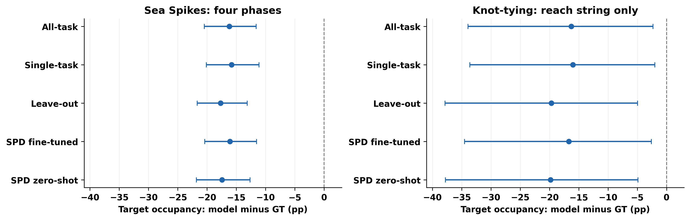
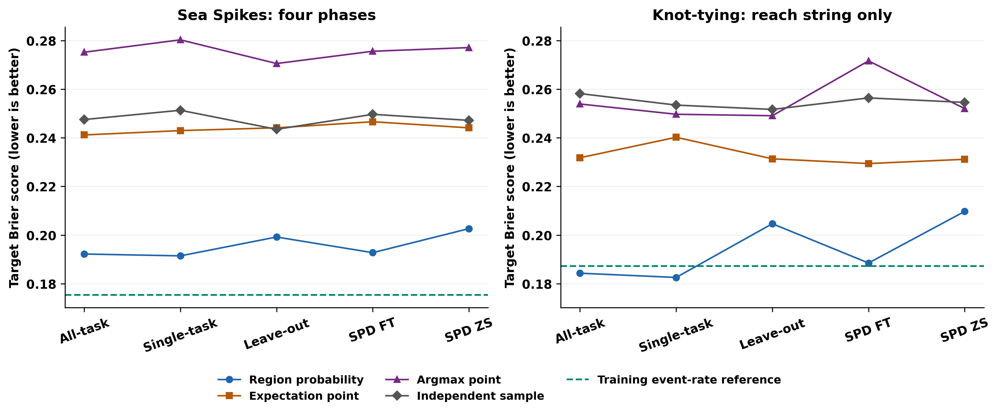

# 模型与 GT：面向论文的精简结论

**总论：在当前留出录像中，五模型仍低估真实目标区域占用。区域概率的 Brier 点估计优于三种点解码，但这不是时序架构消融。论文范围内未观察到跨任务训练优于单任务训练的明确证据；模型排序对阶段范围有依赖。SPD 微调相对零样本的目标事件损失更低。**

**版本与范围。** 本文更新至 v3（`20261105T063658759189Z_v3_full`），沿用原论文摘要范围：Task A（Sea Spikes）为 reach/grab/transfer/place ring 四阶段整体；Task C（Knot-tying）仅为 reach string。wrap、cinch、threading 的结果列在详细版补充范围，不能与本文 C 的数值混用。这是既定的范围选择，不是按本次结果择优选阶段。详细版同时提供与本文一致的 reach-string 证据。

**v3 gaze 规则。** 直接读取结构化 `UserN/npy/<ID>_gaze.npy` 的 `gaze_x`、`gaze_y`，按原视频 `Frame_Number` 匹配。仅要求两坐标有限且位于闭区间 `[0,1]`；不限制 `valid` 的取值。阶段、目标及双侧 DLC 几何条件继续生效，模型比较另取五模型共同有效帧。主分析及半径敏感性使用原始 gaze；平滑分支为独立敏感性。

样本为 10 段测试录像、五模型 50 份预测，每任务 5 人、跨任务共 7 人。GT 与模型使用相同共同有效帧；GT84 全量均值不作为模型误差参照。

**统计口径。** target 是有效目标槽位均值周围 50 px 圆盘，PSM 是左右 DLC 腕部/铰接点 50 px 邻域并集；两者均非完整物体 mask 或经验证的夹爪尖端。T/P/O 分别为目标独占、腕部独占、重叠：L_target=L_T+L_O，L_gripper=L_P+L_O，C=L_T/(L_T+L_P)，分母为 0 时不可估。先按原生时长计算每录像指标，再在参与者内、参与者间等权；方括号为 10,000 次参与者 bootstrap 的 95% CI（seed=42），pp 为百分点。CI 未校正多重比较；跨 0 不等于证实无效，极靠近 0 的端点不宜作稳定的二分结论。

模型概率 q 来自每帧 64 个保存样本的区域命中比例。Brier=时间加权平均(q−y)²，y 为真实 gaze 的区域事件，越小越好；它评价指定区域事件，不能单独证明整张注视分布或多峰结构正确。

## 结论一：模型存在一致的目标概率不足

配对 GT 的目标占用为 A 22.61%、C reach string 24.83%；五模型分别为 4.93%–6.81% 和 5.02%–8.84%。全部 10 个“模型×论文范围”的目标占用差 CI 均低于 0。例如 single_task 的模型−GT 差为 A -15.80 [-20.11, -11.12] pp、C -15.99 [-33.62, -2.00] pp。

| 来源 | A目标占用 % | C reach目标占用 % | A目标Brier | C reach目标Brier |
|---|---|---|---|---|
| 配对GT | 22.61 | 24.83 | — | — |
| all_ABCD | 6.43 | 8.54 | 0.1922 | 0.1843 |
| single_task | 6.81 | 8.84 | 0.1914 | 0.1826 |
| leave_out | 4.93 | 5.15 | 0.1992 | 0.2047 |
| SPD fine-tune | 6.51 | 8.15 | 0.1928 | 0.1885 |
| SPD zero-shot | 5.18 | 5.02 | 0.2026 | 0.2097 |

[矢量 PDF](paper_summary_figures/M1_target_underestimation.pdf)

**图1图注。** 模型区域概率占用减去同帧 GT 占用，点为参与者均值，横线为 95% CI；A 四阶段整体、C reach string 各 n=5。所有区间均在 0 左侧。留出录像不等于留出参与者，不能称已验证的真实或专家注视替代。

A 五模型对训练事件频率参照的目标 BSS 均为负且 CI 全低于 0；C reach string 的五个区间均跨 0。BSS=1−模型平均 Brier/参照平均 Brier，正值表示优于该参照。优于固定中心或均匀面积不等于已经超过训练事件频率；各基线回答的问题不同。

## 结论二：概率输出适合评价区域事件，时序必要性仍未检验

A/C、五模型、target/腕部两事件共 20 个条件；相较期望点、argmax 和独立随机点，区域概率分别有 20/20、20/20、20/20 个 Brier 点估计更低。

| single_task 目标 Brier | 区域概率 | 期望点 | argmax | 独立随机点 |
|---|---|---|---|---|
| A | 0.1914 | 0.2430 | 0.2803 | 0.2513 |
| C reach string | 0.1826 | 0.2402 | 0.2497 | 0.2535 |

[矢量 PDF](paper_summary_figures/M2_probability_and_decoding.pdf)

**图2图注。** 同一支持上的目标 Brier；蓝线为区域概率，其他线为点解码，绿色虚线为训练事件频率参照。模型为离散类别，连线只帮助阅读。两面板均显示纵轴数字；未画分支差 CI，因此不宣称全部差异显著。

这是保存输出表示的对照，不是 Transformer/其他架构、视频/单帧、有/无 memory 的消融。Brier 评价概率预测，但本次观察到的改进不能表述为任何硬解码必然更差，也不能证明模型已经学会正确的多模态或时序结构。

## 结论三：训练策略差异依赖评价范围，应报告效应与区间

下表为目标 Brier 配对差；负值有利于左模型。先匹配录像再做参与者 bootstrap，不能用两组独立 CI 是否重叠替代配对比较。

| 左−右 | A 四阶段整体 | C reach string |
|---|---|---|
| single_task − all_ABCD | -0.0008 [-0.0015, 0.0002] | -0.0017 [-0.0070, 0.0037] |
| single_task − leave_out | -0.0078 [-0.0117, -0.0038] | -0.0221 [-0.0451, -0.0002] |
| SPD fine-tune − zero-shot | -0.0099 [-0.0151, -0.0050] | -0.0212 [-0.0360, -0.0071] |

论文范围中 single_task−all_ABCD 的 CI 在 A 与 C reach string 均跨 0，既未显示跨任务更优，也不能宣布两者等效。**范围改变会改变这一子结论：** C whole 的差为 -0.0046 [-0.0106, -0.0008]，wrap 为 -0.0062 [-0.0128, -0.0020]，两者区间均低于 0；不能把 reach-string 结论推广到全部 C 阶段。

single_task 相较 leave_out 的目标 Brier 点估计较低；C reach string 区间上端为 -0.000162，非常接近 0。它是小样本未校正的探索性差异，不宜只用“是否跨 0”宣称稳健训练优势。SPD 微调的目标事件损失低于零样本，两个范围的区间均为负；其腕部差分别为 A -0.004228 [-0.011571, 0.001504]、C -0.006862 [-0.014659, 0.000157]，应按事件分别解释。

当前没有等训练量学习曲线、完整多 seed 对照和充分 checkpoint 溯源，不能将全部差异归因于数据效率或微调操作本身，也不能由 SPD 名称直接推出被动观看数据的作用。

## 对 Research Questions 的回答

| 问题 | 当前证据 |
|---|---|
| RQ1：适合动态、多模态注视的模型形式？ | 支持保留概率用于区域事件评价；时序必要性未检验，需要单帧/视频、无/有 memory 等受控消融。 |
| RQ2：需要专家数据，还是大量新手/被动数据即可？ | 尚不能判断。当前缺少专家、better-novice、普通新手、passive 的受控比较；模型仍存在目标概率不足。 |
| RQ3：跨任务更好、更省数据吗？ | 论文范围内未发现跨任务优于单任务的明确证据；阶段范围影响子结论，数据效率尚未直接检验。 |

### 可用于论文的英文结果与结论段落

All five models underestimated target-region occupancy in Sea Spikes and in the reach-string phase of Knot-tying, with paired 95% confidence intervals below zero. Region-probability predictions achieved lower Brier point estimates than expectation, argmax, and independently sampled point decodings on the same evaluation support. This supports retaining predictive uncertainty for region-event evaluation, but does not establish the necessity of temporal context. Single-task versus all-task target-Brier contrasts included zero in the paper scopes, whereas the whole-task and wrap-phase Knot-tying contrasts favored single-task training. Single-task point estimates were lower than leave-out estimates, but the reach-string interval endpoint was close to zero. SPD fine-tuning reduced target-event Brier relative to zero-shot transfer. These results indicate incomplete recovery of target-directed gaze and scope-dependent training comparisons; they do not establish expert-like gaze, equivalence, or data efficiency.

**证据与限制。** 每任务 n=5，留出录像不等于留出参与者，CI 未校正多重比较。[占用](20261105T063658759189Z_v3_full/main_probability/group_stage_summary.csv) · [事件误差与 BSS](20261105T063658759189Z_v3_full/main_probability/model_error_summary.csv) · [模型配对差](20261105T063658759189Z_v3_full/main_probability/model_paired_contrasts.csv)。图2使用三个解码分支同名误差表。[模型详细版](models10_vs_gt_analysis_zh.md)覆盖 whole 与逐阶段结果及论文范围证据；[GT84 摘要](gt84_paper_summary_zh.md)讨论目标锁定作为质量指标的边界。
